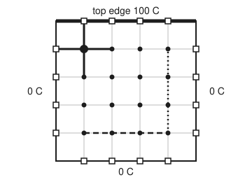
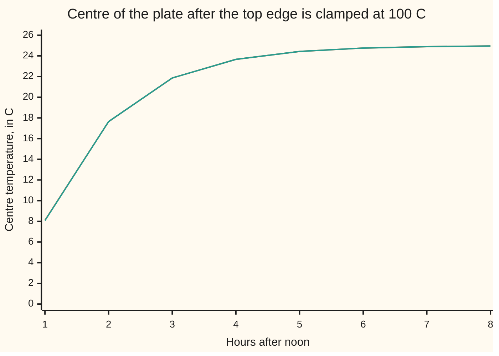

# Two space dimensions: the five-point Laplacian, and ADI to keep solves tridiagonal

[Syllabus](../../../SYLLABUS.md) → [Numerical analysis](../README.md) → [PDE Solvers](../README.md#s07) → Two space dimensions

---

## General Overview

A steel plate, 1 m square, sits at 0 C. At noon its top edge is clamped to a bar at 100 C. The other three edges stay in iced water at 0 C. How warm is the centre at 1 pm, to a few hundredths of a degree? The exact answer is 8.1027 C. After many hours the centre settles at 25 C.

A computer finds this on a grid. With a spacing of 2.5 cm, the plate holds 1,521 inside points, each an unknown temperature. On a rod, each point has two neighbours, so an implicit step (one that solves for all new values at once) is a single chain of equations. On a plate, each point has four neighbours, and the equations no longer form a chain.

Explicit steps (new values read straight off the old) are cheap, but here they blow up unless each step is at most 13.0208 s. Implicit steps can be long, but each solves a 1,521-unknown system coupled in both directions.

**ADI** (alternating direction implicit) splits each step in two. The first half is implicit along rows only, so each row is a chain. The second half does the same along columns. A chain costs about eight flops (floating-point operations) per unknown ([The Thomas algorithm](../03-Numerical%20Linear%20Algebra/03-tridiagonal-systems-and-the-thomas-algorithm.md)).

**The five-point rule ties each grid temperature to its four neighbours, with known edge values on the right side; ADI steps the heat by solving each row, then each column, as a chain, stable at any step length and second-order accurate.**

**What kind of fact this is:** a method. On the rectangle with fixed edge values and constant diffusivity, its second order and its stability at every step length are theorems, proved on this card in Why it works.

### The picture: one stencil, one row, one column

<p align="center"></p>

To scale, 200 units to the metre, on a 5-cell grid so the points show; both checks print the coordinates on their "figure," line. Dots are unknowns; squares are edge points with known values. The thick cross is the stencil at the top-left unknown: two arms land on edges, so those values move to the right side. Dashed: one row chain of the first sweep. Dotted: one column chain of the second.

---

## The formula

Write $U_{i,j}^n$ for the grid temperature at $x = ih$, $y = jh$ after $n$ time steps. The **second difference** along a row is $\delta_x^2 U_{i,j} = U_{i+1,j} - 2U_{i,j} + U_{i-1,j}$; along a column, $\delta_y^2$ does the same with $j$. The **five-point rule** for the settled plate, and the **Peaceman–Rachford ADI step** for the warming plate, are

$$\delta_x^2 U_{i,j} + \delta_y^2 U_{i,j} = 0 \quad\Longleftrightarrow\quad 4U_{i,j} - U_{i+1,j} - U_{i-1,j} - U_{i,j+1} - U_{i,j-1} = 0,$$

$$\Big(1 - \tfrac{r}{2}\delta_x^2\Big)U^{*} = \Big(1 + \tfrac{r}{2}\delta_y^2\Big)U^{n}, \qquad \Big(1 - \tfrac{r}{2}\delta_y^2\Big)U^{n+1} = \Big(1 + \tfrac{r}{2}\delta_x^2\Big)U^{*}, \qquad r = \frac{\alpha\,\Delta t}{h^2}.$$

**Read it aloud:** settled, each inside point is the average of its four neighbours; warming, each step first solves along every row with the columns read from the old values, then solves along every column with the rows read from the half-step values.

Numbered row by row, the inside points form one list $\mathbf{U}$ of $m = (N-1)^2$ unknowns, and the five-point rule becomes $A\mathbf{U} = \mathbf{b}$.

| Symbol | Plain meaning | In our example | Push it up and the answer… |
| --- | --- | --- | --- |
| $u(x, y, t)$ | true temperature, C, at $x$ m across, $y$ m up, $t$ s after noon | centre 8.1027 C at 1 h | — |
| $\alpha$ | diffusivity: how fast heat spreads, m²/s (wing 08 wrote it κ; here κ is the condition number) | 1.2 × 10⁻⁵, illustrative, near a carbon steel | the plate warms faster |
| $N$, $h$ | cells per side; spacing $h = 1/N$ m | 40; 0.025 m | more unknowns; error falls as $h^2$ |
| $i$, $j$, $k$ | column and row number of a point; its place $k = (j-1)(N-1) + i - 1$ in the list | $i$, $j$ from 0 to 40 | — |
| $U_{i,j}^n$, $U^*$ | grid temperature at time level $n$; the half-step value after the row sweep | 3-cell grid: $U^* = 16.2760$ | — |
| $\Delta t$ | time step, s | 600 s in the chart | fewer steps; time error grows as $\Delta t^2$ |
| $r$ | mesh ratio $\alpha\Delta t/h^2$: the time step measured against the grid | 11.52 at 600 s | explicit steps fail above 1/4; ADI stays stable |
| $\delta_x^2$, $\delta_y^2$ | second difference along a row, along a column (not yet divided by $h^2$) | — | — |
| $A$, $\mathbf{U}$, $\mathbf{b}$ | five-point matrix; list of unknowns; right side holding the edge values | 1,521 × 1,521; 4 on the diagonal | — |
| $m$, $w$ | number of unknowns; band half-width, the distance from the diagonal to the farthest nonzero | 1,521; 39 | banded cost grows as $m w^2$ |
| $P$ | probe point (0.5, 0.8) m, 20 cm below the hot edge | settled 62.0792 C | — |
| $g$; $p$, $q$; $a$, $c$ | amplification factor: what one step multiplies a grid wave by; the wave's hump counts across and up; its two weights in Step 4 | $\lvert g\rvert \le 1$ for ADI | — |

### When it holds

- **A rectangle, grid lines along its edges.** On a curved edge the boundary falls between grid points. The stencil then needs unequal arms, and the rows have different lengths.
- **Constant diffusivity.** Then the row and column differences commute (their order does not matter), and ADI is the approximately factored Crank–Nicolson step of Step 3. With varying α they do not commute, and the stability proof below no longer applies as stated.
- **Edge values fixed in time.** Then the half-step value on an edge is just the edge temperature. If an edge changes in time, Step 5 gives the right half-step value; it is not the edge temperature at the half time.
- **Two space dimensions.** The plain three-sweep copy of these formulas in three dimensions is only conditionally stable. Douglas and Rachford's variant restores stability at every step length.

---

## Why it works

### Step 0: implicit in one direction at a time

An implicit step on a plate couples each point to four neighbours at once. Make only one direction implicit, and treat the other with known values. Then the unknowns in a row are tied only to each other, and each row is a chain: a tridiagonal system. Alternate the direction every half step, so both directions get their implicit turn.

### Step 1: assemble the five-point system

[Laplace's equation](../../08-Differential%20equations%20and%20dynamics/10-The%20Classical%20PDEs/07-laplaces-equation-and-harmonic-functions.md) already derives the five-point rule from Taylor's theorem: the four neighbours sum to four times the centre plus $h^2(u_{xx} + u_{yy})$, up to terms in $h^4$. Here $u_{xx}$ is the bend across, a second derivative in $x$ with $y$ held still ([Partial derivatives](../../06-Calculus%20and%20analysis/07-Several%20Variables/01-partial-derivatives.md)). This card builds the system.

1. Number the inside points row by row: $k = (j-1)(N-1) + i - 1$.
2. Row $k$ of $A$ gets 4 on the diagonal.
3. For each of the four neighbours: if it is inside, put −1 in its column. Its east and west neighbours sit 1 place away in the list; its north and south neighbours sit $N - 1$ places away.
4. If the neighbour is on an edge, its value is known. Add it to $b_k$ instead.

So $A$ has at most five nonzeros in a row, all within $w = N - 1$ places of the diagonal. On the 40-cell grid, $\mathbf{b}$ holds 100 in the 39 entries of the top inside row and 0 elsewhere. Leave the edge values out and the system has the answer 0 everywhere.

### Step 2: why a direct solve is costly

Gaussian elimination inside the band fills in the zeros between the diagonals. The checks count every flop (one floating-point add, subtract, multiply or divide; see [Counting the work](../01-Floating%20Point%20and%20Error/08-operation-counts-and-cost.md)). At $N = 40$, factoring costs 4,604,821 flops, close to the estimate $2mw^2$ = 4,626,882. Each later solve with the factors costs 235,677, close to $4mw$ = 237,276.

An implicit time step has a matrix of the same shape, so it pays at least a solve every step.

ADI pays for $2(N-1)$ chains per step. Each chain costs $5(N-1) + 4$ flops for its right side and $8(N-1) - 6$ for the sweep, in this code's arrangement. That is $2(N-1)(13(N-1) - 2)$ flops: 39,390 at $N = 40$, 6.0 times fewer than the estimate for one banded solve. At $N = 1000$ the estimates are 25,944,030 against 3,988,011,996, a ratio of 153.7, before the 1,992,011,992,002 flops of factoring.

### Step 3: ADI is Crank–Nicolson plus a small term

Apply $(1 - \tfrac r2\delta_x^2)$ to the second half step and use the first:

$$\Big(1 - \tfrac r2\delta_x^2\Big)\Big(1 - \tfrac r2\delta_y^2\Big)U^{n+1} = \Big(1 + \tfrac r2\delta_x^2\Big)\Big(1 + \tfrac r2\delta_y^2\Big)U^{n}.$$

Multiply out both sides. What remains is the Crank–Nicolson step of [Crank-Nicolson and the theta family](04-crank-nicolson-and-theta-methods.md) plus one extra term, $\tfrac{r^2}{4}\delta_x^2\delta_y^2(U^{n+1} - U^n)$. Divided by $\Delta t$ to compare with the equation, that term is about $\tfrac{\alpha^2\Delta t^2}{4}\,u_{xxyyt}$, where $u_{xxyyt}$ means: take the bend across, $u_{xx}$, then the bend of that up the plate, then the rate at which the result changes in time. It is of order $\Delta t^2$, the same order as Crank–Nicolson's own error. So ADI is second order in time. The checks see it: as $\Delta t$ halves from 600 s to 300 s to 150 s, the time error falls by 3.85 and 4.13. The halving from 20 minutes to 10 gives 7.71: steps that long are outside the range where the $\Delta t^2$ term dominates.

<details>
<summary>Detailed proof: the factored form, and its local error</summary>

On a rectangle with fixed edges and equal spacing, $\delta_x^2$ acts along rows and $\delta_y^2$ along columns, so $\delta_x^2\delta_y^2 = \delta_y^2\delta_x^2$. The two factors in $x$ also commute with each other, since both are polynomials in $\delta_x^2$.

From the second half step, $(1 - \tfrac r2\delta_y^2)U^{n+1} = (1 + \tfrac r2\delta_x^2)U^*$. Apply $(1 - \tfrac r2\delta_x^2)$ to both sides. On the right, swap the two $x$ factors and use the first half step, $(1 - \tfrac r2\delta_x^2)U^* = (1 + \tfrac r2\delta_y^2)U^n$. This gives the factored form above.

Expand: $(1 + \tfrac{r^2}{4}\delta_x^2\delta_y^2)(U^{n+1} - U^n) = \tfrac r2(\delta_x^2 + \delta_y^2)(U^{n+1} + U^n)$. Without the $r^2$ term this is Crank–Nicolson. Put in the true solution. Crank–Nicolson's residual is $O(\Delta t^3 + \Delta t\,h^2)$ per step. The extra term is $\tfrac{r^2}{4}\delta_x^2\delta_y^2(u^{n+1} - u^n) = \tfrac{\alpha^2\Delta t^2}{4}\,h^{-4}\delta_x^2\delta_y^2\,(\Delta t\,u_t + O(\Delta t^2))$, and $h^{-4}\delta_x^2\delta_y^2 u_t \to u_{xxyyt}$. So it is $O(\Delta t^3)$ per step, for a smooth solution. Summed over the steps to a fixed time, with stability (Step 4), the global error is $O(\Delta t^2 + h^2)$.

</details>

### Step 4: stable at every step length

Test one grid wave, $\sin(p\pi x)\sin(q\pi y)$, as [Von Neumann analysis](03-von-neumann-analysis-and-the-cfl-condition.md) does. The row difference multiplies it by $-4\sin^2(p\pi h/2)$. Write $a = 2r\sin^2(p\pi h/2)$ and $c = 2r\sin^2(q\pi h/2)$, both at least 0. One ADI step multiplies the wave by

$$g = \frac{1 - a}{1 + a}\cdot\frac{1 - c}{1 + c}.$$

A fraction $(1 - a)/(1 + a)$ lies between −1 and 1 whenever $a \ge 0$, and the same holds for $c$. So $|g| \le 1$ for every wave and every $r$: no wave can grow.

An explicit step multiplies the same wave by $1 - 2a - 2c$, which can fall to $1 - 8r$. That stays above −1 only when $r \le 1/4$: half the one-dimensional limit. On the 40-cell grid that means $\Delta t \le$ 13.0208 s.

### Step 5: where the edge values go

In the row sweep, the first and last points of each row have an edge as a neighbour. Its value goes to the right side, times $r/2$. The explicit column part also reads edge values above and below. The column sweep does the same with the top and bottom edges.

The half-step value $U^*$ on an edge needs care. Subtracting the second half step from the first gives $2U^* = (1 + \tfrac r2\delta_y^2)U^n + (1 - \tfrac r2\delta_y^2)U^{n+1}$. For an edge held still, this is just the edge temperature. For an edge that changes in time, use this formula, not the edge temperature at the half time.

---

## Worked numbers, by hand

The coarsest grid with rows: 3 cells a side, $h = 1/3$ m, four inside points. Settled first. By left–right symmetry the two top points share one value, and the two bottom points another. At a top point, four times its value equals 100 (the edge above) + 0 (the side edge) + the other top point + the bottom point below. So 3 × top − bottom = 100, and likewise 3 × bottom − top = 0. Hence top = 37.5000 C and bottom = 12.5000 C.

Now one ADI step of an hour from the cold start.

| Step | Arithmetic | Value |
| --- | --- | --- |
| mesh ratio $r$ | $1.2\times10^{-5} \times 3600 \times 9$ | 0.3888 |
| half of it | $0.3888 / 2$ | 0.1944 |
| row sweep, top row: right side | $0 + 0.1944 \times (100 - 0 + 0)$; the left and right edges add 0 | 19.4400 |
| row sweep: diagonal $1 + r$ | $1 + 0.3888$ | 1.3888 |
| row sweep: solve the chain | both points equal by symmetry: $19.4400 / (1.3888 - 0.1944)$ | $U^*$ = 16.2760 |
| row sweep, bottom row | right side 0 | 0 |
| column sweep, top point: right side | $16.2760 + 0.1944 \times (0 - 2 \times 16.2760 + 16.2760) + 0.1944 \times 100$ | 32.5519 |
| column sweep: eliminate the bottom point | pivot $1.3888 - 0.1944^2 / 1.3888$ | 1.3616 |
| top point | $32.5519 / 1.3616$ | **23.9073 C** |
| bottom point | $0.1944 \times 23.9073 / 1.3888$ | 3.3465 C |

The true plate reads 22.2413 C at (1/3, 2/3) after an hour. Four unknowns and one long step land at 23.9073 C, off by 1.6660 C. The coarse grid and the hour-long step both add to that error; the finer runs below separate them.

The settled plate on finer grids, at $P$ = (0.5, 0.8), against the series of [Laplace on a rectangle](../../08-Differential%20equations%20and%20dynamics/10-The%20Classical%20PDEs/08-laplace-on-a-rectangle.md), 62.0792 C:

| Cells $N$ | Unknowns | Grid at $P$, C | True error | Ratio |
| --- | --- | --- | --- | --- |
| 10 | 81 | 61.7397 | 0.33950 | — |
| 20 | 361 | 61.9910 | 0.08821 | 3.85 |
| 40 | 1,521 | 62.0570 | 0.02224 | 3.97 |

The error falls fourfold as $h$ halves: second order in space. The centre reads 25.0000 C on every grid, the symmetry value.

### What breaks if you drop a piece

| Mistake | Comes out at | What went wrong |
| --- | --- | --- |
| Edge values left out of $\mathbf{b}$ | 0.0000 C at $P$ on the 20-cell grid, against 61.9910 with the edges in | the 100 C edge never enters the equations |
| Full $r$, not $r/2$, in each half step, 60 s steps | 17.6433 C at 1 h; the true 2 h value is 17.6418 | each half step moved a whole step, so time ran twice as fast |
| Explicit steps of 15 s ($r$ = 0.288) | largest value 3.271e+23 C after an hour | the one-dimensional limit 1/2 used in two dimensions, where it is 1/4 |
| One ADI step for the whole hour ($r$ = 69.12) | 6.2344 C; true 8.1027 | stable is not accurate: the time error is 1.8832 |

---

## How the plate warms, hour by hour

The puzzle: the centre must climb from 0 to 25 C. How fast, and does ADI with long steps follow it? The exact answer is the settled series minus a double sine series. Each wave in it fades at its own rate, the finest fastest.



Orange: the exact series. Green: ADI on the 40-cell grid with 10-minute steps ($r$ = 11.52). The two lines lie on top of each other; the largest gap is 0.0255 C, at the first hour. At 24 hours the ADI grid matches the direct five-point solve to within 5.25e-08 C at every point.

---

## Code, from first principles, and it actually runs

The code takes **three independent roads**: the exact series, settled and warming; the five-point system assembled with its edge values and solved by banded elimination, flops counted; and ADI with its own Thomas solver. They meet three ways: the settled grid against the series, order 2 in $h$; ADI at one hour against the series, order 2 in $\Delta t$; ADI at 24 hours against the direct solve. Explicit steps run on each side of their limit.

### Python

```python
# ADI and multidimensional grids -- the check behind the card.  Standard library only.
# A 1 m square steel plate (diffusivity 1.2e-5 m^2/s, illustrative) starts at 0 C; its top edge
# is held at 100 C, the other three edges at 0 C.  Road one: the exact series, settled and in time.
# Road two: the five-point system assembled and solved by banded elimination, flops counted.
# Road three: Peaceman-Rachford ADI, a row sweep then a column sweep, each a tridiagonal solve.
import math
PI, ALPHA, HOUR = math.pi, 1.2e-5, 3600.0

def ratio(n, y):                    # sinh(n pi y)/sinh(n pi), written so it never overflows
    return math.exp(n * PI * (y - 1)) * (1 - math.exp(-2 * n * PI * y)) / (1 - math.exp(-2 * n * PI))
def settled(x, y):                  # the separated series for the settled plate
    return sum(400 / (n * PI) * math.sin(n * PI * x) * ratio(n, y) for n in range(1, 400, 2))
def exact(x, y, t, K=41):           # settled minus every double-sine mode, each fading at its own rate
    gap = sum(800 * n * (-1) ** (n + 1) / (PI * PI * m * (m * m + n * n)) * math.sin(m * PI * x)
              * math.sin(n * PI * y) * math.exp(-ALPHA * PI * PI * (m * m + n * n) * t)
              for m in range(1, K, 2) for n in range(1, K))
    return settled(x, y) - gap
def cold_grid(N, top=100.0):        # U[j][i] at x = i/N, y = j/N; edges hold their values
    U = [[0.0] * (N + 1) for _ in range(N + 1)]
    for i in range(1, N): U[N][i] = top
    return U
def thomas(lo, di, up, d):          # constant-diagonal tridiagonal solve, one sweep down, one back
    n, p, q = len(d), [up / di], [d[0] / di]
    for k in range(1, n):
        den = di - lo * p[k - 1]
        p.append(up / den); q.append((d[k] - lo * q[k - 1]) / den)
    x = q[:]
    for k in range(n - 2, -1, -1): x[k] = q[k] - p[k] * x[k + 1]
    return x
def adi_step(U, N, r, half=True):   # rows implicit in x, then columns implicit in y
    s = r / 2 if half else r
    V = [row[:] for row in U]
    for j in range(1, N):
        d = [U[j][i] + s * (U[j + 1][i] - 2 * U[j][i] + U[j - 1][i]) for i in range(1, N)]
        d[0] += s * U[j][0]; d[-1] += s * U[j][N]        # the row's two edge values go right
        V[j][1:N] = thomas(-s, 1 + 2 * s, -s, d)
    W = [row[:] for row in V]
    for i in range(1, N):
        d = [V[j][i] + s * (V[j][i + 1] - 2 * V[j][i] + V[j][i - 1]) for j in range(1, N)]
        d[0] += s * V[0][i]; d[-1] += s * V[N][i]        # the column's two edge values go right
        for j, v in enumerate(thomas(-s, 1 + 2 * s, -s, d)): W[j + 1][i] = v
    return W
def explicit_step(U, N, r):
    W = [row[:] for row in U]
    for j in range(1, N):
        for i in range(1, N):
            W[j][i] = U[j][i] + r * (U[j][i + 1] + U[j][i - 1] + U[j + 1][i] + U[j - 1][i] - 4 * U[j][i])
    return W
def run(step, N, dt, t, **kw):
    U, h = cold_grid(N), 1.0 / N
    r = ALPHA * dt / (h * h)
    for _ in range(round(t / dt)): U = step(U, N, r, **kw)
    return U
def five_point(N, edges=True):      # A U = b on the (N-1)^2 inside points, numbered row by row
    m, b = (N - 1) ** 2, N - 1
    A, rhs, E = [[0.0] * (2 * b + 1) for _ in range(m)], [0.0] * m, cold_grid(N, 100.0 if edges else 0.0)
    for j in range(1, N):
        for i in range(1, N):
            k = (j - 1) * b + (i - 1); A[k][b] = 4.0
            for ii, jj in ((i - 1, j), (i + 1, j), (i, j - 1), (i, j + 1)):
                if 0 < ii < N and 0 < jj < N: A[k][b + (jj - 1) * b + (ii - 1) - k] = -1.0
                else: rhs[k] += E[jj][ii]                # an edge value is known: it moves right
    return A, rhs, b
def band_solve(A, rhs, b):          # Gaussian elimination inside the band; count every flop
    m, fac, sol = len(rhs), 0, 0
    for k in range(m):
        for i in range(k + 1, min(k + b + 1, m)):
            l = A[i][b + k - i] / A[k][b]; fac += 1
            for j in range(k + 1, min(k + b + 1, m)): A[i][b + j - i] -= l * A[k][b + j - k]
            fac += 2 * (min(k + b + 1, m) - k - 1)
            rhs[i] -= l * rhs[k]; sol += 2
    x = [0.0] * m
    for i in range(m - 1, -1, -1):
        s = rhs[i]
        for j in range(i + 1, min(i + b + 1, m)): s -= A[i][b + j - i] * x[j]; sol += 2
        x[i] = s / A[i][b]; sol += 1
    return x, fac, sol
def solve_grid(N, edges=True):
    A, rhs, b = five_point(N, edges)
    x, fac, sol = band_solve(A, rhs, b)
    return (lambda i, j: x[(j - 1) * b + (i - 1)]), fac, sol

f4 = lambda v: " ".join(f"{x:.4f}" for x in v)
# by hand: the 3-cell grid, 4 inside points; settled values, then one ADI step of an hour
g3 = solve_grid(3)[0]
r3 = ALPHA * HOUR * 9; s3 = r3 / 2
top_star = 100 * s3 / (1 + s3); col_rhs = top_star * (1 - s3) + 100 * s3
U3 = adi_step(cold_grid(3), 3, r3)
print(f"3-cell grid settled: top points {g3(1, 2):.4f}, bottom points {g3(1, 1):.4f} C")
print(f"3-cell ADI step of 1 h: r = {r3:.4f}, r/2 = {s3:.4f}; row sweep: right side {100 * s3:.4f}, diagonal {1 + r3:.4f}, U* = {top_star:.4f} at both top points")
print(f"  column sweep: right side top {col_rhs:.4f}, pivot {1 + r3 - s3 * s3 / (1 + r3):.4f}; top {U3[2][1]:.4f}, bottom {U3[1][1]:.4f}; exact (1/3, 2/3) at 1 h {exact(1/3, 2/3, HOUR):.4f} C, off by {U3[2][1] - exact(1/3, 2/3, HOUR):.4f}")
# settled plate: assembled five-point system against the series, at P = (0.5, 0.8)
P, errs = settled(0.5, 0.8), []
for N in (10, 20, 40):
    g, fac, sol = solve_grid(N)
    errs.append(abs(g(N // 2, 4 * N // 5) - P))
    print(f"five-point N = {N}: {(N - 1) ** 2} unknowns, band {N - 1}; P = {g(N // 2, 4 * N // 5):.4f} C, "
          f"centre {g(N // 2, N // 2):.4f} C; flops factor {fac} solve {sol}")
print(f"series P = {P:.4f} C; errors {' '.join(f'{e:.5f}' for e in errs)}; ratios {errs[0] / errs[1]:.2f} {errs[1] / errs[2]:.2f}")
for n in (39, 999):                 # n = N - 1 points a line; m = n^2 unknowns; band w = n
    print(f"flops per step, N = {n + 1}: ADI 2n(13n - 2) = {2 * n * (13 * n - 2)}; banded estimates: solve 4mw = {4 * n ** 3}, factor once 2mw^2 = {2 * n ** 4}; solve/ADI {4 * n ** 3 / (2 * n * (13 * n - 2)):.1f}")
zero = solve_grid(20, edges=False)[0](10, 16)
# the plate warming: ADI at N = 40 against the exact series at the centre after one hour
ex1, ref = exact(0.5, 0.5, HOUR), run(adi_step, 40, 30.0, HOUR)[20][20]
adi1 = {dt: run(adi_step, 40, dt, HOUR)[20][20] for dt in (3600, 1200, 600, 300, 150)}
print(f"centre at 1 h: exact {ex1:.4f} C; ADI N = 40, dt = 30 s {ref:.4f} C, so the space error is {ref - ex1:.4f}")
for dt, v in adi1.items():
    print(f"  ADI dt = {dt:4d} s, r = {ALPHA * dt * 1600:6.2f}: {v:.4f} C; time error {v - ref:8.4f}, error against exact {v - ex1:8.4f}")
te = [adi1[dt] - ref for dt in (1200, 600, 300, 150)]
print(f"time-error ratios as dt halves: {te[0] / te[1]:.2f} {te[1] / te[2]:.2f} {te[2] / te[3]:.2f}")
exp12 = run(explicit_step, 40, 12.0, HOUR)[20][20]
exp15 = run(explicit_step, 40, 15.0, HOUR)
blow = max(abs(v) for row in exp15 for v in row)
full = run(adi_step, 40, 60.0, HOUR, half=False)[20][20]
print(f"explicit limit r <= 1/4: dt <= {0.25 * 0.025 * 0.025 / ALPHA:.4f} s; dt = 12 s (r = 0.2304): {exp12:.4f} C after 300 steps; dt = 15 s (r = 0.288): largest |U| {blow:.3e}")
print(f"mistake, full r in each sweep: {full:.4f} C at 1 h; exact at 2 h {exact(0.5, 0.5, 2 * HOUR):.4f} C")
print(f"mistake, edge values left out of b: P reads {zero:.4f} C")
# the chart: centre, hour by hour, ADI dt = 600 s against the exact series; then 24 h against direct
U, hours, adiv = cold_grid(40), [], []
for step in range(1, 145):
    U = adi_step(U, 40, ALPHA * 600 * 1600)
    if step % 6 == 0 and step <= 48: hours.append(exact(0.5, 0.5, step * 600)); adiv.append(U[20][20])
g40 = solve_grid(40)[0]
gap24 = max(abs(U[j][i] - g40(i, j)) for j in range(1, 40) for i in range(1, 40))
print("chart, hours        ", " ".join(f"{h:7d}" for h in range(1, 9)))
print("chart, exact centre ", " ".join(f"{v:7.4f}" for v in hours))
print("chart, ADI dt = 600 ", " ".join(f"{v:7.4f}" for v in adiv))
print(f"ADI at 24 h against the direct settled solve, N = 40: largest gap {gap24:.2e} C")
pt = lambda i, j: f"{80 + 40 * i},{230 - 40 * j}"   # the figure: N = 5, 200 units per metre
print(f"figure, plate {pt(0, 5)} to {pt(5, 0)}; stencil {pt(1, 4)} arms {pt(0, 4)} {pt(2, 4)} {pt(1, 5)} {pt(1, 3)}; row {pt(1, 1)} to {pt(4, 1)}; column {pt(4, 1)} to {pt(4, 4)}")
assert abs(g3(1, 2) - 37.5) < 1e-12 and abs(g3(1, 1) - 12.5) < 1e-12        # hand solve: 3a - b = 100, 3b - a = 0
assert all(3.5 < errs[k] / errs[k + 1] < 4.5 for k in range(2)) and errs[-1] < 0.03  # five-point error falls as h^2
assert abs(g40(20, 20) - 25) < 1e-9                                               # turning the plate: centre is 25
assert abs(ref - ex1) < 0.03 and all(3.5 < te[k] / te[k + 1] < 4.5 for k in (1, 2))  # ADI meets the series; order 2 in time
assert abs(exp12 - ex1) < 0.03 and blow > 1e6 and abs(zero) < 1e-12        # explicit: fine at r < 1/4, not above
assert gap24 < 1e-6 and max(abs(a - e) for a, e in zip(adiv, hours)) < 0.03      # ADI settles on the direct solve
print("ALL CHECKS PASS")
```

**Ran 2026-11-11 on macOS, Python 3.14.10, standard library only. All checks passed. Output, pasted from the run:**

```
3-cell grid settled: top points 37.5000, bottom points 12.5000 C
3-cell ADI step of 1 h: r = 0.3888, r/2 = 0.1944; row sweep: right side 19.4400, diagonal 1.3888, U* = 16.2760 at both top points
  column sweep: right side top 32.5519, pivot 1.3616; top 23.9073, bottom 3.3465; exact (1/3, 2/3) at 1 h 22.2413 C, off by 1.6660
five-point N = 10: 81 unknowns, band 9; P = 61.7397 C, centre 25.0000 C; flops factor 12756 solve 2817
five-point N = 20: 361 unknowns, band 19; P = 61.9910 C, centre 25.0000 C; flops factor 257811 solve 27037
five-point N = 40: 1521 unknowns, band 39; P = 62.0570 C, centre 25.0000 C; flops factor 4604821 solve 235677
series P = 62.0792 C; errors 0.33950 0.08821 0.02224; ratios 3.85 3.97
flops per step, N = 40: ADI 2n(13n - 2) = 39390; banded estimates: solve 4mw = 237276, factor once 2mw^2 = 4626882; solve/ADI 6.0
flops per step, N = 1000: ADI 2n(13n - 2) = 25944030; banded estimates: solve 4mw = 3988011996, factor once 2mw^2 = 1992011992002; solve/ADI 153.7
centre at 1 h: exact 8.1027 C; ADI N = 40, dt = 30 s 8.1175 C, so the space error is 0.0149
  ADI dt = 3600 s, r =  69.12: 6.2344 C; time error  -1.8832, error against exact  -1.8683
  ADI dt = 1200 s, r =  23.04: 7.8060 C; time error  -0.3116, error against exact  -0.2967
  ADI dt =  600 s, r =  11.52: 8.0772 C; time error  -0.0404, error against exact  -0.0255
  ADI dt =  300 s, r =   5.76: 8.1071 C; time error  -0.0105, error against exact   0.0044
  ADI dt =  150 s, r =   2.88: 8.1150 C; time error  -0.0025, error against exact   0.0124
time-error ratios as dt halves: 7.71 3.85 4.13
explicit limit r <= 1/4: dt <= 13.0208 s; dt = 12 s (r = 0.2304): 8.1273 C after 300 steps; dt = 15 s (r = 0.288): largest |U| 3.271e+23
mistake, full r in each sweep: 17.6433 C at 1 h; exact at 2 h 17.6418 C
mistake, edge values left out of b: P reads 0.0000 C
chart, hours               1       2       3       4       5       6       7       8
chart, exact centre   8.1027 17.6418 21.8614 23.6621 24.4297 24.7569 24.8964 24.9558
chart, ADI dt = 600   8.0772 17.6469 21.8639 23.6631 24.4301 24.7571 24.8964 24.9559
ADI at 24 h against the direct settled solve, N = 40: largest gap 5.25e-08 C
figure, plate 80,30 to 280,230; stencil 120,70 arms 80,70 160,70 120,30 120,110; row 120,190 to 240,190; column 240,190 to 240,70
ALL CHECKS PASS
```

The "time error" column is an estimate: it compares each step length with a 30-second run on the same grid. The "error against exact" column is the true error. The two differ by the space error, 0.0149. At 300 s the two errors have opposite signs and nearly cancel, giving 0.0044: luck, not accuracy.

### Rust

The same roads, with the same arithmetic in the same order, so the grid values agree to the bit. A small function prints e-notation the way Python does.

```rust
// ADI and multidimensional grids -- the same check as the Python, in Rust.  No crates.
// A 1 m square steel plate (diffusivity 1.2e-5 m^2/s, illustrative) starts at 0 C; its top edge
// is held at 100 C, the other three edges at 0 C.  Road one: the exact series, settled and in time.
// Road two: the five-point system assembled and solved by banded elimination, flops counted.
// Road three: Peaceman-Rachford ADI, a row sweep then a column sweep, each a tridiagonal solve.
use std::f64::consts::PI;
const ALPHA: f64 = 1.2e-5; const HOUR: f64 = 3600.0;
type Grid = Vec<Vec<f64>>;
fn ratio(n: f64, y: f64) -> f64 { // sinh(n pi y)/sinh(n pi), written so it never overflows
    (n * PI * (y - 1.0)).exp() * (1.0 - (-2.0 * n * PI * y).exp()) / (1.0 - (-2.0 * n * PI).exp())
}
fn settled(x: f64, y: f64) -> f64 { // the separated series for the settled plate
    (1..400).step_by(2).map(|n| { let n = n as f64; 400.0 / (n * PI) * (n * PI * x).sin() * ratio(n, y) }).fold(0.0, |a, t| a + t)
}
fn exact(x: f64, y: f64, t: f64) -> f64 { // settled minus every double-sine mode, each fading at its own rate
    let mut gap = 0.0;
    for m in (1..41i64).step_by(2) {
        for n in 1..41i64 {
            let sign = if n % 2 == 1 { 1 } else { -1 };
            let (mf, nf, q) = (m as f64, n as f64, (m * m + n * n) as f64);
            gap += (800 * n * sign) as f64 / (PI * PI * mf * q) * (mf * PI * x).sin() * (nf * PI * y).sin()
                * (-ALPHA * PI * PI * q * t).exp();
        }
    }
    settled(x, y) - gap
}
fn cold_grid(n: usize, top: f64) -> Grid { // u[j][i] at x = i/N, y = j/N; edges hold their values
    let mut u = vec![vec![0.0; n + 1]; n + 1]; for i in 1..n { u[n][i] = top; } u
}
fn thomas(lo: f64, di: f64, up: f64, d: &[f64]) -> Vec<f64> { // one sweep down, one back
    let n = d.len();
    let (mut p, mut q) = (vec![up / di], vec![d[0] / di]);
    for k in 1..n {
        let den = di - lo * p[k - 1];
        p.push(up / den); q.push((d[k] - lo * q[k - 1]) / den);
    }
    let mut x = q.clone(); for k in (0..n - 1).rev() { x[k] = q[k] - p[k] * x[k + 1]; } x
}
fn adi_step(u: &Grid, n: usize, r: f64, half: bool) -> Grid { // rows implicit in x, then columns in y
    let s = if half { r / 2.0 } else { r };
    let mut v = u.clone();
    for j in 1..n {
        let mut d: Vec<f64> = (1..n).map(|i| u[j][i] + s * (u[j + 1][i] - 2.0 * u[j][i] + u[j - 1][i])).collect();
        d[0] += s * u[j][0]; d[n - 2] += s * u[j][n]; // the row's two edge values go right
        for (i, x) in thomas(-s, 1.0 + 2.0 * s, -s, &d).into_iter().enumerate() { v[j][i + 1] = x; }
    }
    let mut w = v.clone();
    for i in 1..n {
        let mut d: Vec<f64> = (1..n).map(|j| v[j][i] + s * (v[j][i + 1] - 2.0 * v[j][i] + v[j][i - 1])).collect();
        d[0] += s * v[0][i]; d[n - 2] += s * v[n][i]; // the column's two edge values go right
        for (j, x) in thomas(-s, 1.0 + 2.0 * s, -s, &d).into_iter().enumerate() { w[j + 1][i] = x; }
    }
    w
}
fn explicit_step(u: &Grid, n: usize, r: f64, _half: bool) -> Grid {
    let mut w = u.clone();
    for j in 1..n { for i in 1..n {
        w[j][i] = u[j][i] + r * (u[j][i + 1] + u[j][i - 1] + u[j + 1][i] + u[j - 1][i] - 4.0 * u[j][i]);
    } }
    w
}
fn run(step: fn(&Grid, usize, f64, bool) -> Grid, n: usize, dt: f64, t: f64, half: bool) -> Grid {
    let (mut u, h) = (cold_grid(n, 100.0), 1.0 / n as f64);
    let r = ALPHA * dt / (h * h); for _ in 0..(t / dt).round() as usize { u = step(&u, n, r, half); }
    u
}
// the five-point system on the (N-1)^2 inside points, numbered row by row, solved inside its band
fn solve_grid(n: usize, edges: bool) -> (Vec<f64>, u64, u64) {
    let (m, b) = ((n - 1) * (n - 1), n - 1);
    let (mut a, mut rhs) = (vec![vec![0.0; 2 * b + 1]; m], vec![0.0; m]);
    let e = cold_grid(n, if edges { 100.0 } else { 0.0 });
    for j in 1..n { for i in 1..n {
        let k = (j - 1) * b + (i - 1); a[k][b] = 4.0;
        for (ii, jj) in [(i - 1, j), (i + 1, j), (i, j - 1), (i, j + 1)] {
            if ii > 0 && ii < n && jj > 0 && jj < n { a[k][b + (jj - 1) * b + (ii - 1) - k] = -1.0; }
            else { rhs[k] += e[jj][ii]; } // an edge value is known: it moves right
        }
    } }
    let (mut fac, mut sol) = (0u64, 0u64);
    for k in 0..m {
        let end = (k + b + 1).min(m);
        for i in k + 1..end {
            let l = a[i][b + k - i] / a[k][b]; fac += 1;
            for j in k + 1..end { a[i][b + j - i] -= l * a[k][b + j - k]; }
            fac += 2 * (end - k - 1) as u64;
            rhs[i] -= l * rhs[k]; sol += 2;
        }
    }
    let mut x = vec![0.0; m];
    for i in (0..m).rev() {
        let mut s = rhs[i];
        for j in i + 1..(i + b + 1).min(m) { s -= a[i][b + j - i] * x[j]; sol += 2; }
        x[i] = s / a[i][b]; sol += 1;
    }
    (x, fac, sol)
}
fn at(x: &[f64], n: usize, i: usize, j: usize) -> f64 { x[(j - 1) * (n - 1) + (i - 1)] }
fn sci(x: f64, d: usize) -> String { // Python's e-notation: mantissa, e, sign, two-digit exponent
    let s = format!("{:.*e}", d, x);
    let (mant, ex) = s.split_once('e').unwrap();
    let ex: i32 = ex.parse().unwrap(); format!("{}e{}{:02}", mant, if ex < 0 { '-' } else { '+' }, ex.abs())
}
fn main() {
    // by hand: the 3-cell grid, 4 inside points; settled values, then one ADI step of an hour
    let g3 = solve_grid(3, true).0;
    let r3 = ALPHA * HOUR * 9.0; let s3 = r3 / 2.0;
    let top_star = 100.0 * s3 / (1.0 + s3); let col_rhs = top_star * (1.0 - s3) + 100.0 * s3;
    let u3 = adi_step(&cold_grid(3, 100.0), 3, r3, true);
    println!("3-cell grid settled: top points {:.4}, bottom points {:.4} C", at(&g3, 3, 1, 2), at(&g3, 3, 1, 1));
    println!("3-cell ADI step of 1 h: r = {:.4}, r/2 = {:.4}; row sweep: right side {:.4}, diagonal {:.4}, U* = {:.4} at both top points", r3, s3, 100.0 * s3, 1.0 + r3, top_star);
    println!("  column sweep: right side top {:.4}, pivot {:.4}; top {:.4}, bottom {:.4}; exact (1/3, 2/3) at 1 h {:.4} C, off by {:.4}", col_rhs, 1.0 + r3 - s3 * s3 / (1.0 + r3),
        u3[2][1], u3[1][1], exact(1.0 / 3.0, 2.0 / 3.0, HOUR), u3[2][1] - exact(1.0 / 3.0, 2.0 / 3.0, HOUR));
    // settled plate: assembled five-point system against the series, at P = (0.5, 0.8)
    let (p, mut errs) = (settled(0.5, 0.8), vec![]);
    for n in [10usize, 20, 40] {
        let (x, fac, sol) = solve_grid(n, true);
        errs.push((at(&x, n, n / 2, 4 * n / 5) - p).abs());
        println!("five-point N = {}: {} unknowns, band {}; P = {:.4} C, centre {:.4} C; flops factor {} solve {}",
            n, (n - 1) * (n - 1), n - 1, at(&x, n, n / 2, 4 * n / 5), at(&x, n, n / 2, n / 2), fac, sol);
    }
    println!("series P = {:.4} C; errors {:.5} {:.5} {:.5}; ratios {:.2} {:.2}", p, errs[0], errs[1], errs[2], errs[0] / errs[1], errs[1] / errs[2]);
    for n in [39u64, 999] { // n = N - 1 points a line; m = n^2 unknowns; band w = n
        let adi = 2 * n * (13 * n - 2);
        println!("flops per step, N = {}: ADI 2n(13n - 2) = {}; banded estimates: solve 4mw = {}, factor once 2mw^2 = {}; solve/ADI {:.1}",
            n + 1, adi, 4 * n * n * n, 2 * n * n * n * n, (4 * n * n * n) as f64 / adi as f64);
    }
    let zero = at(&solve_grid(20, false).0, 20, 10, 16);
    // the plate warming: ADI at N = 40 against the exact series at the centre after one hour
    let (ex1, rf) = (exact(0.5, 0.5, HOUR), run(adi_step, 40, 30.0, HOUR, true)[20][20]);
    let dts = [3600.0, 1200.0, 600.0, 300.0, 150.0];
    let adi1: Vec<f64> = dts.iter().map(|&dt| run(adi_step, 40, dt, HOUR, true)[20][20]).collect();
    println!("centre at 1 h: exact {:.4} C; ADI N = 40, dt = 30 s {:.4} C, so the space error is {:.4}", ex1, rf, rf - ex1);
    for (dt, v) in dts.iter().zip(&adi1) {
        println!("  ADI dt = {:4} s, r = {:6.2}: {:.4} C; time error {:8.4}, error against exact {:8.4}", *dt as i64, ALPHA * dt * 1600.0, v, v - rf, v - ex1);
    }
    let te: Vec<f64> = adi1[1..].iter().map(|v| v - rf).collect();
    println!("time-error ratios as dt halves: {:.2} {:.2} {:.2}", te[0] / te[1], te[1] / te[2], te[2] / te[3]);
    let exp12 = run(explicit_step, 40, 12.0, HOUR, true)[20][20];
    let blow = run(explicit_step, 40, 15.0, HOUR, true).iter().flatten().fold(0.0f64, |a, v| a.max(v.abs()));
    let full = run(adi_step, 40, 60.0, HOUR, false)[20][20];
    println!("explicit limit r <= 1/4: dt <= {:.4} s; dt = 12 s (r = 0.2304): {:.4} C after 300 steps; dt = 15 s (r = 0.288): largest |U| {}",
        0.25 * 0.025 * 0.025 / ALPHA, exp12, sci(blow, 3));
    println!("mistake, full r in each sweep: {:.4} C at 1 h; exact at 2 h {:.4} C", full, exact(0.5, 0.5, 2.0 * HOUR));
    println!("mistake, edge values left out of b: P reads {:.4} C", zero);
    // the chart: centre, hour by hour, ADI dt = 600 s against the exact series; then 24 h against direct
    let (mut u, mut hours, mut adiv) = (cold_grid(40, 100.0), vec![], vec![]);
    for step in 1..145 {
        u = adi_step(&u, 40, ALPHA * 600.0 * 1600.0, true);
        if step % 6 == 0 && step <= 48 { hours.push(exact(0.5, 0.5, step as f64 * 600.0)); adiv.push(u[20][20]); }
    }
    let g40 = solve_grid(40, true).0;
    let mut gap24 = 0.0f64;
    for j in 1..40 { for i in 1..40 { gap24 = gap24.max((u[j][i] - at(&g40, 40, i, j)).abs()); } }
    let row = |v: &[f64]| v.iter().map(|x| format!("{:7.4}", x)).collect::<Vec<_>>().join(" ");
    println!("chart, hours         {}", (1..9).map(|h| format!("{:7}", h)).collect::<Vec<_>>().join(" "));
    println!("chart, exact centre  {}", row(&hours));
    println!("chart, ADI dt = 600  {}", row(&adiv));
    println!("ADI at 24 h against the direct settled solve, N = 40: largest gap {} C", sci(gap24, 2));
    let pt = |i: i32, j: i32| format!("{},{}", 80 + 40 * i, 230 - 40 * j); // the figure: N = 5, 200 units per metre
    println!("figure, plate {} to {}; stencil {} arms {} {} {} {}; row {} to {}; column {} to {}",
        pt(0, 5), pt(5, 0), pt(1, 4), pt(0, 4), pt(2, 4), pt(1, 5), pt(1, 3), pt(1, 1), pt(4, 1), pt(4, 1), pt(4, 4));
    let worst = adiv.iter().zip(&hours).fold(0.0f64, |a, (x, e)| a.max((x - e).abs()));
    assert!((at(&g3, 3, 1, 2) - 37.5).abs() < 1e-12 && (at(&g3, 3, 1, 1) - 12.5).abs() < 1e-12); // 3a - b = 100, 3b - a = 0
    assert!((0..2).all(|k| errs[k] / errs[k + 1] > 3.5 && errs[k] / errs[k + 1] < 4.5) && errs[2] < 0.03); // error as h^2
    assert!((at(&g40, 40, 20, 20) - 25.0).abs() < 1e-9); // turning the plate: centre is 25
    assert!((rf - ex1).abs() < 0.03 && [1, 2].iter().all(|&k| te[k] / te[k + 1] > 3.5 && te[k] / te[k + 1] < 4.5)); // order 2 in time
    assert!((exp12 - ex1).abs() < 0.03 && blow > 1e6 && zero.abs() < 1e-12); // explicit: fine at r < 1/4, not above
    assert!(gap24 < 1e-6 && worst < 0.03); // ADI settles on the direct solve
    println!("ALL CHECKS PASS");
}
```

**Ran 2026-11-11 on macOS, rustc 1.98.1, no crates. All checks passed. Output, pasted from the run:**

```
3-cell grid settled: top points 37.5000, bottom points 12.5000 C
3-cell ADI step of 1 h: r = 0.3888, r/2 = 0.1944; row sweep: right side 19.4400, diagonal 1.3888, U* = 16.2760 at both top points
  column sweep: right side top 32.5519, pivot 1.3616; top 23.9073, bottom 3.3465; exact (1/3, 2/3) at 1 h 22.2413 C, off by 1.6660
five-point N = 10: 81 unknowns, band 9; P = 61.7397 C, centre 25.0000 C; flops factor 12756 solve 2817
five-point N = 20: 361 unknowns, band 19; P = 61.9910 C, centre 25.0000 C; flops factor 257811 solve 27037
five-point N = 40: 1521 unknowns, band 39; P = 62.0570 C, centre 25.0000 C; flops factor 4604821 solve 235677
series P = 62.0792 C; errors 0.33950 0.08821 0.02224; ratios 3.85 3.97
flops per step, N = 40: ADI 2n(13n - 2) = 39390; banded estimates: solve 4mw = 237276, factor once 2mw^2 = 4626882; solve/ADI 6.0
flops per step, N = 1000: ADI 2n(13n - 2) = 25944030; banded estimates: solve 4mw = 3988011996, factor once 2mw^2 = 1992011992002; solve/ADI 153.7
centre at 1 h: exact 8.1027 C; ADI N = 40, dt = 30 s 8.1175 C, so the space error is 0.0149
  ADI dt = 3600 s, r =  69.12: 6.2344 C; time error  -1.8832, error against exact  -1.8683
  ADI dt = 1200 s, r =  23.04: 7.8060 C; time error  -0.3116, error against exact  -0.2967
  ADI dt =  600 s, r =  11.52: 8.0772 C; time error  -0.0404, error against exact  -0.0255
  ADI dt =  300 s, r =   5.76: 8.1071 C; time error  -0.0105, error against exact   0.0044
  ADI dt =  150 s, r =   2.88: 8.1150 C; time error  -0.0025, error against exact   0.0124
time-error ratios as dt halves: 7.71 3.85 4.13
explicit limit r <= 1/4: dt <= 13.0208 s; dt = 12 s (r = 0.2304): 8.1273 C after 300 steps; dt = 15 s (r = 0.288): largest |U| 3.271e+23
mistake, full r in each sweep: 17.6433 C at 1 h; exact at 2 h 17.6418 C
mistake, edge values left out of b: P reads 0.0000 C
chart, hours               1       2       3       4       5       6       7       8
chart, exact centre   8.1027 17.6418 21.8614 23.6621 24.4297 24.7569 24.8964 24.9558
chart, ADI dt = 600   8.0772 17.6469 21.8639 23.6631 24.4301 24.7571 24.8964 24.9559
ADI at 24 h against the direct settled solve, N = 40: largest gap 5.25e-08 C
figure, plate 80,30 to 280,230; stencil 120,70 arms 80,70 160,70 120,30 120,110; row 120,190 to 240,190; column 240,190 to 240,70
ALL CHECKS PASS
```

### Lean

Lean proves the algebra of Steps 3 and 4 for every grid wave and every step length, and checks the card's whole-number arithmetic.

- The row difference $\delta_x^2$ multiplies the grid wave $\sin(p\pi x)\sin(q\pi y)$ by $-4\sin^2(p\pi h/2)$. The column difference $\delta_y^2$ multiplies it by $-4\sin^2(q\pi h/2)$.
- With $a$ and $c$ as in Step 4, $U^* = \tfrac{1 - c}{1 + a}$ times the wave and $U^{n+1} = g$ times the wave satisfy both half steps at every grid point.
- $|g| \le 1$ for every $\alpha > 0$, $\Delta t > 0$ and $h > 0$: no wave can grow, whatever the step length.
- Any $U^*$ and $U^{n+1}$ that satisfy the two half steps also satisfy the factored form of Step 3.
- Multiplied out, that form is Crank–Nicolson plus the one extra term $\tfrac{r^2}{4}\delta_x^2\delta_y^2(U^{n+1} - U^n)$.
- The explicit factor $1 - 2a - 2c$ stays between −1 and 1 for every wave exactly when $r \le 1/4$.
- The hand arithmetic holds exactly: the 3-cell settled values, the mesh ratios 0.3888, 11.52, 0.2304 and 0.288, the 13.0208 s limit, and the unknown and flop counts.

The five-point assembly, the edge values of Step 5, the second-order error claims and every decimal are left to the Python and Rust checks.

```lean
-- Two space dimensions: one Peaceman-Rachford ADI step multiplies every grid sine wave by a factor g with |g| ≤ 1 at every step length, the two half steps together are the Crank-Nicolson step plus the term (r^2/4) δx² δy² (U^(n+1) - U^n), and explicit steps stay bounded on every wave only when r ≤ 1/4.
import Mathlib.Analysis.SpecialFunctions.Trigonometric.Basic
import Mathlib.Tactic.NormNum
import Mathlib.Tactic.Ring
import Mathlib.Tactic.Linarith

open Real

/-- The second difference along a row, not yet divided by h²:
δx² U at (i, j) is U(i+1, j) - 2 U(i, j) + U(i-1, j). -/
def deltaX2 (U : ℤ → ℤ → ℝ) : ℤ → ℤ → ℝ :=
  fun i j => U (i + 1) j - 2 * U i j + U (i - 1) j

/-- The second difference along a column, not yet divided by h²:
δy² U at (i, j) is U(i, j+1) - 2 U(i, j) + U(i, j-1). -/
def deltaY2 (U : ℤ → ℤ → ℝ) : ℤ → ℤ → ℝ :=
  fun i j => U i (j + 1) - 2 * U i j + U i (j - 1)

/-- One factor of the ADI step: W + s · D W, for D one of the two second differences. With
s = -r/2 it is (1 - (r/2) D), with s = r/2 it is (1 + (r/2) D). -/
def adiFactor (s : ℝ) (D : (ℤ → ℤ → ℝ) → ℤ → ℤ → ℝ) (W : ℤ → ℤ → ℝ) : ℤ → ℤ → ℝ :=
  fun i j => W i j + s * D W i j

/-- The grid wave sin(pπx) sin(qπy) at the grid point x = i h, y = j h. -/
noncomputable def gridWave (p q h : ℝ) : ℤ → ℤ → ℝ :=
  fun i j => Real.sin (p * π * (i * h)) * Real.sin (q * π * (j * h))

/-- The weight a = 2 r sin²(pπh/2) of a wave with p humps across (the same formula with q gives
the weight c up the plate). -/
noncomputable def waveWeight (r p h : ℝ) : ℝ := 2 * r * Real.sin (p * π * h / 2) ^ 2

/-- The grid wave is an eigenvector of the row second difference. -/
theorem gridWave_deltaX2 (p q h : ℝ) (i j : ℤ) :
    deltaX2 (gridWave p q h) i j = -(4 * Real.sin (p * π * h / 2) ^ 2) * gridWave p q h i j := by
  simp only [deltaX2, gridWave]
  push_cast
  have e1 : p * π * (((i : ℝ) + 1) * h) = p * π * (i * h) + 2 * (p * π * h / 2) := by ring
  have e2 : p * π * (((i : ℝ) - 1) * h) = p * π * (i * h) - 2 * (p * π * h / 2) := by ring
  rw [e1, e2, Real.sin_add, Real.sin_sub, Real.cos_two_mul]
  have hs := Real.sin_sq_add_cos_sq (p * π * h / 2)
  linear_combination (4 * Real.sin (p * π * (↑i * h)) * Real.sin (q * π * (↑j * h))) * hs

/-- The grid wave is an eigenvector of the column second difference. -/
theorem gridWave_deltaY2 (p q h : ℝ) (i j : ℤ) :
    deltaY2 (gridWave p q h) i j = -(4 * Real.sin (q * π * h / 2) ^ 2) * gridWave p q h i j := by
  simp only [deltaY2, gridWave]
  push_cast
  have e1 : q * π * (((j : ℝ) + 1) * h) = q * π * (j * h) + 2 * (q * π * h / 2) := by ring
  have e2 : q * π * (((j : ℝ) - 1) * h) = q * π * (j * h) - 2 * (q * π * h / 2) := by ring
  rw [e1, e2, Real.sin_add, Real.sin_sub, Real.cos_two_mul]
  have hs := Real.sin_sq_add_cos_sq (q * π * h / 2)
  linear_combination (4 * Real.sin (p * π * (↑i * h)) * Real.sin (q * π * (↑j * h))) * hs

/-- For x ≥ 0 the ratio (1 - x)/(1 + x) lies between -1 and 1. -/
theorem abs_one_sub_div_one_add_le_one (x : ℝ) (hx : 0 ≤ x) : |(1 - x) / (1 + x)| ≤ 1 := by
  rw [abs_div, abs_of_pos (by linarith : (0 : ℝ) < 1 + x), div_le_one (by linarith)]
  exact abs_le.mpr ⟨by linarith, by linarith⟩

#print axioms gridWave_deltaX2
#print axioms gridWave_deltaY2
#print axioms abs_one_sub_div_one_add_le_one

/-- ADI is stable at every step length. Take a constant diffusivity α > 0, a time step Δt > 0,
a grid spacing h > 0 and the mesh ratio r = αΔt/h². Put a = 2r sin²(pπh/2) and
c = 2r sin²(qπh/2), and g = ((1 - a)/(1 + a)) · ((1 - c)/(1 + c)). Start from the grid wave
sin(pπx) sin(qπy). Then the half-step value U* = ((1 - c)/(1 + a)) · wave and the new value
g · wave satisfy the row sweep (1 - (r/2)δx²) U* = (1 + (r/2)δy²) Uⁿ and the column sweep
(1 - (r/2)δy²) Uⁿ⁺¹ = (1 + (r/2)δx²) U* at every grid point, so one step multiplies the wave by g;
and |g| ≤ 1, whatever the step length: no wave can grow. -/
theorem adi_stable_at_every_step_length (α Δt h p q : ℝ) (hα : 0 < α) (hΔt : 0 < Δt)
    (hh : 0 < h) :
    let r := α * Δt / h ^ 2
    let a := waveWeight r p h
    let c := waveWeight r q h
    let g := (1 - a) / (1 + a) * ((1 - c) / (1 + c))
    let Un := gridWave p q h
    let Ustar : ℤ → ℤ → ℝ := fun i j => (1 - c) / (1 + a) * Un i j
    let Unext : ℤ → ℤ → ℝ := fun i j => g * Un i j
    adiFactor (-(r / 2)) deltaX2 Ustar = adiFactor (r / 2) deltaY2 Un ∧
    adiFactor (-(r / 2)) deltaY2 Unext = adiFactor (r / 2) deltaX2 Ustar ∧
    |g| ≤ 1 := by
  intro r a c g Un Ustar Unext
  have hr : 0 ≤ r := by positivity
  have ha : 0 ≤ a := by simp only [a, waveWeight]; positivity
  have hc : 0 ≤ c := by simp only [c, waveWeight]; positivity
  have hX : ∀ i j, r / 2 * deltaX2 Un i j = -a * Un i j := by
    intro i j
    simp only [Un, a, waveWeight]
    rw [gridWave_deltaX2]; ring
  have hY : ∀ i j, r / 2 * deltaY2 Un i j = -c * Un i j := by
    intro i j
    simp only [Un, c, waveWeight]
    rw [gridWave_deltaY2]; ring
  have hXs : ∀ i j, deltaX2 Ustar i j = (1 - c) / (1 + a) * deltaX2 Un i j := by
    intro i j; simp only [Ustar, deltaX2]; ring
  have hYn : ∀ i j, deltaY2 Unext i j = g * deltaY2 Un i j := by
    intro i j; simp only [Unext, deltaY2]; ring
  have ha1 : (1 + a) ≠ 0 := by positivity
  have hc1 : (1 + c) ≠ 0 := by positivity
  have hK : (1 - c) / (1 + a) * (1 + a) = 1 - c := by field_simp
  have hg : g * (1 + c) = (1 - c) / (1 + a) * (1 - a) := by
    simp only [g]; field_simp
  refine ⟨funext₂ fun i j => ?_, funext₂ fun i j => ?_, ?_⟩
  · simp only [adiFactor]
    rw [hXs i j]
    simp only [Ustar]
    linear_combination (-((1 - c) / (1 + a))) * hX i j - hY i j + Un i j * hK
  · simp only [adiFactor]
    rw [hYn i j, hXs i j]
    simp only [Ustar, Unext]
    linear_combination (-g) * hY i j - ((1 - c) / (1 + a)) * hX i j + Un i j * hg
  · simp only [g]
    rw [abs_mul]
    have h1 := abs_one_sub_div_one_add_le_one a ha
    have h2 := abs_one_sub_div_one_add_le_one c hc
    nlinarith [abs_nonneg ((1 - a) / (1 + a)), abs_nonneg ((1 - c) / (1 + c))]

/-- ADI is Crank-Nicolson plus a small term. If U* comes from Uⁿ by the row sweep
(1 - (r/2)δx²) U* = (1 + (r/2)δy²) Uⁿ, and Uⁿ⁺¹ comes from U* by the column sweep
(1 - (r/2)δy²) Uⁿ⁺¹ = (1 + (r/2)δx²) U*, then the two half steps combine into the factored form
(1 - (r/2)δx²)(1 - (r/2)δy²) Uⁿ⁺¹ = (1 + (r/2)δx²)(1 + (r/2)δy²) Uⁿ, which multiplied out reads
(Uⁿ⁺¹ - Uⁿ) + (r²/4) δx² δy² (Uⁿ⁺¹ - Uⁿ) = (r/2)(δx² + δy²)(Uⁿ⁺¹ + Uⁿ):
the Crank-Nicolson step plus the one extra term (r²/4) δx² δy² (Uⁿ⁺¹ - Uⁿ). -/
theorem adi_eq_crank_nicolson_plus_small_term (r : ℝ) (Un Ustar Unext : ℤ → ℤ → ℝ)
    (hrow : adiFactor (-(r / 2)) deltaX2 Ustar = adiFactor (r / 2) deltaY2 Un)
    (hcol : adiFactor (-(r / 2)) deltaY2 Unext = adiFactor (r / 2) deltaX2 Ustar) :
    adiFactor (-(r / 2)) deltaX2 (adiFactor (-(r / 2)) deltaY2 Unext) =
      adiFactor (r / 2) deltaX2 (adiFactor (r / 2) deltaY2 Un) ∧
    ∀ i j : ℤ,
      (Unext i j - Un i j) + r ^ 2 / 4 * deltaX2 (deltaY2 (fun k l => Unext k l - Un k l)) i j =
        r / 2 * (deltaX2 (fun k l => Unext k l + Un k l) i j +
          deltaY2 (fun k l => Unext k l + Un k l) i j) := by
  have key : ∀ V : ℤ → ℤ → ℝ,
      adiFactor (-(r / 2)) deltaX2 (adiFactor (r / 2) deltaX2 V) =
        adiFactor (r / 2) deltaX2 (adiFactor (-(r / 2)) deltaX2 V) := by
    intro V; funext i j; simp only [adiFactor, deltaX2]; ring
  have hF : adiFactor (-(r / 2)) deltaX2 (adiFactor (-(r / 2)) deltaY2 Unext) =
      adiFactor (r / 2) deltaX2 (adiFactor (r / 2) deltaY2 Un) := by
    rw [hcol, key, hrow]
  refine ⟨hF, fun i j => ?_⟩
  have h := congrFun (congrFun hF i) j
  simp only [adiFactor, deltaX2, deltaY2] at h ⊢
  linear_combination h

/-- Explicit steps have a limit, half the one-dimensional one. With constant diffusivity α > 0,
time step Δt > 0, spacing h > 0 and r = αΔt/h², an explicit step multiplies the grid wave with
weights a = 2r sin²(pπh/2) and c = 2r sin²(qπh/2) by 1 - 2a - 2c. That factor stays between
-1 and 1 for every wave exactly when r ≤ 1/4. -/
theorem explicit_step_stable_iff_mesh_ratio_le_quarter (α Δt h : ℝ) (hα : 0 < α)
    (hΔt : 0 < Δt) (hh : 0 < h) :
    (∀ p q : ℝ,
      |1 - 2 * waveWeight (α * Δt / h ^ 2) p h - 2 * waveWeight (α * Δt / h ^ 2) q h| ≤ 1) ↔
      α * Δt / h ^ 2 ≤ 1 / 4 := by
  have hr : 0 ≤ α * Δt / h ^ 2 := by positivity
  constructor
  · intro H
    have h1 := H (1 / h) (1 / h)
    have e : 1 / h * π * h / 2 = π / 2 := by field_simp
    simp only [waveWeight, e, Real.sin_pi_div_two] at h1
    have := (abs_le.mp h1).1
    linarith
  · intro H p q
    simp only [waveWeight]
    have s1 := Real.sin_sq_le_one (p * π * h / 2)
    have s2 := Real.sin_sq_le_one (q * π * h / 2)
    have t1 := sq_nonneg (Real.sin (p * π * h / 2))
    have t2 := sq_nonneg (Real.sin (q * π * h / 2))
    rw [abs_le]
    constructor <;> nlinarith [mul_le_mul_of_nonneg_left s1 hr, mul_le_mul_of_nonneg_left s2 hr,
      mul_nonneg hr t1, mul_nonneg hr t2]

-- The 3-cell grid, settled: top points 75/2 = 37.5 C and bottom points 25/2 = 12.5 C.
-- At each, four times the value equals the sum of its four neighbours (100 C above the top row).
example : 4 * ((75 : ℚ) / 2) = 100 + 0 + 75 / 2 + 25 / 2 ∧
    4 * ((25 : ℚ) / 2) = 75 / 2 + 0 + 25 / 2 + 0 := by norm_num
-- The same as 3 × top - bottom = 100 and 3 × bottom - top = 0.
example : 3 * ((75 : ℚ) / 2) - 25 / 2 = 100 ∧ 3 * ((25 : ℚ) / 2) - 75 / 2 = 0 := by norm_num
-- The 3-cell mesh ratio for one hour: r = 1.2e-5 × 3600 × 9 = 0.3888.
example : (12 : ℚ) / 10 ^ 6 * 3600 * 9 = 3888 / 10000 := by norm_num
-- The 40-cell grid with 10-minute steps: r = 1.2e-5 × 600 × 1600 = 11.52.
example : (12 : ℚ) / 10 ^ 6 * 600 * 1600 = 1152 / 100 := by norm_num
-- The explicit limit r ≤ 1/4 on the 40-cell grid: Δt ≤ 625/48 s, about 13.0208 s.
example : (1 : ℚ) / 4 / (12 / 10 ^ 6 * 1600) = 625 / 48 := by norm_num
-- Explicit steps of 12 s give r = 0.2304 ≤ 1/4; steps of 15 s give r = 0.288 > 1/4, and 1 - 8r < -1.
example : (12 : ℚ) / 10 ^ 6 * 12 * 1600 = 2304 / 10000 ∧ (2304 : ℚ) / 10000 ≤ 1 / 4 := by norm_num
example : (12 : ℚ) / 10 ^ 6 * 15 * 1600 = 288 / 1000 ∧ 1 / 4 < (288 : ℚ) / 1000 ∧
    1 - 8 * ((288 : ℚ) / 1000) < -1 := by norm_num
-- Unknowns m = (N - 1)^2: 81, 361 and 1,521 at N = 10, 20, 40.
example : (10 - 1) ^ 2 = 81 ∧ (20 - 1) ^ 2 = 361 ∧ (40 - 1) ^ 2 = 1521 := by norm_num
-- ADI flops per step, 2n(13n - 2) with n = N - 1: 39,390 at N = 40 and 25,944,030 at N = 1000.
example : 2 * 39 * (13 * 39 - 2) = 39390 ∧ 2 * 999 * (13 * 999 - 2) = 25944030 := by norm_num
-- Banded estimates at N = 40 (m = 1521, w = 39): solve 4mw = 237,276, factor 2mw² = 4,626,882.
example : 4 * 1521 * 39 = 237276 ∧ 2 * 1521 * 39 ^ 2 = 4626882 := by norm_num
-- At N = 1000 (m = 998,001, w = 999): 4mw = 3,988,011,996 and 2mw² = 1,992,011,992,002.
example : 999 ^ 2 = 998001 ∧ 4 * 998001 * 999 = 3988011996 ∧
    2 * 998001 * 999 ^ 2 = 1992011992002 := by norm_num

#print axioms adi_stable_at_every_step_length
#print axioms adi_eq_crank_nicolson_plus_small_term
#print axioms explicit_step_stable_iff_mesh_ratio_le_quarter
```

**Checked 2026-11-11 on macOS, Lean 4.36.0-rc2, Mathlib v4.36.0-rc2. Every proof is complete and uses only Lean's standard axioms. Output, pasted from the run:**

```
'gridWave_deltaX2' depends on axioms: [propext, Classical.choice, Quot.sound]
'gridWave_deltaY2' depends on axioms: [propext, Classical.choice, Quot.sound]
'abs_one_sub_div_one_add_le_one' depends on axioms: [propext, Classical.choice, Quot.sound]
'adi_stable_at_every_step_length' depends on axioms: [propext, Classical.choice, Quot.sound]
'adi_eq_crank_nicolson_plus_small_term' depends on axioms: [propext, Classical.choice, Quot.sound]
'explicit_step_stable_iff_mesh_ratio_le_quarter' depends on axioms: [propext, Classical.choice, Quot.sound]
```

> [!TIP]
> **Try changing**
> - Guess first: one ADI step of a whole hour. Is the centre too hot or too cold? Print `run(adi_step, 40, 3600.0, HOUR)[20][20]`. It reads 6.2344 C against 8.1027: too cold, though stable.
> - Guess first: explicit steps of 15 s, just over the 13.0208 s limit. Change `12.0` to `15.0` in the explicit run. The largest value reaches 3.271e+23 C within the hour.
> - Guess first: halve the spacing on the settled plate. Compare N = 20 with N = 40 in the output. The error at $P$ falls from 0.08821 to 0.02224 C, a ratio of 3.97.
> - Guess first: use $r$ in each half step instead of $r/2$. Call `adi_step` with `half=False`. The one-hour centre reads 17.6433 C, the plate's two-hour temperature.

---

## The usual mistake

> [!warning]
> **Taking "stable at every step" to mean "accurate at every step".** ADI never blows up, so one huge step is tempting. One step of an hour gives the centre 6.2344 C against the true 8.1027; 20-minute steps are still 0.2967 C off. Stability only promises that errors do not grow. The step length still sets the error, which falls as $\Delta t^2$.
>
> Smaller traps:
> - **The rod's limit on the plate.** Explicit steps need $r \le 1/4$ in two dimensions, not 1/2. At $r$ = 0.288 the grid reaches 3.271e+23 C.
> - **Forgetting the half.** Each half step uses $r/2$. Using $r$ gives 17.6433 C at one hour: the two-hour answer.
> - **Leaving the edges out of the right side.** The matrix alone describes a plate with every edge at 0 C. The probe point reads 0.0000 C.
> - **Reading a small error as accuracy.** At 300 s the error against the truth is only 0.0044 C, because a time error and a space error cancel. Halve the step and the error grows to 0.0124 C. Check each error separately.

---

## Where you meet it in real life

- **Oil reservoirs.** ADI was invented in the 1950s to simulate fluid flow through rock in two dimensions on the computers of the day. Each row of rock became a chain the machine could solve.
- **Settled fields by iteration.** The 1955 paper used ADI for elliptic problems too: march the heat equation until nothing changes, as the 24-hour run here lands on the five-point solution.
- **Two-asset options.** Pricing an option on two stocks, or on a stock with random volatility, is a diffusion in two dimensions. ADI schemes are the standard way to step it.
- **Image smoothing.** Running the heat equation on an image blurs it. Split schemes keep each step to row solves and column solves.

> **Say it back**
> On a grid, each inside temperature is tied to its four neighbours by the five-point rule. Known edge values move to the right-hand side, and the system has a band as wide as a row. Solving that band directly costs about $2mw^2$ flops, and an implicit step would pay part of that every step. ADI makes one direction implicit at a time, so every solve is a chain: 39,390 flops a step on the 40-cell grid. It is Crank–Nicolson plus a term of order $\Delta t^2$, stable at every step length, and second order in space and time.

---

## What this builds on

- [Crank-Nicolson and the theta family](04-crank-nicolson-and-theta-methods.md): the time-centred step that ADI factors into two half steps.
- [Laplace on a rectangle](../../08-Differential%20equations%20and%20dynamics/10-The%20Classical%20PDEs/08-laplace-on-a-rectangle.md): the separated series for the settled plate, the exact answer the grid is checked against.
- [Partial derivatives](../../06-Calculus%20and%20analysis/07-Several%20Variables/01-partial-derivatives.md): the bend across and the bend up, $u_{xx}$ and $u_{yy}$, which the second differences copy.
- [Laplace's equation](../../08-Differential%20equations%20and%20dynamics/10-The%20Classical%20PDEs/07-laplaces-equation-and-harmonic-functions.md): the five-point rule from Taylor's theorem, and each point as its neighbours' average.
- [The Thomas algorithm](../03-Numerical%20Linear%20Algebra/03-tridiagonal-systems-and-the-thomas-algorithm.md): the chain solve that each row and column uses, in about eight flops per unknown.

## Where this goes next

- Splitting (planned): the general idea behind ADI, breaking an operator into pieces that are easy to step one at a time, and what the order of the pieces costs.
- [Finite elements](07-finite-elements-galerkin-and-hat-functions.md): the weak form and hat functions, on a cable in one dimension.
- [Assembly and error](08-finite-element-assembly-and-error.md): the same method stated on triangles, the usual road for plates whose edges are not straight.
- [Spectral methods](10-spectral-methods-and-the-fft.md): the fast Fourier transform splits grid values into waves that each step on their own, on a heated ring. Sine waves do the same for this card's five-point system.

This card leaves open how to split a problem whose pieces do not commute, such as a plate whose diffusivity varies from point to point.

---

## Sources

Verified 2026-11-11: every link below resolves to the publisher's page.

- Peaceman, D. W., and H. H. Rachford, Jr. "The Numerical Solution of Parabolic and Elliptic Differential Equations." *Journal of the Society for Industrial and Applied Mathematics* 3, no. 1 (1955): 28–41. [doi:10.1137/0103003](https://doi.org/10.1137/0103003). The ADI method on this card, for heat flow and for settled fields.
- Douglas, Jim, Jr., and H. H. Rachford, Jr. "On the Numerical Solution of Heat Conduction Problems in Two and Three Space Variables." *Transactions of the American Mathematical Society* 82, no. 2 (1956): 421–439. [doi:10.1090/S0002-9947-1956-0084194-4](https://doi.org/10.1090/S0002-9947-1956-0084194-4). The variant that stays stable in three dimensions.
- LeVeque, Randall J. *Finite Difference Methods for Ordinary and Partial Differential Equations*. SIAM, 2007. [doi:10.1137/1.9780898717839](https://doi.org/10.1137/1.9780898717839). The five-point Laplacian, its matrix and band, and ADI in the chapter on the diffusion equation.
- Morton, K. W., and D. F. Mayers. *Numerical Solution of Partial Differential Equations*, 2nd ed. Cambridge University Press, 2005. [doi:10.1017/CBO9780511812248](https://doi.org/10.1017/CBO9780511812248). Parabolic equations in two and three dimensions: ADI's stability, its factored form and its boundary values.
