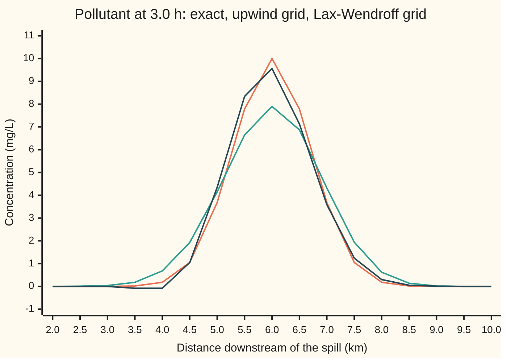
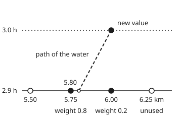
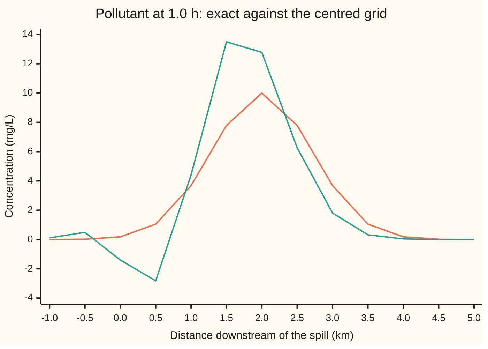

# Flow problems: upwind differencing, and the choice between smearing and wobble

[Syllabus](../../../SYLLABUS.md) → [Numerical analysis](../README.md) → [PDE Solvers](../README.md#s07) → Flow problems

---

## General Overview

A tanker spills a pollutant into a river. At the spill point the concentration is 10.0000 milligrams per litre (mg/L), and it falls off like a bell curve within about a kilometre either side. The river flows at 2.0 km/h. The spill and the speed are illustrative. With no mixing, the pulse rides the current unchanged: 3.0 h later its peak sits 6 km downstream, still at 10.0000 mg/L. The exact answer is known, from [The transport equation](../../08-Differential%20equations%20and%20dynamics/10-The%20Classical%20PDEs/02-the-transport-equation-and-characteristics.md).

A river model does not know that answer. The number it must get right is the peak at 3.0 h, to within 1 mg/L. It cuts the river into cells 0.25 km long and steps time forward 0.1 h at a time, 30 steps to reach 3.0 h. Each step updates a cell from its neighbours. The question is which neighbours.

Three choices give three different rivers at 3.0 h:

- **Centred**: use the cells on both sides equally. The pulse wobbles, the wobbles grow, and the grid shows peaks of 65.4478 mg/L and a concentration of −60.7129 mg/L. Neither can happen.
- **Upwind**: use the cell the water comes from. Nothing goes negative and nothing overshoots, but the peak has sunk to 7.9003 mg/L. The pulse is smeared, as if the river mixed it.
- **Lax-Wendroff**: centred, plus a correction term. The peak keeps 9.5592 mg/L, but a ripple behind the pulse dips to −0.1286 mg/L.

The upwind smear has a name and a size. It is **numerical diffusion**: the grid behaves like a river that mixes at 13.89 m²/s, a mixing the real river never had.

**Taking each difference from the side the flow comes from makes every new value a weighted average of old ones when the step is short enough, so nothing can wobble or grow; the price is a numerical diffusivity c h (1 − ν)/2 that smears the pulse, and no simple fix keeps both sharpness and calm.**

**What kind of fact this is:** a theorem, proved on this card in Why it works: the upwind step's stability, its freedom from wobble, and its numerical diffusivity to leading order. The "no simple fix" part is Godunov's theorem, stated on this card with its source and not proved here.

### The picture: the pulse after 3.0 h, three ways



Orange: the exact pulse. Green: upwind, lower and wider. Dark blue: Lax-Wendroff, nearly as tall as the exact pulse, with a small dip below zero at 3.5 to 4.0 km. The centred step is left off this chart: its values run from −60.7129 to 65.4478 mg/L.

---

## The formula

Notation first, as on [Von Neumann analysis](03-von-neumann-analysis-and-the-cfl-condition.md). The grid value $u_j^n$ is the computed concentration in cell $j$ after $n$ time steps. The **Courant number** $\nu = c\,\Delta t/h$ is the fraction of a cell the water crosses in one step. Here $\nu = 2.0 \times 0.1/0.25 = 0.80$.

The river obeys $u_t + c\,u_x = 0$ with $c > 0$, so water flows toward larger $j$. The **upwind step** takes the space difference from the side the flow comes from:

$$u_j^{n+1} = u_j^n - \nu\,\big(u_j^n - u_{j-1}^n\big), \qquad \text{and it behaves like} \qquad u_t + c\,u_x = \alpha_{\text{num}}\,u_{xx}, \quad \alpha_{\text{num}} = \frac{c\,h}{2}\,(1 - \nu).$$

**Read it aloud:** the new value is the old value, minus the Courant number times the drop from the upstream neighbour; and the grid then carries the pulse at the right speed while spreading it like a river that mixes at the rate c h (1 − ν)/2.

The term $\alpha_{\text{num}} u_{xx}$ is a diffusion term, the same smoothing term as in [The heat equation](../../08-Differential%20equations%20and%20dynamics/10-The%20Classical%20PDEs/03-the-heat-equation.md). The grid adds it; the river did not have it. The equation it appears in is the scheme's **modified equation**: the equation the grid solves more accurately than the one it was built for.

The two other steps on this card, side by side with upwind:

| Scheme | Update | Order | Behaviour on the river |
| --- | --- | --- | --- |
| centred | $u_j^n - \tfrac{\nu}{2}(u_{j+1}^n - u_{j-1}^n)$ | 1 in time, 2 in space | grows: unstable at every fixed $\nu > 0$ |
| upwind | $u_j^n - \nu(u_j^n - u_{j-1}^n)$ | 1 | smears, never wobbles, for $0 \le \nu \le 1$ |
| Lax-Wendroff | centred $+ \tfrac{\nu^2}{2}(u_{j+1}^n - 2u_j^n + u_{j-1}^n)$ | 2 | sharp, but wobbles behind the pulse |

| Symbol | Plain meaning | In our example | Push it up and the answer… |
| --- | --- | --- | --- |
| $u$; $u_t$, $u_{tt}$, $u_x$, $u_{xx}$, $u_{xxx}$ | the carried concentration; a subscript marks a rate: $u_t$ in time, $u_x$ along the river, a repeated letter a rate of a rate | mg/L | — |
| $x$, $t$ | place along the river; time since the spill | km; h | — |
| $c$ | the current's speed | 2.0 km/h | the pulse travels further per step |
| $f$ | the starting pulse, $f(x) = 10\,e^{-x^2}$ | peak 10.0000 mg/L | every value scales with it |
| $h$, $\Delta t$ | cell length; time step | 0.25 km; 0.1 h | larger $h$: more smear |
| $\nu$ | Courant number $c\,\Delta t/h$ | 0.80 | toward 1, less smear; past 1, blow-up |
| $u_j^n$ | computed value in cell $j$, at place $x_j$, after $n$ steps, at time $t_n$ | 7.9003 mg/L at 6 km, $n = 30$ | — |
| $\xi$, $i$ | a wave's phase change per cell, from 0 to $\pi$; $i$ is $\sqrt{-1}$ | $\pi/4$, $\pi/2$, $\pi$ | shorter wave |
| $g(\xi)$ | the factor one step multiplies that wave by | 0.8246 at $\xi = \pi/2$, upwind | above 1 in size: the wave grows |
| $\alpha_{\text{num}}$ | numerical diffusivity: mixing the grid invents | 0.0500 km²/h = 13.89 m²/s | lower, wider peak |
| $s^2$ | the pulse's variance, a measure of its width squared | 0.5 at the spill, 0.8000 km² at 3.0 h | lower peak, $10\sqrt{0.5/s^2}$ |
| $F_{j+1/2}$ | flux: pollutant crossing the edge between cells $j$ and $j+1$, per hour | $c\,u_j^n$ | — |

### When it holds

- **The flow direction is known.** Upwind means "from the side the water comes from". If $c < 0$, the step must use $u_{j+1}$ instead. Using the downstream cell blows up: the check finds values of 10^5.7 mg/L after 3.0 h.
- **The Courant number is at most 1.** The water must not cross more than one cell per step. At $\nu = 1.2$ (a 0.15 h step) the upwind grid reaches 14.0384 mg/L and −1.0038 mg/L.
- **The speed is steady and the equation linear.** The diffusivity formula uses a constant $c$. For a speed that depends on $u$, as in flood waves or traffic, the conservation form below still applies, but shocks need theory beyond this wing.
- **The pulse is smooth on the scale of a cell.** The modified equation comes from a Taylor series. Its leading term predicts the upwind peak to 0.0054 mg/L here, but a pulse only one or two cells wide is beyond it.

---

## Why it works

### Step 0: information moves downstream

The water at 6.00 km at 3.0 h was at 5.80 km at 2.9 h. Nothing downstream of 6.00 km can affect it. The centred step still gives the downstream cell an equal say. The upwind step looks only where the water came from, and that choice decides stability.

### Step 1: the upwind step is an interpolation, so it cannot overshoot

Rearrange the upwind update:

$$u_j^{n+1} = (1 - \nu)\,u_j^n + \nu\,u_{j-1}^n.$$

The water now in cell $j$ was a distance $\nu h$ upstream one step ago. That point lies between cells $j-1$ and $j$. The update reads the old value there by drawing a straight line between the two cells.

<p align="center"></p>

To scale: the cells at 5.50, 5.75, 6.00 and 6.25 km sit at x = 60, 140, 220 and 300, and the 0.1 h step runs from y = 180 up to y = 60. The dashed path has slope 2.0 km/h. It lands at 5.80 km, which is 0.8 of the way from 6.00 km toward 5.75 km. So the 5.75 km cell gets weight 0.8 and the 6.00 km cell gets 0.2. The 6.25 km cell is not used.

For $0 \le \nu \le 1$ both weights are between 0 and 1 and add to 1. A weighted average of that kind can never exceed its largest input or fall below its smallest. So:

- the grid never shows more than the largest old value, 10.0000 mg/L;
- it never shows less than the smallest, 0.0000 mg/L;
- the largest value can only stay level or fall from step to step, so nothing grows.

A scheme with this property is called **monotone**: it creates no new peaks or dips. This is a complete proof of stability in the largest-value size, for every pulse at once.

### Step 2: the wave test agrees, and convicts the centred step

[Von Neumann analysis](03-von-neumann-analysis-and-the-cfl-condition.md) feeds a single wave $e^{i\xi j}$ into a step and reads off the factor $g(\xi)$ it is multiplied by, and its Step 4 already derives $g$ for all three of these schemes. Here $i$ is $\sqrt{-1}$ and $\xi$ is the wave's phase change per cell, written $\xi h$ on that card. A wave grows when $|g| > 1$. In this notation $|g|^2$ is $1 - 2\nu(1-\nu)(1 - \cos\xi)$ for upwind, $1 + \nu^2\sin^2\xi$ for centred, and $1 - \nu^2(1-\nu^2)(1-\cos\xi)^2$ for Lax-Wendroff.

For upwind, $|g|^2 \le 1$ exactly when $0 \le \nu \le 1$. For centred, $|g|^2 > 1$ for every wave except the flat one and the shortest one, at every $\nu > 0$. Shrinking the step along with the cell, at a fixed $\nu$, does not save it.

The check measures each factor by feeding a cosine wave into one step on a periodic grid of 16 cells:

| Scheme | $\xi = \pi/4$ | $\xi = \pi/2$ | $\xi = \pi$ |
| --- | --- | --- | --- |
| upwind | 0.9520 | 0.8246 | 0.6000 |
| centred | 1.1489 | 1.2806 | 1.0000 |
| Lax-Wendroff | 0.9901 | 0.8773 | 0.2800 |

Measured and formula agree to within 1e-12, and the check asserts it. The centred step multiplies the $\xi = \pi/2$ wave, four cells long, by 1.2806 every step.

Which wave does the damage? A bell curve contains every wavelength, the short ones only with tiny weight. The $\xi = \pi/2$ wave grows 1670-fold in 30 steps, yet the spill holds only 1 part in 19334 of it. A longer wave wins: the check takes the centred error apart into waves (a discrete Fourier transform) and finds the strongest at $\xi = 0.277\pi$, 7.2 cells long. The spill holds 1 part in 21 of it, and 30 steps grow it 117.3-fold. That wave dominates the error behind the 65.4478 mg/L peak.

### Step 3: the hidden term is a diffusion

Write the upwind step as the centred step plus a correction:

$$u_j^n - \nu(u_j^n - u_{j-1}^n) \;=\; \underbrace{u_j^n - \tfrac{\nu}{2}(u_{j+1}^n - u_{j-1}^n)}_{\text{centred}} \;+\; \tfrac{\nu}{2}\big(u_{j+1}^n - 2u_j^n + u_{j-1}^n\big).$$

The last bracket is about $h^2 u_{xx}$: a grid version of the second derivative. So upwinding is centred differencing plus added smoothing. That smoothing is what stabilises it.

A Taylor series gives the amount, to leading order. The forward time step itself contributes a negative diffusion, $-\tfrac{c^2\Delta t}{2}u_{xx}$. The upwind correction contributes $+\tfrac{c h}{2}u_{xx}$. The sum is

$$\alpha_{\text{num}} = \frac{c h}{2} - \frac{c^2\Delta t}{2} = \frac{c h}{2}(1 - \nu) = \frac{2.0 \times 0.25}{2} \times 0.2 = 0.0500 \text{ km}^2/\text{h}.$$

The centred step has only the negative part: a river that un-mixes. That is the backward heat equation, which magnifies short waves, the same verdict as Step 2.

<details>
<summary>Detailed proof: the modified equation of the upwind step</summary>

Let $u$ be a smooth function and put it into the upwind step. Expand each grid value about $(x_j, t_n)$ by Taylor's theorem:

$$u_j^{n+1} = u + \Delta t\,u_t + \tfrac{\Delta t^2}{2}u_{tt} + O(\Delta t^3), \qquad u_{j-1}^n = u - h\,u_x + \tfrac{h^2}{2}u_{xx} + O(h^3).$$

Substitute into $\frac{u_j^{n+1} - u_j^n}{\Delta t} + c\,\frac{u_j^n - u_{j-1}^n}{h} = 0$:

$$u_t + \tfrac{\Delta t}{2}u_{tt} + c\,u_x - \tfrac{c h}{2}u_{xx} = O(h^2) \quad\text{with } \nu \text{ held fixed as } h \to 0.$$

To leading order $u_t = -c\,u_x$, so $u_{tt} = c^2 u_{xx} + O(h)$. Replace $u_{tt}$:

$$u_t + c\,u_x = \Big(\tfrac{c h}{2} - \tfrac{c^2\Delta t}{2}\Big)u_{xx} + O(h^2) = \tfrac{c h}{2}(1-\nu)\,u_{xx} + O(h^2).$$

The same expansion for Lax-Wendroff cancels the $u_{xx}$ term exactly; that is how its correction $\tfrac{\nu^2}{2}$ was chosen. What is left is a third-derivative term, $-\tfrac{c h^2}{6}(1-\nu^2)\,u_{xxx}$. A third derivative does not smooth. It makes waves of different lengths travel at different speeds, called **dispersion**. Short waves fall behind and leave the ripple seen upstream of the pulse.

The derivation follows Warming and Hyett (1974).

</details>

### Step 4: a diffused bell curve has a closed form

A bell curve under diffusion stays a bell curve. Its variance grows by $2\alpha_{\text{num}} t$, as on [The heat kernel](../../08-Differential%20equations%20and%20dynamics/10-The%20Classical%20PDEs/10-the-heat-kernel.md), and its total stays the same, so its peak falls as $1/s$. The spill $10\,e^{-x^2}$ has variance $s^2 = 0.5$ km². After 3.0 h of numerical diffusion:

$$s^2 = 0.5 + 2 \times 0.05 \times 3 = 0.8000 \text{ km}^2, \qquad \text{peak} = 10\sqrt{0.5/0.8} = 7.9057 \text{ mg/L}.$$

The upwind grid reads 7.9003 mg/L. The modified equation predicts the smear to 0.0054 mg/L. Across the whole river, the grid is up to 2.0997 mg/L from the exact pulse but only 0.1165 from the diffused bell curve. Numerical diffusion explains almost all of upwind's error.

### Step 5: conservation form keeps the pollutant

Think of $u_j^n$ as the average concentration over cell $j$, so cell $j$ holds $h\,u_j^n$ of pollutant per unit of cross-section. Each step, pollutant leaves through the right edge and enters through the left. The upwind flux says the water crossing an edge carries the concentration of the cell it leaves: $F_{j+1/2} = c\,u_j^n$. Then

$$u_j^{n+1} = u_j^n - \frac{\Delta t}{h}\big(F_{j+1/2} - F_{j-1/2}\big),$$

which is the upwind step again. This is the **conservation form**, the starting point of the **finite volume method**: track what crosses each cell edge.

Add the update over all cells. Each inner edge's flux leaves one cell and enters the next, so the inner fluxes cancel. Only the two ends of the reach can change the total. The spill's total is $10\sqrt{\pi} = 17.7245385$ mg/L·km. After 30 upwind steps the grid holds 17.7245384. The pulse is smeared, but no pollutant is lost.

### Step 6: Godunov's theorem, the choice

Lax-Wendroff is second order: halve the cell and its error falls about fourfold. But it went negative. Can a cleverer linear step be both second order and monotone?

No. **Godunov's theorem** (1959): a linear scheme that is monotone is at most first-order accurate. This card states it without proof. It comes from Godunov's paper, *Matematicheskii Sbornik* 47(89), no. 3 (1959): 271–306, and chapter 6 of LeVeque's book builds the limiter methods that get around it.

So with a fixed recipe of weights, there is a choice. Take first order and smear, or take higher order and accept wobble. Modern flow codes escape by making the weights depend on the solution itself, which a linear scheme cannot do.

---

## Worked numbers, by hand

The upwind step at 6.00 km, from 2.9 h to 3.0 h, then the smear predicted by the modified equation.

| Step | Arithmetic | Value |
| --- | --- | --- |
| Courant number $\nu$ | $2.0 \times 0.1 / 0.25$ | 0.80 |
| upstream cell at 2.9 h, 5.75 km | from the grid | 7.9238 mg/L |
| this cell at 2.9 h, 6.00 km | from the grid | 7.8063 mg/L |
| upwind step | $7.8063 - 0.8 \times (7.8063 - 7.9238)$ | 7.9003 mg/L |
| numerical diffusivity | $2.0 \times 0.25 \times (1 - 0.8)/2$ | 0.0500 km²/h |
| same, in m²/s | $0.05 \times 10^6 / 3600$ | 13.89 m²/s |
| variance at 3.0 h | $0.5 + 2 \times 0.05 \times 3$ | 0.8000 km² |
| predicted peak | $10\sqrt{0.5/0.8}$ | 7.9057 mg/L |
| exact peak | the pulse is only shifted | 10.0000 mg/L |
| **upwind's error at the peak** | $10.0000 - 7.9003$ | **2.0997 mg/L** |

The peak error is also the largest error anywhere on the grid. The upwind model under-reports the worst concentration by about a fifth, and the modified equation predicted that before the grid was run.

### What breaks if you drop a piece

| Mistake | Comes out at | What went wrong |
| --- | --- | --- |
| centred difference with a forward time step | peak 65.4478, lowest −60.7129 mg/L at 3.0 h; 10^10.0 mg/L by 12 h | every wave but two grows; Step 2 |
| difference taken from the downstream side | 10^5.7 mg/L at 3.0 h | information read from where the water is going |
| step too long: $\nu = 1.2$, a 0.15 h step | peak 14.0384, lowest −1.0038 mg/L | the weight $1 - \nu$ turns negative, so the average becomes an extrapolation |
| upwind smear read as real mixing | 13.89 m²/s of mixing that is not there | a calibrated "dispersion" absorbs the grid's own error |

The checks print all four.

---

## How it moves

The centred step's error is small at first and multiplied every step. The upwind step's error is a steady leak of height into width.

### One story: the peak, hour by hour

| Time | Upwind peak | Modified equation | Lax-Wendroff peak (lowest) | Centred peak (lowest) |
| --- | --- | --- | --- | --- |
| 0.5 h | 9.5346 | 9.5346 | 9.9349 (−0.0004) | 11.6992 (−0.4904) |
| 1.0 h | 9.1276 | 9.1287 | 9.8645 (−0.0058) | 14.4618 (−2.8203) |
| 2.0 h | 8.4480 | 8.4515 | 9.7145 (−0.0499) | 22.1318 (−17.7522) |
| 3.0 h | 7.9003 | 7.9057 | 9.5592 (−0.1286) | 65.4478 (−60.7129) |

All values in mg/L; the exact peak stays 10.0000. Upwind sinks smoothly and the modified equation tracks it. Lax-Wendroff sinks slowly while its ripple deepens. The centred step overshoots from the first half hour and then runs away.

### The centred step at 1.0 h



Orange: the exact pulse, centred at 2 km. Green: the centred grid after 10 steps. Its peak is too high and too far upstream, and a ripple already trails behind it, below zero at 0.0 and 0.5 km. The strongest wave in its error is $\xi = 0.185\pi$, 10.8 cells long, grown 2.4-fold in 10 steps. By 3.0 h the strongest is 7.2 cells long: shorter waves grow faster, so the ripple tightens as it grows.

---

## Code, from first principles, and it actually runs

The code runs the three schemes on the same river and grid. It reaches the upwind answer by three independent roads: the exact shifted pulse, the grid stepped with no formula, and the modified equation's diffused bell curve. It measures each growth factor by feeding a wave through one step, and compares it with the von Neumann formula. It shows the order of each scheme from errors at three cell lengths, checks the pollutant total against $10\sqrt{\pi}$, and prints every failure in the table above.

### Python

```python
# Flow problems: upwind, centred and Lax-Wendroff steps on a river pulse -- the
# check behind the card.  Standard library only; math supplies exp, sqrt, cos, sin, pi.
# Road 1: the exact shifted pulse.  Road 2: each grid scheme, stepped with no formula.
# Road 3: the modified equation, a Gaussian widened by the numerical diffusivity.
from math import exp, sqrt, cos, sin, pi, log10

C, H, DT, T = 2.0, 0.25, 0.1, 3.0          # river km/h; cell km; step h; run h
NU = C * DT / H                             # Courant number, 0.8
LO, HI = -4.0, 12.0                         # the reach of river on the grid, km

def f(x): return 10.0 * exp(-x * x)        # the spill at t = 0, mg/L

def step(s, a, b, c, nu):                   # one update from neighbours a | b | c
    if s == "upwind": return b - nu * (b - a)
    if s == "downwind": return b - nu * (c - b)
    if s == "centred": return b - nu / 2 * (c - a)
    return b - nu / 2 * (c - a) + nu * nu / 2 * (c - 2 * b + a)     # Lax-Wendroff

def run(s, h=H, nu=NU, t=T):
    n = round((HI - LO) / h) + 1
    u = [f(LO + i * h) for i in range(n)]
    for _ in range(round(t / (nu * h / C))):
        u = [0.0] + [step(s, u[i - 1], u[i], u[i + 1], nu) for i in range(1, n - 1)] + [u[n - 2]]
    return u

def at(u, x, h=H): return u[round((x - LO) / h)]
def gauss(x, t, alpha):                     # road 3: spill shifted by ct, variance 1/2 + 2 alpha t
    v = 0.5 + 2 * alpha * t
    return 10.0 * sqrt(0.5 / v) * exp(-(x - C * t) ** 2 / (2 * v))

def alpha_num(h, nu): return C * h * (1 - nu) / 2      # numerical diffusivity, km^2/h

print(f"river {C:.1f} km/h, cell h = {H:.2f} km, step {DT:.1f} h, Courant number nu = {NU:.2f}, {round(T / DT)} steps to {T:.1f} h")
up, lw, ce = run("upwind"), run("Lax-Wendroff"), run("centred")
xs = [LO + i * H for i in range(len(up))]
an = alpha_num(H, NU)
mass = sum(up) * H
print(f"exact: peak {f(0):.4f} mg/L at {C * T:.0f} km; mass 10 sqrt(pi) = {10 * sqrt(pi):.7f} mg/L km")
print(f"upwind: peak {max(up):.4f}, lowest {min(up):.4f}, mass {mass:.7f}")
print(f"numerical diffusivity c h (1 - nu)/2 = {an:.4f} km^2/h = {an * 1e6 / 3600:.2f} m^2/s")
print(f"modified equation: variance 0.5 + 2 x {an:.2f} x {T:.0f} = {0.5 + 2 * an * T:.4f} km^2, peak {gauss(C * T, T, an):.4f}")
gap_mod = max(abs(u - gauss(x, T, an)) for x, u in zip(xs, up))
gap_ex = max(abs(u - f(x - C * T)) for x, u in zip(xs, up))
print(f"upwind's largest gap: from the exact pulse {gap_ex:.4f}, from the modified equation {gap_mod:.4f}")
print(f"upwind peak sits {gauss(C * T, T, an) - max(up):.4f} below the modified equation's; the water at 6.00 km came from {C * T - C * DT:.2f} km")
print(f"Lax-Wendroff: peak {max(lw):.4f}, lowest {min(lw):.4f}, mass {sum(lw) * H:.7f}")
print(f"centred: peak {max(ce):.4f}, lowest {min(ce):.4f}")
print(f"Lax-Wendroff with negatives clipped to zero: mass {sum(max(v, 0.0) for v in lw) * H:.7f}")

print("one upwind step by hand, cells at 5.75 and 6.00 km, t = 2.9 -> 3.0 h:")
u29 = run("upwind", t=2.9)
a, b = at(u29, 5.75), at(u29, 6.0)
print(f"  {b:.4f} - {NU:.1f} x ({b:.4f} - {a:.4f}) = {b - NU * (b - a):.4f}; grid {at(up, 6.0):.4f}")

print("growth factor |g| per step: measured on a periodic grid of 16 cells | formula")
def measured(s, m, nu=NU):                  # feed in cos(xi j), xi = 2 pi m / 16; energy ratio
    xi = 2 * pi * m / 16
    u = [cos(xi * j) for j in range(16)]
    v = [step(s, u[j - 1], u[j], u[(j + 1) % 16], nu) for j in range(16)]
    return sqrt(sum(w * w for w in v) / sum(w * w for w in u)), xi
form = {"upwind": lambda x: sqrt(1 - 2 * NU * (1 - NU) * (1 - cos(x))),
        "centred": lambda x: sqrt(1 + NU * NU * sin(x) ** 2),
        "Lax-Wendroff": lambda x: sqrt(1 - NU * NU * (1 - NU * NU) * (1 - cos(x)) ** 2)}
worst = 0.0
for s in ("upwind", "centred", "Lax-Wendroff"):
    row = []
    for m in (2, 4, 8):
        g, xi = measured(s, m)
        worst = max(worst, abs(g - form[s](xi)))
        row.append(f"{g:.4f} | {form[s](xi):.4f}")
    print(f"  {s:<12} xi = pi/4, pi/2, pi: " + ";  ".join(row))

def strongest(t):                           # the wave carrying most of the centred error, by a DFT
    e = [v - f(LO + j * H - C * t) for j, v in enumerate(run("centred", t=t))]
    amp = lambda m: abs(sum(w * complex(cos(2 * pi * m * j / len(e)), -sin(2 * pi * m * j / len(e))) for j, w in enumerate(e)))
    return 2 * pi * max(range(1, len(e) // 2 + 1), key=amp) / len(e)
for t in (1.0, 3.0):
    xi = strongest(t)
    g = sqrt(1 + NU * NU * sin(xi) ** 2)
    print(f"centred error at {t:.1f} h: strongest wave xi = {xi / pi:.3f} pi, {2 * pi / xi:.1f} cells long,"
          f" grown x{g ** round(t / DT):.1f} in {round(t / DT)} steps from a spill weight of 1 in {exp((xi / H) ** 2 / 4):.0f}")
print(f"the xi = pi/2 wave: grown x{sqrt(1 + NU * NU) ** 30:.0f} in 30 steps from a spill weight of 1 in {exp((pi / 2 / H) ** 2 / 4):.0f}")

print("order: largest error at 3 h against the exact pulse, nu = 0.8")
eu, el = [], []
for h in (0.25, 0.125, 0.0625):
    u1, u2 = run("upwind", h), run("Lax-Wendroff", h)
    x1 = [LO + i * h for i in range(len(u1))]
    eu.append(max(abs(u - f(x - C * T)) for x, u in zip(x1, u1)))
    el.append(max(abs(u - f(x - C * T)) for x, u in zip(x1, u2)))
    print(f"  h = {h:<6} upwind {eu[-1]:.4f} (peak {max(u1):.4f}, modified eq {gauss(C * T, T, alpha_num(h, NU)):.4f})"
          f"   Lax-Wendroff {el[-1]:.4f}")
print(f"  ratios as h halves: upwind {eu[0] / eu[1]:.2f}, {eu[1] / eu[2]:.2f}; Lax-Wendroff {el[0] / el[1]:.2f}, {el[1] / el[2]:.2f}")

print("how it moves: peak (and lowest) by time, mg/L")
for t in (0.5, 1.0, 2.0, 3.0):
    a1, a2, a3 = run("upwind", t=t), run("Lax-Wendroff", t=t), run("centred", t=t)
    print(f"  t = {t:.1f} h: upwind {max(a1):.4f} (modified eq {gauss(C * t, t, an):.4f}); Lax-Wendroff {max(a2):.4f}"
          f" ({min(a2):.4f}); centred {max(a3):.4f} ({min(a3):.4f})")

dn = run("downwind")
big = run("upwind", nu=1.2)
late = run("centred", t=12.0)
print(f"what breaks: downwind at 3 h, largest |u| = 10^{log10(max(abs(v) for v in dn)):.1f} mg/L")
print(f"what breaks: upwind with nu = 1.2 (step 0.15 h), peak {max(big):.4f}, lowest {min(big):.4f}")
print(f"what breaks: centred at 12 h, largest |u| = 10^{log10(max(abs(v) for v in late)):.1f} mg/L")
print(f"what breaks: fitting the upwind smear as real mixing gives {an * 1e6 / 3600:.2f} m^2/s of mixing that is not there")
for nu in (1.0, 0.5):
    w = run("upwind", nu=nu)
    print(f"try: upwind nu = {nu:.1f}: peak {max(w):.4f}, modified eq {gauss(C * T, T, alpha_num(H, nu)):.4f}")

lab = [2.0 + 0.5 * i for i in range(17)]
print("chart, x km:", ", ".join(f"{x:.1f}" for x in lab))
for name, u in (("exact 3 h", None), ("upwind 3 h", up), ("Lax-Wendroff 3 h", lw)):
    print(f"chart, {name}:", ", ".join(f"{(f(x - C * T) if u is None else at(u, x)):.2f}" for x in lab))
ce1 = run("centred", t=1.0)
lab1 = [-1.0 + 0.5 * i for i in range(13)]
print("chart, centred 1 h:", ", ".join(f"{at(ce1, x):.2f}" for x in lab1))
print("chart, exact 1 h:", ", ".join(f"{f(x - C):.2f}" for x in lab1))
px = lambda x: 60 + (x + 0.5) * 320
print("figure, cells " + " ".join(f"{6 + x:.2f}" for x in (-0.5, -0.25, 0.0, 0.25)) + " km at px "
      + " ".join(f"{px(x):.0f}" for x in (-0.5, -0.25, 0.0, 0.25))
      + f"; foot {6 - C * DT:.2f} km at px {px(-C * DT):.0f}; 2.9 h at y 180, 3.0 h at y {180 - DT * 1200:.0f}")

assert abs(max(up) - gauss(C * T, T, an)) < 0.02        # grid peak meets the modified equation
assert gap_mod < 0.1 * gap_ex                            # modified equation explains the error
assert abs(mass - 10 * sqrt(pi)) < 1e-6                  # conservation form keeps the mass
assert worst < 1e-12                                     # measured growth meets von Neumann
assert 1.6 < eu[0] / eu[1] < 2.2 and 1.6 < eu[1] / eu[2] < 2.2   # upwind: order 1
assert 3.4 < el[0] / el[1] < 4.4 and 3.4 < el[1] / el[2] < 4.4   # Lax-Wendroff: order 2
assert min(up) >= 0.0 and max(up) <= 10.0 and min(lw) < -0.1 and max(ce) > 50.0
print("ALL CHECKS PASS")
```

**Ran 2026-11-11 on macOS, Python 3.14.10, standard library only. All checks passed. Output, pasted from the run:**

```
river 2.0 km/h, cell h = 0.25 km, step 0.1 h, Courant number nu = 0.80, 30 steps to 3.0 h
exact: peak 10.0000 mg/L at 6 km; mass 10 sqrt(pi) = 17.7245385 mg/L km
upwind: peak 7.9003, lowest 0.0000, mass 17.7245384
numerical diffusivity c h (1 - nu)/2 = 0.0500 km^2/h = 13.89 m^2/s
modified equation: variance 0.5 + 2 x 0.05 x 3 = 0.8000 km^2, peak 7.9057
upwind's largest gap: from the exact pulse 2.0997, from the modified equation 0.1165
upwind peak sits 0.0054 below the modified equation's; the water at 6.00 km came from 5.80 km
Lax-Wendroff: peak 9.5592, lowest -0.1286, mass 17.7245385
centred: peak 65.4478, lowest -60.7129
Lax-Wendroff with negatives clipped to zero: mass 17.8028402
one upwind step by hand, cells at 5.75 and 6.00 km, t = 2.9 -> 3.0 h:
  7.8063 - 0.8 x (7.8063 - 7.9238) = 7.9003; grid 7.9003
growth factor |g| per step: measured on a periodic grid of 16 cells | formula
  upwind       xi = pi/4, pi/2, pi: 0.9520 | 0.9520;  0.8246 | 0.8246;  0.6000 | 0.6000
  centred      xi = pi/4, pi/2, pi: 1.1489 | 1.1489;  1.2806 | 1.2806;  1.0000 | 1.0000
  Lax-Wendroff xi = pi/4, pi/2, pi: 0.9901 | 0.9901;  0.8773 | 0.8773;  0.2800 | 0.2800
centred error at 1.0 h: strongest wave xi = 0.185 pi, 10.8 cells long, grown x2.4 in 10 steps from a spill weight of 1 in 4
centred error at 3.0 h: strongest wave xi = 0.277 pi, 7.2 cells long, grown x117.3 in 30 steps from a spill weight of 1 in 21
the xi = pi/2 wave: grown x1670 in 30 steps from a spill weight of 1 in 19334
order: largest error at 3 h against the exact pulse, nu = 0.8
  h = 0.25   upwind 2.0997 (peak 7.9003, modified eq 7.9057)   Lax-Wendroff 0.7806
  h = 0.125  upwind 1.2300 (peak 8.7700, modified eq 8.7706)   Lax-Wendroff 0.2179
  h = 0.0625 upwind 0.6750 (peak 9.3250, modified eq 9.3250)   Lax-Wendroff 0.0550
  ratios as h halves: upwind 1.71, 1.82; Lax-Wendroff 3.58, 3.96
how it moves: peak (and lowest) by time, mg/L
  t = 0.5 h: upwind 9.5346 (modified eq 9.5346); Lax-Wendroff 9.9349 (-0.0004); centred 11.6992 (-0.4904)
  t = 1.0 h: upwind 9.1276 (modified eq 9.1287); Lax-Wendroff 9.8645 (-0.0058); centred 14.4618 (-2.8203)
  t = 2.0 h: upwind 8.4480 (modified eq 8.4515); Lax-Wendroff 9.7145 (-0.0499); centred 22.1318 (-17.7522)
  t = 3.0 h: upwind 7.9003 (modified eq 7.9057); Lax-Wendroff 9.5592 (-0.1286); centred 65.4478 (-60.7129)
what breaks: downwind at 3 h, largest |u| = 10^5.7 mg/L
what breaks: upwind with nu = 1.2 (step 0.15 h), peak 14.0384, lowest -1.0038
what breaks: centred at 12 h, largest |u| = 10^10.0 mg/L
what breaks: fitting the upwind smear as real mixing gives 13.89 m^2/s of mixing that is not there
try: upwind nu = 1.0: peak 10.0000, modified eq 10.0000
try: upwind nu = 0.5: peak 6.3126, modified eq 6.3246
chart, x km: 2.0, 2.5, 3.0, 3.5, 4.0, 4.5, 5.0, 5.5, 6.0, 6.5, 7.0, 7.5, 8.0, 8.5, 9.0, 9.5, 10.0
chart, exact 3 h: 0.00, 0.00, 0.00, 0.02, 0.18, 1.05, 3.68, 7.79, 10.00, 7.79, 3.68, 1.05, 0.18, 0.02, 0.00, 0.00, 0.00
chart, upwind 3 h: 0.00, 0.01, 0.04, 0.18, 0.68, 1.93, 4.15, 6.65, 7.90, 6.87, 4.32, 1.94, 0.62, 0.14, 0.02, 0.00, 0.00
chart, Lax-Wendroff 3 h: -0.00, 0.00, -0.00, -0.08, -0.08, 1.05, 4.35, 8.34, 9.56, 7.13, 3.59, 1.24, 0.30, 0.05, 0.01, 0.00, 0.00
chart, centred 1 h: 0.11, 0.49, -1.40, -2.82, 4.41, 13.50, 12.78, 6.26, 1.81, 0.32, 0.04, 0.00, 0.00
chart, exact 1 h: 0.00, 0.02, 0.18, 1.05, 3.68, 7.79, 10.00, 7.79, 3.68, 1.05, 0.18, 0.02, 0.00
figure, cells 5.50 5.75 6.00 6.25 km at px 60 140 220 300; foot 5.80 km at px 156; 2.9 h at y 180, 3.0 h at y 60
ALL CHECKS PASS
```

### Rust

Same schemes, same labels, same output, built with `rustc --edition 2021 -O`.

```rust
// Flow problems: upwind, centred and Lax-Wendroff steps on a river pulse -- the
// same check in Rust, std only, no crates.
// Road 1: the exact shifted pulse.  Road 2: each grid scheme, stepped with no formula.
// Road 3: the modified equation, a Gaussian widened by the numerical diffusivity.
use std::f64::consts::PI;

const C: f64 = 2.0; const H: f64 = 0.25; const DT: f64 = 0.1; const T: f64 = 3.0;
const LO: f64 = -4.0; const HI: f64 = 12.0;

fn f(x: f64) -> f64 { 10.0 * (-x * x).exp() }         // the spill at t = 0, mg/L

fn step(s: &str, a: f64, b: f64, c: f64, nu: f64) -> f64 {   // one update from a | b | c
    match s {
        "upwind" => b - nu * (b - a),
        "downwind" => b - nu * (c - b),
        "centred" => b - nu / 2.0 * (c - a),
        _ => b - nu / 2.0 * (c - a) + nu * nu / 2.0 * (c - 2.0 * b + a), // Lax-Wendroff
    }
}

fn run(s: &str, h: f64, nu: f64, t: f64) -> Vec<f64> {
    let n = ((HI - LO) / h).round() as usize + 1;
    let mut u: Vec<f64> = (0..n).map(|i| f(LO + i as f64 * h)).collect();
    for _ in 0..(t / (nu * h / C)).round() as usize {
        let mut v = vec![0.0; n];
        for i in 1..n - 1 { v[i] = step(s, u[i - 1], u[i], u[i + 1], nu) }
        v[n - 1] = u[n - 2];
        u = v;
    }
    u
}

fn at(u: &[f64], x: f64, h: f64) -> f64 { u[((x - LO) / h).round() as usize] }
fn gauss(x: f64, t: f64, alpha: f64) -> f64 {          // road 3: variance 1/2 + 2 alpha t
    let v = 0.5 + 2.0 * alpha * t;
    10.0 * (0.5 / v).sqrt() * (-(x - C * t).powi(2) / (2.0 * v)).exp()
}
fn alpha_num(h: f64, nu: f64) -> f64 { C * h * (1.0 - nu) / 2.0 }
fn mx(u: &[f64]) -> f64 { u.iter().fold(f64::MIN, |m, &v| m.max(v)) }
fn mn(u: &[f64]) -> f64 { u.iter().fold(f64::MAX, |m, &v| m.min(v)) }
fn maxgap(u: &[f64], h: f64, g: &dyn Fn(f64) -> f64) -> f64 {
    u.iter().enumerate().fold(0.0, |m, (i, &v)| m.max((v - g(LO + i as f64 * h)).abs()))
}
fn row(u: &[f64], xs: &[f64]) -> String {
    xs.iter().map(|&x| format!("{:.2}", at(u, x, H))).collect::<Vec<_>>().join(", ")
}

fn main() {
    let nu0 = C * DT / H;
    println!("river {:.1} km/h, cell h = {:.2} km, step {:.1} h, Courant number nu = {:.2}, {} steps to {:.1} h",
             C, H, DT, nu0, (T / DT).round(), T);
    let (up, lw, ce) = (run("upwind", H, nu0, T), run("Lax-Wendroff", H, nu0, T), run("centred", H, nu0, T));
    let an = alpha_num(H, nu0);
    let mass: f64 = up.iter().sum::<f64>() * H;
    println!("exact: peak {:.4} mg/L at {:.0} km; mass 10 sqrt(pi) = {:.7} mg/L km", f(0.0), C * T, 10.0 * PI.sqrt());
    println!("upwind: peak {:.4}, lowest {:.4}, mass {:.7}", mx(&up), mn(&up), mass);
    println!("numerical diffusivity c h (1 - nu)/2 = {:.4} km^2/h = {:.2} m^2/s", an, an * 1e6 / 3600.0);
    println!("modified equation: variance 0.5 + 2 x {:.2} x {:.0} = {:.4} km^2, peak {:.4}", an, T, 0.5 + 2.0 * an * T, gauss(C * T, T, an));
    let gap_mod = maxgap(&up, H, &|x| gauss(x, T, an));
    let gap_ex = maxgap(&up, H, &|x| f(x - C * T));
    println!("upwind's largest gap: from the exact pulse {:.4}, from the modified equation {:.4}", gap_ex, gap_mod);
    println!("upwind peak sits {:.4} below the modified equation's; the water at 6.00 km came from {:.2} km", gauss(C * T, T, an) - mx(&up), C * T - C * DT);
    println!("Lax-Wendroff: peak {:.4}, lowest {:.4}, mass {:.7}", mx(&lw), mn(&lw), lw.iter().sum::<f64>() * H);
    println!("centred: peak {:.4}, lowest {:.4}", mx(&ce), mn(&ce));
    println!("Lax-Wendroff with negatives clipped to zero: mass {:.7}", lw.iter().map(|&v| v.max(0.0)).sum::<f64>() * H);

    println!("one upwind step by hand, cells at 5.75 and 6.00 km, t = 2.9 -> 3.0 h:");
    let u29 = run("upwind", H, nu0, 2.9);
    let (a, b) = (at(&u29, 5.75, H), at(&u29, 6.0, H));
    println!("  {:.4} - {:.1} x ({:.4} - {:.4}) = {:.4}; grid {:.4}", b, nu0, b, a, b - nu0 * (b - a), at(&up, 6.0, H));

    println!("growth factor |g| per step: measured on a periodic grid of 16 cells | formula");
    let measured = |s: &str, m: usize| -> (f64, f64) {   // feed in cos(xi j); energy ratio
        let xi = 2.0 * PI * m as f64 / 16.0;
        let u: Vec<f64> = (0..16).map(|j| (xi * j as f64).cos()).collect();
        let v: Vec<f64> = (0..16).map(|j| step(s, u[(j + 15) % 16], u[j], u[(j + 1) % 16], nu0)).collect();
        ((v.iter().map(|w| w * w).sum::<f64>() / u.iter().map(|w| w * w).sum::<f64>()).sqrt(), xi)
    };
    let form = |s: &str, x: f64| -> f64 {
        match s {
            "upwind" => (1.0 - 2.0 * nu0 * (1.0 - nu0) * (1.0 - x.cos())).sqrt(),
            "centred" => (1.0 + nu0 * nu0 * x.sin().powi(2)).sqrt(),
            _ => (1.0 - nu0 * nu0 * (1.0 - nu0 * nu0) * (1.0 - x.cos()).powi(2)).sqrt(),
        }
    };
    let mut worst: f64 = 0.0;
    for s in ["upwind", "centred", "Lax-Wendroff"] {
        let mut cells = vec![];
        for m in [2, 4, 8] {
            let (g, xi) = measured(s, m);
            worst = worst.max((g - form(s, xi)).abs());
            cells.push(format!("{:.4} | {:.4}", g, form(s, xi)));
        }
        println!("  {:<12} xi = pi/4, pi/2, pi: {}", s, cells.join(";  "));
    }

    let strongest = |t: f64| -> f64 {   // the wave carrying most of the centred error, by a DFT
        let e: Vec<f64> = run("centred", H, nu0, t).iter().enumerate().map(|(j, &v)| v - f(LO + j as f64 * H - C * t)).collect();
        let n = e.len() as f64;
        let amp = |m: usize| -> f64 {
            let a = |j: usize| 2.0 * PI * m as f64 * j as f64 / n;
            let re: f64 = e.iter().enumerate().map(|(j, &w)| w * a(j).cos()).sum();
            let im: f64 = e.iter().enumerate().map(|(j, &w)| -w * a(j).sin()).sum();
            (re * re + im * im).sqrt()
        };
        let mut best = 1; for m in 2..=e.len() / 2 { if amp(m) > amp(best) { best = m } }
        2.0 * PI * best as f64 / n
    };
    for t in [1.0, 3.0] {
        let (xi, k) = (strongest(t), (t / DT).round());
        let g = (1.0 + nu0 * nu0 * xi.sin().powi(2)).sqrt();
        println!("centred error at {:.1} h: strongest wave xi = {:.3} pi, {:.1} cells long, grown x{:.1} in {} steps from a spill weight of 1 in {:.0}",
                 t, xi / PI, 2.0 * PI / xi, g.powi(k as i32), k, ((xi / H).powi(2) / 4.0).exp());
    }
    println!("the xi = pi/2 wave: grown x{:.0} in 30 steps from a spill weight of 1 in {:.0}",
             (1.0 + nu0 * nu0).sqrt().powi(30), ((PI / 2.0 / H).powi(2) / 4.0).exp());

    println!("order: largest error at 3 h against the exact pulse, nu = 0.8");
    let (mut eu, mut el) = (vec![], vec![]);
    for h in [0.25, 0.125, 0.0625] {
        let (u1, u2) = (run("upwind", h, nu0, T), run("Lax-Wendroff", h, nu0, T));
        eu.push(maxgap(&u1, h, &|x| f(x - C * T)));
        el.push(maxgap(&u2, h, &|x| f(x - C * T)));
        println!("  h = {:<6} upwind {:.4} (peak {:.4}, modified eq {:.4})   Lax-Wendroff {:.4}",
                 h, eu[eu.len() - 1], mx(&u1), gauss(C * T, T, alpha_num(h, nu0)), el[el.len() - 1]);
    }
    println!("  ratios as h halves: upwind {:.2}, {:.2}; Lax-Wendroff {:.2}, {:.2}", eu[0] / eu[1], eu[1] / eu[2], el[0] / el[1], el[1] / el[2]);

    println!("how it moves: peak (and lowest) by time, mg/L");
    for t in [0.5, 1.0, 2.0, 3.0] {
        let (a1, a2, a3) = (run("upwind", H, nu0, t), run("Lax-Wendroff", H, nu0, t), run("centred", H, nu0, t));
        println!("  t = {:.1} h: upwind {:.4} (modified eq {:.4}); Lax-Wendroff {:.4} ({:.4}); centred {:.4} ({:.4})",
                 t, mx(&a1), gauss(C * t, t, an), mx(&a2), mn(&a2), mx(&a3), mn(&a3));
    }

    let absmax = |u: &[f64]| u.iter().fold(0.0f64, |m, v| m.max(v.abs()));
    let (dn, big, late) = (run("downwind", H, nu0, T), run("upwind", H, 1.2, T), run("centred", H, nu0, 12.0));
    println!("what breaks: downwind at 3 h, largest |u| = 10^{:.1} mg/L", absmax(&dn).log10());
    println!("what breaks: upwind with nu = 1.2 (step 0.15 h), peak {:.4}, lowest {:.4}", mx(&big), mn(&big));
    println!("what breaks: centred at 12 h, largest |u| = 10^{:.1} mg/L", absmax(&late).log10());
    println!("what breaks: fitting the upwind smear as real mixing gives {:.2} m^2/s of mixing that is not there", an * 1e6 / 3600.0);
    for nu in [1.0, 0.5] {
        let w = run("upwind", H, nu, T);
        println!("try: upwind nu = {:.1}: peak {:.4}, modified eq {:.4}", nu, mx(&w), gauss(C * T, T, alpha_num(H, nu)));
    }

    let lab: Vec<f64> = (0..17).map(|i| 2.0 + 0.5 * i as f64).collect();
    println!("chart, x km: {}", lab.iter().map(|x| format!("{:.1}", x)).collect::<Vec<_>>().join(", "));
    println!("chart, exact 3 h: {}", lab.iter().map(|&x| format!("{:.2}", f(x - C * T))).collect::<Vec<_>>().join(", "));
    println!("chart, upwind 3 h: {}", row(&up, &lab));
    println!("chart, Lax-Wendroff 3 h: {}", row(&lw, &lab));
    let ce1 = run("centred", H, nu0, 1.0);
    let lab1: Vec<f64> = (0..13).map(|i| -1.0 + 0.5 * i as f64).collect();
    println!("chart, centred 1 h: {}", row(&ce1, &lab1));
    println!("chart, exact 1 h: {}", lab1.iter().map(|&x| format!("{:.2}", f(x - C))).collect::<Vec<_>>().join(", "));
    let px = |x: f64| 60.0 + (x + 0.5) * 320.0;
    let cells: Vec<String> = [-0.5, -0.25, 0.0, 0.25].iter().map(|&x| format!("{:.2}", 6.0 + x)).collect();
    let nodes: Vec<String> = [-0.5, -0.25, 0.0, 0.25].iter().map(|&x| format!("{:.0}", px(x))).collect();
    println!("figure, cells {} km at px {}; foot {:.2} km at px {:.0}; 2.9 h at y 180, 3.0 h at y {:.0}",
             cells.join(" "), nodes.join(" "), 6.0 - C * DT, px(-C * DT), 180.0 - DT * 1200.0);

    assert!((mx(&up) - gauss(C * T, T, an)).abs() < 0.02);   // grid peak meets the modified equation
    assert!(gap_mod < 0.1 * gap_ex);                          // modified equation explains the error
    assert!((mass - 10.0 * PI.sqrt()).abs() < 1e-6);          // conservation form keeps the mass
    assert!(worst < 1e-12);                                   // measured growth meets von Neumann
    assert!(eu[0] / eu[1] > 1.6 && eu[0] / eu[1] < 2.2 && eu[1] / eu[2] > 1.6 && eu[1] / eu[2] < 2.2);
    assert!(el[0] / el[1] > 3.4 && el[0] / el[1] < 4.4 && el[1] / el[2] > 3.4 && el[1] / el[2] < 4.4);
    assert!(mn(&up) >= 0.0 && mx(&up) <= 10.0 && mn(&lw) < -0.1 && mx(&ce) > 50.0);
    println!("ALL CHECKS PASS");
}
```

**Ran 2026-11-11 on macOS, rustc 1.98.1, no crates. All checks passed. Output, pasted from the run:**

```
river 2.0 km/h, cell h = 0.25 km, step 0.1 h, Courant number nu = 0.80, 30 steps to 3.0 h
exact: peak 10.0000 mg/L at 6 km; mass 10 sqrt(pi) = 17.7245385 mg/L km
upwind: peak 7.9003, lowest 0.0000, mass 17.7245384
numerical diffusivity c h (1 - nu)/2 = 0.0500 km^2/h = 13.89 m^2/s
modified equation: variance 0.5 + 2 x 0.05 x 3 = 0.8000 km^2, peak 7.9057
upwind's largest gap: from the exact pulse 2.0997, from the modified equation 0.1165
upwind peak sits 0.0054 below the modified equation's; the water at 6.00 km came from 5.80 km
Lax-Wendroff: peak 9.5592, lowest -0.1286, mass 17.7245385
centred: peak 65.4478, lowest -60.7129
Lax-Wendroff with negatives clipped to zero: mass 17.8028402
one upwind step by hand, cells at 5.75 and 6.00 km, t = 2.9 -> 3.0 h:
  7.8063 - 0.8 x (7.8063 - 7.9238) = 7.9003; grid 7.9003
growth factor |g| per step: measured on a periodic grid of 16 cells | formula
  upwind       xi = pi/4, pi/2, pi: 0.9520 | 0.9520;  0.8246 | 0.8246;  0.6000 | 0.6000
  centred      xi = pi/4, pi/2, pi: 1.1489 | 1.1489;  1.2806 | 1.2806;  1.0000 | 1.0000
  Lax-Wendroff xi = pi/4, pi/2, pi: 0.9901 | 0.9901;  0.8773 | 0.8773;  0.2800 | 0.2800
centred error at 1.0 h: strongest wave xi = 0.185 pi, 10.8 cells long, grown x2.4 in 10 steps from a spill weight of 1 in 4
centred error at 3.0 h: strongest wave xi = 0.277 pi, 7.2 cells long, grown x117.3 in 30 steps from a spill weight of 1 in 21
the xi = pi/2 wave: grown x1670 in 30 steps from a spill weight of 1 in 19334
order: largest error at 3 h against the exact pulse, nu = 0.8
  h = 0.25   upwind 2.0997 (peak 7.9003, modified eq 7.9057)   Lax-Wendroff 0.7806
  h = 0.125  upwind 1.2300 (peak 8.7700, modified eq 8.7706)   Lax-Wendroff 0.2179
  h = 0.0625 upwind 0.6750 (peak 9.3250, modified eq 9.3250)   Lax-Wendroff 0.0550
  ratios as h halves: upwind 1.71, 1.82; Lax-Wendroff 3.58, 3.96
how it moves: peak (and lowest) by time, mg/L
  t = 0.5 h: upwind 9.5346 (modified eq 9.5346); Lax-Wendroff 9.9349 (-0.0004); centred 11.6992 (-0.4904)
  t = 1.0 h: upwind 9.1276 (modified eq 9.1287); Lax-Wendroff 9.8645 (-0.0058); centred 14.4618 (-2.8203)
  t = 2.0 h: upwind 8.4480 (modified eq 8.4515); Lax-Wendroff 9.7145 (-0.0499); centred 22.1318 (-17.7522)
  t = 3.0 h: upwind 7.9003 (modified eq 7.9057); Lax-Wendroff 9.5592 (-0.1286); centred 65.4478 (-60.7129)
what breaks: downwind at 3 h, largest |u| = 10^5.7 mg/L
what breaks: upwind with nu = 1.2 (step 0.15 h), peak 14.0384, lowest -1.0038
what breaks: centred at 12 h, largest |u| = 10^10.0 mg/L
what breaks: fitting the upwind smear as real mixing gives 13.89 m^2/s of mixing that is not there
try: upwind nu = 1.0: peak 10.0000, modified eq 10.0000
try: upwind nu = 0.5: peak 6.3126, modified eq 6.3246
chart, x km: 2.0, 2.5, 3.0, 3.5, 4.0, 4.5, 5.0, 5.5, 6.0, 6.5, 7.0, 7.5, 8.0, 8.5, 9.0, 9.5, 10.0
chart, exact 3 h: 0.00, 0.00, 0.00, 0.02, 0.18, 1.05, 3.68, 7.79, 10.00, 7.79, 3.68, 1.05, 0.18, 0.02, 0.00, 0.00, 0.00
chart, upwind 3 h: 0.00, 0.01, 0.04, 0.18, 0.68, 1.93, 4.15, 6.65, 7.90, 6.87, 4.32, 1.94, 0.62, 0.14, 0.02, 0.00, 0.00
chart, Lax-Wendroff 3 h: -0.00, 0.00, -0.00, -0.08, -0.08, 1.05, 4.35, 8.34, 9.56, 7.13, 3.59, 1.24, 0.30, 0.05, 0.01, 0.00, 0.00
chart, centred 1 h: 0.11, 0.49, -1.40, -2.82, 4.41, 13.50, 12.78, 6.26, 1.81, 0.32, 0.04, 0.00, 0.00
chart, exact 1 h: 0.00, 0.02, 0.18, 1.05, 3.68, 7.79, 10.00, 7.79, 3.68, 1.05, 0.18, 0.02, 0.00
figure, cells 5.50 5.75 6.00 6.25 km at px 60 140 220 300; foot 5.80 km at px 156; 2.9 h at y 180, 3.0 h at y 60
ALL CHECKS PASS
```

The two outputs match line for line. Upwind's error ratios, 1.71 then 1.82, climb toward 2: order 1. Lax-Wendroff's, 3.58 then 3.96, approach 4: order 2. At every cell length the modified equation predicts the upwind peak to within 0.0054 mg/L.

### Lean

Lean proves the card's three facts about the steps for every river speed, cell length and smooth pulse, not just this river.

- With the Courant number $\nu$ at most 1, every upwind step keeps each cell between the smallest and largest starting values, after any number of steps.
- Feed the exact moving pulse into the upwind step, with $\nu$ held fixed. It misses by $-\alpha_{\text{num}} u_{xx}$, with $\alpha_{\text{num}} = c h (1 - \nu)/2$, up to an error of order $h^2$ as $h \to 0$.
- For every $\nu > 0$, the centred step's growth factor has $|g(\xi)| > 1$ for every wave except the flat one and the shortest one.
- The hand arithmetic holds: $\nu = 0.80$, $\alpha_{\text{num}} = 0.0500$ km²/h $= 125/9$ m²/s, the variance 0.8000 km², $\nu = 1.2$, and the squared growth factors behind 0.6000, 0.2800 and 1.2806.

Every grid run, the upwind wave test, pollutant conservation and each scheme's order are left to the Python and Rust checks.

```lean
-- Flow problems: with the Courant number ν = cΔt/h at most 1, every upwind step is a weighted average of two old values, so the grid never rises above its largest starting value or falls below its smallest, its leading error on a smooth pulse is the numerical diffusion c h (1 − ν)/2 times the second derivative, and the centred step's growth factor exceeds 1 for every wave but two.
import Mathlib.Analysis.SpecialFunctions.Trigonometric.Basic
import Mathlib.Analysis.SpecialFunctions.Exp
import Mathlib.Analysis.Complex.Basic
import Mathlib.Analysis.Calculus.IteratedDeriv.Defs
import Mathlib.Analysis.Calculus.ContDiff.Defs
import Mathlib.Analysis.Calculus.Taylor
import Mathlib.Analysis.Asymptotics.Defs
import Mathlib.Tactic.NormNum

open Filter Asymptotics Complex Topology

/-- No wobble, no growth. Take a river flowing at speed c > 0 toward larger cell numbers, cells
of length h > 0 and time steps Δt > 0, with Courant number ν = cΔt/h at most 1. The upwind step
replaces the value u_j in cell j by u_j − ν(u_j − u_{j−1}), reading only the cell the water comes
from. If every starting value lies between m and M, then after any number n of upwind steps every
cell's value still lies between m and M: the grid never shows more than the largest old value or
less than the smallest. -/
theorem upwind_steps_stay_between_old_min_and_max (c h Δt m M : ℝ) (hc : 0 < c) (hh : 0 < h)
    (hΔt : 0 < Δt) (hcfl : c * Δt / h ≤ 1) (u₀ : ℤ → ℝ) (hu₀ : ∀ j, m ≤ u₀ j ∧ u₀ j ≤ M)
    (n : ℕ) (j : ℤ) :
    m ≤ (fun (u : ℤ → ℝ) (k : ℤ) => u k - c * Δt / h * (u k - u (k - 1)))^[n] u₀ j ∧
      (fun (u : ℤ → ℝ) (k : ℤ) => u k - c * Δt / h * (u k - u (k - 1)))^[n] u₀ j ≤ M := by
  have hν0 : 0 ≤ c * Δt / h := div_nonneg (mul_nonneg hc.le hΔt.le) hh.le
  induction n generalizing j with
  | zero => simpa using hu₀ j
  | succ n ih =>
    rw [Function.iterate_succ_apply']
    obtain ⟨a1, a2⟩ := ih j
    obtain ⟨b1, b2⟩ := ih (j - 1)
    constructor
    · nlinarith [mul_nonneg (sub_nonneg.2 hcfl) (sub_nonneg.2 a1), mul_nonneg hν0 (sub_nonneg.2 b1)]
    · nlinarith [mul_nonneg (sub_nonneg.2 hcfl) (sub_nonneg.2 a2), mul_nonneg hν0 (sub_nonneg.2 b2)]

/-- The price is numerical diffusion. Let the spill f be a smooth pulse (three times continuously
differentiable), so the exact concentration is u(x, t) = f(x − ct). Feed this exact answer into
the upwind step with cell length h, Courant number ν (0 < ν ≤ 1) and time step Δt = νh/c. The
amount by which it fails the step,
(u(x, t + Δt) − u(x, t))/Δt + c (u(x, t) − u(x − h, t))/h,
equals −α_num u_xx(x, t) with α_num = c h (1 − ν)/2, up to an error of order h² as h → 0.
So the grid behaves like u_t + c u_x = α_num u_xx: a river that mixes at the rate c h (1 − ν)/2. -/
theorem upwind_modified_equation_numerical_diffusion (f : ℝ → ℝ) (hf : ContDiff ℝ 3 f)
    (c ν x t : ℝ) (hc : 0 < c) (hν0 : 0 < ν) (hν1 : ν ≤ 1) :
    (fun h : ℝ =>
        (f (x - c * (t + ν * h / c)) - f (x - c * t)) / (ν * h / c)
          + c * (f (x - c * t) - f ((x - h) - c * t)) / h
          + c * h * (1 - ν) / 2 * iteratedDeriv 2 f (x - c * t))
      =O[𝓝[>] 0] (fun h : ℝ => h ^ 2) := by
  set s := x - c * t with hs
  set T : ℝ → ℝ := fun y => f y - taylorWithinEval f 3 Set.univ s y with hT
  have hTo : T =o[𝓝 s] fun y => (y - s) ^ 3 := taylor_isLittleO_univ (n := 3) hf
  have hTay : ∀ y, taylorWithinEval f 3 Set.univ s y = f s + (y - s) * iteratedDeriv 1 f s
      + (y - s) ^ 2 / 2 * iteratedDeriv 2 f s + (y - s) ^ 3 / 6 * iteratedDeriv 3 f s := by
    intro y
    rw [taylor_within_apply]
    simp only [Finset.sum_range_succ, Finset.sum_range_zero, iteratedDerivWithin_univ,
      iteratedDeriv_zero, Nat.factorial, smul_eq_mul]
    push_cast
    ring
  have hfy : ∀ y, f y = T y + (f s + (y - s) * iteratedDeriv 1 f s
      + (y - s) ^ 2 / 2 * iteratedDeriv 2 f s + (y - s) ^ 3 / 6 * iteratedDeriv 3 f s) := by
    intro y; simp only [hT, hTay]; ring
  have hE : (fun h : ℝ => c * (1 - ν ^ 2) / 6 * iteratedDeriv 3 f s * h ^ 2
        + c / ν * (T (s - ν * h) * h⁻¹) - c * (T (s - h) * h⁻¹)) =ᶠ[𝓝[>] 0]
      (fun h : ℝ =>
        (f (x - c * (t + ν * h / c)) - f (x - c * t)) / (ν * h / c)
          + c * (f (x - c * t) - f ((x - h) - c * t)) / h
          + c * h * (1 - ν) / 2 * iteratedDeriv 2 f (x - c * t)) := by
    filter_upwards [self_mem_nhdsWithin] with h hh
    have hh' : h ≠ 0 := ne_of_gt hh
    have e1 : x - c * (t + ν * h / c) = s - ν * h := by rw [hs]; field_simp; ring
    have e2 : (x - h) - c * t = s - h := by rw [hs]; ring
    rw [e1, e2, hfy (s - ν * h), hfy (s - h)]
    field_simp
    ring
  have hsub : ∀ k : ℝ, (fun y => (y - s) ^ 3) ∘ (fun h : ℝ => s - k * h) = fun h => (-k) ^ 3 * h ^ 3 := by
    intro k; funext h; simp only [Function.comp]; ring
  have tend : ∀ k : ℝ, Tendsto (fun h : ℝ => s - k * h) (𝓝[>] 0) (𝓝 s) := by
    intro k
    have : Tendsto (fun h : ℝ => s - k * h) (𝓝 0) (𝓝 (s - k * 0)) :=
      ((continuous_const.sub (continuous_const.mul continuous_id)).tendsto 0)
    simpa using this.mono_left nhdsWithin_le_nhds
  have O3 : ∀ k : ℝ, (fun h : ℝ => T (s - k * h) * h⁻¹) =O[𝓝[>] 0] fun h : ℝ => h ^ 2 := by
    intro k
    have o1 := (hTo.comp_tendsto (tend k)).isBigO
    rw [hsub k] at o1
    have o2 : (fun h : ℝ => T (s - k * h)) =O[𝓝[>] 0] fun h : ℝ => h ^ 3 :=
      o1.trans (isBigO_const_mul_self _ _ _)
    have o3 := o2.mul (isBigO_refl (fun h : ℝ => h⁻¹) (𝓝[>] 0))
    refine o3.congr' EventuallyEq.rfl ?_
    filter_upwards [self_mem_nhdsWithin] with h hh
    have hh' : h ≠ 0 := ne_of_gt hh
    field_simp
  have O1 := O3 ν
  have O2 := O3 1
  simp only [one_mul] at O2
  refine IsBigO.congr' ?_ hE EventuallyEq.rfl
  exact (((isBigO_const_mul_self _ _ _).add (O1.const_mul_left _)).sub (O2.const_mul_left _))

/-- The centred step grows. The centred step u_j − (ν/2)(u_{j+1} − u_{j−1}) multiplies the wave
e^{iξj} by g(ξ) = 1 − (ν/2)(e^{iξ} − e^{−iξ}). For every Courant number ν > 0 and every wave
except the flat one and the shortest one (those with sin ξ = 0), |g(ξ)| > 1: the wave grows every
step, so shrinking the step at a fixed ν does not save it. -/
theorem centred_step_growth_factor_exceeds_one (ν ξ : ℝ) (hν : 0 < ν) (hξ : Real.sin ξ ≠ 0) :
    1 < ‖(1 : ℂ) - (ν / 2 : ℂ) * (exp (ξ * I) - exp (-(ξ * I)))‖ := by
  have hneg : -((ξ : ℂ) * I) = ((-ξ : ℝ) : ℂ) * I := by push_cast; ring
  have hre : (exp (-((ξ : ℂ) * I))).re = Real.cos ξ := by
    rw [hneg, exp_ofReal_mul_I_re, Real.cos_neg]
  have him : (exp (-((ξ : ℂ) * I))).im = -Real.sin ξ := by
    rw [hneg, exp_ofReal_mul_I_im, Real.sin_neg]
  have h2 : (1 : ℂ) - (ν / 2 : ℂ) * (exp (ξ * I) - exp (-(ξ * I))) = ⟨1, -(ν * Real.sin ξ)⟩ := by
    apply Complex.ext
    · simp [exp_ofReal_mul_I_re, exp_ofReal_mul_I_im, hre, him]
    · simp [exp_ofReal_mul_I_re, exp_ofReal_mul_I_im, hre, him]; ring
  rw [h2]
  have h3 : ‖(⟨1, -(ν * Real.sin ξ)⟩ : ℂ)‖ ^ 2 = 1 + (ν * Real.sin ξ) ^ 2 := by
    rw [Complex.sq_norm, Complex.normSq_apply]; ring
  have h4 : 0 < (ν * Real.sin ξ) ^ 2 := by
    have := mul_ne_zero hν.ne' hξ
    positivity
  nlinarith [norm_nonneg (⟨1, -(ν * Real.sin ξ)⟩ : ℂ)]

-- The Courant number on the river: ν = 2.0 km/h × 0.1 h ÷ 0.25 km = 0.80.
example : (2 : ℚ) * (1 / 10) / (1 / 4) = 4 / 5 := by norm_num
-- The numerical diffusivity c h (1 − ν)/2 = 2.0 × 0.25 × 0.2 ÷ 2 = 0.0500 km²/h.
example : (2 : ℚ) * (1 / 4) * (1 - 4 / 5) / 2 = 1 / 20 := by norm_num
-- In m²/s: 0.05 × 10^6 ÷ 3600 = 125/9 = 13.89 m²/s.
example : (1 / 20 : ℚ) * 10 ^ 6 / 3600 = 125 / 9 := by norm_num
-- The variance at 3.0 h: 0.5 + 2 × 0.05 × 3 = 0.8000 km².
example : (1 / 2 : ℚ) + 2 * (1 / 20) * 3 = 4 / 5 := by norm_num
-- The step that is too long: 2.0 × 0.15 ÷ 0.25 = 1.2.
example : (2 : ℚ) * (15 / 100) / (1 / 4) = 6 / 5 := by norm_num
-- Upwind growth factor at ξ = π: |g|² = 1 − 2ν(1 − ν)(1 − cos π) = 0.36, so |g| = 0.6000.
example : 1 - 2 * (4 / 5 : ℝ) * (1 - 4 / 5) * (1 - Real.cos Real.pi) = (3 / 5) ^ 2 := by
  rw [Real.cos_pi]; norm_num
-- Lax-Wendroff growth factor at ξ = π: |g|² = 1 − ν²(1 − ν²)(1 − cos π)² = 0.0784, so |g| = 0.2800.
example : 1 - (4 / 5 : ℝ) ^ 2 * (1 - (4 / 5) ^ 2) * (1 - Real.cos Real.pi) ^ 2 = (7 / 25) ^ 2 := by
  rw [Real.cos_pi]; norm_num
-- Centred growth factor at ξ = π/2: |g|² = 1 + ν² sin²(π/2) = 1.64, so |g| = 1.2806.
example : 1 + (4 / 5 : ℝ) ^ 2 * Real.sin (Real.pi / 2) ^ 2 = 41 / 25 := by
  rw [Real.sin_pi_div_two]; norm_num

#print axioms upwind_steps_stay_between_old_min_and_max
#print axioms upwind_modified_equation_numerical_diffusion
#print axioms centred_step_growth_factor_exceeds_one
```

**Checked 2026-11-11 on macOS, Lean 4.36.0-rc2, Mathlib v4.36.0-rc2. Every proof is complete and uses only Lean's standard axioms. Output, pasted from the run:**

```
'upwind_steps_stay_between_old_min_and_max' depends on axioms: [propext, Classical.choice, Quot.sound]
'upwind_modified_equation_numerical_diffusion' depends on axioms: [propext, Classical.choice, Quot.sound]
'centred_step_growth_factor_exceeds_one' depends on axioms: [propext, Classical.choice, Quot.sound]
```

> [!TIP]
> **Try changing**
> Guess first, then run it.
> - **Courant number exactly 1.** Guess first: does the smear vanish? The loop `for nu in (1.0, 0.5)` runs it. At `nu = 1.0` the upwind peak is 10.0000 mg/L. The water crosses exactly one cell per step, the update copies each cell into the next, and $\alpha_{\text{num}} = 0$.
> - **A shorter time step.** Guess first: does halving the step from $\nu = 1$ help? The same loop runs `nu = 0.5`. It hurts: the peak falls to 6.3126 mg/L, against 6.3246 predicted. More, shorter steps add more smear, because $1 - \nu$ grows.
> - **Halve the cell.** Guess first: how much of the 2.0997 mg/L error goes? The loop `for h in (0.25, 0.125, 0.0625)` runs it at a fixed $\nu = 0.8$. At `h = 0.125` the peak rises to 8.7700 mg/L and the largest error falls to 1.2300 mg/L. Less than half the error goes, because order 1 is reached only slowly.
> - **Too long a step.** Guess first: what does $\nu = 1.2$ do to upwind? The line `big = run("upwind", nu=1.2)` runs it: peak 14.0384, lowest −1.0038 mg/L. The weight $1 - \nu$ is negative, so the "average" overshoots.

---

## The usual mistake

> [!warning]
> **Trusting a smooth upwind answer.** A smeared pulse looks physical. It has no wiggles and no negative values, so nothing flags it. But its peak is 7.9003 mg/L where the truth is 10.0000, and the spread is the grid's own 13.89 m²/s of mixing. If that model is calibrated to field data, the fitted mixing rate absorbs the grid error and the model then gives the wrong answer on any other grid.
>
> - **Shrinking the time step to fix the smear.** It makes it worse. At $\nu = 0.5$ the peak falls to 6.3126 mg/L. Hold $\nu$ near 1 and shrink $h$.
> - **Upwinding by the grid's direction, not the flow's.** If the current reverses, as in a tidal river, the "upstream" cell changes side. The downstream difference reaches 10^5.7 mg/L in 3.0 h.
> - **Clipping negative values from Lax-Wendroff.** Setting the dips, down to −0.1286 mg/L, to zero adds pollutant that was never spilled. The total rises from 17.7245385 to 17.8028402 mg/L·km.
> - **Treating the centred step as "just needs a smaller step".** At any fixed $\nu$ its growth factor exceeds 1, and by 12 h it reaches 10^10.0 mg/L. Only a time step that shrinks like $h^2$ tames it, at far more steps than upwind needs.

---

## Where you meet it in real life

- **River and coastal pollution models.** Spill response tools carry a pollutant with the current on a grid. A modeller checks that the grid's numerical diffusivity is well below the river's real mixing, or the forecast peak is too low.
- **Weather and ocean models.** Moisture and salt are carried by the wind and the current. A scheme that wobbles produces negative humidity, so these models favour upwind-based or monotone transport steps.
- **Oil and groundwater reservoirs.** Reservoir simulators move fluids between grid blocks using the value from the upstream block, the same choice as on this card, for the same reason: no impossible saturations.
- **Gas dynamics and aircraft design.** Air flow obeys conservation laws for mass, momentum and energy. Finite volume codes in conservation form, with upwind fluxes, capture shock waves at the right speed.

> **Say it back**
> A pulse carried by a river should keep its shape, but a grid must choose which neighbour each update reads. The centred choice amplifies almost every wave a little each step, so it wobbles and then explodes. The upwind choice reads from where the water came from, which makes each new value a weighted average and rules out wobble. The price is numerical diffusion, c h (1 − ν)/2, which smeared the 10.0000 mg/L peak to 7.9003. Godunov's theorem says no linear scheme is both free of wobble and better than first order, so a fixed scheme must choose between smearing and wobble.

---

## What this builds on

- [Von Neumann analysis](03-von-neumann-analysis-and-the-cfl-condition.md): the growth factor $g(\xi)$, the Courant number $\nu$ and the CFL condition $\nu \le 1$ (the water must not outrun the grid). This card applies them to three transport steps.
- [The transport equation](../../08-Differential%20equations%20and%20dynamics/10-The%20Classical%20PDEs/02-the-transport-equation-and-characteristics.md): the river, the pulse, and the exact answer $f(x - ct)$. It already ran an upwind grid as a second road; this card explains that grid's error.

## Where this goes next

- [Crank-Nicolson and the theta family](04-crank-nicolson-and-theta-methods.md): the implicit time-centred step, met there on the heat equation. Used on the river with centred differences in space, it keeps $|g| = 1$: no growth and no smear, but the waves still disperse.
- [Spectral methods](10-spectral-methods-and-the-fft.md): differentiate by transforming all the samples at once, shown there on a heated ring. For a smooth periodic function the error falls faster than any power of the number of points.
- [Finite elements](07-finite-elements-galerkin-and-hat-functions.md): another way to build the grid equations, by integrating against test functions, shown there on a sagging cable. On a flow problem, plain Galerkin weighs both neighbours equally, as the centred step does.

Left open: how to get second order where the pulse is smooth and no wobble where it is steep. Godunov's theorem forces the answer to be nonlinear, with weights that switch toward upwind near a steep edge.

---

## Sources

Verified 2026-11-11: every link below resolves to the publisher's page.

- Courant, Richard, Kurt Friedrichs, and Hans Lewy. "Über die partiellen Differenzengleichungen der mathematischen Physik." *Mathematische Annalen* 100 (1928): 32–74. [doi:10.1007/BF01448839](https://doi.org/10.1007/BF01448839). The condition that the step must not outrun the flow.
- Courant, Richard, Eugene Isaacson, and Mina Rees. "On the solution of nonlinear hyperbolic differential equations by finite differences." *Communications on Pure and Applied Mathematics* 5, no. 3 (1952): 243–255. [doi:10.1002/cpa.3160050303](https://doi.org/10.1002/cpa.3160050303). The upwind scheme: differences taken along the direction the information travels.
- Lax, Peter, and Burton Wendroff. "Systems of conservation laws." *Communications on Pure and Applied Mathematics* 13, no. 2 (1960): 217–237. [doi:10.1002/cpa.3160130205](https://doi.org/10.1002/cpa.3160130205). The second-order Lax-Wendroff scheme and the conservation form.
- Warming, R. F., and B. J. Hyett. "The modified equation approach to the stability and accuracy analysis of finite-difference methods." *Journal of Computational Physics* 14, no. 2 (1974): 159–179. [doi:10.1016/0021-9991(74)90011-4](https://doi.org/10.1016/0021-9991(74)90011-4). The modified equation: numerical diffusion for upwind, dispersion for Lax-Wendroff.
- LeVeque, Randall J. *Finite Volume Methods for Hyperbolic Problems*. Cambridge University Press, 2002. [doi:10.1017/CBO9780511791253](https://doi.org/10.1017/CBO9780511791253). Finite volumes, upwind fluxes, numerical diffusion, and, in chapter 6, the limiter methods that get around Godunov's first-order limit.
