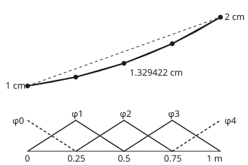
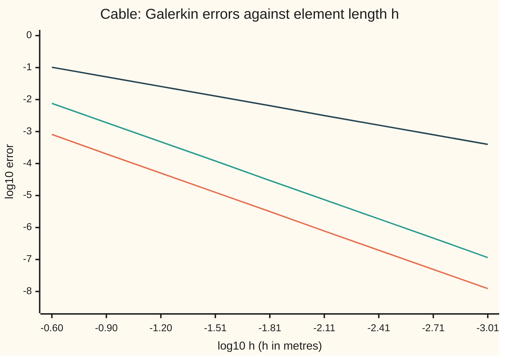

# Finite elements: multiply by a test function, integrate by parts, and use hat functions

[Syllabus](../../../SYLLABUS.md) → [Numerical analysis](../README.md) → [PDE Solvers](../README.md#s07) → Finite elements

---

## General Overview

A cable 1 m long hangs between two posts over a mat of springs. The left post holds it 1 cm above the mat, the right post 2 cm. The springs pull each piece of cable down in proportion to its height, and the tension pulls back by curving it. This is the cable of [Shooting](../../08-Differential%20equations%20and%20dynamics/07-Series%20Solutions%20and%20Boundary%20Problems/06-the-shooting-method.md). Its middle sits at 1.330228 cm, well below the 1.5 cm of a straight line between the posts.

The wanted number is that middle height, to about a thousandth of a centimetre, without the closed form. Shooting aims a slope; finite differences write the equation at grid points. Finite elements never ask the equation to hold at any single point.

Instead, cut the cable into four pieces of 0.25 m, called **elements**. On each piece the computed cable is a straight segment, so the whole is a broken line through five **nodes**. The broken line cannot obey the equation exactly. So ask less: multiply the equation by a small tent-shaped **test function**, add it up along the cable, and demand the total be zero. Do that for three tents, one per inside node. Three equations, three unknown heights. The middle node comes out at 1.329422 cm, off by 8.067e-4 cm.

**Turn the equation into its weak form by multiplying by a test function and integrating by parts, then ask the weak form to hold only for hat functions: the result is a small tridiagonal system, and its broken line is the closest one to the true curve in the energy the cable stores.**

**What kind of fact this is:** a method. That its answer is the best broken line in energy, and the energy-error bound that halves with the element length, are theorems proved on this card in Why it works. The faster fall of the height error, order 2, is stated with a source and shown by the checks, not proved here.

### The picture: the cable in four elements, and its hats

<p align="center"></p>

To scale: 280 px per metre across, 100 px per centimetre up, from the checks' `figure,` lines. Top: the exact curve (thin), the Galerkin broken line and its five dots (thick), and the straight chord (dashed); curve and broken line lie within 1 px. Bottom: the hat functions, each 1 at its own node and 0 at every other node. The two end hats are dashed: their heights are fixed by the posts.

---

## The formula

Notation first, in words. Two primes, $y''$, mean the rate of the rate: the bending. One prime is the slope. The cable obeys

$$-y'' + y = f \quad\text{for } 0 < x < 1, \qquad y(0) = 1, \quad y(1) = 2,$$

where $x$ is the distance from the left post in metres and $y$ is the height in centimetres. The spring stiffness over the tension is 1 per square metre, and $f$ is any extra load. Here $f = 0$: the sag comes from the springs and the posts.

A **test function** $v$ is any curve that is zero at both posts and has a slope worth integrating. Multiply the equation by $v$, integrate from 0 to 1, and move one derivative from $y$ onto $v$ by [Integration by parts](../../06-Calculus%20and%20analysis/04-Integrals/04-integration-by-parts.md). The **weak form** is

$$a(y, v) = (f, v) \quad\text{for every test function } v, \qquad a(u, v) = \int_0^1 \big(u'v' + uv\big)\,dx, \qquad (f, v) = \int_0^1 f\,v\,dx.$$

**Read it aloud:** the slopes of the cable and of the test curve, multiplied and added up, plus the heights multiplied and added up, equal the load weighted by the test curve.

The pairing $a(u, v)$ is the **energy pairing**. Half of $a(y, y)$ is the energy the cable stores: stretching from the slope, springs from the height.

Now cut $[0, 1]$ into $n$ elements of length $h = 1/n$, with nodes $x_i = ih$. The **hat function** $\varphi_i$ is 1 at node $i$, 0 at every other node, and straight in between. (On the secant card $\varphi$ is the golden ratio; on this shelf it is a hat.) The **Galerkin method** looks for a broken line

$$y_h = \varphi_0 \cdot 1 + \sum_{i=1}^{n-1} U_i\,\varphi_i + \varphi_n \cdot 2$$

that obeys the weak form for the inside hats only: $a(y_h, \varphi_j) = (f, \varphi_j)$ for $j = 1, \dots, n-1$. That is $n - 1$ linear equations,

$$(K + M)\,U = F, \qquad K_{ij} = \int_0^1 \varphi_i'\varphi_j'\,dx, \quad M_{ij} = \int_0^1 \varphi_i\varphi_j\,dx.$$

**Read it aloud:** the stiffness matrix plus the mass matrix, times the list of unknown node heights, equals the right side made by the load and the two posts.

Each row has at most three entries, because a hat overlaps only its two neighbours: $d = 2/h + 4h/6$ on the diagonal and $o = -1/h + h/6$ beside it. With $h$ = 0.25 these are 8.166667 and −3.958333.

| Symbol | Plain meaning | In our example | Push it up and the answer… |
| --- | --- | --- | --- |
| $x$, $y$ | distance from the left post, m; exact height, cm | middle: 0.5 m, 1.330228 cm | — |
| $s$, $t$ | the exact cable's starting slope, cm per m; a nudge to one node height, cm | 0.38880097; 0.01 | — |
| $f$, $(f, v)$ | extra load; the load weighted by a test curve | $f = 0$ | the cable sags further |
| $v$, $w$ | test function: any curve that is zero at both posts; any other broken line through the posts | the inside hats; $Iy$ | — |
| $a(u, v)$ | energy pairing $\int (u'v' + uv)\,dx$ | $a(y, y)$ = 3.1615039145 | — |
| $h$, $n$ | element length, m; number of elements | 0.25; 4 | $h$ up: errors grow |
| $x_i$, $\varphi_i$ | node $i$; the hat function on it | $x_2$ = 0.5 m | — |
| $U_i$, $y_h$ | computed node height, cm; the broken line through them | $U_2$ = 1.329422 | — |
| $K$, $M$, $d$, $o$ | stiffness and mass matrices; diagonal and side entry of $K + M$ | 8.166667 and −3.958333 | — |
| $F$ | right side: what the posts and the load push into each row | 3.958333, 0, 7.916667 | — |
| $\lVert\cdot\rVert$, $\lVert\cdot\rVert_a$ | L2 size $\sqrt{\int w^2}$; energy size $\sqrt{a(w, w)}$ | $\lVert y''\rVert$ = 1.416040 | — |
| $e$, $Iy$, $c$, $b_m$ | error $y - y_h$ (in the proof fold, $y - Iy$); the broken line through the exact node heights; its slope on one element; the size of the $m$-th sine in $e$ | $\lVert e\rVert_a$ = 1.023e-1 | — |

### When it holds

- **The energy pairing is positive.** The proofs below need $a(v, v) > 0$ for every nonzero test curve; a pairing negative for every curve works too, after multiplying the equation by −1. Springs that push outward, $-y'' - 10y = 0$, make it positive for some curves and negative for others. With four elements the middle comes out at 53.3354 cm; the exact cable bulges to −145.0352 cm, and 64 elements give −147.3256 cm.
- **Trial curves (the shapes the answer is built from) with a slope, not a bend.** The weak form needs only $y'$, which a hat has. A hat has no usable $y''$: inside each element it is zero, and at a node it is a spike. Skipping integration by parts gives nonsense (What breaks, row 1).
- **Test curves that vanish where the height is fixed.** That kills the end term $[y'v]_0^1$ from integration by parts. A free end, where the slope is given instead, keeps that term ([Assembly and error](08-finite-element-assembly-and-error.md)).
- **A smooth enough cable for the rates.** The energy bound needs $y''$ square-integrable. A point load puts a corner in the cable, and the rates then depend on where the corner falls.
- **Integrals done exactly.** Here every entry has a closed form. A spring stiffness that varies along the cable needs a quadrature rule, which adds its own error.

---

## Why it works

### Step 0: ask the equation to hold on average, against chosen weights

A broken line has a corner at every node, so $-y_h'' + y_h = 0$ fails everywhere. Holding pointwise is too much to ask. Holding "on average, weighted by $v$" is not, and if it holds for every possible $v$, it says the same thing as the equation. Galerkin's move is to use the same few shapes both to build the answer and to test it.

### Step 1: the weak form, by integration by parts

Multiply $-y'' + y = f$ by a test curve $v$ and integrate:

$$-\int_0^1 y''v\,dx + \int_0^1 yv\,dx = \int_0^1 fv\,dx.$$

Integration by parts turns the first term into $-[y'v]_0^1 + \int_0^1 y'v'\,dx$. The end term is zero, because $v(0) = v(1) = 0$. What is left is $a(y, v) = (f, v)$.

Two things happened. The second derivative left $y$, so a curve with corners now qualifies. And the pairing became symmetric, $a(u, v) = a(v, u)$, with $a(v, v) = \int (v'^2 + v^2)\,dx > 0$. That positivity drives the rest.

### Step 2: hats turn the weak form into a tridiagonal matrix

On one element $[x_k, x_k + h]$, two hats are alive. One falls from 1 to 0, slope $-1/h$; the other rises, slope $+1/h$. Integrating over the element gives two small tables:

- slopes: $\int \varphi_k'^2 = h \cdot (1/h)^2 = 1/h$, and $\int \varphi_k'\varphi_{k+1}' = -1/h$;
- heights: $\int \varphi_k^2 = h/3$, and $\int \varphi_k\varphi_{k+1} = h/6$.

An inside node belongs to two elements, so its diagonal entry adds two copies: $2/h + 2h/3$, which is the $d = 2/h + 4h/6$ of The formula. Its neighbours share one element with it: $o = -1/h + h/6$. Hats two nodes apart never overlap, so every other entry is zero.

The posts enter through the end hats. Row 1 contains $o \times 1$ from $\varphi_0$, which moves to the right side as $-o$ = 3.958333. Row 3 contains $o \times 2$, giving 7.916667. Solving the three rows with [The Thomas algorithm](../03-Numerical%20Linear%20Algebra/03-tridiagonal-systems-and-the-thomas-algorithm.md) gives 1.129056, 1.329422 and 1.613750 cm.

<details>
<summary>Detailed comparison: Galerkin's rows against finite differences</summary>

Divide row $i$ by $h$:

$$\frac{-U_{i-1} + 2U_i - U_{i+1}}{h^2} + \frac{U_{i-1} + 4U_i + U_{i+1}}{6} = 0.$$

The first part is the usual second difference. The second part is the spring term, but spread over three nodes with weights 1, 4, 1 instead of sitting on node $i$. Put all of it on the diagonal ("lump" the mass matrix) and the rows become the finite-difference scheme of [Finite differences on a grid](02-finite-differences-consistency-stability-and-convergence.md). That scheme gives 1.130193, 1.331023 and 1.615041 cm.

Taylor's theorem says the second difference misses $-y''$ by $-\tfrac{h^2}{12}y''''$, and the 1, 4, 1 average misses $y$ by $+\tfrac{h^2}{6}y''$. On this cable $y'''' = y'' = y$, so Galerkin's rows miss by $+\tfrac{h^2}{12}y$ and finite differences by $-\tfrac{h^2}{12}y$. The node errors match that: −8.067e-4 and +7.942e-4 cm in the middle. Averaging the two answers cancels the $h^2$ term, and the middle error drops to −6.268e-6 cm.

</details>

### Step 3: Galerkin orthogonality, and why the answer is the best broken line

The exact cable obeys $a(y, \varphi_j) = (f, \varphi_j)$ for every inside hat. The broken line obeys the same equations by construction. Subtract:

$$a(y - y_h, \varphi_j) = 0 \quad\text{for } j = 1, \dots, n-1.$$

The error is perpendicular to every inside hat in the energy pairing. This is **Galerkin orthogonality**. Take any other broken line $w$ through the posts. The gap $y_h - w$ is a mix of inside hats, so it is perpendicular to the error too. Pythagoras in the energy pairing gives

$$\lVert y - w\rVert_a^2 = \lVert y - y_h\rVert_a^2 + \lVert y_h - w\rVert_a^2.$$

So no broken line on this mesh comes closer to the cable in energy than $y_h$. This is the closest-point property of [L2 as a Hilbert space](../../10-Measure%20and%20integration/07-Sizes%20of%20Functions/06-l2-as-a-hilbert-space.md), with $a$ in place of the L2 pairing.

The check tests it on the most natural rival, the broken line $Iy$ through the exact node heights. Its energy error is 1.022838e-1; Galerkin's is 1.022661e-1. Both are estimates from a three-point Gauss rule on each element, good to a few units in the last digit, so the gap is real. The rival has the right heights at the nodes, yet loses in energy.

### Step 4: the same answer is the lowest energy (Ritz)

Take any broken line $w$ through the posts again, with $f = 0$. Because $y - w$ is zero at the posts, $a(y, y - w) = 0$ by the weak form, and expanding gives

$$a(w, w) = a(y, y) + \lVert y - w\rVert_a^2.$$

A broken line's $a(w, w)$ exceeds the cable's by exactly its squared energy error, so it stores more energy than the cable. Hence the least-energy broken line and the closest broken line are the same: $y_h$. Building it this way is the **Rayleigh-Ritz method**; for a symmetric positive pairing it gives the same answer as Galerkin.

Two numbers confirm it. For the cable, $a(y, y)$ = 3.1615039145, twice the energy it stores, from $y(1)y'(1) - y(0)y'(0)$. For the broken line, $a(y_h, y_h)$ = 3.1719622845. The square root of the difference is 1.022662e-1, the energy error found by integrating the error directly (1.022661e-1, with a three-point Gauss rule per element). And nudging node 2 by 0.01 cm raises the stored energy, half of $a(y_h, y_h)$, by 4.083e-4, exactly $t^2 d/2$ with $t$ = 0.01: no first-order change, so the nodes sit at the minimum.

### Step 5: the energy error halves when the elements halve

Step 3 says the Galerkin error is at most the error of $Iy$. That one can be bounded on each element. The error of $Iy$ is zero at both ends of the element, and a curve that vanishes at both ends of a length $h$ cannot be large unless its slope is. The result is

$$\lVert y - y_h\rVert_a \;\le\; \lVert y - Iy\rVert_a \;\le\; \frac{h}{\pi}\sqrt{1 + \Big(\frac{h}{\pi}\Big)^2}\;\lVert y''\rVert.$$

**Read it aloud:** the energy error is at most the element length over pi, times a factor just above 1, times the size of the cable's bending.

<details>
<summary>Detailed proof: the interpolation bound, element by element</summary>

Fix one element of length $h$ and let $e = y - Iy$ there. It is zero at both ends, and $(Iy)'$ is a constant $c$.

1. **Wirtinger's inequality.** On the element $[x_k, x_k + h]$, expand $e$ in sines that vanish at both ends, $e = \sum_{m \ge 1} b_m \sin(m\pi(x - x_k)/h)$. By Parseval ([Parseval's identity](../../08-Differential%20equations%20and%20dynamics/09-Fourier%20Series/03-parsevals-identity.md)), $\int e^2 = \tfrac{h}{2}\sum b_m^2$ and $\int e'^2 = \tfrac{h}{2}\sum (m\pi/h)^2 b_m^2$. Every $m \ge 1$, so $\int e^2 \le (h/\pi)^2 \int e'^2$.
2. **Slope through bending.** $\int e'^2 = \int e'(y' - c) = \int e'y'$, since $\int e' c = c\,[e] = 0$. Integrate by parts: $\int e'y' = [e y'] - \int e y'' = -\int e y''$.
3. **Cauchy-Schwarz.** $-\int e y'' \le \lVert e\rVert\,\lVert y''\rVert \le (h/\pi)\lVert e'\rVert\,\lVert y''\rVert$, using step 1. Divide by $\lVert e'\rVert$: $\lVert e'\rVert \le (h/\pi)\lVert y''\rVert$, and then $\lVert e\rVert \le (h/\pi)^2\lVert y''\rVert$.

Square, add $\lVert e'\rVert^2 + \lVert e\rVert^2$, and sum over the elements: the energy error squared is at most $(h/\pi)^2\big(1 + (h/\pi)^2\big)\lVert y''\rVert^2$. Step 3 then passes the bound to $y_h$.

</details>

On the cable $y'' = y$, so $\lVert y''\rVert = \lVert y\rVert$ = 1.416040, from a closed form and again by quadrature. With $h$ = 0.25 the bound is 1.130e-1 against a true 1.023e-1: a ratio of 1.105. It stays at 1.103 for every finer mesh. The bound is tight because the cable's bending barely changes over one element. The error on each element is then close to a parabola, and for a parabola the bound is exactly $\sqrt{12}/\pi$ times the truth: the 1.103 of the table.

### Step 6: what the checks see as the mesh shrinks

Selected rows from the run, which doubles the number of elements from 4 to 1024. The node errors are true errors against the closed form. The L2 and energy errors are estimates: they integrate the true error with a three-point Gauss rule on each element, which can be off by one in the last digit shown.

| $n$ | node error, cm | L2 error | energy error | bound | bound / true |
| ---: | --- | --- | --- | --- | ---: |
| 4 | 8.067e-4 | 7.614e-3 | 1.023e-1 | 1.130e-1 | 1.105 |
| 8 | 2.005e-4 | 1.903e-3 | 5.111e-2 | 5.639e-2 | 1.103 |
| 16 | 5.009e-5 | 4.756e-4 | 2.555e-2 | 2.818e-2 | 1.103 |
| 64 | 3.140e-6 | 2.972e-5 | 6.387e-3 | 7.043e-3 | 1.103 |
| 1024 | 1.223e-8 | 1.161e-7 | 3.992e-4 | 4.402e-4 | 1.103 |

Observed orders over the first four halvings: energy 1.00, 1.00, 1.00, 1.00, as proved. L2 and node errors 2.00 (the node orders start at 2.01). The L2 order 2 comes from a duality argument, the Aubin-Nitsche trick, which this card states but does not prove ([Brenner and Scott](https://doi.org/10.1007/978-0-387-75934-0), chapter 0).



Orange: largest node error, cm, slope 2. Green: L2 error, slope 2. Dark: energy error, slope 1.

**Cost.** The system has $n - 1$ unknowns in a tridiagonal matrix, so the Thomas sweep takes $8(n-1) - 7$ flops: 17 at $n$ = 4, 8177 at $n$ = 1024.

**Rounding.** The entries grow like $2/h$ while their sums nearly cancel, so rounding grows as $h$ shrinks. The largest node error is 1.9e-10 cm at $n$ = 4096, then rises to 9.1e-9 at 16384 and 1.5e-7 at 65536. That 1.9e-10 is partly luck: near 4096 the shrinking $h^2$ error and the growing rounding error are about the same size and partly cancel. Past about 4096 elements, more elements make the answer worse.

---

## Worked numbers, by hand

Four elements, $h$ = 0.25 m, posts at 1 cm and 2 cm, $f = 0$.

| Step | Arithmetic | Value |
| --- | --- | --- |
| diagonal $d$ | $2/0.25 + 4 \times 0.25/6$ | 8.166667 |
| side entry $o$ | $-1/0.25 + 0.25/6$ | −3.958333 |
| right side, rows 1 to 3 | $-o \times 1$; 0; $-o \times 2$ | 3.958333, 0, 7.916667 |
| solve $(K + M)U = F$ | Thomas sweep, 17 flops | 1.129056, 1.329422, 1.613750 |
| exact nodes | $\cosh x + s\sinh x$, $s$ = 0.38880097 | 1.129629, 1.330228, 1.614401 |
| node errors | computed minus exact | −5.726e-4, −8.067e-4, −6.506e-4 |
| energy error | $\sqrt{3.1719622845 - 3.1615039145}$ | 1.022662e-1 |
| bound | $0.25/\pi \times \sqrt{1 + (0.25/\pi)^2} \times 1.416040$ | 1.130e-1, ratio 1.105 |
| middle height | Galerkin, 4 elements | **1.329422 cm, off by 8.067e-4 cm** |

Four elements put the middle of the cable within a hundredth of a millimetre, and the energy bound promised no worse than 1.130e-1 in energy before the exact answer was known.

### What breaks if you drop a piece

| Mistake | Comes out at | What went wrong |
| --- | --- | --- |
| No integration by parts: hats put straight into $-y'' + y$ | −0.3036, 0.2143, −0.5536 cm | a hat's $y''$ is zero inside every element, so only the spring term survives and the heights zig-zag below the mat |
| Spring term dropped | 1.2500, 1.5000, 1.7500 cm | with no springs the cable is the straight chord |
| Sign slip in integration by parts: $-y'v' + yv$ | 1.3972, 1.7080, 1.9132 cm | the pairing turns negative definite, and the rows become Galerkin's for $y'' + y = 0$: a cable on springs that push out, which bows up above the chord |
| End hats left out of the right side | 0.0000, 0.0000, 0.0000 cm | the posts reach the system only through the end hats |

---

## Code, from first principles, and it actually runs

The code builds the Galerkin system for any number of elements, solves it with a Thomas sweep and measures the errors. It takes three roads. Road one is the closed form $\cosh x + s\sinh x$. Road two is the Galerkin answer, with its errors found by a three-point Gauss rule on each element. Road three is the energy theory: the identity $a(y_h, y_h) - a(y, y) = \lVert e\rVert_a^2$, the Ritz nudge, the best-fit comparison with $Iy$, and the bound. Asserts check that the roads agree, that the observed orders are 2 and 1, that the bound holds, and that rounding stops the fall.

### Python

```python
# Finite elements: Galerkin with hat functions -- the check behind the card.  Standard library only.
# Cable on a bed of springs: -y'' + y = 0 for 0 <= x <= 1 m, y(0) = 1 cm, y(1) = 2 cm.
# Road one: the closed form y = cosh x + s sinh x.  Road two: Galerkin with hats, n elements,
# solved by the Thomas sweep.  Road three: energy identities (Ritz minimum, best fit) and the bound.
from math import cosh, sinh, cos, sin, sqrt, pi, log2, log10

S = (2 - cosh(1)) / sinh(1)                          # starting slope of the exact cable
def y(x): return cosh(x) + S * sinh(x)
def dy(x): return sinh(x) + S * cosh(x)
def sci(x, d=3):                                     # 8.067e-4, the same in Rust
    m, e = f"{x:.{d}e}".split("e")
    return f"{m}e{int(e)}"
def row(v, d=6): return ", ".join(f"{x:.{d}f}" for x in v)
def thomas(a, b, c, r):                              # sub-, main and super-diagonal, right side
    b, r = b[:], r[:]
    for i in range(1, len(b)):
        w = a[i] / b[i-1]; b[i] -= w * c[i-1]; r[i] -= w * r[i-1]
    u = [0.0] * len(b); u[-1] = r[-1] / b[-1]
    for i in range(len(b) - 2, -1, -1): u[i] = (r[i] - c[i] * u[i+1]) / b[i]
    return u
def galerkin(n, ks=1.0, km=1.0, lump=False, ends=True):
    # ks multiplies the y'v' part, km the y v part; lump puts all of y v on the diagonal
    h = 1.0 / n
    d = ks * 2 / h + km * (h if lump else 4 * h / 6)          # a(phi_i, phi_i)
    o = -ks / h + (0.0 if lump else km * h / 6)               # a(phi_i, phi_(i+1))
    r = [0.0] * (n - 1)
    if ends: r[0] -= o * 1.0; r[-1] -= o * 2.0                # the end hats carry 1 cm and 2 cm
    return [1.0] + thomas([o] * (n - 1), [d] * (n - 1), [o] * (n - 1), r) + [2.0], d, o, r
G3 = [(-sqrt(0.6), 5 / 9), (0.0, 8 / 9), (sqrt(0.6), 5 / 9)]   # 3-point Gauss rule on [-1, 1]
def errors(U):                                       # L2 error and energy error of the broken line U
    n = len(U) - 1; h = 1.0 / n; e2 = d2 = 0.0
    for k in range(n):
        sl = (U[k+1] - U[k]) / h
        for t, w in G3:
            x = (k + 0.5 + t / 2) * h
            e2 += w * h / 2 * (y(x) - U[k] - sl * (x - k * h)) ** 2
            d2 += w * h / 2 * (dy(x) - sl) ** 2
    return sqrt(e2), sqrt(e2 + d2)
def energy(U):                                       # a(y_h, y_h), element by element
    n = len(U) - 1; h = 1.0 / n
    return sum((U[k+1] - U[k]) ** 2 / h + h / 3 * (U[k] ** 2 + U[k] * U[k+1] + U[k+1] ** 2) for k in range(n))
def nodal(U): n = len(U) - 1; return max(abs(U[i] - y(i / n)) for i in range(n + 1))

print(f"cable: -y'' + y = 0, y(0) = 1 cm, y(1) = 2 cm; exact starting slope s = {S:.8f}")
U4, d, o, r = galerkin(4)
ex = [y(i / 4) for i in range(5)]
print(f"n = 4, h = 0.25: diagonal 2/h + 4h/6 = {d:.6f}, off-diagonal -1/h + h/6 = {o:.6f}")
print(f"right side from the end hats: {row(r)}")
print(f"Galerkin nodes: {row(U4)}")
print(f"exact nodes:    {row(ex)}")
print("nodal error, Galerkin minus exact: " + ", ".join(sci(U4[i] - ex[i]) for i in (1, 2, 3)))
F4 = galerkin(4, lump=True)[0]
print(f"lumped springs = finite differences: {row(F4)}; errors " + ", ".join(sci(F4[i] - ex[i]) for i in (1, 2, 3)))
l2, en = errors(U4)
ay = 2 * dy(1) - dy(0)                               # a(y, y) = y(1)y'(1) - y(0)y'(0)
print(f"energy: exact cable a(y,y) = {ay:.10f}, Galerkin a(y_h,y_h) = {energy(U4):.10f}")
print(f"energy error: by quadrature {sci(en, 6)}, by sqrt(a(y_h,y_h) - a(y,y)) {sci(sqrt(energy(U4) - ay), 6)}")
I4 = ex[:]
print(f"energy error of the broken line through the exact nodes: {sci(errors(I4)[1], 6)} (Galerkin {sci(en, 6)})")
t = 0.01; P = U4[:]; P[2] += t
print(f"Ritz: nudge node 2 by 0.01 cm, energy/2 rises {sci((energy(P) - energy(U4)) / 2)}; t^2 d/2 = {sci(t * t * d / 2)}")
Y2 = 0.5 + sinh(2) / 4 + S * sinh(1) ** 2 + S * S * (sinh(2) / 4 - 0.5)   # integral of y^2 = y''^2
print(f"||y''|| = ||y|| = {sqrt(Y2):.6f} (closed form), {errors([0.0] * 65)[0]:.6f} (quadrature)")
NS = [4, 8, 16, 32, 64, 128, 256, 512, 1024]
tab = []
print("n, nodal max error, L2 error, energy error, energy bound, bound / energy error")
for n in NS:
    U = galerkin(n)[0]; l2n, enn = errors(U); h = 1.0 / n
    b = h / pi * sqrt(1 + (h / pi) ** 2) * sqrt(Y2)
    tab.append((nodal(U), l2n, enn, b))
    print(f"  {n:4d}  {sci(nodal(U))}  {sci(l2n)}  {sci(enn)}  {sci(b)}  {b / enn:.3f}")
for j, name in enumerate(("nodal", "L2", "energy")):
    print(f"observed order, {name}: " + ", ".join(f"{log2(tab[i][j] / tab[i+1][j]):.2f}" for i in range(4)))
print("chart x, log10 h: " + ", ".join(f"{log10(1 / n):.2f}" for n in NS))
for j, name in enumerate(("nodal", "L2", "energy")):
    print(f"chart, log10 error, {name}: " + ", ".join(f"{log10(v[j]):.2f}" for v in tab))
fl = [nodal(galerkin(n)[0]) for n in (4096, 16384, 65536)]
print("rounding, nodal max error at n = 4096, 16384, 65536: " + ", ".join(sci(e, 1) for e in fl))
print(f"cost at n = 4: 3 unknowns, Thomas sweep 8(n-1) - 7 = {8 * 3 - 7} flops; at n = 1024: {8 * 1023 - 7} flops")
m1, m2, m3, m4 = galerkin(4, ks=0.0)[0], galerkin(4, km=0.0)[0], galerkin(4, ks=-1.0)[0], galerkin(4, ends=False)[0]
print(f"mistake 1, no integration by parts (only y v survives): {row(m1[1:4], 4)}")
print(f"mistake 2, springs dropped: {row(m2[1:4], 4)}")
print(f"mistake 3, sign slip, -y'v' + y v: {row(m3[1:4], 4)}")
print(f"mistake 4, end hats left out of the right side: {row(m4[1:4], 4)}")
w = sqrt(10); B = (2 - cos(w)) / sin(w)              # -y'' - 10 y = 0: springs push out
print(f"push-out springs, -y'' - 10 y = 0: middle, n = 4: {galerkin(4, km=-10.0)[0][2]:.4f}, "
      f"n = 64: {galerkin(64, km=-10.0)[0][32]:.4f}, exact {cos(w / 2) + B * sin(w / 2):.4f}")
A = [(U4[i] + F4[i]) / 2 - ex[i] for i in (1, 2, 3)]
print("try, average of Galerkin and finite differences, errors: " + ", ".join(sci(a) for a in A))
print(f"try, n = 8 middle node {galerkin(8)[0][4]:.6f}, exact {y(0.5):.6f}")
px = lambda x, v: f"({40 + 280 * x:.1f}, {125 - 100 * (v - 1):.1f})"
print("figure, Galerkin nodes px: " + " ".join(px(i / 4, U4[i]) for i in range(5)))
print("figure, exact curve px: " + " ".join(px(i / 8, y(i / 8)) for i in range(9)))
print("figure, hats: base y = 220.0, peaks " + " ".join(f"({40 + 70 * i:.1f}, 175.0)" for i in range(5)))

assert all(abs(U4[i] - ex[i]) < 1e-3 for i in range(5))              # Galerkin near the closed form
assert abs(en - sqrt(energy(U4) - ay)) < 1e-6                         # Gauss rule = energy identity
assert en < errors(I4)[1]                                             # best fit in energy beats the interpolant
assert abs((energy(P) - energy(U4)) / 2 - t * t * d / 2) < 1e-12      # Ritz: the nodes sit at the minimum
assert abs(sqrt(Y2) - errors([0.0] * 65)[0]) < 1e-9                   # closed-form norm = quadrature
assert all(e < b for _, _, e, b in tab)                               # the energy bound holds
assert all(1.95 < log2(tab[i][0] / tab[i+1][0]) < 2.05 for i in range(4))   # nodal order 2
assert all(0.98 < log2(tab[i][2] / tab[i+1][2]) < 1.02 for i in range(4))   # energy order 1
assert all(abs(A[k]) < abs(U4[k+1] - ex[k+1]) / 50 for k in range(3))        # the two h^2 terms cancel
assert fl[2] > fl[1]                                                  # rounding stops the fall
print("ALL CHECKS PASS")
```

**Ran 2026-11-11 on macOS, Python 3.14.10, standard library only. All checks passed. Output, pasted from the run:**

```
cable: -y'' + y = 0, y(0) = 1 cm, y(1) = 2 cm; exact starting slope s = 0.38880097
n = 4, h = 0.25: diagonal 2/h + 4h/6 = 8.166667, off-diagonal -1/h + h/6 = -3.958333
right side from the end hats: 3.958333, 0.000000, 7.916667
Galerkin nodes: 1.000000, 1.129056, 1.329422, 1.613750, 2.000000
exact nodes:    1.000000, 1.129629, 1.330228, 1.614401, 2.000000
nodal error, Galerkin minus exact: -5.726e-4, -8.067e-4, -6.506e-4
lumped springs = finite differences: 1.000000, 1.130193, 1.331023, 1.615041, 2.000000; errors 5.637e-4, 7.942e-4, 6.404e-4
energy: exact cable a(y,y) = 3.1615039145, Galerkin a(y_h,y_h) = 3.1719622845
energy error: by quadrature 1.022661e-1, by sqrt(a(y_h,y_h) - a(y,y)) 1.022662e-1
energy error of the broken line through the exact nodes: 1.022838e-1 (Galerkin 1.022661e-1)
Ritz: nudge node 2 by 0.01 cm, energy/2 rises 4.083e-4; t^2 d/2 = 4.083e-4
||y''|| = ||y|| = 1.416040 (closed form), 1.416040 (quadrature)
n, nodal max error, L2 error, energy error, energy bound, bound / energy error
     4  8.067e-4  7.614e-3  1.023e-1  1.130e-1  1.105
     8  2.005e-4  1.903e-3  5.111e-2  5.639e-2  1.103
    16  5.009e-5  4.756e-4  2.555e-2  2.818e-2  1.103
    32  1.256e-5  1.189e-4  1.277e-2  1.409e-2  1.103
    64  3.140e-6  2.972e-5  6.387e-3  7.043e-3  1.103
   128  7.850e-7  7.431e-6  3.194e-3  3.521e-3  1.103
   256  1.962e-7  1.858e-6  1.597e-3  1.761e-3  1.103
   512  4.905e-8  4.644e-7  7.984e-4  8.804e-4  1.103
  1024  1.223e-8  1.161e-7  3.992e-4  4.402e-4  1.103
observed order, nodal: 2.01, 2.00, 2.00, 2.00
observed order, L2: 2.00, 2.00, 2.00, 2.00
observed order, energy: 1.00, 1.00, 1.00, 1.00
chart x, log10 h: -0.60, -0.90, -1.20, -1.51, -1.81, -2.11, -2.41, -2.71, -3.01
chart, log10 error, nodal: -3.09, -3.70, -4.30, -4.90, -5.50, -6.11, -6.71, -7.31, -7.91
chart, log10 error, L2: -2.12, -2.72, -3.32, -3.92, -4.53, -5.13, -5.73, -6.33, -6.94
chart, log10 error, energy: -0.99, -1.29, -1.59, -1.89, -2.19, -2.50, -2.80, -3.10, -3.40
rounding, nodal max error at n = 4096, 16384, 65536: 1.9e-10, 9.1e-9, 1.5e-7
cost at n = 4: 3 unknowns, Thomas sweep 8(n-1) - 7 = 17 flops; at n = 1024: 8177 flops
mistake 1, no integration by parts (only y v survives): -0.3036, 0.2143, -0.5536
mistake 2, springs dropped: 1.2500, 1.5000, 1.7500
mistake 3, sign slip, -y'v' + y v: 1.3972, 1.7080, 1.9132
mistake 4, end hats left out of the right side: 0.0000, 0.0000, 0.0000
push-out springs, -y'' - 10 y = 0: middle, n = 4: 53.3354, n = 64: -147.3256, exact -145.0352
try, average of Galerkin and finite differences, errors: -4.453e-6, -6.268e-6, -5.086e-6
try, n = 8 middle node 1.330028, exact 1.330228
figure, Galerkin nodes px: (40.0, 125.0) (110.0, 112.1) (180.0, 92.1) (250.0, 63.6) (320.0, 25.0)
figure, exact curve px: (40.0, 125.0) (75.0, 119.3) (110.0, 112.0) (145.0, 103.0) (180.0, 92.0) (215.0, 78.9) (250.0, 63.6) (285.0, 45.7) (320.0, 25.0)
figure, hats: base y = 220.0, peaks (40.0, 175.0) (110.0, 175.0) (180.0, 175.0) (250.0, 175.0) (320.0, 175.0)
ALL CHECKS PASS
```

### Rust

Same rows and labels; the two outputs agree line for line.

```rust
// Finite elements: Galerkin with hat functions -- the same check as the Python, in Rust.  No crates.
// Cable on a bed of springs: -y'' + y = 0 for 0 <= x <= 1 m, y(0) = 1 cm, y(1) = 2 cm.
// Road one: the closed form y = cosh x + s sinh x.  Road two: Galerkin with hats, n elements,
// solved by the Thomas sweep.  Road three: energy identities (Ritz minimum, best fit) and the bound.
use std::f64::consts::PI;

fn s0() -> f64 { (2.0 - 1f64.cosh()) / 1f64.sinh() }      // starting slope of the exact cable
fn y(x: f64) -> f64 { x.cosh() + s0() * x.sinh() }
fn dy(x: f64) -> f64 { x.sinh() + s0() * x.cosh() }
fn sci(x: f64, d: usize) -> String { format!("{:.*e}", d, x) }    // 8.067e-4, as in Python
fn row(v: &[f64], d: usize) -> String { v.iter().map(|x| format!("{:.*}", d, x)).collect::<Vec<_>>().join(", ") }
fn thomas(a: &[f64], b: &[f64], c: &[f64], r: &[f64]) -> Vec<f64> {   // sub, main, super, right side
    let (mut b, mut r) = (b.to_vec(), r.to_vec());
    for i in 1..b.len() {
        let w = a[i] / b[i - 1]; b[i] -= w * c[i - 1]; r[i] -= w * r[i - 1];
    }
    let n = b.len(); let mut u = vec![0.0; n]; u[n - 1] = r[n - 1] / b[n - 1];
    for i in (0..n - 1).rev() { u[i] = (r[i] - c[i] * u[i + 1]) / b[i] }
    u
}
// ks multiplies the y'v' part, km the y v part; lump puts all of y v on the diagonal
fn galerkin(n: usize, ks: f64, km: f64, lump: bool, ends: bool) -> (Vec<f64>, f64, f64, Vec<f64>) {
    let h = 1.0 / n as f64;
    let d = ks * 2.0 / h + km * (if lump { h } else { 4.0 * h / 6.0 });    // a(phi_i, phi_i)
    let o = -ks / h + (if lump { 0.0 } else { km * h / 6.0 });             // a(phi_i, phi_(i+1))
    let mut r = vec![0.0; n - 1];
    if ends { r[0] -= o * 1.0; r[n - 2] -= o * 2.0 }                       // the end hats carry 1 cm and 2 cm
    let mut u = vec![1.0];
    u.extend(thomas(&vec![o; n - 1], &vec![d; n - 1], &vec![o; n - 1], &r));
    u.push(2.0);
    (u, d, o, r)
}
fn gal(n: usize) -> Vec<f64> { galerkin(n, 1.0, 1.0, false, true).0 }
fn errors(u: &[f64]) -> (f64, f64) {                     // L2 error and energy error of the broken line u
    let g3 = [(-(0.6f64).sqrt(), 5.0 / 9.0), (0.0, 8.0 / 9.0), ((0.6f64).sqrt(), 5.0 / 9.0)];
    let n = u.len() - 1; let h = 1.0 / n as f64; let (mut e2, mut d2) = (0.0, 0.0);
    for k in 0..n {
        let sl = (u[k + 1] - u[k]) / h;
        for &(t, w) in &g3 {
            let x = (k as f64 + 0.5 + t / 2.0) * h;
            e2 += w * h / 2.0 * (y(x) - u[k] - sl * (x - k as f64 * h)).powi(2);
            d2 += w * h / 2.0 * (dy(x) - sl).powi(2);
        }
    }
    (e2.sqrt(), (e2 + d2).sqrt())
}
fn energy(u: &[f64]) -> f64 {                            // a(y_h, y_h), element by element
    let n = u.len() - 1; let h = 1.0 / n as f64;
    (0..n).map(|k| (u[k + 1] - u[k]).powi(2) / h + h / 3.0 * (u[k] * u[k] + u[k] * u[k + 1] + u[k + 1] * u[k + 1])).sum()
}
fn nodal(u: &[f64]) -> f64 { let n = u.len() - 1; (0..=n).map(|i| (u[i] - y(i as f64 / n as f64)).abs()).fold(0.0, f64::max) }
fn errs3(u: &[f64], ex: &[f64]) -> String { [1, 2, 3].iter().map(|&i| sci(u[i] - ex[i], 3)).collect::<Vec<_>>().join(", ") }

fn main() {
    let s = s0();
    println!("cable: -y'' + y = 0, y(0) = 1 cm, y(1) = 2 cm; exact starting slope s = {:.8}", s);
    let (u4, d, o, r) = galerkin(4, 1.0, 1.0, false, true);
    let ex: Vec<f64> = (0..5).map(|i| y(i as f64 / 4.0)).collect();
    println!("n = 4, h = 0.25: diagonal 2/h + 4h/6 = {:.6}, off-diagonal -1/h + h/6 = {:.6}", d, o);
    println!("right side from the end hats: {}", row(&r, 6));
    println!("Galerkin nodes: {}", row(&u4, 6));
    println!("exact nodes:    {}", row(&ex, 6));
    println!("nodal error, Galerkin minus exact: {}", errs3(&u4, &ex));
    let f4 = galerkin(4, 1.0, 1.0, true, true).0;
    println!("lumped springs = finite differences: {}; errors {}", row(&f4, 6), errs3(&f4, &ex));
    let (_, en) = errors(&u4);
    let ay = 2.0 * dy(1.0) - dy(0.0);                    // a(y, y) = y(1)y'(1) - y(0)y'(0)
    println!("energy: exact cable a(y,y) = {:.10}, Galerkin a(y_h,y_h) = {:.10}", ay, energy(&u4));
    println!("energy error: by quadrature {}, by sqrt(a(y_h,y_h) - a(y,y)) {}", sci(en, 6), sci((energy(&u4) - ay).sqrt(), 6));
    let i4 = ex.clone();
    println!("energy error of the broken line through the exact nodes: {} (Galerkin {})", sci(errors(&i4).1, 6), sci(en, 6));
    let t = 0.01; let mut p = u4.clone(); p[2] += t;
    println!("Ritz: nudge node 2 by 0.01 cm, energy/2 rises {}; t^2 d/2 = {}", sci((energy(&p) - energy(&u4)) / 2.0, 3), sci(t * t * d / 2.0, 3));
    let y2 = 0.5 + 2f64.sinh() / 4.0 + s * 1f64.sinh().powi(2) + s * s * (2f64.sinh() / 4.0 - 0.5);  // integral of y^2 = y''^2
    let zq = errors(&vec![0.0; 65]).0;
    println!("||y''|| = ||y|| = {:.6} (closed form), {:.6} (quadrature)", y2.sqrt(), zq);
    let ns = [4usize, 8, 16, 32, 64, 128, 256, 512, 1024];
    let mut tab: Vec<[f64; 4]> = vec![];
    println!("n, nodal max error, L2 error, energy error, energy bound, bound / energy error");
    for &n in &ns {
        let u = gal(n); let (l2n, enn) = errors(&u); let h = 1.0 / n as f64;
        let b = h / PI * (1.0 + (h / PI).powi(2)).sqrt() * y2.sqrt();
        tab.push([nodal(&u), l2n, enn, b]);
        println!("  {:4}  {}  {}  {}  {}  {:.3}", n, sci(nodal(&u), 3), sci(l2n, 3), sci(enn, 3), sci(b, 3), b / enn);
    }
    let ord = |j: usize, i: usize| (tab[i][j] / tab[i + 1][j]).log2();
    for (j, name) in ["nodal", "L2", "energy"].iter().enumerate() {
        println!("observed order, {}: {}", name, row(&(0..4).map(|i| ord(j, i)).collect::<Vec<_>>(), 2));
    }
    println!("chart x, log10 h: {}", row(&ns.iter().map(|&n| (1.0 / n as f64).log10()).collect::<Vec<_>>(), 2));
    for (j, name) in ["nodal", "L2", "energy"].iter().enumerate() {
        println!("chart, log10 error, {}: {}", name, row(&tab.iter().map(|v| v[j].log10()).collect::<Vec<_>>(), 2));
    }
    let fl: Vec<f64> = [4096usize, 16384, 65536].iter().map(|&n| nodal(&gal(n))).collect();
    println!("rounding, nodal max error at n = 4096, 16384, 65536: {}", fl.iter().map(|&e| sci(e, 1)).collect::<Vec<_>>().join(", "));
    println!("cost at n = 4: 3 unknowns, Thomas sweep 8(n-1) - 7 = {} flops; at n = 1024: {} flops", 8 * 3 - 7, 8 * 1023 - 7);
    let m1 = galerkin(4, 0.0, 1.0, false, true).0; let m2 = galerkin(4, 1.0, 0.0, false, true).0;
    let m3 = galerkin(4, -1.0, 1.0, false, true).0; let m4 = galerkin(4, 1.0, 1.0, false, false).0;
    println!("mistake 1, no integration by parts (only y v survives): {}", row(&m1[1..4], 4));
    println!("mistake 2, springs dropped: {}", row(&m2[1..4], 4));
    println!("mistake 3, sign slip, -y'v' + y v: {}", row(&m3[1..4], 4));
    println!("mistake 4, end hats left out of the right side: {}", row(&m4[1..4], 4));
    let w = 10f64.sqrt(); let bb = (2.0 - w.cos()) / w.sin();    // -y'' - 10 y = 0: springs push out
    println!("push-out springs, -y'' - 10 y = 0: middle, n = 4: {:.4}, n = 64: {:.4}, exact {:.4}",
             galerkin(4, 1.0, -10.0, false, true).0[2], galerkin(64, 1.0, -10.0, false, true).0[32], (w / 2.0).cos() + bb * (w / 2.0).sin());
    let a: Vec<f64> = [1, 2, 3].iter().map(|&i| (u4[i] + f4[i]) / 2.0 - ex[i]).collect();
    println!("try, average of Galerkin and finite differences, errors: {}", a.iter().map(|&e| sci(e, 3)).collect::<Vec<_>>().join(", "));
    println!("try, n = 8 middle node {:.6}, exact {:.6}", gal(8)[4], y(0.5));
    let px = |x: f64, v: f64| format!("({:.1}, {:.1})", 40.0 + 280.0 * x, 125.0 - 100.0 * (v - 1.0));
    println!("figure, Galerkin nodes px: {}", (0..5).map(|i| px(i as f64 / 4.0, u4[i])).collect::<Vec<_>>().join(" "));
    println!("figure, exact curve px: {}", (0..9).map(|i| px(i as f64 / 8.0, y(i as f64 / 8.0))).collect::<Vec<_>>().join(" "));
    println!("figure, hats: base y = 220.0, peaks {}", (0..5).map(|i| format!("({:.1}, 175.0)", 40.0 + 70.0 * i as f64)).collect::<Vec<_>>().join(" "));

    assert!((0..5).all(|i| (u4[i] - ex[i]).abs() < 1e-3));                 // Galerkin near the closed form
    assert!((en - (energy(&u4) - ay).sqrt()).abs() < 1e-6);                 // Gauss rule = energy identity
    assert!(en < errors(&i4).1);                                            // best fit in energy beats the interpolant
    assert!(((energy(&p) - energy(&u4)) / 2.0 - t * t * d / 2.0).abs() < 1e-12);  // Ritz: the nodes sit at the minimum
    assert!((y2.sqrt() - zq).abs() < 1e-9);                                 // closed-form norm = quadrature
    assert!(tab.iter().all(|v| v[2] < v[3]));                               // the energy bound holds
    assert!((0..4).all(|i| 1.95 < ord(0, i) && ord(0, i) < 2.05));          // nodal order 2
    assert!((0..4).all(|i| 0.98 < ord(2, i) && ord(2, i) < 1.02));          // energy order 1
    assert!((0..3).all(|k| a[k].abs() < (u4[k + 1] - ex[k + 1]).abs() / 50.0));  // the two h^2 terms cancel
    assert!(fl[2] > fl[1]);                                                 // rounding stops the fall
    println!("ALL CHECKS PASS");
}
```

**Ran 2026-11-11 on macOS, rustc 1.98.1, no crates. All checks passed. Output, pasted from the run:**

```
cable: -y'' + y = 0, y(0) = 1 cm, y(1) = 2 cm; exact starting slope s = 0.38880097
n = 4, h = 0.25: diagonal 2/h + 4h/6 = 8.166667, off-diagonal -1/h + h/6 = -3.958333
right side from the end hats: 3.958333, 0.000000, 7.916667
Galerkin nodes: 1.000000, 1.129056, 1.329422, 1.613750, 2.000000
exact nodes:    1.000000, 1.129629, 1.330228, 1.614401, 2.000000
nodal error, Galerkin minus exact: -5.726e-4, -8.067e-4, -6.506e-4
lumped springs = finite differences: 1.000000, 1.130193, 1.331023, 1.615041, 2.000000; errors 5.637e-4, 7.942e-4, 6.404e-4
energy: exact cable a(y,y) = 3.1615039145, Galerkin a(y_h,y_h) = 3.1719622845
energy error: by quadrature 1.022661e-1, by sqrt(a(y_h,y_h) - a(y,y)) 1.022662e-1
energy error of the broken line through the exact nodes: 1.022838e-1 (Galerkin 1.022661e-1)
Ritz: nudge node 2 by 0.01 cm, energy/2 rises 4.083e-4; t^2 d/2 = 4.083e-4
||y''|| = ||y|| = 1.416040 (closed form), 1.416040 (quadrature)
n, nodal max error, L2 error, energy error, energy bound, bound / energy error
     4  8.067e-4  7.614e-3  1.023e-1  1.130e-1  1.105
     8  2.005e-4  1.903e-3  5.111e-2  5.639e-2  1.103
    16  5.009e-5  4.756e-4  2.555e-2  2.818e-2  1.103
    32  1.256e-5  1.189e-4  1.277e-2  1.409e-2  1.103
    64  3.140e-6  2.972e-5  6.387e-3  7.043e-3  1.103
   128  7.850e-7  7.431e-6  3.194e-3  3.521e-3  1.103
   256  1.962e-7  1.858e-6  1.597e-3  1.761e-3  1.103
   512  4.905e-8  4.644e-7  7.984e-4  8.804e-4  1.103
  1024  1.223e-8  1.161e-7  3.992e-4  4.402e-4  1.103
observed order, nodal: 2.01, 2.00, 2.00, 2.00
observed order, L2: 2.00, 2.00, 2.00, 2.00
observed order, energy: 1.00, 1.00, 1.00, 1.00
chart x, log10 h: -0.60, -0.90, -1.20, -1.51, -1.81, -2.11, -2.41, -2.71, -3.01
chart, log10 error, nodal: -3.09, -3.70, -4.30, -4.90, -5.50, -6.11, -6.71, -7.31, -7.91
chart, log10 error, L2: -2.12, -2.72, -3.32, -3.92, -4.53, -5.13, -5.73, -6.33, -6.94
chart, log10 error, energy: -0.99, -1.29, -1.59, -1.89, -2.19, -2.50, -2.80, -3.10, -3.40
rounding, nodal max error at n = 4096, 16384, 65536: 1.9e-10, 9.1e-9, 1.5e-7
cost at n = 4: 3 unknowns, Thomas sweep 8(n-1) - 7 = 17 flops; at n = 1024: 8177 flops
mistake 1, no integration by parts (only y v survives): -0.3036, 0.2143, -0.5536
mistake 2, springs dropped: 1.2500, 1.5000, 1.7500
mistake 3, sign slip, -y'v' + y v: 1.3972, 1.7080, 1.9132
mistake 4, end hats left out of the right side: 0.0000, 0.0000, 0.0000
push-out springs, -y'' - 10 y = 0: middle, n = 4: 53.3354, n = 64: -147.3256, exact -145.0352
try, average of Galerkin and finite differences, errors: -4.453e-6, -6.268e-6, -5.086e-6
try, n = 8 middle node 1.330028, exact 1.330228
figure, Galerkin nodes px: (40.0, 125.0) (110.0, 112.1) (180.0, 92.1) (250.0, 63.6) (320.0, 25.0)
figure, exact curve px: (40.0, 125.0) (75.0, 119.3) (110.0, 112.0) (145.0, 103.0) (180.0, 92.0) (215.0, 78.9) (250.0, 63.6) (285.0, 45.7) (320.0, 25.0)
figure, hats: base y = 220.0, peaks (40.0, 175.0) (110.0, 175.0) (180.0, 175.0) (250.0, 175.0) (320.0, 175.0)
ALL CHECKS PASS
```

### Lean

Lean proves Galerkin's best fit, the tridiagonal matrix and the Ritz energy identity for any number of elements, and the four-element numbers exactly.

- Take a cable whose bending $y''$ is continuous and which obeys $-y'' + y = f$ on $[0, 1]$. Let the broken line $y_h$ through the posts obey the weak form for every inside hat. Then no broken line $w$ through the same posts is closer in energy: $\lVert y - y_h\rVert_a^2 \le \lVert y - w\rVert_a^2$.
- Hats give a tridiagonal matrix. An inside hat pairs with itself to $d = 2/h + 4h/6$, neighbours pair to $o = -1/h + h/6$, and hats two or more nodes apart pair to 0.
- With no load, a broken line's $a(w, w)$ exceeds the cable's $a(y, y)$ by exactly its squared energy error, $\lVert y - w\rVert_a^2$.
- The hand numbers hold as exact fractions: $d$ = 49/6, $o$ = −95/24, the right side, the three Galerkin nodes, the springs-dropped chord, and the 17 and 8177 flops.

The energy-error bound, the observed orders, the rounding floor, the other mistakes and the figure are left to the Python and Rust checks.

```lean
-- Finite elements: the Galerkin broken line built from hat functions is the closest broken line to the exact cable in the energy pairing, its matrix is tridiagonal with the card's entries, and with no load every broken line through the posts stores more energy than the cable.
import Mathlib.MeasureTheory.Integral.IntervalIntegral.IntegrationByParts
import Mathlib.MeasureTheory.Integral.DivergenceTheorem
import Mathlib.Analysis.SpecialFunctions.Integrals.Basic
import Mathlib.Analysis.Calculus.ContDiff.Basic
import Mathlib.Tactic

open intervalIntegral

/-- The hat function on node `i` of the mesh of `[0, 1]` with `n` elements, `h = 1 / n`:
1 at the node `x_i = i / n`, 0 at every other node, straight in between. -/
noncomputable def hat (n i : ℕ) (x : ℝ) : ℝ := max 0 (1 - |(n : ℝ) * x - i|)

/-- The energy pairing `a(u, v) = ∫₀¹ (u' v' + u v) dx`. -/
noncomputable def energyPairing (u v : ℝ → ℝ) : ℝ :=
  ∫ x in (0 : ℝ)..1, (deriv u x * deriv v x + u x * v x)

/-- The broken line through the posts `α` at `x = 0` and `β` at `x = 1`, with inside node
heights `U 1, ..., U (n - 1)`: `α φ_0 + Σ U_i φ_i + β φ_n`. -/
noncomputable def brokenLine (n : ℕ) (α β : ℝ) (U : ℕ → ℝ) (x : ℝ) : ℝ :=
  α * hat n 0 x + (∑ i ∈ Finset.Ioo 0 n, U i * hat n i x) + β * hat n n x

/-- The mesh nodes `k / n`, where hats may have corners. -/
noncomputable def meshNodes (n : ℕ) : Set ℝ := Set.range (fun k : ℤ => (k : ℝ) / n)

lemma ae_not_meshNode (n : ℕ) : ∀ᵐ x ∂MeasureTheory.volume, x ∉ meshNodes n :=
  (Set.countable_range _).ae_notMem _

lemma mul_ne_int_of_not_meshNode (n : ℕ) (hn : 0 < n) (x : ℝ) (hx : x ∉ meshNodes n) (k : ℤ) :
    (n : ℝ) * x ≠ k := by
  intro h
  apply hx
  refine ⟨k, ?_⟩
  have : (0 : ℝ) < n := by exact_mod_cast hn
  rw [div_eq_iff this.ne', ← h, mul_comm]

lemma hat_val_lo (n i : ℕ) (x : ℝ) (hx : (n : ℝ) * x ≤ (i : ℝ) - 1) : hat n i x = 0 := by
  unfold hat
  rw [abs_of_neg (by linarith)]
  exact max_eq_left (by linarith)

lemma hat_val_hi (n i : ℕ) (x : ℝ) (hx : (i : ℝ) + 1 ≤ (n : ℝ) * x) : hat n i x = 0 := by
  unfold hat
  rw [abs_of_pos (by linarith)]
  exact max_eq_left (by linarith)

lemma hat_val_up (n i : ℕ) (x : ℝ) (h1 : (i : ℝ) - 1 ≤ (n : ℝ) * x) (h2 : (n : ℝ) * x ≤ i) :
    hat n i x = (n : ℝ) * x - i + 1 := by
  unfold hat
  rw [abs_of_nonpos (by linarith), max_eq_right (by linarith)]
  ring

lemma hat_val_down (n i : ℕ) (x : ℝ) (h1 : (i : ℝ) ≤ (n : ℝ) * x) (h2 : (n : ℝ) * x ≤ i + 1) :
    hat n i x = i + 1 - (n : ℝ) * x := by
  unfold hat
  rw [abs_of_nonneg (by linarith), max_eq_right (by linarith)]
  ring

lemma hat_hasDerivAt_lo (n i : ℕ) (x : ℝ) (hx : (n : ℝ) * x < (i : ℝ) - 1) :
    HasDerivAt (hat n i) 0 x := by
  have hopen : IsOpen {t : ℝ | (n : ℝ) * t < (i : ℝ) - 1} :=
    isOpen_lt (continuous_const.mul continuous_id) continuous_const
  apply (hasDerivAt_const x (0 : ℝ)).congr_of_eventuallyEq
  filter_upwards [hopen.mem_nhds hx] with t ht
  exact hat_val_lo n i t (le_of_lt ht)

lemma hat_hasDerivAt_hi (n i : ℕ) (x : ℝ) (hx : (i : ℝ) + 1 < (n : ℝ) * x) :
    HasDerivAt (hat n i) 0 x := by
  have hopen : IsOpen {t : ℝ | (i : ℝ) + 1 < (n : ℝ) * t} :=
    isOpen_lt continuous_const (continuous_const.mul continuous_id)
  apply (hasDerivAt_const x (0 : ℝ)).congr_of_eventuallyEq
  filter_upwards [hopen.mem_nhds hx] with t ht
  exact hat_val_hi n i t (le_of_lt ht)

lemma hat_hasDerivAt_up (n i : ℕ) (x : ℝ) (h1 : (i : ℝ) - 1 < (n : ℝ) * x) (h2 : (n : ℝ) * x < i) :
    HasDerivAt (hat n i) n x := by
  have hopen : IsOpen {t : ℝ | (i : ℝ) - 1 < (n : ℝ) * t ∧ (n : ℝ) * t < i} :=
    (isOpen_lt continuous_const (continuous_const.mul continuous_id)).inter (isOpen_lt (continuous_const.mul continuous_id) continuous_const)
  have hd : HasDerivAt (fun t : ℝ => (n : ℝ) * t - i + 1) n x := by
    simpa using (((hasDerivAt_id x).const_mul (n : ℝ)).sub_const (i : ℝ)).add_const (1 : ℝ)
  apply hd.congr_of_eventuallyEq
  filter_upwards [hopen.mem_nhds ⟨h1, h2⟩] with t ht
  exact hat_val_up n i t (le_of_lt ht.1) (le_of_lt ht.2)

lemma hat_hasDerivAt_down (n i : ℕ) (x : ℝ) (h1 : (i : ℝ) < (n : ℝ) * x)
    (h2 : (n : ℝ) * x < i + 1) : HasDerivAt (hat n i) (-n) x := by
  have hopen : IsOpen {t : ℝ | (i : ℝ) < (n : ℝ) * t ∧ (n : ℝ) * t < i + 1} :=
    (isOpen_lt continuous_const (continuous_const.mul continuous_id)).inter (isOpen_lt (continuous_const.mul continuous_id) continuous_const)
  have hd : HasDerivAt (fun t : ℝ => (i : ℝ) + 1 - (n : ℝ) * t) (-n) x := by
    simpa using ((hasDerivAt_id x).const_mul (n : ℝ)).const_sub ((i : ℝ) + 1)
  apply hd.congr_of_eventuallyEq
  filter_upwards [hopen.mem_nhds ⟨h1, h2⟩] with t ht
  exact hat_val_down n i t (le_of_lt ht.1) (le_of_lt ht.2)

lemma hat_hasDerivAt_off (n i : ℕ) (hn : 0 < n) (x : ℝ) (hx : x ∉ meshNodes n) :
    ∃ D : ℝ, |D| ≤ n ∧ HasDerivAt (hat n i) D x := by
  have hnR : (0 : ℝ) ≤ n := by positivity
  have e1 := mul_ne_int_of_not_meshNode n hn x hx ((i : ℤ) - 1)
  have e2 := mul_ne_int_of_not_meshNode n hn x hx (i : ℤ)
  have e3 := mul_ne_int_of_not_meshNode n hn x hx ((i : ℤ) + 1)
  push_cast at e1 e2 e3
  rcases lt_or_gt_of_ne e1 with h1 | h1
  · exact ⟨0, by simp, hat_hasDerivAt_lo n i x h1⟩
  rcases lt_or_gt_of_ne e2 with h2 | h2
  · exact ⟨n, by rw [abs_of_nonneg hnR], hat_hasDerivAt_up n i x h1 h2⟩
  rcases lt_or_gt_of_ne e3 with h3 | h3
  · exact ⟨-n, by rw [abs_neg, abs_of_nonneg hnR], hat_hasDerivAt_down n i x h2 h3⟩
  · exact ⟨0, by simp, hat_hasDerivAt_hi n i x h3⟩

lemma hat_continuous (n i : ℕ) : Continuous (hat n i) := by
  unfold hat
  fun_prop

/-- Continuous, differentiable off the mesh nodes, with a bounded derivative on `[0, 1]`. -/
def Good (n : ℕ) (v : ℝ → ℝ) : Prop :=
  Continuous v ∧ (∀ x, x ∉ meshNodes n → DifferentiableAt ℝ v x) ∧
    ∃ C, ∀ x, x ∉ meshNodes n → x ∈ Set.Icc (0 : ℝ) 1 → |deriv v x| ≤ C

lemma good_hat (n i : ℕ) (hn : 0 < n) : Good n (hat n i) := by
  refine ⟨hat_continuous n i, fun x hx => ?_, n, fun x hx _ => ?_⟩
  · obtain ⟨D, -, hD⟩ := hat_hasDerivAt_off n i hn x hx
    exact hD.differentiableAt
  · obtain ⟨D, hDn, hD⟩ := hat_hasDerivAt_off n i hn x hx
    rw [hD.deriv]
    exact hDn

lemma good_add {n : ℕ} {u v : ℝ → ℝ} (hu : Good n u) (hv : Good n v) :
    Good n (fun x => u x + v x) := by
  obtain ⟨hu1, hu2, Cu, hCu⟩ := hu
  obtain ⟨hv1, hv2, Cv, hCv⟩ := hv
  refine ⟨hu1.add hv1, fun x hx => (hu2 x hx).add (hv2 x hx), Cu + Cv, fun x hx hI => ?_⟩
  rw [deriv_fun_add (hu2 x hx) (hv2 x hx)]
  exact (abs_add_le _ _).trans (add_le_add (hCu x hx hI) (hCv x hx hI))

lemma good_sub {n : ℕ} {u v : ℝ → ℝ} (hu : Good n u) (hv : Good n v) :
    Good n (fun x => u x - v x) := by
  obtain ⟨hu1, hu2, Cu, hCu⟩ := hu
  obtain ⟨hv1, hv2, Cv, hCv⟩ := hv
  refine ⟨hu1.sub hv1, fun x hx => (hu2 x hx).sub (hv2 x hx), Cu + Cv, fun x hx hI => ?_⟩
  rw [deriv_fun_sub (hu2 x hx) (hv2 x hx)]
  exact (abs_sub _ _).trans (add_le_add (hCu x hx hI) (hCv x hx hI))

lemma good_const_mul {n : ℕ} {u : ℝ → ℝ} (c : ℝ) (hu : Good n u) :
    Good n (fun x => c * u x) := by
  obtain ⟨hu1, hu2, Cu, hCu⟩ := hu
  refine ⟨continuous_const.mul hu1, fun x hx => (hu2 x hx).const_mul c, |c| * Cu,
    fun x hx hI => ?_⟩
  rw [deriv_const_mul_field', abs_mul]
  exact mul_le_mul_of_nonneg_left (hCu x hx hI) (abs_nonneg c)

lemma good_zero (n : ℕ) : Good n (fun _ => 0) :=
  ⟨continuous_const, fun _ _ => differentiableAt_const _, 0, fun x _ _ => by simp⟩

lemma good_sum {n : ℕ} (T : Finset ℕ) (c : ℕ → ℝ) (g : ℕ → ℝ → ℝ)
    (hg : ∀ i ∈ T, Good n (g i)) : Good n (fun x => ∑ i ∈ T, c i * g i x) := by
  induction T using Finset.induction_on with
  | empty => simpa using good_zero n
  | insert a s ha ih =>
    simp only [Finset.sum_insert ha]
    exact good_add (good_const_mul _ (hg a (Finset.mem_insert_self a s)))
      (ih (fun i hi => hg i (Finset.mem_insert_of_mem hi)))

lemma good_brokenLine (n : ℕ) (hn : 0 < n) (α β : ℝ) (U : ℕ → ℝ) :
    Good n (brokenLine n α β U) := by
  unfold brokenLine
  exact good_add (good_add (good_const_mul _ (good_hat n 0 hn))
    (good_sum _ _ _ (fun i _ => good_hat n i hn))) (good_const_mul _ (good_hat n n hn))

lemma good_of_contDiff (n : ℕ) (y : ℝ → ℝ) (hy : ContDiff ℝ 2 y) : Good n y := by
  have hc : Continuous (deriv y) := hy.continuous_deriv (by norm_num)
  obtain ⟨C, hC⟩ := isCompact_Icc.exists_bound_of_continuousOn
    (hc.continuousOn (s := Set.Icc (0 : ℝ) 1))
  exact ⟨hy.continuous, fun x _ => (hy.differentiable (by norm_num)) x, C,
    fun x _ hI => by simpa [Real.norm_eq_abs] using hC x hI⟩

lemma intervalIntegrable_of_bound (n : ℕ) (g : ℝ → ℝ)
    (hg : MeasureTheory.AEStronglyMeasurable g MeasureTheory.volume) (C : ℝ)
    (hC : ∀ x, x ∉ meshNodes n → x ∈ Set.Icc (0 : ℝ) 1 → |g x| ≤ C) :
    IntervalIntegrable g MeasureTheory.volume 0 1 := by
  rw [intervalIntegrable_iff_integrableOn_Ioc_of_le zero_le_one]
  refine MeasureTheory.Measure.integrableOn_of_bounded (M := C) measure_Ioc_lt_top.ne hg ?_
  rw [MeasureTheory.ae_restrict_iff' measurableSet_Ioc]
  filter_upwards [ae_not_meshNode n] with x hx hxI
  rw [Real.norm_eq_abs]
  exact hC x hx (Set.Ioc_subset_Icc_self hxI)

lemma pair_integrable {n : ℕ} {u v : ℝ → ℝ} (hu : Good n u) (hv : Good n v) :
    IntervalIntegrable (fun x => deriv u x * deriv v x + u x * v x) MeasureTheory.volume 0 1 := by
  obtain ⟨hu1, hu2, Cu, hCu⟩ := hu
  obtain ⟨hv1, hv2, Cv, hCv⟩ := hv
  obtain ⟨Mu, hMu⟩ := isCompact_Icc.exists_bound_of_continuousOn
    (hu1.continuousOn (s := Set.Icc (0 : ℝ) 1))
  obtain ⟨Mv, hMv⟩ := isCompact_Icc.exists_bound_of_continuousOn
    (hv1.continuousOn (s := Set.Icc (0 : ℝ) 1))
  refine intervalIntegrable_of_bound n _ ?_ (Cu * Cv + Mu * Mv) fun x hx hI => ?_
  · exact (((measurable_deriv u).mul (measurable_deriv v)).add
      (hu1.measurable.mul hv1.measurable)).aestronglyMeasurable
  · have a1 := hCu x hx hI
    have a2 := hCv x hx hI
    have a3 : |u x| ≤ Mu := by simpa [Real.norm_eq_abs] using hMu x hI
    have a4 : |v x| ≤ Mv := by simpa [Real.norm_eq_abs] using hMv x hI
    calc |deriv u x * deriv v x + u x * v x|
        ≤ |deriv u x| * |deriv v x| + |u x| * |v x| := by
          rw [← abs_mul, ← abs_mul]; exact abs_add_le _ _
      _ ≤ Cu * Cv + Mu * Mv := add_le_add
          (mul_le_mul a1 a2 (abs_nonneg _) ((abs_nonneg _).trans a1))
          (mul_le_mul a3 a4 (abs_nonneg _) ((abs_nonneg _).trans a3))

lemma pair_comm (u v : ℝ → ℝ) : energyPairing u v = energyPairing v u := by
  unfold energyPairing
  congr 1
  funext x
  ring

lemma pair_add_left {n : ℕ} {u v w : ℝ → ℝ} (hu : Good n u) (hv : Good n v) (hw : Good n w) :
    energyPairing (fun x => u x + v x) w = energyPairing u w + energyPairing v w := by
  unfold energyPairing
  rw [← integral_add (pair_integrable hu hw) (pair_integrable hv hw)]
  apply integral_congr_ae
  filter_upwards [ae_not_meshNode n] with x hx _
  rw [deriv_fun_add (hu.2.1 x hx) (hv.2.1 x hx)]
  ring

lemma pair_sub_left {n : ℕ} {u v w : ℝ → ℝ} (hu : Good n u) (hv : Good n v) (hw : Good n w) :
    energyPairing (fun x => u x - v x) w = energyPairing u w - energyPairing v w := by
  unfold energyPairing
  rw [← integral_sub (pair_integrable hu hw) (pair_integrable hv hw)]
  apply integral_congr_ae
  filter_upwards [ae_not_meshNode n] with x hx _
  rw [deriv_fun_sub (hu.2.1 x hx) (hv.2.1 x hx)]
  ring

lemma pair_const_mul_left (c : ℝ) (u w : ℝ → ℝ) :
    energyPairing (fun x => c * u x) w = c * energyPairing u w := by
  unfold energyPairing
  rw [deriv_const_mul_field', ← integral_const_mul]
  congr 1
  funext x
  ring

lemma pair_add_right {n : ℕ} {u v w : ℝ → ℝ} (hu : Good n u) (hv : Good n v) (hw : Good n w) :
    energyPairing w (fun x => u x + v x) = energyPairing w u + energyPairing w v := by
  rw [pair_comm, pair_add_left hu hv hw, pair_comm u, pair_comm v]

lemma pair_sub_right {n : ℕ} {u v w : ℝ → ℝ} (hu : Good n u) (hv : Good n v) (hw : Good n w) :
    energyPairing w (fun x => u x - v x) = energyPairing w u - energyPairing w v := by
  rw [pair_comm, pair_sub_left hu hv hw, pair_comm u, pair_comm v]

lemma pair_sum_right {n : ℕ} {u : ℝ → ℝ} (hu : Good n u) (T : Finset ℕ) (c : ℕ → ℝ)
    (g : ℕ → ℝ → ℝ) (hg : ∀ i ∈ T, Good n (g i)) :
    energyPairing u (fun x => ∑ i ∈ T, c i * g i x) = ∑ i ∈ T, c i * energyPairing u (g i) := by
  induction T using Finset.induction_on with
  | empty => simp [energyPairing]
  | insert a s ha ih =>
    have hga := hg a (Finset.mem_insert_self a s)
    have hgs : ∀ i ∈ s, Good n (g i) := fun i hi => hg i (Finset.mem_insert_of_mem hi)
    simp only [Finset.sum_insert ha]
    rw [pair_add_right (good_const_mul _ hga) (good_sum s c g hgs) hu, ih hgs, pair_comm u,
      pair_const_mul_left, pair_comm (g a)]

lemma pair_self_nonneg (u : ℝ → ℝ) : 0 ≤ energyPairing u u := by
  unfold energyPairing
  exact integral_nonneg zero_le_one fun x _ =>
    add_nonneg (mul_self_nonneg _) (mul_self_nonneg _)

lemma pair_ibp (n : ℕ) (y v : ℝ → ℝ) (hy : ContDiff ℝ 2 y) (hv : Good n v) (h0 : v 0 = 0)
    (h1 : v 1 = 0) :
    energyPairing y v = ∫ x in (0 : ℝ)..1, (-(deriv (deriv y) x) + y x) * v x := by
  have hy2 : ContDiff ℝ 1 (deriv y) := by
    exact ((contDiff_succ_iff_deriv (n := 1)).mp hy).2.2
  have hdy : Differentiable ℝ (deriv y) := hy2.differentiable one_ne_zero
  have hcy2 : Continuous (deriv (deriv y)) := hy2.continuous_deriv le_rfl
  have hgy := good_of_contDiff n y hy
  have I1 : IntervalIntegrable (fun x => deriv (deriv y) x * v x + deriv y x * deriv v x)
      MeasureTheory.volume 0 1 := by
    have := (pair_integrable hgy hv).add
      (((hcy2.sub hy.continuous).mul hv.1).intervalIntegrable (μ := MeasureTheory.volume) 0 1)
    convert this using 1
    funext x
    simp only [Pi.mul_apply, Pi.sub_apply]
    ring
  have I2 : IntervalIntegrable (fun x => (-(deriv (deriv y) x) + y x) * v x)
      MeasureTheory.volume 0 1 :=
    ((hcy2.neg.add hy.continuous).mul hv.1).intervalIntegrable 0 1
  have key : ∫ x in (0 : ℝ)..1, (deriv (deriv y) x * v x + deriv y x * deriv v x) = 0 := by
    rw [MeasureTheory.integral_eq_of_hasDerivAt_off_countable_of_le (fun x => deriv y x * v x)
      _ zero_le_one (Set.countable_range _) ((hdy.continuous.mul hv.1).continuousOn)
      (fun x hx => (hdy x).hasDerivAt.mul (hv.2.1 x hx.2).hasDerivAt) I1]
    simp [h0, h1]
  calc energyPairing y v
      = ∫ x in (0 : ℝ)..1, ((deriv (deriv y) x * v x + deriv y x * deriv v x) +
          (-(deriv (deriv y) x) + y x) * v x) := by
        unfold energyPairing
        congr 1
        funext x
        ring
    _ = _ := by rw [integral_add I1 I2, key, zero_add]

lemma quad_integral (a b c α β : ℝ) :
    ∫ x in α..β, (a + b * x + c * x ^ 2) =
      a * (β - α) + b * (β ^ 2 - α ^ 2) / 2 + c * (β ^ 3 - α ^ 3) / 3 := by
  have I : ∀ f : ℝ → ℝ, Continuous f → IntervalIntegrable f MeasureTheory.volume α β :=
    fun f hf => hf.intervalIntegrable _ _
  rw [integral_add (I _ (by fun_prop)) (I _ (by fun_prop)),
    integral_add (I _ (by fun_prop)) (I _ (by fun_prop)), integral_const,
    intervalIntegral.integral_const_mul, intervalIntegral.integral_const_mul, integral_id,
    integral_pow]
  simp only [smul_eq_mul]
  ring

lemma piece_quad (F : ℝ → ℝ) (α β a b c : ℝ) (hαβ : α ≤ β)
    (h : ∀ x ∈ Set.Ioo α β, F x = a + b * x + c * x ^ 2) :
    ∫ x in α..β, F x = a * (β - α) + b * (β ^ 2 - α ^ 2) / 2 + c * (β ^ 3 - α ^ 3) / 3 := by
  rw [← quad_integral]
  apply integral_congr_ae
  have : ∀ᵐ x ∂MeasureTheory.volume, x ∉ ({β} : Set ℝ) :=
    (Set.countable_singleton β).ae_notMem _
  filter_upwards [this] with x hxβ hx
  rw [Set.uIoc_of_le hαβ] at hx
  exact h x ⟨hx.1, lt_of_le_of_ne hx.2 hxβ⟩

lemma intervalIntegrable_sub_of_unit {F : ℝ → ℝ}
    (hF : IntervalIntegrable F MeasureTheory.volume 0 1) {a b : ℝ} (ha : 0 ≤ a) (hab : a ≤ b)
    (hb : b ≤ 1) : IntervalIntegrable F MeasureTheory.volume a b :=
  hF.mono_set (by
    rw [Set.uIcc_of_le hab, Set.uIcc_of_le zero_le_one]
    exact Set.Icc_subset_Icc ha hb)

lemma integral_split3 {F : ℝ → ℝ} (hF : IntervalIntegrable F MeasureTheory.volume 0 1)
    {p q r : ℝ} (h0p : 0 ≤ p) (hpq : p ≤ q) (hqr : q ≤ r) (hr1 : r ≤ 1) :
    ∫ x in (0 : ℝ)..1, F x = (∫ x in (0 : ℝ)..p, F x) + (∫ x in p..q, F x) +
      (∫ x in q..r, F x) + ∫ x in r..1, F x := by
  have I := fun a b ha hab hb => intervalIntegrable_sub_of_unit hF (a := a) (b := b) ha hab hb
  rw [integral_add_adjacent_intervals (I 0 p le_rfl h0p (by linarith))
      (I p q h0p hpq (by linarith)),
    integral_add_adjacent_intervals (I 0 q le_rfl (by linarith) (by linarith))
      (I q r (by linarith) hqr hr1),
    integral_add_adjacent_intervals (I 0 r le_rfl (by linarith) hr1)
      (I r 1 (by linarith) hr1 le_rfl)]

lemma integral_split2 {F : ℝ → ℝ} (hF : IntervalIntegrable F MeasureTheory.volume 0 1)
    {p q : ℝ} (h0p : 0 ≤ p) (hpq : p ≤ q) (hq1 : q ≤ 1) :
    ∫ x in (0 : ℝ)..1, F x = (∫ x in (0 : ℝ)..p, F x) + (∫ x in p..q, F x) +
      ∫ x in q..1, F x := by
  have I := fun a b ha hab hb => intervalIntegrable_sub_of_unit hF (a := a) (b := b) ha hab hb
  rw [integral_add_adjacent_intervals (I 0 p le_rfl h0p (by linarith))
      (I p q h0p hpq hq1),
    integral_add_adjacent_intervals (I 0 q le_rfl (by linarith) hq1)
      (I q 1 (by linarith) hq1 le_rfl)]

lemma hat_at_zero (n j : ℕ) (hj : 1 ≤ j) : hat n j 0 = 0 := by
  have : (1 : ℝ) ≤ j := by exact_mod_cast hj
  exact hat_val_lo n j 0 (by rw [mul_zero]; linarith)

lemma hat_at_one (n j : ℕ) (hj : j < n) : hat n j 1 = 0 := by
  have : (j : ℝ) + 1 ≤ n := by exact_mod_cast hj
  exact hat_val_hi n j 1 (by rw [mul_one]; exact this)

lemma brokenLine_zero (n : ℕ) (hn : 0 < n) (α β : ℝ) (W : ℕ → ℝ) :
    brokenLine n α β W 0 = α := by
  unfold brokenLine
  rw [hat_at_zero n n hn, Finset.sum_eq_zero (fun i hi => by
    rw [hat_at_zero n i (Finset.mem_Ioo.mp hi).1, mul_zero])]
  simp [hat]

lemma brokenLine_one (n : ℕ) (hn : 0 < n) (α β : ℝ) (W : ℕ → ℝ) :
    brokenLine n α β W 1 = β := by
  unfold brokenLine
  rw [hat_at_one n 0 hn, Finset.sum_eq_zero (fun i hi => by
    rw [hat_at_one n i (Finset.mem_Ioo.mp hi).2, mul_zero])]
  simp [hat]

#print axioms ae_not_meshNode
#print axioms mul_ne_int_of_not_meshNode
#print axioms hat_val_lo
#print axioms hat_val_hi
#print axioms hat_val_up
#print axioms hat_val_down
#print axioms hat_hasDerivAt_lo
#print axioms hat_hasDerivAt_hi
#print axioms hat_hasDerivAt_up
#print axioms hat_hasDerivAt_down
#print axioms hat_hasDerivAt_off
#print axioms hat_continuous
#print axioms good_hat
#print axioms good_add
#print axioms good_sub
#print axioms good_const_mul
#print axioms good_zero
#print axioms good_sum
#print axioms good_brokenLine
#print axioms good_of_contDiff
#print axioms intervalIntegrable_of_bound
#print axioms pair_integrable
#print axioms pair_comm
#print axioms pair_add_left
#print axioms pair_sub_left
#print axioms pair_const_mul_left
#print axioms pair_add_right
#print axioms pair_sub_right
#print axioms pair_sum_right
#print axioms pair_self_nonneg
#print axioms pair_ibp
#print axioms quad_integral
#print axioms piece_quad
#print axioms intervalIntegrable_sub_of_unit
#print axioms integral_split3
#print axioms integral_split2
#print axioms hat_at_zero
#print axioms hat_at_one
#print axioms brokenLine_zero
#print axioms brokenLine_one

/-- Galerkin's answer is the best broken line in energy. Let the cable `y` (twice continuously
differentiable) obey `-y'' + y = f` on `[0, 1]`. Let the broken line `y_h` through the posts
`y(0)` and `y(1)` obey the weak form `a(y_h, φ_j) = (f, φ_j)` for every inside hat `φ_j`.
Then no broken line `w` through the same posts on the same mesh is closer to `y` in energy:
`a(y - y_h, y - y_h) ≤ a(y - w, y - w)`. -/
theorem galerkin_broken_line_is_closest_in_energy (n : ℕ) (hn : 0 < n) (f y : ℝ → ℝ)
    (hy : ContDiff ℝ 2 y)
    (heq : ∀ x ∈ Set.Icc (0 : ℝ) 1, -(deriv (deriv y) x) + y x = f x)
    (U : ℕ → ℝ)
    (hgal : ∀ j ∈ Finset.Ioo 0 n,
      energyPairing (brokenLine n (y 0) (y 1) U) (hat n j) = ∫ x in (0 : ℝ)..1, f x * hat n j x)
    (W : ℕ → ℝ) :
    energyPairing (y - brokenLine n (y 0) (y 1) U) (y - brokenLine n (y 0) (y 1) U) ≤
      energyPairing (y - brokenLine n (y 0) (y 1) W) (y - brokenLine n (y 0) (y 1) W) := by
  have hgy := good_of_contDiff n y hy
  have hgU := good_brokenLine n hn (y 0) (y 1) U
  have hgh : ∀ i ∈ Finset.Ioo 0 n, Good n (hat n i) := fun i _ => good_hat n i hn
  have hge := good_sub hgy hgU
  have hgd := good_sum (Finset.Ioo 0 n) (fun i => U i - W i) (hat n) hgh
  have hsplit : (y - brokenLine n (y 0) (y 1) W) = fun x =>
      (y x - brokenLine n (y 0) (y 1) U x) + ∑ i ∈ Finset.Ioo 0 n, (U i - W i) * hat n i x := by
    funext x
    simp only [Pi.sub_apply, brokenLine, sub_mul, Finset.sum_sub_distrib]
    ring
  have hed : energyPairing (fun x => y x - brokenLine n (y 0) (y 1) U x)
      (fun x => ∑ i ∈ Finset.Ioo 0 n, (U i - W i) * hat n i x) = 0 := by
    rw [pair_sum_right hge _ _ _ hgh]
    apply Finset.sum_eq_zero
    intro j hj
    have hj' := Finset.mem_Ioo.mp hj
    rw [pair_sub_left hgy hgU (good_hat n j hn), hgal j hj,
      pair_ibp n y _ hy (good_hat n j hn) (hat_at_zero n j hj'.1) (hat_at_one n j hj'.2)]
    have : ∫ x in (0 : ℝ)..1, (-(deriv (deriv y) x) + y x) * hat n j x =
        ∫ x in (0 : ℝ)..1, f x * hat n j x := by
      apply integral_congr
      intro x hx
      rw [Set.uIcc_of_le zero_le_one] at hx
      simp only [heq x hx]
    rw [this, sub_self, mul_zero]
  have hde : energyPairing (fun x => ∑ i ∈ Finset.Ioo 0 n, (U i - W i) * hat n i x)
      (fun x => y x - brokenLine n (y 0) (y 1) U x) = 0 := by
    rw [pair_comm]
    exact hed
  rw [hsplit]
  show energyPairing (fun x => y x - brokenLine n (y 0) (y 1) U x)
      (fun x => y x - brokenLine n (y 0) (y 1) U x) ≤ _
  rw [pair_add_left hge hgd (good_add hge hgd), pair_add_right hge hgd hge,
    pair_add_right hge hgd hgd, hed, hde]
  linarith [pair_self_nonneg (fun x => ∑ i ∈ Finset.Ioo 0 n, (U i - W i) * hat n i x)]

/-- Hats make the Galerkin matrix `K + M` tridiagonal. With `h = 1 / n`: an inside hat pairs with
itself to `d = 2/h + 4h/6`, neighbouring hats pair to `o = -1/h + h/6`, and hats two or more
nodes apart pair to 0. -/
theorem hat_pairing_is_tridiagonal (n : ℕ) (hn : 0 < n) :
    (∀ i, 0 < i → i < n →
      energyPairing (hat n i) (hat n i) = 2 / (1 / (n : ℝ)) + 4 * (1 / (n : ℝ)) / 6) ∧
    (∀ i, i + 1 ≤ n →
      energyPairing (hat n i) (hat n (i + 1)) = -1 / (1 / (n : ℝ)) + (1 / (n : ℝ)) / 6) ∧
    (∀ i j, i + 2 ≤ j → energyPairing (hat n i) (hat n j) = 0) := by
  have hnR : (0 : ℝ) < n := by exact_mod_cast hn
  refine ⟨fun i hi0 hin => ?_, fun i hin => ?_, fun i j hij => ?_⟩
  · have hF := pair_integrable (good_hat n i hn) (good_hat n i hn)
    have hi1 : (1 : ℝ) ≤ i := by exact_mod_cast hi0
    have hin' : (i : ℝ) + 1 ≤ n := by exact_mod_cast hin
    unfold energyPairing
    set F : ℝ → ℝ := fun x => deriv (hat n i) x * deriv (hat n i) x + hat n i x * hat n i x
      with hFdef
    have h1 : (0 : ℝ) ≤ ((i : ℝ) - 1) / n := div_nonneg (by linarith) hnR.le
    have h2 : ((i : ℝ) - 1) / n ≤ (i : ℝ) / n := div_le_div_of_nonneg_right (by linarith) hnR.le
    have h3 : (i : ℝ) / n ≤ ((i : ℝ) + 1) / n := div_le_div_of_nonneg_right (by linarith) hnR.le
    have h4 : ((i : ℝ) + 1) / n ≤ 1 := (div_le_one hnR).mpr hin'
    have P1 := piece_quad F 0 (((i : ℝ) - 1) / n) 0 0 0 h1 (fun x hx => by
      have a2 := (lt_div_iff₀ hnR).mp hx.2
      rw [mul_comm] at a2
      rw [hFdef]
      dsimp only
      rw [(hat_hasDerivAt_lo n i x a2).deriv, hat_val_lo n i x a2.le]
      ring)
    have P2 := piece_quad F (((i : ℝ) - 1) / n) ((i : ℝ) / n) ((n : ℝ) * n + ((i : ℝ) - 1) ^ 2)
        (-2 * n * ((i : ℝ) - 1)) ((n : ℝ) ^ 2) h2 (fun x hx => by
      have a1 := (div_lt_iff₀ hnR).mp hx.1
      have a2 := (lt_div_iff₀ hnR).mp hx.2
      rw [mul_comm] at a1 a2
      rw [hFdef]
      dsimp only
      rw [(hat_hasDerivAt_up n i x a1 a2).deriv, hat_val_up n i x a1.le a2.le]
      ring)
    have P3 := piece_quad F ((i : ℝ) / n) (((i : ℝ) + 1) / n) ((n : ℝ) * n + ((i : ℝ) + 1) ^ 2)
        (-2 * n * ((i : ℝ) + 1)) ((n : ℝ) ^ 2) h3 (fun x hx => by
      have a1 := (div_lt_iff₀ hnR).mp hx.1
      have a2 := (lt_div_iff₀ hnR).mp hx.2
      rw [mul_comm] at a1 a2
      rw [hFdef]
      dsimp only
      rw [(hat_hasDerivAt_down n i x a1 a2).deriv, hat_val_down n i x a1.le a2.le]
      ring)
    have P4 := piece_quad F (((i : ℝ) + 1) / n) 1 0 0 0 h4 (fun x hx => by
      have a1 := (div_lt_iff₀ hnR).mp hx.1
      rw [mul_comm] at a1
      rw [hFdef]
      dsimp only
      rw [(hat_hasDerivAt_hi n i x a1).deriv, hat_val_hi n i x a1.le]
      ring)
    rw [integral_split3 hF h1 h2 h3 h4, P1, P2, P3, P4]
    field_simp
    ring
  · have hF := pair_integrable (good_hat n i hn) (good_hat n (i + 1) hn)
    have hin' : (i : ℝ) + 1 ≤ n := by exact_mod_cast hin
    unfold energyPairing
    set F : ℝ → ℝ := fun x => deriv (hat n i) x * deriv (hat n (i + 1)) x +
      hat n i x * hat n (i + 1) x with hFdef
    have h1 : (0 : ℝ) ≤ (i : ℝ) / n := div_nonneg (by positivity) hnR.le
    have h2 : (i : ℝ) / n ≤ ((i : ℝ) + 1) / n := div_le_div_of_nonneg_right (by linarith) hnR.le
    have h3 : ((i : ℝ) + 1) / n ≤ 1 := (div_le_one hnR).mpr hin'
    have P1 := piece_quad F 0 ((i : ℝ) / n) 0 0 0 h1 (fun x hx => by
      have a2 := (lt_div_iff₀ hnR).mp hx.2
      rw [mul_comm] at a2
      rw [hFdef]
      dsimp only
      rw [(hat_hasDerivAt_lo n (i + 1) x (by push_cast; linarith)).deriv,
        hat_val_lo n (i + 1) x (by push_cast; linarith)]
      ring)
    have P2 := piece_quad F ((i : ℝ) / n) (((i : ℝ) + 1) / n)
        (-(n : ℝ) * n - (i : ℝ) * ((i : ℝ) + 1)) ((2 * (i : ℝ) + 1) * n) (-(n : ℝ) ^ 2) h2
        (fun x hx => by
      have a1 := (div_lt_iff₀ hnR).mp hx.1
      have a2 := (lt_div_iff₀ hnR).mp hx.2
      rw [mul_comm] at a1 a2
      rw [hFdef]
      dsimp only
      rw [(hat_hasDerivAt_down n i x a1 a2).deriv, hat_val_down n i x a1.le a2.le,
        (hat_hasDerivAt_up n (i + 1) x (by push_cast; linarith) (by push_cast; linarith)).deriv,
        hat_val_up n (i + 1) x (by push_cast; linarith) (by push_cast; linarith)]
      push_cast
      ring)
    have P3 := piece_quad F (((i : ℝ) + 1) / n) 1 0 0 0 h3 (fun x hx => by
      have a1 := (div_lt_iff₀ hnR).mp hx.1
      rw [mul_comm] at a1
      rw [hFdef]
      dsimp only
      rw [(hat_hasDerivAt_hi n i x a1).deriv, hat_val_hi n i x a1.le]
      ring)
    rw [integral_split2 hF h1 h2 h3, P1, P2, P3]
    field_simp
    ring
  · have hj : (i : ℝ) + 2 ≤ j := by exact_mod_cast hij
    unfold energyPairing
    have : ∫ x in (0 : ℝ)..1, (deriv (hat n i) x * deriv (hat n j) x + hat n i x * hat n j x) =
        ∫ x in (0 : ℝ)..1, (0 : ℝ) := by
      apply integral_congr_ae
      filter_upwards [ae_not_meshNode n] with x hx _
      have e := mul_ne_int_of_not_meshNode n hn x hx ((i : ℤ) + 1)
      push_cast at e
      rcases lt_or_gt_of_ne e with h | h
      · rw [(hat_hasDerivAt_lo n j x (by linarith)).deriv, hat_val_lo n j x (by linarith)]
        ring
      · rw [(hat_hasDerivAt_hi n i x h).deriv, hat_val_hi n i x h.le]
        ring
    rw [this]
    simp

/-- Rayleigh-Ritz: with no load (`f = 0`), a cable `y` obeying `-y'' + y = 0` on `[0, 1]` stores
less energy than any broken line `w` through the same posts, by exactly the squared energy error:
`a(w, w) = a(y, y) + a(y - w, y - w)`. -/
theorem ritz_energy_identity (n : ℕ) (hn : 0 < n) (y : ℝ → ℝ) (hy : ContDiff ℝ 2 y)
    (heq : ∀ x ∈ Set.Icc (0 : ℝ) 1, -(deriv (deriv y) x) + y x = 0)
    (W : ℕ → ℝ) :
    energyPairing (brokenLine n (y 0) (y 1) W) (brokenLine n (y 0) (y 1) W) =
      energyPairing y y +
        energyPairing (y - brokenLine n (y 0) (y 1) W) (y - brokenLine n (y 0) (y 1) W) := by
  have hgy := good_of_contDiff n y hy
  have hgb := good_brokenLine n hn (y 0) (y 1) W
  have hv := good_sub hgb hgy
  have hyv : energyPairing y (fun x => brokenLine n (y 0) (y 1) W x - y x) = 0 := by
    rw [pair_ibp n y _ hy hv
      (by show brokenLine n (y 0) (y 1) W 0 - y 0 = 0; rw [brokenLine_zero n hn]; ring)
      (by show brokenLine n (y 0) (y 1) W 1 - y 1 = 0; rw [brokenLine_one n hn]; ring)]
    have : ∫ x in (0 : ℝ)..1, (-(deriv (deriv y) x) + y x) * (brokenLine n (y 0) (y 1) W x - y x)
        = ∫ x in (0 : ℝ)..1, (0 : ℝ) := by
      apply integral_congr
      intro x hx
      rw [Set.uIcc_of_le zero_le_one] at hx
      simp only [heq x hx, zero_mul]
    rw [this]
    simp
  rw [pair_sub_right hgb hgy hgy] at hyv
  show _ = energyPairing y y + energyPairing (fun x => y x - brokenLine n (y 0) (y 1) W x)
    (fun x => y x - brokenLine n (y 0) (y 1) W x)
  rw [pair_sub_left hgy hgb (good_sub hgy hgb), pair_sub_right hgy hgb hgy,
    pair_sub_right hgy hgb hgb, pair_comm (brokenLine n (y 0) (y 1) W) y]
  linarith

-- Four elements, h = 1/4: diagonal d = 49/6 (8.166667) and side entry o = -95/24 (-3.958333).
example : (2 : ℚ) / (1 / 4) + 4 * (1 / 4) / 6 = 49 / 6 := by norm_num
example : (-1 : ℚ) / (1 / 4) + (1 / 4) / 6 = -95 / 24 := by norm_num

-- The right side from the end hats: -o × 1, 0, -o × 2 = 95/24, 0, 95/12 (3.958333, 0, 7.916667).
example : -(-95 / 24 : ℚ) * 1 = 95 / 24 ∧ -(-95 / 24 : ℚ) * 2 = 95 / 12 := by norm_num

-- The four-element Galerkin nodes, exactly: 4506895/3991736, 27075/20366, 6441665/3991736
-- (1.129056, 1.329422, 1.613750) solve the three rows of (K + M) U = F.
example :
    (49 / 6 : ℚ) * (4506895 / 3991736) - 95 / 24 * (27075 / 20366) = 95 / 24 ∧
    -(95 / 24 : ℚ) * (4506895 / 3991736) + 49 / 6 * (27075 / 20366)
      - 95 / 24 * (6441665 / 3991736) = 0 ∧
    -(95 / 24 : ℚ) * (27075 / 20366) + 49 / 6 * (6441665 / 3991736) = 95 / 12 := by norm_num

-- Mistake 2, springs dropped: K alone (diagonal 8, side -4, right side 4, 0, 8) gives the
-- straight chord 5/4, 3/2, 7/4 (1.25, 1.5, 1.75 cm).
example :
    (8 : ℚ) * (5 / 4) - 4 * (3 / 2) = 4 ∧
    -(4 : ℚ) * (5 / 4) + 8 * (3 / 2) - 4 * (7 / 4) = 0 ∧
    -(4 : ℚ) * (3 / 2) + 8 * (7 / 4) = 8 := by norm_num

-- Cost of the Thomas sweep, 8(n - 1) - 7 flops: 17 at n = 4 and 8177 at n = 1024.
example : 8 * (4 - 1) - 7 = 17 := by decide
example : 8 * (1024 - 1) - 7 = 8177 := by decide

#print axioms galerkin_broken_line_is_closest_in_energy
#print axioms hat_pairing_is_tridiagonal
#print axioms ritz_energy_identity
```

**Checked 2026-11-11 on macOS, Lean 4.36.0-rc2, Mathlib v4.36.0-rc2. Every proof is complete and uses only Lean's standard axioms. Output, pasted from the run:**

```
'ae_not_meshNode' depends on axioms: [propext, Classical.choice, Quot.sound]
'mul_ne_int_of_not_meshNode' depends on axioms: [propext, Classical.choice, Quot.sound]
'hat_val_lo' depends on axioms: [propext, Classical.choice, Quot.sound]
'hat_val_hi' depends on axioms: [propext, Classical.choice, Quot.sound]
'hat_val_up' depends on axioms: [propext, Classical.choice, Quot.sound]
'hat_val_down' depends on axioms: [propext, Classical.choice, Quot.sound]
'hat_hasDerivAt_lo' depends on axioms: [propext, Classical.choice, Quot.sound]
'hat_hasDerivAt_hi' depends on axioms: [propext, Classical.choice, Quot.sound]
'hat_hasDerivAt_up' depends on axioms: [propext, Classical.choice, Quot.sound]
'hat_hasDerivAt_down' depends on axioms: [propext, Classical.choice, Quot.sound]
'hat_hasDerivAt_off' depends on axioms: [propext, Classical.choice, Quot.sound]
'hat_continuous' depends on axioms: [propext, Classical.choice, Quot.sound]
'good_hat' depends on axioms: [propext, Classical.choice, Quot.sound]
'good_add' depends on axioms: [propext, Classical.choice, Quot.sound]
'good_sub' depends on axioms: [propext, Classical.choice, Quot.sound]
'good_const_mul' depends on axioms: [propext, Classical.choice, Quot.sound]
'good_zero' depends on axioms: [propext, Classical.choice, Quot.sound]
'good_sum' depends on axioms: [propext, Classical.choice, Quot.sound]
'good_brokenLine' depends on axioms: [propext, Classical.choice, Quot.sound]
'good_of_contDiff' depends on axioms: [propext, Classical.choice, Quot.sound]
'intervalIntegrable_of_bound' depends on axioms: [propext, Classical.choice, Quot.sound]
'pair_integrable' depends on axioms: [propext, Classical.choice, Quot.sound]
'pair_comm' depends on axioms: [propext, Classical.choice, Quot.sound]
'pair_add_left' depends on axioms: [propext, Classical.choice, Quot.sound]
'pair_sub_left' depends on axioms: [propext, Classical.choice, Quot.sound]
'pair_const_mul_left' depends on axioms: [propext, Classical.choice, Quot.sound]
'pair_add_right' depends on axioms: [propext, Classical.choice, Quot.sound]
'pair_sub_right' depends on axioms: [propext, Classical.choice, Quot.sound]
'pair_sum_right' depends on axioms: [propext, Classical.choice, Quot.sound]
'pair_self_nonneg' depends on axioms: [propext, Classical.choice, Quot.sound]
'pair_ibp' depends on axioms: [propext, Classical.choice, Quot.sound]
'quad_integral' depends on axioms: [propext, Classical.choice, Quot.sound]
'piece_quad' depends on axioms: [propext, Classical.choice, Quot.sound]
'intervalIntegrable_sub_of_unit' depends on axioms: [propext, Classical.choice, Quot.sound]
'integral_split3' depends on axioms: [propext, Classical.choice, Quot.sound]
'integral_split2' depends on axioms: [propext, Classical.choice, Quot.sound]
'hat_at_zero' depends on axioms: [propext, Classical.choice, Quot.sound]
'hat_at_one' depends on axioms: [propext, Classical.choice, Quot.sound]
'brokenLine_zero' depends on axioms: [propext, Classical.choice, Quot.sound]
'brokenLine_one' depends on axioms: [propext, Classical.choice, Quot.sound]
'galerkin_broken_line_is_closest_in_energy' depends on axioms: [propext, Classical.choice, Quot.sound]
'hat_pairing_is_tridiagonal' depends on axioms: [propext, Classical.choice, Quot.sound]
'ritz_energy_identity' depends on axioms: [propext, Classical.choice, Quot.sound]
```

> [!TIP]
> **Try changing**
> - **Guess first:** run `galerkin(8)` instead of `galerkin(4)`. How far is the middle node now? It reads 1.330028 against 1.330228: the error falls from 8.067e-4 to 2.005e-4, about four times less.
> - **Guess first:** call `galerkin(4, lump=True)`, which puts the whole spring term on the diagonal. The result is finite differences: 1.130193, 1.331023, 1.615041, with errors the same size as Galerkin's and the opposite sign.
> - **Guess first:** average the Galerkin and finite-difference answers node by node. The errors drop to −4.453e-6, −6.268e-6 and −5.086e-6, because the two $h^2$ terms cancel.
> - **Guess first:** call `galerkin(4, km=-10.0)` for springs that push out. The middle reads 53.3354 cm; the exact cable sits at −145.0352 cm.

---

## The usual mistake

> [!warning]
> **Putting hat functions into the equation as written.** A hat is straight inside each element, so its second derivative there is zero, and $-y_h''$ vanishes from every integral. Only the spring term is left, and the three heights come out at −0.3036, 0.2143 and −0.5536 cm. Integration by parts is not a convenience: it moves one derivative onto the test curve, so that slopes, which hats have, carry the bending.
>
> - **Forgetting the posts.** The fixed end heights reach the system through the end hats. Leave them off the right side and every height is 0.0000 cm.
> - **A sign slip in the slope term.** Writing $-y'v' + yv$ makes the pairing negative definite and turns the weak form into that of $y'' + y = 0$, a different cable. The middle reads 1.7080 cm, above the straight chord.
> - **Expecting finite elements to beat finite differences at the nodes.** On this cable they do not: −8.067e-4 against +7.942e-4 cm. The finite-element strength is the energy guarantee and the freedom of the mesh, not extra node accuracy.
> - **Refining past the rounding floor.** The node error is 1.9e-10 cm at 4096 elements and 1.5e-7 at 65536.

---

## Where you meet it in real life

- **Structural software.** Bridge, aircraft and car-body codes use this exact recipe in two and three dimensions: weak form, simple pieces, one sparse system. The cantilever of [Finite elements](../../13-Engineering%20mathematics/08-Fluids%20and%20Heat/09-finite-element-method-in-outline.md) is the beam version.
- **Heat in a steel bar.** The shelf's house example, a one-metre bar held cold at both ends, takes hats in space and a θ-step in time ([Crank-Nicolson and the theta family](04-crank-nicolson-and-theta-methods.md)). The mass matrix $M$ from this card multiplies the time derivative.
- **Spectral methods.** Galerkin with sines or polynomials in place of hats gives [Spectral methods](10-spectral-methods-and-the-fft.md): the same test-and-project step, with wider shapes.

> **Say it back**
> Multiply the equation by a test curve that is zero at the fixed ends, integrate, and move one derivative onto the test curve: that is the weak form $a(y, v) = (f, v)$. Build the answer from hat functions and test it with the same hats. Each hat overlaps only its neighbours, so the result is a tridiagonal system, solved in about $8n$ flops. The answer's error is perpendicular to every hat in the energy pairing, so it is the best broken line in energy and also the one of least energy. Its energy error is at most $(h/\pi)\lVert y''\rVert$ times a factor near 1, which halves when the elements halve.

---

## What this builds on

- [Two-point boundary problems](../06-ODE%20Solvers/07-boundary-value-problems-shooting-and-collocation.md): shooting and collocation on a cable with both heights fixed; this card solves the same kind of problem by a third road.
- [Integration by parts](../../06-Calculus%20and%20analysis/04-Integrals/04-integration-by-parts.md): the step that moves a derivative onto the test curve and creates the weak form.
- [L2 as a Hilbert space](../../10-Measure%20and%20integration/07-Sizes%20of%20Functions/06-l2-as-a-hilbert-space.md): sizes of functions, and the closest point in a subspace as a perpendicular drop, used here with the energy pairing.
- [Finite elements](../../13-Engineering%20mathematics/08-Fluids%20and%20Heat/09-finite-element-method-in-outline.md): the method in outline on a cantilever; this card supplies the weak form, the hats and the error bound.

## Where this goes next

- [Assembly and error](08-finite-element-assembly-and-error.md): element matrices added into one sparse system, fixed and free ends, and the error estimate in general.
- [Finite differences on a grid](02-finite-differences-consistency-stability-and-convergence.md): the method with any family of trial and test shapes, including different ones (Petrov-Galerkin).
- [Von Neumann analysis](03-von-neumann-analysis-and-the-cfl-condition.md): why the weak form has exactly one solution whenever the pairing is bounded and positive.
- [Crank-Nicolson and the theta family](04-crank-nicolson-and-theta-methods.md): what $y'$ means for a curve with corners, made precise.
- [Two space dimensions](05-adi-and-multidimensional-grids.md): problems whose only solutions are weak ones, such as a cable under a point load.

The proof here bounds the energy error, but the node heights fell twice as fast: what makes the heights more accurate than the slopes?

---

## Sources

Verified 2026-11-11: every link below resolves to the publisher's page.

- Süli, Endre and David F. Mayers. *An Introduction to Numerical Analysis*. Cambridge University Press, 2003. [Publisher page](https://doi.org/10.1017/CBO9780511801181). Chapter 14, the finite element method: the weak form, piecewise linear basis functions and the energy-norm error bound.
- Brenner, Susanne C. and L. Ridgway Scott. *The Mathematical Theory of Finite Element Methods*, 3rd ed. Springer, 2008. [Publisher page](https://doi.org/10.1007/978-0-387-75934-0). Galerkin orthogonality, the Ritz minimum and the duality argument for the L2 order.
- Larson, Mats G. and Fredrik Bengzon. *The Finite Element Method: Theory, Implementation, and Applications*. Springer, 2013. [Publisher page](https://doi.org/10.1007/978-3-642-33287-6). One-dimensional hat functions, element matrices and the stiffness and mass matrices.
