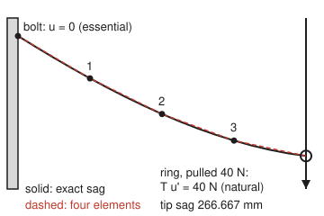
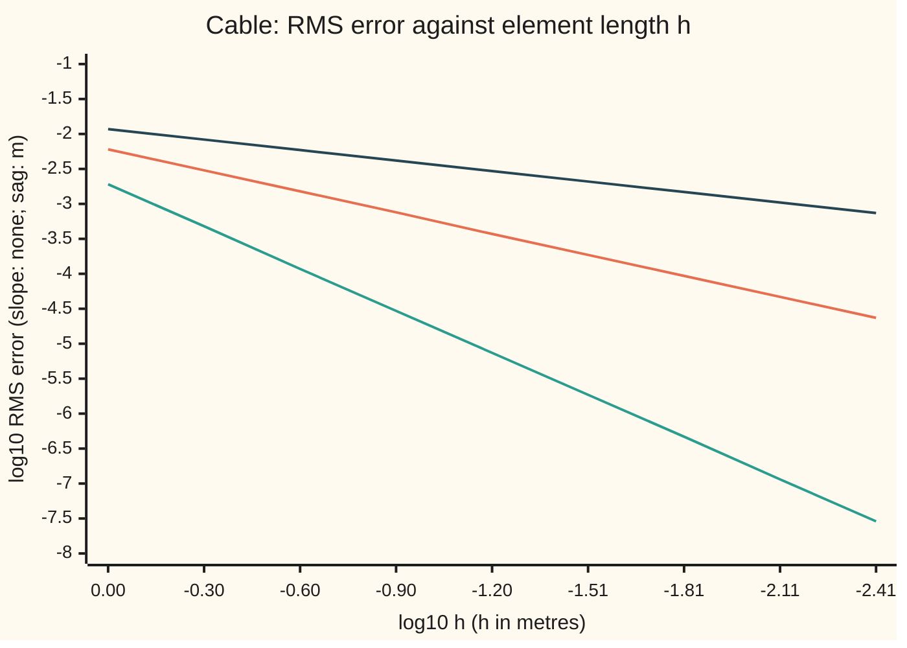

# Assembly and error: adding element matrices, the two boundary kinds, and the error bound

[Syllabus](../../../SYLLABUS.md) → [Numerical analysis](../README.md) → [PDE Solvers](../README.md#s07) → Assembly and error

---

## General Overview

A steel cable 4 m long runs across a garden wall. It is pulled tight to a tension of 2000 N. Planters hang along it, heavier toward the far end: 20 N per metre at the wall, rising to 60 N per metre at the far end. The left end is bolted to the wall. The right end is tied to a ring that slides up and down a smooth post, and a 40 N weight hangs from the ring. (All of these numbers are illustrative.)

The question: how far does the cable sag, and how far is the computed sag from the truth? A sag good to a millimetre is the target.

The finite element method cuts the cable into four 1 m pieces, called **elements**, joined at five points, called **nodes**. Each element gets a small 2 by 2 table of stiffness. The four small tables are added into one 5 by 5 table, the **stiffness matrix**. The two ends are then handled in two different ways:

- **The bolt** says "the sag here is zero". That is an **essential** condition: it is imposed on the unknowns, by removing node 0 from the system.
- **The ring** says "the cable's vertical pull here equals the 40 N weight". That is a **natural** condition: it needs no special treatment, and enters as one extra 40 N in the list of loads.

One solve gives the sag at the nodes: 94.167, 173.333, 232.500 and 266.667 mm. Those four numbers are exactly right. Between the nodes, the straight pieces miss the curved cable. The root-mean-square (RMS) sag error, a typical size of that gap along the cable, is 1.896 mm with four elements: short of the millimetre target. Eight elements bring it to 0.4748 mm. Each halving of the element length cuts the sag error by about 4 and the slope error by about 2. The bound in Why it works predicts both. It sits above the true error by a ratio of only 1.103 to 1.112.

**Add each element's small matrix into the rows and columns of its own nodes, impose the essential conditions on the unknowns and let the natural ones enter as loads, and the answer is the best fit the elements allow: its slope error shrinks like h and its value error like h squared.**

**What kind of fact this is:** a theorem. For a cable or rod (one space dimension) it is proved in Why it works: the best-fit and interpolation steps by their proofs on [Finite elements](07-finite-elements-galerkin-and-hat-functions.md), and the step that is new here, exact nodes, in full. For triangles and bricks in two and three dimensions, the card states the matching theorem and names its source.

### The picture: the cable in four elements

<p align="center"></p>

To scale: 80 px per metre across, 0.5 px per millimetre of sag, so the sag is drawn deeper than it is. The dashed line is the four-element answer. It meets the exact curve at every node. Between nodes the gap is a few millimetres (1.896 mm RMS), too small to see at this scale.

---

## The formula

The cable obeys $-T\,u''(x) = f(x)$: tension times curvature balances the load. Multiply by a **test function** $v$ (any shape the cable could take, with $v(0) = 0$) and integrate by parts, as on the sibling card [Finite elements](07-finite-elements-galerkin-and-hat-functions.md). The result is the **weak form**: find $u$ with $u(0) = 0$ such that

$$a(u, v) = \int_0^L T\,u'\,v'\,dx \;=\; \int_0^L f\,v\,dx \;+\; P\,v(L) \quad\text{for every } v \text{ with } v(0) = 0.$$

The computer looks for $u_h = \sum_i U_i\,\varphi_i$, a sum of **hat functions** $\varphi_i$ (each is 1 at node $i$, 0 at every other node, and a straight line in between). Testing with each hat gives $K U = F$, where

$$K_{ij} = \sum_{\text{elements } e} \int_e T\,\varphi_i'\,\varphi_j'\,dx, \qquad F_i = \sum_{\text{elements } e} \int_e f\,\varphi_i\,dx \;+\; \begin{cases} P & i = n \\ 0 & \text{otherwise.}\end{cases}$$

The error theorem, in root-mean-square (RMS) form, where $\mathrm{RMS}(g) = \sqrt{\tfrac1L\int_0^L g^2\,dx}$:

$$\mathrm{RMS}(u' - u_h') \;\le\; \frac{h}{\pi}\,\mathrm{RMS}(u''), \qquad \mathrm{RMS}(u - u_h) \;\le\; \Big(\frac{h}{\pi}\Big)^{2}\,\mathrm{RMS}(u'').$$

**Read it aloud:** the stiffness matrix and the load list are sums over the elements, and the ring's pull is one more load at the last node. The average slope error is at most h over pi times the average curvature; the average sag error is at most that factor squared times the curvature.

| Symbol | Plain meaning | In our example | Push it up and the answer… |
| --- | --- | --- | --- |
| $T$ | tension in the cable, N | 2000 N | every sag shrinks in proportion |
| $L$, $x$ | cable length; distance from the wall, m | 4 m | — |
| $f(x)$, $w$ | load per metre, N/m; $w$ a uniform load | $20 + 10x$, RMS 41.633 N/m; $w$ = 20 N/m in Try changing | every sag grows in proportion |
| $P$, $Q$ | pull on the ring at $x = L$; a lamp's point load, N | 40 N; 100 N at $x = 4/3$ m | tip sag grows by $PL/T$ |
| $u$, $u'$, $u''$ | exact sag (m, down is positive), its slope, its curvature (1/m) | tip 266.667 mm; slope 0.100 at the wall; RMS $u''$ 2.0817e-02 /m | — |
| $n$, $h$ | number of elements; element length $L/n$, m | 4; 1 m | $h$ up: both errors grow, as $h$ and $h^2$ |
| $\varphi_i$ | hat function of node $i$ | five hats, nodes 0 to 4 | — |
| $u_h$, $U_i$, $Iu$, $e$ | computed sag; its value at node $i$; the interpolant (straight pieces through the true node values); an error $u - Iu$ (as a subscript or superscript, $e$ numbers an element) | 94.167, 173.333, 232.500, 266.667 mm | — |
| $k^{(e)}$, $K$, $F$ | element matrix of element $e$, $\tfrac{T}{h}$ times `[[1, -1], [-1, 1]]`; stiffness matrix; load list, one entry per node | 2000 N/m times that pattern; 5 by 5, 13 nonzeros; 11.667 to 68.333 N | — |
| $a(u, v)$, $v$, $\mathrm{RMS}$ | energy form $\int T u' v'\,dx$; a test function; root-mean-square over the cable | — | — |
| $M$, $\alpha$, $C$ | constants of the general theorem: upper and lower bounds of the energy form (this $\alpha$ is not the shelf's diffusivity); the interpolation constant | 1, 1 and $1/\pi$ in energy terms on the cable | $M/\alpha$ up: weaker best-fit guarantee |
| $R$ | force the bolt puts on the cable, N | −200.000 (minus: upward) | — |

### When it holds

- **The exact curvature $u''$ has a finite RMS value (it is square-integrable).** A smooth load gives this. A single point load does not: $u'$ jumps there. Hang one 100 N lamp at $x = 4/3$ m and the slope error falls only like $h^{0.5}$ (observed order 0.500), not $h$.
- **At least one essential condition.** With the bolt removed, nothing stops the whole cable sliding up or down the post. $K$ has no inverse: elimination hits a zero pivot in row 5 of 5.
- **Exact integrals for $K$ and $F$.** Here they are exact. With a rough quadrature rule (a rule that estimates an integral from a few sample values) the nodes stop being exact, and the quadrature error adds to the bound.
- **One space dimension for exact nodes.** In 2D and 3D the nodes are not exact. The best-fit property and the rates $h$ and $h^2$ survive, with an unknown constant in place of $1/\pi$, as long as no triangle becomes a thin sliver.
- **Small slopes.** The equation $-Tu'' = f$ assumes the slope stays small. Here it is at most 0.100, at the wall.

---

## Why it works

### Step 0: the computed cable is the best one the elements can make

The method does not guess node values and hope. Among all the shapes made of straight pieces, it picks the one closest to the true cable in stored energy. So the error is exactly "how well can straight pieces follow this curve?". That is a question about one element at a time, and its answer is the element length times the curvature.

### Step 1: assembly is adding, because integrals over the cable are sums over elements

Each entry $K_{ij} = \int_0^L T\varphi_i'\varphi_j'\,dx$ splits into one integral per element. On element $e$, only the two hats of its end nodes are nonzero. Their slopes are $-1/h$ (left node's hat) and $+1/h$ (right node's hat). So the element contributes

$$k^{(e)} = \int_e T \begin{pmatrix} \varphi_{\text{left}}'^{\,2} & \varphi_{\text{left}}'\varphi_{\text{right}}' \\ \varphi_{\text{right}}'\varphi_{\text{left}}' & \varphi_{\text{right}}'^{\,2}\end{pmatrix} dx = \frac{T}{h}\begin{pmatrix} 1 & -1 \\ -1 & 1\end{pmatrix}.$$

Element $e$ joins nodes $e - 1$ and $e$, so these four numbers go into rows and columns $e - 1$ and $e$ of $K$, added to whatever is already there. Node 1 belongs to elements 1 and 2, so its diagonal entry is 2000 + 2000 = 4000. The load entries add the same way.

The result is **sparse** (mostly zeros): each row touches only its neighbours. Here 13 of 25 entries are nonzero, and $K$ is tridiagonal, so [The Thomas algorithm](../03-Numerical%20Linear%20Algebra/03-tridiagonal-systems-and-the-thomas-algorithm.md) solves it in $8n - 7$ flops: 25 at $n = 4$, 8185 at $n = 1024$. Dense elimination at $n = 1024$ would cost about $2n^3/3$, 7.158e+08 flops. The [Finite elements](../../13-Engineering%20mathematics/08-Fluids%20and%20Heat/09-finite-element-method-in-outline.md) card in the engineering wing assembles a cantilever the same way; this card spends its effort on the boundaries and the error.

### Step 2: the two boundary kinds come out of integration by parts

Multiply $-Tu'' = f$ by a test function $v$ and integrate by parts:

$$\int_0^L T u' v'\,dx \;-\; \big[\,T u'\,v\,\big]_{x=0}^{x=L} \;=\; \int_0^L f v\,dx.$$

The bracket holds the two ends, and they behave differently.

- **At the ring, $x = L$:** the physics says $T u'(L) = P$. So the bracket term is $P\,v(L)$, a known number times $v(L)$. It moves to the right-hand side as a load. Nothing else is needed: any $u$ that satisfies the weak form for every $v$ automatically has $Tu'(L) = P$. That is why it is called **natural**.
- **At the bolt, $x = 0$:** $T u'(0)$ is the bolt's force, which is unknown. The weak form removes it by demanding $v(0) = 0$, and the answer is forced to obey $u(0) = 0$. Both demands act on the unknowns, so the condition is called **essential**. In the matrix: delete row 0 and column 0.

The deleted row is not wasted. Put the solved sags back into it, and it returns the bolt's force: $R$ = −200.000 N, which is 200 N upward. That is the whole load: every planter plus the 40 N on the ring.

### Step 3: the error is orthogonal to every element shape, so the answer is the best fit

The true $u$ satisfies the weak form for every test function, and the computed $u_h$ for every hat. Subtracting gives $a(u - u_h, \varphi_i) = 0$ for every hat, the ring's hat included: **Galerkin orthogonality**. Pythagoras in the energy form then says no shape made of the elements has a smaller energy error than $u_h$: **Céa's lemma**, in its symmetric form. [Finite elements](07-finite-elements-galerkin-and-hat-functions.md) proves both in its Step 3. Here the energy error is $T$ times the integral of the squared slope error. The code computes the four orthogonality numbers for the cable; the largest, divided by $T$, is 6.2e-17, which is rounding.

### Step 4: on a cable, the best fit goes through the true nodes

Let $I u$ be the **interpolant**: the straight pieces that join the true sag values at the nodes. On each element, $u - Iu$ is zero at both ends. The slope of a hat is constant on each element, so

$$a(u - Iu,\ \varphi_i) = \sum_e T\,(\pm\tfrac1h) \int_e (u - Iu)'\,dx = \sum_e T\,(\pm\tfrac1h)\,\big[u - Iu\big]_{\text{ends of } e} = 0.$$

So $Iu$ also satisfies every Galerkin equation. $K$ (with the bolt row removed) has an inverse, so the solution is unique, and $u_h = Iu$. That is why all four node sags match the exact ones to about 1e-16 m.

A third road gives the same nodes. Element $e$ carries all the load to its right, so its far end sits lower than its near end by (load carried) × $h/T$. The loads carried are 188.333, 158.333, 118.333 and 68.333 N, and $h$ = 1 m. Adding the drops from the wall gives the same four sags.

### Step 5: how far straight pieces can stray from a curve

On one element, $e(x) = u - Iu$ is zero at both ends, and $e'' = u''$ because $Iu$ is straight. The fold of Step 5 on [Finite elements](07-finite-elements-galerkin-and-hat-functions.md) proves, by Wirtinger's inequality, integration by parts and the Cauchy-Schwarz inequality, that then $\int_e e'^2 \le (h/\pi)^2 \int_e u''^2$ and $\int_e e^2 \le (h/\pi)^4 \int_e u''^2$. Step 4 says $u_h = Iu$ here, so sum over the elements, divide by $L$ and take square roots: that is the formula. On a short element the error is close to a parabola, and for a parabola the slope bound is exactly $\sqrt{12}/\pi$ = 1.103 times the truth, the ratio in the output. Most of that gap comes from the Cauchy-Schwarz step, not from Wirtinger's.

### Step 6: what changes in two and three dimensions

The same three ingredients carry over: assembly by adding, boundary kinds from integration by parts, and best fit from Galerkin orthogonality. Two things change.

- **Nodes are no longer exact.** Step 4 used the fact that a hat's slope is constant and an element has only two ends. On triangles the error does not vanish at the nodes.
- **The constants are unknown.** Céa's lemma gives an error at most $M/\alpha$ times the best fit, where $M$ and $\alpha$ bound the energy form above and below. Interpolation on triangles of size $h$ gives slope error at most $C h$ times the second derivatives, if no angle shrinks toward zero. The sag error is $C h^2$ by a duality argument (Aubin and Nitsche), which needs a convex region or a smooth edge.

This card states that general theorem without proof; Braess (Sources) proves it. The tools it needs, Sobolev spaces and the Lax-Milgram theorem, belong to the functional-analysis wing.

---

## Worked numbers, by hand

| Step | Arithmetic | Value |
| --- | --- | --- |
| element matrix | $T/h$ = 2000/1, times `[[1, -1], [-1, 1]]` | 2000, −2000, −2000, 2000 N/m |
| node 1 diagonal | 2000 from element 1 + 2000 from element 2 | 4000 N/m |
| node 4 diagonal | element 4 only | 2000 N/m |
| load at node 1 | $1 \times (20 + 2 \times 30)/6 + 1 \times (2 \times 30 + 40)/6$ | 30.000 N |
| load at node 4 | $1 \times (50 + 2 \times 60)/6$ + the ring's 40 N | 68.333 N |
| bolt | delete row 0 and column 0 | 4 unknowns |
| element 1 carries | 30 + 40 + 50 + 68.333 | 188.333 N |
| sag at node 1 | load carried × $h/T$ = 188.333 × 1 / 2000 m | 94.167 mm |
| sag at node 2 | 94.167 + 158.333 × 1/2000 × 1000 | 173.333 mm |
| tip sag | 232.500 + 68.333 × 1/2000 × 1000 | **266.667 mm** |
| bolt force | row 0: $2000 \times 0 - 2000 \times 0.094167 - 11.667$ | −200.000 N |
| slope error bound | $(1/\pi) \times$ 2.0817e-02 | 6.626e-03 |
| true slope error | measured by 4-point Gauss on each element | 5.998e-03, ratio 1.105 |
| sag error bound | $(1/\pi)^2 \times$ 2.0817e-02 m, in mm | 2.109 mm |
| true sag error | measured the same way | 1.896 mm, ratio 1.112 |

The ring sits 266.667 mm below the bolt, exactly. Between nodes the four straight pieces miss the true curve by 1.896 mm RMS, and the theorem guaranteed no more than 2.109 mm before anything was computed.

### What breaks if you drop a piece

| Mistake | Comes out at | What went wrong |
| --- | --- | --- |
| Overwrite element entries instead of adding them | zero pivot in row 2 of 4: no answer | node 1's diagonal is 2000, not 4000, so the first elimination step leaves 2000 − 2000 = 0 in row 2 |
| Leave out the ring's 40 N (natural load) | tip 186.667 mm, not 266.667 | the natural condition became $Tu'(L) = 0$, a ring with no weight |
| Treat the ring as fixed (natural made essential) | middle sag 40.000 mm, not 173.333 | the cable is now bolted at both ends: a different problem |
| Keep node 0 (no essential condition) | zero pivot in row 5 of 5: no answer | nothing holds the cable; $K$ has no inverse |

The theorem's own hypothesis fails for a point load. One 100 N lamp at $x = 4/3$ m, with no planters, gives a slope error of 1.1785e-02 at $n = 4$. That matches the closed form $\tfrac{Q}{T}\sqrt{2h/(9L)}$ with $Q$ = 100 N. Its observed order is 0.500: halving $h$ cuts the error by only $\sqrt2$.

### The picture: error against element length



Orange: slope error under the planters, slope 1. Green: sag error under the planters, slope 2. Dark: slope error under the single lamp, slope 0.5, because the lamp breaks the hypothesis. Each slope on this log-log plot is the observed order.

At $n = 1024$ the slope error is 2.347e-05 against a bound of 2.588e-05, and the sag error is 2.900e-05 mm against 3.218e-05 mm. The observed orders are 1.000 and 2.000, as the theorem says. The full table is in the output below.

Rounding does not stop the fall in this range. The node error, which is pure rounding, grows from 1.7e-16 m at $n = 4$ to 2.9e-13 m at $n = 1024$, as the matrix's condition number grows like $n^2$ (see [Matrix norms and the condition number](../03-Numerical%20Linear%20Algebra/01-matrix-norms-and-the-condition-number.md)). That is still five orders of magnitude below the 2.900e-05 mm sag error. The trouble here is discretization, not stability.

---

## Code, from first principles, and it actually runs

The code assembles the cable for any $n$, removes the bolt row, adds the ring's pull as a load, and solves with the Thomas algorithm. It measures the true errors with 4-point [Gaussian quadrature](../05-Quadrature/03-gaussian-quadrature.md) on each element, exact for these polynomials. Four independent roads check it: the closed-form sag at the nodes; the element-by-element force balance; closed-form errors for the planters' sag at $n = 4$, for a uniform load and for the lamp; and the theorem's bound with its orders 1 and 2.

### Python

```python
# Assembly and error: a 4 m cable at tension 2000 N carries planters, 20 + 10x N/m.
# Anchored at x = 0 (essential: u = 0); a ring on a post at x = 4 m is pulled down by
# 40 N (natural: T u'(4) = 40). Linear elements. Python standard library only.
import math
T, L, P, PI = 2000.0, 4.0, 40.0, 3.141592653589793

def u_ex(x):  return (200.0 * x - 10.0 * x * x - 5.0 * x * x * x / 3.0) / T   # sag, m
def du_ex(x): return (200.0 - 20.0 * x - 5.0 * x * x) / T                     # slope

def assemble(n, a, b, p_end, lamps, add=True):
    """Add n element matrices and loads into a tridiagonal K (diagonal, off) and F."""
    h = L / n
    di, off, F = [0.0] * (n + 1), [0.0] * n, [0.0] * (n + 1)
    for e in range(n):
        k = T / h
        if add: di[e] += k; di[e + 1] += k
        else:   di[e] = k; di[e + 1] = k            # the bug: overwrite instead of add
        off[e] = -k
        fl, fr = a + b * e * h, a + b * (e + 1) * h   # load per metre at the element's ends
        F[e] += h * (2.0 * fl + fr) / 6.0            # integral of f times the left hat
        F[e + 1] += h * (fl + 2.0 * fr) / 6.0        # integral of f times the right hat
    for (q, xs) in lamps:                            # a point load shared by the two hats
        e = min(int(xs / h), n - 1); t = (xs - e * h) / h
        F[e] += q * (1.0 - t); F[e + 1] += q * t
    F[n] += p_end                                    # natural condition: one load entry
    return di, off, F

def thomas(di, off, F):
    """Tridiagonal elimination. Returns (solution or None, pivots up to the first zero)."""
    m = len(di); d, r = di[:], F[:]
    for i in range(1, m):
        if d[i - 1] == 0.0: return None, d[:i]
        w = off[i - 1] / d[i - 1]; d[i] -= w * off[i - 1]; r[i] -= w * r[i - 1]
    if d[-1] == 0.0: return None, d
    x = [0.0] * m; x[-1] = r[-1] / d[-1]
    for i in range(m - 2, -1, -1):
        x[i] = (r[i] - off[i] * x[i + 1]) / d[i]
    return x, d

def solve(n, a=20.0, b=10.0, p_end=P, lamps=()):
    di, off, F = assemble(n, a, b, p_end, lamps)
    x, _ = thomas(di[1:], off[1:], F[1:])            # essential: drop node 0's row and column
    return [0.0] + x

g1, g2 = (math.sqrt(3.0 / 7.0 + s * math.sqrt(6.0 / 5.0)) for s in (-2.0 / 7.0, 2.0 / 7.0))
w1, w2 = (18.0 + math.sqrt(30.0)) / 36.0, (18.0 - math.sqrt(30.0)) / 36.0
GAUSS = [(-g2, w2), (-g1, w1), (g1, w1), (g2, w2)]    # 4-point Gauss-Legendre on [-1, 1]

def errors(U, uf, duf, cuts=()):
    """RMS slope error and RMS sag error over the cable, element by element."""
    n = len(U) - 1; h = L / n; s1 = s0 = 0.0
    for e in range(n):
        xa, xb = e * h, (e + 1) * h
        pts = [xa] + [c for c in cuts if xa < c < xb] + [xb]
        for p, q in zip(pts, pts[1:]):
            for (z, w) in GAUSS:
                x = 0.5 * (p + q) + 0.5 * (q - p) * z; t = (x - xa) / h
                d1 = duf(x) - (U[e + 1] - U[e]) / h
                d0 = uf(x) - U[e] * (1.0 - t) - U[e + 1] * t
                s1 += 0.5 * (q - p) * w * d1 * d1; s0 += 0.5 * (q - p) * w * d0 * d0
    return math.sqrt(s1 / L), math.sqrt(s0 / L)

# ---- four element matrices added into one system ----
di, off, F = assemble(4, 20.0, 10.0, P, ())
print("element matrix, N/m  " + " ".join(f"{v:7.0f}" for v in (T, -T, -T, T)))
for i in range(5):
    row = [di[i] if j == i else (off[min(i, j)] if abs(i - j) == 1 else 0.0) for j in range(5)]
    print(f"K row {i}              " + " ".join(f"{v:7.0f}" for v in row))
print(f"nonzeros of 25       {3 * 5 - 2:7d}")
print("F, N                 " + " ".join(f"{v:7.3f}" for v in F))
U = solve(4)
print("FE sag at nodes, mm  " + " ".join(f"{1000.0 * v:7.3f}" for v in U))
print("exact sag, mm        " + " ".join(f"{1000.0 * u_ex(float(i)):7.3f}" for i in range(5)))
carried, tele, acc = [0.0] * 4, [0.0], 0.0
for i in range(3, -1, -1): acc += F[i + 1]; carried[i] = acc   # load each element carries
for i in range(4): tele.append(tele[-1] + carried[i] / T)
print("load carried, N      " + " ".join(f"{v:7.3f}" for v in carried))
print("telescoped sag, mm   " + " ".join(f"{1000.0 * v:7.3f}" for v in tele))
R = di[0] * U[0] + off[0] * U[1] - F[0]
print(f"anchor force, N      {R:9.3f}   slope there {-R / T:.3f}")
print(f"thomas flops 8n-7    n=4: {8 * 4 - 7}   n=1024: {8 * 1024 - 7}   dense 2n^3/3: {2.0 * 1024.0 ** 3 / 3.0:.3e}")
se = [0.0] * 4
for e in range(4):
    for (z, w) in GAUSS: se[e] += 0.5 * w * (du_ex(e + 0.5 + 0.5 * z) - (U[e + 1] - U[e]))
orth = max(abs(se[i - 1] - (se[i] if i < 4 else 0.0)) for i in range(1, 5))  # a(u - U, hat_i)
print(f"orthogonality, max   {orth:.1e}")
# ---- what breaks ----
do, oo, Fo = assemble(4, 20.0, 10.0, P, (), add=False)
_, piv_over = thomas(do[1:], oo[1:], Fo[1:])         # overwrite instead of add
no_p = solve(4, p_end=0.0)                           # the 40 N natural load left out
x3, _ = thomas(di[1:4], off[1:3], F[1:4])            # ring treated as fixed: drop node 4 too
_, piv = thomas(di, off, F)                          # node 0 kept: no essential condition
print(f"wrong: overwrite, zero pivot in row {len(piv_over)} of 4")
print(f"wrong: drop 40 N, tip mm    {1000.0 * no_p[4]:9.3f}")
print(f"wrong: ring fixed, mid mm   {1000.0 * x3[1]:9.3f}")
print(f"wrong: no anchor, zero pivot in row {len(piv)} of 5")
# ---- error against element size ----
c2 = 0.0
for (z, w) in GAUSS: c = (20.0 + 10.0 * (2.0 + 2.0 * z)) / T; c2 += 2.0 * w * c * c
rms_curv = math.sqrt(c2 / L); print(f"RMS load, N/m        {T * rms_curv:9.3f}   RMS u'', 1/m {rms_curv:.4e}")
print("   n      h slope err     bound ratio sag err mm     bound ratio  ord1  ord2 node err m")
rows, prev = [], None
for k in range(2, 11):
    n = 2 ** k; h = L / n; U = solve(n)
    e1, e0 = errors(U, u_ex, du_ex)
    b1, b0 = h / PI * rms_curv, (h / PI) * (h / PI) * rms_curv
    node = max(abs(U[i] - u_ex(i * h)) for i in range(n + 1))
    o1, o0 = (math.log2(prev[0] / e1), math.log2(prev[1] / e0)) if prev else (0.0, 0.0)
    ords = f"{o1:5.3f} {o0:5.3f}" if prev else "    -     -"
    print(f"{n:4d} {h:6.4f} {e1:9.3e} {b1:9.3e} {b1 / e1:5.3f} {1000.0 * e0:9.3e} "
          f"{1000.0 * b0:9.3e} {b0 / e0:5.3f} {ords} {node:8.1e}")
    rows.append((n, e1, b1, e0, b0, o1, o0)); prev = (e1, e0)
XS, Q, lamp = 4.0 / 3.0, 100.0, []                   # one 100 N lamp at x = 4/3 m instead
for k in range(2, 11):
    n = 2 ** k; h = L / n; U = solve(n, 0.0, 0.0, 0.0, [(Q, XS)])
    e1, _ = errors(U, lambda x: Q * min(x, XS) / T, lambda x: Q / T if x < XS else 0.0, (XS,))
    lamp.append((n, e1, Q / T * math.sqrt(2.0 * h / 9.0 / L)))
print(f"lamp n=4 slope err   {lamp[0][1]:.4e}  closed form {lamp[0][2]:.4e}")
print(f"lamp order 1024/512  {math.log2(lamp[-2][1] / lamp[-1][1]):.3f}")
U = solve(4, 20.0, 0.0, 0.0)                         # uniform 20 N/m, ring free: road check
e1u, _ = errors(U, lambda x: (80.0 * x - 10.0 * x * x) / T, lambda x: (80.0 - 20.0 * x) / T)
cf = 20.0 / (2.0 * T) / math.sqrt(3.0); print(f"uniform n=4 slope    {e1u:.6e}  closed form {cf:.6e}")
s2, be = 0.0, 5.0 / (3.0 * T)                        # planters, n = 4: error on element e is s(1 - s)(a + be s)
for e in range(4): a = be + (10.0 + 5.0 * e) / T; s2 += (a * a + a * be) / 30.0 + be * be / 105.0   # its exact integral
cs = math.sqrt(s2 / L); print(f"planter n=4 sag, mm  {1000.0 * rows[0][3]:.6e}  closed form {1000.0 * cs:.6e}")
print("figure, node px " + " ".join(f"({20 + 80 * i},{40.0 + 500.0 * u_ex(float(i)):.1f})" for i in range(5)))
print("figure, curve px " + " ".join(f"{40.0 + 500.0 * u_ex(0.25 * j):.1f}" for j in range(17)))
for name, v in (("log10 h", [L / r[0] for r in rows]), ("log10 slope", [r[1] for r in rows]),
                ("log10 sag", [r[3] for r in rows]), ("log10 lamp", [r[1] for r in lamp])):
    print(f"chart, {name:<14}" + " ".join(f"{math.log10(x):6.2f}" for x in v))
assert max(abs(solve(4)[i] - u_ex(float(i))) for i in range(5)) < 1e-15, "nodes = exact sag"
assert max(abs(a - b) for a, b in zip(solve(4), tele)) < 1e-15, "force balance = the solve"
assert abs(R + 20.0 * 4.0 + 5.0 * 16.0 + P) < 1e-9, "anchor holds all 200 N"
assert all(r[1] <= r[2] and r[3] <= r[4] for r in rows), "true errors under the bounds"
assert abs(rows[-1][5] - 1.0) < 0.01 and abs(rows[-1][6] - 2.0) < 0.01, "orders 1 and 2"
assert all(abs(e - c) < 1e-12 for _, e, c in lamp), "lamp error = its closed form"
assert abs(e1u - cf) < 1e-15, "error integrator = the uniform-load closed form"
assert abs(rows[0][3] - cs) < 1e-15, "planters' sag error = its exact integral"
assert orth < 1e-15 and len(piv) == 5 and len(piv_over) == 2, "orthogonality; zero pivots"
print("ALL CHECKS PASS")
```

**Ran 2026-11-11 on macOS, Python 3.14.10, standard library only. All checks passed. Output, pasted from the run:**

```
element matrix, N/m     2000   -2000   -2000    2000
K row 0                 2000   -2000       0       0       0
K row 1                -2000    4000   -2000       0       0
K row 2                    0   -2000    4000   -2000       0
K row 3                    0       0   -2000    4000   -2000
K row 4                    0       0       0   -2000    2000
nonzeros of 25            13
F, N                  11.667  30.000  40.000  50.000  68.333
FE sag at nodes, mm    0.000  94.167 173.333 232.500 266.667
exact sag, mm          0.000  94.167 173.333 232.500 266.667
load carried, N      188.333 158.333 118.333  68.333
telescoped sag, mm     0.000  94.167 173.333 232.500 266.667
anchor force, N       -200.000   slope there 0.100
thomas flops 8n-7    n=4: 25   n=1024: 8185   dense 2n^3/3: 7.158e+08
orthogonality, max   6.2e-17
wrong: overwrite, zero pivot in row 2 of 4
wrong: drop 40 N, tip mm      186.667
wrong: ring fixed, mid mm      40.000
wrong: no anchor, zero pivot in row 5 of 5
RMS load, N/m           41.633   RMS u'', 1/m 2.0817e-02
   n      h slope err     bound ratio sag err mm     bound ratio  ord1  ord2 node err m
   4 1.0000 5.998e-03 6.626e-03 1.105 1.896e+00 2.109e+00 1.112     -     -  1.7e-16
   8 0.5000 3.003e-03 3.313e-03 1.103 4.748e-01 5.273e-01 1.111 0.998 1.998  2.8e-16
  16 0.2500 1.502e-03 1.657e-03 1.103 1.188e-01 1.318e-01 1.110 0.999 1.999  6.1e-16
  32 0.1250 7.511e-04 8.283e-04 1.103 2.969e-02 3.296e-02 1.110 1.000 2.000  1.9e-16
  64 0.0625 3.756e-04 4.141e-04 1.103 7.423e-03 8.239e-03 1.110 1.000 2.000  2.1e-15
 128 0.0312 1.878e-04 2.071e-04 1.103 1.856e-03 2.060e-03 1.110 1.000 2.000  3.6e-15
 256 0.0156 9.389e-05 1.035e-04 1.103 4.639e-04 5.149e-04 1.110 1.000 2.000  2.6e-14
 512 0.0078 4.695e-05 5.177e-05 1.103 1.160e-04 1.287e-04 1.110 1.000 2.000  7.6e-14
1024 0.0039 2.347e-05 2.588e-05 1.103 2.900e-05 3.218e-05 1.110 1.000 2.000  2.9e-13
lamp n=4 slope err   1.1785e-02  closed form 1.1785e-02
lamp order 1024/512  0.500
uniform n=4 slope    2.886751e-03  closed form 2.886751e-03
planter n=4 sag, mm  1.895937e+00  closed form 1.895937e+00
figure, node px (20,40.0) (100,87.1) (180,126.7) (260,156.2) (340,173.3)
figure, curve px 40.0 52.3 64.3 75.9 87.1 97.8 108.0 117.6 126.7 135.1 142.9 149.9 156.2 161.8 166.5 170.4 173.3
chart, log10 h         0.00  -0.30  -0.60  -0.90  -1.20  -1.51  -1.81  -2.11  -2.41
chart, log10 slope    -2.22  -2.52  -2.82  -3.12  -3.43  -3.73  -4.03  -4.33  -4.63
chart, log10 sag      -2.72  -3.32  -3.93  -4.53  -5.13  -5.73  -6.33  -6.94  -7.54
chart, log10 lamp     -1.93  -2.08  -2.23  -2.38  -2.53  -2.68  -2.83  -2.98  -3.13
ALL CHECKS PASS
```

### Rust

```rust
// Assembly and error: a 4 m cable at tension 2000 N carries planters, 20 + 10x N/m.
// Anchored at x = 0 (essential: u = 0); a ring on a post at x = 4 m is pulled down by
// 40 N (natural: T u'(4) = 40). Linear elements. Rust std only.
const T: f64 = 2000.0; const L: f64 = 4.0; const P: f64 = 40.0; const PI: f64 = 3.141592653589793;
const XS: f64 = 4.0 / 3.0; const Q: f64 = 100.0;

fn u_ex(x: f64) -> f64 { (200.0 * x - 10.0 * x * x - 5.0 * x * x * x / 3.0) / T }
fn du_ex(x: f64) -> f64 { (200.0 - 20.0 * x - 5.0 * x * x) / T }

/// Python-style e-notation: 5.998e-03, 7.158e+08.
fn fe(x: f64, prec: usize) -> String {
    let s = format!("{:.*e}", prec, x); let (m, e) = s.split_once('e').unwrap(); let ev: i32 = e.parse().unwrap();
    format!("{}e{}{:02}", m, if ev < 0 { '-' } else { '+' }, ev.abs())
}

fn assemble(n: usize, a: f64, b: f64, p_end: f64, lamps: &[(f64, f64)], add: bool) -> (Vec<f64>, Vec<f64>, Vec<f64>) {
    let h = L / n as f64;
    let (mut di, mut off, mut f) = (vec![0.0; n + 1], vec![0.0; n], vec![0.0; n + 1]);
    for e in 0..n {
        let k = T / h;
        if add { di[e] += k; di[e + 1] += k; } else { di[e] = k; di[e + 1] = k; } // bug: overwrite
        off[e] = -k;
        let (fl, fr) = (a + b * e as f64 * h, a + b * (e + 1) as f64 * h);
        f[e] += h * (2.0 * fl + fr) / 6.0;           // integral of f times the left hat
        f[e + 1] += h * (fl + 2.0 * fr) / 6.0;       // integral of f times the right hat
    }
    for &(q, xs) in lamps {                          // a point load shared by the two hats
        let e = ((xs / h) as usize).min(n - 1); let t = (xs - e as f64 * h) / h;
        f[e] += q * (1.0 - t); f[e + 1] += q * t;
    }
    f[n] += p_end; (di, off, f)                      // natural condition: one load entry
}

/// Tridiagonal elimination. Returns (solution or None, pivots up to the first zero).
fn thomas(di: &[f64], off: &[f64], f: &[f64]) -> (Option<Vec<f64>>, Vec<f64>) {
    let (m, mut d, mut r) = (di.len(), di.to_vec(), f.to_vec());
    for i in 1..m {
        if d[i - 1] == 0.0 { return (None, d[..i].to_vec()); }
        let w = off[i - 1] / d[i - 1]; d[i] -= w * off[i - 1]; r[i] -= w * r[i - 1];
    }
    if d[m - 1] == 0.0 { return (None, d); }
    let mut x = vec![0.0; m]; x[m - 1] = r[m - 1] / d[m - 1];
    for i in (0..m - 1).rev() { x[i] = (r[i] - off[i] * x[i + 1]) / d[i]; }
    (Some(x), d)
}

fn solve(n: usize, a: f64, b: f64, p_end: f64, lamps: &[(f64, f64)]) -> Vec<f64> {
    let (di, off, f) = assemble(n, a, b, p_end, lamps, true);
    let (x, _) = thomas(&di[1..], &off[1..], &f[1..]); // essential: drop node 0
    let mut u = vec![0.0]; u.extend(x.unwrap()); u
}

fn gauss() -> [(f64, f64); 4] {
    let g1 = (3.0 / 7.0 - 2.0 / 7.0 * (6.0f64 / 5.0).sqrt()).sqrt();
    let g2 = (3.0 / 7.0 + 2.0 / 7.0 * (6.0f64 / 5.0).sqrt()).sqrt();
    let (w1, w2) = ((18.0 + 30.0f64.sqrt()) / 36.0, (18.0 - 30.0f64.sqrt()) / 36.0);
    [(-g2, w2), (-g1, w1), (g1, w1), (g2, w2)]
}

/// RMS slope error and RMS sag error over the cable, element by element.
fn errors(u: &[f64], uf: &dyn Fn(f64) -> f64, duf: &dyn Fn(f64) -> f64, cuts: &[f64]) -> (f64, f64) {
    let (n, mut s1, mut s0) = (u.len() - 1, 0.0, 0.0); let h = L / n as f64;
    for e in 0..n {
        let (xa, xb) = (e as f64 * h, (e + 1) as f64 * h);
        let mut pts = vec![xa]; for &c in cuts { if xa < c && c < xb { pts.push(c); } } pts.push(xb);
        for j in 0..pts.len() - 1 {
            let (p, q) = (pts[j], pts[j + 1]);
            for &(z, w) in gauss().iter() {
                let x = 0.5 * (p + q) + 0.5 * (q - p) * z; let t = (x - xa) / h;
                let d1 = duf(x) - (u[e + 1] - u[e]) / h;
                let d0 = uf(x) - u[e] * (1.0 - t) - u[e + 1] * t;
                s1 += 0.5 * (q - p) * w * d1 * d1; s0 += 0.5 * (q - p) * w * d0 * d0;
            }
        }
    }
    ((s1 / L).sqrt(), (s0 / L).sqrt())
}

fn join(v: &[f64], f: &dyn Fn(f64) -> String) -> String { v.iter().map(|&x| f(x)).collect::<Vec<_>>().join(" ") }

fn main() {
    // ---- four element matrices added into one system ----
    let (di, off, f) = assemble(4, 20.0, 10.0, P, &[], true);
    println!("element matrix, N/m  {}", join(&[T, -T, -T, T], &|v| format!("{:7.0}", v)));
    for i in 0..5usize {
        let row: Vec<f64> = (0..5usize).map(|j| if j == i { di[i] } else if i.abs_diff(j) == 1 { off[i.min(j)] } else { 0.0 }).collect();
        println!("K row {}              {}", i, join(&row, &|v| format!("{:7.0}", v)));
    }
    println!("nonzeros of 25       {:7}", 3 * 5 - 2);
    println!("F, N                 {}", join(&f, &|v| format!("{:7.3}", v)));
    let u = solve(4, 20.0, 10.0, P, &[]);
    println!("FE sag at nodes, mm  {}", join(&u, &|v| format!("{:7.3}", 1000.0 * v)));
    let ex: Vec<f64> = (0..5).map(|i| u_ex(i as f64)).collect();
    println!("exact sag, mm        {}", join(&ex, &|v| format!("{:7.3}", 1000.0 * v)));
    let (mut carried, mut tele, mut acc) = (vec![0.0; 4], vec![0.0], 0.0);
    for i in (0..4).rev() { acc += f[i + 1]; carried[i] = acc; }
    for i in 0..4 { let last = tele[i]; tele.push(last + carried[i] / T); }
    println!("load carried, N      {}", join(&carried, &|v| format!("{:7.3}", v)));
    println!("telescoped sag, mm   {}", join(&tele, &|v| format!("{:7.3}", 1000.0 * v)));
    let r = di[0] * u[0] + off[0] * u[1] - f[0];
    println!("anchor force, N      {:9.3}   slope there {:.3}", r, -r / T);
    println!("thomas flops 8n-7    n=4: {}   n=1024: {}   dense 2n^3/3: {}", 8 * 4 - 7, 8 * 1024 - 7, fe(2.0 * 1024.0 * 1024.0 * 1024.0 / 3.0, 3));
    let mut se = [0.0; 4];
    for e in 0..4 { for &(z, w) in gauss().iter() { se[e] += 0.5 * w * (du_ex(e as f64 + 0.5 + 0.5 * z) - (u[e + 1] - u[e])); } }
    let mut orth: f64 = 0.0; for i in 1..5 { orth = orth.max((se[i - 1] - if i < 4 { se[i] } else { 0.0 }).abs()); }
    println!("orthogonality, max   {}", fe(orth, 1));
    // ---- what breaks ----
    let (dov, oov, fov) = assemble(4, 20.0, 10.0, P, &[], false);
    let (_, piv_over) = thomas(&dov[1..], &oov[1..], &fov[1..]);
    let no_p = solve(4, 20.0, 10.0, 0.0, &[]);
    let (x3, _) = thomas(&di[1..4], &off[1..3], &f[1..4]);
    let (_, piv) = thomas(&di, &off, &f);
    println!("wrong: overwrite, zero pivot in row {} of 4", piv_over.len());
    println!("wrong: drop 40 N, tip mm    {:9.3}", 1000.0 * no_p[4]);
    println!("wrong: ring fixed, mid mm   {:9.3}", 1000.0 * x3.unwrap()[1]);
    println!("wrong: no anchor, zero pivot in row {} of 5", piv.len());
    // ---- error against element size ----
    let mut c2 = 0.0; for &(z, w) in gauss().iter() { let c = (20.0 + 10.0 * (2.0 + 2.0 * z)) / T; c2 += 2.0 * w * c * c; }
    let rms_curv = (c2 / L).sqrt(); println!("RMS load, N/m        {:9.3}   RMS u'', 1/m {}", T * rms_curv, fe(rms_curv, 4));
    println!("   n      h slope err     bound ratio sag err mm     bound ratio  ord1  ord2 node err m");
    let (mut rows, mut prev): (Vec<(usize, f64, f64, f64, f64, f64, f64)>, Option<(f64, f64)>) = (vec![], None);
    for k in 2..11 {
        let n = 1usize << k; let h = L / n as f64; let u = solve(n, 20.0, 10.0, P, &[]);
        let (e1, e0) = errors(&u, &u_ex, &du_ex, &[]);
        let (b1, b0) = (h / PI * rms_curv, (h / PI) * (h / PI) * rms_curv);
        let mut node: f64 = 0.0; for i in 0..=n { node = node.max((u[i] - u_ex(i as f64 * h)).abs()); }
        let (o1, o0) = match prev { Some((p1, p0)) => ((p1 / e1).log2(), (p0 / e0).log2()), None => (0.0, 0.0) };
        let ords = if prev.is_some() { format!("{:5.3} {:5.3}", o1, o0) } else { "    -     -".to_string() };
        println!("{:4} {:6.4} {} {} {:5.3} {} {} {:5.3} {} {:>8}", n, h, fe(e1, 3), fe(b1, 3), b1 / e1,
                 fe(1000.0 * e0, 3), fe(1000.0 * b0, 3), b0 / e0, ords, fe(node, 1));
        rows.push((n, e1, b1, e0, b0, o1, o0)); prev = Some((e1, e0));
    }
    let mut lamp: Vec<(usize, f64, f64)> = vec![];
    for k in 2..11 {
        let n = 1usize << k; let h = L / n as f64; let u = solve(n, 0.0, 0.0, 0.0, &[(Q, XS)]);
        let (e1, _) = errors(&u, &|x: f64| Q * x.min(XS) / T, &|x: f64| if x < XS { Q / T } else { 0.0 }, &[XS]);
        lamp.push((n, e1, Q / T * (2.0 * h / 9.0 / L).sqrt()));
    }
    println!("lamp n=4 slope err   {}  closed form {}", fe(lamp[0].1, 4), fe(lamp[0].2, 4));
    println!("lamp order 1024/512  {:.3}", (lamp[7].1 / lamp[8].1).log2());
    let uu = solve(4, 20.0, 0.0, 0.0, &[]);
    let (e1u, _) = errors(&uu, &|x: f64| (80.0 * x - 10.0 * x * x) / T, &|x: f64| (80.0 - 20.0 * x) / T, &[]);
    let cf = 20.0 / (2.0 * T) / 3.0f64.sqrt();
    println!("uniform n=4 slope    {}  closed form {}", fe(e1u, 6), fe(cf, 6));
    let (mut s2, be) = (0.0, 5.0 / (3.0 * T)); // planters, n = 4: error on element e is s(1 - s)(a + be s)
    for e in 0..4 { let a = be + (10.0 + 5.0 * e as f64) / T; s2 += (a * a + a * be) / 30.0 + be * be / 105.0; } // its exact integral
    let cs = (s2 / L).sqrt();
    println!("planter n=4 sag, mm  {}  closed form {}", fe(1000.0 * rows[0].3, 6), fe(1000.0 * cs, 6));
    let nodes: Vec<String> = (0..5).map(|i| format!("({},{:.1})", 20 + 80 * i, 40.0 + 500.0 * u_ex(i as f64))).collect();
    println!("figure, node px {}", nodes.join(" "));
    let curve: Vec<f64> = (0..17).map(|j| 40.0 + 500.0 * u_ex(0.25 * j as f64)).collect();
    println!("figure, curve px {}", join(&curve, &|v| format!("{:.1}", v)));
    let chart = |name: &str, v: Vec<f64>| println!("chart, {:<14}{}", name, join(&v, &|x| format!("{:6.2}", x.log10())));
    chart("log10 h", rows.iter().map(|r| L / r.0 as f64).collect());
    chart("log10 slope", rows.iter().map(|r| r.1).collect());
    chart("log10 sag", rows.iter().map(|r| r.3).collect());
    chart("log10 lamp", lamp.iter().map(|r| r.1).collect());
    for i in 0..5 { assert!((u[i] - u_ex(i as f64)).abs() < 1e-15, "nodes = exact sag"); }
    for i in 0..5 { assert!((u[i] - tele[i]).abs() < 1e-15, "force balance = the solve"); }
    assert!((r + 20.0 * 4.0 + 5.0 * 16.0 + P).abs() < 1e-9, "anchor holds all 200 N");
    assert!(rows.iter().all(|r| r.1 <= r.2 && r.3 <= r.4), "true errors under the bounds");
    assert!((rows[8].5 - 1.0).abs() < 0.01 && (rows[8].6 - 2.0).abs() < 0.01, "orders 1 and 2");
    assert!(lamp.iter().all(|r| (r.1 - r.2).abs() < 1e-12), "lamp error = its closed form");
    assert!((e1u - cf).abs() < 1e-15, "error integrator = the uniform-load closed form");
    assert!((rows[0].3 - cs).abs() < 1e-15, "planters' sag error = its exact integral");
    assert!(orth < 1e-15 && piv.len() == 5 && piv_over.len() == 2, "orthogonality; zero pivots");
    println!("ALL CHECKS PASS");
}
```

**Ran 2026-11-11 on macOS, rustc 1.98.1, no crates. All checks passed. Output, pasted from the run:**

```
element matrix, N/m     2000   -2000   -2000    2000
K row 0                 2000   -2000       0       0       0
K row 1                -2000    4000   -2000       0       0
K row 2                    0   -2000    4000   -2000       0
K row 3                    0       0   -2000    4000   -2000
K row 4                    0       0       0   -2000    2000
nonzeros of 25            13
F, N                  11.667  30.000  40.000  50.000  68.333
FE sag at nodes, mm    0.000  94.167 173.333 232.500 266.667
exact sag, mm          0.000  94.167 173.333 232.500 266.667
load carried, N      188.333 158.333 118.333  68.333
telescoped sag, mm     0.000  94.167 173.333 232.500 266.667
anchor force, N       -200.000   slope there 0.100
thomas flops 8n-7    n=4: 25   n=1024: 8185   dense 2n^3/3: 7.158e+08
orthogonality, max   6.2e-17
wrong: overwrite, zero pivot in row 2 of 4
wrong: drop 40 N, tip mm      186.667
wrong: ring fixed, mid mm      40.000
wrong: no anchor, zero pivot in row 5 of 5
RMS load, N/m           41.633   RMS u'', 1/m 2.0817e-02
   n      h slope err     bound ratio sag err mm     bound ratio  ord1  ord2 node err m
   4 1.0000 5.998e-03 6.626e-03 1.105 1.896e+00 2.109e+00 1.112     -     -  1.7e-16
   8 0.5000 3.003e-03 3.313e-03 1.103 4.748e-01 5.273e-01 1.111 0.998 1.998  2.8e-16
  16 0.2500 1.502e-03 1.657e-03 1.103 1.188e-01 1.318e-01 1.110 0.999 1.999  6.1e-16
  32 0.1250 7.511e-04 8.283e-04 1.103 2.969e-02 3.296e-02 1.110 1.000 2.000  1.9e-16
  64 0.0625 3.756e-04 4.141e-04 1.103 7.423e-03 8.239e-03 1.110 1.000 2.000  2.1e-15
 128 0.0312 1.878e-04 2.071e-04 1.103 1.856e-03 2.060e-03 1.110 1.000 2.000  3.6e-15
 256 0.0156 9.389e-05 1.035e-04 1.103 4.639e-04 5.149e-04 1.110 1.000 2.000  2.6e-14
 512 0.0078 4.695e-05 5.177e-05 1.103 1.160e-04 1.287e-04 1.110 1.000 2.000  7.6e-14
1024 0.0039 2.347e-05 2.588e-05 1.103 2.900e-05 3.218e-05 1.110 1.000 2.000  2.9e-13
lamp n=4 slope err   1.1785e-02  closed form 1.1785e-02
lamp order 1024/512  0.500
uniform n=4 slope    2.886751e-03  closed form 2.886751e-03
planter n=4 sag, mm  1.895937e+00  closed form 1.895937e+00
figure, node px (20,40.0) (100,87.1) (180,126.7) (260,156.2) (340,173.3)
figure, curve px 40.0 52.3 64.3 75.9 87.1 97.8 108.0 117.6 126.7 135.1 142.9 149.9 156.2 161.8 166.5 170.4 173.3
chart, log10 h         0.00  -0.30  -0.60  -0.90  -1.20  -1.51  -1.81  -2.11  -2.41
chart, log10 slope    -2.22  -2.52  -2.82  -3.12  -3.43  -3.73  -4.03  -4.33  -4.63
chart, log10 sag      -2.72  -3.32  -3.93  -4.53  -5.13  -5.73  -6.33  -6.94  -7.54
chart, log10 lamp     -1.93  -2.08  -2.23  -2.38  -2.53  -2.68  -2.83  -2.98  -3.13
ALL CHECKS PASS
```

### Lean

Lean proves assembly, exact nodes and the error bound for any cable with $T > 0$, $L > 0$ and any number of elements.

- The stiffness matrix $K_{ij} = \int_0^L T\,\varphi_i'\,\varphi_j'\,dx$ is the sum of the element matrices $\tfrac{T}{h}$ times `[[1, -1], [-1, 1]]`, each added into its two nodes' rows and columns.
- Take a cable with $-T\,u'' = f$, the bolt $u(0) = 0$ and the ring $T\,u'(L) = P$. The curvature $u''$ exists at every point and has a finite RMS value.
- Remove node 0 by the bolt ($U_0 = 0$). Let $U$ solve every other row of $K U = F$, with exact integrals and $P$ added at node $n$.
- Then every node is exact: $U_i = u(ih)$ for $i = 0, \dots, n$.
- Under the same conditions, $\mathrm{RMS}(u' - u_h') \le \tfrac{h}{\pi}\,\mathrm{RMS}(u'')$ and $\mathrm{RMS}(u - u_h) \le \big(\tfrac{h}{\pi}\big)^2\,\mathrm{RMS}(u'')$.
- On the 4 m cable: the element matrix is 2000 N/m times that pattern, node 1's diagonal is 4000, and 13 of 25 entries are nonzero.
- The loads are 35/3, 30, 40, 50 and 205/3 N, the last one including the ring's 40 N.
- The node sags 565/6000, 1040/6000, 465/2000 and 1600/6000 m solve $K U = F$ and equal the exact sag.
- The loads carried, times $h/T$, add up to the same sags, and the bolt row returns $R$ = −200 N.
- Overwriting gives a zero pivot, dropping the 40 N leaves a tip of 560/3 mm, and the Thomas cost is 25 and 8185 flops.

Rounding, the observed orders, the bound-to-error ratios, the lamp's point load and the chart are left to the Python and Rust checks.

```lean
-- Assembly and error: for a cable obeying -T u'' = f, bolted at x = 0 and pulled by P at x = L, the hat-function answer of the assembled system has exact nodes, its stiffness matrix is the sum of the element matrices, and its slope and sag errors are at most h/π and (h/π)² times the RMS curvature.
import Mathlib.MeasureTheory.Integral.IntervalIntegral.IntegrationByParts
import Mathlib.MeasureTheory.Function.LpSeminorm.Basic
import Mathlib.Analysis.SpecialFunctions.Trigonometric.Basic
import Mathlib.Analysis.SpecialFunctions.Sqrt
import Mathlib.LinearAlgebra.Matrix.Notation
import Mathlib.Analysis.SpecialFunctions.Trigonometric.Deriv
import Mathlib.MeasureTheory.Function.L2Space
import Mathlib.Tactic

open MeasureTheory Set

/-- The hat function of node `i` on a mesh of spacing `h`: 1 at the node `x_i = i h`,
0 at every other node, straight in between. -/
noncomputable def hat (h : ℝ) (i : ℕ) (x : ℝ) : ℝ := max 0 (1 - |x - i * h| / h)

/-- The stiffness matrix of the cable `[0, L]` cut into `n` elements of length `h = L / n`,
by exact integrals: `K_ij = ∫₀ᴸ T φ_i' φ_j' dx`. -/
noncomputable def stiffness (T L : ℝ) (n i j : ℕ) : ℝ :=
  ∫ x in (0 : ℝ)..L, T * deriv (hat (L / n) i) x * deriv (hat (L / n) j) x

/-- The load list, by exact integrals, with the ring's pull `P` as one extra load at the last
node (the natural condition): `F_i = ∫₀ᴸ f φ_i dx + (P if i = n, else 0)`. -/
noncomputable def load (f : ℝ → ℝ) (P L : ℝ) (n i : ℕ) : ℝ :=
  (∫ x in (0 : ℝ)..L, f x * hat (L / n) i x) + if i = n then P else 0

/-- The computed sag `u_h = Σ U_i φ_i`, a sum of hat functions with node values `U_i`. -/
noncomputable def feSag (L : ℝ) (n : ℕ) (U : ℕ → ℝ) (x : ℝ) : ℝ :=
  ∑ j ∈ Finset.range (n + 1), U j * hat (L / n) j x

/-- Root-mean-square over the cable: `RMS(g) = sqrt((1/L) ∫₀ᴸ g² dx)`. -/
noncomputable def rms (L : ℝ) (g : ℝ → ℝ) : ℝ :=
  Real.sqrt ((1 / L) * ∫ x in (0 : ℝ)..L, g x ^ 2)

/-- Assembly: add each element's 2 by 2 matrix into the rows and columns of its own two nodes.
Element `e` joins nodes `e` and `e + 1`. -/
def assemble (n : ℕ) (k : Matrix (Fin 2) (Fin 2) ℝ) (i j : ℕ) : ℝ :=
  ∑ e ∈ Finset.range n, ∑ a : Fin 2, ∑ b : Fin 2,
    if e + (a : ℕ) = i ∧ e + (b : ℕ) = j then k a b else 0

lemma fe_friedrichs_k {a b k : ℝ} (hab : a < b) (hk : 0 < k) (hkπ : k * (b - a) < Real.pi)
    {g g' : ℝ → ℝ} (hg : ContinuousOn g (Icc a b))
    (hd : ∀ x ∈ Ioo a b, HasDerivAt g (g' x) x) (hga : g a = 0) (hgb : g b = 0)
    (hint : IntegrableOn (fun x => g' x ^ 2) (Icc a b)) :
    k ^ 2 * ∫ x in a..b, g x ^ 2 ≤ ∫ x in a..b, g' x ^ 2 := by
  set c := (Real.pi - k * (b - a)) / 2 with hc
  have hsin : ∀ x ∈ Icc a b, 0 < Real.sin (k * (x - a) + c) := by
    intro x hx
    apply Real.sin_pos_of_pos_of_lt_pi
    · nlinarith [hx.1]
    · nlinarith [hx.2]
  set G : ℝ → ℝ := fun x => g x ^ 2 * (k * Real.cos (k * (x - a) + c) / Real.sin (k * (x - a) + c))
  have hθ : ∀ x, HasDerivAt (fun x => k * (x - a) + c) k x := by
    intro x
    simpa using (((hasDerivAt_id x).sub_const a).const_mul k).add_const c
  have hGd : ∀ x ∈ Ioo a b, HasDerivAt G
      (2 * g x * g' x * (k * Real.cos (k * (x - a) + c) / Real.sin (k * (x - a) + c))
        - k ^ 2 * g x ^ 2 / Real.sin (k * (x - a) + c) ^ 2) x := by
    intro x hx
    have hs := hsin x (Ioo_subset_Icc_self hx)
    have h1 := ((hd x hx).pow 2).mul ((((hθ x).cos).const_mul k).div (hθ x).sin hs.ne')
    convert h1 using 1
    have hsc := Real.sin_sq_add_cos_sq (k * (x - a) + c)
    simp only [Pi.div_apply, Pi.pow_apply]
    push_cast
    field_simp
    linear_combination (g x ^ 2 * k) * hsc
  have hGc : ContinuousOn G (Icc a b) := by
    apply (hg.pow 2).mul
    apply ContinuousOn.div
    · exact (continuous_const.mul (Real.continuous_cos.comp
        ((continuous_const.mul (continuous_id.sub continuous_const)).add continuous_const))).continuousOn
    · exact (Real.continuous_sin.comp
        ((continuous_const.mul (continuous_id.sub continuous_const)).add continuous_const)).continuousOn
    · intro x hx; exact (hsin x hx).ne'
  have hg2 : IntegrableOn (fun x => g x ^ 2) (Icc a b) :=
    (hg.pow 2).integrableOn_compact isCompact_Icc
  have key := intervalIntegral.sub_le_integral_of_hasDeriv_right_of_le hab.le hGc
    (fun x hx => (hGd x hx).hasDerivWithinAt) (hint.sub (hg2.const_mul (k ^ 2)))
    (fun x hx => by
      have hs := hsin x (Ioo_subset_Icc_self hx)
      have hsc := Real.sin_sq_add_cos_sq (k * (x - a) + c)
      set S := Real.sin (k * (x - a) + c)
      set C := Real.cos (k * (x - a) + c)
      have : g' x ^ 2 - k ^ 2 * g x ^ 2 - (2 * g x * g' x * (k * C / S) - k ^ 2 * g x ^ 2 / S ^ 2)
          = (g' x - g x * k * C / S) ^ 2 := by
        field_simp
        linear_combination (-(k ^ 2 * g x ^ 2)) * hsc
      simp only [Pi.sub_apply]
      nlinarith [sq_nonneg (g' x - g x * k * C / S)])
  simp only [G, hga, hgb, Pi.sub_apply] at key
  rw [intervalIntegral.integral_sub, intervalIntegral.integral_const_mul] at key
  · simpa using key
  · exact (intervalIntegrable_iff_integrableOn_Icc_of_le hab.le).2 hint
  · exact ((intervalIntegrable_iff_integrableOn_Icc_of_le hab.le).2 hg2).const_mul _

#print axioms fe_friedrichs_k

lemma fe_friedrichs {a b : ℝ} (hab : a < b)
    {g g' : ℝ → ℝ} (hg : ContinuousOn g (Icc a b))
    (hd : ∀ x ∈ Ioo a b, HasDerivAt g (g' x) x) (hga : g a = 0) (hgb : g b = 0)
    (hint : IntegrableOn (fun x => g' x ^ 2) (Icc a b)) :
    ∫ x in a..b, g x ^ 2 ≤ ((b - a) / Real.pi) ^ 2 * ∫ x in a..b, g' x ^ 2 := by
  set X := ∫ x in a..b, g x ^ 2
  set Y := ∫ x in a..b, g' x ^ 2
  have hba : 0 < b - a := sub_pos.2 hab
  have hK : 0 < Real.pi / (b - a) := div_pos Real.pi_pos hba
  have main : (Real.pi / (b - a)) ^ 2 * X ≤ Y := by
    by_contra hcon
    push Not at hcon
    have h1 : ∀ᶠ k in nhdsWithin (Real.pi / (b - a)) (Iio (Real.pi / (b - a))), Y < k ^ 2 * X := by
      have ht : Filter.Tendsto (fun k : ℝ => k ^ 2 * X) (nhds (Real.pi / (b - a)))
          (nhds ((Real.pi / (b - a)) ^ 2 * X)) :=
        ((continuous_pow 2).mul continuous_const).continuousAt.tendsto
      exact (ht.mono_left nhdsWithin_le_nhds).eventually (lt_mem_nhds hcon)
    have h2 : ∀ᶠ k in nhdsWithin (Real.pi / (b - a)) (Iio (Real.pi / (b - a))),
        k ∈ Ioo 0 (Real.pi / (b - a)) := Ioo_mem_nhdsLT hK
    obtain ⟨k, hk1, hk2⟩ := (h1.and h2).exists
    have hkπ : k * (b - a) < Real.pi := by
      have := hk2.2
      rwa [lt_div_iff₀ hba] at this
    have := fe_friedrichs_k hab hk2.1 hkπ hg hd hga hgb hint
    linarith
  have hc : ((b - a) / Real.pi) ^ 2 * (Real.pi / (b - a)) ^ 2 = 1 := by
    rw [← mul_pow, div_mul_div_comm, mul_comm (b - a), div_self (by positivity)]
    simp
  calc X = ((b - a) / Real.pi) ^ 2 * ((Real.pi / (b - a)) ^ 2 * X) := by
        rw [← mul_assoc, hc, one_mul]
    _ ≤ ((b - a) / Real.pi) ^ 2 * Y := mul_le_mul_of_nonneg_left main (by positivity)

#print axioms fe_friedrichs

lemma fe_element_bounds {a b : ℝ} (hab : a < b)
    {e e' w : ℝ → ℝ} (he : ContinuousOn e (Icc a b)) (he' : ContinuousOn e' (Icc a b))
    (hd : ∀ x ∈ Ioo a b, HasDerivAt e (e' x) x) (hd' : ∀ x ∈ Ioo a b, HasDerivAt e' (w x) x)
    (hea : e a = 0) (heb : e b = 0)
    (hw : IntegrableOn w (Icc a b)) (hw2 : IntegrableOn (fun x => w x ^ 2) (Icc a b)) :
    ∫ x in a..b, e' x ^ 2 ≤ ((b - a) / Real.pi) ^ 2 * ∫ x in a..b, w x ^ 2 ∧
    ∫ x in a..b, e x ^ 2 ≤ (((b - a) / Real.pi) ^ 2) ^ 2 * ∫ x in a..b, w x ^ 2 := by
  set c := ((b - a) / Real.pi) ^ 2 with hcdef
  have hba : 0 < b - a := sub_pos.2 hab
  have hc : 0 < c := by positivity
  have he'2 : IntegrableOn (fun x => e' x ^ 2) (Icc a b) :=
    (he'.pow 2).integrableOn_compact isCompact_Icc
  have he2 : IntegrableOn (fun x => e x ^ 2) (Icc a b) :=
    (he.pow 2).integrableOn_compact isCompact_Icc
  have hew : IntegrableOn (fun x => e x * w x) (Icc a b) :=
    hw.continuousOn_mul he isCompact_Icc
  have F1 := fe_friedrichs hab he hd hea heb he'2
  have ii : ∀ {f : ℝ → ℝ}, IntegrableOn f (Icc a b) → IntervalIntegrable f volume a b :=
    fun h => (intervalIntegrable_iff_integrableOn_Icc_of_le hab.le).2 h
  -- integration by parts: ∫ e'^2 + e w = 0
  have ibp : ∫ x in a..b, (e' x ^ 2 + e x * w x) = 0 := by
    rw [intervalIntegral.integral_eq_sub_of_hasDerivAt_of_le (f := fun x => e x * e' x) (f' := fun x => e' x ^ 2 + e x * w x) hab.le
      (he.mul he') (fun x hx => by
        have := (hd x hx).mul (hd' x hx)
        convert this using 1; ring) (ii (he'2.add hew))]
    simp [hea, heb]
  rw [intervalIntegral.integral_add (ii he'2) (ii hew)] at ibp
  have amgm : ∫ x in a..b, -(e x * w x) ≤
      ∫ x in a..b, (1 / (2 * c) * e x ^ 2 + c / 2 * w x ^ 2) := by
    apply intervalIntegral.integral_mono_on hab.le (ii hew).neg
      ((ii he2).const_mul _ |>.add ((ii hw2).const_mul _))
    intro x _
    show -(e x * w x) ≤ _
    have : 0 ≤ (e x + c * w x) ^ 2 / (2 * c) := by positivity
    have h2 : (e x + c * w x) ^ 2 / (2 * c) = 1 / (2 * c) * e x ^ 2 + e x * w x + c / 2 * w x ^ 2 := by
      field_simp; ring
    linarith
  rw [intervalIntegral.integral_neg, intervalIntegral.integral_add ((ii he2).const_mul _)
    ((ii hw2).const_mul _), intervalIntegral.integral_const_mul,
    intervalIntegral.integral_const_mul] at amgm
  set X := ∫ x in a..b, e x ^ 2
  set Y := ∫ x in a..b, e' x ^ 2
  set W := ∫ x in a..b, w x ^ 2
  have hY : Y ≤ c * W := by
    have h3 : 1 / (2 * c) * X ≤ 1 / (2 * c) * (c * Y) :=
      mul_le_mul_of_nonneg_left F1 (by positivity)
    have h4 : 1 / (2 * c) * (c * Y) = Y / 2 := by field_simp
    linarith
  refine ⟨hY, ?_⟩
  calc X ≤ c * Y := F1
    _ ≤ c * (c * W) := mul_le_mul_of_nonneg_left hY hc.le
    _ = c ^ 2 * W := by ring

#print axioms fe_element_bounds

/-- Slope of hat function `j` on element `k`. -/

noncomputable def feSlope (h : ℝ) (j k : ℕ) : ℝ :=
  (if j = k then -1 / h else 0) + (if j = k + 1 then 1 / h else 0)

/-- Value of hat function `j` on element `k`. -/

noncomputable def feHatLin (h : ℝ) (j k : ℕ) (x : ℝ) : ℝ :=
  (if j = k then (((k : ℝ) + 1) * h - x) / h else 0) +
    (if j = k + 1 then (x - (k : ℝ) * h) / h else 0)

lemma fe_hat_on_elem {h : ℝ} (hh : 0 < h) (j k : ℕ) {x : ℝ}
    (hx : x ∈ Icc ((k : ℝ) * h) (((k : ℝ) + 1) * h)) : hat h j x = feHatLin h j k x := by
  obtain ⟨hx1, hx2⟩ := hx
  unfold hat feHatLin
  by_cases h1 : j = k
  · subst h1
    have h2 : j ≠ j + 1 := by omega
    rw [if_pos rfl, if_neg h2, abs_of_nonneg (by linarith), max_eq_right]
    · field_simp; ring
    · rw [sub_nonneg, div_le_one hh]; linarith
  by_cases h2 : j = k + 1
  · subst h2
    rw [if_neg h1, if_pos rfl, abs_of_nonpos (by push_cast; linarith), max_eq_right]
    · push_cast; field_simp; ring
    · rw [sub_nonneg, div_le_one hh]; push_cast; linarith
  rw [if_neg h1, if_neg h2, max_eq_left]
  · simp
  rw [sub_nonpos, le_div_iff₀ hh, one_mul]
  rcases Nat.lt_or_gt_of_ne h1 with h3 | h3
  · have : (j : ℝ) + 1 ≤ k := by exact_mod_cast h3
    rw [abs_of_nonneg (by nlinarith)]; nlinarith
  · have : (k : ℝ) + 2 ≤ j := by
      have : k + 2 ≤ j := by omega
      exact_mod_cast this
    rw [abs_of_nonpos (by nlinarith)]; nlinarith

#print axioms fe_hat_on_elem

lemma fe_hatLin_hasDerivAt (h : ℝ) (j k : ℕ) (x : ℝ) :
    HasDerivAt (feHatLin h j k) (feSlope h j k) x := by
  unfold feHatLin feSlope
  apply HasDerivAt.add
  · split_ifs
    · simpa using ((hasDerivAt_id x).const_sub (((k : ℝ) + 1) * h)).div_const h
    · exact hasDerivAt_const _ _
  · split_ifs
    · simpa using ((hasDerivAt_id x).sub_const ((k : ℝ) * h)).div_const h
    · exact hasDerivAt_const _ _

#print axioms fe_hatLin_hasDerivAt

lemma fe_hat_hasDerivAt {h : ℝ} (hh : 0 < h) (j k : ℕ) {x : ℝ}
    (hx : x ∈ Ioo ((k : ℝ) * h) (((k : ℝ) + 1) * h)) :
    HasDerivAt (hat h j) (feSlope h j k) x := by
  apply (fe_hatLin_hasDerivAt h j k x).congr_of_eventuallyEq
  filter_upwards [Ioo_mem_nhds hx.1 hx.2] with y hy
  exact fe_hat_on_elem hh j k (Ioo_subset_Icc_self hy)

#print axioms fe_hat_hasDerivAt

lemma fe_deriv_hat {h : ℝ} (hh : 0 < h) (j k : ℕ) {x : ℝ}
    (hx : x ∈ Ioo ((k : ℝ) * h) (((k : ℝ) + 1) * h)) :
    deriv (hat h j) x = feSlope h j k :=
  (fe_hat_hasDerivAt hh j k hx).deriv

#print axioms fe_deriv_hat

lemma fe_sum_hatLin (n k : ℕ) (hk : k < n) (h : ℝ) (U : ℕ → ℝ) (x : ℝ) :
    ∑ j ∈ Finset.range (n + 1), U j * feHatLin h j k x =
      U k * ((((k : ℝ) + 1) * h - x) / h) + U (k + 1) * ((x - (k : ℝ) * h) / h) := by
  unfold feHatLin
  simp only [mul_add, mul_ite, mul_zero, Finset.sum_add_distrib, Finset.sum_ite_eq',
    Finset.mem_range]
  rw [if_pos (by omega), if_pos (by omega)]

#print axioms fe_sum_hatLin

lemma fe_sum_slope (n k : ℕ) (hk : k < n) (h : ℝ) (U : ℕ → ℝ) :
    ∑ j ∈ Finset.range (n + 1), U j * feSlope h j k = (U (k + 1) - U k) / h := by
  unfold feSlope
  simp only [mul_add, mul_ite, mul_zero, Finset.sum_add_distrib, Finset.sum_ite_eq',
    Finset.mem_range]
  rw [if_pos (by omega), if_pos (by omega)]
  ring

#print axioms fe_sum_slope

lemma fe_feSag_on_elem {L : ℝ} {n : ℕ} (hh : 0 < L / n) (k : ℕ) (hk : k < n) (U : ℕ → ℝ) {x : ℝ}
    (hx : x ∈ Icc ((k : ℝ) * (L / n)) (((k : ℝ) + 1) * (L / n))) :
    feSag L n U x = U k * ((((k : ℝ) + 1) * (L / n) - x) / (L / n)) +
      U (k + 1) * ((x - (k : ℝ) * (L / n)) / (L / n)) := by
  unfold feSag
  rw [← fe_sum_hatLin n k hk]
  exact Finset.sum_congr rfl fun j _ => by rw [fe_hat_on_elem hh j k hx]

#print axioms fe_feSag_on_elem

lemma fe_feSag_hasDerivAt {L : ℝ} {n : ℕ} (hh : 0 < L / n) (k : ℕ) (hk : k < n) (U : ℕ → ℝ)
    {x : ℝ} (hx : x ∈ Ioo ((k : ℝ) * (L / n)) (((k : ℝ) + 1) * (L / n))) :
    HasDerivAt (feSag L n U) ((U (k + 1) - U k) / (L / n)) x := by
  have hlin : HasDerivAt (fun y => U k * ((((k : ℝ) + 1) * (L / n) - y) / (L / n)) +
      U (k + 1) * ((y - (k : ℝ) * (L / n)) / (L / n))) ((U (k + 1) - U k) / (L / n)) x := by
    have := ((((hasDerivAt_id x).const_sub (((k : ℝ) + 1) * (L / n))).div_const (L / n)).const_mul
      (U k)).add ((((hasDerivAt_id x).sub_const ((k : ℝ) * (L / n))).div_const (L / n)).const_mul
      (U (k + 1)))
    exact this.congr_deriv (by ring)
  apply hlin.congr_of_eventuallyEq
  filter_upwards [Ioo_mem_nhds hx.1 hx.2] with y hy
  exact fe_feSag_on_elem hh k hk U (Ioo_subset_Icc_self hy)

#print axioms fe_feSag_hasDerivAt

lemma fe_split {L : ℝ} (hL : 0 < L) {n : ℕ} (hn : 0 < n) {f : ℝ → ℝ}
    (hint : ∀ k < n, IntervalIntegrable f volume ((k : ℝ) * (L / n)) (((k : ℝ) + 1) * (L / n))) :
    ∫ x in (0 : ℝ)..L, f x =
      ∑ k ∈ Finset.range n, ∫ x in ((k : ℝ) * (L / n))..(((k : ℝ) + 1) * (L / n)), f x := by
  have e1 : ((n : ℕ) : ℝ) * (L / n) = L := by
    have : (n : ℝ) ≠ 0 := by exact_mod_cast hn.ne'
    field_simp
  have := intervalIntegral.sum_integral_adjacent_intervals (μ := volume) (f := f)
    (a := fun k : ℕ => (k : ℝ) * (L / n)) (n := n) (fun k hk => by push_cast; exact hint k hk)
  push_cast at this
  rw [e1, zero_mul] at this
  exact this.symm

#print axioms fe_split

lemma fe_congr {a b : ℝ} (hab : a ≤ b) {f g : ℝ → ℝ} (hfg : EqOn f g (Ioo a b))
    (hg : IntervalIntegrable g volume a b) :
    IntervalIntegrable f volume a b ∧ ∫ x in a..b, f x = ∫ x in a..b, g x :=
  ⟨hg.congr_uIoo (by rw [uIoo_of_le hab]; exact hfg.symm),
    intervalIntegral.integral_congr_Ioo_of_le hab hfg⟩

#print axioms fe_congr

lemma fe_elem_le {L : ℝ} {n : ℕ} (hh : 0 < L / n) (k : ℕ) :
    (k : ℝ) * (L / n) ≤ ((k : ℝ) + 1) * (L / n) := by nlinarith

#print axioms fe_elem_le

lemma fe_stiffness_sum (T L : ℝ) (hL : 0 < L) (n : ℕ) (hn : 0 < n) (i j : ℕ) :
    stiffness T L n i j =
      ∑ k ∈ Finset.range n, (L / n) * (T * feSlope (L / n) i k * feSlope (L / n) j k) := by
  have hh : 0 < L / n := by positivity
  have hc : ∀ k : ℕ, EqOn (fun x => T * deriv (hat (L / n) i) x * deriv (hat (L / n) j) x)
      (fun _ => T * feSlope (L / n) i k * feSlope (L / n) j k)
      (Ioo ((k : ℝ) * (L / n)) (((k : ℝ) + 1) * (L / n))) := by
    intro k x hx
    simp only [fe_deriv_hat hh i k hx, fe_deriv_hat hh j k hx]
  unfold stiffness
  rw [fe_split hL hn (fun k _ => (fe_congr (fe_elem_le hh k) (hc k) intervalIntegrable_const).1)]
  refine Finset.sum_congr rfl fun k _ => ?_
  rw [(fe_congr (fe_elem_le hh k) (hc k) intervalIntegrable_const).2, intervalIntegral.integral_const]
  simp only [smul_eq_mul]
  ring

#print axioms fe_stiffness_sum

theorem fe_stiffness_assembled (T L : ℝ) (hL : 0 < L) (n : ℕ) (hn : 0 < n) (i j : ℕ) :
    stiffness T L n i j = assemble n ((T / (L / n)) • !![1, -1; -1, 1]) i j := by
  have hh : 0 < L / n := by positivity
  rw [fe_stiffness_sum T L hL n hn]
  unfold assemble
  refine Finset.sum_congr rfl fun k _ => ?_
  simp only [Fin.sum_univ_two, Matrix.smul_apply, smul_eq_mul, Fin.val_zero, Fin.val_one,
    add_zero, Matrix.of_apply, Matrix.cons_val', Matrix.cons_val_zero, Matrix.cons_val_one,
    Matrix.empty_val', Matrix.cons_val_fin_one]
  unfold feSlope
  set h := L / (n : ℝ)
  have hh' : h ≠ 0 := hh.ne'
  split_ifs <;> first | omega | (field_simp; ring)

#print axioms fe_stiffness_assembled

lemma fe_weight_left {a b h : ℝ} (hab : a < b) (hh : b - a = h) {u u' u'' : ℝ → ℝ}
    (hcu : ContinuousOn u (Icc a b)) (hcu' : ContinuousOn u' (Icc a b))
    (hdu : ∀ x ∈ Ioo a b, HasDerivAt u (u' x) x) (hdu' : ∀ x ∈ Ioo a b, HasDerivAt u' (u'' x) x)
    (hi : IntegrableOn u'' (Icc a b)) :
    ∫ x in a..b, u'' x * ((b - x) / h) = (u b - u a) / h - u' a := by
  subst hh
  have hne : b - a ≠ 0 := (sub_pos.2 hab).ne'
  rw [intervalIntegral.integral_eq_sub_of_hasDerivAt_of_le (f := fun x => (u' x * (b - x) + u x) / (b - a))
    (f' := fun x => u'' x * ((b - x) / (b - a)))
    hab.le ((hcu'.mul (continuous_const.sub continuous_id).continuousOn).add hcu |>.div_const _)
    (fun x hx => by
      have := (((hdu' x hx).mul ((hasDerivAt_id x).const_sub b)).add (hdu x hx)).div_const (b - a)
      exact this.congr_deriv (by simp; ring))
    ((intervalIntegrable_iff_integrableOn_Icc_of_le hab.le).2
      (hi.mul_continuousOn ((continuous_const.sub continuous_id).div_const _).continuousOn
        isCompact_Icc))]
  field_simp
  ring

#print axioms fe_weight_left

lemma fe_weight_right {a b h : ℝ} (hab : a < b) (hh : b - a = h) {u u' u'' : ℝ → ℝ}
    (hcu : ContinuousOn u (Icc a b)) (hcu' : ContinuousOn u' (Icc a b))
    (hdu : ∀ x ∈ Ioo a b, HasDerivAt u (u' x) x) (hdu' : ∀ x ∈ Ioo a b, HasDerivAt u' (u'' x) x)
    (hi : IntegrableOn u'' (Icc a b)) :
    ∫ x in a..b, u'' x * ((x - a) / h) = u' b - (u b - u a) / h := by
  subst hh
  have hne : b - a ≠ 0 := (sub_pos.2 hab).ne'
  rw [intervalIntegral.integral_eq_sub_of_hasDerivAt_of_le (f := fun x => (u' x * (x - a) - u x) / (b - a))
    (f' := fun x => u'' x * ((x - a) / (b - a)))
    hab.le ((hcu'.mul (continuous_id.sub continuous_const).continuousOn).sub hcu |>.div_const _)
    (fun x hx => by
      have := (((hdu' x hx).mul ((hasDerivAt_id x).sub_const a)).sub (hdu x hx)).div_const (b - a)
      exact this.congr_deriv (by simp; ring))
    ((intervalIntegrable_iff_integrableOn_Icc_of_le hab.le).2
      (hi.mul_continuousOn ((continuous_id.sub continuous_const).div_const _).continuousOn
        isCompact_Icc))]
  field_simp
  ring

#print axioms fe_weight_right

lemma fe_elem_facts {L : ℝ} (hL : 0 < L) {n : ℕ} (hn : 0 < n) {u u' u'' : ℝ → ℝ}
    (hu : ∀ x ∈ Icc 0 L, HasDerivWithinAt u (u' x) (Icc 0 L) x)
    (hu' : ∀ x ∈ Icc 0 L, HasDerivWithinAt u' (u'' x) (Icc 0 L) x) (k : ℕ) (hk : k < n) :
    Icc ((k : ℝ) * (L / n)) (((k : ℝ) + 1) * (L / n)) ⊆ Icc 0 L ∧
    ContinuousOn u (Icc ((k : ℝ) * (L / n)) (((k : ℝ) + 1) * (L / n))) ∧
    ContinuousOn u' (Icc ((k : ℝ) * (L / n)) (((k : ℝ) + 1) * (L / n))) ∧
    (∀ x ∈ Ioo ((k : ℝ) * (L / n)) (((k : ℝ) + 1) * (L / n)), HasDerivAt u (u' x) x) ∧
    (∀ x ∈ Ioo ((k : ℝ) * (L / n)) (((k : ℝ) + 1) * (L / n)), HasDerivAt u' (u'' x) x) := by
  have hh : 0 < L / n := by positivity
  have hsub : Icc ((k : ℝ) * (L / n)) (((k : ℝ) + 1) * (L / n)) ⊆ Icc 0 L := by
    have hk' : (k : ℝ) + 1 ≤ n := by exact_mod_cast hk
    have hnL : (n : ℝ) * (L / n) = L := by
      have : (n : ℝ) ≠ 0 := by exact_mod_cast hn.ne'
      field_simp
    apply Icc_subset_Icc
    · positivity
    · nlinarith
  have hcu : ContinuousOn u (Icc 0 L) := fun x hx => (hu x hx).continuousWithinAt
  have hcu' : ContinuousOn u' (Icc 0 L) := fun x hx => (hu' x hx).continuousWithinAt
  have hnhds : ∀ x ∈ Ioo ((k : ℝ) * (L / n)) (((k : ℝ) + 1) * (L / n)), Icc 0 L ∈ nhds x := by
    intro x hx
    exact Filter.mem_of_superset (Ioo_mem_nhds hx.1 hx.2)
      (Ioo_subset_Icc_self.trans hsub)
  refine ⟨hsub, hcu.mono hsub, hcu'.mono hsub, fun x hx => ?_, fun x hx => ?_⟩
  · exact (hu x (hsub (Ioo_subset_Icc_self hx))).hasDerivAt (hnhds x hx)
  · exact (hu' x (hsub (Ioo_subset_Icc_self hx))).hasDerivAt (hnhds x hx)

#print axioms fe_elem_facts

lemma fe_feHatLin_continuous (h : ℝ) (j k : ℕ) : Continuous (feHatLin h j k) :=
  continuous_iff_continuousAt.2 fun x => (fe_hatLin_hasDerivAt h j k x).continuousAt

#print axioms fe_feHatLin_continuous

lemma fe_integrableOn_u'' {L : ℝ} (_hL : 0 < L) {u'' : ℝ → ℝ}
    (hsq : MemLp u'' 2 (volume.restrict (Icc 0 L))) :
    IntegrableOn u'' (Icc 0 L) ∧ IntegrableOn (fun x => u'' x ^ 2) (Icc 0 L) := by
  have : IsFiniteMeasure (volume.restrict (Icc 0 L)) :=
    isFiniteMeasure_restrict.2 (by simp [Real.volume_Icc])
  exact ⟨hsq.integrable (by norm_num), hsq.integrable_sq⟩

#print axioms fe_integrableOn_u''

lemma fe_row_sum (T L : ℝ) (hL : 0 < L) (n : ℕ) (hn : 0 < n) (U : ℕ → ℝ) (i : ℕ) :
    ∑ j ∈ Finset.range (n + 1), stiffness T L n i j * U j =
      ∑ k ∈ Finset.range n, T * feSlope (L / n) i k * (U (k + 1) - U k) := by
  have hh : 0 < L / n := by positivity
  simp_rw [fe_stiffness_sum T L hL n hn, Finset.sum_mul]
  rw [Finset.sum_comm]
  refine Finset.sum_congr rfl fun k hk => ?_
  have := fe_sum_slope n k (Finset.mem_range.1 hk) (L / n) U
  calc ∑ j ∈ Finset.range (n + 1), L / n * (T * feSlope (L / n) i k * feSlope (L / n) j k) * U j
      = (L / n * T * feSlope (L / n) i k) *
          ∑ j ∈ Finset.range (n + 1), U j * feSlope (L / n) j k := by
        rw [Finset.mul_sum]; exact Finset.sum_congr rfl fun j _ => by ring
    _ = _ := by rw [this]; field_simp

#print axioms fe_row_sum

lemma fe_sum_two (n m : ℕ) (hm : m + 1 ≤ n) (F G S : ℕ → ℝ)
    (hS : ∀ k, S k = (if m + 1 = k then F k else 0) + (if m + 1 = k + 1 then G k else 0)) :
    ∑ k ∈ Finset.range n, S k = (if m + 1 < n then F (m + 1) else 0) + G m := by
  simp only [hS, Finset.sum_add_distrib, Finset.sum_ite_eq, Finset.mem_range,
    Nat.add_right_cancel_iff]
  simp [show m < n by omega]

#print axioms fe_sum_two

lemma fe_nodes_aux (T L P : ℝ) (hT : 0 < T) (hL : 0 < L) (n : ℕ) (hn : 0 < n)
    (u u' u'' f : ℝ → ℝ)
    (hu : ∀ x ∈ Icc 0 L, HasDerivWithinAt u (u' x) (Icc 0 L) x)
    (hu' : ∀ x ∈ Icc 0 L, HasDerivWithinAt u' (u'' x) (Icc 0 L) x)
    (hsq : MemLp u'' 2 (volume.restrict (Icc 0 L)))
    (heq : ∀ x ∈ Icc 0 L, -T * u'' x = f x)
    (hbolt : u 0 = 0) (hring : T * u' L = P)
    (U : ℕ → ℝ) (hU0 : U 0 = 0)
    (hKUF : ∀ i, 1 ≤ i → i ≤ n →
      ∑ j ∈ Finset.range (n + 1), stiffness T L n i j * U j = load f P L n i) :
    ∀ i ≤ n, U i = u (i * (L / n)) := by
  have hh : 0 < L / n := by positivity
  have hnR : (n : ℝ) ≠ 0 := by exact_mod_cast hn.ne'
  obtain ⟨hint1, -⟩ := fe_integrableOn_u'' hL hsq
  have hload : ∀ i, ∀ k < n,
      IntervalIntegrable (fun x => f x * hat (L / n) i x) volume
        ((k : ℝ) * (L / n)) (((k : ℝ) + 1) * (L / n)) ∧
      ∫ x in ((k : ℝ) * (L / n))..(((k : ℝ) + 1) * (L / n)), f x * hat (L / n) i x =
        -T * ((if i = k then (u (((k : ℝ) + 1) * (L / n)) - u ((k : ℝ) * (L / n))) / (L / n)
                - u' ((k : ℝ) * (L / n)) else 0) +
              (if i = k + 1 then u' (((k : ℝ) + 1) * (L / n)) -
                (u (((k : ℝ) + 1) * (L / n)) - u ((k : ℝ) * (L / n))) / (L / n) else 0)) := by
    intro i k hk
    obtain ⟨hsub, hcu, hcu', hdu, hdu'⟩ := fe_elem_facts hL hn hu hu' k hk
    have hab : (k : ℝ) * (L / n) < ((k : ℝ) + 1) * (L / n) := by nlinarith
    have hlen : ((k : ℝ) + 1) * (L / n) - (k : ℝ) * (L / n) = L / n := by ring
    have hi : IntegrableOn u'' (Icc ((k : ℝ) * (L / n)) (((k : ℝ) + 1) * (L / n))) :=
      hint1.mono_set hsub
    have hc := fe_congr hab.le (f := fun x => f x * hat (L / n) i x)
      (g := fun x => -T * (u'' x * feHatLin (L / n) i k x))
      (fun x hx => by
        simp only
        rw [← heq x (hsub (Ioo_subset_Icc_self hx)), fe_hat_on_elem hh i k (Ioo_subset_Icc_self hx)]
        ring)
      ((intervalIntegrable_iff_integrableOn_Icc_of_le hab.le).2
        ((hi.mul_continuousOn (fe_feHatLin_continuous _ _ _).continuousOn isCompact_Icc).const_mul
          (-T)))
    refine ⟨hc.1, ?_⟩
    rw [hc.2, intervalIntegral.integral_const_mul]
    congr 1
    by_cases h1 : i = k
    · have : (fun x => u'' x * feHatLin (L / n) i k x) =
          fun x => u'' x * ((((k : ℝ) + 1) * (L / n) - x) / (L / n)) := by
        funext x; unfold feHatLin; rw [if_pos h1, if_neg (by omega)]; ring
      rw [this, fe_weight_left hab hlen hcu hcu' hdu hdu' hi, if_pos h1, if_neg (by omega)]
      ring
    by_cases h2 : i = k + 1
    · have : (fun x => u'' x * feHatLin (L / n) i k x) =
          fun x => u'' x * ((x - (k : ℝ) * (L / n)) / (L / n)) := by
        funext x; unfold feHatLin; rw [if_neg h1, if_pos h2]; ring
      rw [this, fe_weight_right hab hlen hcu hcu' hdu hdu' hi, if_neg h1, if_pos h2]
      ring
    · have : (fun x => u'' x * feHatLin (L / n) i k x) = fun _ => 0 := by
        funext x; unfold feHatLin; rw [if_neg h1, if_neg h2]; ring
      rw [this, if_neg h1, if_neg h2]
      simp
  obtain ⟨E, hE⟩ : ∃ E : ℕ → ℝ, ∀ k, E k =
      (U (k + 1) - U k) - (u (((k : ℝ) + 1) * (L / n)) - u ((k : ℝ) * (L / n))) := ⟨_, fun _ => rfl⟩
  have hrow : ∀ m, m + 1 ≤ n →
      (if m + 1 < n then -T / (L / n) * (U (m + 1 + 1) - U (m + 1)) else 0) +
        T / (L / n) * (U (m + 1) - U m) =
      (if m + 1 < n then -T * ((u (((((m + 1 : ℕ) : ℝ)) + 1) * (L / n)) -
          u (((m + 1 : ℕ) : ℝ) * (L / n))) / (L / n) - u' (((m + 1 : ℕ) : ℝ) * (L / n))) else 0) +
        -T * (u' (((m : ℝ) + 1) * (L / n)) -
          (u (((m : ℝ) + 1) * (L / n)) - u ((m : ℝ) * (L / n))) / (L / n)) +
        (if m + 1 = n then P else 0) := by
    intro m hm
    have row := hKUF (m + 1) (by omega) hm
    rw [fe_row_sum T L hL n hn U] at row
    unfold load at row
    rw [fe_split hL hn (fun k hk => (hload (m + 1) k hk).1),
      Finset.sum_congr rfl (fun k hk => (hload (m + 1) k (Finset.mem_range.1 hk)).2)] at row
    rw [fe_sum_two n m hm (fun k => -T / (L / n) * (U (k + 1) - U k))
      (fun k => T / (L / n) * (U (k + 1) - U k)) _ (fun k => by
        unfold feSlope; split_ifs <;> ring)] at row
    rw [fe_sum_two n m hm
      (fun k => -T * ((u (((k : ℝ) + 1) * (L / n)) - u ((k : ℝ) * (L / n))) / (L / n)
                - u' ((k : ℝ) * (L / n))))
      (fun k => -T * (u' (((k : ℝ) + 1) * (L / n)) -
                (u (((k : ℝ) + 1) * (L / n)) - u ((k : ℝ) * (L / n))) / (L / n))) _ (fun k => by
        split_ifs <;> ring)] at row
    exact row
  have hTh : T / (L / n) ≠ 0 := (div_pos hT hh).ne'
  have hstep : ∀ m, m + 1 < n → E m = E (m + 1) := by
    intro m hm
    have row := hrow m hm.le
    rw [if_pos hm, if_pos hm, if_neg hm.ne] at row
    have key : T / (L / n) * (E m - E (m + 1)) = 0 := by
      rw [hE, hE]
      push_cast at row ⊢
      linear_combination row
    rcases mul_eq_zero.1 key with h | h
    · exact absurd h hTh
    · linarith
  have hlast : ∀ m, m + 1 = n → E m = 0 := by
    intro m hm
    have row := hrow m hm.le
    rw [if_neg (by omega), if_neg (by omega), if_pos hm] at row
    have hxn : ((m : ℝ) + 1) * (L / n) = L := by
      have : (m : ℝ) + 1 = n := by exact_mod_cast hm
      rw [this]; field_simp
    rw [hxn] at row
    have key : T / (L / n) * E m = 0 := by
      rw [hE, hxn]
      linear_combination row - hring
    rcases mul_eq_zero.1 key with h | h
    · exact absurd h hTh
    · exact h
  have hzero : ∀ d m, m + 1 + d = n → E m = 0 := by
    intro d
    induction d with
    | zero => intro m hm; exact hlast m (by omega)
    | succ d ih => intro m hm; rw [hstep m (by omega)]; exact ih (m + 1) (by omega)
  intro i hi
  induction i with
  | zero => simp [hU0, hbolt]
  | succ k ih =>
    have h0 := hzero (n - (k + 1)) k (by omega)
    rw [hE] at h0
    have := ih (by omega)
    push_cast
    linarith

#print axioms fe_nodes_aux

lemma fe_rms_le {L c I J : ℝ} (hL : 0 < L) (hc : 0 ≤ c) (h : I ≤ c ^ 2 * J) :
    Real.sqrt ((1 / L) * I) ≤ c * Real.sqrt ((1 / L) * J) := by
  rw [← Real.sqrt_sq hc, ← Real.sqrt_mul (sq_nonneg c)]
  apply Real.sqrt_le_sqrt
  calc (1 / L) * I ≤ (1 / L) * (c ^ 2 * J) := mul_le_mul_of_nonneg_left h (by positivity)
    _ = c ^ 2 * ((1 / L) * J) := by ring

#print axioms fe_rms_le

lemma fe_error_aux (T L P : ℝ) (hT : 0 < T) (hL : 0 < L) (n : ℕ) (hn : 0 < n)
    (u u' u'' f : ℝ → ℝ)
    (hu : ∀ x ∈ Icc 0 L, HasDerivWithinAt u (u' x) (Icc 0 L) x)
    (hu' : ∀ x ∈ Icc 0 L, HasDerivWithinAt u' (u'' x) (Icc 0 L) x)
    (hsq : MemLp u'' 2 (volume.restrict (Icc 0 L)))
    (heq : ∀ x ∈ Icc 0 L, -T * u'' x = f x)
    (hbolt : u 0 = 0) (hring : T * u' L = P)
    (U : ℕ → ℝ) (hU0 : U 0 = 0)
    (hKUF : ∀ i, 1 ≤ i → i ≤ n →
      ∑ j ∈ Finset.range (n + 1), stiffness T L n i j * U j = load f P L n i) :
    rms L (fun x => u' x - deriv (feSag L n U) x) ≤ (L / n) / Real.pi * rms L u'' ∧
      rms L (fun x => u x - feSag L n U x) ≤ ((L / n) / Real.pi) ^ 2 * rms L u'' := by
  have hnodes := fe_nodes_aux T L P hT hL n hn u u' u'' f hu hu' hsq heq hbolt hring U hU0 hKUF
  have hh : 0 < L / n := by positivity
  obtain ⟨hint1, hint2⟩ := fe_integrableOn_u'' hL hsq
  have helem : ∀ k < n,
      IntervalIntegrable (fun x => (u' x - deriv (feSag L n U) x) ^ 2) volume
        ((k : ℝ) * (L / n)) (((k : ℝ) + 1) * (L / n)) ∧
      IntervalIntegrable (fun x => (u x - feSag L n U x) ^ 2) volume
        ((k : ℝ) * (L / n)) (((k : ℝ) + 1) * (L / n)) ∧
      IntervalIntegrable (fun x => u'' x ^ 2) volume
        ((k : ℝ) * (L / n)) (((k : ℝ) + 1) * (L / n)) ∧
      ∫ x in ((k : ℝ) * (L / n))..(((k : ℝ) + 1) * (L / n)), (u' x - deriv (feSag L n U) x) ^ 2
        ≤ ((L / n) / Real.pi) ^ 2 *
          ∫ x in ((k : ℝ) * (L / n))..(((k : ℝ) + 1) * (L / n)), u'' x ^ 2 ∧
      ∫ x in ((k : ℝ) * (L / n))..(((k : ℝ) + 1) * (L / n)), (u x - feSag L n U x) ^ 2
        ≤ (((L / n) / Real.pi) ^ 2) ^ 2 *
          ∫ x in ((k : ℝ) * (L / n))..(((k : ℝ) + 1) * (L / n)), u'' x ^ 2 := by
    intro k hk
    obtain ⟨hsub, hcu, hcu', hdu, hdu'⟩ := fe_elem_facts hL hn hu hu' k hk
    have hab : (k : ℝ) * (L / n) < ((k : ℝ) + 1) * (L / n) := by nlinarith
    have hlen : ((k : ℝ) + 1) * (L / n) - (k : ℝ) * (L / n) = L / n := by ring
    have hlin : Continuous (fun x => U k * ((((k : ℝ) + 1) * (L / n) - x) / (L / n)) +
        U (k + 1) * ((x - (k : ℝ) * (L / n)) / (L / n))) := by fun_prop
    have he : ContinuousOn (fun x => u x - (U k * ((((k : ℝ) + 1) * (L / n) - x) / (L / n)) +
        U (k + 1) * ((x - (k : ℝ) * (L / n)) / (L / n)))) (Icc ((k : ℝ) * (L / n)) (((k : ℝ) + 1) * (L / n))) :=
      hcu.sub hlin.continuousOn
    have he' : ContinuousOn (fun x => u' x - (U (k + 1) - U k) / (L / n))
        (Icc ((k : ℝ) * (L / n)) (((k : ℝ) + 1) * (L / n))) := hcu'.sub continuousOn_const
    have hd : ∀ x ∈ Ioo ((k : ℝ) * (L / n)) (((k : ℝ) + 1) * (L / n)),
        HasDerivAt (fun x => u x - (U k * ((((k : ℝ) + 1) * (L / n) - x) / (L / n)) +
          U (k + 1) * ((x - (k : ℝ) * (L / n)) / (L / n)))) (u' x - (U (k + 1) - U k) / (L / n)) x := by
      intro x hx
      have := (hdu x hx).sub
        (((((hasDerivAt_id x).const_sub (((k : ℝ) + 1) * (L / n))).div_const (L / n)).const_mul
          (U k)).add ((((hasDerivAt_id x).sub_const ((k : ℝ) * (L / n))).div_const (L / n)).const_mul
          (U (k + 1))))
      exact this.congr_deriv (by ring)
    have hd' : ∀ x ∈ Ioo ((k : ℝ) * (L / n)) (((k : ℝ) + 1) * (L / n)),
        HasDerivAt (fun x => u' x - (U (k + 1) - U k) / (L / n)) (u'' x) x := by
      intro x hx
      simpa using (hdu' x hx).sub_const ((U (k + 1) - U k) / (L / n))
    have hUk := hnodes k hk.le
    have hUk1 := hnodes (k + 1) hk
    push_cast at hUk1
    have hea : (fun x => u x - (U k * ((((k : ℝ) + 1) * (L / n) - x) / (L / n)) +
        U (k + 1) * ((x - (k : ℝ) * (L / n)) / (L / n)))) ((k : ℝ) * (L / n)) = 0 := by
      simp only
      rw [hUk, hlen, div_self hh.ne']
      ring
    have heb : (fun x => u x - (U k * ((((k : ℝ) + 1) * (L / n) - x) / (L / n)) +
        U (k + 1) * ((x - (k : ℝ) * (L / n)) / (L / n)))) (((k : ℝ) + 1) * (L / n)) = 0 := by
      simp only
      rw [hUk1, hlen, div_self hh.ne']
      ring
    have hw := hint1.mono_set hsub
    have hw2 := hint2.mono_set hsub
    have B := fe_element_bounds hab he he' hd hd' hea heb hw hw2
    rw [hlen] at B
    have c1 := fe_congr hab.le (f := fun x => (u' x - deriv (feSag L n U) x) ^ 2)
      (g := fun x => (u' x - (U (k + 1) - U k) / (L / n)) ^ 2)
      (fun x hx => by
        simp only
        rw [(fe_feSag_hasDerivAt hh k hk U hx).deriv])
      ((intervalIntegrable_iff_integrableOn_Icc_of_le hab.le).2
        ((he'.pow 2).integrableOn_compact isCompact_Icc))
    have c2 := fe_congr hab.le (f := fun x => (u x - feSag L n U x) ^ 2)
      (g := fun x => (u x - (U k * ((((k : ℝ) + 1) * (L / n) - x) / (L / n)) +
        U (k + 1) * ((x - (k : ℝ) * (L / n)) / (L / n)))) ^ 2)
      (fun x hx => by
        simp only
        rw [fe_feSag_on_elem hh k hk U (Ioo_subset_Icc_self hx)])
      ((intervalIntegrable_iff_integrableOn_Icc_of_le hab.le).2
        ((he.pow 2).integrableOn_compact isCompact_Icc))
    refine ⟨c1.1, c2.1, (intervalIntegrable_iff_integrableOn_Icc_of_le hab.le).2 hw2, ?_, ?_⟩
    · rw [c1.2]; exact B.1
    · rw [c2.2]; exact B.2
  have hI1 : ∫ x in (0 : ℝ)..L, (u' x - deriv (feSag L n U) x) ^ 2 ≤
      ((L / n) / Real.pi) ^ 2 * ∫ x in (0 : ℝ)..L, u'' x ^ 2 := by
    rw [fe_split hL hn (fun k hk => (helem k hk).1), fe_split hL hn (fun k hk => (helem k hk).2.2.1),
      Finset.mul_sum]
    exact Finset.sum_le_sum fun k hk => (helem k (Finset.mem_range.1 hk)).2.2.2.1
  have hI2 : ∫ x in (0 : ℝ)..L, (u x - feSag L n U x) ^ 2 ≤
      (((L / n) / Real.pi) ^ 2) ^ 2 * ∫ x in (0 : ℝ)..L, u'' x ^ 2 := by
    rw [fe_split hL hn (fun k hk => (helem k hk).2.1), fe_split hL hn (fun k hk => (helem k hk).2.2.1),
      Finset.mul_sum]
    exact Finset.sum_le_sum fun k hk => (helem k (Finset.mem_range.1 hk)).2.2.2.2
  unfold rms
  exact ⟨fe_rms_le hL (by positivity) hI1, fe_rms_le hL (by positivity) hI2⟩

#print axioms fe_error_aux

/-- The finite-element error bound on a cable. A cable of length `L > 0` at tension `T > 0`
obeys `-T u'' = f`, is bolted at the wall (`u(0) = 0`, essential) and pulled by `P` at the ring
(`T u'(L) = P`, natural), and its curvature `u''` is square-integrable. Cut it into `n`
elements of length `h = L / n`. Let `U` solve the assembled system with exact integrals: node 0
removed by the bolt (`U_0 = 0`) and `K U = F` in every other row. Then the computed sag
`u_h = Σ U_i φ_i` obeys `RMS(u' - u_h') ≤ (h/π) RMS(u'')` and
`RMS(u - u_h) ≤ (h/π)² RMS(u'')`: the slope error shrinks like `h`, the sag error like `h²`. -/
theorem finite_element_error_bound (T L P : ℝ) (hT : 0 < T) (hL : 0 < L) (n : ℕ) (hn : 0 < n)
    (u u' u'' f : ℝ → ℝ)
    (hu : ∀ x ∈ Icc 0 L, HasDerivWithinAt u (u' x) (Icc 0 L) x)
    (hu' : ∀ x ∈ Icc 0 L, HasDerivWithinAt u' (u'' x) (Icc 0 L) x)
    (hsq : MemLp u'' 2 (volume.restrict (Icc 0 L)))
    (heq : ∀ x ∈ Icc 0 L, -T * u'' x = f x)
    (hbolt : u 0 = 0) (hring : T * u' L = P)
    (U : ℕ → ℝ) (hU0 : U 0 = 0)
    (hKUF : ∀ i, 1 ≤ i → i ≤ n →
      ∑ j ∈ Finset.range (n + 1), stiffness T L n i j * U j = load f P L n i) :
    rms L (fun x => u' x - deriv (feSag L n U) x) ≤ (L / n) / Real.pi * rms L u'' ∧
      rms L (fun x => u x - feSag L n U x) ≤ ((L / n) / Real.pi) ^ 2 * rms L u'' := by
  exact fe_error_aux T L P hT hL n hn u u' u'' f hu hu' hsq heq hbolt hring U hU0 hKUF

/-- On a cable the computed sag is exact at every node: under the same hypotheses,
`U_i = u(x_i) = u(i h)` for every node `i = 0, ..., n`. -/
theorem finite_element_nodes_exact (T L P : ℝ) (hT : 0 < T) (hL : 0 < L) (n : ℕ) (hn : 0 < n)
    (u u' u'' f : ℝ → ℝ)
    (hu : ∀ x ∈ Icc 0 L, HasDerivWithinAt u (u' x) (Icc 0 L) x)
    (hu' : ∀ x ∈ Icc 0 L, HasDerivWithinAt u' (u'' x) (Icc 0 L) x)
    (hsq : MemLp u'' 2 (volume.restrict (Icc 0 L)))
    (heq : ∀ x ∈ Icc 0 L, -T * u'' x = f x)
    (hbolt : u 0 = 0) (hring : T * u' L = P)
    (U : ℕ → ℝ) (hU0 : U 0 = 0)
    (hKUF : ∀ i, 1 ≤ i → i ≤ n →
      ∑ j ∈ Finset.range (n + 1), stiffness T L n i j * U j = load f P L n i) :
    ∀ i ≤ n, U i = u (i * (L / n)) := by
  exact fe_nodes_aux T L P hT hL n hn u u' u'' f hu hu' hsq heq hbolt hring U hU0 hKUF

/-- Assembly is adding: the stiffness matrix `K_ij = ∫₀ᴸ T φ_i' φ_j' dx` equals the sum over
the elements of the element matrix `(T/h) [[1, -1], [-1, 1]]`, each added into the rows and
columns of its own two nodes. -/
theorem stiffness_eq_assembled_element_matrices (T L : ℝ) (hL : 0 < L) (n : ℕ) (hn : 0 < n) :
    ∀ i ≤ n, ∀ j ≤ n,
      stiffness T L n i j = assemble n ((T / (L / n)) • !![1, -1; -1, 1]) i j := by
  intro i _ j _
  exact fe_stiffness_assembled T L hL n hn i j

-- The cable: T = 2000 N, L = 4 m, n = 4, h = 1 m, planters 20 + 10x N/m, ring pull 40 N.
-- Element matrix T/h = 2000; node 1 diagonal 2000 + 2000 = 4000; 13 nonzeros of 25.
example : (2000 : ℚ) / 1 = 2000 ∧ (2000 : ℚ) + 2000 = 4000 ∧ 3 * 5 - 2 = 13 := by norm_num

-- Loads F = 35/3, 30, 40, 50, 205/3 N (11.667 ... 68.333): h (2 f_l + f_r)/6 and h (f_l + 2 f_r)/6.
example : ((2 * 20 + 30) / 6 : ℚ) = 35 / 3 ∧ ((20 + 2 * 30) / 6 + (2 * 30 + 40) / 6 : ℚ) = 30 ∧
    ((30 + 2 * 40) / 6 + (2 * 40 + 50) / 6 : ℚ) = 40 ∧
    ((40 + 2 * 50) / 6 + (2 * 50 + 60) / 6 : ℚ) = 50 ∧
    ((50 + 2 * 60) / 6 + 40 : ℚ) = 205 / 3 := by norm_num

-- The four node sags 565/6000, 1040/6000, 465/2000, 1600/6000 m (94.167, 173.333, 232.500,
-- 266.667 mm) solve rows 1 to 4 of K U = F, and equal the exact sag
-- u(x) = (200x - 10x² - 5x³/3)/2000 at x = 1, 2, 3, 4.
example :
    (4000 : ℚ) * (565 / 6000) - 2000 * (1040 / 6000) = 30 ∧
    -(2000 : ℚ) * (565 / 6000) + 4000 * (1040 / 6000) - 2000 * (465 / 2000) = 40 ∧
    -(2000 : ℚ) * (1040 / 6000) + 4000 * (465 / 2000) - 2000 * (1600 / 6000) = 50 ∧
    -(2000 : ℚ) * (465 / 2000) + 2000 * (1600 / 6000) = 205 / 3 := by norm_num

example :
    ((200 * 1 - 10 * 1 ^ 2 - 5 * 1 ^ 3 / 3) / 2000 : ℚ) = 565 / 6000 ∧
    ((200 * 2 - 10 * 2 ^ 2 - 5 * 2 ^ 3 / 3) / 2000 : ℚ) = 1040 / 6000 ∧
    ((200 * 3 - 10 * 3 ^ 2 - 5 * 3 ^ 3 / 3) / 2000 : ℚ) = 465 / 2000 ∧
    ((200 * 4 - 10 * 4 ^ 2 - 5 * 4 ^ 3 / 3) / 2000 : ℚ) = 1600 / 6000 := by norm_num

-- The ring: T u'(4) = 200 - 20·4 - 5·4² = 40 N, the natural condition.
example : (200 - 20 * 4 - 5 * 4 ^ 2 : ℚ) = 40 := by norm_num

-- Loads carried 565/3, 475/3, 355/3, 205/3 N; each element's drop is load × h / T.
example : (30 + 40 + 50 + 205 / 3 : ℚ) = 565 / 3 ∧ (565 / 3 : ℚ) * 1 / 2000 = 565 / 6000 ∧
    (565 / 6000 : ℚ) + (475 / 3) * 1 / 2000 = 1040 / 6000 ∧
    (465 / 2000 : ℚ) + (205 / 3) * 1 / 2000 = 1600 / 6000 := by norm_num

-- The bolt row returns its force: 2000·0 - 2000 · 565/6000 - 35/3 = -200 N, the whole load
-- (planters 20·4 + 5·4² = 160 N plus the ring's 40 N).
example : (2000 : ℚ) * 0 - 2000 * (565 / 6000) - 35 / 3 = -200 ∧
    (20 * 4 + 5 * 4 ^ 2 + 40 : ℚ) = 200 := by norm_num

-- What breaks: overwriting leaves node 1's diagonal 2000, so the first step gives
-- 2000 - 2000 = 0, a zero pivot; with the ring's 40 N dropped the tip is 560/3 mm (186.667).
example : (2000 : ℚ) - (-2000) / 2000 * (-2000) = 0 := by norm_num
example : (1600 / 6 : ℚ) - 40 * 4 / 2000 * 1000 = 560 / 3 := by norm_num

-- Thomas cost 8n - 7 flops: 25 at n = 4, 8185 at n = 1024.
example : 8 * 4 - 7 = 25 ∧ 8 * 1024 - 7 = 8185 := by decide

#print axioms finite_element_error_bound
#print axioms finite_element_nodes_exact
#print axioms stiffness_eq_assembled_element_matrices
```

**Checked 2026-11-11 on macOS, Lean 4.36.0-rc2, Mathlib v4.36.0-rc2. Every proof is complete and uses only Lean's standard axioms. Output, pasted from the run:**

```
'fe_friedrichs_k' depends on axioms: [propext, Classical.choice, Quot.sound]
'fe_friedrichs' depends on axioms: [propext, Classical.choice, Quot.sound]
'fe_element_bounds' depends on axioms: [propext, Classical.choice, Quot.sound]
'fe_hat_on_elem' depends on axioms: [propext, Classical.choice, Quot.sound]
'fe_hatLin_hasDerivAt' depends on axioms: [propext, Classical.choice, Quot.sound]
'fe_hat_hasDerivAt' depends on axioms: [propext, Classical.choice, Quot.sound]
'fe_deriv_hat' depends on axioms: [propext, Classical.choice, Quot.sound]
'fe_sum_hatLin' depends on axioms: [propext, Classical.choice, Quot.sound]
'fe_sum_slope' depends on axioms: [propext, Classical.choice, Quot.sound]
'fe_feSag_on_elem' depends on axioms: [propext, Classical.choice, Quot.sound]
'fe_feSag_hasDerivAt' depends on axioms: [propext, Classical.choice, Quot.sound]
'fe_split' depends on axioms: [propext, Classical.choice, Quot.sound]
'fe_congr' depends on axioms: [propext, Classical.choice, Quot.sound]
'fe_elem_le' depends on axioms: [propext, Classical.choice, Quot.sound]
'fe_stiffness_sum' depends on axioms: [propext, Classical.choice, Quot.sound]
'fe_stiffness_assembled' depends on axioms: [propext, Classical.choice, Quot.sound]
'fe_weight_left' depends on axioms: [propext, Classical.choice, Quot.sound]
'fe_weight_right' depends on axioms: [propext, Classical.choice, Quot.sound]
'fe_elem_facts' depends on axioms: [propext, Classical.choice, Quot.sound]
'fe_feHatLin_continuous' depends on axioms: [propext, Classical.choice, Quot.sound]
'fe_integrableOn_u''' depends on axioms: [propext, Classical.choice, Quot.sound]
'fe_row_sum' depends on axioms: [propext, Classical.choice, Quot.sound]
'fe_sum_two' depends on axioms: [propext, Classical.choice, Quot.sound]
'fe_nodes_aux' depends on axioms: [propext, Classical.choice, Quot.sound]
'fe_rms_le' depends on axioms: [propext, Classical.choice, Quot.sound]
'fe_error_aux' depends on axioms: [propext, Classical.choice, Quot.sound]
'finite_element_error_bound' depends on axioms: [propext, Classical.choice, Quot.sound]
'finite_element_nodes_exact' depends on axioms: [propext, Classical.choice, Quot.sound]
'stiffness_eq_assembled_element_matrices' depends on axioms: [propext, Classical.choice, Quot.sound]
```

> [!TIP]
> **Try changing**
> - Guess first: double the number of elements from 4 to 8. Which error halves and which quarters? Run `errors(solve(8), u_ex, du_ex)`. The slope error goes from 5.998e-03 to 3.003e-03; the sag error from 1.896 mm to 0.4748 mm.
> - Guess first: take the weight off the ring. Call `solve(4, p_end=0.0)`. The tip rises from 266.667 mm to 186.667 mm: the missing 40 N acts through the whole 4 m at 2000 N tension.
> - Guess first: replace the planters by a uniform 20 N/m and leave the ring free. Call `solve(4, 20.0, 0.0, 0.0)` and measure it with `errors`. The slope error is 2.886751e-03, exactly $\tfrac{w}{2T}\cdot\tfrac{h}{\sqrt3}$ with $w$ = 20 N/m.
> - Guess first: replace the planters by one 100 N lamp at 4/3 m. The slope error at $n = 4$ is 1.1785e-02, and each halving of $h$ now cuts it by only $\sqrt2$: order 0.500.

---

## The usual mistake

> [!warning]
> **Fixing what should be free.** A natural condition is not imposed on the unknowns. It is already inside the weak form, and only its load, if any, goes into $F$. Pinning the ring as if it were a bolt solves a different problem: the middle of the cable sags 40.000 mm instead of 173.333 mm. Deleting a row is only for essential conditions, where the value is known and the force is not.
>
> - **Overwriting instead of adding.** `K[i][i] = k` in place of `K[i][i] += k` leaves node 1's diagonal at 2000 instead of 4000. Elimination hits a zero pivot in row 2 of 4.
> - **Dropping the natural load.** A free ring and a weighted ring are both natural conditions. Forgetting the 40 N gives a tip sag of 186.667 mm instead of 266.667 mm.
> - **No essential condition at all.** With only natural ends the cable can slide as a whole. Elimination hits a zero pivot in row 5 of 5.
> - **Judging accuracy at the nodes.** On a cable the nodes are exact at every $n$: off by 1.7e-16 m with four elements. The slope between them is still off by 5.998e-03. Measure the error over the whole element, not at the nodes.

---

## Where you meet it in real life

- **Structural analysis software.** Every support in a building or bridge model is an essential condition; every applied force on a free edge is a natural one. The software assembles element matrices exactly as in Step 1.
- **Heat in a steel bar.** The shelf's house example is the same equation with temperature in place of sag. An end held cold is essential. An insulated end, with no heat flowing out, is natural: it needs nothing done at all.
- **Groundwater and oil reservoirs.** A river that fixes the water level is an essential condition. An impermeable rock layer, where no water crosses, is a natural one.
- **Choosing the mesh.** The error theorem tells an engineer where to put small elements: where the curvature, $u''$, is large. Adaptive mesh refinement (making elements smaller where the error is large) automates that choice.

> **Say it back**
> Each element gives a small matrix, and assembly adds each one into the rows and columns of its own nodes. An essential condition fixes a value, so its row and column come out of the system. A natural condition fixes a force, so it enters only as a load. The computed answer is the best fit the elements allow in energy, and on a cable it is exact at the nodes. Between the nodes the slope error falls like the element length h and the value error like h squared, at most (h/π) and (h/π) squared times the curvature.

---

## What this builds on

- [Finite elements](07-finite-elements-galerkin-and-hat-functions.md): the weak form $a(u, v) = (f, v)$, hat functions and the Galerkin idea, which this card assembles and analyses.
- [Sparse storage and Krylov methods](../03-Numerical%20Linear%20Algebra/10-sparse-matrices-and-krylov-methods.md): how a matrix with millions of rows, almost all zeros, is stored and solved; here the tridiagonal case is enough.
- [Lp spaces](../../10-Measure%20and%20integration/07-Sizes%20of%20Functions/01-lp-spaces.md): the L2 size of a function, $\sqrt{\int g^2}$, which is the RMS error times $\sqrt L$.
- [Finite elements](../../13-Engineering%20mathematics/08-Fluids%20and%20Heat/09-finite-element-method-in-outline.md): the engineering wing's cantilever, the first assembly and support in the library.

## Where this goes next

- [Finite differences on a grid](02-finite-differences-consistency-stability-and-convergence.md): Galerkin's method in general, beyond the cable's symmetric energy form, where Céa's lemma gains the constant $M/\alpha$.
- [Spectral methods](10-spectral-methods-and-the-fft.md): use smooth global functions in place of hats, and gain accuracy much faster than any power of $h$ when the answer is smooth.

This card leaves open what happens when the curvature is concentrated in a few places: how to find them from the computed answer alone, and how to refine there.

---

## Sources

Verified 2026-11-11: every link below resolves to the publisher's page.

- Jean Céa, [Approximation variationnelle des problèmes aux limites](https://doi.org/10.5802/aif.181), Annales de l'Institut Fourier 14(2), 1964. The best-fit lemma of Step 3.
- Dietrich Braess, [Finite Elements: Theory, Fast Solvers, and Applications in Solid Mechanics](https://doi.org/10.1017/CBO9780511618635), 3rd edition, Cambridge University Press, 2007. Weak forms, essential and natural conditions, and the general error estimates of Step 6, with the duality argument.
- Gilbert Strang and George Fix, An Analysis of the Finite Element Method, 2nd edition, [Wellesley-Cambridge Press](https://www.wellesleycambridge.com/), 2008. Assembly, boundary conditions and error bounds in one and two dimensions, written for engineers.
- Claes Johnson, [Numerical Solution of Partial Differential Equations by the Finite Element Method](https://store.doverpublications.com/products/9780486469003), Dover. A first course that treats the one-dimensional case, including exact nodes, before triangles.
