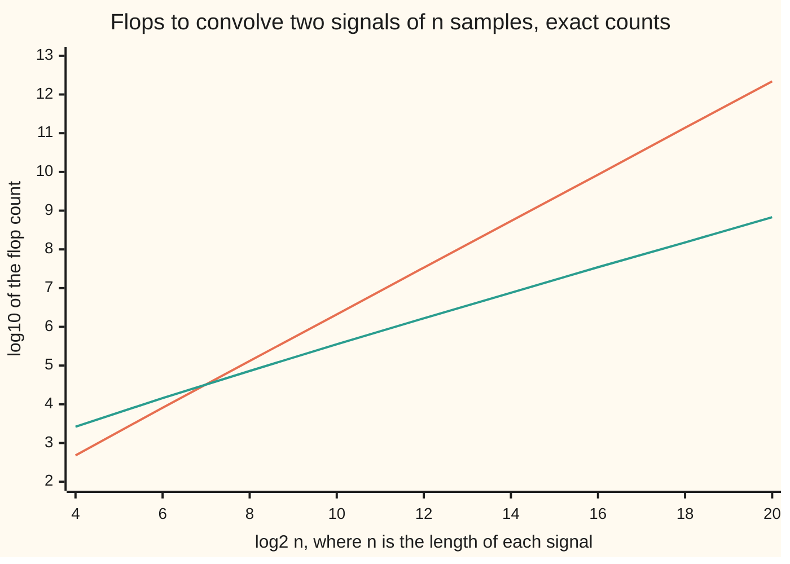

# The fast Fourier transform: n log n instead of n squared, by splitting the sum in half

[Syllabus](../../../SYLLABUS.md) → [Numerical analysis](../README.md) → [PDE Solvers](../README.md#s07) → The fast Fourier transform

---

## General Overview

A sound engineer records a handclap in a studio with no echo: 4096 samples. A concert hall's echo, its **impulse response** (what the hall plays back after one sharp click), is another 4096 samples. To make the clap sound as if it rang out in the hall, the engineer **convolves** the two: each output sample is a sum of clap samples times echo samples. The result has 8191 samples. Both signals on this card are illustrative 16-bit integers, so the true answer is a list of exact integers.

Written out, that sum costs 16,777,216 multiplications and 16,769,025 additions: 33,546,241 **flops** (one flop is one add, subtract, multiply or divide). The **fast Fourier transform**, or FFT, gets every one of the 8191 integers exactly for 1,654,784 flops. That is a twentieth of the work, 20.27 times less. It goes through the frequency side: transform both signals, multiply them frequency by frequency, transform back.

The saving grows with the length. At 65,536 samples each, the transform route does 250.1 times less work than the sum. And the rounding error stays tiny: the worst output is off by 4.05e-06, on outputs as large as 19,345,708,798.

**Splitting the sum into even and odd samples again and again cuts an N-point transform from about 8N² flops to 5 N log2 N, and long signals then convolve cheaply.**

**What kind of fact this is:** a theorem. The split is an exact rearrangement of the same sum, and the flop counts are exact; both are proved on this card in Why it works. The rounding bound is a theorem stated with its key steps, and the full proof is in Higham's book (Sources). The signals are illustrative.

### The picture: the sum against the transform route



The steep orange line is the sum written out. The teal line is the route through three FFTs. Each step up the y-axis is ten times more work. The lines cross at n = 128, where the route wins by a single flop (32,512 against 32,513). At n = 4096, log2 n = 12, the gap is a factor of 20.27. Both checks print every point.

---

## The formula

[The DFT and the FFT](../../13-Engineering%20mathematics/05-Signals/02-discrete-fourier-transform-and-the-fft.md) already builds the FFT and reads spectra with it. This card counts its cost in flops, bounds its rounding error, uses it to convolve, and compares the variants a numerical library chooses between.

The discrete Fourier transform, DFT, of N samples, and its even–odd split:

$$X_k = \sum_{j=0}^{N-1} x_j\, w^{jk}, \qquad w = e^{-2\pi i/N},$$

$$X_k = E_k + w^k O_k, \qquad X_{k+N/2} = E_k - w^k O_k, \qquad 0 \le k < N/2.$$

The cost, and convolution through the transform:

$$F(N) = 5N\log_2 N \text{ flops}, \qquad c = \mathrm{FFT}^{-1}\big(\mathrm{FFT}(a)\cdot\mathrm{FFT}(b)\big) \text{ with both padded to } N \ge 2n - 1.$$

**Read it aloud:** each output is the even half's transform plus a turned copy of the odd half's, so each of the log2 N levels costs 5N flops.

| Symbol | Plain meaning | In our example | Push it up and the answer… |
| --- | --- | --- | --- |
| $n$ | samples in each signal | 4096 | the sum's cost grows like $n^2$, the route's like $n \log_2 n$ |
| $N$ | transform size, a power of 2, at least $2n - 1$ | 8192 | one more halving level per doubling |
| $x_j$, $X_k$ | sample number $j$ of the signal being transformed; output number $k$, how much of the wave with $k$ cycles per block it holds | clap or echo samples; complex numbers | |
| $w$ | the **twiddle**: $e^{-2\pi i/N}$, one $N$-th of a turn round the unit circle; $i$ is the square root of $-1$ | $-i$ when $N = 4$ | a smaller turn per step |
| $E_k$, $O_k$, $t$ | output $k$ of the half-size transforms of the even-numbered and odd-numbered samples; $t = w^k O_k$, the turned odd part | | |
| $F(N)$ | flops in one transform of size $N$ | 532,480 at $N = 8192$ | grows a little faster than $N$ |
| $a_j$, $b_j$ | the clap and the echo, as 16-bit integers | 4096 of each | larger outputs, same relative error |
| $c_j$ | output $j$ of the convolution, $\sum_i a_i\, b_{j-i}$ | 8191 exact integers, the largest 19,345,708,798 | |
| $u$, $\gamma_4$ | the unit roundoff, $2^{-53}$, the largest relative error of one rounding; $\gamma_4 = 4u/(1-4u)$, four roundings' worth | | |
| $\mu$ | how far each computed twiddle can sit from the true one | $2u$, assumed | the bound grows with it |
| $\eta$ | rounding allowance for one butterfly level, built from $u$ and $\mu$ | | the bound grows with it |
| $\lVert\cdot\rVert_2$ | the length of a list of numbers: the square root of the sum of squares | | |

### When it holds

- **N is a power of 2.** The halving must reach single samples. For other sizes, pad with zeros or use a mixed-radix split (below); a prime size needs another trick entirely.
- **Both signals are padded to N ≥ 2n − 1.** The transform's product is a *circular* convolution: outputs past the end wrap round to the start. Without padding, the echo's tail lands on the clap's start, and the largest error is 604,448,004.
- **The twiddles are accurate.** Each $w^k$ is taken from cosine and sine. Built by repeated multiplication, the error grows with N: 241 times worse on this example.
- **The outputs stay well inside double precision.** The integers come back exactly only while the rounding error stays below 0.5. Here it is 4.05e-06; much longer or louder signals need a check, or an exact transform over integers.
- **Flops are not time.** A transform touches each number only a few times per level, so memory traffic often decides its speed ([Counting the work](../01-Floating%20Point%20and%20Error/08-operation-counts-and-cost.md)). This card counts flops; it times nothing.

---

## Why it works

### Step 0: half the samples give half the outputs, twice over

The DFT sum uses the powers of one twiddle $w$. Square the twiddle and you get the twiddle of a transform half as long. So the even-numbered samples, on their own, form a half-size DFT. The odd-numbered samples form another. Two half-size transforms cost a quarter each, half in total. Repeat the trick on each half, and the work falls from $N^2$ to $N \log_2 N$.

### Step 1: the split

Split the sum by the parity of $j$. Write $j = 2m$ for even samples and $j = 2m + 1$ for odd ones:

$$X_k = \sum_{m=0}^{N/2-1} x_{2m}\,(w^2)^{mk} \;+\; w^k \sum_{m=0}^{N/2-1} x_{2m+1}\,(w^2)^{mk} = E_k + w^k O_k.$$

Here $w^2 = e^{-2\pi i/(N/2)}$ is the twiddle of size $N/2$, so $E_k$ and $O_k$ are half-size DFTs.

Two facts give the other half of the outputs free:

1. $E_k$ and $O_k$ repeat every $N/2$ steps of $k$, because $(w^2)^{N/2} = 1$.
2. $w^{k+N/2} = -w^k$, because $w^{N/2}$ is half a turn, which is $-1$.

So $X_{k+N/2} = E_k - w^k O_k$. One product $t = w^k O_k$ serves two outputs, $E_k + t$ and $E_k - t$. This pair is a **butterfly**.

### Step 2: count the flops

A complex number is two real ones. One complex multiplication, $(p + iq)(r + is) = (pr - qs) + i(ps + qr)$, takes 4 multiplications and 2 additions: 6 flops. A complex addition takes 2. So one butterfly costs $6 + 2 + 2 = 10$ flops.

A size-$N$ transform does $N/2$ butterflies after its two half-size transforms:

$$F(N) = 2F(N/2) + 5N, \qquad F(1) = 0.$$

This is the even-split case of [Divide-and-conquer recurrences](../../04-Combinatorics%20and%20graphs/05-Recurrences/07-divide-and-conquer-recurrences.md): equal work $5N$ on each of the $\log_2 N$ levels. So $F(N) = 5N\log_2 N$. The plain sum takes $N^2$ complex multiplications and $N(N-1)$ complex additions, about $8N^2$ flops. The code counts every flop at N = 2, 4, …, 8192 and matches the formula each time.

<details>
<summary>Detailed proof: F(N) = 5N log2 N for every power of 2</summary>

By induction on $L = \log_2 N$. For $L = 0$: $F(1) = 0 = 5 \cdot 1 \cdot 0$.

Suppose $F(2^{L-1}) = 5 \cdot 2^{L-1}(L-1)$. Then

$$F(2^L) = 2 \cdot 5 \cdot 2^{L-1}(L-1) + 5 \cdot 2^L = 5 \cdot 2^L (L - 1 + 1) = 5 \cdot 2^L L.$$

So the formula holds for every $L$. The split itself is exact algebra, so the FFT returns the same numbers as the sum in exact arithmetic.

</details>

### Step 3: convolution becomes a product

[Convolution](../../07-Complex%20analysis/08-Transforms%20in%20Outline/04-convolution-theorem.md) proves that the transform of a convolution is the product of the transforms. For lists of N numbers, the theorem holds for the **circular** convolution: indices are counted modulo N, so anything past the end wraps to the start.

The cure is zero padding. The true output has $2n - 1$ samples. Pad both signals with zeros to $N \ge 2n - 1$, and nothing reaches the end, so nothing wraps. Circular and ordinary convolution then agree.

The route has five parts:

1. Pad the clap and the echo to N = 8192.
2. Transform both: two FFTs.
3. Multiply the two spectra, frequency by frequency: N complex products, $6N$ flops.
4. Transform back: the same FFT with $w$ replaced by its conjugate $\bar w = e^{+2\pi i/N}$.
5. Divide each real part by N: N flops.

Total: $15N\log_2 N + 7N$ flops. The same splitting multiplies two polynomials. A polynomial's coefficients are a signal, and the product's coefficients are their convolution. The worked numbers below do one by hand.

### Step 4: why the rounding error grows only like log2 N

One butterfly level never stretches errors. Its outputs $E_k + t$ and $E_k - t$ have $|E_k + t|^2 + |E_k - t|^2 = 2(|E_k|^2 + |t|^2)$, and $|t| = |O_k|$ because $|w^k| = 1$. So each level multiplies the length of the whole vector by exactly $\sqrt 2$. A rounding error carried into a level grows by that same factor as the signal, so its relative size stays put.

Each level adds at most a fixed relative error of its own, $\eta$. After $\log_2 N$ levels, the relative errors add up. Higham's Theorem 24.2 makes this precise for the computed transform $\hat X$:

$$\frac{\lVert \hat X - X\rVert_2}{\lVert X\rVert_2} \le \frac{\log_2 N \cdot \eta}{1 - \log_2 N \cdot \eta}, \qquad \eta = \mu + \gamma_4(\sqrt 2 + \mu), \quad \gamma_4 = \frac{4u}{1 - 4u}.$$

A transform there and back doubles the bound, to about $2\log_2 N\cdot\eta$ to first order. The plain sum has no such structure: each output adds N terms in a row, and its bound grows in proportion to N.

The code checks the bound, with each twiddle assumed within $\mu = 2u$:

| N | Error there and back, true | Bound $2\log_2 N\cdot\eta$ | Ratio | Twiddles by repeated multiplication |
| ---: | ---: | ---: | ---: | ---: |
| 32 | 1.96e-16 | 8.50e-15 | 0.023 | 4.47e-16 |
| 128 | 2.33e-16 | 1.19e-14 | 0.020 | 1.13e-15 |
| 512 | 3.42e-16 | 1.53e-14 | 0.022 | 6.17e-15 |
| 2048 | 3.90e-16 | 1.87e-14 | 0.021 | 1.29e-14 |
| 8192 | 4.34e-16 | 2.21e-14 | 0.020 | 4.11e-14 |

The ratio stays near 0.02: the true error sits far under the bound, because rounding errors partly cancel. The true error creeps up slowly with N, as $\log_2 N$ predicts.

The last column breaks the twiddle assumption. Each $w^{k+1}$ is computed as $w^k \cdot w$, so its error grows with $k$, and $\mu$ grows with N. At N = 8192 its error is 4.11e-14 against 4.34e-16, already above the accurate bound of 2.21e-14.

### Step 5: the variants a library chooses between

Every variant below gives the same outputs; they differ in flops, memory and accuracy.

| Variant | What changes | Flops for one transform at N = 8192 |
| --- | --- | ---: |
| Radix-2, every twiddle multiplied | this card's recursive code | 532,480 |
| Skip the multiplications by $w^0 = 1$ | 8191 butterflies need no multiply | 483,334 |
| Split-radix | one half-size transform of the even samples, two quarter-size ones of the odd samples | 376,840 |

- **Decimation in time or in frequency.** This card splits the *inputs* into even and odd samples. Splitting the *outputs* instead gives the same count, with the butterflies run in reverse order.
- **Recursive or in-place.** A library avoids recursion and copies. It first moves each sample to the slot whose binary number is its own reversed, then runs the butterflies in one array, level by level. The code's third road does this.
- **Split radix.** Split-radix costs $4N\log_2 N - 6N + 8$ real flops (Duhamel and Vetterli). A 2007 refinement by Johnson and Frigo lowers the count again.
- **Real input.** Real signals waste half a complex transform. Pack the clap into the real part and the echo into the imaginary part, transform once, then separate the two spectra by symmetry. The code's third road does this: 1,187,840 flops, a saving of 28.24.
- **Other sizes.** A size such as $N = 2^a 3^b 5^c$ splits by 2, 3 and 5 in turn: the mixed-radix FFT. A prime size needs another method, such as Bluestein's algorithm, which rewrites the transform as a convolution.
- **Twiddle tables.** Libraries compute each twiddle from cosine and sine, or by a recurrence that is restarted often, for the reason in Step 4.

A library such as FFTW times several of these plans on the actual machine and keeps the fastest. Flop counts narrow the choice; memory traffic settles it.

---

## Worked numbers, by hand

The clap and the echo, n = 4096 samples each, through three radix-2 transforms.

| Step | Arithmetic | Value |
| --- | --- | --- |
| outputs of the convolution | 4096 + 4096 − 1 | 8191 |
| transform size N | the next power of 2 at or above 8191 | 8192, with log2 N = 13 |
| the sum: multiplications | 4096 × 4096 | 16,777,216 |
| the sum: additions | 4095 × 4095, since each output's first term needs none | 16,769,025 |
| the sum: flops | 16,777,216 + 16,769,025 | 33,546,241 |
| one transform | 5 × 8192 × 13 | 532,480 |
| three transforms | 3 × 532,480 | 1,597,440 |
| spectra multiplied, then divided by N | 6 × 8192 + 8192 | 57,344 |
| the route | 1,597,440 + 57,344 | 1,654,784 |
| **saving** | 33,546,241 ÷ 1,654,784 | **20.27 times fewer flops** |

At this length the transform route does a twentieth of the work, and every output rounds to its exact integer.

### The route on a product small enough to do by hand

Multiply $(1 + 2x + 3x^2)(4 + 5x)$. The coefficient lists are 1, 2, 3 and 4, 5; the product has 4 coefficients, so N = 4 and $w = e^{-2\pi i/4} = -i$. The transform evaluates each polynomial at the four powers of $w$: 1, $-i$, $-1$ and $i$.

| Step | Arithmetic | Value |
| --- | --- | --- |
| $A$ at 1, $-i$, $-1$, $i$ | $1 + 2x + 3x^2$ at each point | 6, −2 − 2i, 2, −2 + 2i |
| $B$ at the same points | $4 + 5x$ at each point | 9, 4 − 5i, −1, 4 + 5i |
| product, point by point | e.g. (−2 − 2i)(4 − 5i) = −8 + 10i − 8i − 10 | 54, −18 + 2i, −2, −18 − 2i |
| back: $c_0$ | (54 − 18 + 2i − 2 − 18 − 2i) ÷ 4 | 4 |
| back: all four | the inverse transform, divided by 4 | **4, 13, 22, 15** |

So the product is $4 + 13x + 22x^2 + 15x^3$, which the sum written out confirms. Transforming is evaluating at the roots of unity; multiplying spectra is multiplying values; the inverse transform reads the coefficients back.

### What breaks if you drop a piece

The correct route gives every output exactly, with the largest rounding error 4.05e-06.

| Mistake | Comes out at | What went wrong |
| --- | --- | --- |
| No zero padding, N = 4096 | largest error 604,448,004 | the product of transforms is circular, so the echo's tail wrapped onto the clap's start |
| No division by N on the way back | largest output 158,480,046,473,216, not 19,345,708,798 | the inverse sum adds N copies; 8192 times too big |
| Twiddles by repeated multiplication | largest error 9.77e-04, 241 times worse | each $w^{k+1} = w^k \cdot w$ carries the error of all the steps before it |
| Complex multiplications counted as flops | 167,936 against 16,777,216: a saving of 99.9 claimed | one complex multiplication is 6 flops; the true saving is 20.27 |

---

## Code, from first principles, and it actually runs

The script builds the clap and the echo from a small written-out generator, SplitMix64, so both languages use the same integers. It reaches the convolution **three independent ways**: the sum in exact integers, three recursive radix-2 transforms, and the in-place loop with bit reversal and both signals in one transform. Every flop is counted where it happens and compared with the formulas. The rounding bound is checked at five sizes, the hand-sized polynomial product is redone, its spectra included, and every "what breaks" number is computed.

### Python

```python
# The fast Fourier transform -- the check behind the card.  Standard library only.
# A handclap convolved with a room's echo, 4096 samples each, illustrative 16-bit integers.
# Road 1: the sum written out, in exact integers.  Road 2: the recursive radix-2 FFT, three
# transforms.  Road 3: the in-place FFT with bit reversal, both signals packed into one transform.
import math, functools
M64 = (1 << 64) - 1
def signal(seed, n, power):                           # SplitMix64 noise fading to nothing over n samples
    s, out = seed, []
    for k in range(n):
        s = (s + 0x9E3779B97F4A7C15) & M64
        z = ((s ^ (s >> 30)) * 0xBF58476D1CE4E5B9) & M64
        z = ((z ^ (z >> 27)) * 0x94D049BB133111EB) & M64
        r = z ^ (z >> 31)
        mag = (r >> 1) % 32768 * (n - k) ** power // n ** power
        out.append(-mag if r & 1 else mag)
    return out
flops = [0]
def cmul(a, b): return complex(a.real * b.real - a.imag * b.imag, a.real * b.imag + a.imag * b.real)
def total(g): return functools.reduce(lambda s, v: s + v, g, 0.0)   # plain left-to-right sum
def turn(k, n, sign): return complex(                 # the twiddle w^k, straight from cos and sin
    math.cos(2 * math.pi * k / n), sign * math.sin(2 * math.pi * k / n))
def fft(x, sign=-1, repeated=False):                  # road 2: halve, recurse, recombine
    n = len(x)
    if n == 1:
        return [x[0]]
    ev, od = fft(x[0::2], sign, repeated), fft(x[1::2], sign, repeated)
    out, w, w1 = [0j] * n, 1 + 0j, turn(1, n, sign)
    for k in range(n // 2):
        if not repeated: w = turn(k, n, sign)
        t = cmul(w, od[k])
        out[k], out[k + n // 2] = ev[k] + t, ev[k] - t
        flops[0] += 10                                # one complex multiply (6), two complex adds (4)
        if repeated:
            w = cmul(w, w1)                                # the mistake: w^(k+1) from w^k, error piles up
    return out
def fft_inplace(x, sign=-1):                          # road 3: the library's loop, no recursion
    n, a, bits = len(x), list(x), len(x).bit_length() - 1
    for i in range(n):                                # move each sample to its bit-reversed slot
        j = 0
        for b in range(bits):
            j = (j << 1) | ((i >> b) & 1)
        if i < j:
            a[i], a[j] = a[j], a[i]
    tw, m = [turn(k, n, sign) for k in range(n // 2)], 2
    while m <= n:
        for s in range(0, n, m):
            for k in range(m // 2):
                t = cmul(tw[k * (n // m)], a[s + k + m // 2])
                a[s + k], a[s + k + m // 2] = a[s + k] + t, a[s + k] - t
                flops[0] += 10
        m *= 2
    return a
def pad(x, N): return [complex(v, 0) for v in x] + [0j] * (N - len(x))
def conv_plain(a, b, N, repeated=False):              # three transforms and N products
    A, B = fft(pad(a, N), -1, repeated), fft(pad(b, N), -1, repeated)
    flops[0] += 6 * N + N                             # N complex products, then N divisions
    return [v.real / N for v in fft([cmul(A[k], B[k]) for k in range(N)], 1, repeated)]
def conv_packed(a, b, N):                             # a in the real part, b in the imaginary part
    Z, P = fft_inplace([complex(v, w) for v, w in zip(a + [0] * (N - len(a)), b + [0] * (N - len(b)))]), []
    for k in range(N):
        pr, pi, qr, qi = Z[k].real, Z[k].imag, Z[-k % N].real, -Z[-k % N].imag
        A = complex((pr + qr) * 0.5, (pi + qi) * 0.5)          # a's transform: 4 flops
        H = complex((pi - qi) * 0.5, (qr - pr) * 0.5)          # b's transform: 4 flops
        P.append(cmul(A, H))                                        # their product: 6 flops
    flops[0] += 14 * N + N
    return [v.real / N for v in fft_inplace(P, 1)]
def direct(a, b):                                     # road 1: the sum written out, exact integers
    c, mul, add, top = [0] * (len(a) + len(b) - 1), 0, 0, -1
    for i, ai in enumerate(a):
        for j, bj in enumerate(b):
            c[i + j] += ai * bj
        mul, add, top = mul + len(b), add + max(0, top - i + 1), i + len(b) - 1   # outputs i..top held a term: adds
    return c, mul, add
def route(n): return 15 * 2 * n * ((2 * n).bit_length() - 1) + 7 * 2 * n   # three transforms, N = 2n
def plain_sum(n): return n * n + (n - 1) * (n - 1)
n = 4096; N = 2 * n; lg = N.bit_length() - 1             # lg = log2 N, 13 here
clap, room = signal(2026, n, 4), signal(1111, n, 2)
c, mul, add = direct(clap, room)
flops[0] = 0; c2 = conv_plain(clap, room, N); f_plain = flops[0]
flops[0] = 0; c3 = conv_packed(clap, room, N); f_packed = flops[0]
e2, e3 = max(abs(c2[j] - c[j]) for j in range(2 * n - 1)), max(abs(c3[j] - c[j]) for j in range(2 * n - 1))
exact = all(round(c2[j]) == c[j] == round(c3[j]) for j in range(len(c)))
big = max(abs(v) for v in c)
print(f"signals: n = {n}, padded N = {N}; output {len(c)} samples, largest |c| = {big}")
print(f"road 1, the sum: {mul} multiplications ({n} x {n}) + {add} additions ({n - 1} x {n - 1}) = {mul + add} flops")
print(f"road 2, three transforms: {f_plain} flops counted; 15 N log2 N + 7N = {3 * 5 * N * lg} + {7 * N} = {route(n)}")
print(f"road 3, packed: {f_packed} flops counted; 10 N log2 N + 15N = {10 * N * lg + 15 * N}")
print(f"saving in flops: {(mul + add) / f_plain:.2f} times (three transforms), {(mul + add) / f_packed:.2f} (packed)")
print(f"largest rounding error: road 2 {e2:.2e}, road 3 {e3:.2e}, rounding allows 0.5; exact: {'yes' if exact else 'no'}")
def counted(L): flops[0] = 0; fft([0j] * (1 << L)); return flops[0]
ok_count = all(counted(L) == 5 * (1 << L) * L for L in range(1, 14))
print(f"one transform counted at N = 2 .. 8192 equals 5 N log2 N: {'yes' if ok_count else 'no'}")
print(f"per transform at N = {N}: radix-2 {5 * N * lg}; skipping the {N - 1} multiplications by w^0 = 1: "
      f"{5 * N * lg - 6 * (N - 1)}; split-radix 4 N log2 N - 6N + 8: {4 * N * lg - 6 * N + 8}")
# ---- by hand: (1 + 2x + 3x^2)(4 + 5x) through a 4-point transform ----
ha, hb = fft(pad([1, 2, 3], 4)), fft(pad([4, 5], 4))
hp = [cmul(ha[k], hb[k]) for k in range(4)]
hc = [round(v.real / 4) for v in fft(hp, 1)]
show = lambda v: " ".join(f"{round(z.real):+d}{round(z.imag):+d}i" for z in v)
print(f"by hand: A = {show(ha)}; B = {show(hb)}; A*B = {show(hp)}")
print(f"by hand: c = {hc}, the sum gives {direct([1, 2, 3, 0], [4, 5, 0, 0])[0][:4]}")
# ---- rounding: there and back, against the first-order bound 2 log2 N eta ----
u = 2.0 ** -53; mu = 2 * u; eta = mu + 4 * u / (1 - 4 * u) * (math.sqrt(2) + mu); rows = []
for L in (5, 7, 9, 11, 13):
    x, errs = pad(signal(7, 1 << L, 0), 1 << L), []
    nx = math.sqrt(total(v.real * v.real for v in x))
    for rep in (False, True):
        y = [complex(v.real / (1 << L), v.imag / (1 << L)) for v in fft(fft(x, -1, rep), 1, rep)]
        errs.append(math.sqrt(total((y[j].real - x[j].real) ** 2 + y[j].imag ** 2 for j in range(1 << L))) / nx)
    rows.append((errs[0], errs[1], 2 * L * eta))
    print(f"there and back, N = {1 << L:>4}: error {errs[0]:.2e}, bound {2 * L * eta:.2e}, "
          f"ratio {errs[0] / (2 * L * eta):.3f}; repeated twiddles {errs[1]:.2e}")
# ---- what breaks ----
c4 = conv_plain(clap, room, n)                        # no padding: N = 4096, the tail wraps round
wrap = max(abs(c4[j] - c[j]) for j in range(n))
wrap_ok = all(round(c4[j]) == c[j] + (c[j + n] if j + n < len(c) else 0) for j in range(n))
c5 = conv_plain(clap, room, N, True)                  # twiddles by repeated multiplication
e5 = max(abs(c5[j] - c[j]) for j in range(2 * n - 1))
cm = 3 * N // 2 * lg + N                              # complex multiplications in road 2
print(f"break, no padding: largest error {wrap:.0f}; it is the tail wrapped onto the head: {'yes' if wrap_ok else 'no'}")
print(f"break, no 1/N: largest output {big * N} instead of {big}, {N} times too big")
print(f"break, repeated twiddles: largest error {e5:.2e} instead of {e2:.2e}, {e5 / e2:.0f} times worse")
print(f"break, complex multiplications counted as flops: {cm} against {n * n}, claims {n * n / cm:.1f} times")
# ---- the cost curve, and where the route wins ----
xs = list(range(4, 21, 2))
print("chart, log2 n:", xs)
print("chart, log10 flops, the sum:", ", ".join(f"{math.log10(plain_sum(1 << L)):.2f}" for L in xs))
print("chart, log10 flops, three transforms:", ", ".join(f"{math.log10(route(1 << L)):.2f}" for L in xs))
cross = next(1 << L for L in range(1, 30) if route(1 << L) < plain_sum(1 << L))
two_h = next(1 << L for L in range(1, 30) if plain_sum(1 << L) >= 200 * route(1 << L))
print(f"route first beats the sum at n = {cross}: {route(cross)} against {plain_sum(cross)}")
print(f"saving first reaches 200 at n = {two_h}: {plain_sum(two_h) / route(two_h):.1f}; at n = 8192: {plain_sum(8192) / route(8192):.2f}")
assert mul + add == plain_sum(n) and f_plain == route(n)          # counted flops against the formulas
assert ok_count and f_packed == 10 * N * lg + 15 * N
assert e2 < 0.5 and e3 < 0.5 and exact                             # both transform roads hit the exact sum
assert hc == [4, 13, 22, 15]
assert max(abs(z - w) for z, w in zip(ha + hb, [6, -2 - 2j, 2, -2 + 2j, 9, 4 - 5j, -1, 4 + 5j])) < 1e-12   # the hand spectra
assert all(r[0] < r[2] for r in rows) and rows[-1][1] > 10 * rows[-1][0]
assert wrap_ok and wrap > 1e6 and e5 > 10 * e2
print("ALL CHECKS PASS")
```

**Ran 2026-11-11 on macOS, Python 3.14.10, standard library only. All checks passed. Output, pasted from the run:**

```
signals: n = 4096, padded N = 8192; output 8191 samples, largest |c| = 19345708798
road 1, the sum: 16777216 multiplications (4096 x 4096) + 16769025 additions (4095 x 4095) = 33546241 flops
road 2, three transforms: 1654784 flops counted; 15 N log2 N + 7N = 1597440 + 57344 = 1654784
road 3, packed: 1187840 flops counted; 10 N log2 N + 15N = 1187840
saving in flops: 20.27 times (three transforms), 28.24 (packed)
largest rounding error: road 2 4.05e-06, road 3 1.14e-05, rounding allows 0.5; exact: yes
one transform counted at N = 2 .. 8192 equals 5 N log2 N: yes
per transform at N = 8192: radix-2 532480; skipping the 8191 multiplications by w^0 = 1: 483334; split-radix 4 N log2 N - 6N + 8: 376840
by hand: A = +6+0i -2-2i +2+0i -2+2i; B = +9+0i +4-5i -1+0i +4+5i; A*B = +54+0i -18+2i -2+0i -18-2i
by hand: c = [4, 13, 22, 15], the sum gives [4, 13, 22, 15]
there and back, N =   32: error 1.96e-16, bound 8.50e-15, ratio 0.023; repeated twiddles 4.47e-16
there and back, N =  128: error 2.33e-16, bound 1.19e-14, ratio 0.020; repeated twiddles 1.13e-15
there and back, N =  512: error 3.42e-16, bound 1.53e-14, ratio 0.022; repeated twiddles 6.17e-15
there and back, N = 2048: error 3.90e-16, bound 1.87e-14, ratio 0.021; repeated twiddles 1.29e-14
there and back, N = 8192: error 4.34e-16, bound 2.21e-14, ratio 0.020; repeated twiddles 4.11e-14
break, no padding: largest error 604448004; it is the tail wrapped onto the head: yes
break, no 1/N: largest output 158480046473216 instead of 19345708798, 8192 times too big
break, repeated twiddles: largest error 9.77e-04 instead of 4.05e-06, 241 times worse
break, complex multiplications counted as flops: 167936 against 16777216, claims 99.9 times
chart, log2 n: [4, 6, 8, 10, 12, 14, 16, 18, 20]
chart, log10 flops, the sum: 2.68, 3.91, 5.12, 6.32, 7.53, 8.73, 9.93, 11.14, 12.34
chart, log10 flops, three transforms: 3.42, 4.16, 4.86, 5.55, 6.22, 6.88, 7.54, 8.18, 8.83
route first beats the sum at n = 128: 32512 against 32513
saving first reaches 200 at n = 65536: 250.1; at n = 8192: 37.75
ALL CHECKS PASS
```

### Rust

```rust
// The fast Fourier transform -- the same check as the Python, in Rust.  No crates.
// A handclap convolved with a room's echo, 4096 samples each, illustrative 16-bit integers.
// Road 1: the sum written out, in exact integers.  Road 2: the recursive radix-2 FFT, three
// transforms.  Road 3: the in-place FFT with bit reversal, both signals packed into one transform.
use std::f64::consts::PI;
#[derive(Clone, Copy)]
struct C { re: f64, im: f64 }
fn c(re: f64, im: f64) -> C { C { re, im } }
fn mul(a: C, b: C) -> C { c(a.re * b.re - a.im * b.im, a.re * b.im + a.im * b.re) }
fn add(a: C, b: C) -> C { c(a.re + b.re, a.im + b.im) }
fn sub(a: C, b: C) -> C { c(a.re - b.re, a.im - b.im) }
fn signal(seed: u64, n: usize, power: u32) -> Vec<i64> { // SplitMix64 noise fading to nothing over n samples
    let (mut s, mut out) = (seed, Vec::new());
    for k in 0..n {
        s = s.wrapping_add(0x9E3779B97F4A7C15);
        let mut z = (s ^ (s >> 30)).wrapping_mul(0xBF58476D1CE4E5B9);
        z = (z ^ (z >> 27)).wrapping_mul(0x94D049BB133111EB);
        let r = z ^ (z >> 31);
        let mag = (((r >> 1) % 32768) as u128 * ((n - k) as u128).pow(power) / (n as u128).pow(power)) as i64;
        out.push(if r & 1 == 1 { -mag } else { mag });
    }
    out
}
fn turn(k: usize, n: usize, sign: f64) -> C { // the twiddle w^k, straight from cos and sin; black_box stops
    let t = 2.0 * PI * k as f64 / n as f64;     // -O fusing them into one sincos call with other last bits
    c(std::hint::black_box(t).cos(), sign * std::hint::black_box(t).sin()) }
fn fft(x: &[C], sign: f64, repeated: bool, fl: &mut u64) -> Vec<C> { // road 2: halve, recurse, recombine
    let n = x.len();
    if n == 1 { return vec![x[0]]; }
    let half = |s: usize| x.iter().skip(s).step_by(2).cloned().collect::<Vec<C>>();
    let (ev, od) = (fft(&half(0), sign, repeated, fl), fft(&half(1), sign, repeated, fl));
    let (mut out, mut w, w1) = (vec![c(0.0, 0.0); n], c(1.0, 0.0), turn(1, n, sign));
    for k in 0..n / 2 {
        if !repeated { w = turn(k, n, sign); }
        let t = mul(w, od[k]);
        (out[k], out[k + n / 2]) = (add(ev[k], t), sub(ev[k], t));
        *fl += 10; // one complex multiply (6), two complex adds (4)
        if repeated { w = mul(w, w1); } // the mistake: w^(k+1) from w^k, error piles up
    }
    out
}
fn fft_inplace(x: &[C], sign: f64, fl: &mut u64) -> Vec<C> { // road 3: the library's loop, no recursion
    let (n, mut a, bits) = (x.len(), x.to_vec(), x.len().trailing_zeros());
    for i in 0..n { // move each sample to its bit-reversed slot
        let mut j = 0;
        for b in 0..bits { j = (j << 1) | ((i >> b) & 1); }
        if i < j { a.swap(i, j); }
    }
    let (tw, mut m): (Vec<C>, usize) = ((0..n / 2).map(|k| turn(k, n, sign)).collect(), 2);
    while m <= n {
        for s in (0..n).step_by(m) {
            for k in 0..m / 2 {
                let t = mul(tw[k * (n / m)], a[s + k + m / 2]);
                (a[s + k], a[s + k + m / 2]) = (add(a[s + k], t), sub(a[s + k], t));
                *fl += 10;
            }
        }
        m *= 2;
    }
    a
}
fn pad(x: &[i64], n: usize) -> Vec<C> { (0..n).map(|j| c(if j < x.len() { x[j] as f64 } else { 0.0 }, 0.0)).collect() }
fn conv_plain(a: &[i64], b: &[i64], n: usize, repeated: bool, fl: &mut u64) -> Vec<f64> { // three transforms, N products
    let (fa, fb) = (fft(&pad(a, n), -1.0, repeated, fl), fft(&pad(b, n), -1.0, repeated, fl));
    *fl += 6 * n as u64 + n as u64; // N complex products, then N divisions
    fft(&(0..n).map(|k| mul(fa[k], fb[k])).collect::<Vec<C>>(), 1.0, repeated, fl).iter().map(|v| v.re / n as f64).collect()
}
fn conv_packed(a: &[i64], b: &[i64], n: usize, fl: &mut u64) -> Vec<f64> { // a in the real part, b in the imaginary
    let (pa, pb, mut p) = (pad(a, n), pad(b, n), Vec::new());
    let z = fft_inplace(&(0..n).map(|j| c(pa[j].re, pb[j].re)).collect::<Vec<C>>(), -1.0, fl);
    for k in 0..n {
        let (pr, pi, qr, qi) = (z[k].re, z[k].im, z[(n - k) % n].re, -z[(n - k) % n].im);
        let fa = c((pr + qr) * 0.5, (pi + qi) * 0.5); // a's transform: 4 flops
        let fb = c((pi - qi) * 0.5, (qr - pr) * 0.5); // b's transform: 4 flops
        p.push(mul(fa, fb)); // their product: 6 flops
    }
    *fl += 14 * n as u64 + n as u64;
    fft_inplace(&p, 1.0, fl).iter().map(|v| v.re / n as f64).collect()
}
fn direct(a: &[i64], b: &[i64]) -> (Vec<i64>, u64, u64) { // road 1: the sum written out, exact integers
    let (mut top, mut cc, mut ml, mut ad) = (-1i64, vec![0i64; a.len() + b.len() - 1], 0u64, 0u64);
    for i in 0..a.len() {
        for j in 0..b.len() { cc[i + j] += a[i] * b[j]; }
        ml += b.len() as u64;
        ad += (top - i as i64 + 1).max(0) as u64; top = (i + b.len()) as i64 - 1; // outputs i..top held a term: adds
    }
    (cc, ml, ad)
}
fn route(n: u64) -> u64 { 15 * 2 * n * (2 * n).trailing_zeros() as u64 + 7 * 2 * n } // three transforms, N = 2n
fn plain_sum(n: u64) -> u64 { n * n + (n - 1) * (n - 1) }
fn sci(x: f64) -> String { // e-notation with a two-digit exponent, as Python prints it
    let s = format!("{:.2e}", x); let (m, e) = s.split_once('e').unwrap();
    let e: i32 = e.parse().unwrap();
    format!("{}e{}{:02}", m, if e < 0 { '-' } else { '+' }, e.abs())
}
fn main() {
    let n = 4096usize; let (nn, lg) = (2 * n, (2 * n).trailing_zeros() as u64); // lg = log2 N, 13 here
    let (clap, room) = (signal(2026, n, 4), signal(1111, n, 2));
    let (cv, ml, ad) = direct(&clap, &room);
    let (mut f_plain, mut f_packed, mut junk) = (0u64, 0u64, 0u64);
    let (c2, c3) = (conv_plain(&clap, &room, nn, false, &mut f_plain), conv_packed(&clap, &room, nn, &mut f_packed));
    let err = |v: &Vec<f64>| (0..2 * n - 1).map(|j| (v[j] - cv[j] as f64).abs()).fold(0.0, f64::max);
    let (e2, e3) = (err(&c2), err(&c3));
    let exact = (0..cv.len()).all(|j| c2[j].round() as i64 == cv[j] && c3[j].round() as i64 == cv[j]);
    let big = cv.iter().map(|v| v.abs()).max().unwrap();
    let yn = |b: bool| if b { "yes" } else { "no" };
    let (nu, packed_formula) = (nn as u64, 10 * nn as u64 * lg + 15 * nn as u64);
    println!("signals: n = {}, padded N = {}; output {} samples, largest |c| = {}", n, nn, cv.len(), big);
    println!("road 1, the sum: {} multiplications ({} x {}) + {} additions ({} x {}) = {} flops", ml, n, n, ad, n - 1, n - 1, ml + ad);
    println!("road 2, three transforms: {} flops counted; 15 N log2 N + 7N = {} + {} = {}", f_plain, 3 * 5 * nu * lg, 7 * nu, route(n as u64));
    println!("road 3, packed: {} flops counted; 10 N log2 N + 15N = {}", f_packed, packed_formula);
    println!("saving in flops: {:.2} times (three transforms), {:.2} (packed)", (ml + ad) as f64 / f_plain as f64, (ml + ad) as f64 / f_packed as f64);
    println!("largest rounding error: road 2 {}, road 3 {}, rounding allows 0.5; exact: {}", sci(e2), sci(e3), yn(exact));
    let counted = |l: usize| { let mut f = 0u64; fft(&vec![c(0.0, 0.0); 1 << l], -1.0, false, &mut f); f };
    let ok_count = (1..14).all(|l| counted(l) == 5 * (1u64 << l) * l as u64);
    println!("one transform counted at N = 2 .. 8192 equals 5 N log2 N: {}", yn(ok_count));
    println!("per transform at N = {}: radix-2 {}; skipping the {} multiplications by w^0 = 1: {}; split-radix 4 N log2 N - 6N + 8: {}",
        nn, 5 * nu * lg, nu - 1, 5 * nu * lg - 6 * (nu - 1), 4 * nu * lg - 6 * nu + 8);
    // ---- by hand: (1 + 2x + 3x^2)(4 + 5x) through a 4-point transform ----
    let (ha, hb) = (fft(&pad(&[1, 2, 3], 4), -1.0, false, &mut junk), fft(&pad(&[4, 5], 4), -1.0, false, &mut junk));
    let hp: Vec<C> = (0..4).map(|k| mul(ha[k], hb[k])).collect();
    let hc: Vec<i64> = fft(&hp, 1.0, false, &mut junk).iter().map(|v| (v.re / 4.0).round() as i64).collect();
    let show = |v: &Vec<C>| v.iter().map(|z| format!("{:+}{:+}i", z.re.round() as i64, z.im.round() as i64)).collect::<Vec<_>>().join(" ");
    println!("by hand: A = {}; B = {}; A*B = {}", show(&ha), show(&hb), show(&hp));
    println!("by hand: c = {:?}, the sum gives {:?}", hc, &direct(&[1, 2, 3, 0], &[4, 5, 0, 0]).0[..4]);
    // ---- rounding: there and back, against the first-order bound 2 log2 N eta ----
    let (u, mu) = (2f64.powi(-53), 2.0 * 2f64.powi(-53));
    let eta = mu + 4.0 * u / (1.0 - 4.0 * u) * (2f64.sqrt() + mu); let mut rows = Vec::new();
    for l in [5usize, 7, 9, 11, 13] {
        let (nl, mut errs) = (1usize << l, Vec::new());
        let x = pad(&signal(7, nl, 0), nl);
        let nx = x.iter().fold(0.0, |s, v| s + v.re * v.re).sqrt();
        for rep in [false, true] {
            let y: Vec<C> = fft(&fft(&x, -1.0, rep, &mut junk), 1.0, rep, &mut junk).iter().map(|v| c(v.re / nl as f64, v.im / nl as f64)).collect();
            errs.push((0..nl).fold(0.0, |s, j| s + (y[j].re - x[j].re).powi(2) + y[j].im.powi(2)).sqrt() / nx);
        }
        let bound = 2.0 * l as f64 * eta;
        rows.push((errs[0], errs[1], bound));
        println!("there and back, N = {:>4}: error {}, bound {}, ratio {:.3}; repeated twiddles {}", nl, sci(errs[0]), sci(bound), errs[0] / bound, sci(errs[1]));
    }
    // ---- what breaks ----
    let c4 = conv_plain(&clap, &room, n, false, &mut junk); // no padding: N = 4096, the tail wraps round
    let wrap = (0..n).map(|j| (c4[j] - cv[j] as f64).abs()).fold(0.0, f64::max);
    let wrap_ok = (0..n).all(|j| c4[j].round() as i64 == cv[j] + if j + n < cv.len() { cv[j + n] } else { 0 });
    let e5 = err(&conv_plain(&clap, &room, nn, true, &mut junk)); // twiddles by repeated multiplication
    let cm = 3 * nu / 2 * lg + nu; // complex multiplications in road 2
    println!("break, no padding: largest error {:.0}; it is the tail wrapped onto the head: {}", wrap, yn(wrap_ok));
    println!("break, no 1/N: largest output {} instead of {}, {} times too big", big * nn as i64, big, nn);
    println!("break, repeated twiddles: largest error {} instead of {}, {:.0} times worse", sci(e5), sci(e2), e5 / e2);
    println!("break, complex multiplications counted as flops: {} against {}, claims {:.1} times", cm, n * n, (n * n) as f64 / cm as f64);
    // ---- the cost curve, and where the route wins ----
    let xs: Vec<u32> = (4..21).step_by(2).collect();
    let line = |f: &dyn Fn(u64) -> u64| xs.iter().map(|&l| format!("{:.2}", (f(1u64 << l) as f64).log10())).collect::<Vec<_>>().join(", ");
    println!("chart, log2 n: {:?}", xs);
    println!("chart, log10 flops, the sum: {}", line(&plain_sum));
    println!("chart, log10 flops, three transforms: {}", line(&route));
    let cross = (1..30).map(|l| 1u64 << l).find(|&m| route(m) < plain_sum(m)).unwrap();
    let two_h = (1..30).map(|l| 1u64 << l).find(|&m| plain_sum(m) >= 200 * route(m)).unwrap();
    println!("route first beats the sum at n = {}: {} against {}", cross, route(cross), plain_sum(cross));
    println!("saving first reaches 200 at n = {}: {:.1}; at n = 8192: {:.2}", two_h, plain_sum(two_h) as f64 / route(two_h) as f64, plain_sum(8192) as f64 / route(8192) as f64);
    assert!(ml + ad == plain_sum(n as u64) && f_plain == route(n as u64)); // counted flops against the formulas
    assert!(ok_count && f_packed == packed_formula);
    assert!(e2 < 0.5 && e3 < 0.5 && exact); // both transform roads hit the exact sum
    assert!(hc == vec![4, 13, 22, 15]);
    assert!(ha.iter().chain(hb.iter()).zip([(6.0, 0.0), (-2.0, -2.0), (2.0, 0.0), (-2.0, 2.0), (9.0, 0.0), (4.0, -5.0), (-1.0, 0.0), (4.0, 5.0)])
        .all(|(z, (r, i))| (z.re - r).hypot(z.im - i) < 1e-12)); // the hand spectra
    assert!(rows.iter().all(|r| r.0 < r.2) && rows[4].1 > 10.0 * rows[4].0);
    assert!(wrap_ok && wrap > 1e6 && e5 > 10.0 * e2);
    println!("ALL CHECKS PASS");
}
```

**Ran 2026-11-11 on macOS, rustc 1.98.1, no crates. All checks passed. Output, pasted from the run:**

```
signals: n = 4096, padded N = 8192; output 8191 samples, largest |c| = 19345708798
road 1, the sum: 16777216 multiplications (4096 x 4096) + 16769025 additions (4095 x 4095) = 33546241 flops
road 2, three transforms: 1654784 flops counted; 15 N log2 N + 7N = 1597440 + 57344 = 1654784
road 3, packed: 1187840 flops counted; 10 N log2 N + 15N = 1187840
saving in flops: 20.27 times (three transforms), 28.24 (packed)
largest rounding error: road 2 4.05e-06, road 3 1.14e-05, rounding allows 0.5; exact: yes
one transform counted at N = 2 .. 8192 equals 5 N log2 N: yes
per transform at N = 8192: radix-2 532480; skipping the 8191 multiplications by w^0 = 1: 483334; split-radix 4 N log2 N - 6N + 8: 376840
by hand: A = +6+0i -2-2i +2+0i -2+2i; B = +9+0i +4-5i -1+0i +4+5i; A*B = +54+0i -18+2i -2+0i -18-2i
by hand: c = [4, 13, 22, 15], the sum gives [4, 13, 22, 15]
there and back, N =   32: error 1.96e-16, bound 8.50e-15, ratio 0.023; repeated twiddles 4.47e-16
there and back, N =  128: error 2.33e-16, bound 1.19e-14, ratio 0.020; repeated twiddles 1.13e-15
there and back, N =  512: error 3.42e-16, bound 1.53e-14, ratio 0.022; repeated twiddles 6.17e-15
there and back, N = 2048: error 3.90e-16, bound 1.87e-14, ratio 0.021; repeated twiddles 1.29e-14
there and back, N = 8192: error 4.34e-16, bound 2.21e-14, ratio 0.020; repeated twiddles 4.11e-14
break, no padding: largest error 604448004; it is the tail wrapped onto the head: yes
break, no 1/N: largest output 158480046473216 instead of 19345708798, 8192 times too big
break, repeated twiddles: largest error 9.77e-04 instead of 4.05e-06, 241 times worse
break, complex multiplications counted as flops: 167936 against 16777216, claims 99.9 times
chart, log2 n: [4, 6, 8, 10, 12, 14, 16, 18, 20]
chart, log10 flops, the sum: 2.68, 3.91, 5.12, 6.32, 7.53, 8.73, 9.93, 11.14, 12.34
chart, log10 flops, three transforms: 3.42, 4.16, 4.86, 5.55, 6.22, 6.88, 7.54, 8.18, 8.83
route first beats the sum at n = 128: 32512 against 32513
saving first reaches 200 at n = 65536: 250.1; at n = 8192: 37.75
ALL CHECKS PASS
```

### Lean

Lean proves the split, the flop count and convolution through the transform, in exact arithmetic, for every power of 2.

- For N a power of 2 and $0 \le k < N/2$, the split is exact: $X_k = E_k + w^k O_k$ and $X_{k+N/2} = E_k - w^k O_k$.
- If $F(1) = 0$ and $F(2M) = 2F(M) + 5 \cdot 2M$, then $F(N) = 5N\log_2 N$ exactly for every power of 2.
- Pad two signals of n samples with zeros to a power of 2, $N \ge 2n - 1$. Then the route's output $j$ is exactly $c_j = \sum_{i=0}^{j} a_i\, b_{j-i}$ for every $j < N$: nothing wraps round.
- By hand, 1, 2, 3 convolved with 4, 5 gives 4, 13, 22, 15. Four spectrum values, the product $(-2 - 2i)(4 - 5i) = -18 + 2i$ and $c_0 = 4$ check too.
- The worked counts hold: 33,546,241 flops for the sum, 1,654,784 for the route, a saving between 20.27 and 20.28.

Rounding error, twiddle accuracy, flops counted in running code and the signals themselves are left to the Python and Rust checks.

```lean
-- The fast Fourier transform: an N-point DFT with N a power of 2 splits exactly into the half-size DFTs of the even and odd samples, the repeated split costs exactly 5 N log2 N flops, and zero padding to N ≥ 2n - 1 makes the inverse transform of the product of two transforms give the ordinary convolution.
import Mathlib.Analysis.SpecialFunctions.Complex.Log
import Mathlib.Algebra.BigOperators.Intervals
import Mathlib.Data.Nat.Log
import Mathlib.Tactic.NormNum
import Mathlib.Tactic.Ring
import Mathlib.RingTheory.RootsOfUnity.Complex

open Complex Finset

/-- The twiddle of size N: w = e^(-2πi/N), one N-th of a turn round the unit circle. -/
noncomputable def twiddle (N : ℕ) : ℂ := Complex.exp (-2 * Real.pi * I / N)

/-- The discrete Fourier transform of N samples: X_k = ∑_{j=0}^{N-1} x_j w^(jk), w = e^(-2πi/N). -/
noncomputable def dft (N : ℕ) (x : ℕ → ℂ) (k : ℕ) : ℂ :=
  ∑ j ∈ range N, x j * twiddle N ^ (j * k)

theorem fft_sum_range_two_mul (M : ℕ) (f : ℕ → ℂ) :
    ∑ j ∈ range (2 * M), f j = ∑ m ∈ range M, f (2 * m) + ∑ m ∈ range M, f (2 * m + 1) := by
  induction M with
  | zero => simp
  | succ M ih =>
    rw [show 2 * (M + 1) = 2 * M + 1 + 1 by ring, sum_range_succ, sum_range_succ, ih,
      sum_range_succ, sum_range_succ]
    ring

theorem twiddle_sq (L : ℕ) : twiddle (2 ^ (L + 1)) ^ 2 = twiddle (2 ^ L) := by
  unfold twiddle
  rw [← Complex.exp_nat_mul]
  congr 1
  push_cast
  field_simp
  ring

theorem twiddle_pow_half (L : ℕ) : twiddle (2 ^ (L + 1)) ^ (2 ^ L) = -1 := by
  unfold twiddle
  rw [← Complex.exp_nat_mul]
  have h : ((2 ^ L : ℕ) : ℂ) * (-2 * Real.pi * I / ((2 ^ (L + 1) : ℕ) : ℂ)) = -(Real.pi * I) := by
    push_cast
    field_simp
    ring
  rw [h, Complex.exp_neg, Complex.exp_pi_mul_I]
  norm_num

theorem twiddle_pow_self (L : ℕ) : twiddle (2 ^ L) ^ (2 ^ L) = 1 := by
  unfold twiddle
  rw [← Complex.exp_nat_mul]
  have h : ((2 ^ L : ℕ) : ℂ) * (-2 * Real.pi * I / ((2 ^ L : ℕ) : ℂ)) = -(2 * Real.pi * I) := by
    push_cast
    field_simp
  rw [h, Complex.exp_neg, Complex.exp_two_pi_mul_I]
  norm_num

/-- The radix-2 split. Let N = 2^(L+1) be a power of 2 (at least 2) and w = e^(-2πi/N).
Let E_k and O_k be the half-size DFTs (size N/2 = 2^L) of the even-numbered samples x_0, x_2, ...
and of the odd-numbered samples x_1, x_3, .... Then for 0 ≤ k < N/2 the butterfly gives two
outputs from one product w^k O_k: X_k = E_k + w^k O_k and X_(k+N/2) = E_k - w^k O_k. -/
theorem dft_even_odd_split (L : ℕ) (x : ℕ → ℂ) (k : ℕ) (hk : k < 2 ^ L) :
    dft (2 ^ (L + 1)) x k =
        dft (2 ^ L) (fun m => x (2 * m)) k +
          twiddle (2 ^ (L + 1)) ^ k * dft (2 ^ L) (fun m => x (2 * m + 1)) k ∧
      dft (2 ^ (L + 1)) x (k + 2 ^ L) =
        dft (2 ^ L) (fun m => x (2 * m)) k -
          twiddle (2 ^ (L + 1)) ^ k * dft (2 ^ L) (fun m => x (2 * m + 1)) k := by
  have hs : ∀ f : ℕ → ℂ, ∑ j ∈ range (2 ^ (L + 1)), f j =
      ∑ m ∈ range (2 ^ L), f (2 * m) + ∑ m ∈ range (2 ^ L), f (2 * m + 1) := by
    intro f
    rw [pow_succ']
    exact fft_sum_range_two_mul _ f
  have hw := twiddle_sq L
  have hh := twiddle_pow_half L
  have h1 := twiddle_pow_self L
  constructor
  · simp only [dft]
    rw [hs, mul_sum]
    congr 1
    · apply sum_congr rfl
      intro m _
      rw [← hw]
      ring
    · apply sum_congr rfl
      intro m _
      rw [← hw]
      ring
  · simp only [dft]
    rw [hs, mul_sum, sub_eq_add_neg, ← sum_neg_distrib]
    congr 1
    · apply sum_congr rfl
      intro m _
      have : x (2 * m) * twiddle (2 ^ (L + 1)) ^ (2 * m * (k + 2 ^ L)) =
          x (2 * m) * (twiddle (2 ^ (L + 1)) ^ 2) ^ (m * k) *
            ((twiddle (2 ^ (L + 1)) ^ 2) ^ (2 ^ L)) ^ m := by ring
      rw [this, hw, h1]
      ring
    · apply sum_congr rfl
      intro m _
      have : x (2 * m + 1) * twiddle (2 ^ (L + 1)) ^ ((2 * m + 1) * (k + 2 ^ L)) =
          twiddle (2 ^ (L + 1)) ^ (2 ^ L) * (twiddle (2 ^ (L + 1)) ^ k *
            (x (2 * m + 1) * (twiddle (2 ^ (L + 1)) ^ 2) ^ (m * k))) *
              ((twiddle (2 ^ (L + 1)) ^ 2) ^ (2 ^ L)) ^ m := by
        ring
      rw [this, hh, hw, h1]
      ring

/-- The flop count. If one transform of size 1 costs nothing, F(1) = 0, and a transform of size
2M costs two transforms of size M plus M butterflies of 10 flops each,
F(2M) = 2 F(M) + 5 (2M), then for every power of 2, N = 2^L, F(N) = 5 N log2 N exactly. -/
theorem fft_flops_eq_five_n_log2_n (F : ℕ → ℕ) (h1 : F 1 = 0)
    (hF : ∀ M, 1 ≤ M → F (2 * M) = 2 * F M + 5 * (2 * M)) (L : ℕ) :
    F (2 ^ L) = 5 * 2 ^ L * Nat.log 2 (2 ^ L) := by
  rw [Nat.log_pow (by norm_num)]
  induction L with
  | zero => simpa using h1
  | succ L ih =>
    rw [pow_succ', hF _ Nat.one_le_two_pow, ih]
    ring

/-- Convolution through the transform, with zero padding. Let a and b be two signals of n samples
(zero from index n on) and pad both to a transform size N = 2^L ≥ 2n - 1. Transform both, multiply
the spectra frequency by frequency, transform back with the conjugate twiddle e^(+2πi/N) and
divide by N. Output j, for every 0 ≤ j < N, is then exactly the ordinary convolution
c_j = ∑_{i=0}^{j} a_i b_(j-i): nothing wraps round. -/
theorem fft_convolution_with_zero_padding (n L : ℕ) (a b : ℕ → ℂ)
    (ha : ∀ j, n ≤ j → a j = 0) (hb : ∀ j, n ≤ j → b j = 0) (hN : 2 * n - 1 ≤ 2 ^ L)
    (j : ℕ) (hj : j < 2 ^ L) :
    ∑ i ∈ range (j + 1), a i * b (j - i) =
      (1 / (2 ^ L : ℂ)) * ∑ k ∈ range (2 ^ L),
        dft (2 ^ L) a k * dft (2 ^ L) b k *
          Complex.exp (2 * Real.pi * I / (2 ^ L : ℕ)) ^ (j * k) := by
  have hNc : ((2 ^ L : ℕ) : ℂ) = (2 : ℂ) ^ L := by push_cast; rfl
  rw [← hNc]
  set N := 2 ^ L with hNdef
  have hN0 : N ≠ 0 := by positivity
  have hv := Complex.isPrimitiveRoot_exp N hN0
  set v := Complex.exp (2 * Real.pi * I / (N : ℕ))
  have hv0 : v ≠ 0 := Complex.exp_ne_zero _
  have hw : twiddle N = v⁻¹ := by
    unfold twiddle
    rw [← Complex.exp_neg]
    congr 1
    ring
  have orth : ∀ d : ℤ, ∑ k ∈ range N, (v ^ d) ^ k = if (N : ℤ) ∣ d then (N : ℂ) else 0 := by
    intro d
    by_cases h : (N : ℤ) ∣ d
    · simp only [h, (hv.zpow_eq_one_iff_dvd d).2 h, one_pow, sum_const, card_range, ↓reduceIte,
        nsmul_eq_mul, mul_one]
    · simp only [h, ↓reduceIte]
      have hu : v ^ d ≠ 1 := fun e => h ((hv.zpow_eq_one_iff_dvd d).1 e)
      have hN1 : (v ^ d) ^ N = 1 := by
        rw [← zpow_natCast, ← zpow_mul, mul_comm, zpow_mul, zpow_natCast, hv.pow_eq_one, one_zpow]
      rw [geom_sum_eq hu, hN1, sub_self, zero_div]
  have term : ∀ p q k : ℕ, v⁻¹ ^ (p * k) * v⁻¹ ^ (q * k) * v ^ (j * k) =
      (v ^ ((j : ℤ) - p - q)) ^ k := by
    intro p q k
    rw [← zpow_natCast (v ^ ((j : ℤ) - p - q)), ← zpow_mul, inv_pow, inv_pow, ← zpow_natCast,
      ← zpow_natCast, ← zpow_natCast, ← zpow_neg, ← zpow_neg, ← zpow_add₀ hv0, ← zpow_add₀ hv0]
    congr 1
    push_cast
    ring
  simp only [dft, hw]
  have expand : ∑ k ∈ range N, (∑ p ∈ range N, a p * v⁻¹ ^ (p * k)) *
      (∑ q ∈ range N, b q * v⁻¹ ^ (q * k)) * v ^ (j * k) =
      ∑ p ∈ range N, ∑ q ∈ range N, a p * b q * ∑ k ∈ range N, (v ^ ((j : ℤ) - p - q)) ^ k := by
    simp only [sum_mul, mul_sum]
    conv_lhs => rw [sum_comm]
    conv_lhs => arg 2; ext q; rw [sum_comm]
    conv_lhs => rw [sum_comm]
    apply sum_congr rfl
    intro p _
    apply sum_congr rfl
    intro q _
    apply sum_congr rfl
    intro k _
    rw [← term p q k]
    ring
  rw [expand]
  simp only [orth]
  have key : ∀ p ∈ range N, ∀ q ∈ range N,
      a p * b q * (if (N : ℤ) ∣ ((j : ℤ) - p - q) then (N : ℂ) else 0) =
        (N : ℂ) * (if p + q = j then a p * b q else 0) := by
    intro p _ q _
    by_cases hap : a p = 0
    · simp [hap]
    by_cases hbq : b q = 0
    · simp [hbq]
    have hp : p < n := by
      by_contra h
      exact hap (ha p (by omega))
    have hq : q < n := by
      by_contra h
      exact hbq (hb q (by omega))
    by_cases hpq : p + q = j
    · have hd : (N : ℤ) ∣ ((j : ℤ) - p - q) := ⟨0, by omega⟩
      simp only [hd, hpq, ↓reduceIte]
      ring
    · have hd : ¬ (N : ℤ) ∣ ((j : ℤ) - p - q) := by
        intro hd
        have h0 := Int.eq_zero_of_abs_lt_dvd hd (by rw [abs_lt]; constructor <;> omega)
        omega
      simp only [hd, hpq, ↓reduceIte]
      ring
  rw [sum_congr rfl (fun p hp => sum_congr rfl (fun q hq => key p hp q hq))]
  simp only [← mul_sum]
  rw [← mul_assoc, one_div, inv_mul_cancel₀ (by exact_mod_cast hN0), one_mul]
  have inner : ∀ p, ∑ q ∈ range N, (if p + q = j then a p * b q else 0) =
      if p ≤ j then a p * b (j - p) else 0 := by
    intro p
    by_cases hp : p ≤ j
    · simp only [hp, ↓reduceIte]
      rw [sum_eq_single (j - p)]
      · simp only [show p + (j - p) = j by omega, ↓reduceIte]
      · intro q _ hq
        simp only [show ¬ p + q = j by omega, ↓reduceIte]
      · intro h
        exact absurd (mem_range.2 (by omega)) h
    · simp only [hp, ↓reduceIte]
      apply sum_eq_zero
      intro q _
      simp only [show ¬ p + q = j by omega, ↓reduceIte]
  simp only [inner]
  rw [← sum_filter]
  apply sum_congr _ (fun _ _ => rfl)
  ext p
  simp only [mem_range, mem_filter]
  omega

-- The hand product (1 + 2x + 3x²)(4 + 5x): the convolution of 1, 2, 3 with 4, 5 is 4, 13, 22, 15.
example : (List.range 4).map (fun j => ∑ i ∈ range (j + 1),
    [1, 2, 3].getD i 0 * [4, 5].getD (j - i) 0) = [4, 13, 22, 15] := by decide
-- The hand spectra at N = 4 (w = -i): A = 6, -2 - 2i, 2, -2 + 2i and B = 9, 4 - 5i, -1, 4 + 5i.
example : (1 + 2 * (-I) + 3 * (-I) ^ 2 : ℂ) = -2 - 2 * I ∧ (4 + 5 * (-I) : ℂ) = 4 - 5 * I ∧
    (1 + 2 * (-1) + 3 * (-1) ^ 2 : ℂ) = 2 ∧ (1 + 2 * I + 3 * I ^ 2 : ℂ) = -2 + 2 * I := by
  refine ⟨?_, ?_, ?_, ?_⟩ <;> ring_nf <;> simp [I_sq] <;> ring
-- One product of spectra: (-2 - 2i)(4 - 5i) = -8 + 10i - 8i - 10 = -18 + 2i; and 6 × 9 = 54.
example : ((-2 - 2 * I) * (4 - 5 * I) : ℂ) = -18 + 2 * I := by ring_nf; simp [I_sq]; ring
-- Back: c_0 = (54 + (-18 + 2i) + (-2) + (-18 - 2i)) / 4 = 4.
example : ((54 + (-18 + 2 * I) + (-2) + (-18 - 2 * I)) / 4 : ℂ) = 4 := by ring
-- The sum written out at n = 4096: 4096 × 4096 + 4095 × 4095 = 33,546,241 flops.
example : 4096 * 4096 + 4095 * 4095 = 33546241 := by norm_num
-- N = 8192 = 2^13 is the first power of 2 at or above 2 × 4096 - 1 = 8191, and log2 8192 = 13.
example : 2 * 4096 - 1 = 8191 ∧ 2 ^ 12 < 8191 ∧ 8191 ≤ 2 ^ 13 ∧ Nat.log 2 8192 = 13 := by
  refine ⟨by norm_num, by norm_num, by norm_num, ?_⟩
  rw [show (8192 : ℕ) = 2 ^ 13 by norm_num, Nat.log_pow (by norm_num)]
-- One transform: 5 × 8192 × 13 = 532,480; three of them 1,597,440; plus 6N + N = 57,344.
example : 5 * 8192 * 13 = 532480 ∧ 3 * 532480 = 1597440 ∧ 6 * 8192 + 8192 = 57344 ∧
    1597440 + 57344 = 1654784 ∧ 15 * 8192 * 13 + 7 * 8192 = 1654784 := by norm_num
-- The saving: 33,546,241 / 1,654,784 lies between 20.27 and 20.28.
example : (2027 : ℚ) / 100 < 33546241 / 1654784 ∧ (33546241 : ℚ) / 1654784 < 2028 / 100 := by
  norm_num
-- Packed real input: 10 N log2 N + 15 N = 1,187,840 at N = 8192.
example : 10 * 8192 * 13 + 15 * 8192 = 1187840 := by norm_num
-- Split radix at N = 8192: 4 N log2 N - 6N + 8 = 376,840.
example : 4 * 8192 * 13 - 6 * 8192 + 8 = 376840 := by norm_num
-- Skipping the 8191 multiplications by w^0 = 1 (6 flops each): 532,480 - 6 × 8191 = 483,334.
example : 532480 - 6 * 8191 = 483334 := by norm_num
-- At n = 128 (N = 256, log2 N = 8) the route wins by one flop: 32,512 against 32,513.
example : 15 * 256 * 8 + 7 * 256 = 32512 ∧ 128 * 128 + 127 * 127 = 32513 := by norm_num
-- Without the 1/N: 19,345,708,798 × 8192 = 158,480,046,473,216.
example : 19345708798 * 8192 = 158480046473216 := by norm_num
-- Complex multiplications miscounted as flops: 4096 + 3 × (8192 / 2) × 13 = 167,936.
example : 8192 + 3 * (8192 / 2) * 13 = 167936 := by norm_num

#print axioms fft_sum_range_two_mul
#print axioms twiddle_sq
#print axioms twiddle_pow_half
#print axioms twiddle_pow_self
#print axioms dft_even_odd_split
#print axioms fft_flops_eq_five_n_log2_n
#print axioms fft_convolution_with_zero_padding
```

**Checked 2026-11-11 on macOS, Lean 4.36.0-rc2, Mathlib v4.36.0-rc2. Every proof is complete and uses only Lean's standard axioms. Output, pasted from the run:**

```
'fft_sum_range_two_mul' depends on axioms: [propext, Classical.choice, Quot.sound]
'twiddle_sq' depends on axioms: [propext, Classical.choice, Quot.sound]
'twiddle_pow_half' depends on axioms: [propext, Classical.choice, Quot.sound]
'twiddle_pow_self' depends on axioms: [propext, Classical.choice, Quot.sound]
'dft_even_odd_split' depends on axioms: [propext, Classical.choice, Quot.sound]
'fft_flops_eq_five_n_log2_n' depends on axioms: [propext, Classical.choice, Quot.sound]
'fft_convolution_with_zero_padding' depends on axioms: [propext, Classical.choice, Quot.sound]
```

> [!TIP]
> **Try changing**
> - Guess first: make each signal 8192 samples. Change `n = 4096` to `n = 8192`. The saving rises from 20.27 to **37.75**.
> - Guess first: how long must the signals be before the route wins? The first power of 2 is **n = 128**, by one flop: 32,512 against 32,513.
> - Guess first: at what length does the saving reach 200? At **n = 65,536**, where it is 250.1.
> - Guess first: in `fft`, pass `repeated=True`. The round trip at N = 8192 goes from 4.34e-16 to 4.11e-14, and the convolution's worst error from 4.05e-06 to 9.77e-04.

---

## The usual mistake

> [!warning]
> **Forgetting to pad.** The transform's product is a circular convolution. Transform the 4096-sample signals at N = 4096, and every true output past sample 4096 folds back onto the start. The result looks like a plausible sound, but the largest error is 604,448,004. Pad to at least 2n − 1 = 8191 samples, here 8192.
>
> - **Counting a complex multiplication as one operation.** That count claims a saving of 99.9. In flops the saving is 20.27.
> - **Leaving out the 1/N on the way back.** Every output comes out 8192 times too big: 158,480,046,473,216 instead of 19,345,708,798.
> - **Building twiddles by repeated multiplication.** It saves cosine calls but makes the worst error 241 times larger: 9.77e-04 instead of 4.05e-06.
> - **Thinking the FFT is an approximation.** It is the same sum, rearranged. The 4.05e-06 is rounding, and it rounds away to the exact integers.

---

## Where you meet it in real life

- **Convolution reverb.** Audio software puts a dry recording "into" a recorded room exactly as the overview does. Real impulse responses run to seconds, far past 4096 samples, where the saving runs into the hundreds.
- **Multiplying huge integers.** An integer's digits are a polynomial's coefficients. Big-number libraries multiply numbers of millions of digits by FFT-based convolution, and the search for record Mersenne primes runs on it.
- **Heat in a steel ring.** Bend the shelf's steel bar into a ring, so its temperatures repeat round it. A spectral solver transforms them, damps each frequency on its own, and transforms back: [Spectral methods](10-spectral-methods-and-the-fft.md). A straight bar with cold ends needs a sine transform instead.
- **Option pricing.** Pricing many strikes at once from a characteristic function is one FFT: [Transform pricing](../../12-Financial%20mathematics/06-Numerical%20Methods%20for%20Pricing/09-carr-madan-fft-and-cos-methods.md).
- **Radio and spectra.** Wi-Fi and 4G build and read their signals with FFTs: [The DFT and the FFT](../../13-Engineering%20mathematics/05-Signals/02-discrete-fourier-transform-and-the-fft.md).

> **Say it back**
> The DFT of N samples splits exactly into the DFTs of the even and odd samples, joined by butterflies that cost 10 flops each. Repeating the split gives 5 N log2 N flops instead of about 8N². To convolve, pad both signals to at least 2n − 1, transform, multiply point by point and transform back. For two 4096-sample signals that is 20.27 times fewer flops than the sum, and the saving grows with n. The rounding error grows only like log2 N, as long as each twiddle comes straight from cosine and sine.

---

## What this builds on

- [Counting the work](../01-Floating%20Point%20and%20Error/08-operation-counts-and-cost.md): the flop, and the warning that memory traffic, not flops alone, sets speed.
- [The discrete Fourier transform](../../07-Complex%20analysis/08-Transforms%20in%20Outline/02-discrete-fourier-transform.md): the sum being computed, its roots of unity and its inverse.
- [Convolution](../../07-Complex%20analysis/08-Transforms%20in%20Outline/04-convolution-theorem.md): the theorem that turns convolution into a product of transforms.
- [Divide-and-conquer recurrences](../../04-Combinatorics%20and%20graphs/05-Recurrences/07-divide-and-conquer-recurrences.md): solves $F(N) = 2F(N/2) + 5N$.
- [The DFT and the FFT](../../13-Engineering%20mathematics/05-Signals/02-discrete-fourier-transform-and-the-fft.md): the FFT built and used to read spectra; this card adds its flop count, its rounding error and its variants.

---

## Where this goes next

- [Spectral methods](10-spectral-methods-and-the-fft.md): uses the FFT to solve the heat equation on the steel bar bent into a ring, a periodic problem, to machine accuracy, with error that falls faster than any power of the grid spacing.

The question this card leaves open: when a signal arrives sample by sample, as live audio does, how do you convolve it without waiting for the whole block?

---

## Sources

Verified 2026-11-11: every link below resolves to the publisher's page.

- Cooley, J. W. and Tukey, J. W. (1965). "An algorithm for the machine calculation of complex Fourier series." *Mathematics of Computation* 19(90), 297–301. [doi:10.1090/S0025-5718-1965-0178586-1](https://doi.org/10.1090/S0025-5718-1965-0178586-1). The paper that made the split widely known, with its N log N count.
- Higham, N. J. (2002). *Accuracy and Stability of Numerical Algorithms*, 2nd ed. SIAM. [doi:10.1137/1.9780898718027](https://doi.org/10.1137/1.9780898718027). Chapter 24 proves the rounding bound in Step 4 (Theorem 24.2).
- Duhamel, P. and Vetterli, M. (1990). "Fast Fourier transforms: a tutorial review and a state of the art." *Signal Processing* 19(4), 259–299. [doi:10.1016/0165-1684(90)90158-U](https://doi.org/10.1016/0165-1684(90)90158-U). The variants and their flop counts, split-radix included.
- Johnson, S. G. and Frigo, M. (2007). "A modified split-radix FFT with fewer arithmetic operations." *IEEE Transactions on Signal Processing* 55(1), 111–119. [doi:10.1109/TSP.2006.882087](https://doi.org/10.1109/TSP.2006.882087). The refinement that lowers the split-radix count.
- Frigo, M. and Johnson, S. G. (2005). "The design and implementation of FFTW3." *Proceedings of the IEEE* 93(2), 216–231. [doi:10.1109/JPROC.2004.840301](https://doi.org/10.1109/JPROC.2004.840301). How a library times several plans and keeps the fastest.
