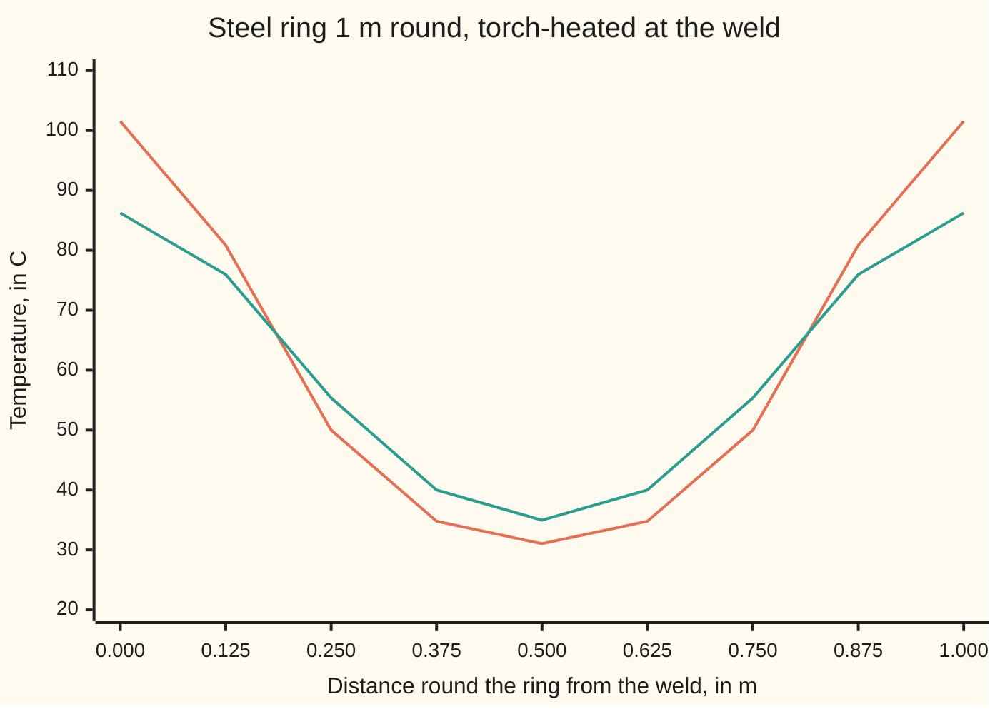
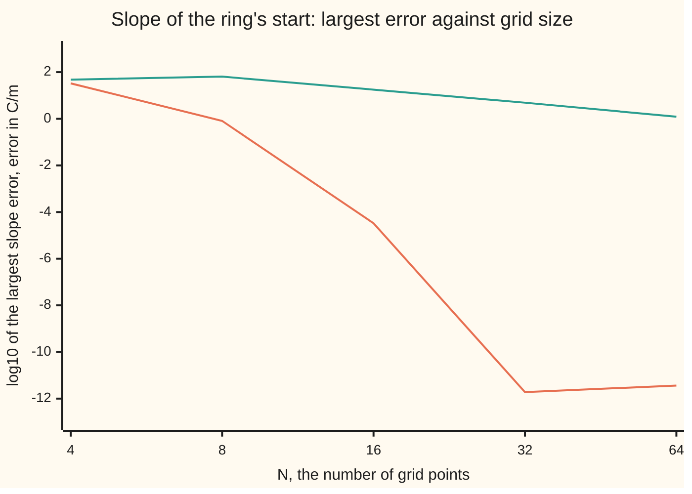

# Spectral methods: differentiate by transforming, and the accuracy smoothness buys

[Syllabus](../../../SYLLABUS.md) → [Numerical analysis](../README.md) → [PDE Solvers](../README.md#s07) → Spectral methods

---

## General Overview

Take the shelf's one-metre steel bar, bend it into a ring and weld the two ends together. A torch has just heated the weld. Measured along the ring from the weld, the temperature is 101.548455 C at the weld and falls smoothly to 31.036383 C on the far side, half a metre away. The ring is insulated, so heat only spreads round it.

The question: what is the temperature everywhere ten minutes later, as accurately as the computer can store a number? The ring has no ends, so the temperature pattern repeats every metre. A pattern that repeats is called **periodic**.

A spectral method answers in three moves:

1. Read the temperature at 32 evenly spaced points round the ring.
2. Use the fast Fourier transform to rewrite those 32 readings as 32 waves. Each wave fits round the ring a whole number of times.
3. Treat each wave exactly, then add the waves back up.

Step 3 is exact because heat cannot change a wave's shape. It only shrinks it, by a known factor that depends on how tightly the wave wiggles. A slope is just as easy: the slope of a wave is the same wave, shifted and scaled.

The result: the weld reads 86.219233587147 C after 600 s. The largest difference from the exact series, anywhere on the ring, is 2.848e-14 C: two units in the last place, the smallest steps a stored number can take at that size. That is rounding, in both the method and the reference. A finite-difference grid on the same 32 points is off by 5.396e-02 C.

The catch is smoothness. This start is smooth all the way round, and its waves shrink faster than any power of the mode number: mode 16 holds just 2.220e-17 C. The straight bar's start, 100 sin(πx), has a corner where its ends meet. Treated as a ring, its error falls only in proportion to 1/N, where N is the number of points.

**A spectral method turns samples of a periodic function into waves with the FFT, does the calculus on each wave exactly, and turns the waves back; its only error comes from waves too fast for the grid, so for a smooth periodic function the error falls faster than any power of N.**

**What kind of fact this is:** a method with a proved error bound. The aliasing identity, the error bound and the link from a finite number of smooth derivatives to the error's rate are proved on this card in Why it works. The exponential rate for analytic functions (functions with a convergent power series at every point) is stated with its source.

### The picture: the ring at the start and after ten minutes



Orange: the start. Teal: after 600 s, from the 32-point spectral solution. The right edge is the weld again, at 1 m round. Heat flows from the weld toward the far side, and the pattern flattens.

---

## The formula

Notation first, in words.

- $u(x, t)$ is the temperature in C at distance $x$ metres round the ring from the weld, at time $t$ seconds. It solves the **heat equation** $u_t = \alpha u_{xx}$: the rate of change in time equals the diffusivity $\alpha$ times the bend along the ring.
- The ring is $L$ = 1 m round, so $u(x + L, t) = u(x, t)$.
- The grid has $N$ points $x_j = jh$, $j = 0, 1, \dots, N - 1$, with spacing $h = L/N$.
- Mode $k$ is the wave $e^{i q_k x}$, where $i$ is the square root of −1 and $q_k = 2\pi k/L$ is its **wavenumber** in radians per metre. Mode $k$ goes round the ring $k$ times.
- The start is $u(x, 0) = 20 + 30e^{\cos(2\pi x/L)}$. Its exact **Fourier coefficients** $c_k$ (how much of mode $k$ it holds) are known: $c_k = 30 I_k(1)$ for $k \ne 0$ and $c_0 = 20 + 30 I_0(1)$, with $I_k(1) = \sum_{m \ge 0} (1/2)^{2m+k}/(m!\,(m+k)!)$, a number from a standard power series.

The method computes coefficients from the samples, then does the calculus mode by mode:

$$\hat c_k = \frac{1}{N}\sum_{j=0}^{N-1} u(x_j, 0)\, e^{-i q_k x_j}, \qquad u_j(t) = \sum_{k=-N/2+1}^{N/2} \hat c_k\, e^{-\alpha q_k^2 t}\, e^{i q_k x_j}, \qquad \Big(\frac{du}{dx}\Big)_j = \sum_{k=-N/2+1}^{N/2-1} i q_k\, \hat c_k\, e^{i q_k x_j}.$$

**Read it aloud:** the computed coefficient of mode $k$ is the average of the samples, each turned back by that mode's angle; to step the heat forward, shrink each mode by $e^{-\alpha q_k^2 t}$ and add them up; to take a slope, multiply each mode by $i q_k$ and add them up.

The error has a proved ceiling. At every grid point and every time,

$$\lvert u_j(t) - u(x_j, t)\rvert \le E_N = 2\sum_{\lvert k\rvert \ge N/2} \lvert c_k\rvert, \qquad \text{slope error} \le E_N^{\text{slope}} = 2\sum_{\lvert k\rvert \ge N/2} \lvert q_k\rvert\,\lvert c_k\rvert.$$

**Read it aloud:** the error is at most twice the total size of the modes too fast for the grid.

And smoothness sets that size:

$$\lvert c_k\rvert \le \frac{K}{\lvert k\rvert^{p+1}} \quad\Longrightarrow\quad E_N \text{ shrinks like } N^{-p} \text{ as } N \to \infty.$$

**Read it aloud:** if the start has $p - 1$ derivatives that join up smoothly round the ring, and the $p$-th has only jumps, the coefficients fall like $1/k^{p+1}$ and the error like $1/N^p$.

| Symbol | Plain meaning | In our example | Push it up and the answer… |
| --- | --- | --- | --- |
| $u$, $u_t$, $u_{xx}$ | temperature, in C; its rate in time; its bend along the ring | 101.548455 C at the weld at the start | — |
| $x$, $L$ | distance round the ring from the weld; the ring's length | 0 to 1 m; 1 m | slower modes, slower cooling |
| $t$, $T$ | time; the time asked about | $T$ = 600 s | the ring evens out |
| $\alpha$ | diffusivity: how fast heat spreads | 1.2e-5 m²/s (illustrative) | every mode fades faster |
| $N$, $h$, $x_j$, $j$ | number of grid points; spacing $L/N$; the $j$-th point, at $jh$ | 32; 1/32 m | error falls fast, down to rounding |
| $k$, $q_k$, $i$ | mode number: times round the ring; wavenumber $2\pi k/L$ in rad/m; the square root of −1 | $k$ from −15 to 16 | the mode fades faster |
| $c_k$, $c_k[f]$, $I_k(1)$ | exact amount of mode $k$ in the start, or in a function $f$; the series that gives it | $c_1$ = 1.695e+01 C; $c_{16}$ = 2.220e-17 C | — |
| $\hat c_k$, $a_k$, $g_k$ | computed coefficient from the $N$ samples (the hat marks a computed value); amount of mode $k$ at time $t$; its fade factor $e^{-\alpha q_k^2 t}$ | $\hat c_k$ is $c_k$ plus the modes $N$ apart; $g_8$ = 1.257e-08 at 600 s | — |
| $m$, $n$, $B$, $w$ | counting indexes; in the proof, $B$ is the band of modes the grid keeps and $w$ a number with $w^N = 1$ | mode $k + mN$ aliases onto mode $k$ | — |
| $E_N$, $E_N^{\text{slope}}$ | proved ceilings on the temperature error and the slope error | 9.150e-17 C; 9.215e-15 C/m at $N$ = 32 | — |
| $p$, $K$, $\sigma$ | smoothness: derivatives continuous round the ring, plus one with jumps; a constant; the decay rate for an analytic start | $p$ = 1 for the bar bent into a ring; 3 for a start whose third derivative jumps | error falls faster |
| $r$, $\Delta t$ | finite-difference time step $\Delta t$, and $r = \alpha\Delta t/h^2$ | 24 s; 0.294912 | — |

### When it holds

- **Periodic.** The FFT treats the samples as one turn of a repeating pattern. A non-periodic function gets a corner or jump where the ends meet. The bar's start 100 sin(πx), sampled as if it were a ring, has a corner there, and the slope error next to the weld stays near 121 C/m however many points are used.
- **Smooth.** Each extra continuous derivative buys one more power of $1/N$. Spectral accuracy, error falling faster than any power, needs every derivative continuous. A start with a corner gets order 1.
- **Linear, with constant coefficients.** Modes stay separate only when the equation does not mix them. A diffusivity that varies round the ring, or a term such as $u^2$, couples modes. Then products are computed on the grid, and their fast parts alias back onto slow modes (see the aliasing step below).
- **The fast modes are handled.** On an even grid the mode $k = N/2$ (the **Nyquist mode**, the fastest the grid can hold) reads $(-1)^j$ at the grid points. Its slope there is zero, so a slope must drop it. Keeping it at $N$ = 8 puts an imaginary part of up to 4.127480 C/m into a real slope.
- **Rounding stays small.** A slope multiplies each rounding error by up to the largest wavenumber, $\pi N/L$. So past the point where $E_N$ is negligible, more points make the slope slightly worse: 1.896e-12 C/m at $N$ = 32, 3.650e-12 C/m at $N$ = 64.

---

## Why it works

### Step 0: waves are the shapes that calculus only rescales

The slope of $e^{iqx}$ is $iq\,e^{iqx}$: the same wave, multiplied by a number. Bending it twice gives $-q^2 e^{iqx}$. So in the language of waves, a derivative is a multiplication. Write the temperature as a sum of waves and the heat equation splits into one simple equation per wave. All the work is in getting the waves, and the FFT does that fast.

### Step 1: the FFT gives the waves through the samples

$N$ samples and $N$ coefficients carry the same information. The sum for $\hat c_k$ is the discrete Fourier transform, and [The fast Fourier transform](09-the-fast-fourier-transform.md) computes it in about $(N/2)\log_2 N$ complex multiplications instead of $N^2$. At $N$ = 32 that is 80 against 1024, counted by the code. The FFT and the direct sum agree to 5.948e-12, a rounding-level difference on unscaled sums of 32 temperatures.

The wave sum with coefficients $\hat c_k$ passes exactly through all $N$ samples. It is the **trigonometric interpolant**: the sum of the $N$ slowest waves that fits the readings. A spectral method treats it as the function.

Taking the slope this way is the same as multiplying the list of samples by one fixed $N \times N$ table of weights, the **Fourier differentiation matrix**. The matrix is full, not banded: each point's slope uses points all round the ring, not just its neighbours. The FFT applies that matrix in $O(N\log N)$ operations as $N \to \infty$, instead of $N^2$.

### Step 2: heat in wave space is exact, with no time steps

Put $u = \sum_k a_k(t)\,e^{i q_k x}$ into $u_t = \alpha u_{xx}$. Each wave's amount obeys its own equation:

$$a_k'(t) = -\alpha q_k^2\, a_k(t), \qquad a_k(t) = a_k(0)\, e^{-\alpha q_k^2 t}.$$

This is [Separation of variables](../../08-Differential%20equations%20and%20dynamics/10-The%20Classical%20PDEs/04-separation-of-variables-for-the-heat-equation.md) on a ring. Cold ends allow only sines; a ring allows sines and cosines, which $e^{iqx}$ carries together. Over 600 s the fade factors are 7.526e-01 for mode 1, 3.208e-01 for mode 2, 1.059e-02 for mode 4 and 1.257e-08 for mode 8.

So the time direction has no error at all, and no stability limit. Finite differences on the same grid have both: a time-step limit $r \le 1/2$ ([Finite differences on a grid](02-finite-differences-consistency-stability-and-convergence.md)), and an error in each step.

### Step 3: the only error is aliasing

On the grid, mode $k$ and mode $k + N$ take the same values, because $e^{i q_N x_j} = e^{2\pi i j} = 1$. So the samples cannot tell them apart, and the FFT files every fast mode under a slow one:

$$\hat c_k = \sum_{m=-\infty}^{\infty} c_{k + mN}.$$

This is **aliasing**, the same folding by which a whistle sampled too slowly plays back as a lower note ([Sampling](../../13-Engineering%20mathematics/05-Signals/01-sampling-and-the-nyquist-theorem.md)). Here it is the whole error budget. Each fast mode $c_k$ with $\lvert k\rvert \ge N/2$ costs twice: once because it is missing from the sum, once because it lands on a slow mode where it does not belong. That gives the bound $E_N$.

<details>
<summary>Detailed proof: the aliasing identity and the error bound</summary>

Let $u(x, 0) = \sum_{n} c_n e^{i q_n x}$ with $\sum_n \lvert c_n\rvert$ finite, so the series converges at every point. Substitute it into the formula for $\hat c_k$ and swap the sums:

$$\hat c_k = \sum_n c_n \cdot \frac{1}{N}\sum_{j=0}^{N-1} e^{2\pi i (n - k) j/N}.$$

The inner sum is a geometric series in $w = e^{2\pi i (n-k)/N}$. If $n - k$ is a multiple of $N$, then $w = 1$ and the average is 1. Otherwise $w \ne 1$, $w^N = 1$, and the sum is $(w^N - 1)/(w - 1) = 0$. So $\hat c_k = \sum_m c_{k+mN}$.

**Temperature.** Write $g_k = e^{-\alpha q_k^2 t}$, which lies between 0 and 1. The exact solution at a grid point is $\sum_n c_n g_n e^{i q_n x_j}$. Call the band $B$ the modes $-N/2 < k \le N/2$. Then

$$u_j(t) - u(x_j, t) = \sum_{k \in B} (\hat c_k - c_k)\, g_k\, e^{i q_k x_j} \;-\; \sum_{n \notin B} c_n g_n e^{i q_n x_j}.$$

Each mode outside $B$ appears once in some $\hat c_k - c_k$, and once in the second sum. Every factor $g$ and every $e^{i\cdot}$ has size at most 1. So the error is at most $2\sum_{n \notin B}\lvert c_n\rvert \le E_N$.

**Slope.** The same split with the band $-N/2 < k < N/2$ and factors $q_k$. A mode $n$ outside the band aliases onto a $k$ with $\lvert q_k\rvert < \lvert q_n\rvert$, so its share is at most $\lvert q_n\rvert\lvert c_n\rvert$, counted twice: at most $E_N^{\text{slope}}$. The Nyquist slot is outside this band, and its mode is counted in $E_N^{\text{slope}}$.

</details>

### Step 4: smoothness decides how fast the fast modes vanish

The coefficient is an average, $c_k = \frac{1}{L}\int_0^L u(x, 0)\, e^{-i q_k x}\,dx$. Integrate by parts. The end terms cancel because the ring has no ends, and

$$c_k[f] = \frac{c_k[f']}{i q_k}.$$

Each derivative that stays continuous round the ring divides the coefficient by another $q_k$. After $p$ steps the $p$-th derivative has only jumps, and one more integration by parts bounds its coefficient by (total jump plus total change) divided by $L\lvert q_k\rvert$. So $\lvert c_k\rvert \le K/\lvert k\rvert^{p+1}$. Adding these from $\lvert k\rvert = N/2$ up gives a tail of size about $N^{-p}$.

For an analytic periodic function, one with a convergent power series everywhere, the coefficients fall like $e^{-\sigma\lvert k\rvert}$ for some $\sigma > 0$, so the error falls faster than any power of $1/N$. This half is stated, not proved; Trefethen and Weideman prove it (Sources). The ring's start is better still: $c_k = 30 I_k(1)$ is close to $30 \cdot (1/2)^k/k!$, so the coefficients for $k$ = 4, 8, 16 are 8.211e-02, 2.988e-06 and 2.220e-17 C.

The code measures the rate on three starts, through the error of the interpolant halfway between grid points:

| Start | Smoothness | Error at $N$ = 8, 16, 32, 64, in C | Observed order |
| --- | --- | --- | --- |
| the ring, $20 + 30e^{\cos 2\pi x}$ | every derivative continuous | 3.192e-02, 6.608e-07, 4.317e-14, 2.870e-14 | 15.56, 23.87, then rounding |
| $100\lvert\sin \pi x\rvert^3$ | third derivative jumps, $p$ = 3 | 2.090e-01, 2.592e-02, 3.234e-03, 4.041e-04 | 3.01, 3.00, 3.00 |
| the bar's start $100\lvert\sin \pi x\rvert$ as a ring | corner at the weld, $p$ = 1 | 7.009e+00, 3.552e+00, 1.782e+00, 8.916e-01 | 0.98, 1.00, 1.00 |

The observed orders match $p$ to within 0.02 by 64 points. For the smooth start the "order" keeps rising until rounding stops the fall at 32 points. That rising order is what **spectral accuracy** means.

### Step 5: the ring confirms each piece

The slope at the start, the temperature gradient that drives heat round the ring, is steepest at $x$ = 0.143965 m, at 274.926152 C/m.

| $N$ | Spectral slope error, C/m | Bound $E_N^{\text{slope}}$ | Bound ÷ true | Centred difference error, C/m |
| --- | --- | --- | --- | --- |
| 4 | 3.302e+01 | 2.642e+02 | 8 | 4.747e+01 |
| 8 | 8.139e-01 | 9.389e+00 | 11.5 | 6.413e+01 |
| 16 | 3.321e-05 | 6.404e-04 | 19.3 | 1.764e+01 |
| 32 | 1.896e-12 | 9.215e-15 | 0.00486 | 4.869e+00 |
| 64 | 3.650e-12 | 2.185e-41 | 5.99e-30 | 1.227e+00 |

Up to 16 points the bound holds, 8 to 19 times above the true error. From 32 points the true error is rounding, which the bound does not count. The **centred difference** $(u_{j+1} - u_{j-1})/(2h)$ shows orders 1.86, 1.86, 1.99, heading for its order 2: at 64 points it is still off by 1.227e+00 C/m.



Orange: the spectral slope, falling faster with each doubling until rounding stops it at −11.72. Teal: the centred difference, falling by a factor near 4 per doubling from 8 points on, which is order 2.

The heat solve at 600 s, against the exact series:

| $N$ | Weld at 600 s, C | Largest difference from the exact series, C | Bound $E_N$ | Bound ÷ difference |
| --- | --- | --- | --- | --- |
| 8 | 86.220992858806 | 1.759e-03 | 3.639e-01 | 207 |
| 16 | 86.219233587149 | 1.933e-12 | 1.265e-05 | 6.55e+06 |
| 32 | 86.219233587147 | 2.848e-14 | 9.150e-17 | 0.00321 |
| 64 | 86.219233587147 | 2.952e-14 | 1.086e-43 | 3.68e-30 |

At 16 points the bound is loose by a factor of millions. It ignores the fading. Aliased modes land on the fastest modes the grid holds, such as mode 8, whose fade factor over ten minutes is 1.257e-08. Heat cleans up its own aliasing. From 32 points the difference is rounding, in both the method and the reference series.

---

## Worked numbers, by hand

The 32-point heat solve to 600 s, reading the weld.

| Step | Arithmetic | Value |
| --- | --- | --- |
| start at the weld | $20 + 30e^{1}$ | 101.548455 C |
| start on the far side | $20 + 30e^{-1}$ | 31.036383 C |
| constant mode less 20, and largest waves | $30 I_0(1)$, $c_1$, $c_2$ | 3.798e+01, 1.695e+01, 4.072e+00 C |
| fade over 600 s | $e^{-\alpha (2\pi k)^2 \times 600}$ for $k$ = 1, 2, 4 | 7.526e-01, 3.208e-01, 1.059e-02 |
| weld at 600 s | $c_0 + 2\sum_{k \ge 1} c_k\, e^{-\alpha q_k^2 T}$, with $c_0 = 20 + 30 I_0(1)$ | 86.219233587147 C |
| largest mode left out | $c_{16}$ | 2.220e-17 C |
| proved bound | $E_{32}$ | 9.150e-17 C |
| largest difference over the ring | against the exact series, summed in doubles | 2.848e-14 C, 2.00 units in the last place |
| same 32 points, finite differences | 25 steps of 24 s, $r$ = 0.294912 | weld 86.165269 C, error 5.396e-02 C |
| cost | FFT against direct sum, $N$ = 32 | 80 against 1024 complex multiplications |

The weld is at **86.219233587147 C** after ten minutes. Every printed digit is right: the largest difference anywhere on the ring is two steps of the last stored digit, and it is rounding. The second-order grid on the same 32 points misses by 5.396e-02 C.

### What breaks if you drop a piece

| Mistake | Comes out at | What went wrong |
| --- | --- | --- |
| The bar's start $100\sin\pi x$ put through the FFT as if periodic | slope error next to the weld: 119.566, 120.910, 121.246 C/m at $N$ = 16, 32, 64 | not periodic: the ends meet at a corner, the coefficients fall only like $1/k^2$, and the slope never converges near the corner |
| FFT slots past the middle used as wavenumbers $N/2 + 1, \dots, N - 1$ | slope error 4379.780 C/m at $N$ = 32 | slot 31 holds mode −1, not mode 31; it must be wrapped to $k - N$ |
| The Nyquist slot kept in the slope | imaginary part up to 4.127480 C/m at $N$ = 8 | the Nyquist slot stands for $\cos(\pi N x/L)$, which has zero slope at every grid point; multiplying by $i q$ invents an imaginary one |
| $2\pi$ dropped from $q_k$ | slope error 229.691311 C/m; weld at 600 s 100.969607 C | the wavenumber was counted in turns per metre instead of radians per metre, so slopes shrink 2π-fold and heat barely spreads |

---

## Code, from first principles, and it actually runs

The code writes its own FFT, takes the slope of the ring's start and solves the heat equation in wave space. Four roads lead to the answer: the spectral method; the exact answer (the closed-form slope, and the heat series from the coefficients $30 I_k(1)$); the direct $N^2$ sum against the FFT; and finite differences on the same points, whose 25 steps are redone mode by mode with the growth factor of [Von Neumann analysis](03-von-neumann-analysis-and-the-cfl-condition.md). Asserts check that the roads agree, that the true errors sit inside the proved bounds, that the rougher starts show orders 3 and 1, and that each mistake in What breaks really breaks the answer.

### Python

```python
# Spectral methods on a heated steel ring: slope by FFT, heat solved in Fourier space, and what smoothness buys.
import math
L, ALPHA, T = 1.0, 1.2e-5, 600.0  # ring 1 m round (m); steel diffusivity (m^2/s, illustrative); ten minutes (s)
MULS = [0]

def mul(a, b):
    MULS[0] += 1
    return (a[0] * b[0] - a[1] * b[1], a[0] * b[1] + a[1] * b[0])

def fft(a):  # radix-2 fast Fourier transform, written out; len(a) is a power of two
    n = len(a)
    if n == 1: return [a[0]]
    ev, od = fft(a[0::2]), fft(a[1::2])
    out = [None] * n
    for k in range(n // 2):
        ang = -2.0 * math.pi * k / n
        w = mul((math.cos(ang), math.sin(ang)), od[k])
        out[k] = (ev[k][0] + w[0], ev[k][1] + w[1])
        out[k + n // 2] = (ev[k][0] - w[0], ev[k][1] - w[1])
    return out

def ifft(a):  # inverse transform by conjugating, then dividing by n
    n = len(a)
    b = fft([(z[0], -z[1]) for z in a])
    return [(z[0] / n, -z[1] / n) for z in b]

def dft(a):  # the O(N^2) definition, a second road to the same coefficients
    n, out = len(a), []
    for k in range(n):
        re, im = 0.0, 0.0
        for j in range(n):
            ang = -2.0 * math.pi * j * k / n
            re, im = re + a[j][0] * math.cos(ang), im + a[j][0] * math.sin(ang)
        out.append((re, im))
    return out

def spectral(f, n, kind, wrap=True, nyq0=True, twopi=True):
    c = fft([(f(j * L / n), 0.0) for j in range(n)])
    out = []
    for k in range(n):
        m = (k if k <= n // 2 else k - n) if wrap else k  # slot k holds wavenumber k, or k - n past the middle
        q = (2.0 * math.pi if twopi else 1.0) * m / L  # radians per metre
        if kind == "slope":  # multiply by i q; the Nyquist slot has no slope
            z = (0.0, 0.0) if (nyq0 and 2 * k == n) else mul((0.0, q), c[k])
        elif kind == "shift":  # move half a cell: multiply by e^(i q h / 2)
            z = (0.0, 0.0) if 2 * k == n else mul((math.cos(q * L / n / 2), math.sin(q * L / n / 2)), c[k])
        else:  # heat: each mode fades by e^(-alpha q^2 T), exactly
            z = (c[k][0] * math.exp(-ALPHA * q * q * T), c[k][1] * math.exp(-ALPHA * q * q * T))
        out.append(z)
    return ifft(out)

def bessel_i(k):  # I_k(1) by its power series, term by term
    t, s = 1.0, 0.0
    for i in range(1, k + 1): t = t * 0.5 / i
    for m in range(30):
        s += t
        t = t * 0.25 / ((m + 1) * (m + 1 + k))
    return s

CK = [30.0 * bessel_i(k) for k in range(40)]  # Fourier coefficients of 30 e^cos(2 pi x)
def u0(x): return 20.0 + 30.0 * math.exp(math.cos(2 * math.pi * x / L))
def du0(x): return -60.0 * math.pi / L * math.sin(2 * math.pi * x / L) * math.exp(math.cos(2 * math.pi * x / L))
def u_exact(x, t):  # the exact heat solution, from the series with known coefficients
    s = 20.0 + CK[0]
    for k in range(1, 40):
        q = 2 * math.pi * k / L
        s += 2 * CK[k] * math.exp(-ALPHA * q * q * t) * math.cos(q * x)
    return s
def maxerr(v, exact, n): return max(math.sqrt((v[j][0] - exact(j * L / n)) ** 2 + v[j][1] ** 2) for j in range(n))
def tail(n, slope):  # 2 x the sum of |c_k| (times q for a slope) over |k| >= N/2: truncation plus aliasing
    s = 0.0
    for k in range(n // 2, 40):
        s += 2 * CK[k] * (2 * math.pi * k / L if slope else 1.0)
    return 2 * s
def e(x): return f"{x:.3e}"

cs = (math.sqrt(5.0) - 1) / 2
print(f"start: weld {u0(0):.6f} C, far side {u0(0.5):.6f} C; series vs closed form at the weld {e(abs(u_exact(0, 0) - u0(0)))}")
print(f"steepest slope {60 * math.pi * math.sqrt(1 - cs * cs) * math.exp(cs):.6f} C/m at x = {math.acos(cs) / (2 * math.pi):.6f} m")
print("coefficients c_k, k = 0, 1, 2, 4, 8, 16: " + ", ".join(e(CK[k]) for k in (0, 1, 2, 4, 8, 16)) + "; fade factors at 600 s, k = 1, 2, 4, 8, 16: " + ", ".join(e(math.exp(-ALPHA * (2 * math.pi * k / L) ** 2 * T)) for k in (1, 2, 4, 8, 16)))
NS, sd, fd = [4, 8, 16, 32, 64], [], []
for n in NS:
    h, s = L / n, maxerr(spectral(u0, n, "slope"), du0, n)
    f = max(abs((u0((j + 1) * h) - u0((j - 1) * h)) / (2 * h) - du0(j * h)) for j in range(n))
    sd.append(s); fd.append(f)
    print(f"slope N = {n:2d}: spectral {e(s)}, bound {e(tail(n, True))}, bound/true {tail(n, True) / s:.3g}; centred difference {e(f)}")
print("centred difference orders: " + ", ".join(f"{math.log2(fd[i] / fd[i + 1]):.2f}" for i in range(1, 4)))
print("chart x, N: " + ", ".join(str(n) for n in NS))
print("chart, log10 spectral slope error: " + ", ".join(f"{math.log10(v):.2f}" for v in sd))
print("chart, log10 centred difference error: " + ", ".join(f"{math.log10(v):.2f}" for v in fd))
heat = {}
for n in (8, 16, 32, 64):
    uh = spectral(u0, n, "heat")
    heat[n] = maxerr(uh, lambda x: u_exact(x, T), n)
    print(f"heat N = {n:2d}: weld at 600 s {uh[0][0]:.12f} C, largest error {e(heat[n])}, bound {e(tail(n, False))}, bound/true {tail(n, False) / heat[n]:.3g}")
w = u_exact(0, T); ulp = 2.0 ** (math.floor(math.log2(w)) - 52)
print(f"exact: weld at 600 s {w:.12f} C, far side {u_exact(0.5, T):.6f} C; N = 32 error in units of the last place {heat[32] / ulp:.2f}")
a, MULS[0] = [(u0(j / 32), 0.0) for j in range(32)], 0
fftd = max(math.sqrt((p[0] - q[0]) ** 2 + (p[1] - q[1]) ** 2) for p, q in zip(fft(a), dft(a)))
print(f"FFT vs direct DFT, N = 32: largest difference {e(fftd)}; complex multiplies {MULS[0]} vs {32 * 32}")
n, dt = 32, 24.0
r, v = ALPHA * dt / (L / n) ** 2, [u0(j / n) for j in range(n)]
for _ in range(25):
    v = [v[j] + r * (v[(j + n - 1) % n] - 2 * v[j] + v[(j + 1) % n]) for j in range(n)]
fdh = max(abs(v[j] - u_exact(j / n, T)) for j in range(n))
print(f"finite differences N = 32, r = {r:.6f}, 25 steps of 24 s: weld {v[0]:.6f} C, largest error {e(fdh)}")
gfd = [(1 - 4 * r * math.sin(math.pi * k / n) ** 2) ** 25 for k in range(n)]  # von Neumann: mode k shrinks by this in 25 steps
vm = ifft([(z[0] * g, z[1] * g) for z, g in zip(fft([(u0(j / n), 0.0) for j in range(n)]), gfd)])  # the same steps, mode by mode
uh = spectral(u0, 32, "heat")
print("ring chart x: " + ", ".join(f"{j / 8:.3f}" for j in range(9)))
print("ring chart, start: " + ", ".join(f"{u0(j / 8):.2f}" for j in range(9)))
print("ring chart, 600 s: " + ", ".join(f"{uh[(4 * j) % 32][0]:.2f}" for j in range(9)))
orders = []
for name, f in (("smooth ring", u0), ("third derivative jumps", lambda x: 100 * abs(math.sin(math.pi * x)) ** 3),
                ("bar, kink at the weld", lambda x: 100 * abs(math.sin(math.pi * x)))):
    errs = [maxerr(spectral(f, n, "shift"), lambda x, f=f, n=n: f(x + L / n / 2), n) for n in (8, 16, 32, 64)]
    orders.append([math.log2(errs[i] / errs[i + 1]) for i in range(3)])
    print(f"midpoint error, {name}, N = 8, 16, 32, 64: " + ", ".join(e(x) for x in errs) + "; orders " + ", ".join(f"{x:.2f}" for x in orders[-1]))
barerr = [abs(spectral(lambda x: 100 * math.sin(math.pi * x), n, "slope")[1][0] - 100 * math.pi * math.cos(math.pi / n)) for n in (16, 32, 64)]
print("mistake, bar treated as periodic: slope error next to the weld, N = 16, 32, 64: " + ", ".join(f"{x:.3f}" for x in barerr) + " C/m")
unw, nyq = maxerr(spectral(u0, 32, "slope", wrap=False), du0, 32), max(abs(z[1]) for z in spectral(u0, 8, "slope", nyq0=False))
no2pi, no2pih = maxerr(spectral(u0, 32, "slope", twopi=False), du0, 32), spectral(u0, 32, "heat", twopi=False)[0][0]
print(f"mistake, slots not wrapped to negative wavenumbers, N = 32: slope error {unw:.3f} C/m")
print(f"mistake, Nyquist slot kept, N = 8: imaginary part up to {nyq:.6f} C/m")
print(f"mistake, 2 pi dropped, N = 32: slope error {no2pi:.6f} C/m; weld at 600 s {no2pih:.6f} C")

assert abs(u_exact(0, 0) - u0(0)) < 1e-12, "series coefficients rebuild the closed-form start"
assert fftd < 1e-10, "FFT agrees with the direct DFT"
assert sd[3] < 1e-10, "32 points: spectral slope down at rounding level"
assert fd[3] > 1.0, "32 points: centred difference still off by over 1 C/m"
assert all(sd[i] <= tail(NS[i], True) for i in range(3)), "slope error inside the aliasing bound until rounding takes over"
assert heat[32] < 1e-12, "heat solve at machine accuracy against the exact series"
assert heat[16] <= tail(16, False), "heat error inside its aliasing bound"
assert fdh > 1e-2, "finite differences on the same 32 points miss by centidegrees"
assert max(abs(vm[j][0] - v[j]) for j in range(n)) < 1e-10, "finite-difference loop = its mode-by-mode solution"
assert abs(orders[1][2] - 3) < 0.05, "order 3 when the third derivative jumps"
assert abs(orders[2][2] - 1) < 0.05, "order 1 for the kinked bar"
assert min(barerr) > 100, "the kinked bar's slope error does not shrink"
assert min(unw / 1000, nyq, no2pi / 100) > 1, "each coding mistake really breaks the answer"
print("ALL CHECKS PASS")
```

**Ran 2026-11-11 on macOS, Python 3.14.10, standard library only. All checks passed. Output, pasted from the run:**

```
start: weld 101.548455 C, far side 31.036383 C; series vs closed form at the weld 1.421e-14
steepest slope 274.926152 C/m at x = 0.143965 m
coefficients c_k, k = 0, 1, 2, 4, 8, 16: 3.798e+01, 1.695e+01, 4.072e+00, 8.211e-02, 2.988e-06, 2.220e-17; fade factors at 600 s, k = 1, 2, 4, 8, 16: 7.526e-01, 3.208e-01, 1.059e-02, 1.257e-08, 2.500e-32
slope N =  4: spectral 3.302e+01, bound 2.642e+02, bound/true 8; centred difference 4.747e+01
slope N =  8: spectral 8.139e-01, bound 9.389e+00, bound/true 11.5; centred difference 6.413e+01
slope N = 16: spectral 3.321e-05, bound 6.404e-04, bound/true 19.3; centred difference 1.764e+01
slope N = 32: spectral 1.896e-12, bound 9.215e-15, bound/true 0.00486; centred difference 4.869e+00
slope N = 64: spectral 3.650e-12, bound 2.185e-41, bound/true 5.99e-30; centred difference 1.227e+00
centred difference orders: 1.86, 1.86, 1.99
chart x, N: 4, 8, 16, 32, 64
chart, log10 spectral slope error: 1.52, -0.09, -4.48, -11.72, -11.44
chart, log10 centred difference error: 1.68, 1.81, 1.25, 0.69, 0.09
heat N =  8: weld at 600 s 86.220992858806 C, largest error 1.759e-03, bound 3.639e-01, bound/true 207
heat N = 16: weld at 600 s 86.219233587149 C, largest error 1.933e-12, bound 1.265e-05, bound/true 6.55e+06
heat N = 32: weld at 600 s 86.219233587147 C, largest error 2.848e-14, bound 9.150e-17, bound/true 0.00321
heat N = 64: weld at 600 s 86.219233587147 C, largest error 2.952e-14, bound 1.086e-43, bound/true 3.68e-30
exact: weld at 600 s 86.219233587147 C, far side 34.973725 C; N = 32 error in units of the last place 2.00
FFT vs direct DFT, N = 32: largest difference 5.948e-12; complex multiplies 80 vs 1024
finite differences N = 32, r = 0.294912, 25 steps of 24 s: weld 86.165269 C, largest error 5.396e-02
ring chart x: 0.000, 0.125, 0.250, 0.375, 0.500, 0.625, 0.750, 0.875, 1.000
ring chart, start: 101.55, 80.84, 50.00, 34.79, 31.04, 34.79, 50.00, 80.84, 101.55
ring chart, 600 s: 86.22, 75.95, 55.37, 40.01, 34.97, 40.01, 55.37, 75.95, 86.22
midpoint error, smooth ring, N = 8, 16, 32, 64: 3.192e-02, 6.608e-07, 4.317e-14, 2.870e-14; orders 15.56, 23.87, 0.59
midpoint error, third derivative jumps, N = 8, 16, 32, 64: 2.090e-01, 2.592e-02, 3.234e-03, 4.041e-04; orders 3.01, 3.00, 3.00
midpoint error, bar, kink at the weld, N = 8, 16, 32, 64: 7.009e+00, 3.552e+00, 1.782e+00, 8.916e-01; orders 0.98, 1.00, 1.00
mistake, bar treated as periodic: slope error next to the weld, N = 16, 32, 64: 119.566, 120.910, 121.246 C/m
mistake, slots not wrapped to negative wavenumbers, N = 32: slope error 4379.780 C/m
mistake, Nyquist slot kept, N = 8: imaginary part up to 4.127480 C/m
mistake, 2 pi dropped, N = 32: slope error 229.691311 C/m; weld at 600 s 100.969607 C
ALL CHECKS PASS
```

### Rust

```rust
// Spectral methods on a heated steel ring: slope by FFT, heat solved in Fourier space, and what smoothness buys.
use std::f64::consts::PI;
use std::sync::atomic::{AtomicUsize, Ordering};
// ring 1 m round (m); steel diffusivity (m^2/s, illustrative); ten minutes (s)
const L: f64 = 1.0; const ALPHA: f64 = 1.2e-5; const T: f64 = 600.0;
static MULS: AtomicUsize = AtomicUsize::new(0);
#[derive(Clone, Copy)] struct C { re: f64, im: f64 }
fn c(re: f64, im: f64) -> C { C { re, im } }
fn mul(a: C, b: C) -> C { MULS.fetch_add(1, Ordering::Relaxed); c(a.re * b.re - a.im * b.im, a.re * b.im + a.im * b.re) }
fn fft(a: &[C]) -> Vec<C> { // radix-2 fast Fourier transform, written out; a.len() is a power of two
    let n = a.len();
    if n == 1 { return vec![a[0]]; }
    let (ev, od) = (fft(&a.iter().step_by(2).cloned().collect::<Vec<C>>()), fft(&a.iter().skip(1).step_by(2).cloned().collect::<Vec<C>>()));
    let mut out = vec![c(0.0, 0.0); n];
    for k in 0..n / 2 {
        let ang = -2.0 * PI * k as f64 / n as f64;
        let w = mul(c(ang.cos(), ang.sin()), od[k]);
        out[k] = c(ev[k].re + w.re, ev[k].im + w.im);
        out[k + n / 2] = c(ev[k].re - w.re, ev[k].im - w.im);
    }
    out
}
fn ifft(a: &[C]) -> Vec<C> { // inverse transform by conjugating, then dividing by n
    let n = a.len() as f64;
    fft(&a.iter().map(|z| c(z.re, -z.im)).collect::<Vec<C>>()).iter().map(|z| c(z.re / n, -z.im / n)).collect()
}
fn dft(a: &[C]) -> Vec<C> { // the O(N^2) definition, a second road to the same coefficients
    let (n, mut out) = (a.len(), Vec::new());
    for k in 0..n {
        let (mut re, mut im) = (0.0, 0.0);
        for j in 0..n {
            let ang = -2.0 * PI * j as f64 * k as f64 / n as f64;
            re += a[j].re * ang.cos(); im += a[j].re * ang.sin();
        }
        out.push(c(re, im));
    }
    out
}
fn spectral(f: &dyn Fn(f64) -> f64, n: usize, kind: &str, wrap: bool, nyq0: bool, twopi: bool) -> Vec<C> {
    let cf = fft(&(0..n).map(|j| c(f(j as f64 * L / n as f64), 0.0)).collect::<Vec<C>>());
    let mut out = Vec::new();
    for k in 0..n {
        let m = if !wrap || k <= n / 2 { k as f64 } else { k as f64 - n as f64 };
        let q = (if twopi { 2.0 * PI } else { 1.0 }) * m / L; // radians per metre
        let z = if kind == "slope" { // multiply by i q; the Nyquist slot has no slope
            if nyq0 && 2 * k == n { c(0.0, 0.0) } else { mul(c(0.0, q), cf[k]) }
        } else if kind == "shift" { // move half a cell: multiply by e^(i q h / 2)
            let a = q * L / n as f64 / 2.0;
            if 2 * k == n { c(0.0, 0.0) } else { mul(c(a.cos(), a.sin()), cf[k]) }
        } else { // heat: each mode fades by e^(-alpha q^2 T), exactly
            c(cf[k].re * (-ALPHA * q * q * T).exp(), cf[k].im * (-ALPHA * q * q * T).exp())
        };
        out.push(z);
    }
    ifft(&out)
}
fn bessel_i(k: usize) -> f64 { // I_k(1) by its power series, term by term
    let (mut t, mut s) = (1.0f64, 0.0f64);
    for i in 1..=k { t = t * 0.5 / i as f64; }
    for m in 0..30 { s += t; t = t * 0.25 / (((m + 1) * (m + 1 + k)) as f64); }
    s
}
fn u0(x: f64) -> f64 { 20.0 + 30.0 * (2.0 * PI * x / L).cos().exp() }
fn du0(x: f64) -> f64 { -60.0 * PI / L * (2.0 * PI * x / L).sin() * (2.0 * PI * x / L).cos().exp() }
fn u_exact(ck: &[f64], x: f64, t: f64) -> f64 { // the exact heat solution, from the series with known coefficients
    let mut s = 20.0 + ck[0];
    for k in 1..40 { let q = 2.0 * PI * k as f64 / L; s += 2.0 * ck[k] * (-ALPHA * q * q * t).exp() * (q * x).cos(); }
    s
}
fn maxerr(v: &[C], exact: &dyn Fn(f64) -> f64, n: usize) -> f64 {
    (0..n).map(|j| ((v[j].re - exact(j as f64 * L / n as f64)).powi(2) + v[j].im.powi(2)).sqrt()).fold(0.0, f64::max)
}
fn tail(ck: &[f64], n: usize, slope: bool) -> f64 { // 2 x the sum of |c_k| (times q for a slope) over |k| >= N/2
    let mut s = 0.0;
    for k in n / 2..40 { s += 2.0 * ck[k] * if slope { 2.0 * PI * k as f64 / L } else { 1.0 }; }
    2.0 * s
}
fn e(x: f64) -> String { // Python's {:.3e}: signed two-digit exponent
    let s = format!("{:.3e}", x);
    let (m, p) = s.split_once('e').map(|(m, p)| (m, p.parse::<i32>().unwrap())).unwrap();
    format!("{}e{}{:02}", m, if p < 0 { '-' } else { '+' }, p.abs())
}
fn g3(x: f64) -> String { // Python's {:.3g}
    let p = format!("{:.2e}", x).split_once('e').unwrap().1.parse::<i32>().unwrap();
    let strip = |s: String| if s.contains('.') { s.trim_end_matches('0').trim_end_matches('.').to_string() } else { s };
    if (-4..3).contains(&p) { strip(format!("{:.*}", (2 - p) as usize, x)) } else {
        format!("{}e{}{:02}", strip(format!("{:.2e}", x).split_once('e').unwrap().0.to_string()), if p < 0 { '-' } else { '+' }, p.abs())
    }
}
fn join(v: &[f64], f: &dyn Fn(f64) -> String) -> String { v.iter().map(|&x| f(x)).collect::<Vec<_>>().join(", ") }

fn main() {
    let ck: Vec<f64> = (0..40).map(|k| 30.0 * bessel_i(k)).collect(); // Fourier coefficients of 30 e^cos(2 pi x)
    let ue = |x: f64| u_exact(&ck, x, T);
    let cs = (5.0f64.sqrt() - 1.0) / 2.0;
    println!("start: weld {:.6} C, far side {:.6} C; series vs closed form at the weld {}", u0(0.0), u0(0.5), e((u_exact(&ck, 0.0, 0.0) - u0(0.0)).abs()));
    println!("steepest slope {:.6} C/m at x = {:.6} m", 60.0 * PI * (1.0 - cs * cs).sqrt() * cs.exp(), cs.acos() / (2.0 * PI));
    println!("coefficients c_k, k = 0, 1, 2, 4, 8, 16: {}; fade factors at 600 s, k = 1, 2, 4, 8, 16: {}", join(&[0, 1, 2, 4, 8, 16].map(|k| ck[k]), &e), join(&[1.0, 2.0, 4.0, 8.0, 16.0].map(|k: f64| (-ALPHA * (2.0 * PI * k / L).powi(2) * T).exp()), &e));
    let ns = [4usize, 8, 16, 32, 64];
    let (mut sd, mut fd) = (Vec::new(), Vec::new());
    for &n in &ns {
        let h = L / n as f64;
        let s = maxerr(&spectral(&u0, n, "slope", true, true, true), &du0, n);
        let f = (0..n).map(|j| ((u0((j as f64 + 1.0) * h) - u0((j as f64 - 1.0) * h)) / (2.0 * h) - du0(j as f64 * h)).abs()).fold(0.0, f64::max);
        let b = tail(&ck, n, true);
        sd.push(s); fd.push(f);
        println!("slope N = {:2}: spectral {}, bound {}, bound/true {}; centred difference {}", n, e(s), e(b), g3(b / s), e(f));
    }
    println!("centred difference orders: {}", join(&(1..4).map(|i| (fd[i] / fd[i + 1]).log2()).collect::<Vec<_>>(), &|x| format!("{:.2}", x)));
    println!("chart x, N: 4, 8, 16, 32, 64");
    println!("chart, log10 spectral slope error: {}", join(&sd, &|x| format!("{:.2}", x.log10())));
    println!("chart, log10 centred difference error: {}", join(&fd, &|x| format!("{:.2}", x.log10())));
    let mut heat = [0.0f64; 65];
    for n in [8usize, 16, 32, 64] {
        let uh = spectral(&u0, n, "heat", true, true, true);
        heat[n] = maxerr(&uh, &ue, n);
        println!("heat N = {:2}: weld at 600 s {:.12} C, largest error {}, bound {}, bound/true {}", n, uh[0].re, e(heat[n]), e(tail(&ck, n, false)), g3(tail(&ck, n, false) / heat[n]));
    }
    let w = ue(0.0); let ulp = 2.0f64.powi(w.log2().floor() as i32 - 52);
    println!("exact: weld at 600 s {:.12} C, far side {:.6} C; N = 32 error in units of the last place {:.2}", w, ue(0.5), heat[32] / ulp);
    let a: Vec<C> = (0..32).map(|j| c(u0(j as f64 / 32.0), 0.0)).collect();
    MULS.store(0, Ordering::Relaxed);
    let (fa, muls) = (fft(&a), MULS.load(Ordering::Relaxed));
    let fftd = fa.iter().zip(dft(&a).iter()).map(|(p, q)| ((p.re - q.re).powi(2) + (p.im - q.im).powi(2)).sqrt()).fold(0.0, f64::max);
    println!("FFT vs direct DFT, N = 32: largest difference {}; complex multiplies {} vs {}", e(fftd), muls, 32 * 32);
    let (n, dt) = (32usize, 24.0); let r = ALPHA * dt / (L / n as f64).powi(2);
    let mut v: Vec<f64> = (0..n).map(|j| u0(j as f64 / n as f64)).collect();
    for _ in 0..25 { v = (0..n).map(|j| v[j] + r * (v[(j + n - 1) % n] - 2.0 * v[j] + v[(j + 1) % n])).collect(); }
    let fdh = (0..n).map(|j| (v[j] - ue(j as f64 / n as f64)).abs()).fold(0.0, f64::max);
    println!("finite differences N = 32, r = {:.6}, 25 steps of 24 s: weld {:.6} C, largest error {}", r, v[0], e(fdh));
    let gfd: Vec<f64> = (0..n).map(|k| (1.0 - 4.0 * r * (PI * k as f64 / n as f64).sin().powi(2)).powi(25)).collect(); // von Neumann: mode k shrinks by this in 25 steps
    let vm = ifft(&fft(&(0..n).map(|j| c(u0(j as f64 / n as f64), 0.0)).collect::<Vec<C>>()).iter().zip(&gfd).map(|(z, g)| c(z.re * g, z.im * g)).collect::<Vec<C>>()); // the same steps, mode by mode
    let uh = spectral(&u0, 32, "heat", true, true, true);
    let xs: Vec<f64> = (0..9).map(|j| j as f64 / 8.0).collect();
    println!("ring chart x: {}", join(&xs, &|x| format!("{:.3}", x)));
    println!("ring chart, start: {}", join(&xs, &|x| format!("{:.2}", u0(x))));
    println!("ring chart, 600 s: {}", join(&(0..9).map(|j| uh[(4 * j) % 32].re).collect::<Vec<_>>(), &|x| format!("{:.2}", x)));
    let (cube, kink) = (|x: f64| 100.0 * (PI * x).sin().abs().powi(3), |x: f64| 100.0 * (PI * x).sin().abs());
    let starts: [(&str, &dyn Fn(f64) -> f64); 3] = [("smooth ring", &u0), ("third derivative jumps", &cube), ("bar, kink at the weld", &kink)];
    let mut orders = Vec::new();
    for (name, f) in starts {
        let errs: Vec<f64> = [8usize, 16, 32, 64].iter().map(|&n| maxerr(&spectral(f, n, "shift", true, true, true), &|x| f(x + L / n as f64 / 2.0), n)).collect();
        let o: Vec<f64> = (0..3).map(|i| (errs[i] / errs[i + 1]).log2()).collect();
        println!("midpoint error, {}, N = 8, 16, 32, 64: {}; orders {}", name, join(&errs, &e), join(&o, &|x| format!("{:.2}", x)));
        orders.push(o);
    }
    let bar = |x: f64| 100.0 * (PI * x).sin();
    let barerr: Vec<f64> = [16usize, 32, 64].iter().map(|&n| (spectral(&bar, n, "slope", true, true, true)[1].re - 100.0 * PI * (PI / n as f64).cos()).abs()).collect();
    println!("mistake, bar treated as periodic: slope error next to the weld, N = 16, 32, 64: {} C/m", join(&barerr, &|x| format!("{:.3}", x)));
    let (unw, nyq) = (maxerr(&spectral(&u0, 32, "slope", false, true, true), &du0, 32), spectral(&u0, 8, "slope", true, false, true).iter().map(|z| z.im.abs()).fold(0.0, f64::max));
    let (no2pi, no2pih) = (maxerr(&spectral(&u0, 32, "slope", true, true, false), &du0, 32), spectral(&u0, 32, "heat", true, true, false)[0].re);
    println!("mistake, slots not wrapped to negative wavenumbers, N = 32: slope error {:.3} C/m", unw);
    println!("mistake, Nyquist slot kept, N = 8: imaginary part up to {:.6} C/m", nyq);
    println!("mistake, 2 pi dropped, N = 32: slope error {:.6} C/m; weld at 600 s {:.6} C", no2pi, no2pih);

    assert!((u_exact(&ck, 0.0, 0.0) - u0(0.0)).abs() < 1e-12, "series coefficients rebuild the closed-form start");
    assert!(fftd < 1e-10, "FFT agrees with the direct DFT");
    assert!(sd[3] < 1e-10, "32 points: spectral slope down at rounding level");
    assert!(fd[3] > 1.0, "32 points: centred difference still off by over 1 C/m");
    assert!((0..3).all(|i| sd[i] <= tail(&ck, ns[i], true)), "slope error inside the aliasing bound until rounding takes over");
    assert!(heat[32] < 1e-12, "heat solve at machine accuracy against the exact series");
    assert!(heat[16] <= tail(&ck, 16, false), "heat error inside its aliasing bound");
    assert!(fdh > 1e-2, "finite differences on the same 32 points miss by centidegrees");
    assert!((0..n).all(|j| (vm[j].re - v[j]).abs() < 1e-10), "finite-difference loop = its mode-by-mode solution");
    assert!((orders[1][2] - 3.0).abs() < 0.05, "order 3 when the third derivative jumps");
    assert!((orders[2][2] - 1.0).abs() < 0.05, "order 1 for the kinked bar");
    assert!(barerr.iter().cloned().fold(f64::MAX, f64::min) > 100.0, "the kinked bar's slope error does not shrink");
    assert!((unw / 1000.0).min(nyq).min(no2pi / 100.0) > 1.0, "each coding mistake really breaks the answer");
    println!("ALL CHECKS PASS");
}
```

**Ran 2026-11-11 on macOS, rustc 1.98.1, no crates. All checks passed. Output, pasted from the run:**

```
start: weld 101.548455 C, far side 31.036383 C; series vs closed form at the weld 1.421e-14
steepest slope 274.926152 C/m at x = 0.143965 m
coefficients c_k, k = 0, 1, 2, 4, 8, 16: 3.798e+01, 1.695e+01, 4.072e+00, 8.211e-02, 2.988e-06, 2.220e-17; fade factors at 600 s, k = 1, 2, 4, 8, 16: 7.526e-01, 3.208e-01, 1.059e-02, 1.257e-08, 2.500e-32
slope N =  4: spectral 3.302e+01, bound 2.642e+02, bound/true 8; centred difference 4.747e+01
slope N =  8: spectral 8.139e-01, bound 9.389e+00, bound/true 11.5; centred difference 6.413e+01
slope N = 16: spectral 3.321e-05, bound 6.404e-04, bound/true 19.3; centred difference 1.764e+01
slope N = 32: spectral 1.896e-12, bound 9.215e-15, bound/true 0.00486; centred difference 4.869e+00
slope N = 64: spectral 3.650e-12, bound 2.185e-41, bound/true 5.99e-30; centred difference 1.227e+00
centred difference orders: 1.86, 1.86, 1.99
chart x, N: 4, 8, 16, 32, 64
chart, log10 spectral slope error: 1.52, -0.09, -4.48, -11.72, -11.44
chart, log10 centred difference error: 1.68, 1.81, 1.25, 0.69, 0.09
heat N =  8: weld at 600 s 86.220992858806 C, largest error 1.759e-03, bound 3.639e-01, bound/true 207
heat N = 16: weld at 600 s 86.219233587149 C, largest error 1.933e-12, bound 1.265e-05, bound/true 6.55e+06
heat N = 32: weld at 600 s 86.219233587147 C, largest error 2.848e-14, bound 9.150e-17, bound/true 0.00321
heat N = 64: weld at 600 s 86.219233587147 C, largest error 2.952e-14, bound 1.086e-43, bound/true 3.68e-30
exact: weld at 600 s 86.219233587147 C, far side 34.973725 C; N = 32 error in units of the last place 2.00
FFT vs direct DFT, N = 32: largest difference 5.948e-12; complex multiplies 80 vs 1024
finite differences N = 32, r = 0.294912, 25 steps of 24 s: weld 86.165269 C, largest error 5.396e-02
ring chart x: 0.000, 0.125, 0.250, 0.375, 0.500, 0.625, 0.750, 0.875, 1.000
ring chart, start: 101.55, 80.84, 50.00, 34.79, 31.04, 34.79, 50.00, 80.84, 101.55
ring chart, 600 s: 86.22, 75.95, 55.37, 40.01, 34.97, 40.01, 55.37, 75.95, 86.22
midpoint error, smooth ring, N = 8, 16, 32, 64: 3.192e-02, 6.608e-07, 4.317e-14, 2.870e-14; orders 15.56, 23.87, 0.59
midpoint error, third derivative jumps, N = 8, 16, 32, 64: 2.090e-01, 2.592e-02, 3.234e-03, 4.041e-04; orders 3.01, 3.00, 3.00
midpoint error, bar, kink at the weld, N = 8, 16, 32, 64: 7.009e+00, 3.552e+00, 1.782e+00, 8.916e-01; orders 0.98, 1.00, 1.00
mistake, bar treated as periodic: slope error next to the weld, N = 16, 32, 64: 119.566, 120.910, 121.246 C/m
mistake, slots not wrapped to negative wavenumbers, N = 32: slope error 4379.780 C/m
mistake, Nyquist slot kept, N = 8: imaginary part up to 4.127480 C/m
mistake, 2 pi dropped, N = 32: slope error 229.691311 C/m; weld at 600 s 100.969607 C
ALL CHECKS PASS
```

The two outputs match line for line, including the rounding-level errors, because both programs do the same operations in the same order.

### Lean

Lean proves the error ceiling, the aliasing rule and the slope rule for every periodic start whose coefficients have a finite total size.

- Take a continuous periodic start whose coefficients $c_k$ have a finite total size, a diffusivity $\alpha \ge 0$ and a time $t \ge 0$. On any even number $N$ of grid points, the heat solve differs from the exact series by at most $E_N$ at every grid point.
- For the same start, on any $N \ge 1$ grid points, each computed coefficient $\hat c_k$ is the sum of the exact coefficients $c_{k + mN}$ over every whole number $m$.
- Take a periodic function whose slope exists at every point and is continuous round the ring. Then $c_k[f] = c_k[f']/(i q_k)$ for every mode $k \ne 0$.
- The counts hold: 80 against 1024 multiplications at $N$ = 32, 32 modes from −15 to 16, slot 31 holding mode −1, and $r$ = 0.294912.

The slope ceiling $E_N^{\text{slope}}$, the rates that smoothness buys, the ring's numbers and the finite-difference run are left to the Python and Rust checks.

```lean
-- Spectral methods: for a continuous periodic start whose Fourier coefficients have a finite total size, the FFT's computed coefficient of mode k is the sum of the exact coefficients of the modes k + mN, the spectral heat solve on N points is off at every grid point by at most twice the total size of the modes with |k| ≥ N/2, and each coefficient of a function with a continuous derivative is that derivative's coefficient divided by i q_k.
import Mathlib.Analysis.Fourier.AddCircle
import Mathlib.Data.Nat.Log
import Mathlib.Data.Int.Interval
import Mathlib.Tactic.NormNum

-- `open scoped Real` makes `π` mean `Real.pi`. The earlier draft lacked it, so `π` became a
-- free variable that could be 0, and all three statements were false.
open Complex
open scoped Real

theorem fft_series_hasSum (L : ℝ) (hL : 0 < L) (f : ℝ → ℂ) (hper : Function.Periodic f L)
    (hcont : Continuous f) (hsum : Summable fun n : ℤ => ‖fourierCoeffOn hL f n‖)
    (x : ℝ) (hx : x ∈ Set.Ico 0 L) :
    HasSum (fun n : ℤ => fourierCoeffOn hL f n * Complex.exp (2 * π * I * n * x / L)) (f x) := by
  have hT : Fact (0 < L - 0) := ⟨by linarith⟩
  have h0 : f 0 = f (0 + (L - 0)) := by
    have := hper 0; simp only [zero_add] at this; simp [this]
  let F : C(AddCircle (L - 0), ℂ) :=
    ⟨AddCircle.liftIoc (L - 0) 0 f, AddCircle.liftIoc_continuous h0 hcont.continuousOn⟩
  have hc : ∀ n, fourierCoeff F n = fourierCoeffOn hL f n := fun n => rfl
  have hs : Summable (fourierCoeff F) := by
    have : fourierCoeff F = fourierCoeffOn hL f := funext hc
    rw [this]; exact hsum.of_norm
  have key := has_pointwise_sum_fourier_series_of_summable hs (x : AddCircle (L - 0))
  have hF : F (x : AddCircle (L - 0)) = f x := by
    show AddCircle.liftIoc (L - 0) 0 f x = f x
    rw [AddCircle.liftIoc_eq_liftIco h0, AddCircle.liftIco_coe_apply]
    simpa using hx
  rw [hF] at key
  convert key using 2 with n
  rw [hc, fourier_coe_apply, smul_eq_mul]
  simp

theorem fft_grid_sum (N : ℕ) (hN : 0 < N) (d : ℤ) :
    (1 / (N : ℂ)) * ∑ i : Fin N, Complex.exp (2 * π * I * d * ((i : ℕ) : ℂ) / N) =
      if (N : ℤ) ∣ d then 1 else 0 := by
  have hN' : (N : ℂ) ≠ 0 := by exact_mod_cast hN.ne'
  have hpi : (2 * π * I : ℂ) ≠ 0 := by simp [Real.pi_ne_zero, Complex.I_ne_zero]
  set ω := Complex.exp (2 * π * I * d / N) with hω
  have hpow : ∀ i : ℕ, Complex.exp (2 * π * I * d * (i : ℂ) / N) = ω ^ i := by
    intro i; rw [hω, ← Complex.exp_nat_mul]; congr 1; ring
  rw [Fin.sum_univ_eq_sum_range (fun i : ℕ => Complex.exp (2 * π * I * d * (i : ℂ) / N)) N]
  simp_rw [hpow]
  split_ifs with h
  · obtain ⟨e, he⟩ := h
    have : ω = 1 := by
      rw [hω, he]; push_cast
      rw [show 2 * π * I * (N * e) / N = (e : ℂ) * (2 * π * I) by field_simp]
      exact Complex.exp_int_mul_two_pi_mul_I e
    simp [this]
    field_simp
  · have h1 : ω ≠ 1 := by
      intro h1
      rw [hω, Complex.exp_eq_one_iff] at h1
      obtain ⟨m, hm⟩ := h1
      apply h
      refine ⟨m, ?_⟩
      rw [div_eq_iff hN'] at hm
      have h3 : (2 * π * I) * (d : ℂ) = (2 * π * I) * ((N : ℂ) * m) := by
        linear_combination hm
      have h4 := mul_left_cancel₀ hpi h3
      exact_mod_cast h4
    have h2 : ω ^ N = 1 := by
      rw [hω, ← Complex.exp_nat_mul,
        show (N : ℂ) * (2 * π * I * d / N) = (d : ℂ) * (2 * π * I) by field_simp]
      exact Complex.exp_int_mul_two_pi_mul_I d
    rw [geom_sum_eq h1, h2]; simp

theorem fft_alias_hasSum (L : ℝ) (hL : 0 < L)
    (f : ℝ → ℂ) (hper : Function.Periodic f L) (hcont : Continuous f)
    (hsum : Summable fun n : ℤ => ‖fourierCoeffOn hL f n‖)
    (N : ℕ) (hN : 0 < N) (k : ℤ) :
    HasSum (fun n : ℤ => if (N : ℤ) ∣ n - k then fourierCoeffOn hL f n else 0)
      ((1 / (N : ℂ)) * ∑ i : Fin N,
        f ((i : ℕ) * L / N) * Complex.exp (-(I * (2 * π * k / L) * ((i : ℕ) * L / N)))) := by
  have hN' : (N : ℂ) ≠ 0 := by exact_mod_cast hN.ne'
  have hL' : (L : ℂ) ≠ 0 := by exact_mod_cast hL.ne'
  have hx : ∀ i : Fin N, ((i : ℕ) * L / N : ℝ) ∈ Set.Ico 0 L := by
    intro i
    have hNr : (0 : ℝ) < N := by exact_mod_cast hN
    have hi : ((i : ℕ) : ℝ) < N := by exact_mod_cast i.isLt
    constructor
    · positivity
    · rw [div_lt_iff₀ hNr]; nlinarith
  have h : ∀ i ∈ (Finset.univ : Finset (Fin N)), HasSum
      (fun n : ℤ => fourierCoeffOn hL f n *
        Complex.exp (2 * π * I * n * (((i : ℕ) * L / N : ℝ) : ℂ) / L) *
        Complex.exp (-(I * (2 * π * k / L) * ((i : ℕ) * L / N))))
      (f ((i : ℕ) * L / N) * Complex.exp (-(I * (2 * π * k / L) * ((i : ℕ) * L / N)))) :=
    fun i _ => (fft_series_hasSum L hL f hper hcont hsum _ (hx i)).mul_right _
  have key := (hasSum_sum h).mul_left (1 / (N : ℂ))
  convert key using 1
  funext n
  have hterm : ∀ i : Fin N, fourierCoeffOn hL f n *
        Complex.exp (2 * π * I * n * (((i : ℕ) * L / N : ℝ) : ℂ) / L) *
        Complex.exp (-(I * (2 * π * k / L) * ((i : ℕ) * L / N))) =
      fourierCoeffOn hL f n * Complex.exp (2 * π * I * ((n - k : ℤ) : ℂ) * ((i : ℕ) : ℂ) / N) := by
    intro i
    rw [mul_assoc, ← Complex.exp_add]
    congr 2
    push_cast
    field_simp
    ring
  simp_rw [hterm, ← Finset.mul_sum]
  rw [mul_left_comm, fft_grid_sum N hN]
  split_ifs <;> simp

#print axioms fft_series_hasSum
#print axioms fft_grid_sum
#print axioms fft_alias_hasSum

/-- **The spectral heat solve is off by at most twice the fast modes.** Let the ring be L > 0
metres round, and let the start f be continuous and periodic, f(x + L) = f(x), with exact
Fourier coefficients c_k = (1/L) ∫₀ᴸ f(x) e^(−i q_k x) dx, q_k = 2πk/L, whose sizes |c_k| have a
finite total. Take an even number N of grid points x_j = jL/N, the computed coefficients
ĉ_k = (1/N) ∑_j f(x_j) e^(−i q_k x_j), a diffusivity α ≥ 0, a time t ≥ 0 and the fade factors
g_k = e^(−α q_k² t). The spectral solution at grid point x_j is
u_j(t) = ∑ ĉ_k g_k e^(i q_k x_j) over −N/2 < k ≤ N/2, and the exact series is
u(x_j, t) = ∑ c_k g_k e^(i q_k x_j) over every whole number k. Then
|u_j(t) − u(x_j, t)| ≤ E_N = 2 ∑ |c_k| over |k| ≥ N/2. -/
theorem spectral_heat_error_le_twice_fast_modes
    (L α t : ℝ) (hL : 0 < L) (hα : 0 ≤ α) (ht : 0 ≤ t)
    (f : ℝ → ℂ) (hper : Function.Periodic f L) (hcont : Continuous f)
    (hsum : Summable fun n : ℤ => ‖fourierCoeffOn hL f n‖)
    (N : ℕ) (hEven : Even N) (j : Fin N) :
    let c : ℤ → ℂ := fourierCoeffOn hL f
    let q : ℤ → ℝ := fun k => 2 * π * k / L
    let x : ℕ → ℝ := fun i => i * L / N
    let chat : ℤ → ℂ := fun k =>
      (1 / (N : ℂ)) * ∑ i : Fin N, f (x i) * Complex.exp (-(I * q k * x i))
    let g : ℤ → ℝ := fun k => Real.exp (-α * q k ^ 2 * t)
    let uSpectral : ℂ := ∑ k ∈ Finset.Ioc (-((N : ℤ) / 2)) ((N : ℤ) / 2),
      chat k * g k * Complex.exp (I * q k * x j)
    let uExact : ℂ := ∑' n : ℤ, c n * g n * Complex.exp (I * q n * x j)
    ‖uSpectral - uExact‖ ≤ 2 * ∑' n : ℤ, if (N : ℤ) / 2 ≤ |n| then ‖c n‖ else 0 := by
  intro c q x chat g uSpectral uExact
  have hN : 0 < N := Nat.pos_of_ne_zero (fun h => by subst h; exact j.elim0)
  obtain ⟨r0, hr0⟩ := hEven
  set M : ℤ := (N : ℤ) / 2 with hM
  have hNM : (N : ℤ) = 2 * M := by omega
  have hMpos : 0 < M := by omega
  set B : Finset ℤ := Finset.Ioc (-M) M with hB
  -- the folded mode
  let r : ℤ → ℤ := fun n => n - N * ((n + M - 1) / N)
  have hrB : ∀ n, r n ∈ B := by
    intro n
    have h1 := Int.emod_add_mul_ediv (n + M - 1) N
    have h2 := Int.emod_nonneg (n + M - 1) (by omega : (N : ℤ) ≠ 0)
    have h3 := Int.emod_lt_of_pos (n + M - 1) (by omega : (0 : ℤ) < N)
    simp only [r, hB, Finset.mem_Ioc]
    generalize (n + M - 1) % N = e at h1 h2 h3
    generalize (N : ℤ) * ((n + M - 1) / N) = Q at h1 ⊢
    omega
  have hrdvd : ∀ n, (N : ℤ) ∣ n - r n := fun n => ⟨(n + M - 1) / N, by simp only [r]; ring⟩
  have huniq : ∀ a ∈ B, ∀ b ∈ B, (N : ℤ) ∣ a - b → a = b := by
    intro a ha b hb hab
    simp only [hB, Finset.mem_Ioc] at ha hb
    have := Int.eq_zero_of_abs_lt_dvd hab (by rw [abs_lt]; constructor <;> omega)
    omega
  have hiff : ∀ n, ∀ k ∈ B, (N : ℤ) ∣ n - k ↔ r n = k := by
    intro n k hk
    constructor
    · intro h
      apply huniq _ (hrB n) _ hk
      have := dvd_sub h (hrdvd n)
      convert this using 1; ring
    · rintro rfl; exact hrdvd n
  have hrself : ∀ n ∈ B, r n = n := fun n hn => (hiff n n hn).1 (by simp)
  -- weights
  let w : ℤ → ℂ := fun n => (g n : ℂ) * Complex.exp (I * q n * x j)
  have hw : ∀ n, ‖w n‖ ≤ 1 := by
    intro n
    simp only [w, norm_mul]
    rw [show I * ((q n : ℝ) : ℂ) * ((x j : ℝ) : ℂ) = ((q n * x j : ℝ) : ℂ) * I by push_cast; ring,
      Complex.norm_exp_ofReal_mul_I, mul_one, Complex.norm_real, Real.norm_eq_abs,
      abs_of_pos (Real.exp_pos _)]
    apply Real.exp_le_one_iff.mpr
    have : 0 ≤ α * q n ^ 2 * t := by positivity
    linarith
  -- Step A
  have hA : ∀ k, HasSum (fun n : ℤ => if (N : ℤ) ∣ n - k then c n else 0) (chat k) := by
    intro k
    have := fft_alias_hasSum L hL f hper hcont hsum N hN k
    convert this using 1
    simp only [chat, q, x]
    push_cast
    rfl
  -- Step B
  have hBsum : HasSum (fun n => c n * w (r n)) (∑ k ∈ B, chat k * w k) := by
    have := hasSum_sum (fun k (_ : k ∈ B) => (hA k).mul_right (w k))
    convert this using 1
    funext n
    rw [Finset.sum_congr rfl (g := fun k => if r n = k then c n * w k else 0)]
    · rw [Finset.sum_ite_eq, ite_eq_left (hrB n)]
    · intro k hk
      by_cases h : r n = k
      · rw [ite_eq_left h, ite_eq_left ((hiff n k hk).2 h)]
      · rw [ite_eq_right h, ite_eq_right (fun h' => h ((hiff n k hk).1 h')), zero_mul]
  have hSpec : uSpectral = ∑ k ∈ B, chat k * w k := by
    simp only [uSpectral, w, hB, hM]
    refine Finset.sum_congr rfl (fun k _ => by ring)
  have hcs : Summable fun n => c n * w n :=
    Summable.of_norm_bounded hsum (fun n => by
      rw [norm_mul]; exact mul_le_of_le_one_right (norm_nonneg _) (hw n))
  have hExact : uExact = ∑' n, c n * w n := by
    simp only [uExact, w]
    exact tsum_congr (fun n => by ring)
  have hdiff : HasSum (fun n => c n * w (r n) - c n * w n) (uSpectral - uExact) := by
    rw [hSpec, hExact]; exact hBsum.sub hcs.hasSum
  -- bound
  have hbound : ∀ n, ‖c n * w (r n) - c n * w n‖ ≤
      2 * (if M ≤ |n| then ‖c n‖ else 0) := by
    intro n
    by_cases hn : n ∈ B
    · rw [hrself n hn, sub_self, norm_zero]
      have : 0 ≤ (if M ≤ |n| then ‖c n‖ else 0) := by split_ifs <;> simp
      linarith
    · have hMn : M ≤ |n| := by
        simp only [hB, Finset.mem_Ioc, not_and_or, not_lt, not_le] at hn
        rw [le_abs]
        omega
      rw [ite_eq_left hMn, ← mul_sub, norm_mul]
      have : ‖w (r n) - w n‖ ≤ 2 := by
        calc ‖w (r n) - w n‖ ≤ ‖w (r n)‖ + ‖w n‖ := norm_sub_le _ _
          _ ≤ 1 + 1 := add_le_add (hw _) (hw _)
          _ = 2 := by norm_num
      nlinarith [norm_nonneg (c n)]
  have hfast : Summable fun n : ℤ => if M ≤ |n| then ‖c n‖ else 0 :=
    Summable.of_nonneg_of_le (fun n => by split_ifs <;> positivity)
      (fun n => by split_ifs <;> first | exact le_rfl | exact norm_nonneg _) hsum
  have hnormsum : Summable fun n => ‖c n * w (r n) - c n * w n‖ :=
    Summable.of_nonneg_of_le (fun n => norm_nonneg _) hbound (hfast.mul_left 2)
  rw [← hdiff.tsum_eq]
  calc ‖∑' n, (c n * w (r n) - c n * w n)‖ ≤ ∑' n, ‖c n * w (r n) - c n * w n‖ :=
        norm_tsum_le_tsum_norm hnormsum
    _ ≤ ∑' n, 2 * (if M ≤ |n| then ‖c n‖ else 0) :=
        Summable.tsum_le_tsum hbound hnormsum (hfast.mul_left 2)
    _ = 2 * ∑' n : ℤ, (if M ≤ |n| then ‖c n‖ else 0) := tsum_mul_left

/-- **Aliasing: the FFT files every fast mode under a slow one.** Let the ring be L > 0 metres
round, and let f be continuous and periodic, f(x + L) = f(x), with exact Fourier coefficients
c_k whose sizes have a finite total. On N ≥ 1 evenly spaced points x_j = jL/N the computed
coefficient ĉ_k = (1/N) ∑_j f(x_j) e^(−i q_k x_j), q_k = 2πk/L, is the sum of the exact
coefficients of all the modes N apart from k: ĉ_k = ∑ c_(k + mN) over every whole number m. -/
theorem computed_coeff_eq_sum_of_aliases
    (L : ℝ) (hL : 0 < L)
    (f : ℝ → ℂ) (hper : Function.Periodic f L) (hcont : Continuous f)
    (hsum : Summable fun n : ℤ => ‖fourierCoeffOn hL f n‖)
    (N : ℕ) (hN : 0 < N) (k : ℤ) :
    (1 / (N : ℂ)) * ∑ i : Fin N,
        f ((i : ℕ) * L / N) * Complex.exp (-(I * (2 * π * k / L) * ((i : ℕ) * L / N))) =
      ∑' m : ℤ, fourierCoeffOn hL f (k + m * N) := by
  have key := fft_alias_hasSum L hL f hper hcont hsum N hN k
  have hinj : Function.Injective (fun m : ℤ => k + m * N) := by
    intro a b hab
    have hN0 : (N : ℤ) ≠ 0 := by exact_mod_cast hN.ne'
    have : a * N = b * N := by simpa using hab
    exact mul_right_cancel₀ hN0 this
  rw [← hinj.hasSum_iff] at key
  · refine (HasSum.tsum_eq ?_).symm
    convert key using 1
    funext m
    simp
  · intro n hn
    split_ifs with h
    · obtain ⟨m, hm⟩ := h
      exact absurd ⟨m, by simp only; linarith⟩ hn
    · rfl

/-- **Each continuous derivative divides the coefficient by i q_k.** Let the ring be L > 0
metres round, and let f be periodic, f(x + L) = f(x), with a slope f'(x) at every point that is
continuous round the ring. Then for every mode k ≠ 0, with q_k = 2πk/L, the exact coefficient of
f is the coefficient of f' divided by i q_k: c_k[f] = c_k[f'] / (i q_k). -/
theorem fourier_coeff_eq_deriv_coeff_div
    (L : ℝ) (hL : 0 < L)
    (f f' : ℝ → ℂ) (hper : Function.Periodic f L)
    (hderiv : ∀ x, HasDerivAt f (f' x) x) (hcont : Continuous f')
    (k : ℤ) (hk : k ≠ 0) :
    fourierCoeffOn hL f k = fourierCoeffOn hL f' k / (I * (2 * π * k / L)) := by
  rw [fourierCoeffOn_of_hasDerivAt hL hk (fun x _ => hderiv x) (hcont.intervalIntegrable _ _)]
  have h1 : f L - f 0 = 0 := by have := hper 0; simp only [zero_add] at this; rw [this, sub_self]
  rw [h1]
  have hL' : (L : ℂ) ≠ 0 := by exact_mod_cast hL.ne'
  have hk' : (k : ℂ) ≠ 0 := by exact_mod_cast hk
  have hpi : (π : ℂ) ≠ 0 := by exact_mod_cast Real.pi_ne_zero
  push_cast
  field_simp
  ring

-- Cost at N = 32: the FFT's (N/2) log2 N = 16 · 5 = 80 complex multiplications,
-- against N^2 = 1024 for the direct sum.
example : (32 / 2) * Nat.log 2 32 = 80 ∧ 32 * 32 = 1024 := by decide
-- The band the 32-point grid keeps, −16 < k ≤ 16, that is k from −15 to 16, holds 32 modes.
example : (Finset.Ioc (-16 : ℤ) 16).card = 32 := by decide
-- At N = 32, FFT slot 31 holds mode 31 − 32 = −1: the two modes differ by a multiple of N.
example : (31 : ℤ) ≡ -1 [ZMOD 32] := by decide
-- The finite-difference comparison: 25 steps of 24 s reach 600 s, and
-- r = αΔt/h² = (12/1000000) · 24 · 32² = 294912/1000000.
example : 25 * 24 = 600 ∧ (12 / 1000000 : ℚ) * 24 * 32 ^ 2 = 294912 / 1000000 := by norm_num

#print axioms spectral_heat_error_le_twice_fast_modes
#print axioms computed_coeff_eq_sum_of_aliases
#print axioms fourier_coeff_eq_deriv_coeff_div
```

**Checked 2026-11-12 on macOS, Lean 4.36.0-rc2, Mathlib v4.36.0-rc2. Every proof is complete and uses only Lean's standard axioms. Output, pasted from the run:**

```
'fft_series_hasSum' depends on axioms: [propext, Classical.choice, Quot.sound]
'fft_grid_sum' depends on axioms: [propext, Classical.choice, Quot.sound]
'fft_alias_hasSum' depends on axioms: [propext, Classical.choice, Quot.sound]
'spectral_heat_error_le_twice_fast_modes' depends on axioms: [propext, Classical.choice, Quot.sound]
'computed_coeff_eq_sum_of_aliases' depends on axioms: [propext, Classical.choice, Quot.sound]
'fourier_coeff_eq_deriv_coeff_div' depends on axioms: [propext, Classical.choice, Quot.sound]
```

> [!TIP]
> **Try changing**
>
> - **Guess first:** where does the weld settle after ten hours? Change `600.0` to `36000.0` where `T` is set. Answer: 57.981977661698 C, and the far side 57.981975 C. That is the average, $c_0 = 20 + 30 I_0(1)$, to five decimals: the other modes have all but faded. The finite-difference error grows to 2.818e+01 C only because its 25 steps still stop at 600 s.
> - **Guess first:** does a smaller time step fix finite differences? Change `n, dt = 32, 24.0` to `n, dt = 32, 12.0` and `range(25)` to `range(50)`. Answer: the error falls to 8.288e-03 C and the finite-difference assert fails. Here $r$ = 0.147456 is near 1/6, where the time and space errors of that scheme cancel ([Finite differences on a grid](02-finite-differences-consistency-stability-and-convergence.md)). The spectral solve is unchanged: it has no time error to cut.
> - **Guess first:** what order does a start with a jump in its fifth derivative give? Change `** 3` to `** 5` in the second start. Answer: orders 5.11, 5.03, 5.01, and the order-3 assert fails. Each extra smooth derivative buys one more power of $1/N$.

---

## The usual mistake

> [!warning]
> **Using the FFT on a function that is not periodic.** The FFT always treats the samples as one turn of a repeating pattern. The bar's start $100\sin\pi x$ is zero at both ends, but its slopes there are $+100\pi$ and $-100\pi$ C/m, so the repeated pattern has a corner. The slope next to the weld is then wrong by 119.566, 120.910 and 121.246 C/m at 16, 32 and 64 points: more points do not help. For a bar with cold ends use a sine series ([Separation of variables](../../08-Differential%20equations%20and%20dynamics/10-The%20Classical%20PDEs/04-separation-of-variables-for-the-heat-equation.md)); for general ends use Chebyshev points, which cluster near the ends and recover fast convergence.
>
> - **Reading slot $k$ as wavenumber $k$ all the way up.** Slots above $N/2$ hold negative wavenumbers. Forgetting to wrap them gives a slope error of 4379.780 C/m at 32 points.
> - **Keeping the Nyquist mode in a slope.** It reads $(-1)^j$ on the grid, with zero slope there. Keeping it puts an imaginary part of up to 4.127480 C/m into a real slope at 8 points.
> - **Dropping the 2π.** A wavenumber in turns per metre instead of radians per metre gives a slope error of 229.691311 C/m, and leaves the weld at 100.969607 C after ten minutes instead of 86.219233587147 C.
> - **Expecting more points always to help.** Once the fast modes are below rounding, more points only multiply rounding by a larger wavenumber: the slope error goes from 1.896e-12 to 3.650e-12 C/m between 32 and 64 points.

---

## Where you meet it in real life

- **Weather and climate models.** Global atmosphere models have long used spherical-harmonic spectral methods, the sphere's version of these waves, for their horizontal directions. Orszag's work on aliasing (Sources) set how they compute products of waves without the fast parts folding back.
- **Turbulence simulation.** Direct simulations of turbulence in a periodic box use Fourier spectral methods, because high accuracy per grid point matters when the smallest eddies need resolving.
- **Option pricing.** [Transform pricing](../../12-Financial%20mathematics/06-Numerical%20Methods%20for%20Pricing/09-carr-madan-fft-and-cos-methods.md) prices options by the same move: go to wave space where the model is simple, then come back with one FFT. Its cosine method gains the same fast convergence when the price distribution is smooth.

> **Say it back**
> A spectral method writes a periodic function as a sum of waves, using the FFT on evenly spaced samples. In wave space a slope multiplies each wave by $i$ times its wavenumber, and heat shrinks each wave by a fixed factor, so both are done exactly. The only error is aliasing: waves too fast for the grid fold onto slower ones. That error is at most twice the size of the fast waves, and smoothness decides their size: $p$ smooth derivatives give $1/N^p$, a smooth start gives faster than any power. On the heated ring, 32 points give the weld's temperature to the last stored digit, while finite differences on the same points miss by 5.396e-02 C.

---

## What this builds on

- [The fast Fourier transform](09-the-fast-fourier-transform.md): computes the $N$ coefficients in about $(N/2)\log_2 N$ multiplications, which makes the method cheap.
- [Finite differences on a grid](02-finite-differences-consistency-stability-and-convergence.md): the order-2 method used here as the comparison, with its time-step limit and the $r$ = 1/6 cancellation.
- [Separation of variables](../../08-Differential%20equations%20and%20dynamics/10-The%20Classical%20PDEs/04-separation-of-variables-for-the-heat-equation.md): the modes that keep their shape and fade, here on a ring instead of a bar with cold ends.
- [Transform pricing](../../12-Financial%20mathematics/06-Numerical%20Methods%20for%20Pricing/09-carr-madan-fft-and-cos-methods.md): an earlier use of the FFT, in option pricing.
- [Sampling](../../13-Engineering%20mathematics/05-Signals/01-sampling-and-the-nyquist-theorem.md): aliasing and the Nyquist frequency, which are this method's whole error budget.

---

## Where this goes next

- [Von Neumann analysis](03-von-neumann-analysis-and-the-cfl-condition.md): looks at a finite-difference scheme through the same waves, one growth factor per mode; a spectral method uses the exact factor $e^{-\alpha q_k^2 t}$ instead.
- [Finite elements](07-finite-elements-galerkin-and-hat-functions.md): the local alternative. Hat functions handle awkward shapes and rough solutions, where global waves lose their fast convergence.

A spectral method needs a periodic, smooth function on a simple shape; how much of its accuracy survives when the solution has a shock or the domain has corners?

---

## Sources

Verified 2026-11-11: every link below resolves to the publisher's page.

- Cooley, James W., and John W. Tukey. "An algorithm for the machine calculation of complex Fourier series." *Mathematics of Computation* 19, 1965, 297–301. [DOI](https://doi.org/10.1090/S0025-5718-1965-0178586-1). The fast Fourier transform that makes the method cheap.
- Gottlieb, David, and Steven A. Orszag. *Numerical Analysis of Spectral Methods: Theory and Applications*. SIAM, 1977. [Publisher page](https://doi.org/10.1137/1.9781611970425). The error theory of Fourier and Chebyshev spectral methods, including coefficient decay and aliasing.
- Orszag, Steven A. "On the elimination of aliasing in finite-difference schemes by filtering high-wavenumber components." *Journal of the Atmospheric Sciences* 28, 1971, 1074. [DOI](https://doi.org/10.1175/1520-0469%281971%29028%3C1074%3AOTEOAI%3E2.0.CO%3B2). Aliasing in products of waves, and how to remove it.
- Trefethen, Lloyd N. *Spectral Methods in MATLAB*. SIAM, 2000. [Publisher page](https://doi.org/10.1137/1.9780898719598). Spectral differentiation by FFT, the Nyquist-mode rule, and smoothness against accuracy, with worked programs.
- Trefethen, Lloyd N., and J. A. C. Weideman. "The exponentially convergent trapezoidal rule." *SIAM Review* 56, 2014, 385–458. [DOI](https://doi.org/10.1137/130932132). The proof that Fourier coefficients of an analytic periodic function fall exponentially, and the aliasing formula behind it.
