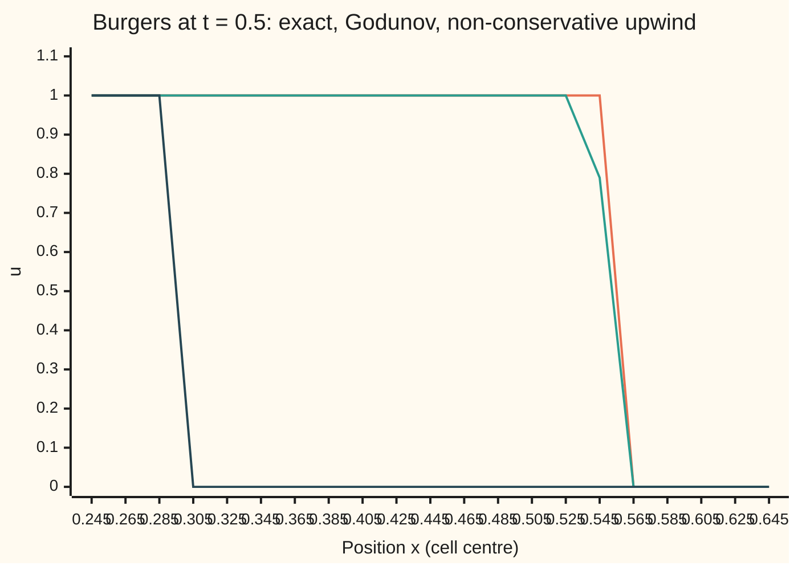
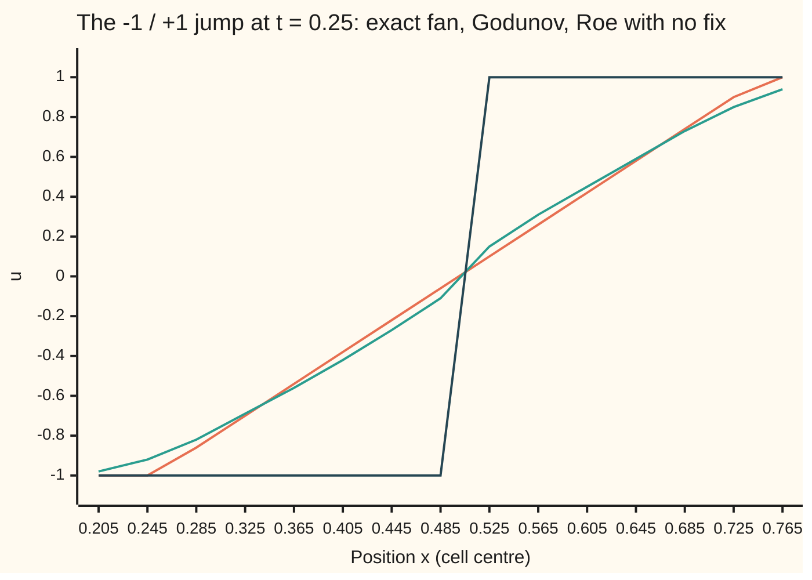

# Godunov's method: solve a small Riemann problem at every cell edge

[Syllabus](../../../SYLLABUS.md) → [Numerical analysis](../README.md) → [PDE Solvers](../README.md#s07) → Godunov's method

---

## General Overview

**Burgers' equation** is the simplest equation that makes a shock. A quantity $`u`$ lies along a line, and each part of it travels at a speed equal to its own value. Start with $`u = 1`$ left of $`x = 0.3`$ and $`u = 0`$ right of it. The fast part runs into the still part, and a moving jump forms, called a **shock**. In traffic, $`u`$ is 1 minus twice the density of cars, and this jump is the back end of a stretch of traffic (see Where you meet it).

The total amount of $`u`$ can change only by what flows in at the ends, and that bookkeeping forces a shock speed of $`(1 + 0)/2 = 0.5`$. So at time $`t = 0.5`$ the jump sits at $`0.3 + 0.5 \times 0.5 = 0.55`$. A solver must put it there, to within a cell or two.

Two grid solvers on 100 cells, run to $`t = 0.5`$:

- **Godunov's method** keeps a total in each cell and moves amounts across cell edges. At each edge it solves the two-state problem exactly. It puts the jump at 0.5502, a true error of 0.02 cells.
- **A non-conservative upwind step** updates each value by its own slope. It leaves the jump at 0.3000 forever, 25 cells behind. In the first empty cell $`u = 0`$, so the update multiplies by zero and nothing changes.

**Godunov's method changes each cell average only by the amounts crossing its two edges, read from the exact two-state solution at each edge, so the total changes only through the ends of the line and every shock moves at the speed conservation demands.**

**What kind of fact this is:** a method, with three theorems proved in Why it works: the update keeps the total exactly, conservation fixes the shock speed (the Rankine–Hugoniot condition), and Godunov's edge flux for Burgers' equation has a closed form. The Lax–Wendroff theorem is stated with its source, not proved.

### The picture: the jump at t = 0.5, three ways



Orange: the exact jump at 0.55. Green: Godunov, with one cell part-way, at 0.79 in the cell centred on 0.545. Dark blue: the non-conservative step, still at the starting jump between 0.285 and 0.305.

---

## The formula

A **conservation law** says that a quantity is neither made nor destroyed: it only moves. In one dimension it reads $`u_t + f(u)_x = 0`$. Here $`u`$ is the amount per unit length, and $`f(u)`$ is the **flux**: the amount crossing a point per unit time. For Burgers' equation $`f(u) = u^2/2`$, so the speed of a small ripple is $`f'(u) = u`$.

Cut the line into cells of width $`h`$. Store $`u_j^n`$, the **cell average** of $`u`$ over cell $`j`$ after $`n`$ steps of length $`\Delta t`$ (the grid notation of [Finite differences on a grid](02-finite-differences-consistency-stability-and-convergence.md)). Write $`F_{j+1/2}`$ for the amount crossing the edge between cells $`j`$ and $`j + 1`$ in one step, divided by $`\Delta t`$. Godunov's method is

```math
u_j^{n+1} = u_j^n - \frac{\Delta t}{h}\big(F_{j+1/2} - F_{j-1/2}\big), \qquad F_{j+1/2} = f\big(u^{*}(u_j^n,\, u_{j+1}^n)\big), \qquad s = \frac{f(u_L) - f(u_R)}{u_L - u_R}.
```

**Read it aloud:** the new cell average is the old one, minus what leaves through the right edge, plus what enters through the left; each edge's flow is the flux of $`u^{*}`$, the value the exact solution of the two-state problem at that edge takes right on the edge; and a jump from $`u_L`$ to $`u_R`$ moves at the jump in flux divided by the jump in $`u`$.

The two-state problem is the **Riemann problem**: one constant value $`u_L`$ on the left of a point, another $`u_R`$ on the right, and nothing else. For Burgers' equation its answer at the edge reduces to one line, proved in Step 3:

```math
F_{j+1/2} = \max\Big(f\big(\max(u_L, 0)\big),\ f\big(\min(u_R, 0)\big)\Big), \qquad u_L = u_j^n,\ u_R = u_{j+1}^n.
```

| Symbol | Plain meaning | In our example | Push it up and the answer… |
| --- | --- | --- | --- |
| $`u`$; $`u_t`$, $`u_x`$ | the conserved amount per unit length; its rate of change in time, along the line | 1 left of the jump, 0 right | — |
| $`f(u)`$, $`f'(u)`$ | flux: the amount crossing a point per unit time, for Burgers $`u^2/2`$; its slope $`f'(u) = u`$ is the wave speed | $`f(1) = 0.5`$ | — |
| $`x`$, $`t`$ | position; time | jump starts at $`x = 0.3`$; run to $`t = 0.5`$ | — |
| $`x_{j\pm 1/2}`$; $`X(t)`$, $`A`$, $`B`$ | the edges of cell $`j`$; a jump's position, and the ends of a stretch around it | edge at 0.30; $`X(0.5) = 0.55`$ | — |
| $`h`$, $`\Delta t`$; $`N`$ | cell width; time step; number of cells | 0.01; 0.005; 100 | smaller $`h`$: a sharper jump, same place |
| $`\nu`$ | Courant number $`\max\lvert u\rvert\,\Delta t/h`$: the fraction of a cell the fastest wave crosses in one step | 0.50 | past 1, overshoot: 1.6549 at $`\nu = 1.25`$ |
| $`u_j^n`$ | computed average over cell $`j`$ after $`n`$ steps | 0.7894 in the cell from 0.54 to 0.55 | — |
| $`F_{j+1/2}`$; $`g`$ | numerical flux through the edge between cells $`j`$ and $`j + 1`$; $`g`$ names the one-line Burgers formula for it in the proof | 0.5 at the left end, 0 at the right | — |
| $`u_L`$, $`u_R`$; $`u^{*}`$ | the two states of a Riemann problem; the exact solution's value on the edge | 1 and 0; $`u^{*} = 1`$ | — |
| $`s`$ | shock speed, from the Rankine–Hugoniot condition | 0.5 | the jump lands further right |
| $`a`$, $`\delta`$ | Roe's single wave speed $`(u_L + u_R)/2`$; the width of its entropy fix | 0.5 on the shock; $`\delta = 0.5`$ | more smoothing near speed 0: L1 error 0.0185 at 0.5, 0.0430 at 0.2 |
| $`s_L`$, $`s_R`$; $`u_m`$ | HLL's slowest and fastest wave speeds, $`\min`$ and $`\max`$ of $`u_L, u_R`$; the one middle state between them | 0 and 1 on the shock | — |

### When it holds

- **The equation is in conservation form, and the right quantity is conserved.** Writing the same equation for $`u^2`$ instead keeps smooth answers but moves the jump at 2/3: the check puts it at 0.6402, against 0.6333 for that wrong law and 0.55 for the true one.
- **The Courant number is at most 1.** A wave from one edge must not reach the next edge within a step, or the edge value is no longer the Riemann answer. At $`\nu = 1.25`$ the cells reach 1.6549, though no value above 1 was ever present.
- **The edge solver picks the physical jump.** A jump where the speeds spread apart, from $`-1`$ to $`+1`$, should open into a smooth fan. Roe's solver without an entropy fix keeps it shut: its error stays at 0.2500.
- **The data are smooth, if the error is to show the order.** On a smooth wave the error halves as $`h`$ halves: first order. At a shock it halves for every capturing scheme, second-order ones included, since the jump is smeared over a few cells.

---

## Why it works

### Step 0: keep the books, and the shock speed takes care of itself

A jump has no slope, so a rule built from slopes, like $`u\,u_x`$, has nothing sound to say there. Totals still make sense across a jump. So Godunov's method tracks a total per cell and moves amounts across edges, and conservation then fixes the shock's speed.

### Step 1: from the integral form to the cell update

Integrate $`u_t + f(u)_x = 0`$ over one cell, from $`x_{j-1/2}`$ to $`x_{j+1/2}`$, and over one step. The flux terms integrate exactly:

```math
\int_{x_{j-1/2}}^{x_{j+1/2}} u(x, t_{n+1})\,dx = \int_{x_{j-1/2}}^{x_{j+1/2}} u(x, t_n)\,dx - \int_{t_n}^{t_{n+1}} f\big(u(x_{j+1/2}, t)\big)\,dt + \int_{t_n}^{t_{n+1}} f\big(u(x_{j-1/2}, t)\big)\,dt.
```

This **integral form** needs no slopes, so it holds across a jump. Divide by $`h`$ and it is the update in The formula, still exact, with $`F_{j+1/2}`$ the time-averaged flux through the edge. The only question is how to compute it.

Godunov's answer, from 1959 (chapter 6 of Toro's book sets it out), has three moves:

1. **Reconstruct.** Pretend $`u`$ is constant in each cell, equal to its average.
2. **Evolve.** Now each edge carries a Riemann problem. Solve each one exactly.
3. **Average.** Read the flux through each edge from that exact solution, and update the averages.

Move 1 is the only approximation.

### Step 2: conservation fixes the shock speed (Rankine–Hugoniot)

Put a jump at $`x = X(t)`$, with $`u_L`$ to its left and $`u_R`$ to its right. Take a stretch $`[A, B]`$ around it. The integral form says the total in $`[A, B]`$ changes at the rate (flux in) minus (flux out), and $`X' = s`$:

```math
\frac{d}{dt}\Big[(X - A)\,u_L + (B - X)\,u_R\Big] = f(u_L) - f(u_R) \quad\Longrightarrow\quad s = X' = \frac{f(u_L) - f(u_R)}{u_L - u_R}.
```

For Burgers' equation this is $`(u_L^2 - u_R^2)/(2(u_L - u_R)) = (u_L + u_R)/2`$, which is 0.5 for 1 and 0.

The grid keeps the same books. Add the update over all cells: each inner edge's flux leaves one cell and enters the next, so it cancels. Only the ends remain, 0.5 flowing in and 0 out. The total grows from 0.3 by $`100 \times 0.005 \times 0.5 = 0.25`$, and the run ends at 0.5500, off by 0.0e+00. With $`u`$ near 1 behind the jump and 0 ahead, a total of 0.55 puts the jump at 0.55.

<details>
<summary>Detailed proof: the grid total and the jump condition</summary>

**The grid total.** Sum the update over the $`N`$ cells, $`j = 0, \dots, N - 1`$:

$`\displaystyle h\sum_{j} u_j^{n+1} = h\sum_{j} u_j^n - \Delta t\sum_{j}\big(F_{j+1/2} - F_{j-1/2}\big) = h\sum_{j} u_j^n - \Delta t\,\big(F_{N-1/2} - F_{-1/2}\big).`$

The middle sum telescopes: every inner edge appears once with each sign. With a ghost cell copying each end, the left edge sees 1 against 1 and carries $`f(1) = 0.5`$; the right edge sees 0 against 0 and carries 0. So the total rises by $`0.5\,\Delta t`$ per step, exactly, whatever the inner cells hold.

**The jump condition.** Let $`u`$ be smooth except for a jump along a curve $`x = X(t)`$ with a continuous speed, and let $`A < X(t) < B`$ for $`t`$ near $`t_0`$. Split the total:

$`\displaystyle \frac{d}{dt}\int_A^B u\,dx = \frac{d}{dt}\int_A^{X} u\,dx + \frac{d}{dt}\int_X^B u\,dx = X'\,u_L + \int_A^X u_t\,dx - X'\,u_R + \int_X^B u_t\,dx.`$

On each smooth side $`u_t = -f(u)_x`$, so the two integrals give $`f(u(A)) - f(u_L) + f(u_R) - f(u(B))`$. The integral form says the whole left side equals $`f(u(A)) - f(u(B))`$. Subtract: $`X'(u_L - u_R) = f(u_L) - f(u_R)`$.

</details>

### Step 3: the Riemann problem for Burgers' equation, and Godunov's flux

The Riemann problem has two answers, depending on which side is faster.

- **$`u_L > u_R`$: a shock.** The left side is faster and catches up. The jump moves at $`s = (u_L + u_R)/2`$. On the edge, at $`x/t = 0`$, the value is $`u_L`$ if $`s > 0`$ and $`u_R`$ if $`s < 0`$.
- **$`u_L < u_R`$: a rarefaction fan.** The right side runs away, and the gap fills with a straight ramp $`u = x/t`$ from $`u_L`$ to $`u_R`$. Along each path of [The transport equation](../../08-Differential%20equations%20and%20dynamics/10-The%20Classical%20PDEs/02-the-transport-equation-and-characteristics.md) the value stays constant, and here the paths spread out from the edge like a **fan**. On the edge the value is $`u_L`$ if $`u_L \ge 0`$, $`u_R`$ if $`u_R \le 0`$, and 0 if $`u_L < 0 < u_R`$. That last case, where the fan straddles speed 0, is called **transonic**.

The edge flux is $`f`$ of that value. The check codes the Riemann solution as a function of $`x/t`$, samples it at 0, and compares the result with the one-line formula on 1,681 pairs of states from $`-2`$ to 2. The largest gap is 0.0e+00.

Each edge costs about 6 operations; the 100-cell run uses 10,100 edge fluxes.

<details>
<summary>Detailed proof: the one-line formula equals the exact edge flux</summary>

Write $`g(u_L, u_R) = \max\big(f(\max(u_L, 0)),\ f(\min(u_R, 0))\big)`$ with $`f(u) = u^2/2`$, which is smallest at 0.

Shock, $`u_L > u_R`$. If $`u_R \ge 0`$, then $`s > 0`$, the edge value is $`u_L`$, and $`g = \max(f(u_L), 0) = f(u_L)`$. If $`u_L \le 0`$, then $`s < 0`$, the edge value is $`u_R`$, and $`g = \max(0, f(u_R)) = f(u_R)`$. If $`u_R < 0 < u_L`$, then $`g = \max(f(u_L), f(u_R))`$. Now $`f(u_L) > f(u_R)`$ exactly when $`u_L^2 > u_R^2`$, that is $`u_L + u_R > 0`$, that is $`s > 0`$. So $`g`$ picks $`f(u_L)`$ when $`s > 0`$ and $`f(u_R)`$ when $`s < 0`$, as the shock does. At $`s = 0`$ the two are equal.

Fan, $`u_L \le u_R`$. If $`u_L \ge 0`$, the edge value is $`u_L`$ and $`g = \max(f(u_L), f(0)) = f(u_L)`$. If $`u_R \le 0`$, the edge value is $`u_R`$ and $`g = f(u_R)`$. If $`u_L < 0 < u_R`$, the edge value is 0 and $`g = \max(f(0), f(0)) = 0`$.

</details>

### Step 4: why the non-conservative step freezes, and the Lax–Wendroff theorem

The non-conservative upwind step is

```math
u_j^{n+1} = u_j^n - \frac{\Delta t}{h}\,u_j^n\big(u_j^n - u_{j-1}^n\big).
```

For a smooth $`u`$ it is a fair copy of $`u_t + u\,u_x = 0`$. At the jump it fails. In the first cell past 0.3, $`u_j = 0`$, so the change is $`0 \times (0 - 1) = 0`$, and every cell to the left has zero slope. Nothing moves, at 100 cells or 1,600, and the total stays 0.3000.

This scheme converges, to the wrong answer. Grids that agree with each other need not agree with the equation.

The cure is a theorem. The **Lax–Wendroff theorem** (1960) says: take a scheme in conservation form whose flux is **consistent**, meaning $`F(u, u) = f(u)`$ and $`F`$ changes by at most a fixed multiple of any change in its inputs. If its grid answers converge, boundedly, as $`h`$ and $`\Delta t`$ shrink together, then the limit is a **weak solution**: a function that satisfies the integral form, jumps included. So every jump in the limit moves at the Rankine–Hugoniot speed. This card states it without proof, and chapter 12 of LeVeque's book proves it.

The conserved quantity matters too. Multiply Burgers' equation by $`2u`$ and it reads $`(u^2)_t + (2u^3/3)_x = 0`$, with the same smooth solutions. But in this law a jump from 1 to 0 moves at $`(2/3)/1 = 0.6667`$, and a conservative scheme for it puts the jump at 0.6402. That is where $`u`$ crosses 1/2, only $`u^2 = 1/4`$ on the smeared profile; $`u^2`$ itself crosses 1/2 at 0.6342. The physics decides which quantity is conserved, and the grid must conserve that one.

### Step 5: the entropy condition, and why Roe's solver needs a fix

Start from $`u = -1`$ left of 0.5 and $`+1`$ right of it. The true answer is a fan, a ramp spreading at unit speed both ways. But a standing jump, with $`s = (-1 + 1)/2 = 0`$, also satisfies the integral form. Weak solutions need not be unique.

The physical choice is fixed by an **entropy condition**: in a shock, the paths of [The transport equation](../../08-Differential%20equations%20and%20dynamics/10-The%20Classical%20PDEs/02-the-transport-equation-and-characteristics.md) must run into the jump from both sides, so $`u_L > s > u_R`$. The standing jump has $`u_L = -1 < 0 < 1 = u_R`$, so its paths run out of it. This **expansion shock** does not occur in nature.

Godunov's method uses the exact Riemann solution, the fan, so it opens the jump without help. The check measures the **L1 error**: $`h`$ times the sum of the gaps between computed and exact cell averages, the area between the two profiles.

| Edge solver on the $`-1 / +1`$ jump, $`t = 0.25`$ | L1 error | Cells either side of 0.5 |
| --- | --- | --- |
| exact fan | — | $`-0.0200`$, $`+0.0200`$ |
| Godunov | 0.0237 | $`-0.0704`$, $`+0.0704`$ |
| Roe, no fix | 0.2500 | $`-1.0000`$, $`+1.0000`$ |
| Roe, fix width 0.5 | 0.0185 | $`-0.0238`$, $`+0.0238`$ |
| Roe, fix width 0.2 | 0.0430 | $`-0.0784`$, $`+0.0784`$ |
| HLL | 0.0203 | $`-0.0359`$, $`+0.0359`$ |

Roe's unfixed 0.2500 is exactly the area between the shut jump and the fan: two triangles of base 0.25 and height 1. Godunov's own kink at the centre, $`\pm 0.0704`$ against $`\pm 0.0200`$, is a known first-order effect where the wave speed passes through 0.



Orange: the exact fan, a straight ramp from 0.25 to 0.75. Green: Godunov, close to the ramp. Dark blue: Roe without a fix, a step that never opens.

### Step 6: approximate solvers, Roe and HLL

For a system, such as the gas equations for mass, momentum and energy, the exact Riemann solution needs an iterative root-find at every edge and step. Two cheaper solvers replace it.

- **Roe's solver** replaces the problem with a linear one whose waves are all jumps, each at an averaged speed. For Burgers there is one wave, at speed $`a = (u_L + u_R)/2`$, and the flux is $`F = \tfrac12\big(f(u_L) + f(u_R)\big) - \tfrac12\lvert a\rvert\,(u_R - u_L)`$. A jump cannot be a fan: at a transonic jump $`a = 0`$, and the plain-average flux keeps the expansion shock. **Harten's entropy fix** replaces $`\lvert a\rvert`$ by $`(a^2 + \delta^2)/(2\delta)`$ when $`\lvert a\rvert < \delta`$, adding smoothing near speed 0 that opens the fan.
- **HLL** (Harten, Lax and van Leer, 1983) assumes two waves, at speeds $`s_L`$ and $`s_R`$, with one constant state $`u_m`$ between them fixed by conservation. Its flux is $`F = \big(s_R f(u_L) - s_L f(u_R) + s_L s_R (u_R - u_L)\big)/(s_R - s_L)`$ when $`s_L < 0 < s_R`$, and the upwind flux otherwise. With speeds that bracket the true ones, it needs no entropy fix.

The check also builds HLL's flux from $`u_m`$: conservation over the fan fixes it, and Step 2's jump condition across the left wave gives $`F = f(u_L) + s_L(u_m - u_L)`$. On the 800 pairs with $`s_L < 0 < s_R`$ the two agree to 8.9e-16.

On the main shock all three agree: Roe's run differs from Godunov's by at most 2.2e-16 per cell, and HLL's by 0.0e+00. Over Step 3's pairs, Roe's flux matches Godunov's to 2.2e-16 on the 1,281 without $`u_L < 0 < u_R`$, and differs on all 400 with it, the transonic fan, by at least 5.0e-03.

### Step 7: how accurate it is

Godunov's method is first order on smooth data. The cause is move 1: treating a cell as flat misses the value at its edge by about half a cell times the slope, an error proportional to $`h`$.

The check reads the order on the smooth wave $`u = 0.5 + 0.25\sin(2\pi x)`$ on a loop (the right end joined to the left), at $`t = 0.2`$, before it breaks at $`t = 1/(0.25 \times 2\pi) = 0.6366`$. The exact value is the starting value at $`x - ut`$, found by repeated substitution.

| Cells | Smooth wave: L1 error | Ratio | Shock: L1 error | Ratio |
| --- | --- | --- | --- | --- |
| 100 | 0.002508 | — | 0.00473 | — |
| 200 | 0.001262 | 1.99 | 0.00236 | 2.00 |
| 400 | 0.000633 | 1.99 | 0.00118 | 2.00 |
| 800 | 0.000317 | 2.00 | 0.00059 | 2.00 |
| 1,600 | 0.000159 | 2.00 | 0.00030 | 2.00 |

On the smooth wave the ratio settles at 2: observed order 1. On the shock it is exactly 2 for another reason: the profile, measured in cells, is the same at every size. At a shock like this, every conservative shock-capturing scheme does the same, second-order ones included, so a shock test shows where the jump goes, not the order.

---

## Worked numbers, by hand

The first two Godunov steps in the cell from 0.30 to 0.31, with $`\nu = \Delta t/h = 0.5`$, then the total.

| Step | Arithmetic | Value |
| --- | --- | --- |
| shock speed, Rankine–Hugoniot | $`(0.5 - 0)/(1 - 0)`$ | 0.5000 |
| exact jump at $`t = 0.5`$ | $`0.3 + 0.5 \times 0.5`$ | 0.5500 |
| step 1: left edge, $`1 \mid 0`$, shock moving right | $`f(1) = 1^2/2`$ | 0.50000 |
| step 1: right edge, $`0 \mid 0`$ | $`f(0)`$ | 0.00000 |
| step 1: new cell value | $`0 - 0.5 \times (0 - 0.5)`$ | 0.250000 |
| step 2: right edge, $`0.25 \mid 0`$ | $`f(0.25) = 0.0625/2`$ | 0.03125 |
| step 2: new cell value | $`0.25 - 0.5 \times (0.03125 - 0.5)`$ | 0.484375 |
| total at $`t = 0.5`$ | $`0.3 + 100 \times 0.005 \times 0.5`$ | 0.5500 |
| **jump crossing 1/2 at $`t = 0.5`$** | interpolated between 0.7894 at 0.545 and 0.2318 at 0.555 | **0.5502** |

The computed jump is 0.0002 to the right of 0.55, a true error of 0.02 cells.

### What breaks if you drop a piece

| Mistake | Comes out at | What went wrong |
| --- | --- | --- |
| non-conservative upwind, $`u_j(u_j - u_{j-1})`$ | jump at 0.3000, error $`-0.2500`$, at every grid | $`u = 0`$ in the first empty cell, so the update is zero; the total never grows |
| conserving $`u^2`$ instead of $`u`$ | jump at 0.6402 where $`u`$ crosses 1/2, 0.6342 where $`u^2`$ does (that law's speed predicts 0.6333) | a different conserved quantity has a different jump speed, 0.6667 |
| Roe's solver with no entropy fix, on the $`-1 / +1`$ jump | L1 error 0.2500; cells stay at $`-1.0000`$ and $`+1.0000`$ | one wave at speed 0 cannot make a fan, so the expansion shock stands |
| Courant number 1.25 ($`\Delta t = 0.0125`$, 40 steps) | values up to 1.6549, an overshoot of 0.6549 | waves from neighbouring edges reach each other within a step |

The checks print all four.

---

## Code, from first principles, and it actually runs

The code solves the Riemann problem for Burgers' equation exactly and builds Godunov's method on it. Four roads reach the shock position: the Rankine–Hugoniot speed, the grid at five sizes, the telescoping grid total, and the sampled Riemann solution against the closed-form flux. It also runs Roe, HLL two ways, the non-conservative step, the $`u^2`$ law, the transonic fan and a smooth wave for the order.

### Python

```python
# Godunov's method: solve a small Riemann problem at every cell edge -- the check
# behind the card.  Standard library only.  Burgers' equation u_t + (u^2/2)_x = 0.
# Road 1: the Rankine-Hugoniot speed.  Road 2: Godunov's method at five grid sizes, on the
# shock and on a smooth wave.  Road 3: the mass identity (telescoping end fluxes).  Road 4: the
# exact Riemann solution against the closed-form flux; Roe and HLL against Godunov and HLL's middle state.
from math import sin, pi

def f(u): return 0.5 * u * u                           # Burgers' flux
def riemann(ul, ur, xi):                               # exact Riemann solution at x/t = xi
    if ul > ur: return ul if xi < (ul + ur) / 2 else ur    # shock, Rankine-Hugoniot speed
    if xi <= ul: return ul                             # rarefaction fan: u = x/t inside
    if xi >= ur: return ur
    return xi
def godunov(ul, ur): return f(riemann(ul, ur, 0.0))    # flux through the edge, x/t = 0
def closed(ul, ur): return max(f(max(ul, 0.0)), f(min(ur, 0.0)))
def roe(ul, ur, d=0.0):                                # Roe: one wave at the averaged speed
    a = abs(ul + ur) / 2
    if a < d: a = (a * a + d * d) / (2 * d)            # Harten's entropy fix, width d
    return (f(ul) + f(ur)) / 2 - a / 2 * (ur - ul)
def hll(ul, ur):                                       # HLL: two waves, one middle state
    sl, sr = min(ul, ur), max(ul, ur)
    if sl >= 0: return f(ul)
    if sr <= 0: return f(ur)
    return (sr * f(ul) - sl * f(ur) + sl * sr * (ur - ul)) / (sr - sl)
def hll2(ul, ur, sl, sr):                              # HLL again: middle state um from conservation over
    um = (sr * ur - sl * ul - (f(ur) - f(ul))) / (sr - sl)   # the fan, then the jump condition
    return f(ul) + sl * (um - ul)                      # across the left wave

def step(flux, u, nu):                                # finite-volume update; ghost cells copy the ends
    g = [u[0]] + u + [u[-1]]
    F = [flux(g[i], g[i + 1]) for i in range(len(g) - 1)]
    return [u[j] - nu * (F[j + 1] - F[j]) for j in range(len(u))]
def nonc(u, nu):                                       # non-conservative upwind u_j - nu u_j (u_j - u_{j-1})
    return [v - nu * v * (v - (u[j - 1] if j else u[0])) for j, v in enumerate(u)]
def squares(u, nu):                                    # conserves u^2 with flux (2/3) u^3 instead
    v = [w * w for w in u]
    g = [2 / 3 * w ** 1.5 for w in v]
    return [max(v[j] - nu * (g[j] - g[j - 1 if j else 0]), 0.0) ** 0.5 for j in range(len(u))]

def start(n, x0=0.3, a=1.0, b=0.0): return [a if (j + 0.5) / n < x0 else b for j in range(n)]
def run(n, nu=0.5, t=0.5, how=None, u=None):
    u = start(n) if u is None else u
    for _ in range(round(t * n / nu)): u = how(u, nu) if how else step(godunov, u, nu)
    return u
def cross(u):                                          # where the profile crosses 1/2
    n = len(u)
    j = max(i for i in range(n - 1) if u[i] >= 0.5 > u[i + 1])
    return (j + 0.5 + (u[j] - 0.5) / (u[j] - u[j + 1])) / n
def l1(u, xs):                                         # distance from the exact shock's cell averages
    n = len(u)
    return sum(abs(v - min(max(xs * n - j, 0.0), 1.0)) for j, v in enumerate(u)) / n
def wave(x, t):                                        # smooth wave on a loop: u = u0(x - u t), by iteration
    v = 0.5
    for _ in range(60): v = 0.5 + 0.25 * sin(2 * pi * (x - v * t))
    return v

s = (f(1.0) - f(0.0)) / (1.0 - 0.0)
XS = 0.3 + s * 0.5
print(f"Burgers, u = 1 left of 0.3, 0 right; 100 cells h = 0.01, dt = 0.005, nu = 0.50, 100 steps to t = 0.5")
print(f"Rankine-Hugoniot: s = (0.5 - 0)/(1 - 0) = {s:.4f}; exact shock at 0.3 + {s:.1f} x 0.5 = {XS:.4f}")
grid = [i / 10 - 2 for i in range(41)]
print(f"Riemann solver sampled at x/t = 0 against max(f(max(uL,0)), f(min(uR,0))), 1681 pairs: largest gap "
      f"{max(abs(godunov(a, b) - closed(a, b)) for a in grid for b in grid):.1e}")
same = [abs(roe(a, b) - godunov(a, b)) for a in grid for b in grid if not a < 0 < b]
tr = [abs(roe(a, b) - godunov(a, b)) for a in grid for b in grid if a < 0 < b]
print(f"Roe against Godunov: largest gap {max(same):.1e} on the {len(same)} pairs without uL < 0 < uR;"
      f" smallest gap {min(tr):.1e} on the {len(tr)} with it")
hg = [abs(hll(a, b) - hll2(a, b, min(a, b), max(a, b))) for a in grid for b in grid if min(a, b) < 0 < max(a, b)]
print(f"HLL against f(uL) + sL (um - uL), um from conservation, {len(hg)} pairs with sL < 0 < sR: largest gap {max(hg):.1e}")

u = start(100)
print("by hand, the first two steps at the cell from 0.30 to 0.31 (left neighbour 1, right neighbour 0):")
for k in (1, 2):
    a, b, c = u[29], u[30], u[31]
    Fl, Fr = godunov(a, b), godunov(b, c)
    u = step(godunov, u, 0.5)
    print(f"  step {k}: F_left = {Fl:.5f}, F_right = {Fr:.5f}, new u = {b:.6f} - 0.5 x ({Fr:.5f} - {Fl:.5f}) = {u[30]:.6f}")

gd, nc, sq = run(100), run(100, how=nonc), run(100, how=squares)
print(f"Godunov: crossing {cross(gd):.4f}, true error {cross(gd) - XS:+.4f} = {(cross(gd) - XS) * 100:+.2f} cells;"
      f" mass {sum(gd) / 100:.4f}; range {min(gd):.4f} to {max(gd):.4f}")
print(f"  mass identity 0.3 + 100 x 0.005 x 0.5 = {0.3 + 100 * 0.005 * 0.5:.4f}; gap {abs(sum(gd) / 100 - 0.55):.1e}")
print("  cells 0.50 to 0.60:", " ".join(f"{v:.4f}" for v in gd[50:60]))
print(f"non-conservative upwind: crossing {cross(nc):.4f}, true error {cross(nc) - XS:+.4f}; mass {sum(nc) / 100:.4f}")
print(f"conserving u^2 instead: speed (2/3)/1 = {2 / 3:.4f}, shock at {0.3 + 0.5 * 2 / 3:.4f}; crossing {cross(sq):.4f},"
      f" where u^2 itself crosses 1/2: {cross([w * w for w in sq]):.4f}")
rs, hs = run(100, how=lambda u, nu: step(roe, u, nu)), run(100, how=lambda u, nu: step(hll, u, nu))
print(f"Roe and HLL on the shock: largest gap from Godunov {max(abs(a - b) for a, b in zip(rs, gd)):.1e},"
      f" {max(abs(a - b) for a, b in zip(hs, gd)):.1e}")

print("Lax-Wendroff theorem at work: refine, nu = 0.5 | L1 error = h x sum |u_j - exact cell average|")
print(f"  and Godunov on a smooth wave u0 = 0.5 + 0.25 sin(2 pi x), on a loop, to t = 0.2, before it breaks at 1/(0.25 x 2 pi) = {1 / (0.5 * pi):.4f} | L1 against exact u at centres")
eg, en, es = [], [], []
for n in (100, 200, 400, 800, 1600):
    a, b = run(n), run(n, how=nonc)
    w = run(n, t=0.2, how=lambda u, nu: step(godunov, [u[-1]] + u + [u[0]], nu)[1:-1], u=[wave((j + 0.5) / n, 0) for j in range(n)])
    eg.append(l1(a, XS)); en.append(l1(b, XS)); es.append(sum(abs(v - wave((j + 0.5) / n, 0.2)) for j, v in enumerate(w)) / n)
    print(f"  {n:>4} cells: Godunov crossing {cross(a):.4f}, L1 {eg[-1]:.5f} | non-conservative crossing {cross(b):.4f},"
          f" L1 {en[-1]:.4f} | smooth L1 {es[-1]:.6f}")
for name, e in (("shock", eg), ("smooth wave", es)):
    print(f"  Godunov L1 ratios as h halves, {name}: " + ", ".join(f"{e[i] / e[i + 1]:.2f}" for i in range(4)))

def fan(j, n, t=0.25):                                 # exact cell average of the fan from x = 0.5
    def G(y): return y * y / (2 * t) if abs(y) <= t else abs(y) - t / 2
    return (G((j + 1) / n - 0.5) - G(j / n - 0.5)) * n
print("transonic fan: u = -1 left of 0.5, +1 right, 100 cells, nu = 0.5, 50 steps to t = 0.25 | L1 error")
fans, fl1 = {}, {}
for name, fl in (("Godunov", godunov), ("Roe, no fix", roe), ("Roe, fix width 0.5", lambda a, b: roe(a, b, 0.5)),
                 ("Roe, fix width 0.2", lambda a, b: roe(a, b, 0.2)), ("HLL", hll)):
    v = fans[name] = run(100, t=0.25, how=lambda u, nu: step(fl, u, nu), u=start(100, 0.5, -1.0, 1.0))
    fl1[name] = sum(abs(w - fan(j, 100)) for j, w in enumerate(v)) / 100
    print(f"  {name:<19} L1 {fl1[name]:.4f}; cells either side of 0.5: {v[49]:+.4f} {v[50]:+.4f}")
print(f"  exact cell averages there: {fan(49, 100):+.4f} {fan(50, 100):+.4f}")

big = run(100, nu=1.25)
print(f"what breaks: nu = 1.25 (dt = 0.0125, 40 steps): range {min(big):.4f} to {max(big):.4f}, overshoot {max(big) - 1:.4f}")
print(f"cost: {101 * 100} edge fluxes for the 100-cell run, about 6 operations each")

lab = [0.245 + 0.02 * i for i in range(21)]
print("chart, x:", ", ".join(f"{x:.3f}" for x in lab))
for name, v in (("exact", None), ("Godunov", gd), ("non-conservative", nc)):
    print(f"chart, {name}:", ", ".join(f"{(1.0 if x < XS else 0.0) if v is None else v[round(x * 100 - 0.5)]:.2f}" for x in lab))
lab2 = [0.205 + 0.04 * i for i in range(15)]
print("chart2, x:", ", ".join(f"{x:.3f}" for x in lab2))
print("chart2, exact:", ", ".join(f"{fan(round(x * 100 - 0.5), 100):.2f}" for x in lab2))
for name in ("Godunov", "Roe, no fix"):
    print(f"chart2, {name}:", ", ".join(f"{fans[name][round(x * 100 - 0.5)]:.2f}" for x in lab2))

assert abs(cross(gd) - XS) < 0.02                      # within two cells of Rankine-Hugoniot
assert abs(sum(gd) / 100 - (0.3 + 0.25)) < 1e-12       # mass identity: telescoping fluxes
assert abs(cross(nc) - 0.3) < 1e-12 and en[-1] > 0.24   # non-conservative: frozen, wrong limit
assert abs(cross(sq) - (0.3 + 1 / 3)) < 0.02           # u^2 conserved: the other speed, 2/3
assert all(1.8 < es[i] / es[i + 1] < 2.2 for i in range(4))   # first order, seen on the smooth wave
assert all(abs(godunov(a, b) - closed(a, b)) < 1e-15 for a in grid for b in grid)
assert all(g < 1e-15 for g in same) and all(g > 1e-3 for g in tr)   # Roe differs only on transonic fans
assert max(abs(a - b) for a, b in zip(rs, gd)) < 1e-12 and all(g < 1e-12 for g in hg)   # HLL, two roads
assert abs(fans["Roe, no fix"][49] + 1.0) < 1e-12      # no fix: the expansion shock never opens
assert all(fl1[k] < 0.05 for k in fl1 if k != "Roe, no fix")   # fixed solvers open the fan (NaN fails)
assert max(big) > 1.005 and max(gd) <= 1.0 and min(gd) >= 0.0
print("ALL CHECKS PASS")
```

**Ran 2026-11-24 on macOS, Python 3.14.10, standard library only. All checks passed. Output, pasted from the run:**

```
Burgers, u = 1 left of 0.3, 0 right; 100 cells h = 0.01, dt = 0.005, nu = 0.50, 100 steps to t = 0.5
Rankine-Hugoniot: s = (0.5 - 0)/(1 - 0) = 0.5000; exact shock at 0.3 + 0.5 x 0.5 = 0.5500
Riemann solver sampled at x/t = 0 against max(f(max(uL,0)), f(min(uR,0))), 1681 pairs: largest gap 0.0e+00
Roe against Godunov: largest gap 2.2e-16 on the 1281 pairs without uL < 0 < uR; smallest gap 5.0e-03 on the 400 with it
HLL against f(uL) + sL (um - uL), um from conservation, 800 pairs with sL < 0 < sR: largest gap 8.9e-16
by hand, the first two steps at the cell from 0.30 to 0.31 (left neighbour 1, right neighbour 0):
  step 1: F_left = 0.50000, F_right = 0.00000, new u = 0.000000 - 0.5 x (0.00000 - 0.50000) = 0.250000
  step 2: F_left = 0.50000, F_right = 0.03125, new u = 0.250000 - 0.5 x (0.03125 - 0.50000) = 0.484375
Godunov: crossing 0.5502, true error +0.0002 = +0.02 cells; mass 0.5500; range 0.0000 to 1.0000
  mass identity 0.3 + 100 x 0.005 x 0.5 = 0.5500; gap 0.0e+00
  cells 0.50 to 0.60: 1.0000 0.9998 0.9979 0.9766 0.7894 0.2318 0.0045 0.0000 0.0000 0.0000
non-conservative upwind: crossing 0.3000, true error -0.2500; mass 0.3000
conserving u^2 instead: speed (2/3)/1 = 0.6667, shock at 0.6333; crossing 0.6402, where u^2 itself crosses 1/2: 0.6342
Roe and HLL on the shock: largest gap from Godunov 2.2e-16, 0.0e+00
Lax-Wendroff theorem at work: refine, nu = 0.5 | L1 error = h x sum |u_j - exact cell average|
  and Godunov on a smooth wave u0 = 0.5 + 0.25 sin(2 pi x), on a loop, to t = 0.2, before it breaks at 1/(0.25 x 2 pi) = 0.6366 | L1 against exact u at centres
   100 cells: Godunov crossing 0.5502, L1 0.00473 | non-conservative crossing 0.3000, L1 0.2500 | smooth L1 0.002508
   200 cells: Godunov crossing 0.5501, L1 0.00236 | non-conservative crossing 0.3000, L1 0.2500 | smooth L1 0.001262
   400 cells: Godunov crossing 0.5500, L1 0.00118 | non-conservative crossing 0.3000, L1 0.2500 | smooth L1 0.000633
   800 cells: Godunov crossing 0.5500, L1 0.00059 | non-conservative crossing 0.3000, L1 0.2500 | smooth L1 0.000317
  1600 cells: Godunov crossing 0.5500, L1 0.00030 | non-conservative crossing 0.3000, L1 0.2500 | smooth L1 0.000159
  Godunov L1 ratios as h halves, shock: 2.00, 2.00, 2.00, 2.00
  Godunov L1 ratios as h halves, smooth wave: 1.99, 1.99, 2.00, 2.00
transonic fan: u = -1 left of 0.5, +1 right, 100 cells, nu = 0.5, 50 steps to t = 0.25 | L1 error
  Godunov             L1 0.0237; cells either side of 0.5: -0.0704 +0.0704
  Roe, no fix         L1 0.2500; cells either side of 0.5: -1.0000 +1.0000
  Roe, fix width 0.5  L1 0.0185; cells either side of 0.5: -0.0238 +0.0238
  Roe, fix width 0.2  L1 0.0430; cells either side of 0.5: -0.0784 +0.0784
  HLL                 L1 0.0203; cells either side of 0.5: -0.0359 +0.0359
  exact cell averages there: -0.0200 +0.0200
what breaks: nu = 1.25 (dt = 0.0125, 40 steps): range 0.0000 to 1.6549, overshoot 0.6549
cost: 10100 edge fluxes for the 100-cell run, about 6 operations each
chart, x: 0.245, 0.265, 0.285, 0.305, 0.325, 0.345, 0.365, 0.385, 0.405, 0.425, 0.445, 0.465, 0.485, 0.505, 0.525, 0.545, 0.565, 0.585, 0.605, 0.625, 0.645
chart, exact: 1.00, 1.00, 1.00, 1.00, 1.00, 1.00, 1.00, 1.00, 1.00, 1.00, 1.00, 1.00, 1.00, 1.00, 1.00, 1.00, 0.00, 0.00, 0.00, 0.00, 0.00
chart, Godunov: 1.00, 1.00, 1.00, 1.00, 1.00, 1.00, 1.00, 1.00, 1.00, 1.00, 1.00, 1.00, 1.00, 1.00, 1.00, 0.79, 0.00, 0.00, 0.00, 0.00, 0.00
chart, non-conservative: 1.00, 1.00, 1.00, 0.00, 0.00, 0.00, 0.00, 0.00, 0.00, 0.00, 0.00, 0.00, 0.00, 0.00, 0.00, 0.00, 0.00, 0.00, 0.00, 0.00, 0.00
chart2, x: 0.205, 0.245, 0.285, 0.325, 0.365, 0.405, 0.445, 0.485, 0.525, 0.565, 0.605, 0.645, 0.685, 0.725, 0.765
chart2, exact: -1.00, -1.00, -0.86, -0.70, -0.54, -0.38, -0.22, -0.06, 0.10, 0.26, 0.42, 0.58, 0.74, 0.90, 1.00
chart2, Godunov: -0.98, -0.92, -0.82, -0.69, -0.56, -0.42, -0.27, -0.11, 0.15, 0.31, 0.45, 0.59, 0.73, 0.85, 0.94
chart2, Roe, no fix: -1.00, -1.00, -1.00, -1.00, -1.00, -1.00, -1.00, -1.00, 1.00, 1.00, 1.00, 1.00, 1.00, 1.00, 1.00
ALL CHECKS PASS
```

### Rust

Same method, same labels, same output, built with `rustc --edition 2021 -O`.

```rust
// Godunov's method: solve a small Riemann problem at every cell edge -- the same
// check in Rust, std only, no crates.  Burgers' equation u_t + (u^2/2)_x = 0.
// Road 1: the Rankine-Hugoniot speed.  Road 2: Godunov's method at five grid sizes, on the
// shock and on a smooth wave.  Road 3: the mass identity (telescoping end fluxes).  Road 4: the
// exact Riemann solution against the closed-form flux; Roe and HLL against Godunov and HLL's middle state.
use std::f64::consts::PI;

fn f(u: f64) -> f64 { 0.5 * u * u }                    // Burgers' flux

fn riemann(ul: f64, ur: f64, xi: f64) -> f64 {         // exact Riemann solution at x/t = xi
    if ul > ur { return if xi < (ul + ur) / 2.0 { ul } else { ur } }   // shock
    if xi <= ul { return ul }                          // rarefaction fan: u = x/t inside
    if xi >= ur { return ur }
    xi
}
fn godunov(ul: f64, ur: f64) -> f64 { f(riemann(ul, ur, 0.0)) }   // flux through the edge
fn closed(ul: f64, ur: f64) -> f64 { f(ul.max(0.0)).max(f(ur.min(0.0))) }
fn roe_d(ul: f64, ur: f64, d: f64) -> f64 {            // Roe: one wave at the averaged speed
    let mut a = (ul + ur).abs() / 2.0;
    if a < d { a = (a * a + d * d) / (2.0 * d) }       // Harten's entropy fix, width d
    (f(ul) + f(ur)) / 2.0 - a / 2.0 * (ur - ul)
}
fn roe(ul: f64, ur: f64) -> f64 { roe_d(ul, ur, 0.0) }
fn roe5(ul: f64, ur: f64) -> f64 { roe_d(ul, ur, 0.5) }  fn roe2(ul: f64, ur: f64) -> f64 { roe_d(ul, ur, 0.2) }
fn hll(ul: f64, ur: f64) -> f64 {                      // HLL: two waves, one middle state
    let (sl, sr) = (ul.min(ur), ul.max(ur));
    if sl >= 0.0 { return f(ul) }
    if sr <= 0.0 { return f(ur) }
    (sr * f(ul) - sl * f(ur) + sl * sr * (ur - ul)) / (sr - sl)
}
fn hll2(ul: f64, ur: f64, sl: f64, sr: f64) -> f64 {  // HLL again: middle state um from conservation over
    let um = (sr * ur - sl * ul - (f(ur) - f(ul))) / (sr - sl);   // the fan, then the jump condition
    f(ul) + sl * (um - ul)                             // across the left wave
}

enum How { Flux(fn(f64, f64) -> f64), Nonc, Squares, Loop }
fn advance(how: &How, u: &[f64], nu: f64) -> Vec<f64> {
    let n = u.len();
    match how {
        How::Flux(fl) => {                             // finite-volume update; ghost cells copy the ends
            let g: Vec<f64> = (0..n + 2).map(|i| u[i.max(1).min(n) - 1]).collect();
            let fx: Vec<f64> = (0..n + 1).map(|i| fl(g[i], g[i + 1])).collect();
            (0..n).map(|j| u[j] - nu * (fx[j + 1] - fx[j])).collect()
        }
        How::Loop => advance(&How::Flux(godunov), &[&u[n - 1..], u, &u[..1]].concat(), nu)[1..n + 1].to_vec(),   // ghosts: far ends
        How::Nonc => (0..n).map(|j| u[j] - nu * u[j] * (u[j] - u[if j > 0 { j - 1 } else { 0 }])).collect(),
        How::Squares => {                              // conserves u^2 with flux (2/3) u^3 instead
            let v: Vec<f64> = u.iter().map(|w| w * w).collect();
            let g: Vec<f64> = v.iter().map(|w| 2.0 / 3.0 * w.powf(1.5)).collect();
            (0..n).map(|j| (v[j] - nu * (g[j] - g[if j > 0 { j - 1 } else { 0 }])).max(0.0).powf(0.5)).collect()
        }
    }
}
fn start(n: usize, x0: f64, a: f64, b: f64) -> Vec<f64> { (0..n).map(|j| if (j as f64 + 0.5) / (n as f64) < x0 { a } else { b }).collect() }
fn run(n: usize, nu: f64, t: f64, how: &How, u0: Option<Vec<f64>>) -> Vec<f64> {
    let mut u = u0.unwrap_or_else(|| start(n, 0.3, 1.0, 0.0));
    for _ in 0..(t * n as f64 / nu).round() as usize { u = advance(how, &u, nu) }
    u
}
fn cross(u: &[f64]) -> f64 {                           // where the profile crosses 1/2
    let n = u.len();
    let j = (0..n - 1).filter(|&i| u[i] >= 0.5 && 0.5 > u[i + 1]).max().unwrap();
    (j as f64 + 0.5 + (u[j] - 0.5) / (u[j] - u[j + 1])) / n as f64
}
fn l1(u: &[f64], xs: f64) -> f64 {                     // distance from the exact shock's cell averages
    let n = u.len() as f64;
    u.iter().enumerate().map(|(j, v)| (v - (xs * n - j as f64).max(0.0).min(1.0)).abs()).sum::<f64>() / n
}
fn wave(x: f64, t: f64) -> f64 {                       // smooth wave on a loop: u = u0(x - u t), by iteration
    (0..60).fold(0.5, |v, _| 0.5 + 0.25 * (2.0 * PI * (x - v * t)).sin())
}
fn fan(j: usize, n: usize) -> f64 {                    // exact cell average of the fan from x = 0.5
    let g = |y: f64| if y.abs() <= 0.25 { y * y / (2.0 * 0.25) } else { y.abs() - 0.25 / 2.0 };
    (g((j + 1) as f64 / n as f64 - 0.5) - g(j as f64 / n as f64 - 0.5)) * n as f64
}
fn sci(x: f64) -> String {                             // Python's {:.1e}: exponent with sign and two digits
    let s = format!("{:.1e}", x);
    let (m, e) = s.split_once('e').map(|(m, e)| (m, e.parse::<i32>().unwrap())).unwrap();
    format!("{}e{}{:02}", m, if e < 0 { '-' } else { '+' }, e.abs())
}
fn mx(u: &[f64]) -> f64 { u.iter().fold(f64::MIN, |m, &v| m.max(v)) }
fn mn(u: &[f64]) -> f64 { u.iter().fold(f64::MAX, |m, &v| m.min(v)) }
fn gap(a: &[f64], b: &[f64]) -> f64 { a.iter().zip(b).fold(0.0, |m, (x, y)| m.max((x - y).abs())) }
fn join(v: Vec<String>) -> String { v.join(", ") }

fn main() {
    let g = How::Flux(godunov);
    let s = (f(1.0) - f(0.0)) / (1.0 - 0.0);  let xs = 0.3 + s * 0.5;
    println!("Burgers, u = 1 left of 0.3, 0 right; 100 cells h = 0.01, dt = 0.005, nu = 0.50, 100 steps to t = 0.5");
    println!("Rankine-Hugoniot: s = (0.5 - 0)/(1 - 0) = {:.4}; exact shock at 0.3 + {:.1} x 0.5 = {:.4}", s, s, xs);
    let grid: Vec<f64> = (0..41).map(|i| i as f64 / 10.0 - 2.0).collect();
    let (mut gc, mut same, mut tr, mut hg) = (vec![], vec![], vec![], vec![]);
    for &a in &grid { for &b in &grid {
        gc.push((godunov(a, b) - closed(a, b)).abs());
        if a < 0.0 && 0.0 < b { tr.push((roe(a, b) - godunov(a, b)).abs()) } else { same.push((roe(a, b) - godunov(a, b)).abs()) }
        if a.min(b) < 0.0 && 0.0 < a.max(b) { hg.push((hll(a, b) - hll2(a, b, a.min(b), a.max(b))).abs()) }
    } }
    println!("Riemann solver sampled at x/t = 0 against max(f(max(uL,0)), f(min(uR,0))), 1681 pairs: largest gap {}", sci(mx(&gc)));
    println!("Roe against Godunov: largest gap {} on the {} pairs without uL < 0 < uR; smallest gap {} on the {} with it",
             sci(mx(&same)), same.len(), sci(mn(&tr)), tr.len());
    println!("HLL against f(uL) + sL (um - uL), um from conservation, {} pairs with sL < 0 < sR: largest gap {}", hg.len(), sci(mx(&hg)));

    let mut u = start(100, 0.3, 1.0, 0.0);
    println!("by hand, the first two steps at the cell from 0.30 to 0.31 (left neighbour 1, right neighbour 0):");
    for k in 1..=2 {
        let (b, fl, fr) = (u[30], godunov(u[29], u[30]), godunov(u[30], u[31]));
        u = advance(&g, &u, 0.5);
        println!("  step {}: F_left = {:.5}, F_right = {:.5}, new u = {:.6} - 0.5 x ({:.5} - {:.5}) = {:.6}", k, fl, fr, b, fr, fl, u[30]);
    }
    let (gd, nc, sq) = (run(100, 0.5, 0.5, &g, None), run(100, 0.5, 0.5, &How::Nonc, None), run(100, 0.5, 0.5, &How::Squares, None));
    let mass = gd.iter().sum::<f64>() / 100.0;
    println!("Godunov: crossing {:.4}, true error {:+.4} = {:+.2} cells; mass {:.4}; range {:.4} to {:.4}",
             cross(&gd), cross(&gd) - xs, (cross(&gd) - xs) * 100.0, mass, mn(&gd), mx(&gd));
    println!("  mass identity 0.3 + 100 x 0.005 x 0.5 = {:.4}; gap {}", 0.3 + 100.0 * 0.005 * 0.5, sci((mass - 0.55).abs()));
    println!("  cells 0.50 to 0.60: {}", gd[50..60].iter().map(|v| format!("{:.4}", v)).collect::<Vec<_>>().join(" "));
    println!("non-conservative upwind: crossing {:.4}, true error {:+.4}; mass {:.4}", cross(&nc), cross(&nc) - xs, nc.iter().sum::<f64>() / 100.0);
    println!("conserving u^2 instead: speed (2/3)/1 = {:.4}, shock at {:.4}; crossing {:.4}, where u^2 itself crosses 1/2: {:.4}",
             2.0 / 3.0, 0.3 + 0.5 * 2.0 / 3.0, cross(&sq), cross(&sq.iter().map(|w| w * w).collect::<Vec<f64>>()));
    let (rs, hs) = (run(100, 0.5, 0.5, &How::Flux(roe), None), run(100, 0.5, 0.5, &How::Flux(hll), None));
    println!("Roe and HLL on the shock: largest gap from Godunov {}, {}", sci(gap(&rs, &gd)), sci(gap(&hs, &gd)));
    println!("Lax-Wendroff theorem at work: refine, nu = 0.5 | L1 error = h x sum |u_j - exact cell average|");
    println!("  and Godunov on a smooth wave u0 = 0.5 + 0.25 sin(2 pi x), on a loop, to t = 0.2, before it breaks at 1/(0.25 x 2 pi) = {:.4} | L1 against exact u at centres", 1.0 / (0.5 * PI));
    let (mut eg, mut en, mut es) = (vec![], vec![], vec![]);
    for n in [100usize, 200, 400, 800, 1600] {
        let (a, b) = (run(n, 0.5, 0.5, &g, None), run(n, 0.5, 0.5, &How::Nonc, None));
        let w = run(n, 0.5, 0.2, &How::Loop, Some((0..n).map(|j| wave((j as f64 + 0.5) / n as f64, 0.0)).collect()));
        eg.push(l1(&a, xs)); en.push(l1(&b, xs));
        es.push(w.iter().enumerate().map(|(j, v)| (v - wave((j as f64 + 0.5) / n as f64, 0.2)).abs()).sum::<f64>() / n as f64);
        println!("  {:>4} cells: Godunov crossing {:.4}, L1 {:.5} | non-conservative crossing {:.4}, L1 {:.4} | smooth L1 {:.6}",
                 n, cross(&a), eg[eg.len() - 1], cross(&b), en[en.len() - 1], es[es.len() - 1]);
    }
    for (name, e) in [("shock", &eg), ("smooth wave", &es)] { println!("  Godunov L1 ratios as h halves, {}: {}", name, join((0..4).map(|i| format!("{:.2}", e[i] / e[i + 1])).collect())) }

    println!("transonic fan: u = -1 left of 0.5, +1 right, 100 cells, nu = 0.5, 50 steps to t = 0.25 | L1 error");
    let (mut fans, mut fl1): (Vec<Vec<f64>>, Vec<f64>) = (vec![], vec![]);
    let list: [(&str, fn(f64, f64) -> f64); 5] = [("Godunov", godunov), ("Roe, no fix", roe), ("Roe, fix width 0.5", roe5), ("Roe, fix width 0.2", roe2), ("HLL", hll)];
    for (name, fl) in list.iter() {
        let v = run(100, 0.5, 0.25, &How::Flux(*fl), Some(start(100, 0.5, -1.0, 1.0)));
        let e = v.iter().enumerate().map(|(j, w)| (w - fan(j, 100)).abs()).sum::<f64>() / 100.0;
        println!("  {:<19} L1 {:.4}; cells either side of 0.5: {:+.4} {:+.4}", name, e, v[49], v[50]);
        fans.push(v); fl1.push(e);
    }
    println!("  exact cell averages there: {:+.4} {:+.4}", fan(49, 100), fan(50, 100));
    let big = run(100, 1.25, 0.5, &g, None);
    println!("what breaks: nu = 1.25 (dt = 0.0125, 40 steps): range {:.4} to {:.4}, overshoot {:.4}", mn(&big), mx(&big), mx(&big) - 1.0);
    println!("cost: {} edge fluxes for the 100-cell run, about 6 operations each", 101 * 100);
    let idx = |x: f64| (x * 100.0 - 0.5).round() as usize;
    let lab: Vec<f64> = (0..21).map(|i| 0.245 + 0.02 * i as f64).collect();
    println!("chart, x: {}", join(lab.iter().map(|x| format!("{:.3}", x)).collect()));
    println!("chart, exact: {}", join(lab.iter().map(|&x| format!("{:.2}", if x < xs { 1.0 } else { 0.0 })).collect()));
    println!("chart, Godunov: {}", join(lab.iter().map(|&x| format!("{:.2}", gd[idx(x)])).collect()));
    println!("chart, non-conservative: {}", join(lab.iter().map(|&x| format!("{:.2}", nc[idx(x)])).collect()));
    let lab2: Vec<f64> = (0..15).map(|i| 0.205 + 0.04 * i as f64).collect();
    println!("chart2, x: {}", join(lab2.iter().map(|x| format!("{:.3}", x)).collect()));
    println!("chart2, exact: {}", join(lab2.iter().map(|&x| format!("{:.2}", fan(idx(x), 100))).collect()));
    println!("chart2, Godunov: {}", join(lab2.iter().map(|&x| format!("{:.2}", fans[0][idx(x)])).collect()));
    println!("chart2, Roe, no fix: {}", join(lab2.iter().map(|&x| format!("{:.2}", fans[1][idx(x)])).collect()));

    assert!((cross(&gd) - xs).abs() < 0.02);              // within two cells of Rankine-Hugoniot
    assert!((mass - (0.3 + 0.25)).abs() < 1e-12);          // mass identity: telescoping fluxes
    assert!((cross(&nc) - 0.3).abs() < 1e-12 && en[4] > 0.24);   // non-conservative: frozen, wrong limit
    assert!((cross(&sq) - (0.3 + 1.0 / 3.0)).abs() < 0.02);  // u^2 conserved: the other speed, 2/3
    assert!((0..4).all(|i| es[i] / es[i + 1] > 1.8 && es[i] / es[i + 1] < 2.2));   // first order, seen on the smooth wave
    assert!(gc.iter().all(|&e| e < 1e-15) && same.iter().all(|&e| e < 1e-15) && tr.iter().all(|&e| e > 1e-3));   // Roe: only fans differ
    assert!(gap(&rs, &gd) < 1e-12 && hg.iter().all(|&e| e < 1e-12));   // HLL, two roads
    assert!((fans[1][49] + 1.0).abs() < 1e-12);            // no fix: the expansion shock never opens
    assert!(fl1[0] < 0.05 && fl1[2] < 0.05 && fl1[3] < 0.05 && fl1[4] < 0.05);   // fixed solvers open the fan (NaN fails)
    assert!(mx(&big) > 1.005 && mx(&gd) <= 1.0 && mn(&gd) >= 0.0);
    println!("ALL CHECKS PASS");
}
```

**Ran 2026-11-24 on macOS, rustc 1.98.1, no crates. All checks passed. Output, pasted from the run:**

```
Burgers, u = 1 left of 0.3, 0 right; 100 cells h = 0.01, dt = 0.005, nu = 0.50, 100 steps to t = 0.5
Rankine-Hugoniot: s = (0.5 - 0)/(1 - 0) = 0.5000; exact shock at 0.3 + 0.5 x 0.5 = 0.5500
Riemann solver sampled at x/t = 0 against max(f(max(uL,0)), f(min(uR,0))), 1681 pairs: largest gap 0.0e+00
Roe against Godunov: largest gap 2.2e-16 on the 1281 pairs without uL < 0 < uR; smallest gap 5.0e-03 on the 400 with it
HLL against f(uL) + sL (um - uL), um from conservation, 800 pairs with sL < 0 < sR: largest gap 8.9e-16
by hand, the first two steps at the cell from 0.30 to 0.31 (left neighbour 1, right neighbour 0):
  step 1: F_left = 0.50000, F_right = 0.00000, new u = 0.000000 - 0.5 x (0.00000 - 0.50000) = 0.250000
  step 2: F_left = 0.50000, F_right = 0.03125, new u = 0.250000 - 0.5 x (0.03125 - 0.50000) = 0.484375
Godunov: crossing 0.5502, true error +0.0002 = +0.02 cells; mass 0.5500; range 0.0000 to 1.0000
  mass identity 0.3 + 100 x 0.005 x 0.5 = 0.5500; gap 0.0e+00
  cells 0.50 to 0.60: 1.0000 0.9998 0.9979 0.9766 0.7894 0.2318 0.0045 0.0000 0.0000 0.0000
non-conservative upwind: crossing 0.3000, true error -0.2500; mass 0.3000
conserving u^2 instead: speed (2/3)/1 = 0.6667, shock at 0.6333; crossing 0.6402, where u^2 itself crosses 1/2: 0.6342
Roe and HLL on the shock: largest gap from Godunov 2.2e-16, 0.0e+00
Lax-Wendroff theorem at work: refine, nu = 0.5 | L1 error = h x sum |u_j - exact cell average|
  and Godunov on a smooth wave u0 = 0.5 + 0.25 sin(2 pi x), on a loop, to t = 0.2, before it breaks at 1/(0.25 x 2 pi) = 0.6366 | L1 against exact u at centres
   100 cells: Godunov crossing 0.5502, L1 0.00473 | non-conservative crossing 0.3000, L1 0.2500 | smooth L1 0.002508
   200 cells: Godunov crossing 0.5501, L1 0.00236 | non-conservative crossing 0.3000, L1 0.2500 | smooth L1 0.001262
   400 cells: Godunov crossing 0.5500, L1 0.00118 | non-conservative crossing 0.3000, L1 0.2500 | smooth L1 0.000633
   800 cells: Godunov crossing 0.5500, L1 0.00059 | non-conservative crossing 0.3000, L1 0.2500 | smooth L1 0.000317
  1600 cells: Godunov crossing 0.5500, L1 0.00030 | non-conservative crossing 0.3000, L1 0.2500 | smooth L1 0.000159
  Godunov L1 ratios as h halves, shock: 2.00, 2.00, 2.00, 2.00
  Godunov L1 ratios as h halves, smooth wave: 1.99, 1.99, 2.00, 2.00
transonic fan: u = -1 left of 0.5, +1 right, 100 cells, nu = 0.5, 50 steps to t = 0.25 | L1 error
  Godunov             L1 0.0237; cells either side of 0.5: -0.0704 +0.0704
  Roe, no fix         L1 0.2500; cells either side of 0.5: -1.0000 +1.0000
  Roe, fix width 0.5  L1 0.0185; cells either side of 0.5: -0.0238 +0.0238
  Roe, fix width 0.2  L1 0.0430; cells either side of 0.5: -0.0784 +0.0784
  HLL                 L1 0.0203; cells either side of 0.5: -0.0359 +0.0359
  exact cell averages there: -0.0200 +0.0200
what breaks: nu = 1.25 (dt = 0.0125, 40 steps): range 0.0000 to 1.6549, overshoot 0.6549
cost: 10100 edge fluxes for the 100-cell run, about 6 operations each
chart, x: 0.245, 0.265, 0.285, 0.305, 0.325, 0.345, 0.365, 0.385, 0.405, 0.425, 0.445, 0.465, 0.485, 0.505, 0.525, 0.545, 0.565, 0.585, 0.605, 0.625, 0.645
chart, exact: 1.00, 1.00, 1.00, 1.00, 1.00, 1.00, 1.00, 1.00, 1.00, 1.00, 1.00, 1.00, 1.00, 1.00, 1.00, 1.00, 0.00, 0.00, 0.00, 0.00, 0.00
chart, Godunov: 1.00, 1.00, 1.00, 1.00, 1.00, 1.00, 1.00, 1.00, 1.00, 1.00, 1.00, 1.00, 1.00, 1.00, 1.00, 0.79, 0.00, 0.00, 0.00, 0.00, 0.00
chart, non-conservative: 1.00, 1.00, 1.00, 0.00, 0.00, 0.00, 0.00, 0.00, 0.00, 0.00, 0.00, 0.00, 0.00, 0.00, 0.00, 0.00, 0.00, 0.00, 0.00, 0.00, 0.00
chart2, x: 0.205, 0.245, 0.285, 0.325, 0.365, 0.405, 0.445, 0.485, 0.525, 0.565, 0.605, 0.645, 0.685, 0.725, 0.765
chart2, exact: -1.00, -1.00, -0.86, -0.70, -0.54, -0.38, -0.22, -0.06, 0.10, 0.26, 0.42, 0.58, 0.74, 0.90, 1.00
chart2, Godunov: -0.98, -0.92, -0.82, -0.69, -0.56, -0.42, -0.27, -0.11, 0.15, 0.31, 0.45, 0.59, 0.73, 0.85, 0.94
chart2, Roe, no fix: -1.00, -1.00, -1.00, -1.00, -1.00, -1.00, -1.00, -1.00, 1.00, 1.00, 1.00, 1.00, 1.00, 1.00, 1.00
ALL CHECKS PASS
```

The two outputs match line for line.

### Lean

Lean proves the card's three theorems for every cell count, time step and pair of states, not just this example.

- One Godunov step changes the total of the cell averages only by the fluxes through the two end edges. The inner edge fluxes cancel, whatever the cells hold.
- Godunov's one-line edge flux equals the flux of the exact Riemann solution on the edge, for every pair of states. That covers shocks, fans and transonic fans.
- Suppose the total in a stretch around a jump changes at the rate $`f(u_L) - f(u_R)`$. Then the jump moves at $`s = (f(u_L) - f(u_R))/(u_L - u_R)`$, if $`u_L \ne u_R`$. For Burgers' equation that is $`(u_L + u_R)/2`$.
- The worked numbers hold exactly: shock speed 0.5, jump and total at 0.55, and the first two cell values, 0.25 and 0.484375.
- Also exact: zero flux on the transonic edge, the frozen first empty cell, the $`u^2`$ law's 0.6333, and Roe's unfixed 0.2500.

Every grid run, the sampled Riemann solution, Roe, HLL, the entropy fix and the orders are left to the Python and Rust checks.

```lean
-- Godunov's method: for Burgers' equation the update keeps the grid total except for the two end fluxes, Godunov's one-line edge flux is the flux of the exact Riemann solution on the edge, and conservation fixes a jump's speed at the Rankine-Hugoniot value.
import Mathlib.Algebra.BigOperators.Intervals
import Mathlib.Analysis.Calculus.Deriv.Basic
import Mathlib.Analysis.Calculus.Deriv.Add
import Mathlib.Analysis.Calculus.Deriv.Mul
import Mathlib.Data.Real.Basic
import Mathlib.Tactic.NormNum
import Mathlib.Tactic.Ring

open Finset

/-! ### How the card's objects are written here

* `burgersFlux u = u^2/2` is Burgers' flux `f(u)`.
* `godunovFlux uL uR = max (f (max uL 0)) (f (min uR 0))` is the card's one-line edge flux `g`.
* `riemannEdgeValue uL uR` is `u*`, the exact solution of the Riemann problem with `uL` left of
  the edge and `uR` right of it, read on the edge (`x/t = 0`), as in Step 3:
  a shock (`uL > uR`) gives `uL` if its speed `(uL + uR)/2` is positive and `uR` otherwise;
  a fan (`uL ≤ uR`) gives `uL` if `uL ≥ 0`, `uR` if `uR ≤ 0`, and `0` in the transonic case.
* Cell values are `u : ℤ → ℝ`. The cells are `0, …, N - 1`; `u (-1)` and `u N` are the ghost
  cells at the two ends, holding any values.
* `godunovStep Δt h u j` is Godunov's update of cell `j`:
  `u_j - (Δt/h) (F_{j+1/2} - F_{j-1/2})` with `F_{j+1/2} = g (u_j) (u_{j+1})`. -/

/-- Burgers' flux `f(u) = u^2/2`. -/
noncomputable def burgersFlux (u : ℝ) : ℝ := u ^ 2 / 2

/-- Godunov's edge flux for Burgers' equation in one line: `max (f (max uL 0)) (f (min uR 0))`. -/
noncomputable def godunovFlux (uL uR : ℝ) : ℝ :=
  max (burgersFlux (max uL 0)) (burgersFlux (min uR 0))

/-- The exact solution of Burgers' Riemann problem on the edge, `x/t = 0` (Step 3). -/
noncomputable def riemannEdgeValue (uL uR : ℝ) : ℝ :=
  if uR < uL then (if 0 < (uL + uR) / 2 then uL else uR)
  else if 0 ≤ uL then uL else if uR ≤ 0 then uR else 0

/-- One step of Godunov's method for Burgers' equation, at cell `j`. -/
noncomputable def godunovStep (Δt h : ℝ) (u : ℤ → ℝ) (j : ℤ) : ℝ :=
  u j - Δt / h * (godunovFlux (u j) (u (j + 1)) - godunovFlux (u (j - 1)) (u j))

/-- Godunov's method keeps the books: one step changes the total of the `N` cell averages only
by what crosses the two ends of the line. Every inner edge's flux leaves one cell and enters the
next, so it cancels, whatever the cells hold. -/
theorem godunov_step_total_changes_only_through_ends (Δt h : ℝ) (u : ℤ → ℝ) (N : ℕ) :
    ∑ j ∈ range N, godunovStep Δt h u j =
      ∑ j ∈ range N, u j
        - Δt / h * (godunovFlux (u ((N : ℤ) - 1)) (u N) - godunovFlux (u (-1)) (u 0)) := by
  unfold godunovStep
  rw [Finset.sum_sub_distrib, ← Finset.mul_sum, Finset.sum_sub_distrib]
  have h := Finset.sum_range_sub (fun k : ℕ => godunovFlux (u ((k : ℤ) - 1)) (u k)) N
  have h2 : ∑ j ∈ range N, godunovFlux (u (j : ℤ)) (u ((j : ℤ) + 1))
      - ∑ j ∈ range N, godunovFlux (u ((j : ℤ) - 1)) (u j)
      = ∑ k ∈ range N, (godunovFlux (u (((k + 1 : ℕ) : ℤ) - 1)) (u ((k + 1 : ℕ) : ℤ))
          - godunovFlux (u ((k : ℤ) - 1)) (u k)) := by
    rw [← Finset.sum_sub_distrib]
    apply Finset.sum_congr rfl
    intro k _
    push_cast
    ring_nf
  rw [h2, h]
  simp

/-- Godunov's flux for Burgers' equation: the one-line formula
`max (f (max uL 0)) (f (min uR 0))` equals `f(u*)`, the flux of the exact Riemann solution on
the edge, for every pair of states `uL`, `uR`, shocks, fans and transonic fans alike. -/
theorem godunov_flux_eq_exact_riemann_flux (uL uR : ℝ) :
    godunovFlux uL uR = burgersFlux (riemannEdgeValue uL uR) := by
  unfold godunovFlux riemannEdgeValue burgersFlux
  split_ifs with h1 h2 h3 h4
  · rw [max_eq_left (by linarith : (0:ℝ) ≤ uL)]
    rcases le_total uR 0 with h5 | h5
    · rw [min_eq_left h5]
      apply max_eq_left
      nlinarith
    · rw [min_eq_right h5]
      apply max_eq_left
      nlinarith
  · rw [min_eq_left (by linarith : uR ≤ 0)]
    rcases le_total uL 0 with h5 | h5
    · rw [max_eq_right h5]
      apply max_eq_right
      nlinarith
    · rw [max_eq_left h5]
      apply max_eq_right
      nlinarith
  · rw [max_eq_left h3, min_eq_right (by linarith : (0:ℝ) ≤ uR)]
    apply max_eq_left
    nlinarith
  · rw [max_eq_right (by linarith : uL ≤ 0), min_eq_left h4]
    apply max_eq_right
    nlinarith
  · rw [max_eq_right (by linarith : uL ≤ 0), min_eq_right (by linarith : (0:ℝ) ≤ uR)]
    norm_num

/-- Rankine–Hugoniot (Step 2): a jump at `X(t)` from `uL` to `uR` (`uL ≠ uR`) moving at speed
`s = X'(t)`, inside a stretch `[A, B]` whose total `(X - A) uL + (B - X) uR` changes at the rate
flux in minus flux out, `f(uL) - f(uR)`, must move at `s = (f(uL) - f(uR)) / (uL - uR)`;
for Burgers' flux that is `(uL + uR)/2`. -/
theorem rankine_hugoniot_shock_speed (f : ℝ → ℝ) (uL uR A B s t : ℝ) (X : ℝ → ℝ)
    (hjump : uL ≠ uR) (hX : HasDerivAt X s t)
    (hbooks : HasDerivAt (fun τ => (X τ - A) * uL + (B - X τ) * uR) (f uL - f uR) t) :
    s = (f uL - f uR) / (uL - uR) ∧
      (f = burgersFlux → s = (uL + uR) / 2) := by
  have hd : HasDerivAt (fun τ => (X τ - A) * uL + (B - X τ) * uR) (s * uL - s * uR) t := by
    have h1 := ((hX.sub_const A).mul_const uL).add ((hX.const_sub B).mul_const uR)
    convert h1 using 1
    ring
  have heq : f uL - f uR = s * uL - s * uR := hbooks.unique hd
  have hne : uL - uR ≠ 0 := sub_ne_zero.mpr hjump
  have hs : s = (f uL - f uR) / (uL - uR) := by
    rw [heq, eq_div_iff hne]
    ring
  refine ⟨hs, ?_⟩
  intro hf
  rw [hs, hf, div_eq_iff hne]
  unfold burgersFlux
  ring

-- The card's shock: speed (f(1) - f(0))/(1 - 0) = 1/2, so at t = 1/2 the jump sits at
-- 3/10 + 1/2 × 1/2 = 11/20.
example : (burgersFlux 1 - burgersFlux 0) / (1 - 0) = 1 / 2 := by norm_num [burgersFlux]
example : (3 / 10 : ℚ) + 1 / 2 * (1 / 2) = 11 / 20 := by norm_num

-- The grid total: 3/10 + 100 × (1/200) × (1/2) = 11/20.
example : (3 / 10 : ℚ) + 100 * (1 / 200) * (1 / 2) = 11 / 20 := by norm_num

-- By hand, step 1 in the cell from 0.30 to 0.31 (ν = 1/2): left edge 1 | 0, right edge 0 | 0.
example : godunovFlux 1 0 = 1 / 2 := by norm_num [godunovFlux, burgersFlux]
example : godunovFlux 0 0 = 0 := by norm_num [godunovFlux, burgersFlux]
example : (0 : ℝ) - 1 / 2 * (godunovFlux 0 0 - godunovFlux 1 0) = 1 / 4 := by
  norm_num [godunovFlux, burgersFlux]

-- Step 2: right edge 1/4 | 0 carries f(1/4) = 1/32, left edge 1 | 1/4 carries 1/2;
-- the cell becomes 1/4 - 1/2 × (1/32 - 1/2) = 31/64 (0.484375).
example : godunovFlux (1 / 4) 0 = 1 / 32 := by norm_num [godunovFlux, burgersFlux]
example : godunovFlux 1 (1 / 4) = 1 / 2 := by norm_num [godunovFlux, burgersFlux]
example : (1 / 4 : ℝ) - 1 / 2 * (godunovFlux (1 / 4) 0 - godunovFlux 1 (1 / 4)) = 31 / 64 := by
  norm_num [godunovFlux, burgersFlux]

-- The transonic fan from -1 to +1: the edge value is 0, so the edge carries no flux.
example : godunovFlux (-1) 1 = 0 := by norm_num [godunovFlux, burgersFlux]

-- The non-conservative step in the first empty cell: 0 - ν × 0 × (0 - 1) = 0, nothing moves.
example (ν : ℝ) : (0 : ℝ) - ν * 0 * (0 - 1) = 0 := by ring

-- Conserving u^2 with flux (2/3)u^3: a jump from 1 to 0 moves at (2/3 - 0)/(1 - 0) = 2/3,
-- landing at 3/10 + 2/3 × 1/2 = 19/30 (0.6333).
example : ((2 / 3 : ℚ) * 1 ^ 3 - 2 / 3 * 0 ^ 3) / (1 ^ 2 - 0 ^ 2) = 2 / 3 := by norm_num
example : (3 / 10 : ℚ) + 2 / 3 * (1 / 2) = 19 / 30 := by norm_num

-- Roe with no fix on the -1 / +1 jump at t = 1/4: two triangles of base 1/4 and height 1.
example : (2 : ℚ) * (1 / 2 * (1 / 4) * 1) = 1 / 4 := by norm_num

#print axioms godunov_step_total_changes_only_through_ends
#print axioms godunov_flux_eq_exact_riemann_flux
#print axioms rankine_hugoniot_shock_speed
```

**Checked 2026-11-24 on macOS, Lean 4.36.0-rc2, Mathlib v4.36.0-rc2. Every proof is complete and uses only Lean's standard axioms. Output, pasted from the run:**

```
'godunov_step_total_changes_only_through_ends' depends on axioms: [propext, Classical.choice, Quot.sound]
'godunov_flux_eq_exact_riemann_flux' depends on axioms: [propext, Classical.choice, Quot.sound]
'rankine_hugoniot_shock_speed' depends on axioms: [propext, Classical.choice, Quot.sound]
```

> [!TIP]
> **Try changing**
>
> - **A longer time step.** Guess first: what does $`\nu = 1.25`$ do to the jump? The line `big = run(100, nu=1.25)` runs it. The cells reach 1.6549, though the data never exceeded 1.
> - **A narrower entropy fix.** Guess first: does any fix width work equally well? The fan loop runs widths 0.5 and 0.2. The L1 error rises from 0.0185 to 0.0430 at the narrower width, and the centre cells sit at $`\pm 0.0784`$ instead of $`\pm 0.0238`$.
> - **HLL instead of Godunov.** Guess first: does the cruder solver smear the main shock more? No: HLL's run equals Godunov's to 0.0e+00, because both states have speeds of 0 or more, so HLL takes the upwind flux.

---

## The usual mistake

> [!warning]
> **Writing the equation in a non-conservative form, then trusting the grid because it converged.** The update $`u_j - \nu\,u_j(u_j - u_{j-1})`$ is consistent with $`u_t + u\,u_x = 0`$ wherever $`u`$ is smooth. At a jump it leaves the shock at 0.3000 against the true 0.55, on every grid from 100 to 1,600 cells. Only a conservative update guarantees the right jump speed.
>
> - **Conserving the wrong quantity.** The $`u^2`$ law gives the same smooth solutions but puts the jump at 0.6402. Use the quantity the physics conserves.
> - **Leaving out the entropy fix.** Roe's solver keeps a standing expansion shock at a transonic jump: L1 error 0.2500 instead of 0.0185.
> - **Taking too long a step.** The Courant number uses the fastest wave speed, $`\max\lvert f'(u)\rvert = 1`$ here. A step of 0.0125 makes it 1.25, and the cells overshoot to 1.6549.
> - **Reading the order from a shock.** The shock's L1 error halves with $`h`$, 0.00473 on 100 cells to 0.00030 on 1,600, as it would for a second-order scheme: it measures a smear a fixed number of cells wide. The smooth wave shows the order.

---

## Where you meet it in real life

- **Aircraft and engine design.** Solvers for fast air flow store mass, momentum and energy per cell with Roe-type or HLL-type edge fluxes, and capture shock waves on wings and in nozzles in the right place.
- **Flood and dam-break models.** The shallow-water equations conserve water volume and momentum. A dam-break bore is a moving jump, placed where conservation puts it.
- **Traffic flow.** The basic traffic model conserves cars, with a flux of density times speed. When car speed is 1 minus the density (cars per unit length, scaled so a full jam is 1), setting $`u`$ to 1 minus twice the density turns it into Burgers' equation. The back of a queue is a shock, and its speed is the Rankine–Hugoniot speed.
- **Astrophysics.** Codes for exploding stars use HLL-type solvers, which stay robust where an exact Riemann solve would be costly.

> **Say it back**
> A jump has no slope, but totals still make sense across it. Godunov's method keeps a total in each cell and changes it only by the flux through its two edges, read from the exact solution of the two-state Riemann problem at each edge. Because the edge fluxes cancel in pairs, the total is kept exactly, and that fixes the jump at the Rankine–Hugoniot speed: 0.5 here, landing at 0.55 by t = 0.5. A non-conservative step left the same jump frozen at 0.3. Roe and HLL replace the exact edge solution with cheaper ones, and Roe needs an entropy fix so that a spreading jump opens into a fan.

---

## What this builds on

- [Flow problems](06-upwind-schemes-and-conservation-laws.md): the conservation form for a constant speed, upwind fluxes, numerical diffusion, and Godunov's theorem on first order. This card keeps the form and makes the speed depend on $`u`$.
- [Von Neumann analysis](03-von-neumann-analysis-and-the-cfl-condition.md): the Courant number and the CFL condition, that the step must not outrun the waves. Here the wave speed is $`\lvert u\rvert`$, so $`\nu`$ uses its largest value.
- [Finite differences on a grid](02-finite-differences-consistency-stability-and-convergence.md): grid values $`u_j^n`$, consistency and convergence. This card shows a consistent scheme that converges to the wrong limit.
- [The transport equation](../../08-Differential%20equations%20and%20dynamics/10-The%20Classical%20PDEs/02-the-transport-equation-and-characteristics.md): values carried along paths, and the crossing paths of $`u_t + u\,u_x = 0`$ that make a shock in the first place.

## Where this goes next

- [Flux limiters](12-tvd-schemes-and-flux-limiters.md): the next card. It builds second-order schemes on Godunov's fluxes, with limiters that fall back to first order at a jump.
- [Discontinuous Galerkin](14-discontinuous-galerkin-methods.md): higher-degree polynomials inside each cell, joined at the edges by the same Riemann-solver fluxes.
- [Conservation laws](../../19-Partial%20differential%20equations/02-First-Order%20Equations%20and%20Characteristics/02-conservation-laws-and-shocks.md): the theory of weak solutions and shock formation behind Step 2.
- [Entropy conditions](../../19-Partial%20differential%20equations/02-First-Order%20Equations%20and%20Characteristics/03-entropy-conditions-and-vanishing-viscosity.md): why the fan, and not the expansion shock, is the physical answer.
- [The Riemann problem](../../19-Partial%20differential%20equations/02-First-Order%20Equations%20and%20Characteristics/04-rarefaction-and-the-riemann-problem.md): the full solution of the two-state problem, including systems.

Left open: how to make the jump sharper than three cells and the smooth parts better than first order, without the wobble that Godunov's theorem forces on every higher-order linear scheme.

---

## Sources

Verified 2026-11-24: every link below resolves to the publisher's page.

- LeVeque, Randall J. *Finite Volume Methods for Hyperbolic Problems*. Cambridge University Press, 2002. [doi:10.1017/CBO9780511791253](https://doi.org/10.1017/CBO9780511791253). Finite volumes, Godunov's method, the Lax–Wendroff theorem (chapter 12), the entropy fix for transonic fans, and approximate Riemann solvers (chapter 15).
- Toro, Eleuterio F. *Riemann Solvers and Numerical Methods for Fluid Dynamics*, 3rd ed. Springer, 2009. [doi:10.1007/b79761](https://doi.org/10.1007/b79761). Exact and approximate Riemann solvers; chapter 6 ([doi:10.1007/b79761_6](https://doi.org/10.1007/b79761_6)) sets out Godunov's method.
- Lax, Peter, and Burton Wendroff. "Systems of conservation laws." *Communications on Pure and Applied Mathematics* 13, no. 2 (1960): 217–237. [doi:10.1002/cpa.3160130205](https://doi.org/10.1002/cpa.3160130205). The theorem that a convergent conservative scheme converges to a weak solution.
- Roe, P. L. "Approximate Riemann solvers, parameter vectors, and difference schemes." *Journal of Computational Physics* 43, no. 2 (1981): 357–372. [doi:10.1016/0021-9991(81)90128-5](https://doi.org/10.1016/0021-9991(81)90128-5). Roe's single-wave approximate solver.
- Harten, Amiram, Peter D. Lax, and Bram van Leer. "On upstream differencing and Godunov-type schemes for hyperbolic conservation laws." *SIAM Review* 25, no. 1 (1983): 35–61. [doi:10.1137/1025002](https://doi.org/10.1137/1025002). The HLL solver and the Godunov-type framework.
