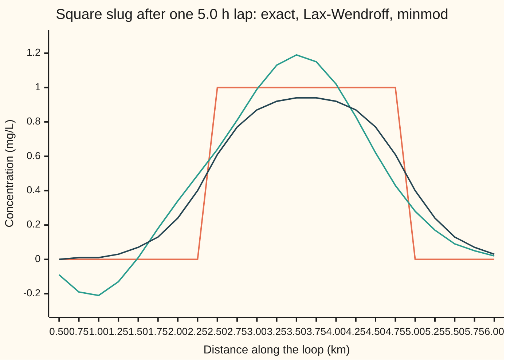
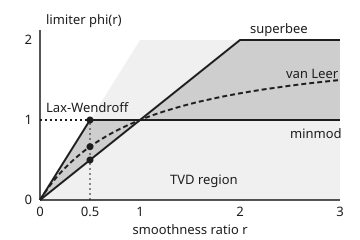

# Flux limiters: second order where the wave is smooth, no wiggles where it is steep

[Syllabus](../../../SYLLABUS.md) → [Numerical analysis](../README.md) → [PDE Solvers](../README.md#s07) → Flux limiters

---

## General Overview

Take the river from [Flow problems](06-upwind-schemes-and-conservation-laws.md): water at 2.0 km/h, cells 0.25 km long. This time the spill is a square slug of pollutant. It reads 1 mg/L (milligrams per litre) in the ten cells at 2.50 to 4.75 km, a 2.5 km stretch, and 0 everywhere else. The numbers are illustrative. For a clean test, the 10 km reach is joined end to end into a loop, so water leaving the bottom end comes back in at the top. After 5.0 h the water has gone exactly once round, and the true answer is the starting slug again.

The model steps 0.0625 h at a time, shorter than the 0.1 h of Flow problems, so the water crosses half a cell per step: a Courant number of 0.50, not that card's 0.80. Eighty steps make one lap. The model must bring the slug back without inventing pollution: no value above 1 mg/L, none below 0.

The two classic steps fail in opposite ways:

- **Upwind** smears the slug. Its top sinks to 0.7336 mg/L.
- **Lax-Wendroff** keeps the edges steeper but rings. It reaches 1.1864 mg/L and dips to −0.2095 mg/L. A negative concentration cannot happen.

A **flux limiter** blends the two cell by cell. Where the profile is smooth, it uses the Lax-Wendroff correction. Near a jump or a peak, it switches the correction off and falls back to upwind. The minmod limiter brings the slug back with a top of 0.9366 mg/L, nothing below 0, and half of upwind's error.

The test for "no wiggles" is one number, the **total variation**: the total climb plus total drop along the river. The slug climbs 1 and drops 1, so its total variation is 2. Every new wiggle adds to it. Lax-Wendroff ends the lap at 3.0791. Minmod never goes above 2.

**A flux limiter scales the second-order correction by a function of the local smoothness ratio, and when that function stays inside Sweby's region, every step is a set of non-negative weights that cannot raise the total variation, so the scheme is second order on smooth stretches and free of new wiggles at jumps.**

**What kind of fact this is:** a theorem, proved on this card in Why it works: Harten's lemma, and the region of limiters it allows. Second-order accuracy on smooth data and the loss of accuracy at smooth crests are shown by the checks' measured orders, with the source named. The time-stepping result for strong-stability-preserving Runge-Kutta is proved for the two-stage method used here.

### The picture: the slug after one lap



Orange: the exact slug, back in the cells at 2.50 to 4.75 km. Green: Lax-Wendroff, too high in the middle, too low at 1.00 km. Dark blue: minmod, rounded at the corners but always between 0 and 1.

---

## The formula

Notation from [Flow problems](06-upwind-schemes-and-conservation-laws.md): $`u_j^n`$ is the computed concentration in cell $`j`$ after $`n`$ steps, and the Courant number is $`\nu = c\,\Delta t/h`$. Here $`\nu = 2.0 \times 0.0625/0.25 = 0.50`$. The flow goes toward larger $`j`$.

Write $`\Delta_{j+1/2} = u_{j+1} - u_j`$ for the jump across the edge between cells $`j`$ and $`j+1`$. The **smoothness ratio** compares the jump behind a cell with the jump ahead of it:

```math
r_j = \frac{u_j - u_{j-1}}{u_{j+1} - u_j}, \qquad F_{j+1/2} = c\,u_j + \frac{c}{2}(1 - \nu)\,\varphi(r_j)\,\big(u_{j+1} - u_j\big), \qquad u_j^{n+1} = u_j^n - \frac{\Delta t}{h}\big(F_{j+1/2} - F_{j-1/2}\big).
```

**Read it aloud:** the flux through each edge is the upwind flux plus a fraction phi of the Lax-Wendroff correction, where phi depends on how the jump behind compares with the jump ahead; then each cell gains what flows in and loses what flows out.

On a smooth slope $`r_j`$ is near 1. At a peak or a dip it is negative. Next to a sudden jump it is near 0 or very large. The **limiter** $`\varphi`$ turns that reading into a weight. Three standard choices:

| Limiter | $`\varphi(r)`$ for $`r > 0`$ (all are 0 for $`r \le 0`$) | $`\varphi(0.5)`$ |
| --- | --- | --- |
| minmod | $`\min(r, 1)`$ | 0.5000 |
| van Leer | $`(r + \lvert r\rvert)/(1 + \lvert r\rvert)`$ | 0.6667 |
| superbee | $`\max(\min(2r, 1), \min(r, 2))`$ | 1.0000 |

Setting $`\varphi = 0`$ gives upwind. Setting $`\varphi = 1`$ gives Lax-Wendroff. The **total variation** of a grid and the condition this card proves are:

```math
\mathrm{TV}(u) = \sum_j \big|u_{j+1} - u_j\big|, \qquad \mathrm{TV}(u^{n+1}) \le \mathrm{TV}(u^n) \quad \text{whenever} \quad 0 \le \varphi(r) \le \min(2r, 2) \ \text{for } r > 0, \ \ \varphi(r) = 0 \ \text{for } r \le 0, \ \ 0 \le \nu \le 1.
```

**Read it aloud:** total variation adds up the size of every jump; it never grows from one step to the next if the limiter stays under both 2r and 2, is zero at peaks and dips, and the water crosses at most one cell per step.

A scheme with that property is **TVD**, total variation diminishing. The allowed band of limiters is **Sweby's region**.

| Symbol | Plain meaning | In our example | Push it up and the answer… |
| --- | --- | --- | --- |
| $`u_j^n`$ | computed concentration in cell $`j`$ after $`n`$ steps | 1 or 0 mg/L at the start | — |
| $`h`$, $`\Delta t`$; $`x`$ | cell length; time step; distance along the loop, with cell $`j`$ at $`x = jh`$ | 0.25 km; 0.0625 h; 0 to 10 km | larger $`h`$: more smear |
| $`c`$, $`\nu`$ | river speed; Courant number $`c\,\Delta t/h`$ | 2.0 km/h; 0.50 | $`\nu`$ past 1: blow-up |
| $`N`$ | number of cells round the loop | 40 | finer grid, smaller error |
| $`\Delta_{j+1/2}`$ | jump from cell $`j`$ to cell $`j+1`$ | −1 at the slug's front edge | — |
| $`\mathrm{TV}(u)`$ | total variation: sum of the sizes of all jumps | 2.0000 at the start | above 2: new wiggles |
| $`r_j`$ | smoothness ratio: jump behind over jump ahead | 1 on a straight slope | — |
| $`\varphi(r)`$ | limiter: how much Lax-Wendroff correction to keep | minmod 0.5 at $`r = 0.5`$ | steeper edges; above $`2r`$, wiggles |
| $`F_{j+1/2}`$ | flux: pollutant crossing the edge per hour | $`c\,u_j`$ plus the limited correction | — |
| $`C_{j-1/2}`$, $`D_{j+1/2}`$ | Harten's coefficients: weights on the jump behind and ahead | minmod: 0.3750 to 0.6250 | above 1 or below 0: TV can grow |
| $`\sigma_j`$ | limited slope inside cell $`j`$ (the MUSCL form) | minmod of the two jumps | — |
| $`E`$, $`u^{(1)}`$ | one forward Euler step of the MUSCL form; the first stage it gives | 0.5000 mg/L at 5.00 km after one stage | — |

### When it holds

- **Limiter inside Sweby's region.** If $`\varphi > 2r`$ anywhere, a weight can exceed 1. The limiter "$`\varphi = 1`$ whenever $`r > 0`$" breaks that for $`0 < r < 0.5`$, and the slug's total variation rises to 2.3301.
- **Courant number at most 1.** Minmod at $`\nu = 1.2`$ reaches a total variation of 131069.0991 in 33 steps, about one lap.
- **One known flow direction.** The ratio $`r_j`$ is built from the upstream side. For a river flowing toward smaller $`j`$, the ratio and the flux use the mirror-image cells.
- **One equation, one space dimension.** Harten's lemma is for a single equation in one dimension. Systems such as gas dynamics, and grids in two or three dimensions, apply the limiter wave by wave or direction by direction, and the lemma no longer covers them as stated.
- **A smooth crest gets clipped.** At a peak $`r \le 0`$, so $`\varphi = 0`$ and the scheme is first order there. The largest error then falls at order 1.30, not 2.

---

## Why it works

### Step 0: let the data choose the weights

[Flow problems](06-upwind-schemes-and-conservation-laws.md) stated Godunov's theorem. A *linear* scheme, one with fixed weights, cannot be both free of new wiggles and better than first order. A limiter escapes by making the weight depend on the solution. The scheme is then nonlinear, and the theorem does not apply.

The plan has two parts. Measure "no wiggles" by one number, the total variation. Then find the limiters that never let it grow.

### Step 1: total variation counts the wiggles

On the slug the grid climbs 1 at the back edge and drops 1 at the front. So $`\mathrm{TV} = 2`$.

One Lax-Wendroff step makes cells read 0, −0.1250, 0.6250, 1, …, 1, 1.1250, 0.3750, 0. The new dip and the new bump each add a climb and a drop. The total variation jumps from 2.0000 to 2.5000 in one step.

On a loop, the total variation is at least twice the gap between the lowest and highest values, because the profile must climb from one to the other and come back. So holding it at 2 keeps that gap at most 1: no wiggle can grow taller than the slug. The limited schemes give more. Step 3 writes each new value as a weighted average of two old neighbours, so nothing goes above 1 or below 0. More generally, Harten (1983) showed that a TVD scheme keeps a rising profile rising: it cannot create a new peak or dip there.

### Step 2: Harten's lemma

Suppose a step can be written in **incremental form**:

```math
u_j^{n+1} = u_j^n - C_{j-1/2}\,\Delta_{j-1/2} + D_{j+1/2}\,\Delta_{j+1/2}.
```

Here $`C_{j-1/2}`$ is the weight on the jump behind the cell and $`D_{j+1/2}`$ the weight on the jump ahead. They may depend on the data.

**Harten's lemma.** If every $`C \ge 0`$, every $`D \ge 0`$, and $`C_{j+1/2} + D_{j+1/2} \le 1`$ at every edge, then $`\mathrm{TV}(u^{n+1}) \le \mathrm{TV}(u^n)`$.

The proof in words: subtract the update at cell $`j`$ from the update at cell $`j+1`$. Each new jump becomes a blend of three old jumps with non-negative weights. Add up the sizes. Each old jump is shared out with total weight exactly $`(1 - C - D) + C + D = 1`$. So the new total is at most the old total.

<details>
<summary>Detailed proof: Harten's lemma on a periodic grid</summary>

Write $`\Delta_{j+1/2}^{n+1} = u_{j+1}^{n+1} - u_j^{n+1}`$ and subtract the two incremental forms:

$`\displaystyle \Delta_{j+1/2}^{n+1} = \big(1 - C_{j+1/2} - D_{j+1/2}\big)\Delta_{j+1/2} + C_{j-1/2}\,\Delta_{j-1/2} + D_{j+3/2}\,\Delta_{j+3/2}.`$

All three weights are non-negative by assumption. Take sizes and use the triangle inequality:

$`\displaystyle \big|\Delta_{j+1/2}^{n+1}\big| \le \big(1 - C_{j+1/2} - D_{j+1/2}\big)\big|\Delta_{j+1/2}\big| + C_{j-1/2}\big|\Delta_{j-1/2}\big| + D_{j+3/2}\big|\Delta_{j+3/2}\big|.`$

Sum over every edge of the loop. On a periodic grid, shifting the index by one in the second and third sums changes nothing, so they become $`\sum C_{j+1/2}|\Delta_{j+1/2}|`$ and $`\sum D_{j+1/2}|\Delta_{j+1/2}|`$. The three sums add to

$`\displaystyle \sum_j \big|\Delta_{j+1/2}^{n+1}\big| \le \sum_j \big(1 - C_{j+1/2} - D_{j+1/2} + C_{j+1/2} + D_{j+1/2}\big)\big|\Delta_{j+1/2}\big| = \sum_j \big|\Delta_{j+1/2}\big|.`$

That is $`\mathrm{TV}(u^{n+1}) \le \mathrm{TV}(u^n)`$. On a finite reach with fixed end values the same sum holds, with the end terms adding nothing. The lemma is from Harten (1983).

</details>

### Step 3: put the limited scheme in that form, and read off Sweby's region

Expand the flux-limited update. It is the upwind step, minus the change in the limited correction across the cell:

```math
u_j^{n+1} = u_j^n - \nu\,\Delta_{j-1/2} - \frac{\nu}{2}(1-\nu)\Big(\varphi(r_j)\,\Delta_{j+1/2} - \varphi(r_{j-1})\,\Delta_{j-1/2}\Big).
```

The jump ahead is the jump behind divided by $`r_j`$. So everything is a multiple of $`\Delta_{j-1/2}`$. That gives Harten's form with $`D = 0`$ and

```math
C_{j-1/2} = \nu\left[1 + \frac{1-\nu}{2}\left(\frac{\varphi(r_j)}{r_j} - \varphi(r_{j-1})\right)\right].
```

Now bound the bracket. If $`0 \le \varphi(r) \le 2`$ and $`0 \le \varphi(r)/r \le 2`$, the difference inside lies between −2 and 2. Then $`C`$ lies between $`\nu^2`$ and $`\nu(2-\nu)`$. For $`0 \le \nu \le 1`$ both ends sit in $`[0, 1]`$, so Harten's lemma applies.

The two conditions are $`\varphi(r) \le 2`$ and $`\varphi(r) \le 2r`$: Sweby's region. With $`\nu = 0.5`$ the bound is 0.2500 to 0.7500. Over the whole lap, the checks measure minmod's $`C`$ from 0.3750 to 0.6250, and van Leer's and superbee's from 0.2500 to 0.7500, right at the edges of the bound. Lax-Wendroff, written the same way, has $`C`$ from −159.8293 to 37.5563.

<p align="center"></p>

To scale: $`x = 40 + 100r`$ and $`y = 200 - 80\varphi`$. The light band is Sweby's TVD region, under $`2r`$ and under 2. The darker band, between minmod (lower solid line) and superbee (upper solid line), is the part Sweby recommends for second order. Van Leer (dashed) runs between them. At $`r = 0.5`$ the dots sit at 0.5, 0.6667 and 1. The short dotted line at height 1 is Lax-Wendroff for $`r < 0.5`$, where it leaves the region.

### Step 4: second order on smooth stretches, first order at crests

On a smooth slope, $`r_j`$ is close to 1. Every limiter in the darker band has $`\varphi(1) = 1`$. So it keeps nearly the full Lax-Wendroff correction, and the method is second order there.

At a smooth crest, the jump behind and the jump ahead have opposite signs, so $`r_j < 0`$ and $`\varphi = 0`$. The scheme drops to upwind for a cell or two. It shaves the top off every smooth peak. This is **clipping**.

The checks carry a smooth wave, $`0.5 + 0.5\sin(2\pi x/10)`$ mg/L, once round the loop at four grid sizes:

| Scheme | Order, average error | Order, largest error | Crest after a lap, 40 cells |
| --- | --- | --- | --- |
| upwind | 0.98 | 0.98 | 0.8906 |
| Lax-Wendroff | 2.00 | 2.00 | 0.9993 |
| minmod | 1.87 | 1.30 | 0.9666 |
| van Leer | 2.17 | 1.44 | 0.9810 |
| superbee | 1.94 | 1.31 | 0.9915 |

The average error (the L1 error: the sum of errors times the cell length) falls at about second order. The largest error, which sits at the crests, falls more slowly. This clipping at smooth extrema is discussed in chapter 6 of LeVeque's book.

### Step 5: the slope form, and time steps that keep the guarantee

A second way to build the same idea is **MUSCL** (van Leer, 1979): draw a sloped line inside each cell instead of a flat value. The slope is limited, for example $`\sigma_j = \mathrm{minmod}(\Delta_{j-1/2}, \Delta_{j+1/2})`$: the smaller jump if both have the same sign, otherwise 0. The flux through each edge uses the line's value at that edge.

That gives a rate of change for every cell, an ordinary differential equation in time. One forward Euler step of it is TVD when $`\nu \le 2/3`$: the same argument as Step 3 gives $`C`$ between $`\nu/2`$ and $`3\nu/2`$.

A higher-order time step must not lose that. A **strong-stability-preserving** (SSP) [Runge-Kutta](../06-ODE%20Solvers/01-runge-kutta-and-butcher-tableaux.md) method is one built as averages of forward Euler steps. The two-stage version used here is

```math
u^{(1)} = E(u^n), \qquad u^{n+1} = \tfrac12\,u^n + \tfrac12\,E\big(u^{(1)}\big),
```

where $`E`$ is one forward Euler step. Total variation of an average is at most the average of the total variations. So if $`E`$ does not raise it, neither does the whole step. That is the full proof for this method. Gottlieb, Shu and Tadmor (2001) give the general theory. Classical RK4 is not of this kind, and the guarantee does not carry over to it.

The checks run MUSCL with this step at $`\nu = 0.5`$ as a separate road. Its total variation stays at most 2.0000 on every step and ends at 1.7123.

### Step 6: beyond TVD, in outline

Clipping is the price of TVD. Later schemes relax the rule so that smooth crests keep full accuracy:

- **ENO and WENO** (essentially non-oscillatory and weighted ENO) build several candidate curves through nearby cells. They weight each by how smooth it is, so a curve crossing a jump gets almost no weight.
- These schemes allow the total variation to rise by a tiny amount that shrinks with the grid. They reach third order or higher on smooth crests.
- They still use SSP Runge-Kutta steps in time.
- [Spectral methods](10-spectral-methods-and-the-fft.md) sit at the opposite extreme: very high accuracy on smooth periodic data, and ringing at any jump. That ringing is why shock codes limit.

---

## Worked numbers, by hand

The first two steps at the slug's front edge, then the lap totals.

| Step | Arithmetic | Value |
| --- | --- | --- |
| Courant number | $`2.0 \times 0.0625 / 0.25`$ | 0.50 |
| Lax-Wendroff, step 1, cell at 4.75 km | $`1 - 0.25 \times (0 - 1) + 0.125 \times (0 - 2 + 1)`$ | 1.1250: a new maximum |
| Lax-Wendroff, step 1, cell at 5.00 km | $`0 - 0.25 \times (0 - 1) + 0.125 \times (0 - 0 + 1)`$ | 0.3750 |
| Lax-Wendroff, total variation after step 1 | $`0.125 + 0.75 + 0.375 + 0.125 + 0.75 + 0.375`$ | 2.5000 |
| minmod, step 1, cell at 4.75 km | $`r = (1-1)/(0-1) = 0`$, so $`\varphi = 0`$: upwind, $`1 - 0.5 \times (1 - 1)`$ | 1.0000 |
| minmod, step 1, cell at 5.00 km | jump ahead is 0, so no correction: $`0 - 0.5 \times (0 - 1)`$ | 0.5000 |
| minmod, step 2, cell at 5.00 km | $`r = (0.5-1)/(0-0.5) = 1`$, $`\varphi = 1`$: $`0.5 - 0.5 \times (0.5 - 1) - 0.125 \times (1 \times (0 - 0.5))`$ | 0.8125 |
| MUSCL + SSP, step 1, cell at 5.00 km | $`E`$ gives 0.5; again: slope −0.5, edge value 0.25, $`0.5 - 0.5 \times (0.25 - 1) = 0.875`$; average with the old 0 | 0.4375 |
| limiters at $`r = 0.5`$ | minmod $`\min(0.5, 1)`$; van Leer $`1/1.5`$; superbee $`\max(1, 0.5)`$ | 0.5000, 0.6667, 1.0000 |
| Harten's bound at $`\nu = 0.5`$ | $`0.5^2`$ to $`0.5 \times 1.5`$ | 0.2500 to 0.7500 |
| Lax-Wendroff after one lap | total variation; highest; lowest | 3.0791; 1.1864; −0.2095 |
| **minmod after one lap** | total variation; highest; lowest | **1.8732; 0.9366; 0.0000** |

The minmod model never shows pollution that was not spilled, and its L1 error, 0.8905 mg/L·km, is half of upwind's 1.7601.

All schemes keep the pollutant: the total stays at 2.5000 mg/L·km, because each is in conservation form.

### What breaks if you drop a piece

| Mistake | Comes out at | What went wrong |
| --- | --- | --- |
| no limiter: $`\varphi = 1`$, Lax-Wendroff | total variation up to 3.0919; highest 1.1864, lowest −0.2095 | the correction is kept across the jumps |
| limiter outside Sweby's region: $`\varphi = 1`$ whenever $`r > 0`$ | total variation up to 2.3301; highest 1.0445, lowest −0.0791 | $`\varphi > 2r`$ for $`0 < r < 0.5`$, so a weight $`C`$ leaves $`[0, 1]`$ |
| Courant number 1.2 with minmod | total variation up to 131069.0991; highest 6760.4774 | the upwind part alone has weight $`\nu = 1.2 > 1`$ |
| minmod judged by its largest error on a smooth wave | order 1.30, not 2 | the limiter switches off at every crest |

The checks print all four.

---

## Code, from first principles, and it actually runs

The scripts build the limited flux from scratch and carry the slug one lap with six schemes. They take four roads. The exact answer is known: after one lap the slug is back where it began. Total variation is measured every step, and Harten's coefficients are computed for every cell to confirm the lemma's conditions hold. A second scheme, MUSCL with the two-stage SSP Runge-Kutta step, reaches the same verdict another way. On a smooth wave, errors at four grid sizes give the observed orders. Both programs print the chart and figure coordinates.

### Python

```python
# Flux limiters: TVD schemes on a square slug of pollutant -- the check behind the card.
# Standard library only; math supplies sin, pi and log2.  Road 1: the exact answer (after
# one lap round the loop the slug is back where it began).  Road 2: total variation measured
# every step, against Harten's coefficients C computed from the limiter.  Road 3: a second
# scheme, MUSCL slopes with an SSP Runge-Kutta step.  Road 4: errors at four grid sizes.
from math import sin, pi, log2

C, H, NU, N = 2.0, 0.25, 0.5, 40           # river km/h; cell km; Courant number; cells on the loop
DT = NU * H / C                            # time step, h
LIM = {"upwind": lambda r: 0.0, "Lax-Wendroff": lambda r: 1.0,
       "minmod": lambda r: max(0.0, min(1.0, r)),
       "van Leer": lambda r: (r + abs(r)) / (1.0 + abs(r)),
       "superbee": lambda r: max(0.0, min(2.0 * r, 1.0), min(r, 2.0)),
       "phi = 1 for r > 0": lambda r: 1.0 if r > 0 else 0.0}
TVD = ("minmod", "van Leer", "superbee")

def jumps(u): return [u[(j + 1) % len(u)] - u[j] for j in range(len(u))]   # d[j] = u_(j+1) - u_j
def tv(u): return sum(abs(d) for d in jumps(u))

def step(u, phi, nu=NU, cs=None):          # flux form; cs collects Harten's C_(j-1/2)
    d = jumps(u)
    g = [phi(d[j - 1] / d[j]) * d[j] if d[j] != 0 else 0.0 for j in range(len(u))]
    new = [u[j] - nu * ((u[j] + (1 - nu) / 2 * g[j]) - (u[j - 1] + (1 - nu) / 2 * g[j - 1])) for j in range(len(u))]
    if cs is not None:                     # incremental form u_j - C_(j-1/2) d_(j-1/2), built separately
        for j in range(len(u)):
            if d[j - 1] != 0:
                c = nu * (1 + (1 - nu) / 2 * (g[j] - g[j - 1]) / d[j - 1])
                cs[0], cs[1] = min(cs[0], c), max(cs[1], c)
                cs[2] = max(cs[2], abs(u[j] - c * d[j - 1] - new[j]))
    return new

def mm(a, b): return 0.0 if a * b <= 0 else (a if abs(a) < abs(b) else b)
def muscl(u, nu=NU):                       # forward Euler on minmod-limited slopes, one step
    d = jumps(u)
    e = [u[j] + 0.5 * mm(d[j - 1], d[j]) for j in range(len(u))]           # value at the right edge
    return [u[j] - nu * (e[j] - e[j - 1]) for j in range(len(u))]
def ssprk2(u): return [0.5 * a + 0.5 * b for a, b in zip(u, muscl(muscl(u)))]

def lap(u0, f, n):                         # n steps; returns end state, largest TV, TV never rose?
    u, top, mono = u0[:], tv(u0), True
    for _ in range(n):
        v = f(u)
        mono = mono and tv(v) <= tv(u) + 1e-12
        u, top = v, max(top, tv(v))
    return u, top, mono

slug = [1.0 if 10 <= j < 20 else 0.0 for j in range(N)]
steps = round(N / NU)
print(f"river {C:.1f} km/h, cell h = {H:.2f} km, Courant number nu = {NU:.2f}, step {DT:.4f} h, {N} cells on a 10 km loop"
      f" (Flow problems' 0.1 h step gave nu = {C * 0.1 / H:.2f})")
print(f"one lap = {steps} steps = {steps * DT:.2f} h; slug 1 mg/L in the 10 cells at 2.50 to 4.75 km; total variation TV = {tv(slug):.4f}")
v = [LIM[s](0.5) for s in TVD]
print(f"phi(0.5): minmod {v[0]:.4f}, van Leer {v[1]:.4f}, superbee {v[2]:.4f}")
assert abs(v[0] - 1 / 2) < 1e-15 and abs(v[1] - 2 / 3) < 1e-15 and abs(v[2] - 1) < 1e-15
rs = [k / 100 for k in range(-200, 1001)]
def inside(phi): return all(0 <= phi(r) <= min(2 * r, 2) + 1e-15 or (r <= 0 and phi(r) == 0) for r in rs)
for s in ("Lax-Wendroff", "minmod", "van Leer", "superbee"):
    out = [r for r in rs if not (0 <= LIM[s](r) <= max(0.0, min(2 * r, 2)))]
    print(f"  {s:<12} inside Sweby's TVD region for r = -2..10: {'yes' if not out else 'no, outside for r <= %.2f' % out[-1]}")
    assert inside(LIM[s]) == (s in TVD)

print("first step by hand, cells at 2.25 | 2.50 | 4.75 | 5.00 km:")
for s in ("Lax-Wendroff", "minmod"):
    u1 = step(slug, LIM[s])
    print(f"  {s:<12} {u1[9]:.4f} | {u1[10]:.4f} | {u1[19]:.4f} | {u1[20]:.4f}; TV {tv(u1):.4f}")
lw1 = step(slug, LIM["Lax-Wendroff"])
assert abs(lw1[19] - (1 + NU / 2 - NU * NU / 2)) < 1e-15 and abs(tv(lw1) - 2.5) < 1e-12
m1 = step(slug, LIM["minmod"])
r20 = (m1[20] - m1[19]) / (m1[21] - m1[20])
m2 = step(m1, LIM["minmod"])[20]
print(f"second minmod step at 5.00 km: r = {r20:.4f}, phi = {LIM['minmod'](r20):.4f}, value {m2:.4f}")
assert abs(m2 - 0.8125) < 1e-15                          # by hand: 0.5 + 0.25 + 0.0625
s1 = ssprk2(slug)
print(f"MUSCL + SSP-RK2, step 1, cells at 5.00 | 5.25 km: {s1[20]:.4f} | {s1[21]:.4f}")
assert abs(s1[20] - 7 / 16) < 1e-15 and abs(s1[21] - 1 / 16) < 1e-15   # by hand: 0.875 / 2, 0.125 / 2

print("one lap | largest TV on the way | TV at end | highest | lowest | L1 error mg/L km | mass")
ends = {}
for s in ("upwind", "Lax-Wendroff", "minmod", "van Leer", "superbee", "MUSCL + SSP-RK2"):
    f = ssprk2 if s[0] == "M" else (lambda u, p=LIM[s]: step(u, p))
    u, top, mono = lap(slug, f, steps)
    ends[s] = u
    err = H * sum(abs(a - b) for a, b in zip(u, slug))
    print(f"  {s:<15} {top:.4f} | {tv(u):.4f} | {max(u):.4f} | {min(u):.4f} | {err:.4f} | {H * sum(u):.4f}")
    assert abs(H * sum(u) - 2.5) < 1e-12                       # conservation form keeps the pollutant
    if s != "Lax-Wendroff": assert mono and top <= 2 + 1e-12 and -1e-12 <= min(u) and max(u) <= 1 + 1e-12
assert tv(ends["Lax-Wendroff"]) > 3.0 and max(ends["Lax-Wendroff"]) > 1.15
assert H * sum(abs(a - b) for a, b in zip(ends["minmod"], slug)) < 0.6 * H * sum(abs(a - b) for a, b in zip(ends["upwind"], slug))

for s in ("minmod", "van Leer", "superbee", "Lax-Wendroff"):
    cs, u = [9.0, -9.0, 0.0], slug[:]
    for _ in range(steps): u = step(u, LIM[s], cs=cs)
    print(f"Harten's C over the lap, {s:<12}: {cs[0]:.4f} to {cs[1]:.4f}; incremental form matches to {cs[2]:.1e}")
    assert cs[2] < 1e-14
    assert (NU * NU - 1e-12 <= cs[0] and cs[1] <= NU * (2 - NU) + 1e-12) == (s in TVD)
print(f"bound for any limiter in the region: nu^2 = {NU * NU:.4f} to nu(2 - nu) = {NU * (2 - NU):.4f}")

print("what breaks:")
for s, nu in (("phi = 1 for r > 0", NU), ("minmod", 1.2)):
    u, top, mono = lap(slug, lambda w, p=LIM[s], q=nu: step(w, p, q), round(N / nu))
    print(f"  {s} at nu = {nu:.1f}: largest TV {top:.4f}, highest {max(u):.4f}, lowest {min(u):.4f}")
    assert top > 2.2 and not mono

print("smooth wave 0.5 + 0.5 sin(2 pi x / 10 km), one lap: L1 error | max error at N = 40, 80, 160, 320")
ords = {}
for s in ("upwind", "Lax-Wendroff", "minmod", "van Leer", "superbee"):
    e1, e8, top = [], [], []
    for n in (40, 80, 160, 320):
        h = 10.0 / n
        u0 = [0.5 + 0.5 * sin(2 * pi * j * h / 10) for j in range(n)]
        u = u0[:]
        for _ in range(2 * n): u = step(u, LIM[s])
        e1.append(h * sum(abs(a - b) for a, b in zip(u, u0)))
        e8.append(max(abs(a - b) for a, b in zip(u, u0)))
        top.append(max(u))
    p1, p8 = log2(e1[2] / e1[3]), log2(e8[2] / e8[3])
    ords[s] = (p1, p8)
    print(f"  {s:<12} " + "  ".join(f"{a:.6f}|{b:.6f}" for a, b in zip(e1, e8)) + f"; orders {p1:.2f} | {p8:.2f}; crest at N = 40: {top[0]:.4f}")
assert abs(ords["upwind"][0] - 1) < 0.1 and abs(ords["Lax-Wendroff"][0] - 2) < 0.05 and abs(ords["Lax-Wendroff"][1] - 2) < 0.05
assert ords["minmod"][0] > 1.8 and ords["minmod"][1] < 1.5 and ords["van Leer"][1] < 1.5

xs = range(2, 25)
print("chart, km " + ", ".join(f"{j * H:.2f}" for j in xs))
for s, u in (("exact", slug), ("Lax-Wendroff", ends["Lax-Wendroff"]), ("minmod", ends["minmod"])):
    print(f"  {s}: " + ", ".join(f"{u[j]:.2f}" for j in xs))
def px(r, p): return f"({40 + 100 * r:.0f}, {200 - 80 * p:.1f})"
print("figure, Sweby diagram, x = 40 + 100 r, y = 200 - 80 phi: r = 0.5 minmod " + px(0.5, v[0]) + ", van Leer " + px(0.5, v[1])
      + ", superbee " + px(0.5, v[2]) + "; r = 3 van Leer " + px(3, LIM["van Leer"](3)) + ", superbee " + px(3, LIM["superbee"](3)))
print("ALL CHECKS PASS")
```

**Ran 2026-11-24 on macOS, Python 3.14.10, standard library only. All checks passed. Output, pasted from the run:**

```
river 2.0 km/h, cell h = 0.25 km, Courant number nu = 0.50, step 0.0625 h, 40 cells on a 10 km loop (Flow problems' 0.1 h step gave nu = 0.80)
one lap = 80 steps = 5.00 h; slug 1 mg/L in the 10 cells at 2.50 to 4.75 km; total variation TV = 2.0000
phi(0.5): minmod 0.5000, van Leer 0.6667, superbee 1.0000
  Lax-Wendroff inside Sweby's TVD region for r = -2..10: no, outside for r <= 0.49
  minmod       inside Sweby's TVD region for r = -2..10: yes
  van Leer     inside Sweby's TVD region for r = -2..10: yes
  superbee     inside Sweby's TVD region for r = -2..10: yes
first step by hand, cells at 2.25 | 2.50 | 4.75 | 5.00 km:
  Lax-Wendroff -0.1250 | 0.6250 | 1.1250 | 0.3750; TV 2.5000
  minmod       0.0000 | 0.5000 | 1.0000 | 0.5000; TV 2.0000
second minmod step at 5.00 km: r = 1.0000, phi = 1.0000, value 0.8125
MUSCL + SSP-RK2, step 1, cells at 5.00 | 5.25 km: 0.4375 | 0.0625
one lap | largest TV on the way | TV at end | highest | lowest | L1 error mg/L km | mass
  upwind          2.0000 | 1.4657 | 0.7336 | 0.0008 | 1.7601 | 2.5000
  Lax-Wendroff    3.0919 | 3.0791 | 1.1864 | -0.2095 | 1.1927 | 2.5000
  minmod          2.0000 | 1.8732 | 0.9366 | 0.0000 | 0.8905 | 2.5000
  van Leer        2.0000 | 1.9699 | 0.9849 | 0.0000 | 0.6596 | 2.5000
  superbee        2.0000 | 1.9963 | 0.9981 | 0.0000 | 0.4227 | 2.5000
  MUSCL + SSP-RK2 2.0000 | 1.7123 | 0.8562 | 0.0001 | 1.1992 | 2.5000
Harten's C over the lap, minmod      : 0.3750 to 0.6250; incremental form matches to 1.1e-16
Harten's C over the lap, van Leer    : 0.2500 to 0.7500; incremental form matches to 1.1e-16
Harten's C over the lap, superbee    : 0.2500 to 0.7500; incremental form matches to 1.1e-16
Harten's C over the lap, Lax-Wendroff: -159.8293 to 37.5563; incremental form matches to 2.2e-16
bound for any limiter in the region: nu^2 = 0.2500 to nu(2 - nu) = 0.7500
what breaks:
  phi = 1 for r > 0 at nu = 0.5: largest TV 2.3301, highest 1.0445, lowest -0.0791
  minmod at nu = 1.2: largest TV 131069.0991, highest 6760.4774, lowest -6755.1820
smooth wave 0.5 + 0.5 sin(2 pi x / 10 km), one lap: L1 error | max error at N = 40, 80, 160, 320
  upwind       0.695203|0.109427  0.369341|0.058046  0.190404|0.029912  0.096675|0.015186; orders 0.98 | 0.98; crest at N = 40: 0.8906
  Lax-Wendroff 0.061627|0.009648  0.015418|0.002420  0.003855|0.000605  0.000964|0.000151; orders 2.00 | 2.00; crest at N = 40: 0.9993
  minmod       0.124167|0.033406  0.035029|0.013959  0.009435|0.005720  0.002587|0.002320; orders 1.87 | 1.30; crest at N = 40: 0.9666
  van Leer     0.049888|0.019008  0.011680|0.007125  0.002653|0.002640  0.000590|0.000970; orders 2.17 | 1.44; crest at N = 40: 0.9810
  superbee     0.080933|0.021002  0.025872|0.008660  0.007178|0.004123  0.001870|0.001662; orders 1.94 | 1.31; crest at N = 40: 0.9915
chart, km 0.50, 0.75, 1.00, 1.25, 1.50, 1.75, 2.00, 2.25, 2.50, 2.75, 3.00, 3.25, 3.50, 3.75, 4.00, 4.25, 4.50, 4.75, 5.00, 5.25, 5.50, 5.75, 6.00
  exact: 0.00, 0.00, 0.00, 0.00, 0.00, 0.00, 0.00, 0.00, 1.00, 1.00, 1.00, 1.00, 1.00, 1.00, 1.00, 1.00, 1.00, 1.00, 0.00, 0.00, 0.00, 0.00, 0.00
  Lax-Wendroff: -0.09, -0.19, -0.21, -0.13, 0.01, 0.18, 0.34, 0.49, 0.64, 0.81, 0.99, 1.13, 1.19, 1.15, 1.02, 0.83, 0.62, 0.43, 0.28, 0.17, 0.09, 0.05, 0.02
  minmod: 0.00, 0.01, 0.01, 0.03, 0.07, 0.13, 0.24, 0.40, 0.61, 0.77, 0.87, 0.92, 0.94, 0.94, 0.92, 0.87, 0.77, 0.61, 0.40, 0.24, 0.13, 0.07, 0.03
figure, Sweby diagram, x = 40 + 100 r, y = 200 - 80 phi: r = 0.5 minmod (90, 160.0), van Leer (90, 146.7), superbee (90, 120.0); r = 3 van Leer (340, 80.0), superbee (340, 40.0)
ALL CHECKS PASS
```

### Rust

```rust
// Flux limiters: TVD schemes on a square slug of pollutant -- the check behind the card.
// std only.  Road 1: the exact answer (after one lap round the loop the slug is back where it
// began).  Road 2: total variation measured every step, against Harten's coefficients C computed
// from the limiter.  Road 3: a second scheme, MUSCL slopes with an SSP Runge-Kutta step.
// Road 4: errors at four grid sizes.
use std::f64::consts::PI;

const C: f64 = 2.0; const H: f64 = 0.25; const NU: f64 = 0.5; const N: usize = 40;
const TVD: [&str; 3] = ["minmod", "van Leer", "superbee"];

fn lim(s: &str, r: f64) -> f64 {
    match s {
        "upwind" => 0.0,
        "Lax-Wendroff" => 1.0,
        "minmod" => 0.0f64.max(1.0f64.min(r)),
        "van Leer" => (r + r.abs()) / (1.0 + r.abs()),
        "superbee" => 0.0f64.max((2.0 * r).min(1.0)).max(r.min(2.0)),
        _ => if r > 0.0 { 1.0 } else { 0.0 }, // "phi = 1 for r > 0"
    }
}
fn jumps(u: &[f64]) -> Vec<f64> { (0..u.len()).map(|j| u[(j + 1) % u.len()] - u[j]).collect() }
fn tv(u: &[f64]) -> f64 { jumps(u).iter().map(|d| d.abs()).sum() }
fn prev(j: usize, n: usize) -> usize { (j + n - 1) % n }

fn step(u: &[f64], s: &str, nu: f64, cs: Option<&mut [f64; 3]>) -> Vec<f64> {
    let n = u.len();
    let d = jumps(u);
    let g: Vec<f64> = (0..n).map(|j| if d[j] != 0.0 { lim(s, d[prev(j, n)] / d[j]) * d[j] } else { 0.0 }).collect();
    let new: Vec<f64> = (0..n).map(|j| { let p = prev(j, n);
        u[j] - nu * ((u[j] + (1.0 - nu) / 2.0 * g[j]) - (u[p] + (1.0 - nu) / 2.0 * g[p])) }).collect();
    if let Some(cs) = cs { // incremental form u_j - C_(j-1/2) d_(j-1/2), built separately
        for j in 0..n { let p = prev(j, n);
            if d[p] != 0.0 {
                let c = nu * (1.0 + (1.0 - nu) / 2.0 * (g[j] - g[p]) / d[p]);
                cs[0] = cs[0].min(c); cs[1] = cs[1].max(c);
                cs[2] = cs[2].max((u[j] - c * d[p] - new[j]).abs());
            }
        }
    }
    new
}
fn mm(a: f64, b: f64) -> f64 { if a * b <= 0.0 { 0.0 } else if a.abs() < b.abs() { a } else { b } }
fn muscl(u: &[f64], nu: f64) -> Vec<f64> { // forward Euler on minmod-limited slopes, one step
    let n = u.len();
    let d = jumps(u);
    let e: Vec<f64> = (0..n).map(|j| u[j] + 0.5 * mm(d[prev(j, n)], d[j])).collect();
    (0..n).map(|j| u[j] - nu * (e[j] - e[prev(j, n)])).collect()
}
fn ssprk2(u: &[f64]) -> Vec<f64> { let w = muscl(&muscl(u, NU), NU); u.iter().zip(&w).map(|(a, b)| 0.5 * a + 0.5 * b).collect() }

fn lap(u0: &[f64], f: &dyn Fn(&[f64]) -> Vec<f64>, n: usize) -> (Vec<f64>, f64, bool) {
    let (mut u, mut top, mut mono) = (u0.to_vec(), tv(u0), true);
    for _ in 0..n { let v = f(&u); mono = mono && tv(&v) <= tv(&u) + 1e-12; top = top.max(tv(&v)); u = v; }
    (u, top, mono)
}
fn mx(u: &[f64]) -> f64 { u.iter().cloned().fold(f64::MIN, f64::max) }
fn mn(u: &[f64]) -> f64 { u.iter().cloned().fold(f64::MAX, f64::min) }
fn l1(u: &[f64], v: &[f64], h: f64) -> f64 { h * u.iter().zip(v).map(|(a, b)| (a - b).abs()).sum::<f64>() }
fn px(r: f64, p: f64) -> String { format!("({:.0}, {:.1})", 40.0 + 100.0 * r, 200.0 - 80.0 * p) }

fn main() {
    let dt = NU * H / C;
    let slug: Vec<f64> = (0..N).map(|j| if (10..20).contains(&j) { 1.0 } else { 0.0 }).collect();
    let steps = (N as f64 / NU).round() as usize;
    println!("river {:.1} km/h, cell h = {:.2} km, Courant number nu = {:.2}, step {:.4} h, {} cells on a 10 km loop (Flow problems' 0.1 h step gave nu = {:.2})",
             C, H, NU, dt, N, C * 0.1 / H);
    println!("one lap = {} steps = {:.2} h; slug 1 mg/L in the 10 cells at 2.50 to 4.75 km; total variation TV = {:.4}", steps, steps as f64 * dt, tv(&slug));
    let v: Vec<f64> = TVD.iter().map(|s| lim(s, 0.5)).collect();
    println!("phi(0.5): minmod {:.4}, van Leer {:.4}, superbee {:.4}", v[0], v[1], v[2]);
    assert!((v[0] - 0.5).abs() < 1e-15 && (v[1] - 2.0 / 3.0).abs() < 1e-15 && (v[2] - 1.0).abs() < 1e-15);
    let rs: Vec<f64> = (-200..1001).map(|k| k as f64 / 100.0).collect();
    for s in ["Lax-Wendroff", "minmod", "van Leer", "superbee"] {
        let out: Vec<f64> = rs.iter().cloned().filter(|&r| !(0.0 <= lim(s, r) && lim(s, r) <= 0.0f64.max((2.0 * r).min(2.0)))).collect();
        let inside = rs.iter().all(|&r| (0.0 <= lim(s, r) && lim(s, r) <= (2.0 * r).min(2.0) + 1e-15) || (r <= 0.0 && lim(s, r) == 0.0));
        let msg = if out.is_empty() { "yes".to_string() } else { format!("no, outside for r <= {:.2}", out[out.len() - 1]) };
        println!("  {:<12} inside Sweby's TVD region for r = -2..10: {}", s, msg);
        assert!(inside == TVD.contains(&s));
    }
    println!("first step by hand, cells at 2.25 | 2.50 | 4.75 | 5.00 km:");
    for s in ["Lax-Wendroff", "minmod"] {
        let u1 = step(&slug, s, NU, None);
        println!("  {:<12} {:.4} | {:.4} | {:.4} | {:.4}; TV {:.4}", s, u1[9], u1[10], u1[19], u1[20], tv(&u1));
    }
    let lw1 = step(&slug, "Lax-Wendroff", NU, None);
    assert!((lw1[19] - (1.0 + NU / 2.0 - NU * NU / 2.0)).abs() < 1e-15 && (tv(&lw1) - 2.5).abs() < 1e-12);
    let m1 = step(&slug, "minmod", NU, None);
    let r20 = (m1[20] - m1[19]) / (m1[21] - m1[20]);
    let m2 = step(&m1, "minmod", NU, None)[20];
    println!("second minmod step at 5.00 km: r = {:.4}, phi = {:.4}, value {:.4}", r20, lim("minmod", r20), m2);
    assert!((m2 - 0.8125).abs() < 1e-15); // by hand: 0.5 + 0.25 + 0.0625
    let s1 = ssprk2(&slug);
    println!("MUSCL + SSP-RK2, step 1, cells at 5.00 | 5.25 km: {:.4} | {:.4}", s1[20], s1[21]);
    assert!((s1[20] - 7.0 / 16.0).abs() < 1e-15 && (s1[21] - 1.0 / 16.0).abs() < 1e-15); // by hand: 0.875 / 2, 0.125 / 2

    println!("one lap | largest TV on the way | TV at end | highest | lowest | L1 error mg/L km | mass");
    let mut ends: Vec<(&str, Vec<f64>)> = vec![];
    for s in ["upwind", "Lax-Wendroff", "minmod", "van Leer", "superbee", "MUSCL + SSP-RK2"] {
        let f: Box<dyn Fn(&[f64]) -> Vec<f64>> = if s.starts_with('M') { Box::new(ssprk2) } else { Box::new(move |u: &[f64]| step(u, s, NU, None)) };
        let (u, top, mono) = lap(&slug, &*f, steps);
        let mass = H * u.iter().sum::<f64>();
        println!("  {:<15} {:.4} | {:.4} | {:.4} | {:.4} | {:.4} | {:.4}", s, top, tv(&u), mx(&u), mn(&u), l1(&u, &slug, H), mass);
        assert!((mass - 2.5).abs() < 1e-12);
        if s != "Lax-Wendroff" { assert!(mono && top <= 2.0 + 1e-12 && -1e-12 <= mn(&u) && mx(&u) <= 1.0 + 1e-12); }
        ends.push((s, u));
    }
    let end = |name: &str| ends.iter().find(|e| e.0 == name).unwrap().1.clone();
    assert!(tv(&end("Lax-Wendroff")) > 3.0 && mx(&end("Lax-Wendroff")) > 1.15);
    assert!(l1(&end("minmod"), &slug, H) < 0.6 * l1(&end("upwind"), &slug, H));

    for s in ["minmod", "van Leer", "superbee", "Lax-Wendroff"] {
        let mut cs = [9.0, -9.0, 0.0];
        let mut u = slug.clone();
        for _ in 0..steps { u = step(&u, s, NU, Some(&mut cs)); }
        println!("Harten's C over the lap, {:<12}: {:.4} to {:.4}; incremental form matches to {:.1e}", s, cs[0], cs[1], cs[2]);
        assert!(cs[2] < 1e-14);
        assert!((NU * NU - 1e-12 <= cs[0] && cs[1] <= NU * (2.0 - NU) + 1e-12) == TVD.contains(&s));
    }
    println!("bound for any limiter in the region: nu^2 = {:.4} to nu(2 - nu) = {:.4}", NU * NU, NU * (2.0 - NU));

    println!("what breaks:");
    for (s, nu) in [("phi = 1 for r > 0", NU), ("minmod", 1.2)] {
        let (u, top, mono) = lap(&slug, &|w: &[f64]| step(w, s, nu, None), (N as f64 / nu).round() as usize);
        println!("  {} at nu = {:.1}: largest TV {:.4}, highest {:.4}, lowest {:.4}", s, nu, top, mx(&u), mn(&u));
        assert!(top > 2.2 && !mono);
    }

    println!("smooth wave 0.5 + 0.5 sin(2 pi x / 10 km), one lap: L1 error | max error at N = 40, 80, 160, 320");
    let mut ords: Vec<(f64, f64)> = vec![];
    for s in ["upwind", "Lax-Wendroff", "minmod", "van Leer", "superbee"] {
        let (mut e1, mut e8, mut top) = (vec![], vec![], vec![]);
        for n in [40usize, 80, 160, 320] {
            let h = 10.0 / n as f64;
            let u0: Vec<f64> = (0..n).map(|j| 0.5 + 0.5 * (2.0 * PI * j as f64 * h / 10.0).sin()).collect();
            let mut u = u0.clone();
            for _ in 0..2 * n { u = step(&u, s, NU, None); }
            e1.push(l1(&u, &u0, h));
            e8.push(u.iter().zip(&u0).map(|(a, b)| (a - b).abs()).fold(0.0, f64::max));
            top.push(mx(&u));
        }
        let (p1, p8) = ((e1[2] / e1[3]).log2(), (e8[2] / e8[3]).log2());
        ords.push((p1, p8));
        let cells: Vec<String> = (0..4).map(|i| format!("{:.6}|{:.6}", e1[i], e8[i])).collect();
        println!("  {:<12} {}; orders {:.2} | {:.2}; crest at N = 40: {:.4}", s, cells.join("  "), p1, p8, top[0]);
    }
    assert!((ords[0].0 - 1.0).abs() < 0.1 && (ords[1].0 - 2.0).abs() < 0.05 && (ords[1].1 - 2.0).abs() < 0.05);
    assert!(ords[2].0 > 1.8 && ords[2].1 < 1.5 && ords[3].1 < 1.5);

    let xs: Vec<usize> = (2..25).collect();
    println!("chart, km {}", xs.iter().map(|&j| format!("{:.2}", j as f64 * H)).collect::<Vec<_>>().join(", "));
    for (s, u) in [("exact", slug.clone()), ("Lax-Wendroff", end("Lax-Wendroff")), ("minmod", end("minmod"))] {
        println!("  {}: {}", s, xs.iter().map(|&j| format!("{:.2}", u[j])).collect::<Vec<_>>().join(", "));
    }
    println!("figure, Sweby diagram, x = 40 + 100 r, y = 200 - 80 phi: r = 0.5 minmod {}, van Leer {}, superbee {}; r = 3 van Leer {}, superbee {}",
        px(0.5, v[0]), px(0.5, v[1]), px(0.5, v[2]), px(3.0, lim("van Leer", 3.0)), px(3.0, lim("superbee", 3.0)));
    println!("ALL CHECKS PASS");
}
```

**Ran 2026-11-24 on macOS, rustc 1.98.1, no crates. All checks passed. Output, pasted from the run:**

```
river 2.0 km/h, cell h = 0.25 km, Courant number nu = 0.50, step 0.0625 h, 40 cells on a 10 km loop (Flow problems' 0.1 h step gave nu = 0.80)
one lap = 80 steps = 5.00 h; slug 1 mg/L in the 10 cells at 2.50 to 4.75 km; total variation TV = 2.0000
phi(0.5): minmod 0.5000, van Leer 0.6667, superbee 1.0000
  Lax-Wendroff inside Sweby's TVD region for r = -2..10: no, outside for r <= 0.49
  minmod       inside Sweby's TVD region for r = -2..10: yes
  van Leer     inside Sweby's TVD region for r = -2..10: yes
  superbee     inside Sweby's TVD region for r = -2..10: yes
first step by hand, cells at 2.25 | 2.50 | 4.75 | 5.00 km:
  Lax-Wendroff -0.1250 | 0.6250 | 1.1250 | 0.3750; TV 2.5000
  minmod       0.0000 | 0.5000 | 1.0000 | 0.5000; TV 2.0000
second minmod step at 5.00 km: r = 1.0000, phi = 1.0000, value 0.8125
MUSCL + SSP-RK2, step 1, cells at 5.00 | 5.25 km: 0.4375 | 0.0625
one lap | largest TV on the way | TV at end | highest | lowest | L1 error mg/L km | mass
  upwind          2.0000 | 1.4657 | 0.7336 | 0.0008 | 1.7601 | 2.5000
  Lax-Wendroff    3.0919 | 3.0791 | 1.1864 | -0.2095 | 1.1927 | 2.5000
  minmod          2.0000 | 1.8732 | 0.9366 | 0.0000 | 0.8905 | 2.5000
  van Leer        2.0000 | 1.9699 | 0.9849 | 0.0000 | 0.6596 | 2.5000
  superbee        2.0000 | 1.9963 | 0.9981 | 0.0000 | 0.4227 | 2.5000
  MUSCL + SSP-RK2 2.0000 | 1.7123 | 0.8562 | 0.0001 | 1.1992 | 2.5000
Harten's C over the lap, minmod      : 0.3750 to 0.6250; incremental form matches to 1.1e-16
Harten's C over the lap, van Leer    : 0.2500 to 0.7500; incremental form matches to 1.1e-16
Harten's C over the lap, superbee    : 0.2500 to 0.7500; incremental form matches to 1.1e-16
Harten's C over the lap, Lax-Wendroff: -159.8293 to 37.5563; incremental form matches to 2.2e-16
bound for any limiter in the region: nu^2 = 0.2500 to nu(2 - nu) = 0.7500
what breaks:
  phi = 1 for r > 0 at nu = 0.5: largest TV 2.3301, highest 1.0445, lowest -0.0791
  minmod at nu = 1.2: largest TV 131069.0991, highest 6760.4774, lowest -6755.1820
smooth wave 0.5 + 0.5 sin(2 pi x / 10 km), one lap: L1 error | max error at N = 40, 80, 160, 320
  upwind       0.695203|0.109427  0.369341|0.058046  0.190404|0.029912  0.096675|0.015186; orders 0.98 | 0.98; crest at N = 40: 0.8906
  Lax-Wendroff 0.061627|0.009648  0.015418|0.002420  0.003855|0.000605  0.000964|0.000151; orders 2.00 | 2.00; crest at N = 40: 0.9993
  minmod       0.124167|0.033406  0.035029|0.013959  0.009435|0.005720  0.002587|0.002320; orders 1.87 | 1.30; crest at N = 40: 0.9666
  van Leer     0.049888|0.019008  0.011680|0.007125  0.002653|0.002640  0.000590|0.000970; orders 2.17 | 1.44; crest at N = 40: 0.9810
  superbee     0.080933|0.021002  0.025872|0.008660  0.007178|0.004123  0.001870|0.001662; orders 1.94 | 1.31; crest at N = 40: 0.9915
chart, km 0.50, 0.75, 1.00, 1.25, 1.50, 1.75, 2.00, 2.25, 2.50, 2.75, 3.00, 3.25, 3.50, 3.75, 4.00, 4.25, 4.50, 4.75, 5.00, 5.25, 5.50, 5.75, 6.00
  exact: 0.00, 0.00, 0.00, 0.00, 0.00, 0.00, 0.00, 0.00, 1.00, 1.00, 1.00, 1.00, 1.00, 1.00, 1.00, 1.00, 1.00, 1.00, 0.00, 0.00, 0.00, 0.00, 0.00
  Lax-Wendroff: -0.09, -0.19, -0.21, -0.13, 0.01, 0.18, 0.34, 0.49, 0.64, 0.81, 0.99, 1.13, 1.19, 1.15, 1.02, 0.83, 0.62, 0.43, 0.28, 0.17, 0.09, 0.05, 0.02
  minmod: 0.00, 0.01, 0.01, 0.03, 0.07, 0.13, 0.24, 0.40, 0.61, 0.77, 0.87, 0.92, 0.94, 0.94, 0.92, 0.87, 0.77, 0.61, 0.40, 0.24, 0.13, 0.07, 0.03
figure, Sweby diagram, x = 40 + 100 r, y = 200 - 80 phi: r = 0.5 minmod (90, 160.0), van Leer (90, 146.7), superbee (90, 120.0); r = 3 van Leer (340, 80.0), superbee (340, 40.0)
ALL CHECKS PASS
```

### Lean

Lean proves the card's three guarantees on a loop of any number of cells, for every river speed, cell length and limiter.

- Harten's lemma. Suppose every $`C \ge 0`$, every $`D \ge 0`$, and $`C + D \le 1`$ at every edge. Then the total variation does not grow.
- Sweby's region. Take a limiter inside Sweby's region and a Courant number at most 1. Then one flux-limited step never raises the total variation.
- The SSP Runge-Kutta step. Take a forward Euler step $`E`$ that never raises the total variation. Then the two-stage SSP step never raises it either.
- The limiters by hand. Take $`r = 0.5`$. Then minmod gives 0.5, van Leer gives 2/3 and superbee gives 1, as exact fractions.
- The slug by hand. Its total variation is 2. One Lax-Wendroff step lifts it to 2.5, with cells reading −0.125 and 1.125.
- One minmod step keeps the total variation at 2. A second minmod step gives 0.8125 at 5.00 km.

The full laps, Harten's measured coefficients, the MUSCL road, the smooth-wave orders and the failure cases are left to the Python and Rust checks.

```lean
-- Flux limiters: on a loop of cells, a flux-limited upwind step whose limiter stays in Sweby's region and whose Courant number is at most 1 never raises the total variation, by Harten's lemma, and the two-stage SSP Runge-Kutta step keeps that guarantee.
import Mathlib.Algebra.Order.Field.Basic
import Mathlib.Algebra.BigOperators.Group.Finset.Basic
import Mathlib.Data.ZMod.Defs
import Mathlib.Basic.Real.Basic
import Mathlib.Data.Rat.Defs
import Mathlib.Tactic.NormNum
import Mathlib.Algebra.Order.BigOperators.Group.Finset
import Mathlib.Algebra.BigOperators.Ring.Finset
import Mathlib.Tactic.Linarith
import Mathlib.Tactic.FieldSimp
import Mathlib.Tactic.Positivity
import Mathlib.Tactic.Ring
import Mathlib.Tactic.LinearCombination

open Finset

/-- The total variation of a grid u on a loop of N cells: the sum of the sizes of all the jumps
u_(j+1) − u_j, with the last cell joined back to the first. -/
def totalVariation {α : Type*} [Field α] [LinearOrder α] {N : ℕ} [NeZero N]
    (u : ZMod N → α) : α :=
  ∑ j : ZMod N, |u (j + 1) - u j|

/-- The smoothness ratio r_j = (u_j − u_(j−1)) / (u_(j+1) − u_j): the jump behind cell j over the
jump ahead of it. -/
def smoothnessRatio {α : Type*} [Field α] {N : ℕ} (u : ZMod N → α) (j : ZMod N) : α :=
  (u j - u (j - 1)) / (u (j + 1) - u j)

/-- One flux-limited step on a loop of N cells, river speed c, time step Δt, cell length h and
Courant number ν = cΔt/h. The flux through the edge after cell j is
F_(j+1/2) = c u_j + (c/2)(1 − ν) φ(r_j)(u_(j+1) − u_j), and the new value is
u_j − (Δt/h)(F_(j+1/2) − F_(j−1/2)). -/
def fluxLimitedStep {α : Type*} [Field α] {N : ℕ} (φ : α → α) (c Δt h : α)
    (u : ZMod N → α) : ZMod N → α :=
  let ν := c * Δt / h
  let F : ZMod N → α := fun j => c * u j + c / 2 * (1 - ν) * φ (smoothnessRatio u j) * (u (j + 1) - u j)
  fun j => u j - Δt / h * (F j - F (j - 1))

/-- Helper: Harten's incremental-form bound, stated before the main theorem so it can use it. -/
theorem harten_incremental_tvd {N : ℕ} [NeZero N] (C D : ZMod N → ℝ)
    (hC : ∀ j, 0 ≤ C j) (hD : ∀ j, 0 ≤ D j) (hCD : ∀ j, C j + D j ≤ 1) (u : ZMod N → ℝ) :
    totalVariation (fun j => u j - C (j - 1) * (u j - u (j - 1)) + D j * (u (j + 1) - u j))
      ≤ totalVariation u := by
  unfold totalVariation
  calc ∑ j : ZMod N, |(u (j + 1) - C (j + 1 - 1) * (u (j + 1) - u (j + 1 - 1))
          + D (j + 1) * (u (j + 1 + 1) - u (j + 1)))
          - (u j - C (j - 1) * (u j - u (j - 1)) + D j * (u (j + 1) - u j))|
        ≤ ∑ j : ZMod N, ((1 - C j - D j) * |u (j + 1) - u j|
          + C (j - 1) * |u (j - 1 + 1) - u (j - 1)|
          + D (j + 1) * |u (j + 1 + 1) - u (j + 1)|) := by
        apply sum_le_sum
        intro j _
        simp only [add_sub_cancel_right, sub_add_cancel]
        have e : (u (j + 1) - C j * (u (j + 1) - u j) + D (j + 1) * (u (j + 1 + 1) - u (j + 1)))
            - (u j - C (j - 1) * (u j - u (j - 1)) + D j * (u (j + 1) - u j))
            = (1 - C j - D j) * (u (j + 1) - u j) + C (j - 1) * (u j - u (j - 1))
              + D (j + 1) * (u (j + 1 + 1) - u (j + 1)) := by ring
        rw [e]
        have h1 : 0 ≤ 1 - C j - D j := by linarith [hCD j]
        calc _ ≤ |(1 - C j - D j) * (u (j + 1) - u j)| + |C (j - 1) * (u j - u (j - 1))|
              + |D (j + 1) * (u (j + 1 + 1) - u (j + 1))| := abs_add_three _ _ _
          _ = _ := by
            rw [abs_mul, abs_mul, abs_mul, abs_of_nonneg h1, abs_of_nonneg (hC _),
              abs_of_nonneg (hD _)]
    _ = ∑ j : ZMod N, (1 - C j - D j) * |u (j + 1) - u j|
          + ∑ j : ZMod N, C (j - 1) * |u (j - 1 + 1) - u (j - 1)|
          + ∑ j : ZMod N, D (j + 1) * |u (j + 1 + 1) - u (j + 1)| := by
        rw [sum_add_distrib, sum_add_distrib]
    _ = ∑ j : ZMod N, (1 - C j - D j) * |u (j + 1) - u j|
          + ∑ j : ZMod N, C j * |u (j + 1) - u j|
          + ∑ j : ZMod N, D j * |u (j + 1) - u j| := by
        have h1 : ∑ j : ZMod N, C (j - 1) * |u (j - 1 + 1) - u (j - 1)|
            = ∑ j : ZMod N, C j * |u (j + 1) - u j| :=
          Fintype.sum_equiv (Equiv.subRight 1) _ (fun j => C j * |u (j + 1) - u j|) (fun j => rfl)
        have h2 : ∑ j : ZMod N, D (j + 1) * |u (j + 1 + 1) - u (j + 1)|
            = ∑ j : ZMod N, D j * |u (j + 1) - u j| :=
          Fintype.sum_equiv (Equiv.addRight 1) _ (fun j => D j * |u (j + 1) - u j|) (fun j => rfl)
        rw [h1, h2]
    _ = ∑ j : ZMod N, |u (j + 1) - u j| := by
        rw [← sum_add_distrib, ← sum_add_distrib]
        apply sum_congr rfl
        intro j _
        ring

#print axioms harten_incremental_tvd

/-- Helper: the total variation of an even average is at most the average of the total variations. -/
theorem tv_half_add {N : ℕ} [NeZero N] (u v : ZMod N → ℝ) :
    totalVariation (fun j => 1 / 2 * u j + 1 / 2 * v j)
      ≤ 1 / 2 * totalVariation u + 1 / 2 * totalVariation v := by
  unfold totalVariation
  rw [mul_sum, mul_sum, ← sum_add_distrib]
  apply sum_le_sum
  intro j _
  show |1 / 2 * u (j + 1) + 1 / 2 * v (j + 1) - (1 / 2 * u j + 1 / 2 * v j)| ≤ _
  have e : 1 / 2 * u (j + 1) + 1 / 2 * v (j + 1) - (1 / 2 * u j + 1 / 2 * v j)
      = 1 / 2 * (u (j + 1) - u j) + 1 / 2 * (v (j + 1) - v j) := by ring
  rw [e]
  calc _ ≤ |1 / 2 * (u (j + 1) - u j)| + |1 / 2 * (v (j + 1) - v j)| := abs_add_le _ _
    _ = _ := by rw [abs_mul, abs_mul, abs_of_pos (by norm_num : (0:ℝ) < 1 / 2)]

#print axioms tv_half_add

/-- Flux limiters inside Sweby's region give TVD schemes. On a loop of N cells, take a river
flowing toward larger cell numbers at speed c ≥ 0, cells of length h > 0, a time step Δt > 0,
and Courant number ν = cΔt/h at most 1. Let the limiter φ be 0 for r ≤ 0, and for r > 0 lie
between 0 and both 2r and 2 (Sweby's region). Then one flux-limited step never raises the total
variation: TV(u^(n+1)) ≤ TV(u^n). -/
theorem flux_limited_step_in_swebys_region_is_tvd {N : ℕ} [NeZero N] (φ : ℝ → ℝ)
    (c Δt h : ℝ) (hc : 0 ≤ c) (hh : 0 < h) (hΔt : 0 < Δt) (hν : c * Δt / h ≤ 1)
    (hφ_nonpos : ∀ r : ℝ, r ≤ 0 → φ r = 0)
    (hφ_pos : ∀ r : ℝ, 0 < r → 0 ≤ φ r ∧ φ r ≤ 2 * r ∧ φ r ≤ 2)
    (u : ZMod N → ℝ) :
    totalVariation (fluxLimitedStep φ c Δt h u) ≤ totalVariation u := by
  set ν := c * Δt / h with hνdef
  have hν0 : 0 ≤ ν := by positivity
  set r : ZMod N → ℝ := fun j => smoothnessRatio u j with hr
  set ψ : ZMod N → ℝ := fun j => φ (r j) / r j with hψ
  have hφ0 : φ 0 = 0 := hφ_nonpos 0 le_rfl
  have hψb : ∀ j, 0 ≤ ψ j ∧ ψ j ≤ 2 := by
    intro j
    simp only [hψ]
    rcases le_or_gt (r j) 0 with hr0 | hr0
    · rw [hφ_nonpos _ hr0]; simp
    · obtain ⟨a, b, _⟩ := hφ_pos _ hr0
      exact ⟨div_nonneg a hr0.le, (div_le_iff₀ hr0).2 (by linarith)⟩
  have hφb : ∀ j, 0 ≤ φ (r j) ∧ φ (r j) ≤ 2 := by
    intro j
    rcases le_or_gt (r j) 0 with hr0 | hr0
    · rw [hφ_nonpos _ hr0]; norm_num
    · obtain ⟨a, _, b⟩ := hφ_pos _ hr0
      exact ⟨a, b⟩
  have hψe : ∀ j, ψ j * (u j - u (j - 1)) = φ (r j) * (u (j + 1) - u j) := by
    intro j
    simp only [hψ, hr, smoothnessRatio]
    by_cases ha : u (j + 1) - u j = 0
    · rw [ha]; simp [hφ0]
    by_cases hb : u j - u (j - 1) = 0
    · rw [hb]; simp [hφ0]
    field_simp
  let C : ZMod N → ℝ := fun j => ν + ν / 2 * (1 - ν) * (ψ (j + 1) - φ (r j))
  have hstep : fluxLimitedStep φ c Δt h u
      = fun j => u j - C (j - 1) * (u j - u (j - 1)) + (fun _ => (0:ℝ)) j * (u (j + 1) - u j) := by
    funext j
    simp only [fluxLimitedStep, C, sub_add_cancel]
    have e1 := hψe j
    simp only [hr] at e1
    simp only [hνdef, hr]
    linear_combination (c * Δt / h / 2 * (1 - c * Δt / h)) * e1
  rw [hstep]
  apply harten_incremental_tvd
  · intro j
    obtain ⟨a1, a2⟩ := hψb (j + 1)
    obtain ⟨b1, b2⟩ := hφb j
    have hk : 0 ≤ ν * (1 - ν) := mul_nonneg hν0 (by linarith)
    simp only [C]
    nlinarith
  · intro j; exact le_rfl
  · intro j
    obtain ⟨a1, a2⟩ := hψb (j + 1)
    obtain ⟨b1, b2⟩ := hφb j
    have hk : 0 ≤ ν * (1 - ν) := mul_nonneg hν0 (by linarith)
    simp only [C]
    nlinarith

/-- Harten's lemma. On a loop of N cells, write a step in incremental form
u_j^(n+1) = u_j − C_(j−1/2)(u_j − u_(j−1)) + D_(j+1/2)(u_(j+1) − u_j), with C j standing for
C_(j+1/2) and D j for D_(j+1/2); the weights may depend on the data. If every C ≥ 0, every D ≥ 0,
and C + D ≤ 1 at every edge, then the total variation does not grow. -/
theorem hartens_lemma {N : ℕ} [NeZero N] (C D : ZMod N → ℝ)
    (hC : ∀ j, 0 ≤ C j) (hD : ∀ j, 0 ≤ D j) (hCD : ∀ j, C j + D j ≤ 1) (u : ZMod N → ℝ) :
    totalVariation (fun j => u j - C (j - 1) * (u j - u (j - 1)) + D j * (u (j + 1) - u j))
      ≤ totalVariation u := by
  exact harten_incremental_tvd C D hC hD hCD u

/-- The two-stage strong-stability-preserving Runge-Kutta step keeps the guarantee. If one
forward Euler step E never raises the total variation, then neither does the step
u^(1) = E(u^n), u^(n+1) = ½ u^n + ½ E(u^(1)). -/
theorem ssp_rk2_step_keeps_tvd {N : ℕ} [NeZero N] (E : (ZMod N → ℝ) → (ZMod N → ℝ))
    (hE : ∀ v, totalVariation (E v) ≤ totalVariation v) (u : ZMod N → ℝ) :
    totalVariation (fun j => 1 / 2 * u j + 1 / 2 * E (E u) j) ≤ totalVariation u := by
  calc totalVariation (fun j => 1 / 2 * u j + 1 / 2 * E (E u) j)
      ≤ 1 / 2 * totalVariation u + 1 / 2 * totalVariation (E (E u)) := tv_half_add u (E (E u))
    _ ≤ 1 / 2 * totalVariation u + 1 / 2 * totalVariation u := by
        have := (hE (E u)).trans (hE u)
        linarith
    _ = totalVariation u := by ring

/-! The card's worked numbers, in exact rationals. -/

/-- The square slug: 1 in the ten cells 10 to 19 (2.50 to 4.75 km) of the 40-cell loop, 0 elsewhere. -/
def slug : ZMod 40 → ℚ := fun j => if 10 ≤ j.val ∧ j.val < 20 then 1 else 0

def minmod (r : ℚ) : ℚ := max 0 (min r 1)
def vanLeer (r : ℚ) : ℚ := (r + |r|) / (1 + |r|)
def superbee (r : ℚ) : ℚ := max 0 (max (min (2 * r) 1) (min r 2))
def laxWendroff (_ : ℚ) : ℚ := 1

-- Limiter values at r = 0.5: minmod 0.5, van Leer 0.6667, superbee 1.
example : minmod (1 / 2) = 1 / 2 := by decide +kernel
example : vanLeer (1 / 2) = 2 / 3 := by decide +kernel
example : superbee (1 / 2) = 1 := by decide +kernel

-- Courant number 2.0 × 0.0625 / 0.25 = 0.5, and Harten's bound ν² to ν(2 − ν) is 0.25 to 0.75.
example : (2 : ℚ) * (1 / 16) / (1 / 4) = 1 / 2 := by norm_num
example : ((1 : ℚ) / 2) ^ 2 = 1 / 4 ∧ (1 : ℚ) / 2 * (2 - 1 / 2) = 3 / 4 := by norm_num

-- The slug's total variation is 2.
example : totalVariation slug = 2 := by decide +kernel

-- One Lax-Wendroff step: cells at 2.25, 2.50, 4.75, 5.00 km read −0.125, 0.625, 1.125, 0.375,
-- and the total variation rises to 2.5.
example : fluxLimitedStep laxWendroff 2 (1 / 16) (1 / 4) slug 9 = -1 / 8 := by decide +kernel
example : fluxLimitedStep laxWendroff 2 (1 / 16) (1 / 4) slug 10 = 5 / 8 := by decide +kernel
example : fluxLimitedStep laxWendroff 2 (1 / 16) (1 / 4) slug 19 = 9 / 8 := by decide +kernel
example : fluxLimitedStep laxWendroff 2 (1 / 16) (1 / 4) slug 20 = 3 / 8 := by decide +kernel
example : totalVariation (fluxLimitedStep laxWendroff 2 (1 / 16) (1 / 4) slug) = 5 / 2 := by decide +kernel

-- One minmod step: the same cells read 0, 0.5, 1, 0.5, and the total variation stays 2.
example : fluxLimitedStep minmod 2 (1 / 16) (1 / 4) slug 9 = 0 := by decide +kernel
example : fluxLimitedStep minmod 2 (1 / 16) (1 / 4) slug 10 = 1 / 2 := by decide +kernel
example : fluxLimitedStep minmod 2 (1 / 16) (1 / 4) slug 19 = 1 := by decide +kernel
example : fluxLimitedStep minmod 2 (1 / 16) (1 / 4) slug 20 = 1 / 2 := by decide +kernel
example : totalVariation (fluxLimitedStep minmod 2 (1 / 16) (1 / 4) slug) = 2 := by decide +kernel

-- A second minmod step at 5.00 km gives 0.8125.
example : fluxLimitedStep minmod 2 (1 / 16) (1 / 4)
    (fluxLimitedStep minmod 2 (1 / 16) (1 / 4) slug) 20 = 13 / 16 := by decide +kernel

#print axioms flux_limited_step_in_swebys_region_is_tvd
#print axioms hartens_lemma
#print axioms ssp_rk2_step_keeps_tvd
```

**Checked 2026-11-24 on macOS, Lean 4.36.0-rc2, Mathlib v4.36.0-rc2. Every proof is complete and uses only Lean's standard axioms. Output, pasted from the run:**

```
'harten_incremental_tvd' depends on axioms: [propext, Classical.choice, Quot.sound]
'tv_half_add' depends on axioms: [propext, Classical.choice, Quot.sound]
'flux_limited_step_in_swebys_region_is_tvd' depends on axioms: [propext, Classical.choice, Quot.sound]
'hartens_lemma' depends on axioms: [propext, Classical.choice, Quot.sound]
'ssp_rk2_step_keeps_tvd' depends on axioms: [propext, Classical.choice, Quot.sound]
```

> [!TIP]
> **Try changing**
> - Guess first: what does every scheme return at a Courant number of exactly 1? Set `NU = 1.0` and delete the `assert` lines, which pin the card's own numbers. The factor $`1 - \nu`$ wipes out every limited correction, and upwind copies each cell into the next, so in the lap table all five flux-form schemes return the slug exactly. The MUSCL road does not: its correction has no $`1 - \nu`$ factor. The run then stops at the smooth wave with a division by zero, because every error there is now exactly 0.
> - Guess first: can the broken limiter be repaired by one change? Replace `1.0 if r > 0 else 0.0` with `max(0.0, min(2 * r, 1.0))`, which caps it at $`2r`$, and delete the `assert` in the "what breaks" loop, which expects a failure. It is now inside Sweby's region, and its largest total variation falls back to 2.0000 with nothing below 0.
> - Guess first: does a larger Courant number spare the smooth crests? In the smooth-wave loop, replace `range(2 * n)` with `range(round(n / 0.8))` and `step(u, LIM[s])` with `step(u, LIM[s], 0.8)`. Every error shrinks: van Leer's average error at 40 cells falls from 0.049888 to 0.025402, superbee's from 0.080933 to 0.039700. But the largest error still falls at about order 1.3 for minmod (1.29) and superbee (1.26): clipping does not depend on the step.

---

## The usual mistake

> [!warning]
> **Reading "TVD" as "second order everywhere".** A limiter switches itself off at every peak and dip, smooth or not. On the smooth wave, minmod's average error falls at order 1.87, but its largest error falls at only 1.30, and the crest arrives at 0.9666 instead of 1. A model that must predict peak concentrations needs to check its crests, not only its averages.
>
> - **A homemade limiter that breaks Sweby's bound.** Keeping the full correction whenever $`r > 0`$ looks harmless. It lets the total variation climb to 2.3301 and the slug dip to −0.0791 mg/L.
> - **Superbee for everything.** It keeps jumps sharpest, but on smooth data its average error at 40 cells is 0.080933 against van Leer's 0.049888.
> - **A time step that is not SSP.** A TVD space step with a classical RK4 time step loses the proof: RK4 is not an average of Euler steps. Use an SSP method, and keep the step within its limit.
> - **Forgetting which way the water flows.** The ratio $`r_j`$ must use the upstream jump on top. In a tidal river the upstream side changes, and so must the ratio.

---

## Where you meet it in real life

- **Aircraft and engine design.** Codes for air flow with shock waves use MUSCL slopes with minmod or van Leer limiters, so a shock is sharp and has no ringing beside it.
- **Weather and air-quality models.** Humidity and pollutant concentrations must stay non-negative. Limited transport steps keep them so without clipping values by hand, which would add mass.
- **Oil and groundwater reservoirs.** A water front pushing oil is a near-jump in saturation. Limiters keep it sharp without producing saturations above 1 or below 0.
- **Astrophysics.** Simulations of gas in exploding stars and accretion discs use the same limited reconstructions, applied wave by wave.

> **Say it back**
> Upwind never wiggles but smears, and Lax-Wendroff is sharp but rings, so a flux limiter blends them cell by cell. The blend weight depends on the smoothness ratio, the jump behind over the jump ahead. Total variation, the sum of all jumps, measures wiggles, and Harten's lemma says it cannot grow if each step uses non-negative weights that add to at most 1. That holds when the limiter stays under both 2r and 2, which is Sweby's region. The slug comes back with total variation 1.8732 instead of 3.0791, at the cost of clipped crests on smooth waves.

---

## What this builds on

- [Godunov's method](11-godunov-method-and-riemann-solvers.md): the finite-volume update from edge fluxes, built from small Riemann problems. A flux limiter adds a limited second-order correction to such a first-order flux.
- [Flow problems](06-upwind-schemes-and-conservation-laws.md): the river, the Courant number, the upwind and Lax-Wendroff steps, conservation form, and Godunov's theorem that no linear scheme gives both sharpness and calm. This card answers the question that card left open.
- [Runge-Kutta](../06-ODE%20Solvers/01-runge-kutta-and-butcher-tableaux.md): stages and tableaux. The SSP methods here are Runge-Kutta methods whose stages are averages of forward Euler steps.

## Where this goes next

- [Discontinuous Galerkin](14-discontinuous-galerkin-methods.md): a polynomial inside each cell, joined by upwind fluxes at the edges. Near shocks it uses limiters of this card's kind, with SSP Runge-Kutta steps in time.
- [Entropy conditions](../../19-Partial%20differential%20equations/02-First-Order%20Equations%20and%20Characteristics/03-entropy-conditions-and-vanishing-viscosity.md): which of the many weak solutions is the physical one, and so which limit a limited scheme must converge to.

Left open: how to keep full accuracy at smooth crests without giving up control at jumps. WENO answers part of it, and [Entropy conditions](../../19-Partial%20differential%20equations/02-First-Order%20Equations%20and%20Characteristics/03-entropy-conditions-and-vanishing-viscosity.md) explains which limit these schemes converge to.

---

## Sources

Verified 2026-11-24: every link below resolves to the publisher's page.

- Harten, Ami. "High resolution schemes for hyperbolic conservation laws." *Journal of Computational Physics* 49, no. 3 (1983): 357–393. [doi:10.1016/0021-9991(83)90136-5](https://doi.org/10.1016/0021-9991(83)90136-5). Total variation diminishing schemes and the lemma on incremental-form coefficients.
- Sweby, P. K. "High resolution schemes using flux limiters for hyperbolic conservation laws." *SIAM Journal on Numerical Analysis* 21, no. 5 (1984): 995–1011. [doi:10.1137/0721062](https://doi.org/10.1137/0721062). The flux-limiter form, the TVD region and the second-order region between minmod and superbee.
- van Leer, Bram. "Towards the ultimate conservative difference scheme. V. A second-order sequel to Godunov's method." *Journal of Computational Physics* 32, no. 1 (1979): 101–136. [doi:10.1016/0021-9991(79)90145-1](https://doi.org/10.1016/0021-9991(79)90145-1). MUSCL: limited slopes inside each cell.
- Gottlieb, Sigal, Chi-Wang Shu, and Eitan Tadmor. "Strong stability-preserving high-order time discretization methods." *SIAM Review* 43, no. 1 (2001): 89–112. [doi:10.1137/S003614450036757X](https://doi.org/10.1137/S003614450036757X). SSP Runge-Kutta steps built from averages of forward Euler steps.
- LeVeque, Randall J. *Finite Volume Methods for Hyperbolic Problems*. Cambridge University Press, 2002. [doi:10.1017/CBO9780511791253](https://doi.org/10.1017/CBO9780511791253). Chapter 6: high-resolution methods, flux and slope limiters, total variation and the clipping of extrema.
