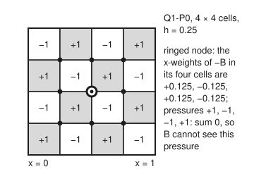
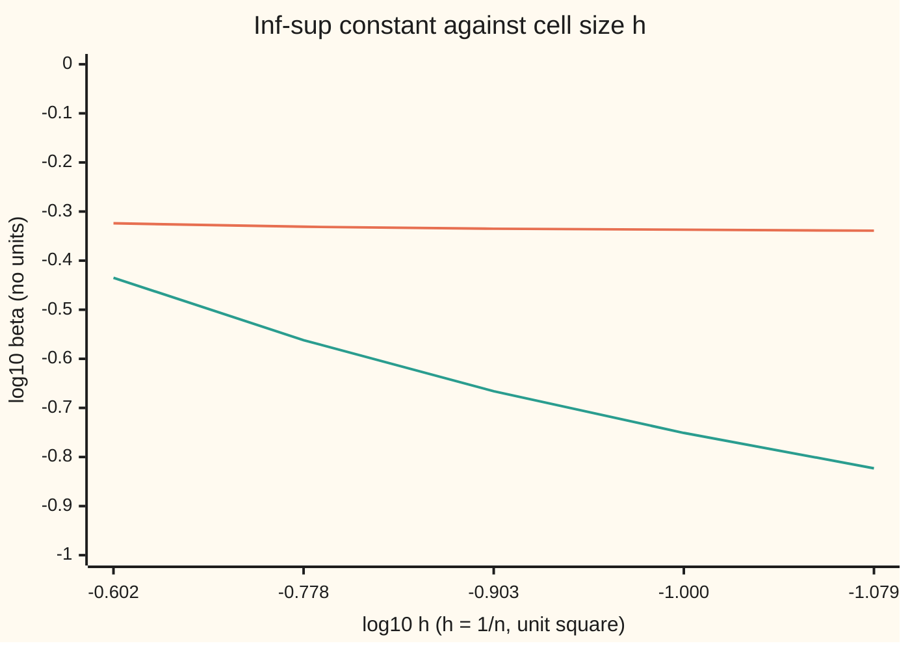

# Mixed finite elements: two unknowns at once, and the inf-sup test that keeps the pressure honest

[Syllabus](../../../SYLLABUS.md) → [Numerical analysis](../README.md) → [PDE Solvers](../README.md#s07) → Mixed finite elements

---

## General Overview

Honey in a square tray, stirred slowly, is Stokes flow: so thick and slow that inertia does not matter. Two things are unknown at every point: the velocity of the honey and its pressure. The honey cannot be squeezed, so the velocity must have zero divergence (no point gains or loses fluid). The pressure is the force that enforces that rule.

A finite-element solver splits the square into a 4 by 4 grid of cells and picks two sets of shapes, one for velocity and one for pressure. That choice is a **mixed** method: two unknowns solved together. The choice can fail without any error message.

The simplest pair is called **Q1-P0**: velocity bilinear on each cell (degree 1 in x and in y), pressure one constant per cell. Put pressure +1 and −1 in alternate cells, a checkerboard. The velocity equations cannot see it: every one of them reads 0.0e+00 for this pressure. So any amount of checkerboard can be added to the computed pressure, and the solver cannot tell. The pressure is garbage.

The **inf-sup constant** $`\beta_h`$ turns that danger into one number. It measures how strongly the worst pressure pattern pushes on the velocity. The name reads the test inside out: "inf" (infimum, the smallest value) over pressures of the "sup" (supremum, the largest value) over velocities of the push. For Q1-P0 it is 0. For the **Taylor-Hood** pair (velocity biquadratic, degree 2 in x and in y; pressure bilinear) it is 0.474783 on the 4 by 4 grid and 0.458050 on a 12 by 12 grid, with $`\beta_h^2`$ going from 0.2254 to 0.2098. It is still drifting down, by smaller steps each time; the theorem guarantees only that it stays above some fixed positive number.

**A velocity-pressure pair is safe when its inf-sup constant, the smallest singular value of the divergence matrix measured in the right sizes, stays away from zero as the grid is refined; a pair whose constant is zero, or sinks toward zero, has pressure patterns the equations cannot see.**

**What kind of fact this is:** a theorem and a computed test. The matrix facts are proved on this card in Why it works: when a mixed system has a unique answer, why $`\beta_h^2`$ is an eigenvalue, why the checkerboard is invisible, and why the pressure is bounded by $`1/\beta_h`$. That Taylor-Hood passes on every grid, and the full error estimate, are theorems stated with their sources; the code measures $`\beta_h`$ up to a 12 by 12 grid.

### The picture: the checkerboard that the divergence matrix cannot see

<p align="center"></p>

To scale: each cell is 45 px wide, with the unit square's corner at (40, 220). Dots are the nine interior velocity nodes of Q1-P0; the walls carry zero velocity. At the ringed node, the four cells' x-weights are listed below-left, below-right, above-left, above-right. Each weight is plus or minus half a cell width, and the checkerboard signs cancel them in pairs.

---

## The formula

Stokes flow, with $`u`$ the velocity, $`p`$ the pressure, $`\mu`$ the viscosity and $`f`$ a driving force per unit volume, is $`-\mu\,\Delta u + \nabla p = f`$ and $`\nabla\cdot u = 0`$, with $`u = 0`$ on the walls. Here $`\Delta`$ (the Laplacian) sums second derivatives, $`\nabla p`$ is the pressure's slope and $`\nabla\cdot u`$ is the divergence. Writing $`u_h = \sum_j U_j \varphi_j`$ and $`p_h = \sum_i P_i q_i`$ in the two sets of shapes gives a **saddle-point system** (a symmetric system with a zero block, whose energy is a minimum in $`U`$ and a maximum in $`P`$):

```math
\begin{pmatrix} A & B^{T} \\ B & 0 \end{pmatrix}\begin{pmatrix} U \\ P \end{pmatrix} = \begin{pmatrix} F \\ 0 \end{pmatrix}, \qquad A_{jk} = \mu\!\int_\Omega \nabla\varphi_j : \nabla\varphi_k\,dx, \qquad B_{ij} = -\!\int_\Omega q_i\,\nabla\cdot\varphi_j\,dx.
```

The pair passes the **inf-sup test** when this number stays away from zero as $`h \to 0`$:

```math
\beta_h \;=\; \min_{q \in Q_h,\ \int q = 0}\ \max_{v \in V_h}\ \frac{\int_\Omega q\,\nabla\cdot v\,dx}{|v|_1\,\|q\|_0}, \qquad \beta_h^{2} \;=\; \text{smallest eigenvalue of } B A^{-1} B^{T} P = \lambda\, M_p P \text{ with } \textstyle\sum P_i \!\int\! q_i = 0.
```

Then the computed flow is close to the best the shapes allow:

```math
|u - u_h|_1 + \|p - p_h\|_0 \;\le\; C\Big(1 + \frac{1}{\beta_h}\Big)^{2}\Big(\min_{v \in V_h} |u - v|_1 + \min_{q \in Q_h} \|p - q\|_0\Big).
```

**Read it aloud:** the pressure enters the velocity equations only through B transpose; the inf-sup constant asks how hard the weakest pressure pattern can push on some velocity, relative to their sizes; it is the square root of the smallest eigenvalue of the Schur complement against the pressure mass matrix; and the error is at most a constant times one-plus-one-over-beta squared times the best fit.

| Symbol | Plain meaning | In our example | Push it up and the answer… |
| --- | --- | --- | --- |
| $`u`$, $`p`$, $`\sigma`$, $`\tau`$, $`z`$, $`k`$, $`s`$, $`m`$ | velocity (two components), pressure; on the 1-D bar, heat flux, a trial flux, the zigzag temperature, a cosine flux's mode number, and the slope and size terms of the slowest one, $`k = 1`$ | zero velocity on all four walls; $`z`$ = 1, −1, 1, −1, 1 | — |
| $`\mu`$, $`f`$, $`\lVert f\rVert_{*}`$ | viscosity; driving force per unit volume; its size as felt by velocities, the largest $`F^{T}V/\lvert v\rvert_1`$ | $`\mu = 1`$; $`f`$ plays no part in the test | $`A`$ scales with $`\mu`$; $`\beta_h`$ is measured with $`\mu = 1`$ |
| $`\Omega`$, $`n`$, $`h`$, $`N`$ | the unit square; cells per side; cell side $`1/n`$; velocity numbers per component | $`n = 4`$, $`h = 0.25`$; Q1-P0 $`N = 9`$ | $`h`$ down: Taylor-Hood $`\beta_h`$ drifts down slowly, Q1-P0's next value falls like $`h`$ |
| $`V_h`$, $`Q_h`$ | the velocity shapes and the pressure shapes: the pair | Q1-P0, Taylor-Hood (Q2-Q1), Q1-Q1 | more velocity shapes per pressure: $`\beta_h`$ up |
| $`\varphi_j`$, $`q_i`$, $`v`$, $`q`$, $`V`$ | one velocity shape; one pressure shape; any velocity and any pressure built from them; the coefficients of $`v`$ | Q1-P0: 18 and 16 shapes | — |
| $`U`$, $`P`$, $`F`$ | the unknown coefficients and the load vector | 18 and 16 numbers for Q1-P0 at $`n = 4`$ | — |
| $`\lvert v\rvert_1`$, $`\lVert q\rVert_0`$ | size of a velocity's slopes, $`\sqrt{\int \lvert\nabla v\rvert^2}`$; size of a pressure, $`\sqrt{\int q^2}`$ | the sizes the test uses | — |
| $`A`$, $`M_p`$ | velocity stiffness matrix; pressure mass matrix, $`\int q_i q_k`$ | 9 by 9 per component; 16 by 16 | — |
| $`B`$ | divergence matrix: how each pressure shape pairs with each velocity shape | weights ±0.125 at one node | — |
| $`S = BA^{-1}B^{T}`$, $`L`$, $`W`$, $`w`$, $`E`$, $`I`$ | the Schur complement: the pressure system left after eliminating $`U`$; Cholesky factor $`A = LL^{T}`$; $`W = L^{-1}B^{T}`$; $`w = L^{T}V`$; the outer factor in Step 3; the identity | 16 by 16 for Q1-P0 | — |
| $`\beta_h`$, $`\lambda`$, $`t`$ | inf-sup constant; an eigenvalue of $`S`$ against $`M_p`$; a trial value in the pivot-sign count | Q1-P0: 0; Taylor-Hood: 0.474783, $`\lambda`$ = 0.2254 | $`\beta_h`$ up: pressure error bound down |
| $`C`$ | constant in the error bound, independent of $`h`$ | not computed | — |

### When it holds

- **The constant pressure is set aside.** In a closed box the same pressure everywhere moves nothing: $`\int \nabla\cdot v = 0`$ for any $`v`$ that is zero on the walls. Count it and every pair scores 0.
- **Velocity is measured by its slopes.** Measured by its plain size instead, the score is meaningless (What breaks).
- **The test is run on several grids.** A value that looks safe on one grid can still be falling (What breaks).
- **$`A`$ is positive definite.** True for Stokes flow; Step 3 uses it. If $`A`$ were zero on a divergence-free velocity, that velocity could be added to any answer.
- **No thin slivers.** The Taylor-Hood theorem needs cells of bounded shape, as squares are.

---

## Why it works

### Step 0: the pressure is a referee that only acts through B transpose

The pressure has no equation of its own. It is a **Lagrange multiplier** (an extra unknown that enforces a rule): it sets the force that keeps the net inflow at zero, pressure shape by pressure shape. It reaches the velocity only through the term $`B^{T}P`$. A pressure pattern with $`B^{T}P = 0`$ exerts no force on any velocity. The equations cannot detect it, so they cannot fix it. The inf-sup constant measures how close the weakest pattern comes to that.

### Step 1: the idea in one dimension, a steel bar

Take the shelf's house example: a one-metre steel bar held cold at both ends. A mixed method solves for two unknowns along it: the temperature $`u`$ and the heat flux $`\sigma`$ (heat per second passing each point, $`\sigma = -u'`$ with conductivity scaled to 1). Heat balance says $`\sigma'`$ equals the heat source.

Use hats for the flux (5 numbers on 4 elements) and one temperature per element (4 numbers). The pairing matrix is

```math
B = \begin{pmatrix} -1 & 1 & 0 & 0 & 0 \\ 0 & -1 & 1 & 0 & 0 \\ 0 & 0 & -1 & 1 & 0 \\ 0 & 0 & 0 & -1 & 1 \end{pmatrix}.
```

Each row is the flux difference across one element. Given any four temperatures, a flux can be built by adding up from the left whose differences are exactly those four. So every temperature pattern is seen. The constant, with the flux measured by $`\sqrt{\int \tau^2 + \int \tau'^2}`$ for a trial flux $`\tau`$, is 0.95508, 0.95345 and 0.95303 at 4, 8 and 16 elements: steady. A closed form agrees to every printed digit. Each cosine flux $`\cos(k\pi x)`$, sampled at the nodes, is a shared eigenvector of the slope and size parts of the flux's norm, so the eigenvalue problem splits mode by mode. The slowest, $`k = 1`$, gives $`\beta_h^2 = s/(s + m)`$, with slope term $`s = (2 - 2\cos(\pi/n))/h`$ and size term $`m = h(2 + \cos(\pi/n))/3`$.

Now give the temperature hats too (5 numbers). The zigzag temperature 1, −1, 1, −1, 1 has average 0 on every element, and a hat's slope is constant on each element. So the zigzag pairs to zero with every flux: largest entry of $`B^{T}z`$ = 0.0e+00. Its constant is 0.00000 at every size. This is the one-dimensional checkerboard.

The ends behave differently here from [Assembly and error](08-finite-element-assembly-and-error.md). In the mixed form the cold ends are **natural** (they enter as a boundary term, here zero), and a flux condition would be **essential**: the roles swap.

### Step 2: the Stokes system is a minimum with a constraint

The slow flow minimises the viscous energy $`\tfrac12 U^{T}AU - F^{T}U`$ subject to $`BU = 0`$ (no net inflow into any pressure shape). The Lagrange conditions, from [Lagrange multipliers, proved](../../15-Optimization/03-Constrained%20Optimisation/01-lagrange-multipliers-revisited.md), are exactly the saddle-point system in The formula, with $`P`$ as the multiplier. The point is a **saddle**: lowest in $`U`$, highest in $`P`$, as on [Saddle points](../../15-Optimization/03-Constrained%20Optimisation/06-saddle-points-and-minimax.md).

### Step 3: when the saddle-point matrix has an inverse

If $`A`$ is positive definite, block elimination gives

```math
\begin{pmatrix} A & B^{T} \\ B & 0 \end{pmatrix} = \begin{pmatrix} I & 0 \\ BA^{-1} & I \end{pmatrix}\begin{pmatrix} A & 0 \\ 0 & -S \end{pmatrix}\begin{pmatrix} I & A^{-1}B^{T} \\ 0 & I \end{pmatrix}, \qquad S = BA^{-1}B^{T}.
```

So the big matrix has an inverse exactly when $`S`$ does. With $`A = LL^{T}`$ (Cholesky) and $`W = L^{-1}B^{T}`$, $`S = W^{T}W`$, so $`P^{T}SP = \lvert WP\rvert^2 \ge 0`$. It is zero only when $`B^{T}P = 0`$. So: **unique answer if and only if no pressure is invisible.** That is the matrix form of Brezzi's condition.

The right factor is the transpose of the left one, so by Sylvester's law of inertia the big matrix has as many positive eigenvalues as $`A`$ and as many negative ones as $`-S`$. For the bar: 9 unknowns, 4 negative pivots. The matrix is **indefinite**, so conjugate gradients does not apply; [Saddle-point systems](../03-Numerical%20Linear%20Algebra/12-symmetric-indefinite-systems-ldlt-and-minres.md) solves it by $`LDL^{T}`$ or MINRES.

### Step 4: the inf-sup constant is a smallest singular value

Fix a pressure $`q`$ with coefficients $`P`$. For a velocity with coefficients $`V`$, the top of the fraction is $`P^{T}BV`$ (up to sign) and $`\lvert v\rvert_1 = \sqrt{V^{T}AV}`$ (with $`\mu = 1`$). Put $`w = L^{T}V`$. Then the best velocity gives

```math
\max_{V} \frac{P^{T}BV}{\sqrt{V^{T}AV}} = \max_{w} \frac{(L^{-1}B^{T}P)\cdot w}{\lvert w\rvert} = \lvert L^{-1}B^{T}P\rvert = \sqrt{P^{T}SP},
```

by the Cauchy-Schwarz inequality, with equality at $`w = L^{-1}B^{T}P`$. Divide by $`\lVert q\rVert_0 = \sqrt{P^{T}M_pP}`$ and minimise over $`P`$. The smallest value of $`P^{T}SP / P^{T}M_pP`$ is the smallest eigenvalue $`\lambda`$ of $`SP = \lambda M_p P`$. So $`\beta_h = \sqrt{\lambda_{\min}}`$: the smallest singular value of $`B`$ once velocity and pressure are measured in their own sizes, as on [Singular value decomposition](../03-Numerical%20Linear%20Algebra/08-svd-and-the-pseudoinverse.md).

### Step 5: why the checkerboard is invisible to Q1-P0

Take an interior node and its velocity shape pointing in x. It is the product of a hat in x and a hat in y. Over one of its four cells, the x-slope integrates to the change across the cell, ±1, times the area under the y-hat over the cell's height, h/2:

```math
\int_{\text{cell}} \frac{\partial \varphi}{\partial x}\,dx\,dy = \pm 1 \times \frac{h}{2} = \pm 0.125 \quad (h = 0.25),
```

plus on the two cells left of the node and minus on the two to its right. These are the entries of $`-B`$: The formula's minus sign flips every weight and leaves $`\beta_h`$ unchanged. The checkerboard gives the two left cells opposite signs, and the two right cells too. So each side cancels, and the y-shape cancels the same way. Every column of $`B`$ pairs to zero with the checkerboard. Together with the constant, Q1-P0 on the 4 by 4 grid has 2 invisible pressures out of 16: $`B`$ has rank 14, not 15.

A count gives another failure. Q1-Q1 on the 4 by 4 grid has 25 pressure numbers but only 18 velocity numbers. $`B^{T}`$ maps 25 numbers to 18, so at least 7 pressure patterns vanish. The code finds 8, the constant among them.

### Step 6: a small constant amplifies, a zero constant loses the pressure

The first block row says $`AU + B^{T}P = F`$. Multiply by any velocity $`V`$:

```math
P^{T}BV = F^{T}V - U^{T}AV \le \big(\lVert f\rVert_{*} + \mu\lvert u_h\rvert_1\big)\,\lvert v\rvert_1,
```

where $`\lVert f\rVert_{*}`$ is the largest value of $`F^{T}V/\lvert v\rvert_1`$. Set the pressure's average to zero and take the best $`V`$ for this $`P`$, so the left side is at least $`\beta_h\lVert p_h\rVert_0\lvert v\rvert_1`$. Hence

```math
\lVert p_h\rVert_0 \le \frac{1}{\beta_h}\big(\lVert f\rVert_{*} + \mu\lvert u_h\rvert_1\big).
```

The factor $`1/\beta_h`$ is the amplifier: 2.106 for Taylor-Hood at $`n = 4`$ and 2.183 at $`n = 12`$. At $`\beta_h = 0`$ there is no bound, since any multiple of the invisible pattern can be added. The trouble is stability of the discretization, not conditioning of the flow.

The full error estimate in The formula combines this bound with the best-fit argument of [Assembly and error](08-finite-element-assembly-and-error.md). This card states it without proof; Brezzi (1974) and Boffi, Brezzi and Fortin, chapter 5, prove it.

### Step 7: Taylor-Hood passes on every grid

Taylor-Hood gives each pressure shape many velocity shapes to push on: 98 velocity numbers against 25 pressure numbers at $`n = 4`$. The theorem that its $`\beta_h`$ stays above a fixed positive number on every grid of squares is proved patch by patch; this card states it and cites Boffi, Brezzi and Fortin, chapter 8. The code measures it: 0.474783 at $`n = 4`$ down to 0.458050 at $`n = 12`$, by smaller steps each time. The theorem gives a positive floor, not a value: the measured constant is still drifting down at $`n = 12`$.

<details>
<summary>Detailed proof: the saddle-point matrix has an inverse exactly when no pressure is invisible, and then its inertia is fixed</summary>

Let $`A`$ be symmetric positive definite, with one row per velocity number, and let $`B`$ have one row per pressure number.

Multiply out the three factors in Step 3. The left factor times the middle gives rows $`(A,\ 0)`$ and $`(B,\ -S)`$. Times the right factor this is $`(A,\ B^{T})`$ and $`(B,\ BA^{-1}B^{T} - S) = (B,\ 0)`$. So the factorisation holds.

The outer factors are triangular with ones on the diagonal, so they have inverses. Hence the big matrix has an inverse exactly when $`A`$ and $`S`$ both do. $`A`$ does.

$`S = W^{T}W`$ with $`W = L^{-1}B^{T}`$. If $`SP = 0`$ then $`0 = P^{T}SP = \lvert WP\rvert^2`$, so $`WP = 0`$, so $`B^{T}P = LWP = 0`$. Conversely $`B^{T}P = 0`$ gives $`SP = 0`$. So $`S`$ has an inverse exactly when $`B^{T}P = 0`$ forces $`P = 0`$.

The right factor is the transpose of the left one. So the big matrix is $`E\,\mathrm{diag}(A, -S)\,E^{T}`$, with $`E`$ the invertible left factor. Sylvester's law of inertia says such a congruence keeps the counts of positive, negative and zero eigenvalues. $`A`$ has one positive eigenvalue per velocity number. $`-S`$ has one negative eigenvalue per pressure number when $`S`$ is positive definite. So the big matrix has exactly that many of each.

</details>

---

## Worked numbers, by hand

| Step | Arithmetic | Value |
| --- | --- | --- |
| Q1-P0 unknowns, $`n = 4`$ | 9 interior nodes × 2 components; 16 cells | 18 velocity, 16 pressure |
| one cell's x-weight at a node | $`\pm 1 \times h/2`$ with $`h = 0.25`$ | ±0.125 |
| the four cells at the ringed node, entries of $`-B`$ | below-left, below-right, above-left, above-right | +0.125, −0.125, +0.125, −0.125 |
| checkerboard signs there | same order | +1, −1, −1, +1 |
| pairing | $`0.125 \times 1 + (-0.125)(-1) + 0.125 \times (-1) + (-0.125) \times 1`$ | 0 |
| invisible pressures | the constant and the checkerboard | 2 of 16; rank of $`B`$ 14 |
| Q1-Q1 count | 25 pressures − 18 velocities | at least 7 invisible; 8 found |
| Taylor-Hood unknowns, $`n = 4`$ | $`7 \times 7`$ interior nodes × 2; $`5 \times 5`$ pressure nodes | 98 velocity, 25 pressure |
| Taylor-Hood $`\lambda`$ | smallest eigenvalue of $`S`$ against $`M_p`$, constant set aside | 0.2254 |
| Taylor-Hood $`\beta_h`$ | $`\sqrt{0.2254}`$ | **0.474783** |
| amplifier | $`1/0.474783`$ | 2.106 |

Q1-P0 on the 4 by 4 grid has an inf-sup constant of exactly 0, so its pressure is not determined. Taylor-Hood's 0.474783 means its pressure is at most 2.106 times the right side of Step 6's bound (the force felt plus the viscous term) on this grid. The factor creeps to 2.183 at $`n = 12`$; the theorem says it stays bounded on every finer grid.

### What breaks if you drop a piece

| Mistake | Comes out at | What went wrong |
| --- | --- | --- |
| Use Q1-P0 and trust the pressure | $`\beta_h`$ = 0.000000; adding 1000 × checkerboard changes $`B^{T}P`$ by 0.0e+00 | the checkerboard is invisible, so its amount is arbitrary |
| Use equal order, Q1-Q1 | 8 zero eigenvalues of 25 | more pressure numbers than velocity numbers |
| Count the constant pressure as a failure | Taylor-Hood $`\beta_h`$ = 0.000000 | in a closed box the constant is always invisible, and harmless |
| Measure the velocity by its size, not its slopes | Taylor-Hood "$`\beta_h`$" = 3.0532 | above the true ceiling of 1; the test no longer measures stability |

The hypothesis "stays away from zero on every grid" fails for Q1-P0 even after the checkerboard is set aside. Its next eigenvalue gives 0.367598, 0.274030, 0.215900, 0.177358 and 0.150231 at $`n`$ = 4, 6, 8, 10 and 12. The observed order climbs 0.724, 0.829, 0.881, 0.910: it falls roughly in proportion to $`h`$.

### The picture: the constant against the cell size



Orange: Taylor-Hood, nearly flat. Green: Q1-P0's next value after the checkerboard, falling with slope near 1. Q1-P0's true constant is 0 at every size and has no logarithm, so it cannot be drawn.

Every eigenvalue comes from 80 halvings of a Sturm-count bracket, so the bisection itself adds less than 1e-15. A separate road confirms the Taylor-Hood value without any eigenvalue solver: the $`LDL^{T}`$ pivot signs of $`S - tM_p`$ show exactly 1 eigenvalue (the constant pressure, at 0) below $`t`$ = 0.225194 and 2 below 0.225520. So $`\lambda`$ lies in that bracket, next to a second eigenvalue at 0.225620.

---

## Code, from first principles, and it actually runs

The code assembles the Stokes matrices $`A`$, $`B`$ and $`M_p`$ for any grid with 3-point Gauss rules, exact for these polynomials. It forms $`S = W^{T}W`$ through a Cholesky factor, reduces $`S`$ against $`M_p`$ to a tridiagonal matrix (nonzero only on three diagonals) by Householder reflections (mirror maps that clear a column below the band), and finds the smallest eigenvalues by Sturm-count bisection (halving a bracket, using a count of negative pivots that equals the number of eigenvalues below a trial value). Five independent roads check it:

- known values worked by hand: the ±0.125 weights;
- exact integrals: for Taylor-Hood at $`n = 4`$, the velocity $`x(1 - x)y(1 - y)`$ gives $`V^{T}AV = 1/45`$; the x-part of $`B^{T}`$ applied to the pressure $`x`$, and the y-part to $`y`$, return each velocity shape's integral (by parts), a product of Simpson weights, $`h/3`$ at a cell corner and $`2h/3`$ at a midpoint; $`M_p`$ totals 1; and the bar's constant matches its closed form. Every Taylor-Hood and bar constant is at most 1, the ceiling;
- explicit invisible vectors, exact in arithmetic and run in floating point: the checkerboard, the zigzag and the count of 25 against 18;
- inertia: $`LDL^{T}`$ pivot signs bracket $`\beta_h^2`$ with no eigenvalue solver;
- rate: the observed order of Q1-P0's falling value, beside Taylor-Hood's slow drift.

Forming $`S`$ densely costs about $`N^3/3`$ flops for the Cholesky factor of $`A`$, with $`N`$ velocity numbers per component, plus about $`N^2`$ flops for each of two triangular solves per pressure number; on the finer grids the solves dominate. That is fine for a test, not for a production solve, which uses the sparse methods of [Saddle-point systems](../03-Numerical%20Linear%20Algebra/12-symmetric-indefinite-systems-ldlt-and-minres.md).

### Python

```python
# Mixed finite elements and the inf-sup test: Stokes flow in the unit square, velocity zero on the walls, for
# Q1-P0, Taylor-Hood Q2-Q1 and Q1-Q1; and a 1-D bar, flux P1 with temperature P0 or P1. Standard library only.
import math, functools
G = [(0.5 - 0.5 * math.sqrt(0.6), 5.0 / 18.0), (0.5, 8.0 / 18.0), (0.5 + 0.5 * math.sqrt(0.6), 5.0 / 18.0)]
def dot(a, b): return functools.reduce(lambda s, xy: s + xy[0] * xy[1], zip(a, b), 0.0)
def b1(k, t):  # 1-D Lagrange basis of degree k = 1 or 2 on [0, 1]: values, slopes
    if k == 1: return [1.0 - t, t], [-1.0, 1.0]
    return [2.0 * (t - 0.5) * (t - 1.0), -4.0 * t * (t - 1.0), 2.0 * t * (t - 0.5)], [4.0 * t - 3.0, 4.0 - 8.0 * t, 4.0 * t - 1.0]
def stokes(n, kv, kp):
    # one velocity component's stiffness A and mass Mv; Bx, By = q times div v (the card's -B); pressure mass Mp
    h, m = 1.0 / n, kv * n + 1
    idx = {(i, j): (j - 1) * (m - 2) + i - 1 for j in range(1, m - 1) for i in range(1, m - 1)}
    N, P = len(idx), (n * n if kp == 0 else (n + 1) * (n + 1))
    A, Mv = [[0.0] * N for _ in range(N)], [[0.0] * N for _ in range(N)]
    Bx, By, Mp = [[0.0] * N for _ in range(P)], [[0.0] * N for _ in range(P)], [[0.0] * P for _ in range(P)]
    for cy, cx in [(y, x) for y in range(n) for x in range(n)]:
        for (tx, wx), (ty, wy) in [(gx, gy) for gx in G for gy in G]:
            w = wx * wy * h * h; vx, dx = b1(kv, tx); vy, dy = b1(kv, ty)
            loc = [(idx[(kv * cx + a, kv * cy + b)], dx[a] * vy[b] / h, vx[a] * dy[b] / h, vx[a] * vy[b])
                   for b in range(kv + 1) for a in range(kv + 1) if (kv * cx + a, kv * cy + b) in idx]
            ploc = [(cy * n + cx, 1.0)] if kp == 0 else [((cy + b) * (n + 1) + cx + a,
                    b1(1, tx)[0][a] * b1(1, ty)[0][b]) for b in range(2) for a in range(2)]
            for (I, gx, gy, f) in loc:
                for (J, hx, hy, g) in loc: A[I][J] += w * (gx * hx + gy * hy); Mv[I][J] += w * f * g
                for (Q, q) in ploc: Bx[Q][I] += w * q * gx; By[Q][I] += w * q * gy
            for (Q, q) in ploc:
                for (R, r) in ploc: Mp[Q][R] += w * q * r
    return A, Mv, Bx, By, Mp
def chol(A):
    n = len(A); L = [[0.0] * n for _ in range(n)]
    for j in range(n):
        L[j][j] = math.sqrt(A[j][j] - dot(L[j][:j], L[j][:j]))
        for i in range(j + 1, n): L[i][j] = (A[i][j] - dot(L[i][:j], L[j][:j])) / L[j][j]
    return L
def fsolve(L, b):  # solve L y = b
    y = b[:]
    for i in range(len(y)): y[i] = (y[i] - dot(L[i][:i], y[:i])) / L[i][i]
    return y
def schur(A, Bs):  # S = sum over the parts of B A^-1 B^T = W^T W with W = L^-1 B^T
    L = chol(A); P = len(Bs[0]); S = [[0.0] * P for _ in range(P)]
    for B in Bs:
        W = [fsolve(L, row) for row in B]
        for p in range(P):
            for q in range(P): S[p][q] += dot(W[p], W[q])
    return S
def eigs(S, M, k):
    # the k smallest eigenvalues of S x = lam M x: C = L^-1 S L^-T, Householder, Sturm bisection
    L = chol(M); n = len(S); T = [fsolve(L, [S[i][j] for i in range(n)]) for j in range(n)]
    C = [fsolve(L, [T[j][i] for j in range(n)]) for i in range(n)]; d, e = [0.0] * n, [0.0] * n
    for k0 in range(n - 2):
        x = [C[i][k0] for i in range(k0 + 1, n)]; al = -math.copysign(math.sqrt(dot(x, x)), x[0])
        v = x[:]; v[0] -= al; vn = dot(v, v); m = n - k0 - 1
        if vn > 0.0:
            p = [2.0 * dot(C[k0 + 1 + i][k0 + 1:], v) / vn for i in range(m)]; K = dot(v, p) / vn
            q = [p[i] - K * v[i] for i in range(m)]
            for i in range(m):
                row = C[k0 + 1 + i]
                for j in range(m): row[k0 + 1 + j] -= v[i] * q[j] + q[i] * v[j]
        e[k0] = al
    d = [C[i][i] for i in range(n)]; e[n - 2] = C[n - 2][n - 1]
    def below(t):  # Sturm count: eigenvalues below t
        c, piv = 0, 1.0
        for i in range(n):
            piv = d[i] - t - (e[i - 1] * e[i - 1] / piv if i > 0 else 0.0)
            piv = piv if piv != 0.0 else 1e-300; c += 1 if piv < 0.0 else 0
        return c
    out, hi = [], 1.0 + max(abs(x) for x in d) + 2.0 * max(abs(x) for x in e)  # Gershgorin bound
    for j in range(k):
        lo, up = -1.0, hi
        for _ in range(80): mid = 0.5 * (lo + up); lo, up = (lo, mid) if below(mid) > j else (mid, up)
        out.append(0.5 * (lo + up))
    return out
def negpivots(S, M, t):  # inertia road: LDL^T of S - t M, no pivoting; Sylvester counts eigenvalues below t
    n = len(S); D = [[S[i][j] - t * M[i][j] for j in range(n)] for i in range(n)]; c = 0
    for k in range(n):
        if D[k][k] < 0.0: c += 1
        for i in range(k + 1, n):
            f = D[i][k] / D[k][k]
            for j in range(k + 1, n): D[i][j] -= f * D[k][j]
    return c
def bar(n, kp):  # 1-D bar, length 1: flux in P1 (norm: integral of tau^2 + tau'^2), temperature P0 or P1
    h = 1.0 / n; A = [[0.0] * (n + 1) for _ in range(n + 1)]; P = n if kp == 0 else n + 1
    B, M = [[0.0] * (n + 1) for _ in range(P)], [[0.0] * P for _ in range(P)]
    for e in range(n):
        for a, b in ((0, 0), (0, 1), (1, 0), (1, 1)):
            A[e + a][e + b] += h * (2.0 if a == b else 1.0) / 6.0 + (1.0 if a == b else -1.0) / h
            if kp == 1: M[e + a][e + b] += h * (2.0 if a == b else 1.0) / 6.0; B[e + a][e + b] += 0.5 * (2 * b - 1)
        if kp == 0: M[e][e] = h; B[e][e] -= 1.0; B[e][e + 1] += 1.0
    return A, B, M
NS, beta = (4, 6, 8, 10, 12), lambda lam: math.sqrt(max(lam, 0.0))
bars = [beta(eigs(schur(A, [B]), M, 1)[0]) for (A, B, M) in (bar(n, kp) for kp in (0, 1) for n in (4, 8, 16))]
print("1-D bar, beta at n = 4, 8, 16: temperature P0 " + " ".join(f"{b:.5f}" for b in bars[:3])
      + "; temperature P1 " + " ".join(f"{b:.5f}" for b in bars[3:]))
cf = [math.sqrt(s / (s + m)) for n in (4, 8, 16) for (s, m) in [((2 - 2 * math.cos(math.pi / n)) * n, (2 + math.cos(math.pi / n)) / (3 * n))]]
print("  P0 closed form sqrt(s/(s + m)), s = (2 - 2 cos(pi/n))/h, m = h (2 + cos(pi/n))/3: " + " ".join(f"{c:.5f}" for c in cf))
A1, B1, M1 = bar(4, 1); zz = max(abs(dot([B1[j][i] for j in range(5)], [1.0, -1.0, 1.0, -1.0, 1.0])) for i in range(5))
Ab, Bb, _ = bar(4, 0); K9 = [Ab[i] + [Bb[j][i] for j in range(4)] for i in range(5)] + [Bb[j] + [0.0] * 4 for j in range(4)]
print(f"zigzag 1,-1,1,-1,1: largest |B^T z| = {zz:.1e}; bar saddle matrix 9 x 9: negative pivots {negpivots(K9, K9, 0.0)}")
print("4 x 4 grid, (velocity, pressure) unknowns: " + "; ".join(f"{nm} ({2 * len(s[0])}, {len(s[4])})" for nm, s in
      (("Q1-P0", stokes(4, 1, 0)), ("Taylor-Hood", stokes(4, 2, 1)), ("Q1-Q1", stokes(4, 1, 1)))))
A, Mv, Bx, By, Mp = stokes(4, 1, 0); cb = [(-1.0) ** (i // 4 + i % 4) for i in range(16)]
print("node (2,2), x-part of -B in its four cells: " + " ".join(f"{Bx[c][4]:+.3f}" for c in (5, 6, 9, 10))
      + f"; checkerboard signs {cb[5]:+.0f} {cb[6]:+.0f} {cb[9]:+.0f} {cb[10]:+.0f}")
assert abs(A[4][4] - 8.0 / 3.0) < 1e-14 and all(abs(abs(Bx[c][4]) - 0.125) < 1e-15 for c in (5, 6, 9, 10)), "by hand"
res = max(abs(dot([B[q][I] for q in range(16)], cb)) for B in (Bx, By) for I in range(9))
print(f"Q1-P0 checkerboard: largest |B^T p| = {res:.1e}; times 1000 = {1000.0 * res:.1e}")
ev = eigs(schur(A, [Bx, By]), Mp, 16); z0 = len([v for v in ev if v < 1e-10])
A, Mv, Bx, By, Mp = stokes(4, 1, 1); q11 = len([v for v in eigs(schur(A, [Bx, By]), Mp, 25) if v < 1e-10])
print(f"zero eigenvalues at n=4: Q1-P0 {z0} of 16 (rank of B {16 - z0}); Q1-Q1 {q11} of 25 (25 - 18 = 7 forced)")
rows = []; print("   n      h  Q1-P0 beta  Q1-P0 next   order  Taylor-Hood beta  beta^2  1/beta")
for n in NS:
    A, Mv, Bx, By, Mp = stokes(n, 1, 0); e0 = eigs(schur(A, [Bx, By]), Mp, 3)
    A, Mv, Bx, By, Mp = stokes(n, 2, 1); S2 = schur(A, [Bx, By]); e2 = eigs(S2, Mp, 3)
    rows.append((n, beta(e0[1]), beta(e0[2]), beta(e2[1]), e2[1]))
    o = f"{math.log(rows[-2][2] / rows[-1][2]) / math.log(n / rows[-2][0]):7.3f}" if len(rows) > 1 else "      -"
    print(f"{n:4d} {1.0 / n:6.4f} {rows[-1][1]:11.6f} {rows[-1][2]:11.6f} {o} {rows[-1][3]:17.6f} {e2[1]:7.4f} {1.0 / rows[-1][3]:7.3f}")
    if n == 4: S4, M4, l4, l5, Mv4, B4 = S2, Mp, e2[1], e2[2], Mv, (Bx, By)
t1, t2 = 0.999 * l4, 0.5 * (l4 + l5); i1, i2 = negpivots(S4, M4, t1), negpivots(S4, M4, t2)
print(f"inertia, Taylor-Hood n=4: eigenvalues below {t1:.6f}: {i1}; below {t2:.6f}: {i2}; next eigenvalue {l5:.6f}")
print(f"wrong norm (velocity size, not its slope), Taylor-Hood n=4: beta {beta(eigs(schur(Mv4, B4), M4, 2)[1]):.4f}")
print(f"wrong: count the constant pressure, Taylor-Hood n=4: beta {beta(eigs(S4, M4, 1)[0]):.6f}")
A, Mv, Bx, By, Mp = stokes(4, 2, 1); V = [i * (8 - i) * j * (8 - j) / 4096 for j in range(1, 8) for i in range(1, 8)]
sw, vav = [(1.0 if i % 2 == 0 else 2.0) / 12.0 for i in range(1, 8)], dot(V, [dot(r, V) for r in A])   # Simpson: h/3, 2h/3
gb = max(abs(dot([B[Q][I] for Q in range(25)], [(Q % 5 if B is Bx else Q // 5) / 4.0 for Q in range(25)]) + sw[I % 7] * sw[I // 7])
         for B in (Bx, By) for I in range(49))   # pressure x (or y) against div v: -integral of v, by parts
print(f"Taylor-Hood n=4 against exact integrals: v = x(1-x)y(1-y), V^T A V = {vav:.6f}, 1/45 = {1 / 45:.6f}; pressures x, y"
      f" against -Simpson weights, gap {gb:.1e}; total of M_p {sum(sum(r) for r in Mp):.6f}")
print(f"figure, grid px left 40 bottom 220 cell 45; node (2,2) at ({40 + 45 * 2},{220 - 45 * 2})")
print("chart, log10 h          " + " ".join(f"{math.log10(1.0 / r[0]):6.3f}" for r in rows))
print("chart, log10 Q1-P0 next " + " ".join(f"{math.log10(r[2]):6.3f}" for r in rows))
print("chart, log10 TH beta    " + " ".join(f"{math.log10(r[3]):6.3f}" for r in rows))
assert res < 1e-14 and z0 == 2, "Q1-P0: the constant and the checkerboard are invisible to B"
assert q11 >= 25 - 18, "more pressures than velocities leaves invisible pressures"
assert zz < 1e-14 and all(abs(b - c) < 1e-12 and b <= 1.0 for b, c in zip(bars, cf)), "1-D: zigzag invisible; P0 = closed form"
assert abs(vav - 1 / 45) < 1e-14 and gb < 1e-14 and abs(sum(sum(r) for r in Mp) - 1.0) < 1e-12, "assembly = exact integrals"
assert i1 == 1 and i2 == 2, "inertia (no eigen solver) brackets the Taylor-Hood beta^2"
assert all(0.45 < r[3] <= 1.0 for r in rows), "Taylor-Hood beta on these grids: above 0.45, below the ceiling 1"
assert rows[-1][2] < 0.5 * rows[0][2], "Q1-P0's best non-checkerboard constant still decays"
print("ALL CHECKS PASS")
```

**Ran 2026-11-24 on macOS, Python 3.14.10, standard library only. All checks passed. Output, pasted from the run:**

```
1-D bar, beta at n = 4, 8, 16: temperature P0 0.95508 0.95345 0.95303; temperature P1 0.00000 0.00000 0.00000
  P0 closed form sqrt(s/(s + m)), s = (2 - 2 cos(pi/n))/h, m = h (2 + cos(pi/n))/3: 0.95508 0.95345 0.95303
zigzag 1,-1,1,-1,1: largest |B^T z| = 0.0e+00; bar saddle matrix 9 x 9: negative pivots 4
4 x 4 grid, (velocity, pressure) unknowns: Q1-P0 (18, 16); Taylor-Hood (98, 25); Q1-Q1 (18, 25)
node (2,2), x-part of -B in its four cells: +0.125 -0.125 +0.125 -0.125; checkerboard signs +1 -1 -1 +1
Q1-P0 checkerboard: largest |B^T p| = 0.0e+00; times 1000 = 0.0e+00
zero eigenvalues at n=4: Q1-P0 2 of 16 (rank of B 14); Q1-Q1 8 of 25 (25 - 18 = 7 forced)
   n      h  Q1-P0 beta  Q1-P0 next   order  Taylor-Hood beta  beta^2  1/beta
   4 0.2500    0.000000    0.367598       -          0.474783  0.2254   2.106
   6 0.1667    0.000000    0.274030   0.724          0.466546  0.2177   2.143
   8 0.1250    0.000000    0.215900   0.829          0.462548  0.2140   2.162
  10 0.1000    0.000000    0.177358   0.881          0.459949  0.2116   2.174
  12 0.0833    0.000000    0.150231   0.910          0.458050  0.2098   2.183
inertia, Taylor-Hood n=4: eigenvalues below 0.225194: 1; below 0.225520: 2; next eigenvalue 0.225620
wrong norm (velocity size, not its slope), Taylor-Hood n=4: beta 3.0532
wrong: count the constant pressure, Taylor-Hood n=4: beta 0.000000
Taylor-Hood n=4 against exact integrals: v = x(1-x)y(1-y), V^T A V = 0.022222, 1/45 = 0.022222; pressures x, y against -Simpson weights, gap 1.4e-17; total of M_p 1.000000
figure, grid px left 40 bottom 220 cell 45; node (2,2) at (130,130)
chart, log10 h          -0.602 -0.778 -0.903 -1.000 -1.079
chart, log10 Q1-P0 next -0.435 -0.562 -0.666 -0.751 -0.823
chart, log10 TH beta    -0.324 -0.331 -0.335 -0.337 -0.339
ALL CHECKS PASS
```

### Rust

```rust
// Mixed finite elements and the inf-sup test: Stokes flow in the unit square, velocity zero on the walls, for
// Q1-P0, Taylor-Hood Q2-Q1 and Q1-Q1; and a 1-D bar, flux P1 with temperature P0 or P1. Rust std only.
use std::collections::HashMap;
type M = Vec<Vec<f64>>;
fn zeros(r: usize, c: usize) -> M { vec![vec![0.0; c]; r] }
fn dot(a: &[f64], b: &[f64]) -> f64 { let mut s = 0.0; for (x, y) in a.iter().zip(b) { s += x * y; } s }
fn sci(x: f64, p: usize) -> String { // Python-style e-notation: 1.2e-17, 0.0e+00
    let s = format!("{:.*e}", p, x); let (m, e) = s.split_once('e').unwrap(); let k: i32 = e.parse().unwrap();
    format!("{}e{}{:02}", m, if k < 0 { '-' } else { '+' }, k.abs())
}
fn b1(k: usize, t: f64) -> (Vec<f64>, Vec<f64>) { // 1-D Lagrange basis of degree 1 or 2 on [0, 1]
    if k == 1 { return (vec![1.0 - t, t], vec![-1.0, 1.0]); }
    (vec![2.0 * (t - 0.5) * (t - 1.0), -4.0 * t * (t - 1.0), 2.0 * t * (t - 0.5)], vec![4.0 * t - 3.0, 4.0 - 8.0 * t, 4.0 * t - 1.0])
}
fn stokes(n: usize, kv: usize, kp: usize) -> (M, M, M, M, M) {
    // one velocity component's stiffness A and mass Mv; Bx, By = q times div v (the card's -B); pressure mass Mp
    let r6 = 0.6f64.sqrt(); let g = [(0.5 - 0.5 * r6, 5.0 / 18.0), (0.5, 8.0 / 18.0), (0.5 + 0.5 * r6, 5.0 / 18.0)];
    let (h, m) = (1.0 / n as f64, kv * n + 1);
    let idx: HashMap<(usize, usize), usize> = (1..m - 1).flat_map(|j| (1..m - 1).map(move |i| ((i, j), (j - 1) * (m - 2) + i - 1))).collect();
    let (nv, np) = (idx.len(), if kp == 0 { n * n } else { (n + 1) * (n + 1) });
    let (mut a, mut mv, mut bx, mut by, mut mp) = (zeros(nv, nv), zeros(nv, nv), zeros(np, nv), zeros(np, nv), zeros(np, np));
    for cy in 0..n { for cx in 0..n { for &(tx, wx) in &g { for &(ty, wy) in &g {
        let w = wx * wy * h * h; let (vx, dx) = b1(kv, tx); let (vy, dy) = b1(kv, ty); let mut loc = vec![];
        for b in 0..=kv { for aa in 0..=kv { if let Some(&i) = idx.get(&(kv * cx + aa, kv * cy + b)) { loc.push((i, dx[aa] * vy[b] / h, vx[aa] * dy[b] / h, vx[aa] * vy[b])); } } }
        let mut ploc = vec![]; if kp == 0 { ploc.push((cy * n + cx, 1.0)); } else {
            for b in 0..2 { for aa in 0..2 { ploc.push(((cy + b) * (n + 1) + cx + aa, b1(1, tx).0[aa] * b1(1, ty).0[b])); } }
        }
        for &(i, gx, gy, f) in &loc {
            for &(j, hx, hy, gg) in &loc { a[i][j] += w * (gx * hx + gy * hy); mv[i][j] += w * f * gg; }
            for &(q, qq) in &ploc { bx[q][i] += w * qq * gx; by[q][i] += w * qq * gy; }
        }
        for &(q, qq) in &ploc { for &(r, rr) in &ploc { mp[q][r] += w * qq * rr; } }
    } } } }
    (a, mv, bx, by, mp)
}
fn chol(a: &M) -> M {
    let n = a.len(); let mut l = zeros(n, n);
    for j in 0..n {
        l[j][j] = (a[j][j] - dot(&l[j][..j], &l[j][..j])).sqrt();
        for i in j + 1..n { l[i][j] = (a[i][j] - dot(&l[i][..j], &l[j][..j])) / l[j][j]; }
    }
    l
}
fn fsolve(l: &M, b: &[f64]) -> Vec<f64> { let mut y = b.to_vec(); for i in 0..y.len() { y[i] = (y[i] - dot(&l[i][..i], &y[..i])) / l[i][i]; } y } // L y = b
fn schur(a: &M, bs: &[&M]) -> M { // S = sum over the parts of B A^-1 B^T = W^T W with W = L^-1 B^T
    let l = chol(a); let p = bs[0].len(); let mut s = zeros(p, p);
    for b in bs {
        let w: M = b.iter().map(|row| fsolve(&l, row)).collect();
        for i in 0..p { for j in 0..p { s[i][j] += dot(&w[i], &w[j]); } }
    }
    s
}
fn eigs(s: &M, mm: &M, k: usize) -> Vec<f64> {
    // the k smallest eigenvalues of S x = lam M x: C = L^-1 S L^-T, Householder, Sturm bisection
    let l = chol(mm); let n = s.len();
    let t: M = (0..n).map(|j| fsolve(&l, &(0..n).map(|i| s[i][j]).collect::<Vec<_>>())).collect();
    let mut c: M = (0..n).map(|i| fsolve(&l, &(0..n).map(|j| t[j][i]).collect::<Vec<_>>())).collect(); let mut e = vec![0.0; n];
    for k0 in 0..n - 2 {
        let x: Vec<f64> = (k0 + 1..n).map(|i| c[i][k0]).collect();
        let al = -(dot(&x, &x).sqrt()).copysign(x[0]);
        let mut v = x.clone(); v[0] -= al; let vn = dot(&v, &v); let m = n - k0 - 1;
        if vn > 0.0 {
            let p: Vec<f64> = (0..m).map(|i| 2.0 * dot(&c[k0 + 1 + i][k0 + 1..], &v) / vn).collect();
            let kk = dot(&v, &p) / vn;
            let q: Vec<f64> = (0..m).map(|i| p[i] - kk * v[i]).collect();
            for i in 0..m { for j in 0..m { c[k0 + 1 + i][k0 + 1 + j] -= v[i] * q[j] + q[i] * v[j]; } }
        }
        e[k0] = al;
    }
    let d: Vec<f64> = (0..n).map(|i| c[i][i]).collect(); e[n - 2] = c[n - 2][n - 1];
    let below = |t: f64| -> usize { // Sturm count: eigenvalues below t
        let (mut cnt, mut piv) = (0, 1.0);
        for i in 0..n {
            piv = d[i] - t - (if i > 0 { e[i - 1] * e[i - 1] / piv } else { 0.0 });
            piv = if piv != 0.0 { piv } else { 1e-300 }; if piv < 0.0 { cnt += 1; }
        }
        cnt
    };
    let mx = |z: &[f64]| z.iter().fold(f64::MIN, |a, b| a.max(b.abs()));
    let (hi, mut out) = (1.0 + mx(&d) + 2.0 * mx(&e), vec![]); // Gershgorin bound
    for j in 0..k {
        let (mut lo, mut up) = (-1.0, hi);
        for _ in 0..80 { let mid = 0.5 * (lo + up); if below(mid) > j { up = mid; } else { lo = mid; } }
        out.push(0.5 * (lo + up));
    }
    out
}
fn negpivots(s: &M, mm: &M, t: f64) -> usize { // inertia road: LDL^T of S - t M, no pivoting (Sylvester)
    let n = s.len(); let mut d: M = (0..n).map(|i| (0..n).map(|j| s[i][j] - t * mm[i][j]).collect()).collect(); let mut c = 0;
    for k in 0..n {
        if d[k][k] < 0.0 { c += 1; }
        for i in k + 1..n { let f = d[i][k] / d[k][k]; for j in k + 1..n { d[i][j] -= f * d[k][j]; } }
    }
    c
}
fn bar(n: usize, kp: usize) -> (M, M, M) { // 1-D bar: flux P1 (norm: tau^2 + tau'^2), temperature P0 or P1
    let h = 1.0 / n as f64; let p = if kp == 0 { n } else { n + 1 };
    let (mut a, mut b, mut m) = (zeros(n + 1, n + 1), zeros(p, n + 1), zeros(p, p));
    for e in 0..n {
        for i in 0..2 { for j in 0..2 {
            a[e + i][e + j] += h * (if i == j { 2.0 } else { 1.0 }) / 6.0 + (if i == j { 1.0 } else { -1.0 }) / h;
            if kp == 1 { m[e + i][e + j] += h * (if i == j { 2.0 } else { 1.0 }) / 6.0; b[e + i][e + j] += 0.5 * (2.0 * j as f64 - 1.0); }
        } }
        if kp == 0 { m[e][e] = h; b[e][e] -= 1.0; b[e][e + 1] += 1.0; }
    }
    (a, b, m)
}
fn beta(l: f64) -> f64 { l.max(0.0).sqrt() }
fn main() {
    let mut bars = vec![];
    for kp in 0..2 { for &n in &[4, 8, 16] { let (a, b, m) = bar(n, kp); bars.push(beta(eigs(&schur(&a, &[&b]), &m, 1)[0])); } }
    let j5 = |z: &[f64]| z.iter().map(|b| format!("{:.5}", b)).collect::<Vec<_>>().join(" ");
    println!("1-D bar, beta at n = 4, 8, 16: temperature P0 {}; temperature P1 {}", j5(&bars[..3]), j5(&bars[3..]));
    let cf: Vec<f64> = [4.0f64, 8.0, 16.0].iter().map(|&n| { let c = (std::f64::consts::PI / n).cos(); let (s, m) = ((2.0 - 2.0 * c) * n, (2.0 + c) / (3.0 * n)); (s / (s + m)).sqrt() }).collect();
    println!("  P0 closed form sqrt(s/(s + m)), s = (2 - 2 cos(pi/n))/h, m = h (2 + cos(pi/n))/3: {}", j5(&cf));
    let (_, b1m, _) = bar(4, 1); let zig = [1.0, -1.0, 1.0, -1.0, 1.0];
    let zz = (0..5).map(|i| dot(&(0..5).map(|j| b1m[j][i]).collect::<Vec<_>>(), &zig).abs()).fold(0.0, f64::max);
    let (ab, bb, _) = bar(4, 0); let mut k9 = zeros(9, 9);
    for i in 0..5 { for j in 0..5 { k9[i][j] = ab[i][j]; } for j in 0..4 { k9[i][5 + j] = bb[j][i]; k9[5 + j][i] = bb[j][i]; } }
    println!("zigzag 1,-1,1,-1,1: largest |B^T z| = {}; bar saddle matrix 9 x 9: negative pivots {}", sci(zz, 1), negpivots(&k9, &k9, 0.0));
    let cnt = |nm: &str, kv: usize, kp: usize| { let s = stokes(4, kv, kp); format!("{} ({}, {})", nm, 2 * s.0.len(), s.4.len()) };
    println!("4 x 4 grid, (velocity, pressure) unknowns: {}; {}; {}", cnt("Q1-P0", 1, 0), cnt("Taylor-Hood", 2, 1), cnt("Q1-Q1", 1, 1));
    let (a, _, bx, by, mp) = stokes(4, 1, 0);
    let cb: Vec<f64> = (0..16).map(|i| if (i / 4 + i % 4) % 2 == 0 { 1.0 } else { -1.0 }).collect();
    println!("node (2,2), x-part of -B in its four cells: {:+.3} {:+.3} {:+.3} {:+.3}; checkerboard signs {:+.0} {:+.0} {:+.0} {:+.0}",
             bx[5][4], bx[6][4], bx[9][4], bx[10][4], cb[5], cb[6], cb[9], cb[10]);
    assert!((a[4][4] - 8.0 / 3.0).abs() < 1e-14 && [5, 6, 9, 10].iter().all(|&c| (bx[c][4].abs() - 0.125).abs() < 1e-15), "by hand");
    let mut res: f64 = 0.0;
    for b in [&bx, &by] { for i in 0..9 { res = res.max(dot(&(0..16).map(|q| b[q][i]).collect::<Vec<_>>(), &cb).abs()); } }
    println!("Q1-P0 checkerboard: largest |B^T p| = {}; times 1000 = {}", sci(res, 1), sci(1000.0 * res, 1));
    let z0 = eigs(&schur(&a, &[&bx, &by]), &mp, 16).iter().filter(|&&v| v < 1e-10).count();
    let (a, _, bx, by, mp) = stokes(4, 1, 1);
    let q11 = eigs(&schur(&a, &[&bx, &by]), &mp, 25).iter().filter(|&&v| v < 1e-10).count();
    println!("zero eigenvalues at n=4: Q1-P0 {} of 16 (rank of B {}); Q1-Q1 {} of 25 (25 - 18 = 7 forced)", z0, 16 - z0, q11);
    let mut rows: Vec<(usize, f64, f64, f64, f64)> = vec![]; println!("   n      h  Q1-P0 beta  Q1-P0 next   order  Taylor-Hood beta  beta^2  1/beta");
    let (mut s4, mut m4, mut l4, mut l5, mut mv4, mut b4) = (zeros(0, 0), zeros(0, 0), 0.0, 0.0, zeros(0, 0), (zeros(0, 0), zeros(0, 0)));
    for &n in &[4usize, 6, 8, 10, 12] {
        let (a, _, bx, by, mp) = stokes(n, 1, 0); let e0 = eigs(&schur(&a, &[&bx, &by]), &mp, 3);
        let (a, mv, bx, by, mp) = stokes(n, 2, 1); let s2 = schur(&a, &[&bx, &by]); let e2 = eigs(&s2, &mp, 3);
        rows.push((n, beta(e0[1]), beta(e0[2]), beta(e2[1]), e2[1]));
        let r = rows[rows.len() - 1];
        let o = if rows.len() > 1 { let q = rows[rows.len() - 2]; format!("{:7.3}", (q.2 / r.2).ln() / (n as f64 / q.0 as f64).ln()) } else { "      -".to_string() };
        println!("{:4} {:6.4} {:11.6} {:11.6} {} {:17.6} {:7.4} {:7.3}", n, 1.0 / n as f64, r.1, r.2, o, r.3, e2[1], 1.0 / r.3);
        if n == 4 { s4 = s2; m4 = mp; l4 = e2[1]; l5 = e2[2]; mv4 = mv; b4 = (bx, by); }
    }
    let (t1, t2) = (0.999 * l4, 0.5 * (l4 + l5)); let (i1, i2) = (negpivots(&s4, &m4, t1), negpivots(&s4, &m4, t2));
    println!("inertia, Taylor-Hood n=4: eigenvalues below {:.6}: {}; below {:.6}: {}; next eigenvalue {:.6}", t1, i1, t2, i2, l5);
    println!("wrong norm (velocity size, not its slope), Taylor-Hood n=4: beta {:.4}", beta(eigs(&schur(&mv4, &[&b4.0, &b4.1]), &m4, 2)[1]));
    println!("wrong: count the constant pressure, Taylor-Hood n=4: beta {:.6}", beta(eigs(&s4, &m4, 1)[0]));
    let (a, _, bx, by, mp) = stokes(4, 2, 1); let v: Vec<f64> = (1..8).flat_map(|j| (1..8).map(move |i| (i * (8 - i) * j * (8 - j)) as f64 / 4096.0)).collect();
    let (sw, vav): (Vec<f64>, f64) = ((1..8).map(|i| (if i % 2 == 0 { 1.0 } else { 2.0 }) / 12.0).collect(), dot(&v, &a.iter().map(|r| dot(r, &v)).collect::<Vec<_>>())); // Simpson: h/3, 2h/3
    let (mut gb, mpt): (f64, f64) = (0.0, mp.iter().map(|r| r.iter().sum::<f64>()).sum());   // pressure x (or y) against div v: -integral of v, by parts
    for (b, xy) in [(&bx, 0), (&by, 1)] { for i in 0..49 { let c: Vec<f64> = (0..25).map(|q| (if xy == 0 { q % 5 } else { q / 5 }) as f64 / 4.0).collect(); gb = gb.max((dot(&(0..25).map(|q| b[q][i]).collect::<Vec<_>>(), &c) + sw[i % 7] * sw[i / 7]).abs()); } }
    println!("Taylor-Hood n=4 against exact integrals: v = x(1-x)y(1-y), V^T A V = {:.6}, 1/45 = {:.6}; pressures x, y against -Simpson weights, gap {}; total of M_p {:.6}",
             vav, 1.0 / 45.0, sci(gb, 1), mpt);
    println!("figure, grid px left 40 bottom 220 cell 45; node (2,2) at ({},{})", 40 + 45 * 2, 220 - 45 * 2);
    let ch = |f: &dyn Fn(&(usize, f64, f64, f64, f64)) -> f64| rows.iter().map(|r| format!("{:6.3}", f(r).log10())).collect::<Vec<_>>().join(" ");
    println!("chart, log10 h          {}", ch(&|r| 1.0 / r.0 as f64));
    println!("chart, log10 Q1-P0 next {}", ch(&|r| r.2));
    println!("chart, log10 TH beta    {}", ch(&|r| r.3));
    assert!(res < 1e-14 && z0 == 2, "Q1-P0: the constant and the checkerboard are invisible to B");
    assert!(q11 >= 25 - 18, "more pressures than velocities leaves invisible pressures");
    assert!(zz < 1e-14 && (0..3).all(|i| (bars[i] - cf[i]).abs() < 1e-12 && bars[i] <= 1.0), "1-D: zigzag invisible; P0 = closed form");
    assert!((vav - 1.0 / 45.0).abs() < 1e-14 && gb < 1e-14 && (mpt - 1.0).abs() < 1e-12, "assembly = exact integrals");
    assert!(i1 == 1 && i2 == 2, "inertia (no eigen solver) brackets the Taylor-Hood beta^2");
    assert!(rows.iter().all(|r| 0.45 < r.3 && r.3 <= 1.0), "Taylor-Hood beta on these grids: above 0.45, below the ceiling 1");
    assert!(rows[rows.len() - 1].2 < 0.5 * rows[0].2, "Q1-P0's best non-checkerboard constant still decays");
    println!("ALL CHECKS PASS");
}
```

**Ran 2026-11-24 on macOS, rustc 1.98.1, no crates. All checks passed. Output, pasted from the run:**

```
1-D bar, beta at n = 4, 8, 16: temperature P0 0.95508 0.95345 0.95303; temperature P1 0.00000 0.00000 0.00000
  P0 closed form sqrt(s/(s + m)), s = (2 - 2 cos(pi/n))/h, m = h (2 + cos(pi/n))/3: 0.95508 0.95345 0.95303
zigzag 1,-1,1,-1,1: largest |B^T z| = 0.0e+00; bar saddle matrix 9 x 9: negative pivots 4
4 x 4 grid, (velocity, pressure) unknowns: Q1-P0 (18, 16); Taylor-Hood (98, 25); Q1-Q1 (18, 25)
node (2,2), x-part of -B in its four cells: +0.125 -0.125 +0.125 -0.125; checkerboard signs +1 -1 -1 +1
Q1-P0 checkerboard: largest |B^T p| = 0.0e+00; times 1000 = 0.0e+00
zero eigenvalues at n=4: Q1-P0 2 of 16 (rank of B 14); Q1-Q1 8 of 25 (25 - 18 = 7 forced)
   n      h  Q1-P0 beta  Q1-P0 next   order  Taylor-Hood beta  beta^2  1/beta
   4 0.2500    0.000000    0.367598       -          0.474783  0.2254   2.106
   6 0.1667    0.000000    0.274030   0.724          0.466546  0.2177   2.143
   8 0.1250    0.000000    0.215900   0.829          0.462548  0.2140   2.162
  10 0.1000    0.000000    0.177358   0.881          0.459949  0.2116   2.174
  12 0.0833    0.000000    0.150231   0.910          0.458050  0.2098   2.183
inertia, Taylor-Hood n=4: eigenvalues below 0.225194: 1; below 0.225520: 2; next eigenvalue 0.225620
wrong norm (velocity size, not its slope), Taylor-Hood n=4: beta 3.0532
wrong: count the constant pressure, Taylor-Hood n=4: beta 0.000000
Taylor-Hood n=4 against exact integrals: v = x(1-x)y(1-y), V^T A V = 0.022222, 1/45 = 0.022222; pressures x, y against -Simpson weights, gap 1.4e-17; total of M_p 1.000000
figure, grid px left 40 bottom 220 cell 45; node (2,2) at (130,130)
chart, log10 h          -0.602 -0.778 -0.903 -1.000 -1.079
chart, log10 Q1-P0 next -0.435 -0.562 -0.666 -0.751 -0.823
chart, log10 TH beta    -0.324 -0.331 -0.335 -0.337 -0.339
ALL CHECKS PASS
```

### Lean

Lean proves the matrix facts of Steps 3, 4 and 6 for matrices of any size, and checks the hand numbers exactly.

- Step 3: take $`A`$ positive definite. Then the saddle-point matrix has an inverse exactly when $`B^{T}P = 0`$ forces $`P = 0`$.
- Step 4: take $`A`$ positive definite and any pressure $`P`$. Then $`P^{T}BV \le \sqrt{P^{T}SP}\,\sqrt{V^{T}AV}`$ for every velocity $`V`$. The velocity $`V = A^{-1}B^{T}P`$ gives equality.
- Step 6: take a pressure with average zero, $`AU + B^{T}P = F`$ and $`\beta_h > 0`$. Then $`\lVert p_h\rVert_0 \le (\lVert f\rVert_{*} + \lvert u_h\rvert_1)/\beta_h`$, with $`\mu = 1`$.
- The hand numbers check out: the ±0.125 weights, the checkerboard pairing to 0, and the counts 18, 16, 98, 25 and 25 − 18 = 7.
- On the bar with 4 elements and temperature hats, the zigzag 1, −1, 1, −1, 1 gives $`B^{T}z = 0`$ exactly.
- With one temperature per element, the flux added up from the left has exactly the given differences, so every pattern is seen.

The assembled matrices, every computed constant, the inertia counts and the observed rates are left to the Python and Rust checks.

```lean
-- Mixed finite elements: the saddle-point matrix [[A, Bᵀ], [B, 0]] with A positive definite has an inverse exactly when no pressure is invisible (Bᵀ P = 0 only for P = 0), the best velocity's push on a pressure is √(Pᵀ S P) with S = B A⁻¹ Bᵀ, and an inf-sup constant β > 0 bounds the pressure by 1/β times the force and viscous terms.
import Mathlib.LinearAlgebra.Matrix.SchurComplement
import Mathlib.LinearAlgebra.Matrix.PosDef
import Mathlib.Analysis.Real.Sqrt
import Mathlib.Algebra.BigOperators.Fin
import Mathlib.LinearAlgebra.Matrix.Notation
import Mathlib.Algebra.QuadraticDiscriminant

open Matrix

variable {n m : Type*} [Fintype n] [Fintype m] [DecidableEq n] [DecidableEq m]

omit [DecidableEq n] in
/-- For a real symmetric matrix, `y ⬝ᵥ (A *ᵥ x) = x ⬝ᵥ (A *ᵥ y)`. -/
theorem mfe_dot_mulVec_symm {A : Matrix n n ℝ} (hA : A.IsHermitian) (x y : n → ℝ) :
    y ⬝ᵥ (A *ᵥ x) = x ⬝ᵥ (A *ᵥ y) := by
  have hT : Aᵀ = A := by
    have := hA.eq
    rwa [conjTranspose_eq_transpose_of_trivial] at this
  rw [dotProduct_mulVec, ← mulVec_transpose, hT, dotProduct_comm]

omit [DecidableEq n] in
/-- Cauchy-Schwarz for a positive semidefinite real matrix, squared form. -/
theorem mfe_cauchy_schwarz_sq {A : Matrix n n ℝ} (hA : A.PosSemidef) (x y : n → ℝ) :
    (x ⬝ᵥ (A *ᵥ y)) ^ 2 ≤ (x ⬝ᵥ (A *ᵥ x)) * (y ⬝ᵥ (A *ᵥ y)) := by
  have hsym := mfe_dot_mulVec_symm hA.isHermitian x y
  have h : ∀ t : ℝ, 0 ≤ (y ⬝ᵥ (A *ᵥ y)) * (t * t) + (2 * (x ⬝ᵥ (A *ᵥ y))) * t
      + (x ⬝ᵥ (A *ᵥ x)) := by
    intro t
    have h0 := hA.dotProduct_mulVec_nonneg (x + t • y)
    simp only [star_trivial, mulVec_add, mulVec_smul, add_dotProduct, dotProduct_add,
      smul_dotProduct, dotProduct_smul, smul_eq_mul, hsym] at h0
    nlinarith [h0]
  have hd := discrim_le_zero h
  rw [discrim] at hd
  nlinarith [hd]

omit [DecidableEq n] in
/-- Cauchy-Schwarz for a positive semidefinite real matrix, square-root form. -/
theorem mfe_cauchy_schwarz {A : Matrix n n ℝ} (hA : A.PosSemidef) (x y : n → ℝ) :
    |x ⬝ᵥ (A *ᵥ y)| ≤ √(x ⬝ᵥ (A *ᵥ x)) * √(y ⬝ᵥ (A *ᵥ y)) := by
  have hx : 0 ≤ x ⬝ᵥ (A *ᵥ x) := by simpa using hA.dotProduct_mulVec_nonneg x
  rw [← Real.sqrt_mul hx]
  exact Real.abs_le_sqrt (mfe_cauchy_schwarz_sq hA x y)

/-- Brezzi's condition in matrix form (Step 3). Let A be the velocity stiffness matrix, symmetric
positive definite, with one row per velocity number, and let B be the divergence matrix, with one
row per pressure number. Then the saddle-point matrix [[A, Bᵀ], [B, 0]] has an inverse, so the mixed
system has a unique answer, exactly when no pressure is invisible: Bᵀ P = 0 only for P = 0. -/
theorem saddle_point_matrix_isUnit_iff_no_invisible_pressure
    {A : Matrix n n ℝ} (hA : A.PosDef) (B : Matrix m n ℝ) :
    IsUnit (fromBlocks A Bᵀ B 0) ↔ ∀ P : m → ℝ, Bᵀ *ᵥ P = 0 → P = 0 := by
  have := hA.isUnit.invertible
  have hdetA : A.det ≠ 0 := (hA.det_pos).ne'
  rw [isUnit_iff_isUnit_det, det_fromBlocks₁₁, invOf_eq_nonsing_inv, zero_sub, det_neg,
    isUnit_iff_ne_zero, mul_ne_zero_iff, mul_ne_zero_iff]
  simp only [hdetA, ne_eq, pow_eq_zero_iff', neg_eq_zero, one_ne_zero, false_and,
    not_false_eq_true, true_and]
  constructor
  · intro hS P hP
    apply Matrix.eq_zero_of_mulVec_eq_zero hS
    rw [← mulVec_mulVec, ← mulVec_mulVec, hP, mulVec_zero, mulVec_zero]
  · intro hinj
    have hvm : Function.Injective B.vecMul := by
      intro a b hab
      have h1 : Bᵀ *ᵥ (a - b) = 0 := by
        rw [mulVec_transpose, sub_vecMul]
        exact sub_eq_zero.mpr hab
      exact sub_eq_zero.mp (hinj _ h1)
    have hS := hA.inv.mul_mul_conjTranspose_same hvm
    rw [conjTranspose_eq_transpose_of_trivial] at hS
    exact (hS.det_pos).ne'

/-- The inf-sup quotient for one pressure is a Schur-complement norm (Step 4). Let A be symmetric
positive definite, B any divergence matrix, P any pressure vector, and S = B A⁻¹ Bᵀ the Schur
complement. Then every velocity V satisfies Pᵀ B V ≤ √(Pᵀ S P) · √(Vᵀ A V) (Cauchy-Schwarz), and the
velocity V = A⁻¹ Bᵀ P gives equality. So the best velocity's push on P, measured against the
velocity's size √(Vᵀ A V), is exactly √(Pᵀ S P). -/
theorem best_velocity_push_eq_sqrt_schur
    {A : Matrix n n ℝ} (hA : A.PosDef) (B : Matrix m n ℝ) (P : m → ℝ) :
    (∀ V : n → ℝ,
        P ⬝ᵥ (B *ᵥ V) ≤ √(P ⬝ᵥ ((B * A⁻¹ * Bᵀ) *ᵥ P)) * √(V ⬝ᵥ (A *ᵥ V))) ∧
      P ⬝ᵥ (B *ᵥ (A⁻¹ *ᵥ (Bᵀ *ᵥ P))) =
        √(P ⬝ᵥ ((B * A⁻¹ * Bᵀ) *ᵥ P)) *
          √((A⁻¹ *ᵥ (Bᵀ *ᵥ P)) ⬝ᵥ (A *ᵥ (A⁻¹ *ᵥ (Bᵀ *ᵥ P)))) := by
  have hdet : IsUnit A.det := isUnit_iff_ne_zero.mpr (hA.det_pos).ne'
  set w := A⁻¹ *ᵥ (Bᵀ *ᵥ P) with hw
  have hAw : A *ᵥ w = Bᵀ *ᵥ P := by
    rw [hw, mulVec_mulVec, mul_nonsing_inv _ hdet, one_mulVec]
  have hpush : ∀ V : n → ℝ, P ⬝ᵥ (B *ᵥ V) = w ⬝ᵥ (A *ᵥ V) := by
    intro V
    rw [dotProduct_mulVec, ← mulVec_transpose, ← hAw, dotProduct_comm,
      mfe_dot_mulVec_symm hA.isHermitian]
  have hS : P ⬝ᵥ ((B * A⁻¹ * Bᵀ) *ᵥ P) = w ⬝ᵥ (A *ᵥ w) := by
    rw [← mulVec_mulVec, ← mulVec_mulVec, ← hw, hpush]
  have hwn : 0 ≤ w ⬝ᵥ (A *ᵥ w) := by simpa using hA.posSemidef.dotProduct_mulVec_nonneg w
  refine ⟨fun V => ?_, ?_⟩
  · rw [hS, hpush]
    exact (le_abs_self _).trans (mfe_cauchy_schwarz hA.posSemidef w V)
  · rw [hS, hpush, Real.mul_self_sqrt hwn]

/-- A positive inf-sup constant bounds the pressure (Step 6), with viscosity μ = 1 so that the
velocity's size is |v|₁ = √(Vᵀ A V). Let A be symmetric positive definite, let the pressure size be
‖q‖₀ = √(Pᵀ Mₚ P), and let c hold the integrals of the pressure shapes, so c ⬝ P = 0 sets the
constant pressure aside. Suppose the inf-sup test passes with constant β > 0: every pressure Q with
c ⬝ Q = 0 has a nonzero velocity V with β ‖q‖₀ |v|₁ ≤ Qᵀ B V. Suppose the force's size is at most
f*, meaning Fᵀ V ≤ f* |v|₁ for every V. Then a solution of A U + Bᵀ P = F whose pressure has
average zero satisfies ‖p‖₀ ≤ (1/β) (f* + |u|₁). -/
theorem pressure_le_inv_inf_sup_mul
    {A : Matrix n n ℝ} (hA : A.PosDef) (B : Matrix m n ℝ) (Mp : Matrix m m ℝ) (c : m → ℝ)
    {β fstar : ℝ} (hβ : 0 < β)
    (hinfsup : ∀ Q : m → ℝ, c ⬝ᵥ Q = 0 → ∃ V : n → ℝ, V ≠ 0 ∧
      β * √(Q ⬝ᵥ (Mp *ᵥ Q)) * √(V ⬝ᵥ (A *ᵥ V)) ≤ Q ⬝ᵥ (B *ᵥ V))
    (F : n → ℝ) (hF : ∀ V : n → ℝ, F ⬝ᵥ V ≤ fstar * √(V ⬝ᵥ (A *ᵥ V)))
    (U : n → ℝ) (P : m → ℝ) (hsol : A *ᵥ U + Bᵀ *ᵥ P = F) (hP : c ⬝ᵥ P = 0) :
    √(P ⬝ᵥ (Mp *ᵥ P)) ≤ (1 / β) * (fstar + √(U ⬝ᵥ (A *ᵥ U))) := by
  obtain ⟨V, hV0, hV⟩ := hinfsup P hP
  have hVpos : 0 < √(V ⬝ᵥ (A *ᵥ V)) :=
    Real.sqrt_pos.mpr (by simpa using hA.dotProduct_mulVec_pos hV0)
  have hBP : Bᵀ *ᵥ P = F - A *ᵥ U := by rw [← hsol]; abel
  have hsplit : P ⬝ᵥ (B *ᵥ V) = F ⬝ᵥ V - U ⬝ᵥ (A *ᵥ V) := by
    rw [dotProduct_mulVec, ← mulVec_transpose, hBP, sub_dotProduct, dotProduct_comm (A *ᵥ U),
      mfe_dot_mulVec_symm hA.isHermitian]
  have hcs := mfe_cauchy_schwarz hA.posSemidef U V
  have hFV := hF V
  have key : (β * √(P ⬝ᵥ (Mp *ᵥ P))) * √(V ⬝ᵥ (A *ᵥ V)) ≤
      (fstar + √(U ⬝ᵥ (A *ᵥ U))) * √(V ⬝ᵥ (A *ᵥ V)) := by
    have := neg_abs_le (U ⬝ᵥ (A *ᵥ V))
    nlinarith [hV, hsplit, hcs, hFV]
  have key2 := le_of_mul_le_mul_right key hVpos
  rw [one_div_mul_eq_div, le_div_iff₀ hβ]
  linarith

/-! Worked numbers from the card, checked exactly. -/

-- One cell's x-weight at a Q1-P0 node: ±1 × h/2 with h = 1/4 gives 1/8 = 0.125.
example : (1 : ℚ) * ((1 / 4) / 2) = 1 / 8 := by norm_num

-- At the ringed node, the four weights of -B (+0.125, -0.125, +0.125, -0.125) against the
-- checkerboard signs (+1, -1, -1, +1) pair to exactly 0.
example : (1 / 8 : ℚ) * 1 + (-1 / 8) * (-1) + (1 / 8) * (-1) + (-1 / 8) * 1 = 0 := by norm_num

-- Unknown counts on the 4 by 4 grid: Q1-P0 has 9 interior nodes × 2 = 18 velocity numbers and
-- 16 pressures; Taylor-Hood has 7 × 7 × 2 = 98 velocity and 5 × 5 = 25 pressure numbers; Q1-Q1 has
-- 25 pressures against 18 velocity numbers, so at least 25 - 18 = 7 pressures are invisible.
example : 3 * 3 * 2 = 18 ∧ 4 * 4 = 16 ∧ 7 * 7 * 2 = 98 ∧ 5 * 5 = 25 ∧ 25 - 18 = 7 := by decide

-- The 1-D bar with flux hats and temperature hats on 4 elements: the zigzag temperature
-- 1, -1, 1, -1, 1 pairs to zero with every flux, Bᵀ z = 0.
example :
    (!![-1/2, 1/2, 0, 0, 0;
        -1/2, 0, 1/2, 0, 0;
        0, -1/2, 0, 1/2, 0;
        0, 0, -1/2, 0, 1/2;
        0, 0, 0, -1/2, 1/2] : Matrix (Fin 5) (Fin 5) ℚ)ᵀ *ᵥ ![1, -1, 1, -1, 1] = 0 := by
  ext i; fin_cases i <;> simp [mulVec, dotProduct, Fin.sum_univ_five] <;> norm_num

-- The 1-D bar with one temperature per element: every temperature pattern z is seen, since the
-- flux built by adding up from the left, 0, z₀, z₀ + z₁, ..., has exactly those differences.
example (z : Fin 4 → ℚ) :
    (!![-1, 1, 0, 0, 0;
        0, -1, 1, 0, 0;
        0, 0, -1, 1, 0;
        0, 0, 0, -1, 1] : Matrix (Fin 4) (Fin 5) ℚ) *ᵥ
      ![0, z 0, z 0 + z 1, z 0 + z 1 + z 2, z 0 + z 1 + z 2 + z 3] = z := by
  ext i; fin_cases i <;> simp [mulVec, dotProduct, Fin.sum_univ_five] <;> ring

#print axioms mfe_dot_mulVec_symm
#print axioms mfe_cauchy_schwarz_sq
#print axioms mfe_cauchy_schwarz
#print axioms saddle_point_matrix_isUnit_iff_no_invisible_pressure
#print axioms best_velocity_push_eq_sqrt_schur
#print axioms pressure_le_inv_inf_sup_mul
```

**Checked 2026-11-24 on macOS, Lean 4.36.0-rc2, Mathlib v4.36.0-rc2. Every proof is complete and uses only Lean's standard axioms. Output, pasted from the run:**

```
'mfe_dot_mulVec_symm' depends on axioms: [propext, Classical.choice, Quot.sound]
'mfe_cauchy_schwarz_sq' depends on axioms: [propext, Classical.choice, Quot.sound]
'mfe_cauchy_schwarz' depends on axioms: [propext, Classical.choice, Quot.sound]
'saddle_point_matrix_isUnit_iff_no_invisible_pressure' depends on axioms: [propext, Classical.choice, Quot.sound]
'best_velocity_push_eq_sqrt_schur' depends on axioms: [propext, Classical.choice, Quot.sound]
'pressure_le_inv_inf_sup_mul' depends on axioms: [propext, Classical.choice, Quot.sound]
```

> [!TIP]
> **Try changing**
> - Guess first: does Taylor-Hood's constant level off past $`n = 12`$? Add 16 to `NS` (a slower run: 961 velocity numbers per component). It reads 0.455387, still a little lower, and Q1-P0's next value falls to 0.114818.
> - Guess first: is the checkerboard a fault of the constant pressure or of the bilinear velocity? In the loop, change `stokes(n, 1, 0)` to `stokes(n, 2, 0)`: biquadratic velocity, still one constant per cell (Q2-P0). The "Q1-P0 beta" column now reads 0.592538 at $`n = 4`$ and 0.515395 at $`n = 12`$: no invisible pressure. The last assert, written for Q1-P0's decay, now fails.
> - Guess first: what does a slip in the bar's slope term do? In `bar`, change the final `/ h` on the `A[e + a][e + b]` line to `/ (2 * h)`. The constant reads 1.29502, above the ceiling of 1 that holds when the sizes are right, and the closed-form assert fails.

---

## The usual mistake

> [!warning]
> **Trusting a pressure because the solve ran.** A Q1-P0 solve returns a velocity and a pressure with no warning. But adding 1000 times the checkerboard to that pressure changes the velocity equations by 0.0e+00. The amount of checkerboard in the answer is set by rounding and by the solver's choices, not by the physics. Check $`\beta_h`$ on several grids before trusting any pressure.
>
> - **Counting the constant.** Leave the always-invisible constant in and even Taylor-Hood scores 0.000000.
> - **Equal-order shapes.** Q1-Q1 has 25 pressure numbers against 18 velocity numbers at $`n = 4`$: 8 invisible patterns.
> - **One grid only.** Q1-P0's value after the checkerboard looks safe at $`n = 4`$, 0.367598, and is 0.150231 at $`n = 12`$, still falling.
> - **The wrong size for velocity.** Measuring velocity by $`\sqrt{\int \lvert v\rvert^2}`$ gives Taylor-Hood 3.0532, above the true ceiling of 1, which comes from $`\lVert\nabla\cdot v\rVert_0 \le \lvert v\rvert_1`$ for flows that vanish on the walls.

---

## Where you meet it in real life

- **Microfluidic chips and blood in capillaries.** Flows this small and slow are Stokes flows. Their simulations solve for velocity and pressure together, and the pressure drop is often the number wanted.
- **Rubber seals and nearly incompressible solids.** Rubber barely changes volume. Its displacement and pressure form the same saddle-point system, and an unstable pair gives the same checkerboard stresses.
- **Groundwater and oil reservoirs.** Mixed methods for Darcy flow solve for the water pressure and the flux together, as on the steel bar. The flux balances exactly cell by cell, which a transport code needs.
- **Flow solvers in engineering software.** Element libraries label pairs as stable or unstable by this test. Equal-order pairs are allowed only with an added "stabilisation" term that makes the invisible pressures visible.

> **Say it back**
> A mixed method solves for two unknowns at once, such as velocity and pressure. The pressure acts only through the divergence matrix, so a pressure pattern that the matrix maps to zero is invisible and can be added freely. The inf-sup constant measures the weakest pattern: it is the square root of the smallest eigenvalue of the Schur complement against the pressure mass matrix. Q1-P0 has the invisible checkerboard and a constant of 0; Taylor-Hood's constant drifts down slowly, from 0.474783 at $`n = 4`$ to 0.458050 at $`n = 12`$, and the theorem keeps it above a fixed positive number on every grid. A constant that stays away from zero bounds the pressure by one over the constant times the force and viscous terms.

---

## What this builds on

- [Assembly and error](08-finite-element-assembly-and-error.md): element matrices added into one system, essential and natural ends, and the best-fit error argument reused here.
- [Finite elements](07-finite-elements-galerkin-and-hat-functions.md): the weak form, the hat functions and the Galerkin idea, now with two sets of shapes.
- [Saddle-point systems](../03-Numerical%20Linear%20Algebra/12-symmetric-indefinite-systems-ldlt-and-minres.md): how a symmetric indefinite matrix like the Stokes one is factored by $`LDL^{T}`$ or solved by MINRES.
- [Singular value decomposition](../03-Numerical%20Linear%20Algebra/08-svd-and-the-pseudoinverse.md): the smallest singular value, which $`\beta_h`$ is once sizes are chosen.
- [Lagrange multipliers, proved](../../15-Optimization/03-Constrained%20Optimisation/01-lagrange-multipliers-revisited.md): why a constrained minimum has an extra unknown per constraint; here the pressure.
- [Saddle points](../../15-Optimization/03-Constrained%20Optimisation/06-saddle-points-and-minimax.md): a minimum in one unknown and a maximum in the other.
- [Navier-Stokes](../../13-Engineering%20mathematics/08-Fluids%20and%20Heat/03-navier-stokes-and-the-reynolds-number.md): the flow equations; at small Reynolds number they reduce to the Stokes equations used here.

## Where this goes next

- [Discontinuous Galerkin](14-discontinuous-galerkin-methods.md): the next card. It lets the shapes jump between cells, which gives another way to balance flux cell by cell.
- [Lax-Milgram](../../18-Functional%20analysis/02-Hilbert%20Spaces/07-lax-milgram-theorem.md): existence and uniqueness when the energy form is bounded and stays away from zero. The Babuška-Brezzi theory, in the functional-analysis wing, extends it to saddle points, with the continuous inf-sup constant in place of that lower bound.
- [Galerkin](../../19-Partial%20differential%20equations/06-Weak%20Solutions%20and%20Free%20Boundaries/04-galerkin-and-finite-elements.md): Galerkin's method in general, where the inf-sup test also governs trial and test shapes that differ.

This card leaves open how to keep equal-order shapes, which are cheaper to program, and still pass the test: what must be added to the equations to make the invisible pressures visible?

---

## Sources

Verified 2026-11-24: every link below resolves to the publisher's page.

- Franco Brezzi, [On the existence, uniqueness and approximation of saddle-point problems arising from Lagrangian multipliers](https://doi.org/10.1051/m2an/197408R201291), RAIRO Analyse Numérique 8(R2), 129–151, 1974. The inf-sup condition for saddle-point problems and the error estimate of The formula.
- C. Taylor and P. Hood, [A numerical solution of the Navier-Stokes equations using the finite element technique](https://doi.org/10.1016/0045-7930(73)90027-3), Computers & Fluids 1(1), 73–100, 1973. The pair with quadratic velocity and linear pressure.
- Daniele Boffi, Franco Brezzi and Michel Fortin, [Mixed Finite Element Methods and Applications](https://doi.org/10.1007/978-3-642-36519-5), Springer, 2013. Chapter 5, the abstract theory of Step 6; chapter 8, Stokes pairs, the checkerboard and the stability of Taylor-Hood in Step 7.
- Dietrich Braess, [Finite Elements: Theory, Fast Solvers, and Applications in Solid Mechanics](https://doi.org/10.1017/CBO9780511618635), 3rd edition, Cambridge University Press, 2007. Saddle-point problems, mixed methods for the Poisson equation and the Stokes equations.
- Howard Elman, David Silvester and Andy Wathen, [Finite Elements and Fast Iterative Solvers](https://doi.org/10.1093/acprof:oso/9780199678792.001.0001), 2nd edition, Oxford University Press, 2014. The chapter "The Stokes equations": stable and unstable pairs on squares, and the inf-sup constant computed from the eigenvalues of the Schur complement against the pressure mass matrix.
