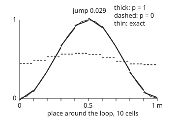
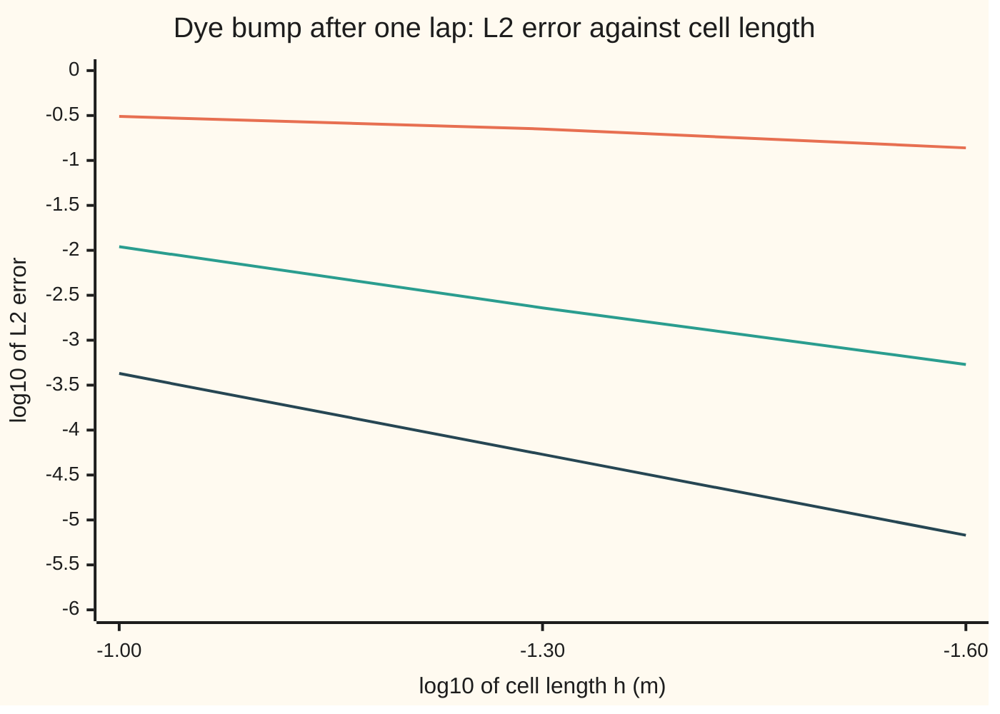

# Discontinuous Galerkin: finite elements that may jump at edges, joined by an upwind flux

[Syllabus](../../../SYLLABUS.md) → [Numerical analysis](../README.md) → [PDE Solvers](../README.md#s07) → Discontinuous Galerkin

---

## General Overview

A laboratory flume is a water channel bent into a closed ring. This one is 1 m around, and the water circulates at 1 m/s. A dose of dye is spread around the ring as a smooth bump: concentration 0 at the injection port, rising to a peak of 1 halfway round. The numbers are illustrative. With no mixing, the bump rides the current unchanged, so after one lap, 1 s later, the exact answer is the starting bump.

A flow model must find that answer itself. The wanted numbers are its error after one lap, and how fast that error falls as the grid is refined. The model cuts the ring into 10 cells, each 0.1 m long.

- **One number per cell** (the cell's average) is the upwind finite-volume scheme of [Flow problems](06-upwind-schemes-and-conservation-laws.md) in space, here stepped in time with the third-order method of Step 5. After one lap its highest cell reads 0.5725, where the true peak is 1. The bump is smeared.
- **A straight line per cell**, free to jump at every cell edge, keeps the peak. At the halfway point the two cells meeting there read 0.9903 and 1.0193: a jump of 0.0290 where the true curve has none. The overall error is 1.087e-2, against 3.078e-1 with one number per cell.

That second model is a **discontinuous Galerkin method**, DG for short: a finite-element method (the answer is built from simple shapes and tested against them) in which neighboring cells need not agree at their shared edge. The cells talk only through one number per edge, the **numerical flux**: the dye the method lets cross that edge. Taking it from the upstream side is the **upwind flux**.

Double the cells to 20 and then 40, and the straight-line error falls by 4.72 and then 4.24 times: order 2. Parabolas per cell fall by 8.03 and 8.01: order 3. Degree p gives order p + 1.

**Give each cell its own polynomial, let the cells disagree at their edges, and pass information across each edge only from the upstream side: the total of u² can then only fall, by exactly the sum of the squared jumps, so the method is stable, and its error falls like the cell length to the power p + 1.**

**What kind of fact this is:** a method. Its energy identity, and the stability that follows, are a theorem proved on this card in Why it works. The general error bound, order p + 1/2 on any mesh in any dimension, is a theorem stated with its source and not proved here. The full order p + 1 is also a theorem in one dimension, not proved here; the checks show it on the flume.

### The picture: one lap on 10 cells

<p align="center"></p>

To scale: 280 px per metre across, 160 px per unit of concentration up, from the checks' `figure,` lines. Thin: the exact bump. Thick: the straight-line DG answer, one segment per cell. Each segment ends a little above or below where the next begins; at the peak the gap is 0.029. Dashed: one number per cell, flattened to a peak of 0.5725.

---

## The formula

Notation first. The dye obeys the **advection equation** (the transport equation) $`u_t + c\,u_x = 0`$. Here $`u(x, t)`$ is the concentration at place $`x`$ (metres round the ring) and time $`t`$ (seconds), $`u_t`$ and $`u_x`$ are its rates of change in time and along the ring, and $`c`$ = 1 m/s is the water speed.

Cut the ring into $`N`$ cells of length $`h = 1/N`$. Inside each cell, measure position by a local coordinate $`\xi`$ that runs from −1 at the cell's left edge to +1 at its right edge. (This $`\xi`$ is a position, not the wave number in the amplification factor $`g(\xi)`$ of [Von Neumann analysis](03-von-neumann-analysis-and-the-cfl-condition.md).) On cell $`j`$ the DG answer is a polynomial of degree $`p`$:

```math
u_h(x, t) = \sum_{k=0}^{p} a_{j,k}(t)\,P_k(\xi), \qquad P_0 = 1,\quad P_1 = \xi,\quad P_2 = \tfrac{1}{2}(3\xi^2 - 1).
```

The $`P_k`$ are the Legendre polynomials, the same ones whose zeros are the nodes of [Gaussian quadrature](../05-Quadrature/03-gaussian-quadrature.md). The numbers $`a_{j,k}`$ are the unknowns: $`a_{j,0}`$ is the cell's average and $`a_{j,1}`$ its half-slope across the cell.

At each edge two values meet. Write $`u^-`$ for the value arriving from the cell on the left and $`u^+`$ for the value from the cell on the right. The **jump** is $`[u] = u^+ - u^-`$. The DG step replaces both by one flux $`\hat F`$. With water flowing to the right ($`c > 0`$), the upwind flux is $`\hat F = c\,u^-`$.

Each cell then obeys its own small set of $`p + 1`$ equations:

```math
\frac{h}{2k+1}\,\frac{d a_{j,k}}{dt} \;=\; c\int_{-1}^{1} u_h\,P_k'(\xi)\,d\xi \;-\; \Big(\hat F_{j+1/2} - (-1)^k\,\hat F_{j-1/2}\Big), \qquad k = 0, 1, \dots, p.
```

**Read it aloud:** the rate of change of each coefficient, weighted by the cell's own small mass, equals what the flow carries across the inside of the cell, minus what the flux takes out through the right edge, plus what it brings in through the left edge.

Subscripts $`j \pm 1/2`$ mark the right and left edges of cell $`j`$. The factor $`h/(2k+1)`$ is the cell's **mass matrix**, the table of integrals $`\int P_k P_m\,dx`$. Legendre polynomials are orthogonal (two different ones multiply to an integral of zero), so the table is diagonal.

The second result is the energy identity. Call $`E = \int_0^1 u_h^2\,dx`$ the **energy**. With the upwind flux,

```math
\frac{dE}{dt} \;=\; -\,c \sum_{\text{edges}} [u]^2 \;\le\; 0.
```

**Read it aloud:** the total of u squared falls at a rate equal to the water speed times the sum, over every edge, of the squared jump there; it can never rise.

| Symbol | Plain meaning | In our example | Push it up and the answer… |
| --- | --- | --- | --- |
| $`u`$; $`u_t`$, $`u_x`$ | dye concentration; its rate of change in time, along the ring | bump $`\sin^2(\pi x)`$, peak 1 | — |
| $`x`$, $`t`$ | place round the ring, m; time, s | 0 to 1 m; one lap is 1 s | — |
| $`c`$ | water speed | 1 m/s | the bump laps faster |
| $`N`$, $`h`$ | number of cells; cell length $`1/N`$ | 10, 20, 40; 0.1, 0.05, 0.025 m | more cells: error falls like $`h^{p+1}`$ |
| $`p`$ | polynomial degree in each cell | 0, 1, 2 | order $`p + 1`$, more numbers per cell |
| $`\xi`$, $`P_k`$ | position inside a cell, −1 to 1; Legendre polynomial of degree $`k`$ | $`P_1 = \xi`$ | — |
| $`a_{j,k}`$, $`u_h`$ | coefficient $`k`$ in cell $`j`$; the DG answer they build | cell [0.4, 0.5] m at the start: 0.967745, 0.048063 | — |
| $`u^-`$, $`u^+`$ | value at an edge from the left cell; from the right cell | at 0.5 m after one lap: 0.9903, 1.0193 | — |
| $`[u]`$ | jump $`u^+ - u^-`$ at an edge | 0.0290 at 0.5 m | more energy lost |
| $`\hat F`$, $`\beta`$ | numerical flux; its mix, $`\hat F = c\big(\tfrac{u^- + u^+}{2} - \tfrac{\beta}{2}[u]\big)`$ | upwind: $`\beta = 1`$, so $`\hat F = c\,u^-`$; not the inf-sup constant $`\beta_h`$ of [Mixed finite elements](13-mixed-finite-elements-and-the-inf-sup-condition.md) | more damping of jumps; below 0, growth |
| $`E`$ | energy $`\int u_h^2\,dx`$ | 0.374973 at the start, 0.369978 after one lap | — |
| $`\Delta t`$, $`\nu`$, $`e`$ | time step; Courant number $`c\,\Delta t/h`$; error $`\big(\int (u_h - u)^2 dx\big)^{1/2}`$ | $`\nu h`$; 0.1; 1.087e-2 for $`p = 1`$, 10 cells | — |

The error $`e`$ is the **L2 error**: the square root of the area under the squared gap between computed and true curves.

### When it holds

- **The flux reads from upstream.** Stability needs $`\beta \ge 0`$; the identity itself holds for every $`\beta`$. The downwind flux, $`\beta = -1`$, makes the energy grow instead: with straight lines on 10 cells it reaches 10^44.3 in one lap.
- **The speed is steady and the equation linear.** The proof uses a constant $`c`$. For a speed that depends on $`u`$, as in gas flow, the flux comes from [Godunov's method](11-godunov-method-and-riemann-solvers.md) and shocks need a limiter.
- **The solution is smooth, for the p + 1 rate.** From a square pulse, straight-line DG overshoots to 1.0779 and dips to −0.0779.
- **The time stepper is stable for this scheme.** The identity holds in exact time. Forward Euler steps with straight lines raise the energy from 0.3750 to 0.4280 in one lap, even at $`\nu`$ = 0.1.

---

## Why it works

### Step 0: one small finite-element problem per cell, joined at the edges

[Finite elements](07-finite-elements-galerkin-and-hat-functions.md) asks the equation to hold on average against test functions, and its hat functions force the answer to be continuous. DG drops that demand. Each cell gets its own polynomial and its own test functions, and is solved as if it were alone.

A cell alone does not know what enters through its left edge. The flux supplies it: what enters cell $`j`$ is what left cell $`j - 1`$, so the flux reads the upstream value. The jumps between cells are not a defect. They are where the method sheds energy.

### Step 1: the cell equations, by integration by parts

On cell $`j`$, multiply $`u_t + c\,u_x = 0`$ by a test polynomial $`v`$ and integrate over the cell. Move the $`x`$-derivative from $`u`$ onto $`v`$ by integration by parts. That leaves an integral inside the cell and two edge terms, $`c\,u\,v`$ at the right edge minus the same at the left edge.

At the edges $`u`$ has two values, so the edge terms are ambiguous. DG replaces each with the flux $`\hat F`$:

```math
\int_{\text{cell}} u_t\,v\,dx \;=\; c\int_{\text{cell}} u\,v_x\,dx \;-\; \hat F_{j+1/2}\,v^-_{j+1/2} \;+\; \hat F_{j-1/2}\,v^+_{j-1/2}.
```

Now take $`v = P_k`$. Three facts turn this into The formula:

- $`P_k(1) = 1`$ and $`P_k(-1) = (-1)^k`$, which gives the edge terms.
- With $`dx = \tfrac{h}{2}\,d\xi`$ and orthogonality, $`\int u_t P_k\,dx = \tfrac{h}{2k+1}\,\tfrac{da_{j,k}}{dt}`$: a diagonal mass matrix.
- $`P_k'`$ is a sum of lower Legendre polynomials, so the inside integral is a short sum: $`\int u_h P_k'\,d\xi = 2\sum a_{j,m}`$ over $`m < k`$ with $`k - m`$ odd.

For straight lines ($`p = 1`$) with $`c`$ = 1, writing $`u^-_{j\pm1/2}`$ for the upwind edge values:

```math
h\,\frac{da_{j,0}}{dt} = -\big(u^-_{j+1/2} - u^-_{j-1/2}\big), \qquad \frac{h}{3}\,\frac{da_{j,1}}{dt} = 2a_{j,0} - u^-_{j+1/2} - u^-_{j-1/2}.
```

The first line keeps the dye: what leaves one cell enters the next, so the total $`\sum h\,a_{j,0}`$ never changes.

The diagonal mass matrix means an explicit step needs no linear solve, only a fixed number of operations per unknown. Continuous finite elements couple neighboring nodes through their mass matrix, which must be solved every step.

### Step 2: p = 0 is the upwind finite-volume scheme

With $`p = 0`$ the inside integral is empty and only the first line remains: $`h\,\tfrac{da_{j,0}}{dt} = -c\,(a_{j,0} - a_{j-1,0})`$. One Euler step of length $`\Delta t`$ gives

```math
a_{j,0}^{\text{new}} = a_{j,0} - \nu\,\big(a_{j,0} - a_{j-1,0}\big),
```

the upwind step of [Flow problems](06-upwind-schemes-and-conservation-laws.md) to the letter. The check runs both for 13 steps at $`\nu`$ = 0.8; they differ by 1.110e-16, one rounding in the flux formula. So DG is the finite-volume idea with more numbers per cell, and its accuracy comes from those extra numbers.

### Step 3: the energy identity, which is the stability proof

Take the test function to be the answer itself, $`v = u_h`$, in every cell, and add over the cells. Each inside integral becomes $`\tfrac{c}{2}`$ times the change in $`u_h^2`$ across its cell. Collected by edges, each edge with left value $`a = u^-`$ and right value $`b = u^+`$ contributes

```math
(a - b)\Big(\frac{a + b}{2}\,c - \hat F\Big) \;=\; -\,\frac{\beta\,c}{2}\,(a - b)^2.
```

The left sides, added over the cells, give $`\int u_t u\,dx = \tfrac{1}{2}\tfrac{dE}{dt}`$. So $`\tfrac{dE}{dt} = -\beta\,c\sum[u]^2`$. For the upwind flux $`\beta = 1`$, which is the identity in The formula.

The check computes both sides at the start for straight lines on 10 cells, three ways:

| Flux | $`\beta`$ | $`dE/dt`$ from the cell equations | $`-\beta\sum[u]^2`$ |
| --- | --- | --- | --- |
| upwind | 1 | −0.00032920 | −0.00032920 |
| central | 0 | +0.00000000 | +0.00000000 |
| downwind | −1 | +0.00032920 | +0.00032920 |

Over the whole lap the energy falls from 0.374973 to 0.369978, a loss of 0.004995. The time integral of the squared jumps is 0.004981. The gap, 1.441e-5, is the Runge-Kutta step's own small damping, which the identity (a statement about exact time) leaves out. Halving the step, to $`\nu`$ = 0.05, cuts the gap to 1.787e-6, 8.06 times smaller, as the error of a third-order step should.

The difference of two DG answers is itself a DG answer, so its energy falls too. A change in the starting data cannot grow: stability, for every degree and every cell length.

<details>
<summary>Detailed proof: the energy identity, edge by edge</summary>

Put $`v = u_h`$ into the cell equation of Step 1 on cell $`j`$:

$`\displaystyle \tfrac{1}{2}\tfrac{d}{dt}\int_{\text{cell } j} u_h^2\,dx = c\int_{\text{cell } j} u_h\,(u_h)_x\,dx - \hat F_{j+1/2}\,u^-_{j+1/2} + \hat F_{j-1/2}\,u^+_{j-1/2}.`$

Inside the cell, $`u_h (u_h)_x = \tfrac{1}{2}(u_h^2)_x`$, so the integral is $`\tfrac{c}{2}\big((u^-_{j+1/2})^2 - (u^+_{j-1/2})^2\big)`$.

Add over all cells of the ring. Each edge appears twice: as the right edge of the cell on its left, with value $`a = u^-`$, and as the left edge of the cell on its right, with value $`b = u^+`$. Its total contribution is

$`\displaystyle \tfrac{c}{2}a^2 - \hat F a - \tfrac{c}{2}b^2 + \hat F b = (a - b)\Big(\tfrac{c}{2}(a + b) - \hat F\Big).`$

With $`\hat F = c\big(\tfrac{a+b}{2} - \tfrac{\beta}{2}(b - a)\big)`$ the bracket is $`\tfrac{\beta c}{2}(b - a)`$, and the contribution is $`-\tfrac{\beta c}{2}(a - b)^2`$. The ring has no boundary, so nothing else is left:

$`\displaystyle \tfrac{d}{dt}\int_0^1 u_h^2\,dx = -\beta\,c\sum_{\text{edges}}(u^+ - u^-)^2.`$

For $`\beta = 1`$ this is $`\hat F = c\,a = c\,u^-`$, the upwind flux. The Lax-Friedrichs flux, whose damping speed is at least $`c`$, is the same formula with $`\beta`$ equal to that speed divided by $`c`$, so $`\beta \ge 1`$: it is stable too, and damps the jumps harder.

</details>

### Step 4: why the error falls like h to the power p + 1

A smooth curve looks like a polynomial of degree $`p`$ on a short enough cell, missing by a term of size $`h^{p+1}`$ (Taylor's theorem). The best degree-$`p`$ fit in each cell therefore misses by about $`h^{p+1}`$. Stability, Step 3, stops that local miss from growing as it is carried around the ring.

The proof that survives on every grid loses half a power. **Johnson and Pitkäranta's theorem** (1986): for a smooth solution, the DG error with the upwind flux is at most a constant times $`h^{p+1/2}`$. This card states it with its source and does not prove it; the proof needs the Sobolev-space tools of [Weak derivatives](../../18-Functional%20analysis/04-Distributions%20and%20Sobolev%20Spaces/07-weak-derivatives-and-sobolev-spaces.md). It sits beside the continuous finite-element estimate of [Assembly and error](08-finite-element-assembly-and-error.md). On general meshes the half power is not slack: Peterson (1991) built two-dimensional triangle meshes on which the error really falls only that fast. In one dimension a sharper argument gives the full order $`p + 1`$ on any grid, and the flume shows it:

| Degree | Error, 10 cells | 20 cells | 40 cells | Ratios | Observed order, last pair |
| --- | --- | --- | --- | --- | --- |
| $`p = 0`$ | 3.078e-1 | 2.232e-1 | 1.385e-1 | 1.38, 1.61 | 0.69 |
| $`p = 1`$ | 1.087e-2 | 2.301e-3 | 5.427e-4 | 4.72, 4.24 | 2.08 |
| $`p = 2`$ | 4.304e-4 | 5.361e-5 | 6.697e-6 | 8.03, 8.01 | 3.00 |

These are true errors, against the exact bump. The $`p = 0`$ ratios climb toward 2 only slowly, because the smear is still large at these sizes. The $`p = 1`$ and $`p = 2`$ ratios sit at 4 and 8. Raising $`p`$ instead of cutting cells leads to [Spectral methods](10-spectral-methods-and-the-fft.md): one cell of very high degree is a spectral method, and many such cells form a spectral element method.



Orange: one number per cell ($`p = 0`$), slope well under 1 so far. Green: straight lines ($`p = 1`$), slope 2. Dark blue: parabolas ($`p = 2`$), slope 3. Each step right halves the cell length.

**The cost.** Straight lines on 40 cells use 80 unknowns for an error of 5.427e-4. One number per cell, at the order 1 it is heading for, would need about 10206 cells for the same error. That is an estimate from the 40-cell error, and an optimistic one, because $`p = 0`$ has not yet reached order 1.

### Step 5: march in time with a step of matching accuracy

The cell equations form one large system of ordinary differential equations (equations in time only). The check marches it with the third-order Runge-Kutta method of Shu and Osher. Its tableau, as on [Runge-Kutta](../06-ODE%20Solvers/01-runge-kutta-and-butcher-tableaux.md), has stage times 0, 1, 1/2, inner weights 1, then 1/4 and 1/4, and final weights 1/6, 1/6, 2/3. It is three Euler steps blended by averages, so with a limiter it keeps any no-overshoot bound that one limited Euler step keeps.

Forward Euler alone fails. Straight-line DG has waves just outside Euler's stability region at every fixed $`\nu`$, so the energy creeps up: 0.3750 to 0.4280 in one lap, 4.5182 in ten. The third-order step's larger stability region covers those waves. The Cockburn-Shu review gives $`\nu \le 1/(2p + 1)`$ as a safe rule; this card uses $`\nu`$ = 0.1.

### Step 6: jumps in the data need a limiter; diffusion needs a penalty

A square pulse has true jumps, and a polynomial overshoots beside them: straight-line DG reaches 1.0779 and −0.0779. A **slope limiter** fixes this after each stage. It keeps each cell's average and replaces its slope by the **minmod** of three candidates (the smallest in size if all share a sign, else zero): its own slope and the two differences of neighboring averages. This is the device of [Flux limiters](12-tvd-schemes-and-flux-limiters.md). The pulse then stays between 0.0002 and 0.9998. Left on for the smooth bump, the limiter clips the peak: the 40-cell error grows from 5.427e-4 to 5.847e-3.

For diffusion, as in the heat equation, the **interior penalty** method adds a term that charges each edge's jump times a large constant over $`h`$. This card gives the idea only; chapter 7 of Hesthaven and Warburton gives it in full. Another route writes diffusion as two first-order equations, as [Mixed finite elements](13-mixed-finite-elements-and-the-inf-sup-condition.md) does for the steel bar.

---

## Worked numbers, by hand

Straight lines on 10 cells, at the start, for the cell from 0.4 to 0.5 m. Its upstream neighbor is the cell from 0.3 to 0.4 m. The coefficients come from projecting the bump with a 5-point Gauss rule; the cell average is also checked against its closed form.

| Step | Arithmetic | Value |
| --- | --- | --- |
| cell average, closed form | $`\tfrac{1}{2} - \dfrac{\sin(2\pi \cdot 0.5) - \sin(2\pi \cdot 0.4)}{4\pi \times 0.1}`$ | 0.967745 |
| same, from the Gauss rule, $`a_{4,0}`$ | 5-point rule on the cell | 0.967745 |
| half-slope $`a_{4,1}`$ | 5-point rule | 0.048063 |
| neighbor's coefficients $`a_{3,0}`$, $`a_{3,1}`$ | 5-point rule | 0.789082, 0.125830 |
| upwind flux at 0.5 m, $`u^-`$ | $`0.967745 + 0.048063`$ | 1.015808 |
| upwind flux at 0.4 m, $`u^-`$ | $`0.789082 + 0.125830`$ | 0.914912 |
| rate of the average | $`-(1.015808 - 0.914912)/0.1`$ | **−1.008952** |
| rate of the half-slope | $`30 \times (2 \times 0.967745 - 1.015808 - 0.914912)`$ | **0.143082** |

The average falls because the peak is starting to leave the cell. The edge value 1.015808 already exceeds the true peak of 1: a straight line fitted to a curved top overshoots at its ends, and that is where the jumps come from.

### What breaks if you drop a piece

| Mistake | Comes out at | What went wrong |
| --- | --- | --- |
| downwind flux, $`\beta = -1`$ | energy 10^44.3 after one lap | $`dE/dt = +\sum[u]^2`$: every jump feeds growth |
| forward Euler steps with $`p = 1`$ | energy 0.3750 → 0.4280 in one lap, 4.5182 in ten | the time step is less stable than the space scheme |
| no limiter on a square pulse | highest 1.0779, lowest −0.0779 | a polynomial overshoots beside a true jump |
| limiter left on for a smooth bump | 40-cell error 5.847e-3, not 5.427e-4 | minmod flattens the smooth peak |
| central flux, $`\beta = 0`$ | 10-cell error 2.197e-2, against 1.087e-2 upwind | energy is kept, so jump noise is never damped |

The checks print all five.

---

## Code, from first principles, and it actually runs

The code builds the Gauss rule by Newton's method, projects the bump into each cell, and marches the cell equations with the third-order Runge-Kutta step. Three roads: the exact answer after one lap is the starting bump, so every error is true; the method at three degrees and three sizes gives the observed orders; and $`p = 0`$ is checked against the upwind step, the energy rate against the summed squared jumps, and the energy budget's small gap against the third-order time step. Python's `sum` adds floats with a compensated rule, so the script keeps a plain running total, as Rust does.

### Python

```python
# Discontinuous Galerkin for u_t + u_x = 0 on a 1 m loop -- the check behind the card.
# Standard library only; math supplies sin, cos, pi, sqrt, log2, log10.
# Road 1: after one lap the exact answer is the starting bump.  Road 2: DG with p = 0, 1, 2
# on 10, 20, 40 cells, and the observed orders.  Road 3: p = 0 against the upwind step of
# the Flow problems card, and the energy identity against the summed squared jumps.
from math import sin, cos, pi, sqrt, log2, log10

def sci(x): m, e = f"{x:.3e}".split("e"); return f"{m}e{int(e)}"   # Rust-style exponent
def P(k, x):                                  # Legendre polynomial P_k(x), by recurrence
    p0, p1 = 1.0, x
    if k == 0: return 1.0
    for n in range(1, k): p0, p1 = p1, ((2 * n + 1) * x * p1 - n * p0) / (n + 1)
    return p1
def gauss(n):                                 # Gauss-Legendre nodes and weights, by Newton
    xs, ws = [], []
    for i in range(n):
        x = cos(pi * (i + 0.75) / (n + 0.5))
        for _ in range(50): x -= P(n, x) * (x * x - 1) / (n * (x * P(n, x) - P(n - 1, x)))
        dp = n * (x * P(n, x) - P(n - 1, x)) / (x * x - 1)
        xs.append(x); ws.append(2 / ((1 - x * x) * dp * dp))
    return xs, ws
GX, GW = gauss(5)
def sq(v): return v * v
def tot(vals):                                # plain left-to-right sum, as Rust's sum() does
    s = 0.0
    for v in vals: s += v
    return s
def bump(x): return sq(sin(pi * x))            # the dye at t = 0; also the exact answer at t = 1
def square(x): return 1.0 if 0.25 <= x % 1.0 < 0.75 else 0.0

def project(f, N, p):                         # a[j][k]: Legendre coefficients in cell j
    return [[(2 * k + 1) / 2 * tot(w * f((j + (1 + x) / 2) / N) * P(k, x) for x, w in zip(GX, GW))
             for k in range(p + 1)] for j in range(N)]
def edges(a):                                 # values at each cell's right and left edge
    return [tot(c) for c in a], [tot(c * (-1) ** k for k, c in enumerate(cj)) for cj in a]
def jumps(a):                                 # sum over edges of (jump in u)^2
    R, L = edges(a); return tot(sq(R[j] - L[(j + 1) % len(a)]) for j in range(len(a)))
def rhs(a, beta):                             # da/dt; beta = 1 upwind, 0 central, -1 downwind
    N = len(a); R, L = edges(a)
    F = [0.5 * (R[j] + L[(j + 1) % N]) + 0.5 * beta * (R[j] - L[(j + 1) % N]) for j in range(N)]
    return [[(2 * k + 1) * N * (tot(2 * a[j][m] for m in range(k) if (k - m) % 2)
             - (F[j] - F[j - 1] * (-1) ** k)) for k in range(len(a[0]))] for j in range(N)]
def lin(s, A, t, B): return [[s * x + t * y for x, y in zip(r, q)] for r, q in zip(A, B)]
def minmod(a, b, c):
    if a > 0 and b > 0 and c > 0: return min(a, b, c)
    if a < 0 and b < 0 and c < 0: return max(a, b, c)
    return 0.0
def limit(a):                                 # p = 1 slope limiter: keep the mean, clip the slope
    N = len(a)
    return [[a[j][0], minmod(a[j][1], a[(j + 1) % N][0] - a[j][0], a[j][0] - a[j - 1][0])] for j in range(N)]
def run(p, N, beta=1.0, nu=0.1, laps=1, f=bump, euler=False, lim=False):
    a = project(f, N, p)
    n = round(laps * N / nu); dt = laps / n; lost = 0.0
    g = limit if lim else (lambda b: b)
    for _ in range(n):
        j0 = jumps(a)
        if euler: a = lin(1, a, dt, rhs(a, beta))
        else:                                 # three-stage, third-order Runge-Kutta (Shu-Osher)
            u1 = g(lin(1, a, dt, rhs(a, beta)))
            u2 = g(lin(0.75, a, 0.25, lin(1, u1, dt, rhs(u1, beta))))
            a = g(lin(1 / 3, a, 2 / 3, lin(1, u2, dt, rhs(u2, beta))))
        lost += dt * (j0 + jumps(a)) / 2      # trapezoid rule for the integral of the jumps
    return a, lost
def l2err(a, f=bump):
    N = len(a)
    return sqrt(tot(w / (2 * N) * sq(tot(c * P(k, x) for k, c in enumerate(a[j])) - f((j + (1 + x) / 2) / N))
                    for j in range(N) for x, w in zip(GX, GW)))
def energy(a): return tot(c * c / (len(a) * (2 * k + 1)) for cj in a for k, c in enumerate(cj))

print("loop 1 m, speed c = 1 m/s, one lap T = 1 s, dye u0 = sin(pi x)^2; exact answer after one lap = u0")
print("Gauss 5-point nodes: " + " ".join(f"{x:.6f}" for x in GX) + "; weights add to " + f"{tot(GW):.12f}")
g8 = tot(w * x ** 8 for x, w in zip(GX, GW))
b0 = project(bump, 10, 0); u = [c[0] for c in b0]; dg = b0
for _ in range(13):                           # road 3: p = 0 with Euler steps at nu = 0.8
    u = [u[j] - 0.8 * (u[j] - u[j - 1]) for j in range(10)]
    dg = lin(1, dg, 0.08, rhs(dg, 1.0))
d_up = max(abs(x - c[0]) for x, c in zip(u, dg))
print(f"p = 0, Euler steps, nu = 0.8, 13 steps: largest gap from the upwind step u - nu(u - u_left) = {sci(d_up)}")
print("L2 error after one lap, upwind flux, third-order Runge-Kutta, nu = 0.1:")
E = {}
for p in range(3):
    for N in (10, 20, 40):
        E[p, N] = l2err(run(p, N)[0])
        tail = f"  ratio {E[p, N // 2] / E[p, N]:.2f}  observed order {log2(E[p, N // 2] / E[p, N]):.2f}" if N > 10 else ""
        print(f"  p = {p}  N = {N:<3} h = {1 / N:<6} error {sci(E[p, N])}{tail}")
a1, lost = run(1, 10); R, L = edges(a1)
print(f"10 cells after one lap: p = 0 peak cell {max(c[0] for c in run(0, 10)[0]):.4f};"
      f" p = 1 at x = 0.5 left {R[4]:.4f}, right {L[5]:.4f}, jump {L[5] - R[4]:.4f}")
a = project(bump, 10, 1); R, L = edges(a); da = rhs(a, 1.0)
xl, xr = 0.4, 0.5
avg = 0.5 - (sin(2 * pi * xr) - sin(2 * pi * xl)) / (4 * pi * (xr - xl))
print(f"hand step, p = 1, 10 cells, t = 0: cell [0.3, 0.4] a0 {a[3][0]:.6f} a1 {a[3][1]:.6f};"
      f" cell [0.4, 0.5] a0 {a[4][0]:.6f} a1 {a[4][1]:.6f}")
print(f"  closed-form average of cell [0.4, 0.5] {avg:.6f}; edge values: 0.4 from the left {R[3]:.6f},"
      f" 0.5 from the left {R[4]:.6f}")
print(f"  da0/dt = -({R[4]:.6f} - {R[3]:.6f}) / 0.1 = {da[4][0]:.6f};"
      f" da1/dt = 30 x (2 x {a[4][0]:.6f} - {R[4]:.6f} - {R[3]:.6f}) = {da[4][1]:.6f}")
e0 = energy(a); a05, lost05 = run(1, 10, nu=0.05); gap, gap05 = e0 - energy(a1) - lost, e0 - energy(a05) - lost05
print(f"energy, p = 1, 10 cells: exact 3/8 = {0.375:.6f}; projected {e0:.6f}; after one lap {energy(a1):.6f}")
print(f"  lost over the lap {e0 - energy(a1):.6f}; time integral of the summed squared jumps {lost:.6f};"
      f" gap {sci(gap)}; at nu = 0.05 the gap is {sci(gap05)}, {gap / gap05:.2f} times smaller")
worst = 0.0
for beta, name in ((1.0, "upwind"), (0.0, "central"), (-1.0, "downwind")):
    r = rhs(a, beta)
    rate = tot(2 * a[j][k] * r[j][k] / (10 * (2 * k + 1)) for j in range(10) for k in range(2))
    worst = max(worst, abs(rate + beta * jumps(a)))
    print(f"  t = 0, {name:<8} flux: d/dt of the energy {rate:+.8f}; -beta x sum of squared jumps {-beta * jumps(a) + 0.0:+.8f}")
dn = energy(run(1, 10, beta=-1.0)[0]); eu1 = energy(run(1, 10, euler=True)[0])
eu10 = energy(run(1, 10, euler=True, laps=10)[0])
print(f"what breaks: downwind flux, p = 1, 10 cells: energy after one lap 10^{log10(dn):.1f}")
print(f"what breaks: Euler steps, p = 1, 10 cells, nu = 0.1: energy {e0:.4f} -> {eu1:.4f} after one lap, {eu10:.4f} after ten")
sqp, _ = run(1, 20, f=square); Rs, Ls = edges(sqp)
sl, _ = run(1, 20, f=square, lim=True); R2, L2 = edges(sl)
print(f"what breaks: square pulse, p = 1, 20 cells: highest {max(Rs + Ls):.4f}, lowest {min(Rs + Ls):.4f};"
      f" with the minmod limiter {max(R2 + L2):.4f} and {min(R2 + L2):.4f}")
lim40 = l2err(run(1, 40, lim=True)[0])
print(f"what breaks: limiter left on for the smooth bump, p = 1, 40 cells: error {sci(lim40)} against {sci(E[1, 40])}")
cen = [l2err(run(1, N, beta=0.0)[0]) for N in (10, 20, 40)]
print("central flux, p = 1, N = 10, 20, 40: errors " + ", ".join(sci(e) for e in cen))
need = E[0, 40] * 40 / E[1, 40]
print(f"cost: p = 1 on 40 cells is 80 unknowns for {sci(E[1, 40])}; p = 0 at order 1 would need about {need:.0f} cells (estimate)")
print("chart, log10 h: " + ", ".join(f"{log10(1 / N):.2f}" for N in (10, 20, 40)))
for p in range(3): print(f"chart, p = {p} log10 error: " + ", ".join(f"{log10(E[p, N]):.2f}" for N in (10, 20, 40)))
X = lambda x: 40 + 280 * x; Y = lambda v: 200 - 160 * v
print("figure, p = 1 segments: " + " ".join(f"({X(j / 10):.1f},{Y(L[j]):.1f})-({X((j + 1) / 10):.1f},{Y(R[j]):.1f})"
      for R, L in [edges(a1)] for j in range(10)))
print("figure, exact curve y at x = 0, 0.05, ..., 1: " + " ".join(f"{Y(bump(i / 20)):.1f}" for i in range(21)))
print("figure, p = 0 steps y: " + " ".join(f"{Y(c[0]):.1f}" for c in run(0, 10)[0]))

assert abs(tot(GW) - 2) < 1e-14 and abs(g8 - 2 / 9) < 1e-14   # Gauss: exact to degree 9
assert d_up < 1e-15                                          # p = 0 is the upwind step
assert abs(a[4][0] - avg) < 1e-12                            # projection meets the closed form
assert 1.2 < E[0, 20] / E[0, 40] < 2.2                       # p = 0: order toward 1
assert 3.6 < E[1, 20] / E[1, 40] < 4.6 and 7.2 < E[2, 20] / E[2, 40] < 8.8   # orders 2 and 3
assert worst < 1e-12                                         # energy rate = -beta x jumps
assert abs(gap) < 5e-3 * lost and 6 < gap / gap05 < 10 and energy(a1) < e0   # gap: the time step's own error
assert dn > 1e10 and eu1 > e0 and eu10 > 10 * e0             # the failures really fail
assert max(Rs + Ls) > 1.05 and -1e-12 < min(R2 + L2) and max(R2 + L2) < 1 + 1e-12
print("ALL CHECKS PASS")
```

**Ran 2026-11-24 on macOS, Python 3.14.10, standard library only. All checks passed. Output, pasted from the run:**

```
loop 1 m, speed c = 1 m/s, one lap T = 1 s, dye u0 = sin(pi x)^2; exact answer after one lap = u0
Gauss 5-point nodes: 0.906180 0.538469 0.000000 -0.538469 -0.906180; weights add to 2.000000000000
p = 0, Euler steps, nu = 0.8, 13 steps: largest gap from the upwind step u - nu(u - u_left) = 1.110e-16
L2 error after one lap, upwind flux, third-order Runge-Kutta, nu = 0.1:
  p = 0  N = 10  h = 0.1    error 3.078e-1
  p = 0  N = 20  h = 0.05   error 2.232e-1  ratio 1.38  observed order 0.46
  p = 0  N = 40  h = 0.025  error 1.385e-1  ratio 1.61  observed order 0.69
  p = 1  N = 10  h = 0.1    error 1.087e-2
  p = 1  N = 20  h = 0.05   error 2.301e-3  ratio 4.72  observed order 2.24
  p = 1  N = 40  h = 0.025  error 5.427e-4  ratio 4.24  observed order 2.08
  p = 2  N = 10  h = 0.1    error 4.304e-4
  p = 2  N = 20  h = 0.05   error 5.361e-5  ratio 8.03  observed order 3.01
  p = 2  N = 40  h = 0.025  error 6.697e-6  ratio 8.01  observed order 3.00
10 cells after one lap: p = 0 peak cell 0.5725; p = 1 at x = 0.5 left 0.9903, right 1.0193, jump 0.0290
hand step, p = 1, 10 cells, t = 0: cell [0.3, 0.4] a0 0.789082 a1 0.125830; cell [0.4, 0.5] a0 0.967745 a1 0.048063
  closed-form average of cell [0.4, 0.5] 0.967745; edge values: 0.4 from the left 0.914912, 0.5 from the left 1.015808
  da0/dt = -(1.015808 - 0.914912) / 0.1 = -1.008952; da1/dt = 30 x (2 x 0.967745 - 1.015808 - 0.914912) = 0.143082
energy, p = 1, 10 cells: exact 3/8 = 0.375000; projected 0.374973; after one lap 0.369978
  lost over the lap 0.004995; time integral of the summed squared jumps 0.004981; gap 1.441e-5; at nu = 0.05 the gap is 1.787e-6, 8.06 times smaller
  t = 0, upwind   flux: d/dt of the energy -0.00032920; -beta x sum of squared jumps -0.00032920
  t = 0, central  flux: d/dt of the energy +0.00000000; -beta x sum of squared jumps +0.00000000
  t = 0, downwind flux: d/dt of the energy +0.00032920; -beta x sum of squared jumps +0.00032920
what breaks: downwind flux, p = 1, 10 cells: energy after one lap 10^44.3
what breaks: Euler steps, p = 1, 10 cells, nu = 0.1: energy 0.3750 -> 0.4280 after one lap, 4.5182 after ten
what breaks: square pulse, p = 1, 20 cells: highest 1.0779, lowest -0.0779; with the minmod limiter 0.9998 and 0.0002
what breaks: limiter left on for the smooth bump, p = 1, 40 cells: error 5.847e-3 against 5.427e-4
central flux, p = 1, N = 10, 20, 40: errors 2.197e-2, 4.978e-3, 1.202e-3
cost: p = 1 on 40 cells is 80 unknowns for 5.427e-4; p = 0 at order 1 would need about 10206 cells (estimate)
chart, log10 h: -1.00, -1.30, -1.60
chart, p = 0 log10 error: -0.51, -0.65, -0.86
chart, p = 1 log10 error: -1.96, -2.64, -3.27
chart, p = 2 log10 error: -3.37, -4.27, -5.17
figure, p = 1 segments: (40.0,203.1)-(68.0,183.9) (68.0,186.5)-(96.0,145.0) (96.0,144.5)-(124.0,96.5) (124.0,93.2)-(152.0,57.0) (152.0,52.1)-(180.0,41.5) (180.0,36.9)-(208.0,56.1) (208.0,53.5)-(236.0,95.0) (236.0,95.5)-(264.0,143.5) (264.0,146.8)-(292.0,183.0) (292.0,187.9)-(320.0,198.5)
figure, exact curve y at x = 0, 0.05, ..., 1: 200.0 196.1 184.7 167.0 144.7 120.0 95.3 73.0 55.3 43.9 40.0 43.9 55.3 73.0 95.3 120.0 144.7 167.0 184.7 196.1 200.0
figure, p = 0 steps y: 128.8 122.6 115.4 110.0 108.4 111.2 117.4 124.6 130.0 131.6
ALL CHECKS PASS
```

### Rust

Same method, same labels, same output, built with `rustc --edition 2021 -O`.

```rust
// Discontinuous Galerkin for u_t + u_x = 0 on a 1 m loop -- the same check in Rust, std only.
// Road 1: after one lap the exact answer is the starting bump.  Road 2: DG with p = 0, 1, 2
// on 10, 20, 40 cells, and the observed orders.  Road 3: p = 0 against the upwind step of
// the Flow problems card, and the energy identity against the summed squared jumps.
use std::f64::consts::PI;
type Dg = Vec<Vec<f64>>;

fn sci(x: f64) -> String { format!("{:.3e}", x) }
fn leg(k: usize, x: f64) -> f64 {              // Legendre polynomial P_k(x), by recurrence
    if k == 0 { return 1.0; }
    let (mut p0, mut p1) = (1.0, x);
    for n in 1..k { let p2 = ((2 * n + 1) as f64 * x * p1 - n as f64 * p0) / (n + 1) as f64; p0 = p1; p1 = p2; }
    p1
}
fn gauss(n: usize) -> (Vec<f64>, Vec<f64>) {   // Gauss-Legendre nodes and weights, by Newton
    let (mut xs, mut ws) = (vec![], vec![]);
    let nf = n as f64;
    for i in 0..n {
        let mut x = (PI * (i as f64 + 0.75) / (nf + 0.5)).cos();
        for _ in 0..50 { x -= leg(n, x) * (x * x - 1.0) / (nf * (x * leg(n, x) - leg(n - 1, x))); }
        let dp = nf * (x * leg(n, x) - leg(n - 1, x)) / (x * x - 1.0);
        xs.push(x); ws.push(2.0 / ((1.0 - x * x) * dp * dp));
    }
    (xs, ws)
}
fn bump(x: f64) -> f64 { (PI * x).sin().powi(2) }
fn square(x: f64) -> f64 { let y = x.rem_euclid(1.0); if 0.25 <= y && y < 0.75 { 1.0 } else { 0.0 } }

struct Q { gx: Vec<f64>, gw: Vec<f64> }
impl Q {
    fn project(&self, f: fn(f64) -> f64, n: usize, p: usize) -> Dg {
        (0..n).map(|j| (0..=p).map(|k| (2 * k + 1) as f64 / 2.0 * self.gx.iter().zip(&self.gw)
            .map(|(&x, &w)| w * f((j as f64 + (1.0 + x) / 2.0) / n as f64) * leg(k, x)).sum::<f64>()).collect()).collect()
    }
    fn l2err(&self, a: &Dg, f: fn(f64) -> f64) -> f64 {
        let n = a.len(); let mut s = 0.0;
        for j in 0..n { for (&x, &w) in self.gx.iter().zip(&self.gw) {
            let uh: f64 = a[j].iter().enumerate().map(|(k, &c)| c * leg(k, x)).sum();
            s += w / (2 * n) as f64 * (uh - f((j as f64 + (1.0 + x) / 2.0) / n as f64)).powi(2);
        } }
        s.sqrt()
    }
}
fn sgn(k: usize) -> f64 { if k % 2 == 0 { 1.0 } else { -1.0 } }
fn edges(a: &Dg) -> (Vec<f64>, Vec<f64>) {     // values at each cell's right and left edge
    (a.iter().map(|c| c.iter().sum()).collect(),
     a.iter().map(|c| c.iter().enumerate().map(|(k, &v)| v * sgn(k)).sum()).collect())
}
fn jumps(a: &Dg) -> f64 {                      // sum over edges of (jump in u)^2
    let (r, l) = edges(a); let n = a.len();
    (0..n).map(|j| (r[j] - l[(j + 1) % n]).powi(2)).sum()
}
fn rhs(a: &Dg, beta: f64) -> Dg {              // da/dt; beta = 1 upwind, 0 central, -1 downwind
    let n = a.len(); let (r, l) = edges(a);
    let f: Vec<f64> = (0..n).map(|j| 0.5 * (r[j] + l[(j + 1) % n]) + 0.5 * beta * (r[j] - l[(j + 1) % n])).collect();
    (0..n).map(|j| (0..a[0].len()).map(|k| {
        let vol: f64 = (0..k).filter(|m| (k - m) % 2 == 1).map(|m| 2.0 * a[j][m]).sum();
        (2 * k + 1) as f64 * n as f64 * (vol - (f[j] - f[(j + n - 1) % n] * sgn(k)))
    }).collect()).collect()
}
fn lin(s: f64, a: &Dg, t: f64, b: &Dg) -> Dg {
    a.iter().zip(b).map(|(r, q)| r.iter().zip(q).map(|(x, y)| s * x + t * y).collect()).collect()
}
fn minmod(a: f64, b: f64, c: f64) -> f64 {
    if a > 0.0 && b > 0.0 && c > 0.0 { return a.min(b).min(c); }
    if a < 0.0 && b < 0.0 && c < 0.0 { return a.max(b).max(c); }
    0.0
}
fn limit(a: Dg) -> Dg {                        // p = 1 slope limiter: keep the mean, clip the slope
    let n = a.len();
    (0..n).map(|j| vec![a[j][0], minmod(a[j][1], a[(j + 1) % n][0] - a[j][0], a[j][0] - a[(j + n - 1) % n][0])]).collect()
}
fn run(q: &Q, p: usize, n: usize, beta: f64, laps: f64, f: fn(f64) -> f64, euler: bool, lim: bool, nu: f64) -> (Dg, f64) {
    let mut a = q.project(f, n, p);
    let steps = (laps * n as f64 / nu).round() as usize; let dt = laps / steps as f64; let mut lost = 0.0;
    let g = |b: Dg| if lim { limit(b) } else { b };
    for _ in 0..steps {
        let j0 = jumps(&a);
        if euler { a = lin(1.0, &a, dt, &rhs(&a, beta)); } else {   // three-stage, third-order Runge-Kutta
            let u1 = g(lin(1.0, &a, dt, &rhs(&a, beta)));
            let u2 = g(lin(0.75, &a, 0.25, &lin(1.0, &u1, dt, &rhs(&u1, beta))));
            a = g(lin(1.0 / 3.0, &a, 2.0 / 3.0, &lin(1.0, &u2, dt, &rhs(&u2, beta))));
        }
        lost += dt * (j0 + jumps(&a)) / 2.0;       // trapezoid rule for the integral of the jumps
    }
    (a, lost)
}
fn energy(a: &Dg) -> f64 {
    a.iter().flat_map(|c| c.iter().enumerate().map(|(k, &v)| v * v / (a.len() * (2 * k + 1)) as f64)).sum()
}
fn mx(v: &[f64]) -> f64 { v.iter().fold(f64::MIN, |m, &x| m.max(x)) }
fn mn(v: &[f64]) -> f64 { v.iter().fold(f64::MAX, |m, &x| m.min(x)) }
fn join(v: Vec<String>, s: &str) -> String { v.join(s) }

fn main() {
    let (gx, gw) = gauss(5); let q = Q { gx, gw };
    let sm = |p: usize, n: usize| run(&q, p, n, 1.0, 1.0, bump, false, false, 0.1);
    println!("loop 1 m, speed c = 1 m/s, one lap T = 1 s, dye u0 = sin(pi x)^2; exact answer after one lap = u0");
    println!("Gauss 5-point nodes: {}; weights add to {:.12}", join(q.gx.iter().map(|x| format!("{:.6}", x)).collect(), " "), q.gw.iter().sum::<f64>());
    let g8: f64 = q.gx.iter().zip(&q.gw).map(|(&x, &w)| w * x.powi(8)).sum();
    let b0 = q.project(bump, 10, 0); let mut u: Vec<f64> = b0.iter().map(|c| c[0]).collect(); let mut dg = b0.clone();
    for _ in 0..13 {                           // road 3: p = 0 with Euler steps at nu = 0.8
        u = (0..10).map(|j| u[j] - 0.8 * (u[j] - u[(j + 9) % 10])).collect();
        dg = lin(1.0, &dg, 0.08, &rhs(&dg, 1.0));
    }
    let d_up = u.iter().zip(&dg).fold(0.0f64, |m, (x, c)| m.max((x - c[0]).abs()));
    println!("p = 0, Euler steps, nu = 0.8, 13 steps: largest gap from the upwind step u - nu(u - u_left) = {}", sci(d_up));
    println!("L2 error after one lap, upwind flux, third-order Runge-Kutta, nu = 0.1:");
    let mut e = [[0.0f64; 3]; 3]; let ns = [10usize, 20, 40];
    for p in 0..3 { for i in 0..3 {
        e[p][i] = q.l2err(&sm(p, ns[i]).0, bump);
        let tail = if i > 0 { format!("  ratio {:.2}  observed order {:.2}", e[p][i - 1] / e[p][i], (e[p][i - 1] / e[p][i]).log2()) } else { String::new() };
        println!("  p = {}  N = {:<3} h = {:<6} error {}{}", p, ns[i], 1.0 / ns[i] as f64, sci(e[p][i]), tail);
    } }
    let (a1, lost) = sm(1, 10); let (r, l) = edges(&a1);
    println!("10 cells after one lap: p = 0 peak cell {:.4}; p = 1 at x = 0.5 left {:.4}, right {:.4}, jump {:.4}",
             mx(&sm(0, 10).0.iter().map(|c| c[0]).collect::<Vec<_>>()), r[4], l[5], l[5] - r[4]);
    let a = q.project(bump, 10, 1); let (r, _l) = edges(&a); let da = rhs(&a, 1.0);
    let (xl, xr) = (0.4, 0.5);
    let avg = 0.5 - ((2.0 * PI * xr).sin() - (2.0 * PI * xl).sin()) / (4.0 * PI * (xr - xl));
    println!("hand step, p = 1, 10 cells, t = 0: cell [0.3, 0.4] a0 {:.6} a1 {:.6}; cell [0.4, 0.5] a0 {:.6} a1 {:.6}", a[3][0], a[3][1], a[4][0], a[4][1]);
    println!("  closed-form average of cell [0.4, 0.5] {:.6}; edge values: 0.4 from the left {:.6}, 0.5 from the left {:.6}", avg, r[3], r[4]);
    println!("  da0/dt = -({:.6} - {:.6}) / 0.1 = {:.6}; da1/dt = 30 x (2 x {:.6} - {:.6} - {:.6}) = {:.6}",
             r[4], r[3], da[4][0], a[4][0], r[4], r[3], da[4][1]);
    let e0 = energy(&a); let (a05, lost05) = run(&q, 1, 10, 1.0, 1.0, bump, false, false, 0.05); let (gap, gap05) = (e0 - energy(&a1) - lost, e0 - energy(&a05) - lost05);
    println!("energy, p = 1, 10 cells: exact 3/8 = {:.6}; projected {:.6}; after one lap {:.6}", 0.375, e0, energy(&a1));
    println!("  lost over the lap {:.6}; time integral of the summed squared jumps {:.6}; gap {}; at nu = 0.05 the gap is {}, {:.2} times smaller",
             e0 - energy(&a1), lost, sci(gap), sci(gap05), gap / gap05);
    let mut worst = 0.0f64;
    for (beta, name) in [(1.0, "upwind"), (0.0, "central"), (-1.0, "downwind")] {
        let rr = rhs(&a, beta); let mut rate = 0.0;
        for j in 0..10 { for k in 0..2 { rate += 2.0 * a[j][k] * rr[j][k] / (10 * (2 * k + 1)) as f64; } }
        worst = worst.max((rate + beta * jumps(&a)).abs());
        println!("  t = 0, {:<8} flux: d/dt of the energy {:+.8}; -beta x sum of squared jumps {:+.8}", name, rate, -beta * jumps(&a) + 0.0);
    }
    let dn = energy(&run(&q, 1, 10, -1.0, 1.0, bump, false, false, 0.1).0);
    let eu1 = energy(&run(&q, 1, 10, 1.0, 1.0, bump, true, false, 0.1).0);
    let eu10 = energy(&run(&q, 1, 10, 1.0, 10.0, bump, true, false, 0.1).0);
    println!("what breaks: downwind flux, p = 1, 10 cells: energy after one lap 10^{:.1}", dn.log10());
    println!("what breaks: Euler steps, p = 1, 10 cells, nu = 0.1: energy {:.4} -> {:.4} after one lap, {:.4} after ten", e0, eu1, eu10);
    let (rs, ls) = edges(&run(&q, 1, 20, 1.0, 1.0, square, false, false, 0.1).0); let s1 = [rs, ls].concat();
    let (r2, l2) = edges(&run(&q, 1, 20, 1.0, 1.0, square, false, true, 0.1).0); let s2 = [r2, l2].concat();
    println!("what breaks: square pulse, p = 1, 20 cells: highest {:.4}, lowest {:.4}; with the minmod limiter {:.4} and {:.4}", mx(&s1), mn(&s1), mx(&s2), mn(&s2));
    let lim40 = q.l2err(&run(&q, 1, 40, 1.0, 1.0, bump, false, true, 0.1).0, bump);
    println!("what breaks: limiter left on for the smooth bump, p = 1, 40 cells: error {} against {}", sci(lim40), sci(e[1][2]));
    let cen: Vec<String> = ns.iter().map(|&n| sci(q.l2err(&run(&q, 1, n, 0.0, 1.0, bump, false, false, 0.1).0, bump))).collect();
    println!("central flux, p = 1, N = 10, 20, 40: errors {}", cen.join(", "));
    let need = e[0][2] * 40.0 / e[1][2];
    println!("cost: p = 1 on 40 cells is 80 unknowns for {}; p = 0 at order 1 would need about {:.0} cells (estimate)", sci(e[1][2]), need);
    println!("chart, log10 h: {}", join(ns.iter().map(|&n| format!("{:.2}", (1.0 / n as f64).log10())).collect(), ", "));
    for p in 0..3 { println!("chart, p = {} log10 error: {}", p, join(e[p].iter().map(|x| format!("{:.2}", x.log10())).collect(), ", ")); }
    let xp = |x: f64| 40.0 + 280.0 * x; let yp = |v: f64| 200.0 - 160.0 * v;
    let (r, l) = edges(&a1);
    println!("figure, p = 1 segments: {}", join((0..10).map(|j| format!("({:.1},{:.1})-({:.1},{:.1})",
        xp(j as f64 / 10.0), yp(l[j]), xp((j + 1) as f64 / 10.0), yp(r[j]))).collect(), " "));
    println!("figure, exact curve y at x = 0, 0.05, ..., 1: {}", join((0..21).map(|i| format!("{:.1}", yp(bump(i as f64 / 20.0)))).collect(), " "));
    println!("figure, p = 0 steps y: {}", join(sm(0, 10).0.iter().map(|c| format!("{:.1}", yp(c[0]))).collect(), " "));

    assert!((q.gw.iter().sum::<f64>() - 2.0).abs() < 1e-14 && (g8 - 2.0 / 9.0).abs() < 1e-14); // Gauss: exact to degree 9
    assert!(d_up < 1e-15);                                     // p = 0 is the upwind step
    assert!((a[4][0] - avg).abs() < 1e-12);                    // projection meets the closed form
    assert!(e[0][1] / e[0][2] > 1.2 && e[0][1] / e[0][2] < 2.2); // p = 0: order toward 1
    assert!(e[1][1] / e[1][2] > 3.6 && e[1][1] / e[1][2] < 4.6 && e[2][1] / e[2][2] > 7.2 && e[2][1] / e[2][2] < 8.8);
    assert!(worst < 1e-12);                                    // energy rate = -beta x jumps
    assert!(gap.abs() < 5e-3 * lost && 6.0 < gap / gap05 && gap / gap05 < 10.0 && energy(&a1) < e0);   // gap: the time step's own error
    assert!(dn > 1e10 && eu1 > e0 && eu10 > 10.0 * e0);        // the failures really fail
    assert!(mx(&s1) > 1.05 && -1e-12 < mn(&s2) && mx(&s2) < 1.0 + 1e-12);
    println!("ALL CHECKS PASS");
}
```

**Ran 2026-11-24 on macOS, rustc 1.98.1, no crates. All checks passed. Output, pasted from the run:**

```
loop 1 m, speed c = 1 m/s, one lap T = 1 s, dye u0 = sin(pi x)^2; exact answer after one lap = u0
Gauss 5-point nodes: 0.906180 0.538469 0.000000 -0.538469 -0.906180; weights add to 2.000000000000
p = 0, Euler steps, nu = 0.8, 13 steps: largest gap from the upwind step u - nu(u - u_left) = 1.110e-16
L2 error after one lap, upwind flux, third-order Runge-Kutta, nu = 0.1:
  p = 0  N = 10  h = 0.1    error 3.078e-1
  p = 0  N = 20  h = 0.05   error 2.232e-1  ratio 1.38  observed order 0.46
  p = 0  N = 40  h = 0.025  error 1.385e-1  ratio 1.61  observed order 0.69
  p = 1  N = 10  h = 0.1    error 1.087e-2
  p = 1  N = 20  h = 0.05   error 2.301e-3  ratio 4.72  observed order 2.24
  p = 1  N = 40  h = 0.025  error 5.427e-4  ratio 4.24  observed order 2.08
  p = 2  N = 10  h = 0.1    error 4.304e-4
  p = 2  N = 20  h = 0.05   error 5.361e-5  ratio 8.03  observed order 3.01
  p = 2  N = 40  h = 0.025  error 6.697e-6  ratio 8.01  observed order 3.00
10 cells after one lap: p = 0 peak cell 0.5725; p = 1 at x = 0.5 left 0.9903, right 1.0193, jump 0.0290
hand step, p = 1, 10 cells, t = 0: cell [0.3, 0.4] a0 0.789082 a1 0.125830; cell [0.4, 0.5] a0 0.967745 a1 0.048063
  closed-form average of cell [0.4, 0.5] 0.967745; edge values: 0.4 from the left 0.914912, 0.5 from the left 1.015808
  da0/dt = -(1.015808 - 0.914912) / 0.1 = -1.008952; da1/dt = 30 x (2 x 0.967745 - 1.015808 - 0.914912) = 0.143082
energy, p = 1, 10 cells: exact 3/8 = 0.375000; projected 0.374973; after one lap 0.369978
  lost over the lap 0.004995; time integral of the summed squared jumps 0.004981; gap 1.441e-5; at nu = 0.05 the gap is 1.787e-6, 8.06 times smaller
  t = 0, upwind   flux: d/dt of the energy -0.00032920; -beta x sum of squared jumps -0.00032920
  t = 0, central  flux: d/dt of the energy +0.00000000; -beta x sum of squared jumps +0.00000000
  t = 0, downwind flux: d/dt of the energy +0.00032920; -beta x sum of squared jumps +0.00032920
what breaks: downwind flux, p = 1, 10 cells: energy after one lap 10^44.3
what breaks: Euler steps, p = 1, 10 cells, nu = 0.1: energy 0.3750 -> 0.4280 after one lap, 4.5182 after ten
what breaks: square pulse, p = 1, 20 cells: highest 1.0779, lowest -0.0779; with the minmod limiter 0.9998 and 0.0002
what breaks: limiter left on for the smooth bump, p = 1, 40 cells: error 5.847e-3 against 5.427e-4
central flux, p = 1, N = 10, 20, 40: errors 2.197e-2, 4.978e-3, 1.202e-3
cost: p = 1 on 40 cells is 80 unknowns for 5.427e-4; p = 0 at order 1 would need about 10206 cells (estimate)
chart, log10 h: -1.00, -1.30, -1.60
chart, p = 0 log10 error: -0.51, -0.65, -0.86
chart, p = 1 log10 error: -1.96, -2.64, -3.27
chart, p = 2 log10 error: -3.37, -4.27, -5.17
figure, p = 1 segments: (40.0,203.1)-(68.0,183.9) (68.0,186.5)-(96.0,145.0) (96.0,144.5)-(124.0,96.5) (124.0,93.2)-(152.0,57.0) (152.0,52.1)-(180.0,41.5) (180.0,36.9)-(208.0,56.1) (208.0,53.5)-(236.0,95.0) (236.0,95.5)-(264.0,143.5) (264.0,146.8)-(292.0,183.0) (292.0,187.9)-(320.0,198.5)
figure, exact curve y at x = 0, 0.05, ..., 1: 200.0 196.1 184.7 167.0 144.7 120.0 95.3 73.0 55.3 43.9 40.0 43.9 55.3 73.0 95.3 120.0 144.7 167.0 184.7 196.1 200.0
figure, p = 0 steps y: 128.8 122.6 115.4 110.0 108.4 111.2 117.4 124.6 130.0 131.6
ALL CHECKS PASS
```

The two outputs match line for line.

### Lean

Lean proves the energy identity and the $`p = 0`$ step for every ring of cells, degree and speed, in exact time.

- Suppose the cells obey Step 1's cell equations with the upwind flux, $`c > 0`$ and degree at most $`p`$. Then $`dE/dt = -c \sum [u]^2`$, which is never positive.
- Suppose the flux has any mix $`\beta`$ and the speed $`c`$ is any number. Then $`dE/dt = -\beta c \sum [u]^2`$.
- Take $`p = 0`$ and the upwind flux, with cell length $`h > 0`$. Then one Euler step of length $`\Delta t`$ gives exactly the upwind step of Step 2.

Every run, the order $`p + 1`$ error, the Runge-Kutta step and the limiter are left to the Python and Rust checks.

```lean
-- Discontinuous Galerkin: for advection on a periodic ring of cells, the semi-discrete DG energy changes at the rate minus the flux mix times the speed times the sum of squared edge jumps, so with the upwind flux it never rises, and with one number per cell an Euler step is exactly the upwind step.
import Mathlib.Algebra.Polynomial.Derivative
import Mathlib.Analysis.Calculus.Deriv.Polynomial
import Mathlib.MeasureTheory.Integral.IntervalIntegral.FundThmCalculus
import Mathlib.Data.Fin.Basic
import Mathlib.Topology.Algebra.Polynomial

open Polynomial Finset

/-! ### How the card's objects are written here

* The ring is cut into `N` cells, numbered by `Fin N`; addition and subtraction in `Fin N` wrap
  round, so cell `j + 1` is the downstream neighbour and cell `j - 1` the upstream one, and the
  ring has no boundary.
* Inside each cell the position is the local coordinate `ξ ∈ [-1, 1]`, with `dx = (h/2) dξ`.
  The DG answer on cell `j` is a real polynomial in `ξ` of degree at most `p`.
* `u t j` is the DG answer on cell `j` at time `t`; `w j` is its rate of change in time
  (the polynomial `u_t`) at the instant considered.
* The right edge of cell `j` is edge `j + 1/2`. There `u^- = (u j).eval 1` comes from cell `j`
  and `u^+ = (u (j + 1)).eval (-1)` from cell `j + 1`; the jump is `[u] = u^+ - u^-`.
* `F j` is the numerical flux at edge `j + 1/2`, so `F (j - 1)` is the flux at edge `j - 1/2`.
* `dgWeakForm` is the card's cell equation of Step 1, written in the local coordinate:
  for every test polynomial `v` of degree at most `p`,
  `(h/2) ∫ u_t v dξ = c ∫ u v_ξ dξ - F_{j+1/2} v(1) + F_{j-1/2} v(-1)`.
* `fluxMix c β a b = c ((a + b)/2 - (β/2)(b - a))` is the card's flux with mix `β`, with `a = u^-`
  and `b = u^+`; `β = 1` gives the upwind flux `c u^-`, `β = 0` the central flux,
  `β = -1` the downwind flux.
* `dgEnergy h u t = Σ_j (h/2) ∫_{-1}^{1} (u t j)^2 dξ` is the energy `E = ∫_0^1 u_h^2 dx`.
* `jumpSq q = Σ_j (u^+ - u^-)^2` is the sum over every edge of the squared jump. -/

/-- The card's flux with mix `β` at an edge with left value `a = u^-` and right value `b = u^+`:
`F = c ((u^- + u^+)/2 - (β/2) [u])`. -/
noncomputable def fluxMix (c β a b : ℝ) : ℝ := c * ((a + b) / 2 - β / 2 * (b - a))

/-- The DG cell equations (Step 1 of the card): on every cell `j`, for every test polynomial `v`
of degree at most `p`, `(h/2) ∫ u_t v dξ = c ∫ u v_ξ dξ - F_{j+1/2} v(1) + F_{j-1/2} v(-1)`. -/
def dgWeakForm {N : ℕ} [NeZero N] (p : ℕ) (h c : ℝ) (F : Fin N → ℝ)
    (u w : Fin N → ℝ[X]) : Prop :=
  ∀ j : Fin N, ∀ v : ℝ[X], v.natDegree ≤ p →
    h / 2 * ∫ ξ in (-1:ℝ)..1, (w j).eval ξ * v.eval ξ =
      c * (∫ ξ in (-1:ℝ)..1, (u j).eval ξ * (derivative v).eval ξ)
        - F j * v.eval 1 + F (j - 1) * v.eval (-1)

/-- The energy `E(t) = ∫_0^1 u_h^2 dx`, added cell by cell: `Σ_j (h/2) ∫_{-1}^{1} u_j^2 dξ`. -/
noncomputable def dgEnergy {N : ℕ} (h : ℝ) (u : ℝ → Fin N → ℝ[X]) (t : ℝ) : ℝ :=
  ∑ j : Fin N, h / 2 * ∫ ξ in (-1:ℝ)..1, ((u t j).eval ξ) ^ 2

/-- The sum over every edge of the ring of the squared jump `(u^+ - u^-)^2`. -/
noncomputable def jumpSq {N : ℕ} [NeZero N] (q : Fin N → ℝ[X]) : ℝ :=
  ∑ j : Fin N, ((q (j + 1)).eval (-1) - (q j).eval 1) ^ 2

lemma dg_eval_eq_sum {p : ℕ} (q : ℝ[X]) (hq : q.natDegree ≤ p) (x : ℝ) :
    q.eval x = ∑ k ∈ range (p + 1), q.coeff k * x ^ k :=
  eval_eq_sum_range' (by omega) x

lemma dg_integral_eval_mul {p : ℕ} (q r : ℝ[X]) (hq : q.natDegree ≤ p) (hr : r.natDegree ≤ p) :
    ∫ ξ in (-1:ℝ)..1, q.eval ξ * r.eval ξ =
      ∑ k ∈ range (p + 1), ∑ l ∈ range (p + 1),
        q.coeff k * r.coeff l * ∫ ξ in (-1:ℝ)..1, ξ ^ k * ξ ^ l := by
  have hfun : (fun ξ : ℝ => q.eval ξ * r.eval ξ) = fun ξ => ∑ k ∈ range (p + 1),
      ∑ l ∈ range (p + 1), q.coeff k * r.coeff l * (ξ ^ k * ξ ^ l) := by
    funext ξ
    rw [dg_eval_eq_sum q hq, dg_eval_eq_sum r hr, Finset.sum_mul_sum]
    exact Finset.sum_congr rfl fun k _ => Finset.sum_congr rfl fun l _ => by ring
  rw [hfun, intervalIntegral.integral_finsetSum]
  · refine Finset.sum_congr rfl fun k _ => ?_
    rw [intervalIntegral.integral_finsetSum]
    · exact Finset.sum_congr rfl fun l _ => intervalIntegral.integral_const_mul _ _
    · intro l _
      exact (by fun_prop : Continuous fun ξ : ℝ =>
        q.coeff k * r.coeff l * (ξ ^ k * ξ ^ l)).intervalIntegrable _ _
  · intro k _
    exact (by fun_prop : Continuous fun ξ : ℝ => ∑ l ∈ range (p + 1),
      q.coeff k * r.coeff l * (ξ ^ k * ξ ^ l)).intervalIntegrable _ _

lemma dg_integral_eval_mul_derivative (q : ℝ[X]) :
    ∫ ξ in (-1:ℝ)..1, q.eval ξ * (derivative q).eval ξ = (q.eval 1 ^ 2 - q.eval (-1) ^ 2) / 2 := by
  have hI := intervalIntegral.integral_eq_sub_of_hasDerivAt (f := fun ξ => q.eval ξ ^ 2 / 2)
    (f' := fun ξ => q.eval ξ * (derivative q).eval ξ) (a := -1) (b := 1)
    (fun x _ => by
      have hx := ((q.hasDerivAt x).pow 2).div_const 2
      convert hx using 1
      norm_num
      ring)
    ((q.continuous.mul (derivative q).continuous).intervalIntegrable _ _)
  rw [hI]
  ring

lemma dg_rate_natDegree_le {N : ℕ} (p : ℕ) (u : ℝ → Fin N → ℝ[X]) (w : Fin N → ℝ[X]) (t : ℝ)
    (hdeg : ∀ s j, (u s j).natDegree ≤ p)
    (hrate : ∀ j k, HasDerivAt (fun s => (u s j).coeff k) ((w j).coeff k) t) (j : Fin N) :
    (w j).natDegree ≤ p := by
  rw [Polynomial.natDegree_le_iff_coeff_eq_zero]
  intro k hk
  have h0 : (fun s => (u s j).coeff k) = fun _ => (0:ℝ) := by
    funext s
    exact coeff_eq_zero_of_natDegree_lt (lt_of_le_of_lt (hdeg s j) hk)
  have hk' := hrate j k
  rw [h0] at hk'
  exact hk'.unique (hasDerivAt_const t 0)

lemma dg_energy_hasDerivAt {N : ℕ} (p : ℕ) (h : ℝ) (u : ℝ → Fin N → ℝ[X]) (w : Fin N → ℝ[X])
    (t : ℝ) (hdeg : ∀ s j, (u s j).natDegree ≤ p) (hw : ∀ j, (w j).natDegree ≤ p)
    (hrate : ∀ j k, HasDerivAt (fun s => (u s j).coeff k) ((w j).coeff k) t) :
    HasDerivAt (dgEnergy h u)
      (∑ j : Fin N, 2 * (h / 2 * ∫ ξ in (-1:ℝ)..1, (w j).eval ξ * (u t j).eval ξ)) t := by
  have hE : dgEnergy h u = fun s => ∑ j : Fin N, h / 2 * ∑ k ∈ range (p + 1),
      ∑ l ∈ range (p + 1),
        (u s j).coeff k * (u s j).coeff l * ∫ ξ in (-1:ℝ)..1, ξ ^ k * ξ ^ l := by
    funext s
    unfold dgEnergy
    refine Finset.sum_congr rfl fun j _ => ?_
    rw [← dg_integral_eval_mul _ _ (hdeg s j) (hdeg s j)]
    congr 1
    refine intervalIntegral.integral_congr fun ξ _ => ?_
    ring
  rw [hE]
  have hd : HasDerivAt (fun s => ∑ j : Fin N, h / 2 * ∑ k ∈ range (p + 1),
      ∑ l ∈ range (p + 1),
        (u s j).coeff k * (u s j).coeff l * ∫ ξ in (-1:ℝ)..1, ξ ^ k * ξ ^ l)
      (∑ j : Fin N, h / 2 * ∑ k ∈ range (p + 1), ∑ l ∈ range (p + 1),
        ((w j).coeff k * (u t j).coeff l + (u t j).coeff k * (w j).coeff l) *
          ∫ ξ in (-1:ℝ)..1, ξ ^ k * ξ ^ l) t := by
    refine HasDerivAt.fun_sum fun j _ => ?_
    refine HasDerivAt.const_mul _ ?_
    refine HasDerivAt.fun_sum fun k _ => ?_
    refine HasDerivAt.fun_sum fun l _ => ?_
    exact ((hrate j k).mul (hrate j l)).mul_const _
  convert hd using 1
  refine Finset.sum_congr rfl fun j _ => ?_
  have h1 := dg_integral_eval_mul (w j) (u t j) (hw j) (hdeg t j)
  have h2 := dg_integral_eval_mul (u t j) (w j) (hdeg t j) (hw j)
  have h3 : ∫ ξ in (-1:ℝ)..1, (u t j).eval ξ * (w j).eval ξ =
      ∫ ξ in (-1:ℝ)..1, (w j).eval ξ * (u t j).eval ξ :=
    intervalIntegral.integral_congr fun ξ _ => mul_comm _ _
  have h4 : ∑ k ∈ range (p + 1), ∑ l ∈ range (p + 1),
        ((w j).coeff k * (u t j).coeff l + (u t j).coeff k * (w j).coeff l) *
          ∫ ξ in (-1:ℝ)..1, ξ ^ k * ξ ^ l =
      (∫ ξ in (-1:ℝ)..1, (w j).eval ξ * (u t j).eval ξ) +
        ∫ ξ in (-1:ℝ)..1, (u t j).eval ξ * (w j).eval ξ := by
    rw [h1, h2, ← Finset.sum_add_distrib]
    refine Finset.sum_congr rfl fun k _ => ?_
    rw [← Finset.sum_add_distrib]
    exact Finset.sum_congr rfl fun l _ => by ring
  rw [h4, h3]
  ring

lemma dg_flux_sum {N : ℕ} [NeZero N] (c β : ℝ) (a b : Fin N → ℝ) :
    ∑ j : Fin N, 2 * (c * ((a j ^ 2 - b j ^ 2) / 2) - fluxMix c β (a j) (b (j + 1)) * a j
        + fluxMix c β (a (j - 1)) (b (j - 1 + 1)) * b j)
      = -(β * c * ∑ j : Fin N, (b (j + 1) - a j) ^ 2) := by
  have hshift : ∑ j : Fin N, (2 * fluxMix c β (a (j - 1)) (b (j - 1 + 1)) * b j - c * b j ^ 2)
      = ∑ j : Fin N, (2 * fluxMix c β (a j) (b (j + 1)) * b (j + 1) - c * b (j + 1) ^ 2) := by
    rw [← Equiv.sum_comp (Equiv.addRight (1 : Fin N))]
    simp only [Equiv.coe_addRight, add_sub_cancel_right]
  calc _ = ∑ j : Fin N, (c * a j ^ 2 - 2 * fluxMix c β (a j) (b (j + 1)) * a j)
        + ∑ j : Fin N, (2 * fluxMix c β (a (j - 1)) (b (j - 1 + 1)) * b j - c * b j ^ 2) := by
          rw [← Finset.sum_add_distrib]
          exact Finset.sum_congr rfl fun j _ => by ring
    _ = _ := by
      rw [hshift, ← Finset.sum_add_distrib, Finset.mul_sum, ← Finset.sum_neg_distrib]
      refine Finset.sum_congr rfl fun j _ => ?_
      unfold fluxMix
      ring

lemma dg_energy_rate_general {N : ℕ} [NeZero N] (p : ℕ) (h c β : ℝ)
    (u : ℝ → Fin N → ℝ[X]) (w : Fin N → ℝ[X]) (t : ℝ)
    (hdeg : ∀ s j, (u s j).natDegree ≤ p)
    (hrate : ∀ j k, HasDerivAt (fun s => (u s j).coeff k) ((w j).coeff k) t)
    (hweak : dgWeakForm p h c
      (fun j => fluxMix c β ((u t j).eval 1) ((u t (j + 1)).eval (-1))) (u t) w) :
    HasDerivAt (dgEnergy h u) (-(β * c * jumpSq (u t))) t := by
  have hw : ∀ j, (w j).natDegree ≤ p := dg_rate_natDegree_le p u w t hdeg hrate
  have hd := dg_energy_hasDerivAt p h u w t hdeg hw hrate
  convert hd using 1
  have hj : ∀ j : Fin N, 2 * (h / 2 * ∫ ξ in (-1:ℝ)..1, (w j).eval ξ * (u t j).eval ξ) =
      2 * (c * (((u t j).eval 1 ^ 2 - (u t j).eval (-1) ^ 2) / 2)
        - fluxMix c β ((u t j).eval 1) ((u t (j + 1)).eval (-1)) * (u t j).eval 1
        + fluxMix c β ((u t (j - 1)).eval 1) ((u t (j - 1 + 1)).eval (-1)) * (u t j).eval (-1)) := by
    intro j
    rw [hweak j (u t j) (hdeg t j), dg_integral_eval_mul_derivative]
  rw [Finset.sum_congr rfl fun j _ => hj j]
  exact (dg_flux_sum c β (fun j => (u t j).eval 1) (fun j => (u t j).eval (-1))).symm

#print axioms dg_eval_eq_sum
#print axioms dg_integral_eval_mul
#print axioms dg_integral_eval_mul_derivative
#print axioms dg_rate_natDegree_le
#print axioms dg_energy_hasDerivAt
#print axioms dg_flux_sum
#print axioms dg_energy_rate_general

/-- The card's main claim, the energy identity with the upwind flux. Discontinuous Galerkin for
`u_t + c u_x = 0` with steady speed `c > 0` on a periodic ring of cells, each cell carrying its
own polynomial of degree at most `p` and the cells joined only by the upwind flux `F = c u^-`:
the energy `E = ∫ u_h^2 dx` changes at the rate `dE/dt = -c Σ_edges [u]^2`, which is never
positive. -/
theorem upwind_dg_energy_rate_eq_neg_sum_sq_jumps {N : ℕ} [NeZero N] (p : ℕ) (h c : ℝ)
    (hc : 0 < c) (u : ℝ → Fin N → ℝ[X]) (w : Fin N → ℝ[X]) (t : ℝ)
    (hdeg : ∀ s j, (u s j).natDegree ≤ p)
    (hrate : ∀ j k, HasDerivAt (fun s => (u s j).coeff k) ((w j).coeff k) t)
    (hweak : dgWeakForm p h c (fun j => c * (u t j).eval 1) (u t) w) :
    HasDerivAt (dgEnergy h u) (-(c * jumpSq (u t))) t ∧ -(c * jumpSq (u t)) ≤ 0 := by
  have hF : (fun j => c * (u t j).eval 1) =
      (fun j => fluxMix c 1 ((u t j).eval 1) ((u t (j + 1)).eval (-1))) := by
    funext j
    unfold fluxMix
    ring
  rw [hF] at hweak
  have hd := dg_energy_rate_general p h c 1 u w t hdeg hrate hweak
  rw [one_mul] at hd
  refine ⟨hd, ?_⟩
  have hJ : 0 ≤ jumpSq (u t) := Finset.sum_nonneg fun j _ => sq_nonneg _
  have := mul_nonneg hc.le hJ
  linarith

/-- The energy identity for every flux mix (Step 3 and its detailed proof): with the flux
`F = c ((u^- + u^+)/2 - (β/2)[u])` at every edge, the energy changes at the rate
`dE/dt = -β c Σ_edges [u]^2`, for every `β` and every speed `c`. -/
theorem dg_energy_rate_eq_neg_beta_sum_sq_jumps {N : ℕ} [NeZero N] (p : ℕ) (h c β : ℝ)
    (u : ℝ → Fin N → ℝ[X]) (w : Fin N → ℝ[X]) (t : ℝ)
    (hdeg : ∀ s j, (u s j).natDegree ≤ p)
    (hrate : ∀ j k, HasDerivAt (fun s => (u s j).coeff k) ((w j).coeff k) t)
    (hweak : dgWeakForm p h c
      (fun j => fluxMix c β ((u t j).eval 1) ((u t (j + 1)).eval (-1))) (u t) w) :
    HasDerivAt (dgEnergy h u) (-(β * c * jumpSq (u t))) t := by
  exact dg_energy_rate_general p h c β u w t hdeg hrate hweak

/-- Step 2 of the card: piecewise-constant DG (`p = 0`) with the upwind flux is the upwind
finite-volume scheme. If each cell holds the constant `a_j` and its rate is the constant `r_j`,
the cell equations force `h r_j = -c (a_j - a_{j-1})`, so one Euler step of length `Δt` gives
`a_j - ν (a_j - a_{j-1})` with `ν = c Δt / h`. -/
theorem dg_degree_zero_euler_step_eq_upwind_step {N : ℕ} [NeZero N] (h c Δt : ℝ) (hh : 0 < h)
    (a r : Fin N → ℝ)
    (hweak : dgWeakForm 0 h c (fun j => c * a j) (fun j => C (a j)) (fun j => C (r j))) :
    ∀ j : Fin N, a j + Δt * r j = a j - c * Δt / h * (a j - a (j - 1)) := by
  intro j
  have hw := hweak j (C 1) (by simp)
  simp at hw
  have hr : r j = -(c * (a j - a (j - 1))) / h := by
    field_simp
    linarith
  rw [hr]
  field_simp
  ring

#print axioms upwind_dg_energy_rate_eq_neg_sum_sq_jumps
#print axioms dg_energy_rate_eq_neg_beta_sum_sq_jumps
#print axioms dg_degree_zero_euler_step_eq_upwind_step
```

**Checked 2026-11-24 on macOS, Lean 4.36.0-rc2, Mathlib v4.36.0-rc2. Every proof is complete and uses only Lean's standard axioms. Output, pasted from the run:**

```
'dg_eval_eq_sum' depends on axioms: [propext, Classical.choice, Quot.sound]
'dg_integral_eval_mul' depends on axioms: [propext, Classical.choice, Quot.sound]
'dg_integral_eval_mul_derivative' depends on axioms: [propext, Classical.choice, Quot.sound]
'dg_rate_natDegree_le' depends on axioms: [propext, Classical.choice, Quot.sound]
'dg_energy_hasDerivAt' depends on axioms: [propext, Classical.choice, Quot.sound]
'dg_flux_sum' depends on axioms: [propext, Classical.choice, Quot.sound]
'dg_energy_rate_general' depends on axioms: [propext, Classical.choice, Quot.sound]
'upwind_dg_energy_rate_eq_neg_sum_sq_jumps' depends on axioms: [propext, Classical.choice, Quot.sound]
'dg_energy_rate_eq_neg_beta_sum_sq_jumps' depends on axioms: [propext, Classical.choice, Quot.sound]
'dg_degree_zero_euler_step_eq_upwind_step' depends on axioms: [propext, Classical.choice, Quot.sound]
```

> [!TIP]
> **Try changing**
> Guess first, then run it.
> - **Cubics.** Guess first: does $`p = 3`$ give order 4? In the error loop, change `for p in range(3):` to `range(4)`. The errors are 2.830e-5, 3.050e-6 and 3.645e-7: ratios 9.28 and 8.37, order about 3, not 4. The third-order time step now sets the error, because $`\Delta t`$ shrinks only in step with $`h`$. Call `run(p, N, nu=0.02)` in that loop instead, and the cubic ratios become 15.92 and 15.98.
> - **The Lax-Friedrichs flux.** Guess first: does damping the jumps harder cost accuracy? In the line `cen = [...]`, change `beta=0.0` to `beta=2.0`; the line labelled central flux then prints this flux. Its errors are 7.625e-3, 1.633e-3 and 3.922e-4, below upwind's 1.087e-2, 2.301e-3 and 5.427e-4 on this smooth bump.
> - **Forward Euler.** Guess first: is a small step enough? Call `run(1, 10, euler=True)`. Even at $`\nu`$ = 0.1 the energy grows to 0.4280 in one lap.
> - **Downwind.** Guess first: how bad? Set `beta=-1.0` in `run`. The energy reaches 10^44.3 in one lap.

---

## The usual mistake

> [!warning]
> **Treating the jumps as an error to be removed.** The jumps at the cell edges are not a bug in the display. They are how DG sheds energy: $`dE/dt = -c\sum[u]^2`$. Force the cells to agree at their edges and the method is continuous Galerkin again, which on a flow problem weighs both neighbors equally and damps nothing. The jump of 0.0290 at the peak is the price of a 10-cell error of 1.087e-2, against 3.078e-1 with one number per cell.
>
> - **Using forward Euler because the space scheme is stable.** Straight-line DG then gains energy: 0.3750 to 0.4280 in one lap.
> - **Reading the flux from the wrong side.** If the flow reverses, upstream changes side. Downwind reaches 10^44.3 in one lap.
> - **Limiting everywhere.** A limiter belongs near true jumps. On the smooth bump it raises the 40-cell error from 5.427e-4 to 5.847e-3.
> - **Expecting p + 1 on every mesh.** The rate guaranteed in any dimension is $`p + 1/2`$, and some triangle meshes really lose the half power. The full $`p + 1`$ seen here is guaranteed only in one dimension.

---

## Where you meet it in real life

- **Aircraft design.** High-order DG codes compute air flow round wings: each cell's polynomial follows steep layers, with no global matrix to solve.
- **Earthquake simulation.** Seismic wave codes run DG on meshes of rock layers. The diagonal mass matrix lets thousands of processors step their cells independently.
- **Weather and climate.** Some newer atmosphere models use DG, keeping mass exactly while gaining accuracy from higher degrees.
- **Nuclear reactors.** DG began in 1973 at Los Alamos, for neutrons streaming through a reactor: an advection problem much like the flume.

> **Say it back**
> Discontinuous Galerkin gives each cell its own polynomial and lets neighboring cells disagree at their shared edge. The cells talk only through a flux at each edge, read from the upstream side. Testing each cell with its own solution shows the total of u² falls by exactly the sum of the squared jumps, so the method is stable. With polynomials of degree p, the error in one dimension falls like $`h^{p+1}`$: on the flume, by about 4 per halving for straight lines and 8 for parabolas. One number per cell is the old upwind finite-volume scheme; jumps in the data need a limiter, and diffusion needs a penalty on the jumps.

---

## What this builds on

- [Godunov's method](11-godunov-method-and-riemann-solvers.md): one value per cell, joined by solving the small jump problem at each edge. DG keeps that edge flux and adds a polynomial inside each cell.
- [Finite elements](07-finite-elements-galerkin-and-hat-functions.md): the weak form, test functions and the Galerkin choice. DG uses them cell by cell and drops the hats' continuity.
- [Gaussian quadrature](../05-Quadrature/03-gaussian-quadrature.md): the Legendre polynomials and the Gauss rule that projects the start and measures the error.
- [Runge-Kutta](../06-ODE%20Solvers/01-runge-kutta-and-butcher-tableaux.md): the tableau of the third-order step that marches the cell equations.
- [Flow problems](06-upwind-schemes-and-conservation-laws.md): the upwind step, which is DG with $`p = 0`$.
- [Flux limiters](12-tvd-schemes-and-flux-limiters.md): the minmod rule, used here as DG's slope limiter near jumps.

## Where this goes next

- [Conservation laws](../../19-Partial%20differential%20equations/02-First-Order%20Equations%20and%20Characteristics/02-conservation-laws-and-shocks.md): flows whose speed depends on $`u`$, where shocks form and DG needs the Riemann-solver fluxes and limiters this card only sketches.
- [Weak derivatives](../../18-Functional%20analysis/04-Distributions%20and%20Sobolev%20Spaces/07-weak-derivatives-and-sobolev-spaces.md): the Sobolev spaces in which the $`h^{p+1/2}`$ bound of Step 4 is proved.

Left open: on a nonlinear flow with shocks, how to keep order $`p + 1`$ where the solution is smooth while the limiter acts only at the shock.

---

## Sources

Verified 2026-11-24: every link below resolves to the publisher's page.

- Reed, W. H., and T. R. Hill. "Triangular mesh methods for the neutron transport equation." Los Alamos Scientific Laboratory report LA-UR-73-479, 1973. [OSTI record](https://www.osti.gov/biblio/4491151). The first discontinuous Galerkin method, for neutrons streaming through a reactor.
- Johnson, Claes, and Juhani Pitkäranta. "An analysis of the discontinuous Galerkin method for a scalar hyperbolic equation." *Mathematics of Computation* 46, no. 173 (1986): 1–26. [doi:10.1090/S0025-5718-1986-0815828-4](https://doi.org/10.1090/S0025-5718-1986-0815828-4). The error bound of order $`p + 1/2`$ on any grid, stated on this card.
- Peterson, Todd E. "A note on the convergence of the discontinuous Galerkin method for a scalar hyperbolic equation." *SIAM Journal on Numerical Analysis* 28, no. 1 (1991): 133–140. [doi:10.1137/0728006](https://doi.org/10.1137/0728006). A mesh family on which the $`h^{p+1/2}`$ bound cannot be improved, even for smooth solutions.
- Cockburn, Bernardo, and Chi-Wang Shu. "Runge–Kutta discontinuous Galerkin methods for convection-dominated problems." *Journal of Scientific Computing* 16, no. 3 (2001): 173–261. [doi:10.1023/A:1012873910884](https://doi.org/10.1023/A:1012873910884). The review: numerical fluxes, the energy argument, Runge-Kutta time steps (including the third-order step of Shu and Osher) and slope limiters together.
- Hesthaven, Jan S., and Tim Warburton. *Nodal Discontinuous Galerkin Methods*. Springer, 2008. [doi:10.1007/978-0-387-72067-8](https://doi.org/10.1007/978-0-387-72067-8). Chapters 2 and 4 build the one-dimensional method and its stability; chapter 7 gives the interior penalty method for diffusion.
