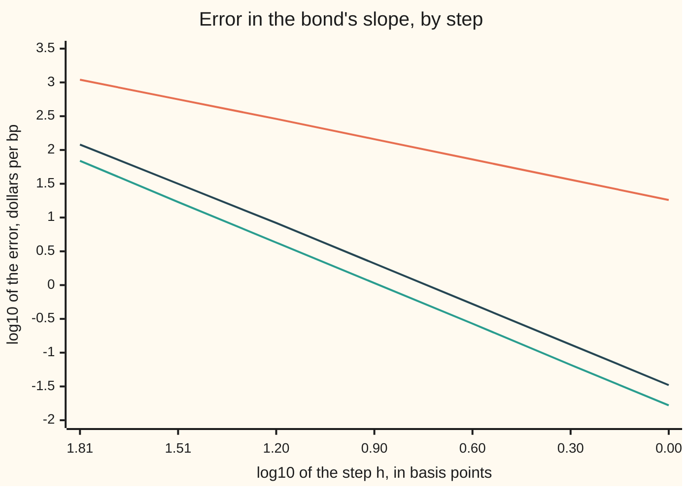

# Forward, backward and central differences: three routes to a slope, two accuracies

[Syllabus](../../../SYLLABUS.md) → [Numerical analysis](../README.md) → [Derivatives by Machine](../README.md#s08) → Forward, backward and central differences

---

## General Overview

A trading desk holds $10 million face (the amount repaid at maturity) of a 30-year bond; the bond is illustrative. It pays a 4% coupon (the yearly interest payment, 4% of face) once a year. The market yield (the single interest rate that discounts its payments to today's price) is 4.50%. The position is worth $9,185,555.57.

The desk wants one number: how many dollars it loses when the yield rises one **basis point** (bp: one hundredth of a percentage point, 0.0001). That number is the bond's slope against yield, and the exact formula gives **$15,330.69 per bp**. A hedge is sized from it, so it should be right to well under a dollar.

Most pricing code has no slope formula. It can only reprice. There are three ways to do that:

- **Reprice up.** At 4.51% the position is worth $9,170,243.17. It fell $15,312.41. That is **$18.28 too small**.
- **Reprice down.** At 4.49% it is worth $9,200,904.57. It rose $15,349.00. That is **$18.31 too big**.
- **Reprice both ways.** The change from 4.49% to 4.51%, over the 2 bp span, is $15,330.70 per bp. That is **1.7 cents ($0.016687) too big**.

Up is the **forward difference**, down the **backward difference**, both ways the **central difference**. Forward and backward miss by nearly the same amount on opposite sides. Central sits between them and misses by cents, not dollars, because the two misses cancel.

Sometimes only one side exists. A stress run that only shocks rates upward has no 4.49% price. Then a third price on the same side, at 4.52%, buys the accuracy back: the **one-sided three-point difference** gives $15,330.65 per bp, 3.3 cents off.

**A difference formula weighs nearby prices so that Taylor's theorem cancels everything but the slope: forward and backward leave an error proportional to the step, central and the three-point one-sided formulas one proportional to its square, and the prices on hand decide which you can use.**

**What kind of fact this is:** a theorem, proved on this card in Why it works: each formula's error term, from Taylor's theorem. Which formula to use is a rule of practice that follows from it.

### The picture: error against step

The horizontal axis is the base-10 logarithm of the step in basis points: 1.81 is a 64 bp step, 0.00 a 1 bp step. The vertical axis is the base-10 logarithm of the error in dollars per bp: 0 means a $1 error, −1.78 means under 2 cents.



Orange: forward, one price up. Green: central, one price each way. Dark: one-sided three-point, two prices up. Each halving of the step moves the orange line down 0.30 (the error halves) and the other two down 0.60 (the error quarters). Backward, not drawn, has nearly the same error as forward.

---

## The formula

Write $P(y)$ for the position's price in dollars at yield $y$, and $h$ for the step in yield. The slope $P'(y)$ is in dollars per unit of yield; multiplied by 0.0001 it is dollars per basis point. Two and three primes, $P''$ and $P'''$, are the second and third derivatives.

The three two-price formulas:

$$D_+ = \frac{P(y+h) - P(y)}{h}, \qquad D_- = \frac{P(y) - P(y-h)}{h}, \qquad D_0 = \frac{P(y+h) - P(y-h)}{2h}$$

**Read it aloud:** forward is the change over one step up, backward the change over one step down, central the change from one step down to one step up, each per unit of yield.

The two three-price one-sided formulas, for when only one side exists:

$$D_+^{(2)} = \frac{-3P(y) + 4P(y+h) - P(y+2h)}{2h}, \qquad D_-^{(2)} = \frac{3P(y) - 4P(y-h) + P(y-2h)}{2h}$$

**Read it aloud:** weigh the price here by minus three, the next one out by four and the one beyond by minus one, and divide by two steps; the downward formula is the mirror image.

Their errors, each the formula minus the true slope, proved below:

$$D_\pm - P' = \pm\tfrac{h}{2}P''(\xi), \qquad D_0 - P' = \tfrac{h^2}{6}P'''(\xi), \qquad D_\pm^{(2)} - P' = -\tfrac{h^2}{3}P'''(\xi)$$

**Read it aloud:** forward and backward are off by half the step times the second derivative, with opposite signs; central by a sixth of the step squared times the third; the one-sided three-point formulas by a third of the step squared times the third, with the opposite sign to central.

Here $\xi$ (the Greek letter xi) is some unknown point among the yields the formula uses, a different one for each formula. A formula whose error shrinks like $h^p$ as $h \to 0$ has **order** $p$: forward and backward have order 1, the other three order 2. The set of points a formula uses is its **stencil**.

| Symbol | Plain meaning | In our example | Push it up and the answer… |
| --- | --- | --- | --- |
| $P(y)$ | the position's price at yield $y$, in dollars | 9,185,555.572786 at 4.50% | — |
| $y$ | the annual yield, as a decimal | 0.045 | the slope shrinks: −15,185.1010 $/bp at 4.54% |
| $h$ | the step in yield; 1 bp is 0.0001 | 0.0001 | forward and backward errors grow in proportion, the rest with its square |
| $P'(y)$ | the exact slope; times 0.0001, dollars per bp | −15,330.686730 $/bp | — |
| $P''(y)$ | the second derivative: how fast the slope changes | 3,659,589,692 | forward and backward errors grow with it |
| $P'''(y)$ | the third derivative | −100,119,349,137 | central and three-point errors grow with it |
| $D_+$, $D_-$, $D_0$ | forward, backward and central differences | −15,312.405456, −15,349.001377 and −15,330.703417 $/bp | — |
| $D_+^{(2)}$, $D_-^{(2)}$ | one-sided three-point differences, up and down | −15,330.653431 and −15,330.653283 $/bp | — |
| $\xi$, $\xi_1$, $\xi_2$ | unknown points inside the stencil where a derivative is read | not needed | — |
| $k$; $a$, $b$, $c$ | a number of steps from $y$; the weights on three prices in Step 3 | $k$ = 1, −1, 2; −3/2, 2, −1/2 | — |
| $M_3$ | a ceiling on the size of $P'''$ across the stencil | not needed | a looser, still true, error bound |
| $p$ | the order: halve $h$ and the error falls by $2^p$ | 1 or 2 | a faster fall as the step shrinks |

### When it holds

- **The price is smooth across the whole stencil.** Forward and backward need a continuous $P''$, the others a continuous $P'''$. In a crude model of a bond callable at par, one that caps the price at par, the price stops rising at par: a corner. At that corner, at 4.00%, central reads −8,645.9117 $/bp at a 0.01 bp step, about half the uncapped −17,292.0333, and shrinking the step does not help.
- **The steps are equal.** Prices at +1 bp and −2 bp, differenced over 3 bp, look central but are only order 1: the error is −18.348070 $/bp. Unequal steps need their own weights, built on [Stencils to order](02-stencils-for-higher-and-mixed-derivatives.md).
- **The step is small against the scale on which $P'''$ changes.** At 64 bp, central's error ratio on halving is 4.006 and the three-point one's 3.735, not yet 4.
- **Each price is exact to many more digits than the price change.** Rounding in each price is divided by $h$, so a tiny step returns noise; [Choosing the step](04-choosing-the-step-truncation-against-rounding.md) sets $h$ against it. At 1 bp on this bond the error is almost all truncation: the error from a finite step.

---

## Why it works

### Step 0: every neighbour is a Taylor expansion of the price here

[Taylor's theorem](../../06-Calculus%20and%20analysis/03-What%20Derivatives%20Tell%20You/05-taylors-theorem.md) writes the price one step away in terms of the price, slope, bend and so on at $y$:

$$P(y + kh) = P + kh\,P' + \tfrac{(kh)^2}{2}P'' + \tfrac{(kh)^3}{6}P''' + \dots$$

with everything on the right read at $y$, and $k$ the number of steps (1, −1, 2, …). A difference formula adds a few of these with weights. Choose the weights so the $P$ terms cancel and the $P'$ term comes out with weight exactly 1. Whatever survives after that is the error. Each further term the weights cancel buys one more power of $h$.

### Step 1: forward, and backward as its mirror

[Numerical derivatives](../../06-Calculus%20and%20analysis/03-What%20Derivatives%20Tell%20You/08-numerical-derivatives-and-sensitivity.md) proves the forward error $\tfrac{h}{2}P''(\xi)$ and the central error $\tfrac{h^2}{6}P'''(\xi)$.

Backward is forward with $h$ replaced by $-h$: $D_-(h)$ equals $\bigl(P(y-h) - P(y)\bigr)/(-h)$, which is the forward formula with a negative step. So its error is $\tfrac{-h}{2}P''(\xi)$. Same size, opposite sign.

On the bond the second derivative is positive (the price curve bends upward, which is what convexity means). So forward reads a slope too shallow and backward one too steep. The run: forward +18.281274 $/bp off, backward −18.314647, Taylor's term ±18.297948.

### Step 2: central is the average of forward and backward

Add forward and backward and halve: the $P(y)$ terms cancel and what is left is $\bigl(P(y+h) - P(y-h)\bigr)/(2h)$, the central difference. The run prints it: the average is −15,330.703417 $/bp, central's value.

That explains the jump in accuracy. Forward's error is $+\tfrac{h}{2}P''$ plus smaller terms; backward's is $-\tfrac{h}{2}P''$ plus smaller terms. The average cancels the $P''$ term exactly. In $P(y+h) - P(y-h)$ the terms with even powers of $h$ have the same sign on both sides and cancel; the odd ones survive. What is left is $\tfrac{h^2}{6}P'''$: here −0.016687 $/bp, and the run's error is −0.016687.

The price of that accuracy is one more reprice. With the price at $y$ already computed, forward needs one new price and central two.

### Step 3: one-sided, but second order

With only $y$, $y+h$ and $y+2h$ available, ask for weights $a$, $b$, $c$ on the three prices that cancel the $P$ term and the $P''$ term and leave the slope term with weight 1. The Taylor rows give three equations:

| Term | Condition | Why |
| --- | --- | --- |
| $P$ | $a + b + c = 0$ | the price level must cancel |
| $h\,P'$ | $b + 2c = 1$ | the slope must come out once |
| $\tfrac{h^2}{2}P''$ | $b + 4c = 0$ | the bend must cancel |

Subtract the second from the third: $2c = -1$, so $c = -\tfrac12$, then $b = 2$ and $a = -\tfrac32$. Times 2, those are the weights −3, 4, −1 over $2h$. The first term left over is the $P'''$ one: $\tfrac{h^3}{6}(b + 8c)P''' = -\tfrac{2h^3}{6}P'''$, and dividing by $h$ gives $-\tfrac{h^2}{3}P'''$.

The run: predicted +0.033373 $/bp, observed +0.033299 upward and +0.033447 downward. That is twice central's error and of the opposite sign.

<details>
<summary>Detailed proof: the one-sided error, with its remainder</summary>

Suppose $P'''$ is continuous between $y$ and $y + 2h$. Taylor's theorem with remainder gives
$P(y+h) = P + hP' + \tfrac{h^2}{2}P'' + \tfrac{h^3}{6}P'''(\xi_1)$ and
$P(y+2h) = P + 2hP' + 2h^2P'' + \tfrac{8h^3}{6}P'''(\xi_2)$,
with $\xi_1$ between $y$ and $y + h$ and $\xi_2$ between $y$ and $y + 2h$. Then

$$-3P(y) + 4P(y+h) - P(y+2h) = 2hP' + \tfrac{h^3}{6}\bigl(4P'''(\xi_1) - 8P'''(\xi_2)\bigr).$$

Divide by $2h$: $D_+^{(2)} - P' = \tfrac{h^2}{12}\bigl(4P'''(\xi_1) - 8P'''(\xi_2)\bigr)$. If $\lvert P'''\rvert \le M_3$ on the stencil, this is at most $h^2 M_3$ in size, so the formula has order 2. As $h \to 0$ both $\xi$'s approach $y$, and the error divided by $h^2$ tends to $\tfrac{4 - 8}{12}P'''(y) = -\tfrac13 P'''(y)$.

The single-point form $-\tfrac{h^2}{3}P'''(\xi)$ needs one more fact, stated here without proof: the formula is the slope at $y$ of the parabola through the three prices, and the error of an interpolating polynomial's slope at one of its own nodes is the next derivative at one point times a fixed product of the node gaps, here $(0 - h)(0 - 2h)/6 = h^2/3$. The downward formula is the same with $h$ replaced by $-h$; $h^2$ does not change sign, so neither does the error. ∎

</details>

### Step 4: the order shows in the numbers

Halve the step from 2 bp to 1 bp. Forward's error falls by 1.998, central's by 4.000, the three-point one's by 3.991. Order 1 halves the error; order 2 quarters it. At 64 bp the ratios are 1.944, 4.006 and 3.735: the leading term has not yet taken over, because the higher derivatives change across stencils 64 to 128 bp wide.

### Step 5: the data picks the formula

Count prices you must compute beyond the one at $y$, which usually exists already. Then pick the best formula the available yields allow:

| Prices you have | Formula | Order | Extra reprices | Error on the bond at 1 bp |
| --- | --- | --- | --- | --- |
| $y$, $y+h$ | forward | 1 | 1 | +18.281274 |
| $y$, $y-h$ | backward | 1 | 1 | −18.314647 |
| $y-h$, $y+h$ | central | 2 | 2 | −0.016687 |
| $y$, $y+h$, $y+2h$ | one-sided three-point, up | 2 | 2 | +0.033299 |
| $y$, $y-h$, $y-2h$ | one-sided three-point, down | 2 | 2 | +0.033447 |

Central and the three-point formulas cost the same: two reprices. Central is twice as accurate. So use central where both sides exist, and the three-point formula only where one side is missing. Forward or backward alone is right only when a second extra price is unaffordable.

A **scenario ladder** shows all three at once. A stress run prices the bond at 4.50%, 4.51%, 4.52%, 4.53% and 4.54%, once each, and the desk wants the slope at every rung. The middle rungs have both neighbours. The bottom rung has only prices above it; the top rung only prices below. The same five prices give:

| Rung | Neighbours | Exact $/bp | Two-point, error | Best available, error |
| --- | --- | --- | --- | --- |
| +0 bp | up only | −15,330.6867 | forward −15,312.4055, +18.2813 | three-point up −15,330.6534, +0.0333 |
| +1 bp | both sides | −15,294.1408 | central −15,294.1575, −0.0166 | central, −0.0166 |
| +2 bp | both sides | −15,257.6948 | central −15,257.7114, −0.0166 | central, −0.0166 |
| +3 bp | both sides | −15,221.3482 | central −15,221.3648, −0.0165 | central, −0.0165 |
| +4 bp | down only | −15,185.1010 | backward −15,203.2163, −18.1154 | three-point down −15,185.0679, +0.0331 |

With two-point formulas at the ends, the two end slopes are off by dollars while the middle ones are off by cents. With three-point formulas every rung is right to a few cents, and no extra price was computed.

---

## Worked numbers, by hand

| Step | Arithmetic | Value |
| --- | --- | --- |
| Price at 4.50% | the bond's 30 discounted payments | 9,185,555.572786 |
| Prices at 4.51%, 4.49%, 4.52% | the same, repriced | 9,170,243.167330; 9,200,904.574163; 9,154,967.257824 |
| Forward, 1 bp | 9,170,243.167330 − 9,185,555.572786 | −15,312.405456 |
| Backward, 1 bp | 9,185,555.572786 − 9,200,904.574163 | −15,349.001377 |
| Central, 1 bp | (9,170,243.167330 − 9,200,904.574163) / 2 | −15,330.703417 |
| Three-point up, 1 bp | (−3 × 9,185,555.572786 + 4 × 9,170,243.167330 − 9,154,967.257824) / 2 | −15,330.653431 |
| Exact slope | the derivative of the price formula, times 0.0001 | **−15,330.686730** |

A one-basis-point rise costs the position $15,330.69. Central gets that to within 1.7 cents and the up-only three-point formula to within 3.3 cents; forward and backward miss by about $18 each, in opposite directions.

With a 1 bp step, "per unit of yield times 0.0001" is just the price change itself, which is why the forward line has no division.

### What breaks if you drop a piece

| Mistake | Comes out at | What went wrong |
| --- | --- | --- |
| Central divided by $h$, not $2h$ | −30,661.4068 $/bp | The span is two steps; the slope doubled |
| Uneven pair: +1 bp and −2 bp, over 3 bp | −15,349.034800, error −18.348070 | Unequal steps leave the $P''$ term in: order 1 |
| Two-point backward at the top of the ladder | −15,203.2163, error −18.1154 | Order 1 where a third price gave order 2 |
| Central at a corner: price capped at par, a crude callable, at 4.00% (illustrative) | −8,645.9117 at 0.01 bp, against −17,292.0333 | No slope to find: up reads −17,291.8233, down 0.0000 |

The code prints all four.

---

## Code, from first principles, and it actually runs

The code prices the bond by summing its 30 discounted payments, with the discount factor built by repeated multiplication so that Python and Rust agree to the bit. The same loop gives the exact first, second and third derivatives. It takes three independent roads to each slope: the difference formulas from repriced values, the exact slope from the derivative formula, and the error Taylor's theorem predicts from the exact $P''$ and $P'''$. The asserts check that each observed error matches its Taylor term, that halving the step halves forward's error and quarters central's, that the uneven pair is first order, and that at the corner the central difference stays far from the smooth slope.

### Python

```python
# Forward, backward and central differences -- the check behind the card.
# Python standard library only.  The function is the price P(y), in dollars, of
# $10,000,000 face of a 30-year bond paying a 4% coupon once a year, at an
# annual yield y near 4.5%.  The step h is one basis point, 0.0001.
# Road one: difference quotients from repriced values.  Road two: the exact
# slope from the price's closed-form derivative.  Road three: the error each
# quotient should have, from Taylor's theorem, using the exact P'' and P'''.
import math
FACE, CPN, YEARS, Y0, BP = 10_000_000.0, 0.04, 30, 0.045, 0.0001
def derivs(y):                        # P, P', P'', P''' by summing the cash flows
    d, df, s = 1.0 / (1.0 + y), 1.0, [0.0, 0.0, 0.0, 0.0]
    for t in range(1, YEARS + 1):
        df *= d                       # discount factor 1/(1+y)^t by repeated multiply
        a = FACE * CPN + (FACE if t == YEARS else 0.0)
        s[0] += a * df
        s[1] -= t * a * df * d
        s[2] += t * (t + 1) * a * df * d * d
        s[3] -= t * (t + 1) * (t + 2) * a * df * d * d * d
    return s
def P(y): return derivs(y)[0]
def fwd(f, y, h): return (f(y + h) - f(y)) / h
def bwd(f, y, h): return (f(y) - f(y - h)) / h
def ctr(f, y, h): return (f(y + h) - f(y - h)) / (2 * h)
def fwd3(f, y, h): return (-3 * f(y) + 4 * f(y + h) - f(y + 2 * h)) / (2 * h)
def bwd3(f, y, h): return (3 * f(y) - 4 * f(y - h) + f(y - 2 * h)) / (2 * h)
def bp(x): return x * BP              # dollars per unit of yield -> dollars per bp
p0, p1, p2, p3 = derivs(Y0)
print(f"price P(4.50%) = {p0:.6f}; P(4.51%) = {P(Y0 + BP):.6f}; P(4.49%) = {P(Y0 - BP):.6f}; "
      f"P(4.52%) = {P(Y0 + 2 * BP):.6f}; P(4.48%) = {P(Y0 - 2 * BP):.6f}")
print(f"exact slope P' = {bp(p1):.6f} $/bp; P'' = {p2:.0f}; P''' = {p3:.0f}")
rules = [("forward", fwd, p2 / 2, 1), ("backward", bwd, -p2 / 2, 1), ("central", ctr, p3 / 6, 2),
         ("one-sided 3-point up", fwd3, -p3 / 3, 2), ("one-sided 3-point down", bwd3, -p3 / 3, 2)]
ratio = {}
for name, rule, c, k in rules:        # c * h^k is the leading error Taylor predicts
    est = rule(P, Y0, BP)
    err, pred = bp(est - p1), bp(c * BP ** k)
    ratio[name] = err / pred
    print(f"{name}: {est * BP:.6f} $/bp; error {err:+.6f}; Taylor predicts {pred:+.6f}; ratio {err / pred:.4f}")
print(f"forward and backward averaged = {bp(fwd(P, Y0, BP) + bwd(P, Y0, BP)) / 2:.6f} $/bp, central's value")
steps = [64, 32, 16, 8, 4, 2, 1]      # steps in basis points
print("chart steps h (bp): log10 h [" + ", ".join(f"{math.log10(s):.2f}" for s in steps) + "]")
errs = {name: [abs(bp(rule(P, Y0, s * BP) - p1)) for s in steps] for name, rule, c, k in rules}
for name in ("forward", "central", "one-sided 3-point up"):
    e = errs[name]
    lg = [f"{math.log10(v):.2f}" for v in e]
    print(f"chart {name}: log10 error [{', '.join(lg)}]; halving ratios "
          + ", ".join(f"{e[i] / e[i + 1]:.3f}" for i in range(len(e) - 1)))
print("ladder: rungs 4.50% to 4.54%, one bp apart, each priced once")
lad = [Y0 + k * BP for k in range(5)]
pv = [P(y) for y in lad]
for k, y in enumerate(lad):
    exact = bp(derivs(y)[1])
    if k == 0:
        two, three, how = (pv[1] - pv[0]) / BP, (-3 * pv[0] + 4 * pv[1] - pv[2]) / (2 * BP), "up only"
    elif k == 4:
        two, three, how = (pv[4] - pv[3]) / BP, (3 * pv[4] - 4 * pv[3] + pv[2]) / (2 * BP), "down only"
    else:
        two = three = (pv[k + 1] - pv[k - 1]) / (2 * BP); how = "both sides"
    print(f"rung +{k} bp ({how}): exact {exact:.4f}; two-point {bp(two):.4f} err {bp(two) - exact:+.4f}; "
          f"best available {bp(three):.4f} err {bp(three) - exact:+.4f}")
uneven = (P(Y0 + BP) - P(Y0 - 2 * BP)) / (3 * BP)                 # up 1 bp, down 2 bp
half = (P(Y0 + BP) - P(Y0 - BP)) / BP                             # forgot the 2 in 2h
yk = 0.04                                                         # where P hits par
cap = lambda y: min(P(y), P(yk))                                  # callable at par, crude
P1K = derivs(yk)[1]                                               # smooth slope just above 4%
kink = [(s, ctr(cap, yk, s * BP), fwd(cap, yk, s * BP), bwd(cap, yk, s * BP)) for s in (1, 0.01)]
print(f"breaks: uneven pair +1/-2 bp over 3h {bp(uneven):.6f} err {bp(uneven - p1):+.6f}; "
      f"central over h not 2h {bp(half):.4f}")
for s, c, f, b in kink:
    print(f"breaks: capped at par, y = 4.00%, h = {s} bp: up {bp(f):.4f}, down {bp(b):.4f}, "
          f"central {bp(c):.4f}; uncapped slope {bp(P1K):.4f}")
assert abs(ratio["forward"] - 1) < 0.01 and abs(ratio["backward"] - 1) < 0.01  # first-order law
assert abs(ratio["central"] - 1) < 1e-3 and abs(ratio["one-sided 3-point up"] - 1) < 0.01
assert 1.9 < errs["forward"][-2] / errs["forward"][-1] < 2.1      # halve h, halve error
assert 3.9 < errs["central"][-2] / errs["central"][-1] < 4.1      # halve h, quarter error
assert abs(bp(uneven - p1)) > 100 * abs(bp(ctr(P, Y0, BP) - p1))  # uneven pair is first order
assert abs(kink[1][1] - P1K) > 0.4 * abs(P1K)                    # kink: no shrinking with h
print("ALL CHECKS PASS")
```

**Ran 2026-11-11 on macOS, Python 3.14.10, standard library only. All checks passed. Output, pasted from the run:**

```
price P(4.50%) = 9185555.572786; P(4.51%) = 9170243.167330; P(4.49%) = 9200904.574163; P(4.52%) = 9154967.257824; P(4.48%) = 9216290.271729
exact slope P' = -15330.686730 $/bp; P'' = 3659589692; P''' = -100119349137
forward: -15312.405456 $/bp; error +18.281274; Taylor predicts +18.297948; ratio 0.9991
backward: -15349.001377 $/bp; error -18.314647; Taylor predicts -18.297948; ratio 1.0009
central: -15330.703417 $/bp; error -0.016687; Taylor predicts -0.016687; ratio 1.0000
one-sided 3-point up: -15330.653431 $/bp; error +0.033299; Taylor predicts +0.033373; ratio 0.9978
one-sided 3-point down: -15330.653283 $/bp; error +0.033447; Taylor predicts +0.033373; ratio 1.0022
forward and backward averaged = -15330.703417 $/bp, central's value
chart steps h (bp): log10 h [1.81, 1.51, 1.20, 0.90, 0.60, 0.30, 0.00]
chart forward: log10 error [3.04, 2.75, 2.46, 2.16, 1.86, 1.56, 1.26]; halving ratios 1.944, 1.971, 1.986, 1.993, 1.996, 1.998
chart central: log10 error [1.84, 1.23, 0.63, 0.03, -0.57, -1.18, -1.78]; halving ratios 4.006, 4.001, 4.000, 4.000, 4.000, 4.000
chart one-sided 3-point up: log10 error [2.08, 1.50, 0.92, 0.32, -0.28, -0.88, -1.48]; halving ratios 3.735, 3.863, 3.930, 3.965, 3.982, 3.991
ladder: rungs 4.50% to 4.54%, one bp apart, each priced once
rung +0 bp (up only): exact -15330.6867; two-point -15312.4055 err +18.2813; best available -15330.6534 err +0.0333
rung +1 bp (both sides): exact -15294.1408; two-point -15294.1575 err -0.0166; best available -15294.1575 err -0.0166
rung +2 bp (both sides): exact -15257.6948; two-point -15257.7114 err -0.0166; best available -15257.7114 err -0.0166
rung +3 bp (both sides): exact -15221.3482; two-point -15221.3648 err -0.0165; best available -15221.3648 err -0.0165
rung +4 bp (down only): exact -15185.1010; two-point -15203.2163 err -18.1154; best available -15185.0679 err +0.0331
breaks: uneven pair +1/-2 bp over 3h -15349.034800 err -18.348070; central over h not 2h -30661.4068
breaks: capped at par, y = 4.00%, h = 1 bp: up -17271.0571, down 0.0000, central -8635.5285; uncapped slope -17292.0333
breaks: capped at par, y = 4.00%, h = 0.01 bp: up -17291.8233, down 0.0000, central -8645.9117; uncapped slope -17292.0333
ALL CHECKS PASS
```

### Rust

```rust
// Forward, backward and central differences -- the check behind the card.
// Rust std only.  The function is the price P(y), in dollars, of $10,000,000
// face of a 30-year bond paying a 4% coupon once a year, at an annual yield y
// near 4.5%.  The step h is one basis point, 0.0001.
// Road one: difference quotients from repriced values.  Road two: the exact
// slope from the price's closed-form derivative.  Road three: the error each
// quotient should have, from Taylor's theorem, using the exact P'' and P'''.
const FACE: f64 = 10_000_000.0;
const CPN: f64 = 0.04;
const YEARS: usize = 30;
const Y0: f64 = 0.045;
const BP: f64 = 0.0001;
type Rule = fn(&dyn Fn(f64) -> f64, f64, f64) -> f64;

fn derivs(y: f64) -> [f64; 4] {
    // P, P', P'', P''' by summing the cash flows
    let d = 1.0 / (1.0 + y);
    let (mut df, mut s) = (1.0, [0.0f64; 4]);
    for t in 1..=YEARS {
        df *= d; // discount factor 1/(1+y)^t by repeated multiply
        let a = FACE * CPN + if t == YEARS { FACE } else { 0.0 };
        let tf = t as f64;
        s[0] += a * df;
        s[1] -= tf * a * df * d;
        s[2] += ((t * (t + 1)) as f64) * a * df * d * d;
        s[3] -= ((t * (t + 1) * (t + 2)) as f64) * a * df * d * d * d;
    }
    s
}
fn p(y: f64) -> f64 { derivs(y)[0] }
fn fwd(f: &dyn Fn(f64) -> f64, y: f64, h: f64) -> f64 { (f(y + h) - f(y)) / h }
fn bwd(f: &dyn Fn(f64) -> f64, y: f64, h: f64) -> f64 { (f(y) - f(y - h)) / h }
fn ctr(f: &dyn Fn(f64) -> f64, y: f64, h: f64) -> f64 { (f(y + h) - f(y - h)) / (2.0 * h) }
fn fwd3(f: &dyn Fn(f64) -> f64, y: f64, h: f64) -> f64 {
    (-3.0 * f(y) + 4.0 * f(y + h) - f(y + 2.0 * h)) / (2.0 * h)
}
fn bwd3(f: &dyn Fn(f64) -> f64, y: f64, h: f64) -> f64 {
    (3.0 * f(y) - 4.0 * f(y - h) + f(y - 2.0 * h)) / (2.0 * h)
}
fn bp(x: f64) -> f64 { x * BP } // dollars per unit of yield -> dollars per bp

fn main() {
    let pf = |y: f64| p(y);
    let [p0, p1, p2, p3] = derivs(Y0);
    println!("price P(4.50%) = {:.6}; P(4.51%) = {:.6}; P(4.49%) = {:.6}; P(4.52%) = {:.6}; P(4.48%) = {:.6}",
        p0, p(Y0 + BP), p(Y0 - BP), p(Y0 + 2.0 * BP), p(Y0 - 2.0 * BP));
    println!("exact slope P' = {:.6} $/bp; P'' = {:.0}; P''' = {:.0}", bp(p1), p2, p3);
    let rules: [(&str, Rule, f64, i32); 5] = [("forward", fwd, p2 / 2.0, 1), ("backward", bwd, -p2 / 2.0, 1),
        ("central", ctr, p3 / 6.0, 2), ("one-sided 3-point up", fwd3, -p3 / 3.0, 2),
        ("one-sided 3-point down", bwd3, -p3 / 3.0, 2)];
    let mut ratio = Vec::new();
    for (name, rule, c, k) in rules.iter() {
        // c * h^k is the leading error Taylor predicts
        let est = rule(&pf, Y0, BP);
        let (err, pred) = (bp(est - p1), bp(c * BP.powi(*k)));
        ratio.push(err / pred);
        println!("{}: {:.6} $/bp; error {:+.6}; Taylor predicts {:+.6}; ratio {:.4}", name, est * BP, err, pred, err / pred);
    }
    println!("forward and backward averaged = {:.6} $/bp, central's value", bp(fwd(&pf, Y0, BP) + bwd(&pf, Y0, BP)) / 2.0);
    let steps = [64.0f64, 32.0, 16.0, 8.0, 4.0, 2.0, 1.0]; // steps in basis points
    let lgs: Vec<String> = steps.iter().map(|s| format!("{:.2}", s.log10())).collect();
    println!("chart steps h (bp): log10 h [{}]", lgs.join(", "));
    let errs: Vec<Vec<f64>> = rules.iter()
        .map(|(_, rule, _, _)| steps.iter().map(|s| bp(rule(&pf, Y0, s * BP) - p1).abs()).collect()).collect();
    for i in [0usize, 2, 3] {
        let e = &errs[i];
        let lg: Vec<String> = e.iter().map(|v| format!("{:.2}", v.log10())).collect();
        let hr: Vec<String> = (0..e.len() - 1).map(|j| format!("{:.3}", e[j] / e[j + 1])).collect();
        println!("chart {}: log10 error [{}]; halving ratios {}", rules[i].0, lg.join(", "), hr.join(", "));
    }
    println!("ladder: rungs 4.50% to 4.54%, one bp apart, each priced once");
    let lad: Vec<f64> = (0..5).map(|k| Y0 + (k as f64) * BP).collect();
    let pv: Vec<f64> = lad.iter().map(|&y| p(y)).collect();
    for (k, &y) in lad.iter().enumerate() {
        let exact = bp(derivs(y)[1]);
        let (two, three, how) = if k == 0 {
            ((pv[1] - pv[0]) / BP, (-3.0 * pv[0] + 4.0 * pv[1] - pv[2]) / (2.0 * BP), "up only")
        } else if k == 4 {
            ((pv[4] - pv[3]) / BP, (3.0 * pv[4] - 4.0 * pv[3] + pv[2]) / (2.0 * BP), "down only")
        } else {
            let c = (pv[k + 1] - pv[k - 1]) / (2.0 * BP);
            (c, c, "both sides")
        };
        println!("rung +{} bp ({}): exact {:.4}; two-point {:.4} err {:+.4}; best available {:.4} err {:+.4}",
            k, how, exact, bp(two), bp(two) - exact, bp(three), bp(three) - exact);
    }
    let uneven = (p(Y0 + BP) - p(Y0 - 2.0 * BP)) / (3.0 * BP); // up 1 bp, down 2 bp
    let half = (p(Y0 + BP) - p(Y0 - BP)) / BP; // forgot the 2 in 2h
    let yk = 0.04; // where P hits par
    let par = p(yk);
    let cap = move |y: f64| p(y).min(par); // callable at par, crude
    let p1k = derivs(yk)[1]; // smooth slope just above 4%
    let kink: Vec<(&str, f64, f64, f64)> = [("1", 1.0), ("0.01", 0.01)].iter()
        .map(|&(lab, s)| (lab, ctr(&cap, yk, s * BP), fwd(&cap, yk, s * BP), bwd(&cap, yk, s * BP))).collect();
    println!("breaks: uneven pair +1/-2 bp over 3h {:.6} err {:+.6}; central over h not 2h {:.4}",
        bp(uneven), bp(uneven - p1), bp(half));
    for (lab, c, f, b) in kink.iter() {
        println!("breaks: capped at par, y = 4.00%, h = {} bp: up {:.4}, down {:.4}, central {:.4}; uncapped slope {:.4}",
            lab, bp(*f), bp(*b), bp(*c), bp(p1k));
    }
    assert!((ratio[0] - 1.0).abs() < 0.01 && (ratio[1] - 1.0).abs() < 0.01); // first-order law
    assert!((ratio[2] - 1.0).abs() < 1e-3 && (ratio[3] - 1.0).abs() < 0.01);
    let (f, c) = (&errs[0], &errs[2]);
    assert!(1.9 < f[5] / f[6] && f[5] / f[6] < 2.1); // halve h, halve error
    assert!(3.9 < c[5] / c[6] && c[5] / c[6] < 4.1); // halve h, quarter error
    assert!(bp(uneven - p1).abs() > 100.0 * bp(ctr(&pf, Y0, BP) - p1).abs()); // uneven pair is first order
    assert!((kink[1].1 - p1k).abs() > 0.4 * p1k.abs()); // kink: no shrinking with h
    println!("ALL CHECKS PASS");
}
```

**Ran 2026-11-11 on macOS, rustc 1.98.1, no crates. All checks passed. Output, pasted from the run:**

```
price P(4.50%) = 9185555.572786; P(4.51%) = 9170243.167330; P(4.49%) = 9200904.574163; P(4.52%) = 9154967.257824; P(4.48%) = 9216290.271729
exact slope P' = -15330.686730 $/bp; P'' = 3659589692; P''' = -100119349137
forward: -15312.405456 $/bp; error +18.281274; Taylor predicts +18.297948; ratio 0.9991
backward: -15349.001377 $/bp; error -18.314647; Taylor predicts -18.297948; ratio 1.0009
central: -15330.703417 $/bp; error -0.016687; Taylor predicts -0.016687; ratio 1.0000
one-sided 3-point up: -15330.653431 $/bp; error +0.033299; Taylor predicts +0.033373; ratio 0.9978
one-sided 3-point down: -15330.653283 $/bp; error +0.033447; Taylor predicts +0.033373; ratio 1.0022
forward and backward averaged = -15330.703417 $/bp, central's value
chart steps h (bp): log10 h [1.81, 1.51, 1.20, 0.90, 0.60, 0.30, 0.00]
chart forward: log10 error [3.04, 2.75, 2.46, 2.16, 1.86, 1.56, 1.26]; halving ratios 1.944, 1.971, 1.986, 1.993, 1.996, 1.998
chart central: log10 error [1.84, 1.23, 0.63, 0.03, -0.57, -1.18, -1.78]; halving ratios 4.006, 4.001, 4.000, 4.000, 4.000, 4.000
chart one-sided 3-point up: log10 error [2.08, 1.50, 0.92, 0.32, -0.28, -0.88, -1.48]; halving ratios 3.735, 3.863, 3.930, 3.965, 3.982, 3.991
ladder: rungs 4.50% to 4.54%, one bp apart, each priced once
rung +0 bp (up only): exact -15330.6867; two-point -15312.4055 err +18.2813; best available -15330.6534 err +0.0333
rung +1 bp (both sides): exact -15294.1408; two-point -15294.1575 err -0.0166; best available -15294.1575 err -0.0166
rung +2 bp (both sides): exact -15257.6948; two-point -15257.7114 err -0.0166; best available -15257.7114 err -0.0166
rung +3 bp (both sides): exact -15221.3482; two-point -15221.3648 err -0.0165; best available -15221.3648 err -0.0165
rung +4 bp (down only): exact -15185.1010; two-point -15203.2163 err -18.1154; best available -15185.0679 err +0.0331
breaks: uneven pair +1/-2 bp over 3h -15349.034800 err -18.348070; central over h not 2h -30661.4068
breaks: capped at par, y = 4.00%, h = 1 bp: up -17271.0571, down 0.0000, central -8635.5285; uncapped slope -17292.0333
breaks: capped at par, y = 4.00%, h = 0.01 bp: up -17291.8233, down 0.0000, central -8645.9117; uncapped slope -17292.0333
ALL CHECKS PASS
```

### Lean

Lean proves every error term on the card, Step 2's average and Step 3's weights, for any smooth enough function and any positive step.

- If $P''$ is continuous across the stencil, forward misses the slope by $\tfrac{h}{2}P''(\xi)$ and backward by $-\tfrac{h}{2}P''(\xi)$, with $\xi$ inside the stencil.
- If $P'''$ is continuous across the stencil, central misses by $\tfrac{h^2}{6}P'''(\xi)$ and each one-sided three-point formula by $-\tfrac{h^2}{3}P'''(\xi)$.
- That one-sided form is the single-point one the Detailed proof states without proof.
- The central difference is the average of the forward and backward differences, for any step other than 0.
- Weights $a$, $b$, $c$ meet Step 3's three conditions exactly when they are $-\tfrac32$, $2$ and $-\tfrac12$.
- The card's fractions check out: the leftover $\tfrac16(b + 8c) = -\tfrac13$, and the uneven pair's $P''$ coefficient $(1^2 - 2^2)/(2 \cdot 3) = -\tfrac12$.

The bond's numbers, the observed orders, the ladder and every row of What breaks are left to Python and Rust.

```lean
-- Forward, backward and central differences: for a function smooth across each stencil, the forward and backward differences miss the slope by ±(h/2)·f''(ξ), the central difference by (h²/6)·f'''(ξ), and the one-sided three-point differences by -(h²/3)·f'''(ξ).
import Mathlib.Analysis.Calculus.Taylor
import Mathlib.Analysis.Calculus.IteratedDeriv.Lemmas
import Mathlib.Tactic

open Set

namespace DifferenceFormulas

lemma facts2 {f : ℝ → ℝ} {y : ℝ} (hf : ContDiffAt ℝ 2 f y) :
    HasDerivAt f (deriv f y) y ∧ HasDerivAt (deriv f) (iteratedDeriv 2 f y) y := by
  have h2 : iteratedDeriv 2 f = deriv (deriv f) := by rw [iteratedDeriv_succ, iteratedDeriv_one]
  have d1 : ContDiffAt ℝ 1 (deriv f) y := hf.derivWithin (by norm_num)
  refine ⟨(hf.differentiableAt (by norm_num)).hasDerivAt, ?_⟩
  rw [h2]; exact (d1.differentiableAt (by norm_num)).hasDerivAt

#print axioms facts2

lemma facts3 {f : ℝ → ℝ} {y : ℝ} (hf : ContDiffAt ℝ 3 f y) :
    HasDerivAt f (deriv f y) y ∧ HasDerivAt (deriv f) (iteratedDeriv 2 f y) y ∧
      HasDerivAt (iteratedDeriv 2 f) (iteratedDeriv 3 f y) y := by
  have h2 : iteratedDeriv 2 f = deriv (deriv f) := by rw [iteratedDeriv_succ, iteratedDeriv_one]
  have h3 : iteratedDeriv 3 f = deriv (deriv (deriv f)) := by rw [iteratedDeriv_succ, h2]
  have d1 : ContDiffAt ℝ 2 (deriv f) y := hf.derivWithin (by norm_num)
  have d2 : ContDiffAt ℝ 1 (deriv (deriv f)) y := d1.derivWithin (by norm_num)
  refine ⟨(hf.differentiableAt (by norm_num)).hasDerivAt, ?_, ?_⟩
  · rw [h2]; exact (d1.differentiableAt (by norm_num)).hasDerivAt
  · rw [h2, h3]; exact (d2.differentiableAt (by norm_num)).hasDerivAt

#print axioms facts3

lemma hd_aff {g : ℝ → ℝ} {d x c s : ℝ} (hg : HasDerivAt g d (x + c * s)) :
    HasDerivAt (fun t => g (x + c * t)) (c * d) s := by
  have hl : HasDerivAt (fun t => x + c * t) c s := by
    simpa using ((hasDerivAt_id s).const_mul c).const_add x
  have := hg.comp s hl
  rw [mul_comm]; exact this

#print axioms hd_aff

lemma cauchy_sq (D D' : ℝ → ℝ) (h : ℝ) (hh : 0 < h)
    (hD : ∀ s ∈ Icc 0 h, HasDerivAt D (D' s) s) (h0 : D 0 = 0) :
    ∃ s ∈ Ioo 0 h, D h * (2 * s) = h ^ 2 * D' s := by
  obtain ⟨s, hs, e⟩ := exists_ratio_hasDerivAt_eq_ratio_slope D D' hh
    (fun y hy => (hD y hy).continuousAt.continuousWithinAt)
    (fun y hy => hD y (Ioo_subset_Icc_self hy))
    (fun t => t ^ 2) (fun t => 2 * t) (by fun_prop) (fun y _ => by simpa using hasDerivAt_pow 2 y)
  refine ⟨s, hs, ?_⟩
  rw [h0] at e
  linear_combination -e

#print axioms cauchy_sq

lemma cauchy_cube (D D' D'' : ℝ → ℝ) (h : ℝ) (hh : 0 < h)
    (hD : ∀ s ∈ Icc 0 h, HasDerivAt D (D' s) s) (hD' : ∀ s ∈ Icc 0 h, HasDerivAt D' (D'' s) s)
    (h0 : D 0 = 0) (h0' : D' 0 = 0) :
    ∃ s ∈ Ioo 0 h, D h * (6 * s) = h ^ 3 * D'' s := by
  obtain ⟨s1, hs1, e1⟩ := exists_ratio_hasDerivAt_eq_ratio_slope D D' hh
    (fun y hy => (hD y hy).continuousAt.continuousWithinAt)
    (fun y hy => hD y (Ioo_subset_Icc_self hy))
    (fun t => t ^ 3) (fun t => 3 * t ^ 2) (by fun_prop)
    (fun y _ => by simpa using hasDerivAt_pow 3 y)
  have hsub : Icc 0 s1 ⊆ Icc 0 h := Icc_subset_Icc le_rfl hs1.2.le
  obtain ⟨s2, hs2, e2⟩ := exists_ratio_hasDerivAt_eq_ratio_slope D' D'' hs1.1
    (fun y hy => (hD' y (hsub hy)).continuousAt.continuousWithinAt)
    (fun y hy => hD' y (hsub (Ioo_subset_Icc_self hy)))
    (fun t => t ^ 2) (fun t => 2 * t) (by fun_prop) (fun y _ => by simpa using hasDerivAt_pow 2 y)
  refine ⟨s2, ⟨hs2.1, hs2.2.trans hs1.2⟩, ?_⟩
  rw [h0] at e1
  rw [h0'] at e2
  have key : s1 ^ 2 * (D h * (6 * s2) - h ^ 3 * D'' s2) = 0 := by
    linear_combination (-h ^ 3) * e2 - 2 * s2 * e1
  have hs1ne : s1 ^ 2 ≠ 0 := by have := hs1.1; positivity
  exact sub_eq_zero.mp ((mul_eq_zero.mp key).resolve_left hs1ne)

#print axioms cauchy_cube

lemma forward_err (f : ℝ → ℝ) (x h : ℝ) (hh : 0 < h)
    (hf : ∀ y ∈ Icc x (x + h), ContDiffAt ℝ 2 f y) :
    ∃ ξ ∈ Ioo x (x + h),
      (f (x + h) - f x) / h - deriv f x = h / 2 * iteratedDeriv 2 f ξ := by
  have F := fun y hy => facts2 (hf y hy)
  have hD : ∀ t ∈ Icc 0 h, HasDerivAt (fun t => f (x + 1 * t) - f x - t * deriv f x)
      (deriv f (x + 1 * t) - deriv f x) t := by
    intro t ht
    have := hd_aff (c := 1) (F (x + 1 * t) ⟨by linarith [ht.1], by linarith [ht.2]⟩).1
    convert (this.sub (hasDerivAt_const t (f x))).sub (hasDerivAt_mul_const (deriv f x)) using 1
    ring
  obtain ⟨s, hs, e⟩ := cauchy_sq _ _ h hh hD (by simp)
  have hxs : x < x + s := by linarith [hs.1]
  obtain ⟨ξ, hξ, eξ⟩ := exists_hasDerivAt_eq_slope (deriv f) (iteratedDeriv 2 f) hxs
    (fun y hy => (F y ⟨hy.1, by linarith [hy.2, hs.2]⟩).2.continuousAt.continuousWithinAt)
    (fun y hy => (F y ⟨hy.1.le, by linarith [hy.2, hs.2]⟩).2)
  refine ⟨ξ, ⟨hξ.1, by linarith [hξ.2, hs.2]⟩, ?_⟩
  simp only [one_mul] at e
  rw [eξ, show x + s - x = s by ring]
  have hs0 : s ≠ 0 := hs.1.ne'
  have hh0 : h ≠ 0 := hh.ne'
  field_simp
  linear_combination e

#print axioms forward_err

lemma backward_err (f : ℝ → ℝ) (x h : ℝ) (hh : 0 < h)
    (hf : ∀ y ∈ Icc (x - h) x, ContDiffAt ℝ 2 f y) :
    ∃ ξ ∈ Ioo (x - h) x,
      (f x - f (x - h)) / h - deriv f x = -(h / 2) * iteratedDeriv 2 f ξ := by
  have F := fun y hy => facts2 (hf y hy)
  have hD : ∀ t ∈ Icc 0 h, HasDerivAt (fun t => f x - f (x + -1 * t) - t * deriv f x)
      (deriv f (x + -1 * t) - deriv f x) t := by
    intro t ht
    have := hd_aff (c := -1) (F (x + -1 * t) ⟨by linarith [ht.2], by linarith [ht.1]⟩).1
    convert ((hasDerivAt_const t (f x)).sub this).sub (hasDerivAt_mul_const (deriv f x)) using 1
    ring
  obtain ⟨s, hs, e⟩ := cauchy_sq _ _ h hh hD (by simp)
  have hxs : x - s < x := by linarith [hs.1]
  obtain ⟨ξ, hξ, eξ⟩ := exists_hasDerivAt_eq_slope (deriv f) (iteratedDeriv 2 f) hxs
    (fun y hy => (F y ⟨by linarith [hy.1, hs.2], hy.2⟩).2.continuousAt.continuousWithinAt)
    (fun y hy => (F y ⟨by linarith [hy.1, hs.2], hy.2.le⟩).2)
  refine ⟨ξ, ⟨by linarith [hξ.1, hs.2], hξ.2⟩, ?_⟩
  simp only [neg_one_mul, ← sub_eq_add_neg] at e
  rw [eξ, show x - (x - s) = s by ring]
  have hs0 : s ≠ 0 := hs.1.ne'
  have hh0 : h ≠ 0 := hh.ne'
  field_simp
  linear_combination e

#print axioms backward_err

lemma central_err (f : ℝ → ℝ) (x h : ℝ) (hh : 0 < h)
    (hf : ∀ y ∈ Icc (x - h) (x + h), ContDiffAt ℝ 3 f y) :
    ∃ ξ ∈ Ioo (x - h) (x + h),
      (f (x + h) - f (x - h)) / (2 * h) - deriv f x = h ^ 2 / 6 * iteratedDeriv 3 f ξ := by
  have F := fun y hy => facts3 (hf y hy)
  have mem : ∀ t ∈ Icc 0 h, ∀ c : ℝ, -1 ≤ c → c ≤ 1 → x + c * t ∈ Icc (x - h) (x + h) := by
    intro t ht c hc1 hc2
    constructor <;> nlinarith [ht.1, ht.2]
  have hD : ∀ t ∈ Icc 0 h,
      HasDerivAt (fun t => f (x + 1 * t) - f (x + -1 * t) - t * (2 * deriv f x))
      (deriv f (x + 1 * t) + deriv f (x + -1 * t) - 2 * deriv f x) t := by
    intro t ht
    have h1 := hd_aff (c := 1) (F (x + 1 * t) (mem t ht 1 (by norm_num) (by norm_num))).1
    have h2 := hd_aff (c := -1) (F (x + -1 * t) (mem t ht (-1) (by norm_num) (by norm_num))).1
    convert (h1.sub h2).sub (hasDerivAt_mul_const (2 * deriv f x)) using 1
    ring
  have hD' : ∀ t ∈ Icc 0 h,
      HasDerivAt (fun t => deriv f (x + 1 * t) + deriv f (x + -1 * t) - 2 * deriv f x)
      (iteratedDeriv 2 f (x + 1 * t) - iteratedDeriv 2 f (x + -1 * t)) t := by
    intro t ht
    have h1 := hd_aff (c := 1) (F (x + 1 * t) (mem t ht 1 (by norm_num) (by norm_num))).2.1
    have h2 := hd_aff (c := -1) (F (x + -1 * t) (mem t ht (-1) (by norm_num) (by norm_num))).2.1
    convert (h1.add h2).sub (hasDerivAt_const t (2 * deriv f x)) using 1
    ring
  obtain ⟨s, hs, e⟩ := cauchy_cube _ _ _ h hh hD hD' (by simp) (by simp only [mul_zero, add_zero]; ring)
  have hxs : x - s < x + s := by linarith [hs.1]
  obtain ⟨ξ, hξ, eξ⟩ := exists_hasDerivAt_eq_slope (iteratedDeriv 2 f) (iteratedDeriv 3 f) hxs
    (fun y hy => (F y ⟨by linarith [hy.1, hs.2], by linarith [hy.2, hs.2]⟩).2.2.continuousAt.continuousWithinAt)
    (fun y hy => (F y ⟨by linarith [hy.1, hs.2], by linarith [hy.2, hs.2]⟩).2.2)
  refine ⟨ξ, ⟨by linarith [hξ.1, hs.2], by linarith [hξ.2, hs.2]⟩, ?_⟩
  simp only [one_mul, neg_one_mul, ← sub_eq_add_neg] at e
  rw [eξ, show x + s - (x - s) = 2 * s by ring]
  have hs0 : s ≠ 0 := hs.1.ne'
  have hh0 : h ≠ 0 := hh.ne'
  field_simp
  linear_combination e

#print axioms central_err

lemma up_err (f : ℝ → ℝ) (x h : ℝ) (hh : 0 < h)
    (hf : ∀ y ∈ Icc x (x + 2 * h), ContDiffAt ℝ 3 f y) :
    ∃ ξ ∈ Ioo x (x + 2 * h),
      (-3 * f x + 4 * f (x + h) - f (x + 2 * h)) / (2 * h) - deriv f x
        = -(h ^ 2 / 3) * iteratedDeriv 3 f ξ := by
  have F := fun y hy => facts3 (hf y hy)
  have mem : ∀ t ∈ Icc 0 h, ∀ c : ℝ, 0 ≤ c → c ≤ 2 → x + c * t ∈ Icc x (x + 2 * h) := by
    intro t ht c hc1 hc2
    constructor <;> nlinarith [ht.1, ht.2]
  have hD : ∀ t ∈ Icc 0 h,
      HasDerivAt (fun t => -3 * f x + 4 * f (x + 1 * t) - f (x + 2 * t) - t * (2 * deriv f x))
      (4 * deriv f (x + 1 * t) - 2 * deriv f (x + 2 * t) - 2 * deriv f x) t := by
    intro t ht
    have h1 := hd_aff (c := 1) (F (x + 1 * t) (mem t ht 1 (by norm_num) (by norm_num))).1
    have h2 := hd_aff (c := 2) (F (x + 2 * t) (mem t ht 2 (by norm_num) (by norm_num))).1
    convert (((hasDerivAt_const t (-3 * f x)).add (h1.const_mul 4)).sub h2).sub
      (hasDerivAt_mul_const (2 * deriv f x)) using 1
    ring
  have hD' : ∀ t ∈ Icc 0 h,
      HasDerivAt (fun t => 4 * deriv f (x + 1 * t) - 2 * deriv f (x + 2 * t) - 2 * deriv f x)
      (4 * iteratedDeriv 2 f (x + 1 * t) - 4 * iteratedDeriv 2 f (x + 2 * t)) t := by
    intro t ht
    have h1 := hd_aff (c := 1) (F (x + 1 * t) (mem t ht 1 (by norm_num) (by norm_num))).2.1
    have h2 := hd_aff (c := 2) (F (x + 2 * t) (mem t ht 2 (by norm_num) (by norm_num))).2.1
    convert ((h1.const_mul 4).sub (h2.const_mul 2)).sub (hasDerivAt_const t (2 * deriv f x)) using 1
    ring
  obtain ⟨s, hs, e⟩ := cauchy_cube _ _ _ h hh hD hD' (by simp only [mul_zero, add_zero, zero_mul, sub_zero]; ring)
    (by simp only [mul_zero, add_zero]; ring)
  have hxs : x + 1 * s < x + 2 * s := by linarith [hs.1]
  obtain ⟨ξ, hξ, eξ⟩ := exists_hasDerivAt_eq_slope (iteratedDeriv 2 f) (iteratedDeriv 3 f) hxs
    (fun y hy => (F y ⟨by linarith [hy.1, hs.1], by linarith [hy.2, hs.2]⟩).2.2.continuousAt.continuousWithinAt)
    (fun y hy => (F y ⟨by linarith [hy.1, hs.1], by linarith [hy.2, hs.2]⟩).2.2)
  refine ⟨ξ, ⟨by linarith [hξ.1, hs.1], by linarith [hξ.2, hs.2]⟩, ?_⟩
  simp only [one_mul] at e eξ
  rw [eξ, show x + 2 * s - (x + s) = s by ring]
  have hs0 : s ≠ 0 := hs.1.ne'
  have hh0 : h ≠ 0 := hh.ne'
  generalize f (x + h) = a1 at e ⊢
  generalize f (x + 2 * h) = a2 at e ⊢
  generalize iteratedDeriv 2 f (x + s) = b1 at e ⊢
  generalize iteratedDeriv 2 f (x + 2 * s) = b2 at e ⊢
  field_simp
  linear_combination e / 2

#print axioms up_err

lemma down_err (f : ℝ → ℝ) (x h : ℝ) (hh : 0 < h)
    (hf : ∀ y ∈ Icc (x - 2 * h) x, ContDiffAt ℝ 3 f y) :
    ∃ ξ ∈ Ioo (x - 2 * h) x,
      (3 * f x - 4 * f (x - h) + f (x - 2 * h)) / (2 * h) - deriv f x
        = -(h ^ 2 / 3) * iteratedDeriv 3 f ξ := by
  have F := fun y hy => facts3 (hf y hy)
  have mem : ∀ t ∈ Icc 0 h, ∀ c : ℝ, -2 ≤ c → c ≤ 0 → x + c * t ∈ Icc (x - 2 * h) x := by
    intro t ht c hc1 hc2
    constructor <;> nlinarith [ht.1, ht.2]
  have hD : ∀ t ∈ Icc 0 h,
      HasDerivAt (fun t => 3 * f x - 4 * f (x + -1 * t) + f (x + -2 * t) - t * (2 * deriv f x))
      (4 * deriv f (x + -1 * t) - 2 * deriv f (x + -2 * t) - 2 * deriv f x) t := by
    intro t ht
    have h1 := hd_aff (c := -1) (F (x + -1 * t) (mem t ht (-1) (by norm_num) (by norm_num))).1
    have h2 := hd_aff (c := -2) (F (x + -2 * t) (mem t ht (-2) (by norm_num) (by norm_num))).1
    convert (((hasDerivAt_const t (3 * f x)).sub (h1.const_mul 4)).add h2).sub
      (hasDerivAt_mul_const (2 * deriv f x)) using 1
    ring
  have hD' : ∀ t ∈ Icc 0 h,
      HasDerivAt (fun t => 4 * deriv f (x + -1 * t) - 2 * deriv f (x + -2 * t) - 2 * deriv f x)
      (-4 * iteratedDeriv 2 f (x + -1 * t) + 4 * iteratedDeriv 2 f (x + -2 * t)) t := by
    intro t ht
    have h1 := hd_aff (c := -1) (F (x + -1 * t) (mem t ht (-1) (by norm_num) (by norm_num))).2.1
    have h2 := hd_aff (c := -2) (F (x + -2 * t) (mem t ht (-2) (by norm_num) (by norm_num))).2.1
    convert ((h1.const_mul 4).sub (h2.const_mul 2)).sub (hasDerivAt_const t (2 * deriv f x)) using 1
    ring
  obtain ⟨s, hs, e⟩ := cauchy_cube _ _ _ h hh hD hD' (by simp only [mul_zero, add_zero, zero_mul, sub_zero]; ring)
    (by simp only [mul_zero, add_zero]; ring)
  have hxs : x + -2 * s < x + -1 * s := by linarith [hs.1]
  obtain ⟨ξ, hξ, eξ⟩ := exists_hasDerivAt_eq_slope (iteratedDeriv 2 f) (iteratedDeriv 3 f) hxs
    (fun y hy => (F y ⟨by linarith [hy.1, hs.2], by linarith [hy.2, hs.1]⟩).2.2.continuousAt.continuousWithinAt)
    (fun y hy => (F y ⟨by linarith [hy.1, hs.2], by linarith [hy.2, hs.1]⟩).2.2)
  refine ⟨ξ, ⟨by linarith [hξ.1, hs.2], by linarith [hξ.2, hs.1]⟩, ?_⟩
  simp only [neg_mul, one_mul, ← sub_eq_add_neg] at e eξ
  rw [eξ, show x - s - (x - 2 * s) = s by ring]
  have hs0 : s ≠ 0 := hs.1.ne'
  have hh0 : h ≠ 0 := hh.ne'
  generalize f (x - h) = a1 at e ⊢
  generalize f (x - 2 * h) = a2 at e ⊢
  generalize iteratedDeriv 2 f (x - s) = b1 at e ⊢
  generalize iteratedDeriv 2 f (x - 2 * s) = b2 at e ⊢
  field_simp
  linear_combination e / 2

#print axioms down_err


/-- The error of each difference formula, from Taylor's theorem. Take a step `h > 0`.
* Forward, `(f(x+h) - f(x))/h`: if `f` has a continuous second derivative across
  `[x, x+h]`, it misses the slope `f'(x)` by `(h/2)·f''(ξ)` for some `ξ` in the stencil.
* Backward, `(f(x) - f(x-h))/h`: with a continuous `f''` across `[x-h, x]`, it misses by
  `-(h/2)·f''(ξ)`: the same size as forward, the opposite sign.
* Central, `(f(x+h) - f(x-h))/(2h)`: with a continuous `f'''` across `[x-h, x+h]`, it misses
  by `(h²/6)·f'''(ξ)`.
* One-sided three-point, up, `(-3f(x) + 4f(x+h) - f(x+2h))/(2h)`, and down,
  `(3f(x) - 4f(x-h) + f(x-2h))/(2h)`: with a continuous `f'''` across their stencils, each
  misses by `-(h²/3)·f'''(ξ)`.
So forward and backward have errors proportional to the step (order 1), and the other three
errors proportional to its square (order 2). Each `ξ` is a point inside that formula's own
stencil. -/
theorem difference_formula_errors (f : ℝ → ℝ) (x h : ℝ) (hh : 0 < h) :
    ((∀ y ∈ Icc x (x + h), ContDiffAt ℝ 2 f y) →
      ∃ ξ ∈ Ioo x (x + h),
        (f (x + h) - f x) / h - deriv f x = h / 2 * iteratedDeriv 2 f ξ) ∧
    ((∀ y ∈ Icc (x - h) x, ContDiffAt ℝ 2 f y) →
      ∃ ξ ∈ Ioo (x - h) x,
        (f x - f (x - h)) / h - deriv f x = -(h / 2) * iteratedDeriv 2 f ξ) ∧
    ((∀ y ∈ Icc (x - h) (x + h), ContDiffAt ℝ 3 f y) →
      ∃ ξ ∈ Ioo (x - h) (x + h),
        (f (x + h) - f (x - h)) / (2 * h) - deriv f x = h ^ 2 / 6 * iteratedDeriv 3 f ξ) ∧
    ((∀ y ∈ Icc x (x + 2 * h), ContDiffAt ℝ 3 f y) →
      ∃ ξ ∈ Ioo x (x + 2 * h),
        (-3 * f x + 4 * f (x + h) - f (x + 2 * h)) / (2 * h) - deriv f x
          = -(h ^ 2 / 3) * iteratedDeriv 3 f ξ) ∧
    ((∀ y ∈ Icc (x - 2 * h) x, ContDiffAt ℝ 3 f y) →
      ∃ ξ ∈ Ioo (x - 2 * h) x,
        (3 * f x - 4 * f (x - h) + f (x - 2 * h)) / (2 * h) - deriv f x
          = -(h ^ 2 / 3) * iteratedDeriv 3 f ξ) := by
  exact ⟨forward_err f x h hh, backward_err f x h hh, central_err f x h hh, up_err f x h hh,
    down_err f x h hh⟩

/-- The central difference is the average of the forward and backward differences: adding
them and halving cancels the `f(x)` terms and leaves `(f(x+h) - f(x-h))/(2h)`. -/
theorem central_eq_average_of_forward_and_backward (f : ℝ → ℝ) (x h : ℝ) (hh : h ≠ 0) :
    (f (x + h) - f (x - h)) / (2 * h)
      = ((f (x + h) - f x) / h + (f x - f (x - h)) / h) / 2 := by
  field_simp
  ring

/-- The one-sided three-point weights are forced. Weights `a, b, c` on the prices at `x`,
`x+h`, `x+2h` cancel the price level (`a + b + c = 0`), bring out the slope once
(`b + 2c = 1`) and cancel the bend (`b + 4c = 0`) exactly when they are `-3/2, 2, -1/2`,
that is, `-3, 4, -1` over `2h`. -/
theorem three_point_weights_unique (a b c : ℝ) :
    (a + b + c = 0 ∧ b + 2 * c = 1 ∧ b + 4 * c = 0) ↔ (a = -3 / 2 ∧ b = 2 ∧ c = -1 / 2) := by
  constructor
  · rintro ⟨h1, h2, h3⟩
    refine ⟨by linarith, by linarith, by linarith⟩
  · rintro ⟨rfl, rfl, rfl⟩
    norm_num

-- Step 3: the weights -3/2, 2, -1/2 solve the three Taylor rows.
example : (-3 / 2 : ℚ) + 2 + (-1 / 2) = 0 ∧ (2 : ℚ) + 2 * (-1 / 2) = 1 ∧
    (2 : ℚ) + 4 * (-1 / 2) = 0 := by norm_num

-- Step 3: the leftover f''' term, (1/6)(b + 8c), is -1/3, so the error is -(h²/3) f'''.
example : (1 / 6 : ℚ) * (2 + 8 * (-1 / 2)) = -1 / 3 := by norm_num

-- What breaks: the uneven pair +1 step and -2 steps over 3 steps leaves the f'' term,
-- with coefficient (1² - 2²)/(2·3) = -1/2 times h: order 1, not 2.
example : ((1 : ℚ) ^ 2 - (-2) ^ 2) / (2 * 3) = -1 / 2 := by norm_num

#print axioms difference_formula_errors
#print axioms central_eq_average_of_forward_and_backward
#print axioms three_point_weights_unique

end DifferenceFormulas
```

**Checked 2026-11-11 on macOS, Lean 4.36.0-rc2, Mathlib v4.36.0-rc2. Every proof is complete and uses only Lean's standard axioms. Output, pasted from the run:**

```
'DifferenceFormulas.facts2' depends on axioms: [propext, Classical.choice, Quot.sound]
'DifferenceFormulas.facts3' depends on axioms: [propext, Classical.choice, Quot.sound]
'DifferenceFormulas.hd_aff' depends on axioms: [propext, Classical.choice, Quot.sound]
'DifferenceFormulas.cauchy_sq' depends on axioms: [propext, Classical.choice, Quot.sound]
'DifferenceFormulas.cauchy_cube' depends on axioms: [propext, Classical.choice, Quot.sound]
'DifferenceFormulas.forward_err' depends on axioms: [propext, Classical.choice, Quot.sound]
'DifferenceFormulas.backward_err' depends on axioms: [propext, Classical.choice, Quot.sound]
'DifferenceFormulas.central_err' depends on axioms: [propext, Classical.choice, Quot.sound]
'DifferenceFormulas.up_err' depends on axioms: [propext, Classical.choice, Quot.sound]
'DifferenceFormulas.down_err' depends on axioms: [propext, Classical.choice, Quot.sound]
'DifferenceFormulas.difference_formula_errors' depends on axioms: [propext, Classical.choice, Quot.sound]
'DifferenceFormulas.central_eq_average_of_forward_and_backward' depends on axioms: [propext, Classical.choice, Quot.sound]
'DifferenceFormulas.three_point_weights_unique' depends on axioms: [propext, Classical.choice, Quot.sound]
```

> [!TIP]
> **Try changing**
> - **Guess first:** move the base yield `Y0` to 0.040. Does central's error grow or shrink? It grows: at a lower yield the distant payments are discounted less and weigh more, so $P'''$ is larger.
> - **Guess first:** what does a 2 bp step do to each error? The halving ratios already answer it: forward's error roughly doubles (1.998), central's and the three-point one's roughly quadruple (4.000 and 3.991).
> - **Guess first:** set `CPN` to 0, a zero-coupon bond. Do the orders change? No: the errors change size, but forward still halves and central still quarters, because the orders come from Taylor's theorem, not from the bond.
> - **Guess first:** in `fwd3`, change the weights to −1, 1, 0 over `h`. What happens? It becomes the forward difference, order 1, and the ratio assert fails.

---

## The usual mistake

> [!warning]
> **Two-point formulas at the end of a grid.** Code that uses central differences in the middle of a ladder often falls back to forward or backward at the ends. The middle rungs are right to 1.7 cents; the end rungs are off by $18.2813 and −$18.1154. The fix costs nothing: the next price inward is already on the ladder, and the three-point formula uses it to reach errors of 3.3 cents.
>
> - **Forgetting the 2 in $2h$.** Central over one step reads −30,661.4068 $/bp, double the truth.
> - **Pairing unequal steps.** +1 bp and −2 bp over 3 bp reads −15,349.034800, off by −18.348070: as bad as forward, though it looks central.
> - **Assuming backward is worse than forward.** They have the same size of error with opposite signs: +18.281274 and −18.314647 at 1 bp. Neither is preferred; the data decides.
> - **Differencing across a corner.** In a crude model that caps a callable bond's price at par, the central difference at the par point returns −8,645.9117, half the smooth slope, at every step size.

---

## Where you meet it in real life

- **Risk systems.** A bond's DV01 (dollar value of one basis point) is often computed by repricing 1 bp up and down and taking the central difference; [Bump and revalue](../../12-Financial%20mathematics/07-Greeks%20by%20Numbers%20and%20Calibration/01-bump-and-revalue-and-common-random-numbers.md) carries the same idea to simulated prices, and [Duration and convexity](../../12-Financial%20mathematics/01-Money%2C%20Dates%20and%20Discounting/06-duration-and-convexity.md) gives the closed form this card checks against.
- **Live data.** A speed computed from the latest GPS position has no future position to use, so it is a backward difference, or the three-point backward one for second order.
- **Tabulated data and grid edges.** Array libraries that differentiate a table of values use central differences inside and offer second-order one-sided formulas at the two ends, exactly the ladder above. A heat or pricing grid needing a slope at its edge does the same.
- **Flow simulations.** Upwind schemes take a backward or forward difference on purpose, toward where the flow comes from; [Flow problems](../07-PDE%20Solvers/06-upwind-schemes-and-conservation-laws.md) shows the price paid in accuracy.

> **Say it back**
> Repricing a bond up, down or both ways gives three estimates of its slope. Taylor's theorem says forward and backward miss by half the step times the second derivative, on opposite sides. Central averages them, the misses cancel, and the error falls to a sixth of the step squared times the third derivative. When only one side exists, a third price on that side gives second order back, at twice central's error. Use the most accurate formula the available prices allow.

---

## What this builds on

- [Numerical derivatives](../../06-Calculus%20and%20analysis/03-What%20Derivatives%20Tell%20You/08-numerical-derivatives-and-sensitivity.md): the forward and central differences, their error terms, and the step-size trade-off with rounding.
- [Taylor's theorem](../../06-Calculus%20and%20analysis/03-What%20Derivatives%20Tell%20You/05-taylors-theorem.md): the expansion with remainder that turns each formula's weights into its error.

## Where this goes next

- [Stencils to order](02-stencils-for-higher-and-mixed-derivatives.md): the weight-matching of Step 3 in general, for higher orders, second derivatives, mixed derivatives and unequal steps.
- [Richardson extrapolation](03-richardson-extrapolation.md): two central differences at 1 bp and 2 bp, combined to cancel the $h^2$ term.

The open question: every formula here still has an error that depends on a step, so can a slope be computed with no step at all?

---

## Sources

Verified 2026-11-11: every link below resolves to the publisher's or the authors' page.

- LeVeque, Randall J. *Finite Difference Methods for Ordinary and Partial Differential Equations*. SIAM, 2007. [doi:10.1137/1.9780898717839](https://doi.org/10.1137/1.9780898717839). Chapter 1: forward, backward, central and one-sided formulas, their truncation errors, and deriving weights from Taylor series.
- Fornberg, Bengt. "Generation of finite difference formulas on arbitrarily spaced grids." *Mathematics of Computation* 51 (1988). [doi:10.1090/S0025-5718-1988-0935077-0](https://doi.org/10.1090/S0025-5718-1988-0935077-0). The general recipe for weights on any stencil, one-sided and uneven included.
- Driscoll, Tobin A., and Richard J. Braun. *Fundamentals of Numerical Computation*, "Finite differences". [Authors' online book](https://fncbook.com/finitediffs/). Forward, backward and centered formulas, and one-sided formulas at the ends of an interval.
- Tuckman, Bruce, and Angel Serrat. *Fixed Income Securities: Tools for Today's Markets*, 4th ed. Wiley, 2022. [doi:10.1002/9781119835622](https://doi.org/10.1002/9781119835622). DV01 and duration, and computing them by shifting yields up and down.
