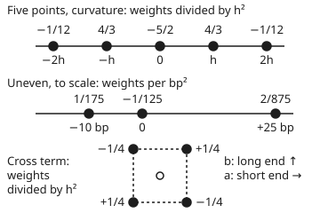
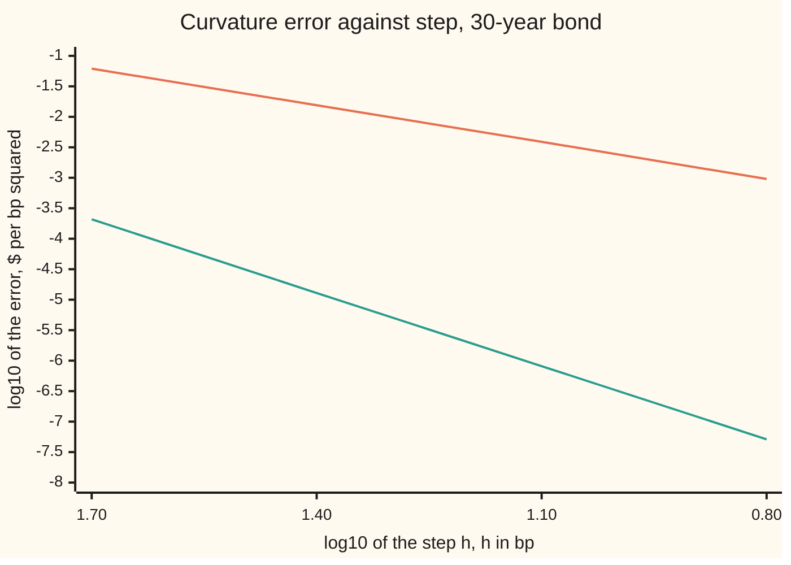

# Stencils to order: a fourth-order slope, a mixed derivative, and how to build your own

[Syllabus](../../../SYLLABUS.md) → [Numerical analysis](../README.md) → [Derivatives by Machine](../README.md#s08) → Stencils to order

---

## General Overview

A desk holds $10 million face (the amount repaid at maturity) of a 30-year bond with a 4% coupon paid once a year. Every interest rate on its curve is 4.50%, and the position is worth $9,185,555.57. [Forward, backward and central differences](01-forward-backward-and-central-differences.md) found its slope from three repricings: it loses $15,330.69 for each **basis point** (bp: 0.01 percentage point) that rates rise.

The desk wants three more numbers that three-point formulas give badly or not at all.

- **Curvature from a stored grid.** The risk system keeps the position repriced at −50, −25, 0, +25 and +50 bp. The **curvature**, how fast the slope itself changes, is 36.595897 dollars per bp squared. The three-point formula on the ±25 bp values reads 36.611288, off by 0.0154. A five-point formula on the same values reads 36.595884, off by 0.000013.
- **A cross term.** The short end and the 30-year end of the curve can move separately. The **cross term** is how much the loss per bp at the short end changes when the 30-year end moves 1 bp. Four repricings give 2.236329; the exact value is 2.236328.
- **Uneven moves.** Some scenarios sit at −10 and +25 bp. The three-point formula, used as if the gaps were equal, returns −708.35, the wrong sign. Weights fitted to the real gaps return 36.106831.

Each formula is a **stencil**: a few nearby points, one weight each. Multiply each value by its weight, add, and divide by a power of the step. One recipe builds every stencil above and states its error in advance.

**Expand every value in the stencil by Taylor's theorem and choose the weights so that every derivative except the one you want cancels; the first term that cannot be cancelled is the error, and its power of the step is the order.**

**What kind of fact this is:** a method resting on a theorem. The weights exist and are unique, and the leading error term has the stated form; both are proved on this card in Why it works.

### The picture: three stencils, drawn to scale

<p align="center"></p>

Top: the five-point curvature stencil. Middle: the uneven stencil, its points spaced as the moves are. Bottom: the cross stencil. Its centre point is unused; only the four corners carry weight.

---

## The formula

Notation first, in words. $f$ is a smooth function, here the position's value after every rate moves $x$ bp, and $f^{(k)}$ is its $k$-th derivative. A stencil uses $n$ points $x + s_j h$: $h$ is the step in bp, each **offset** $s_j$ is a fixed number such as −2 or 1, and $c_j$ is that point's **weight**.

The stencil reads

$$f^{(k)}(x) \;\approx\; \frac{1}{h^k}\sum_{j=1}^{n} c_j\, f(x + s_j h),$$

with weights chosen by the **moment conditions**, one for each power $m = 0, 1, \dots, n-1$:

$$\sum_{j=1}^{n} c_j\, s_j^{\,m} \;=\; \begin{cases} k! & m = k,\\ 0 & m \ne k. \end{cases}$$

The error is then

$$\text{stencil} - f^{(k)}(x) \;=\; E\,h^{\,p-k} f^{(p)}(x) + \dots, \qquad E = \frac{1}{p!}\sum_{j} c_j\, s_j^{\,p},$$

where $p$ is the first power, $n$ or above, whose moment is not zero.

**Read it aloud:** the weights must reproduce the $k$-th power and cancel every other power below $n$; the first power that survives gives the error and the order, $p - k$.

The stencils on this card, all solved from those conditions:

| Stencil | Weights | Leading error |
| --- | --- | --- |
| slope, 5 points | $\tfrac{1}{12}, -\tfrac{2}{3}, 0, \tfrac{2}{3}, -\tfrac{1}{12}$ on $-2..2$, over $h$ | $-\tfrac{1}{30}h^4 f^{(5)}$ |
| curvature, 5 points | $-\tfrac{1}{12}, \tfrac{4}{3}, -\tfrac{5}{2}, \tfrac{4}{3}, -\tfrac{1}{12}$, over $h^2$ | $-\tfrac{1}{90}h^4 f^{(6)}$ |
| cross term, 4 corners | $+\tfrac14, -\tfrac14, -\tfrac14, +\tfrac14$ at $(+,+), (+,-), (-,+), (-,-)$, over $h^2$ | $\tfrac{h^2}{6}(P_{aaab} + P_{abbb})$ |
| curvature, gaps $h_-$ and $h_+$ | $\tfrac{2}{h_-(h_-+h_+)}, -\tfrac{2}{h_-h_+}, \tfrac{2}{h_+(h_-+h_+)}$ | $\tfrac{h_+ - h_-}{3} f^{(3)}$ |

For the cross term, $a$ is the move of the short-end rate and $b$ the move of the 30-year rate, in bp, with the curve straight between them. $P_{ab}$ is the derivative once in each.

| Symbol | Plain meaning | In our example | Push it up and the answer… |
| --- | --- | --- | --- |
| $x$, $P$ | parallel move of every rate, in bp; the value after it | 0; $9,185,555.57 | value falls |
| $P'$, $P''$ | slope in $ per bp; curvature in $ per bp² | −15,330.686730; 36.595897 | — |
| $a$, $b$, $P(a, b)$ | short-end and 30-year moves, in bp; the value after them. $P_{+-}$ is $P(+h, -h)$; each subscript $a$ or $b$ is one derivative | 0 and 0 | — |
| $P_{ab}$ | cross term: change in the short-end slope per bp of 30-year move | 2.236328 $ per bp² | — |
| $f$, $f^{(k)}$, $k$ | a smooth function; its $k$-th derivative | $f = P$; $k$ = 1 or 2 | larger $k$: more points |
| $h$ | the step, in bp | 1 bp; 25 bp | the stencil's error grows as $h^{p-k}$ |
| $s_j$, $n$ | offsets in steps; number of points | −2, −1, 0, 1, 2; 5 | more points: higher order possible |
| $c_j$ | weights | $-\tfrac{1}{12}, \tfrac43, -\tfrac52, \tfrac43, -\tfrac{1}{12}$ | — |
| $m$, $p$, $E$ | a power in the conditions; first power not cancelled; its constant | $p$ = 6; $E = -\tfrac{1}{90}$ | — |
| $h_-$, $h_+$ | the two gaps of an uneven stencil, below and above | 10 bp; 25 bp | unequal gaps: order drops to 1 |
| $u$ | unit roundoff: the largest relative rounding in one operation | $2^{-53}$ | — |
| $\ell_j$, $L$, $q$, $d$, $R$ | letters used only in the folded proof, each defined there | — | — |

### When it holds

- **Smooth across the whole stencil.** The error term needs $f^{(p)}$ bounded over every point used. A kink inside, such as an option's strike, breaks the expansion and the stated rate.
- **Distinct offsets.** Two points at one place make two equal columns in the conditions, and no unique weights exist.
- **A step that is not too small.** The Taylor terms the stencil leaves out, its **truncation error**, shrink with $h$. Rounding adds about $u\,\lvert P\rvert\sum_j\lvert c_j\rvert / h^k$, which grows as $h$ shrinks. At 1 bp the five-point curvature already sits at that floor.
- **The real gaps.** Weights solved for equal spacing are wrong for any other. On −10 and +25 bp they give −708.35.

---

## Why it works

### Step 0: every value is a Taylor series about the same centre

By [Taylor's theorem](../../06-Calculus%20and%20analysis/03-What%20Derivatives%20Tell%20You/05-taylors-theorem.md), each value $f(x + s_j h)$ is $f(x)$, plus $s_j h f'(x)$, plus $s_j^2 h^2 f''(x)/2$, and so on. So a weighted sum of values is a weighted sum of the same derivatives. Choose the weights so only the $k$-th derivative survives, with coefficient 1.

### Step 1: the moment conditions

Multiply each expansion by $c_j$ and add. The coefficient of $h^m f^{(m)}(x)/m!$ is $\sum_j c_j s_j^m$, the $m$-th **moment** of the stencil. After dividing by $h^k$, only $f^{(k)}$ survives below power $n$ exactly when the $k$-th moment is $k!$ and the others are 0.

That is $n$ linear equations in $n$ weights. Their matrix, with rows of powers $s_j^m$, is a **Vandermonde matrix**, invertible when the offsets are distinct. So the weights exist and are unique.

<details>
<summary>Detailed proof: unique weights, and the same weights from the interpolating polynomial</summary>

**Uniqueness.** Suppose two weight lists both satisfy the conditions. Their difference $d$ has every moment from 0 to $n-1$ equal to zero. Then $\sum_j d_j\, q(s_j) = 0$ for every polynomial $q$ of degree below $n$. Take $q$ to be the Lagrange basis polynomial $\ell_i$, which is 1 at $s_i$ and 0 at the other offsets. This gives $d_i = 0$ for every $i$.

**The second road.** Let $L(s) = \sum_j f(x + s_j h)\,\ell_j(s)$, the polynomial of degree below $n$ through the $n$ values. Its $k$-th derivative at 0, over $h^k$, uses weights $\ell_j^{(k)}(0)$. When $f$ is a polynomial of degree below $n$, $L$ equals it exactly, so these weights pass every moment condition and, by uniqueness, are the same weights. The check computes both and asserts the fractions agree.

**The error term.** Taylor's theorem with remainder of order $p + 1$ gives
$$\frac{1}{h^k}\sum_j c_j f(x + s_j h) = f^{(k)}(x) + \frac{h^{p-k}}{p!}\Big(\sum_j c_j s_j^p\Big) f^{(p)}(x) + R,$$
with $\lvert R\rvert \le \frac{h^{p+1-k}}{(p+1)!}\sum_j \lvert c_j\rvert\,\lvert s_j\rvert^{p+1} \max \lvert f^{(p+1)}\rvert$ over the stencil. The moments from 0 to $p - 1$ other than the $k$-th vanish by the choice of $p$. So the leading error is $E h^{p-k} f^{(p)}(x)$, and the order is $p - k$.

</details>

### Step 2: symmetry buys one extra order

On equal spacing centred at 0, the curvature weights are mirror images, $c_{-j} = c_j$, so every odd moment cancels by itself. Five points match powers 0 to 4 and power 5 for free. The first failure is power 6: order $6 - 2 = 4$.

By hand, with three unknowns: the centre weight $c_0$, the inner pair $c_1$, the outer pair $c_2$.

| Condition | Equation | Meaning |
| --- | --- | --- |
| power 0 | $c_0 + 2c_1 + 2c_2 = 0$ | a constant gives zero curvature |
| power 2 | $2c_1 + 8c_2 = 2$ | $x^2$ has curvature 2 |
| power 4 | $2c_1 + 32c_2 = 0$ | $x^4$ has zero curvature at 0 |
| solution | $c_2 = -\tfrac{1}{12}$, $c_1 = \tfrac43$, $c_0 = -\tfrac52$ | |
| power 6, the error | $(2 \times \tfrac43 - 2 \times \tfrac{64}{12}) / 720 = -\tfrac{1}{90}$ | the leading error constant |

The five-point slope has $c_{-j} = -c_j$, so the even moments cancel, and its error is $-\tfrac{1}{30}h^4 f^{(5)}$. At 1 bp it misses by 2.986e-8 dollars per bp; the three-point slope misses by −1.669e-2.

### Step 3: the cross term is the same recipe in two directions

Expand $P(a, b)$ in both moves at once: each term is a power $a^{i} b^{j}$ times a derivative over $i!\,j!$. Put points at the four corners $(\pm h, \pm h)$. Require the weights to keep the $ab$ term and cancel $1$, $a$ and $b$: four conditions, four weights, solution $\tfrac14, -\tfrac14, -\tfrac14, \tfrac14$.

The moments never asked for come out as follows. The $a^2$, $b^2$ and $a^2b^2$ moments are 0 by symmetry. The $a^3b$ and $ab^3$ moments are each $\tfrac16$. So the cross stencil is second order, with error $\tfrac{h^2}{6}(P_{aaab} + P_{abbb})$.

A second road: apply the central slope in $a$, weights $-\tfrac12, 0, \tfrac12$, to the central slope in $b$. Each corner gets $\tfrac{\pm1}{2}\times\tfrac{\pm1}{2}$: the same four weights.

[Correlation Greeks and implied correlation](../../12-Financial%20mathematics/18-Many%20underlyings%20-%20exchange%2C%20spread%2C%20basket%20and%20rainbow/05-correlation-greeks-and-implied-correlation.md) already uses this rule, over $4h^2$, for a cross-gamma between two shares. This step derives it and gives its error.

### Step 4: unequal gaps cost one order

Put three points at $-h_-$, 0 and $+h_+$ and solve powers 0, 1 and 2: the weights in the formula table. The power-3 moment no longer cancels. It is $2(h_+ - h_-)$; divided by $3!$ it gives the error $\tfrac{h_+ - h_-}{3} f^{(3)}$, first order.

For −10 and +25 bp the weights are $\tfrac{1}{175}$, $-\tfrac{1}{125}$ and $\tfrac{2}{875}$ per bp², and the error constant is 5 bp. The curvature is 36.106831, off by −0.489066; the leading term predicts −0.500597.

A fourth point restores the order. With a scenario at +50 bp the weights are $\tfrac{1}{140}, -\tfrac{13}{1250}, \tfrac{16}{4375}, -\tfrac{1}{2500}$, and the error is $-\tfrac{125}{3} f^{(4)}$ bp². The curvature reads 36.584254, off by −0.011643, against a predicted −0.012310.

[Greeks from a tree or grid](../../12-Financial%20mathematics/07-Greeks%20by%20Numbers%20and%20Calibration/04-greeks-from-a-tree-or-grid.md) already fits this three-point parabola to uneven tree prices for gamma. The recipe here adds the error term and the fourth point.

### Step 5: the bond confirms each order

Curvature errors at four steps, against the exact 36.595897, in $ per bp²:

| Step $h$ | 3 points | 5 points |
| --- | --- | --- |
| 50 bp | 6.1604e-2 | −2.0764e-4 |
| 25 bp | 1.5391e-2 | −1.2952e-5 |
| 12.5 bp | 3.8472e-3 | −8.0912e-7 |
| 6.25 bp | 9.6176e-4 | −5.1838e-8 |
| observed orders | 2.00, 2.00, 2.00 | 4.00, 4.00, 3.96 |

At 25 bp the five-point leading term predicts −1.2944e-5, and the true error is 1.0007 times that. The cross term's errors, 1.0328e-6 at 1 bp and 6.4458e-4 at 25 bp, match their predictions, 1.0312e-6 and 6.4448e-4.



Orange: three points, slope 2 on this log scale. Teal: five points, slope 4.

---

## Worked numbers, by hand

The curvature from the stored scenario grid, $h$ = 25 bp.

| Step | Arithmetic | Value |
| --- | --- | --- |
| stored values | at −50, −25, 0, +25, +50 bp | 10,000,000.0000; 9,580,524.5709; 9,185,555.5728; 8,813,468.6298; 8,462,754.8973 |
| three-point sum | 9,580,524.5709 − 2 × 9,185,555.5728 + 8,813,468.6298 | 22,882.0551 |
| three-point curvature | 22,882.0551 ÷ 25² | 36.611288 |
| five-point sum | −10,000,000 + 16 × 9,580,524.5709 − 30 × 9,185,555.5728 + 16 × 8,813,468.6298 − 8,462,754.8973 | 274,469.1298 |
| five-point curvature | 274,469.1298 ÷ (12 × 25²) | **36.595884** |
| exact curvature | from the cash flows | 36.595897 |
| errors | three points; five points | 1.5391e-2; −1.2952e-5 |

The cross term from four repricings, $h$ = 1 bp:

| Step | Arithmetic | Value |
| --- | --- | --- |
| both up; short up, long down | $P(+1, +1)$; $P(+1, -1)$ | 9,170,243.1673; 9,194,711.8204 |
| short down, long up; both down | $P(-1, +1)$; $P(-1, -1)$ | 9,176,426.9758; 9,200,904.5742 |
| corner sum | $P_{++} - P_{+-} - P_{-+} + P_{--}$ | 8.945316 |
| cross term | 8.945316 ÷ (4 × 1²) | **2.236329** |
| exact | from the cash flows | 2.236328 |

The −50 bp value is exactly $10,000,000: at a 4.00% rate a 4% coupon bond is worth its face. The cross term means this: if the 30-year rate rises 1 bp, the position's loss per bp at the short end shrinks from $3,094.1389 to $3,091.9025.

### What breaks if you drop a piece

| Mistake | Comes out at | What went wrong |
| --- | --- | --- |
| The 1, −2, 1 rule on the −10 and +25 bp scenarios, with $h$ = 17.5 bp, their average | −708.3542 | Unequal gaps leave the slope term uncancelled, and it swamps the curvature |
| Moving both ends together, up 1 bp and down 1 bp, and dividing by $4h^2$ as for the cross term | 9.148980 | That measures $(P_{aa} + 2P_{ab} + P_{bb})/4$, a quarter of the parallel curvature, not $P_{ab}$ = 2.236328 |
| A one-sided cross term from up moves only: $P_{++} - P_{+0} - P_{0+} + P_{00}$ | 2.234132, off by −0.002196 | First order: error $\tfrac{h}{2}(P_{aab} + P_{abb})$, predicted −0.002197; the four corners miss by 1.0328e-6 |
| Five points at 1 bp, expecting the $h^4$ error | off by −6.536e-9, not the predicted −3.314e-11 | Rounding, estimated at 5.44e-9, is now far larger than the truncation error |

The code prints every row.

---

## Code, from first principles, and it actually runs

The code builds every stencil from its offsets: it solves the moment conditions in exact fractions and reads the error term off the first failed moment. It takes three roads. Road one applies each stencil to repriced values. Road two sums the exact derivatives from the bond's cash flows. Road three rebuilds the weights from the Lagrange polynomial, or for the cross term, from two slope stencils. Asserts check that the roads agree, that the orders are 2 and 4, that each error matches its prediction, and that each mistake fails.

### Python

```python
# Stencils to order -- the check behind the card.  Standard library only.
# Weights come from solving the Taylor conditions in exact fractions, and again
# from differentiating Lagrange's polynomial.  The bond's slopes come from its
# cash flows in closed form.  Discounting is (1 + r)^-t by repeated division,
# so Python and Rust do the same +, -, x, / and print the same digits.
from fractions import Fraction as Q
from math import factorial, log2, log10

def add(xs):  # plain left-to-right sum: Python's sum() compensates floats, Rust's does not
    t = 0.0
    for x in xs: t += x
    return t

def e(x, d):  # e-notation the way Rust prints it: -1.707e-3, not -1.707e-03
    m, p = f"{x:.{d}e}".split("e"); return f"{m}e{int(p)}"

def solve(M, rhs):  # Gauss-Jordan elimination on exact fractions
    n = len(M); A = [row[:] + [b] for row, b in zip(M, rhs)]
    for c in range(n):
        p = next(r for r in range(c, n) if A[r][c] != 0); A[c], A[p] = A[p], A[c]
        A[c] = [v / A[c][c] for v in A[c]]
        for r in range(n):
            if r != c and A[r][c] != 0: A[r] = [x - A[r][c] * y for x, y in zip(A[r], A[c])]
    return [A[r][n] for r in range(n)]

def weights(s, k):  # undetermined coefficients: sum_j c_j s_j^m = k! if m == k else 0
    return solve([[Q(x) ** m for x in s] for m in range(len(s))], [Q(factorial(k) if m == k else 0) for m in range(len(s))])

def lagrange(s, k):  # road two: k! times the x^k coefficient of each basis polynomial
    out = []
    for j, sj in enumerate(s):
        poly, den = [Q(1)], 1
        for i, si in enumerate(s):
            if i != j:
                poly = [(poly[m - 1] if m else 0) - si * (poly[m] if m < len(poly) else 0) for m in range(len(poly) + 1)]
                den *= sj - si
        out.append(poly[k] * factorial(k) / den)
    return out

def err_term(s, c):  # first moment the stencil gets wrong: error = E h^(m-k) f^(m)
    for m in range(len(s), len(s) + 3):
        E = sum(cj * Q(x) ** m for cj, x in zip(c, s)) / factorial(m)
        if E != 0: return m, E

YEARS, CPN, FACE, R0, BP = 30, 400_000.0, 10_000_000.0, 0.045, 1e-4
def cash(t): return CPN + (FACE if t == YEARS else 0.0)
def disc(r, t):  # (1 + r)^-t by repeated division
    d = 1.0
    for _ in range(t): d /= 1.0 + r
    return d
def price(a, b):  # short end moved a bp, 30-year end b bp, zero rate straight between
    return add(cash(t) * disc(R0 + (a + (b - a) * t / YEARS) * BP, t) for t in range(1, YEARS + 1))
def exact(m, n):  # d^(m+n) P / da^m db^n in $ per bp^(m+n), from the cash flows
    tot = 0.0
    for t in range(1, YEARS + 1):
        wa, wb = 1 - t / YEARS, t / YEARS; g = 1.0
        for i in range(m + n): g *= -(t + i) / (1 + R0) * BP
        tot += cash(t) * disc(R0, t) * g * wa ** m * wb ** n
    return tot
def par(k):  # k-th slope for a parallel move: binomial sum of the partial slopes
    return add(factorial(k) // (factorial(m) * factorial(k - m)) * exact(m, k - m) for m in range(k + 1))
def f(x): return price(x, x)  # the position after every rate moves x bp
def apply(s, c, k, h): return add(float(cj) * f(x * h) for cj, x in zip(c, s)) / h ** k
def fr(c): return " ".join(str(x) for x in c)
S3, S5 = [-1, 0, 1], [-2, -1, 0, 1, 2]
SL3, SL5, CU3, CU5 = weights(S3, 1), weights(S5, 1), weights(S3, 2), weights(S5, 2)
P0, P1, P2 = f(0), par(1), par(2)
print("$10m face, 4% annual coupon, 30 years, every zero rate 4.50%; moves in bp")
print(f"value {P0:.2f}; slope {P1:.6f} $/bp; curvature {P2:.6f} $/bp^2")
print(f"100 bp rise: slope alone {P1 * 100:.2f}, curvature adds {P2 * 100 ** 2 / 2:.2f}, true change {f(100) - P0:.2f}")
for name, s, k, c in (("slope, 3 points", S3, 1, SL3), ("slope, 5 points", S5, 1, SL5),
                      ("curvature, 3 points", S3, 2, CU3), ("curvature, 5 points", S5, 2, CU5)):
    m, E = err_term(s, c)
    assert c == lagrange(s, k)  # two unrelated algorithms give the same fractions
    print(f"{name:<20} weights {fr(c)}; error {E} h^{m - k} f^({m})")
assert CU5 == [Q(-1, 12), Q(4, 3), Q(-5, 2), Q(4, 3), Q(-1, 12)] and err_term(S5, SL5) == (5, Q(-1, 30))
print("at h = 1 bp, true error of each stencil, then the predicted leading term:")
for name, s, k, c, tru in (("slope 3", S3, 1, SL3, P1), ("slope 5", S5, 1, SL5, P1),
                           ("curvature 3", S3, 2, CU3, P2), ("curvature 5", S5, 2, CU5, P2)):
    m, E = err_term(s, c)
    print(f"  {name:<12} {e(apply(s, c, k, 1) - tru, 3):>10}   predicted {e(float(E) * par(m), 3):>10}")
fl = 2 ** -53 * P0 * add(float(abs(c)) for c in CU5)
print(f"  rounding estimate for curvature 5 at 1 bp: u x value x sum|w| / h^2 = {e(fl, 2)}")
r5 = abs(apply(S5, CU5, 2, 1) - P2); assert fl / 10 < r5 < 10 * fl and r5 > 10 * abs(float(Q(-1, 90)) * par(6))
print("curvature errors, h = 50, 25, 12.5, 6.25 bp:")
HS = (50, 25, 12.5, 6.25)
e3 = [apply(S3, CU3, 2, hb) - P2 for hb in HS]; e5 = [apply(S5, CU5, 2, hb) - P2 for hb in HS]
o3 = [log2(e3[i] / e3[i + 1]) for i in range(3)]; o5 = [log2(e5[i] / e5[i + 1]) for i in range(3)]
print("  3 points: " + ", ".join(e(v, 4) for v in e3) + "; orders " + ", ".join(f"{o:.2f}" for o in o3))
print("  5 points: " + ", ".join(e(v, 4) for v in e5) + "; orders " + ", ".join(f"{o:.2f}" for o in o5))
assert all(abs(o - 2) < 0.02 for o in o3) and all(abs(o - 4) < 0.05 for o in o5)
lead = float(Q(-1, 90)) * 25 ** 4 * par(6)
print(f"  at 25 bp: leading term {e(lead, 4)}, true over predicted {e5[1] / lead:.4f}")
n3 = add(float(c) * f(x * 25) for c, x in zip(CU3, S3)); n5 = add(float(12 * c) * f(x * 25) for c, x in zip(CU5, S5))
print("values at -50, -25, 0, +25, +50 bp: " + ", ".join(f"{f(x * 25):.4f}" for x in S5))
print(f"  1 -2 1 sum {n3:.4f}, / 25^2 = {n3 / 625:.6f}; -1 16 -30 16 -1 sum {n5:.4f}, / (12 x 25^2) = {n5 / 7500:.6f}")
print("chart, log10 h in bp: " + ", ".join(f"{log10(hb):.2f}" for hb in HS))
print("chart, log10 |error| 3 points: " + ", ".join(f"{log10(abs(v)):.2f}" for v in e3))
print("chart, log10 |error| 5 points: " + ", ".join(f"{log10(abs(v)):.2f}" for v in e5))
# --- the mixed derivative: four corner points (x, y), solved for d^2/dx dy ---
C4 = [(1, 1), (1, -1), (-1, 1), (-1, -1)]
MON = [(0, 0), (1, 0), (0, 1), (1, 1)]  # monomials 1, x, y, xy
CX = solve([[Q(x) ** p * Q(y) ** q for x, y in C4] for p, q in MON], [Q(1 if (p, q) == (1, 1) else 0) for p, q in MON])
prod = [Q(x, 2) * Q(y, 2) for x, y in C4]  # road two: central slope in x times central slope in y
def mom(p, q): return sum(c * Q(x) ** p * Q(y) ** q for c, (x, y) in zip(CX, C4)) / (factorial(p) * factorial(q))
print(f"cross weights at (+,+) (+,-) (-,+) (-,-): {fr(CX)}; product of two slopes: {fr(prod)}")
print(f"cross moments: x^2 {mom(2, 0)}, y^2 {mom(0, 2)}, x^3 y {mom(3, 1)}, x y^3 {mom(1, 3)}, x^2 y^2 {mom(2, 2)}")
assert CX == prod and mom(2, 0) == 0 and mom(3, 1) == Q(1, 6)
X11, X31 = exact(1, 1), exact(3, 1) + exact(1, 3)
def cross(h): return add(float(c) * price(x * h, y * h) for c, (x, y) in zip(CX, C4)) / (h * h)
pc = [price(x, y) for x, y in C4]
print("cross values at (+,+) (+,-) (-,+) (-,-), 1 bp: " + ", ".join(f"{v:.4f}" for v in pc))
print(f"  ++ - +- - -+ + -- = {pc[0] - pc[1] - pc[2] + pc[3]:.6f}")
for hb in (1, 25):
    v = cross(hb)
    print(f"cross term, h = {hb} bp: stencil {v:.6f}, exact {X11:.6f}, error {e(v - X11, 4)}, predicted {e(hb * hb / 6 * X31, 4)}")
assert abs(cross(1) - X11) < 1e-4 and abs((cross(25) - X11) / (625 / 6 * X31) - 1) < 0.01
print(f"slopes: short end {exact(1, 0):.4f}, 30-year end {exact(0, 1):.4f}; own curvatures {exact(2, 0):.6f}, {exact(0, 2):.6f}")
print(f"30-year end up 1 bp: short-end slope {exact(1, 0):.4f} becomes {exact(1, 0) + X11:.4f}")
# --- unequal spacing: scenarios stored at -10 bp, 0 and +25 bp ---
SU = [-10, 0, 25]; CU = weights(SU, 2); mU, EU = err_term(SU, CU)
vU = apply(SU, CU, 2, 1); predU = float(EU) * par(mU)
print(f"uneven {', '.join(map(str, SU))} bp: weights {fr(CU)}; error {EU} f^({mU})")
print(f"  curvature {vU:.6f}, error {vU - P2:.6f}, predicted {predU:.6f}")
S4 = [-10, 0, 25, 50]; C4U = weights(S4, 2); v4 = apply(S4, C4U, 2, 1); m4, E4 = err_term(S4, C4U)
print(f"  add +50 bp: weights {fr(C4U)}; error {E4} f^(4)")
print(f"  curvature {v4:.6f}, error {v4 - P2:.6f}, predicted {float(E4) * par(4):.6f}")
assert CU == lagrange(SU, 2) and abs((vU - P2) / predU - 1) < 0.05 and abs(v4 - P2) < abs(vU - P2) / 5
# --- what breaks ---
naive = (f(25) - 2 * P0 + f(-10)) / 17.5 ** 2
both = (f(1) - 2 * P0 + f(-1)) / 4
one = price(1, 1) - price(1, 0) - price(0, 1) + P0
pone = (exact(2, 1) + exact(1, 2)) / 2
print(f"mistake, 1 -2 1 on -10/+25 with h = 17.5 bp: {naive:.4f}")
print(f"mistake, both ends moved together, over 4 h^2: {both:.6f}; (P_aa + 2 P_ab + P_bb) / 4 = {P2 / 4:.6f}")
print(f"mistake, one-sided cross from up moves only: {one:.6f}, error {one - X11:.6f}, predicted {pone:.6f}")
assert abs(both - P2 / 4) < 1e-4 and naive < 0 and abs((one - X11) / pone - 1) < 0.02
print("figure, five points at x " + " ".join(str(180 + 60 * x) for x in S5) + "; uneven at x "
      + " ".join(str(160 + 6 * x) for x in SU) + "; cross corners at x 150 210, y 168 228")
print("ALL CHECKS PASS")
```

**Ran 2026-11-11 on macOS, Python 3.14.10, standard library only. All checks passed. Output, pasted from the run:**

```
$10m face, 4% annual coupon, 30 years, every zero rate 4.50%; moves in bp
value 9185555.57; slope -15330.686730 $/bp; curvature 36.595897 $/bp^2
100 bp rise: slope alone -1533068.67, curvature adds 182979.48, true change -1365617.35
slope, 3 points      weights -1/2 0 1/2; error 1/6 h^2 f^(3)
slope, 5 points      weights 1/12 -2/3 0 2/3 -1/12; error -1/30 h^4 f^(5)
curvature, 3 points  weights 1 -2 1; error 1/12 h^2 f^(4)
curvature, 5 points  weights -1/12 4/3 -5/2 4/3 -1/12; error -1/90 h^4 f^(6)
at h = 1 bp, true error of each stencil, then the predicted leading term:
  slope 3       -1.669e-2   predicted  -1.669e-2
  slope 5        2.986e-8   predicted   3.064e-8
  curvature 3    2.462e-5   predicted   2.462e-5
  curvature 5   -6.536e-9   predicted -3.314e-11
  rounding estimate for curvature 5 at 1 bp: u x value x sum|w| / h^2 = 5.44e-9
curvature errors, h = 50, 25, 12.5, 6.25 bp:
  3 points: 6.1604e-2, 1.5391e-2, 3.8472e-3, 9.6176e-4; orders 2.00, 2.00, 2.00
  5 points: -2.0764e-4, -1.2952e-5, -8.0912e-7, -5.1838e-8; orders 4.00, 4.00, 3.96
  at 25 bp: leading term -1.2944e-5, true over predicted 1.0007
values at -50, -25, 0, +25, +50 bp: 10000000.0000, 9580524.5709, 9185555.5728, 8813468.6298, 8462754.8973
  1 -2 1 sum 22882.0551, / 25^2 = 36.611288; -1 16 -30 16 -1 sum 274469.1298, / (12 x 25^2) = 36.595884
chart, log10 h in bp: 1.70, 1.40, 1.10, 0.80
chart, log10 |error| 3 points: -1.21, -1.81, -2.41, -3.02
chart, log10 |error| 5 points: -3.68, -4.89, -6.09, -7.29
cross weights at (+,+) (+,-) (-,+) (-,-): 1/4 -1/4 -1/4 1/4; product of two slopes: 1/4 -1/4 -1/4 1/4
cross moments: x^2 0, y^2 0, x^3 y 1/6, x y^3 1/6, x^2 y^2 0
cross values at (+,+) (+,-) (-,+) (-,-), 1 bp: 9170243.1673, 9194711.8204, 9176426.9758, 9200904.5742
  ++ - +- - -+ + -- = 8.945316
cross term, h = 1 bp: stencil 2.236329, exact 2.236328, error 1.0328e-6, predicted 1.0312e-6
cross term, h = 25 bp: stencil 2.236973, exact 2.236328, error 6.4458e-4, predicted 6.4448e-4
slopes: short end -3094.1389, 30-year end -12236.5479; own curvatures 1.924389, 30.198852
30-year end up 1 bp: short-end slope -3094.1389 becomes -3091.9025
uneven -10, 0, 25 bp: weights 1/175 -1/125 2/875; error 5 f^(3)
  curvature 36.106831, error -0.489066, predicted -0.500597
  add +50 bp: weights 1/140 -13/1250 16/4375 -1/2500; error -125/3 f^(4)
  curvature 36.584254, error -0.011643, predicted -0.012310
mistake, 1 -2 1 on -10/+25 with h = 17.5 bp: -708.3542
mistake, both ends moved together, over 4 h^2: 9.148980; (P_aa + 2 P_ab + P_bb) / 4 = 9.148974
mistake, one-sided cross from up moves only: 2.234132, error -0.002196, predicted -0.002197
figure, five points at x 60 120 180 240 300; uneven at x 100 160 310; cross corners at x 150 210, y 168 228
ALL CHECKS PASS
```

### Rust

The same operations in the same order, built with `rustc --edition 2021 -O`. The fractions are a small struct of two 128-bit integers.

```rust
// Stencils to order -- the check behind the card.  std only, no crates.  Weights are
// solved from the Taylor conditions in exact fractions, and again from Lagrange's
// polynomial; the bond's slopes come from its cash flows in closed form.
#[derive(Clone, Copy, PartialEq, Debug)]
struct Q(i128, i128); // an exact fraction, numerator over a positive denominator
fn gcd(a: i128, b: i128) -> i128 { if b == 0 { a.abs() } else { gcd(b, a % b) } }
fn q(n: i128, d: i128) -> Q { let g = gcd(n, d) * d.signum(); Q(n / g, d / g) }
impl Q {
    fn add(self, o: Q) -> Q { q(self.0 * o.1 + o.0 * self.1, self.1 * o.1) }
    fn sub(self, o: Q) -> Q { q(self.0 * o.1 - o.0 * self.1, self.1 * o.1) }
    fn mul(self, o: Q) -> Q { q(self.0 * o.0, self.1 * o.1) }
    fn div(self, o: Q) -> Q { q(self.0 * o.1, self.1 * o.0) }
    fn pw(self, m: u32) -> Q { Q(self.0.pow(m), self.1.pow(m)) }
    fn f(self) -> f64 { self.0 as f64 / self.1 as f64 }
    fn s(self) -> String { if self.1 == 1 { format!("{}", self.0) } else { format!("{}/{}", self.0, self.1) } }
}
fn fr(c: &[Q]) -> String { c.iter().map(|x| x.s()).collect::<Vec<_>>().join(" ") }
fn fact(k: u32) -> i128 { (1..=k as i128).product() }
fn e(x: f64, d: usize) -> String { format!("{:.*e}", d, x) }
fn solve(m: Vec<Vec<Q>>, rhs: Vec<Q>) -> Vec<Q> { // Gauss-Jordan elimination on exact fractions
    let n = m.len();
    let mut a: Vec<Vec<Q>> = m.into_iter().zip(rhs).map(|(mut r, b)| { r.push(b); r }).collect();
    for c in 0..n {
        let p = (c..n).find(|&r| a[r][c].0 != 0).unwrap(); a.swap(c, p);
        let piv = a[c][c]; a[c] = a[c].iter().map(|v| v.div(piv)).collect();
        for r in 0..n {
            if r != c && a[r][c].0 != 0 {
                let k = a[r][c]; let rc = a[c].clone();
                a[r] = a[r].iter().zip(&rc).map(|(x, y)| x.sub(k.mul(*y))).collect();
            }
        }
    }
    (0..n).map(|r| a[r][n]).collect()
}
fn weights(s: &[i128], k: u32) -> Vec<Q> { // undetermined coefficients
    let m = (0..s.len() as u32).map(|p| s.iter().map(|&x| q(x, 1).pw(p)).collect()).collect();
    solve(m, (0..s.len() as u32).map(|p| q(if p == k { fact(k) } else { 0 }, 1)).collect())
}
fn lagrange(s: &[i128], k: usize) -> Vec<Q> { // road two: k! times the x^k coefficient
    let mut out = vec![];
    for (j, &sj) in s.iter().enumerate() {
        let (mut poly, mut den) = (vec![q(1, 1)], 1i128);
        for (i, &si) in s.iter().enumerate() {
            if i != j {
                poly = (0..=poly.len()).map(|m| {
                    let lo = if m > 0 { poly[m - 1] } else { q(0, 1) };
                    let hi = if m < poly.len() { poly[m] } else { q(0, 1) };
                    lo.sub(q(si, 1).mul(hi)) }).collect();
                den *= sj - si;
            }
        }
        out.push(poly[k].mul(q(fact(k as u32), den)));
    }
    out
}
fn err_term(s: &[i128], c: &[Q]) -> (u32, Q) {
    for m in s.len() as u32..s.len() as u32 + 3 {
        let mut t = q(0, 1);
        for (cj, &x) in c.iter().zip(s) { t = t.add(cj.mul(q(x, 1).pw(m))); }
        let ee = t.div(q(fact(m), 1)); if ee.0 != 0 { return (m, ee); }
    }
    panic!("no error term")
}
const YEARS: usize = 30; const R0: f64 = 0.045; const BP: f64 = 1e-4;
fn cash(t: usize) -> f64 { 400_000.0 + if t == YEARS { 10_000_000.0 } else { 0.0 } }
fn disc(r: f64, t: usize) -> f64 { let mut d = 1.0; for _ in 0..t { d /= 1.0 + r; } d }
fn price(a: f64, b: f64) -> f64 { // short end moved a bp, 30-year end b bp
    (1..=YEARS).map(|t| cash(t) * disc(R0 + (a + (b - a) * t as f64 / YEARS as f64) * BP, t)).sum()
}
fn exact(m: i32, n: i32) -> f64 { // d^(m+n) P / da^m db^n in $ per bp^(m+n)
    let mut tot = 0.0;
    for t in 1..=YEARS {
        let tf = t as f64; let (wa, wb) = (1.0 - tf / YEARS as f64, tf / YEARS as f64); let mut g = 1.0;
        for i in 0..m + n { g *= -(tf + i as f64) / (1.0 + R0) * BP; }
        tot += cash(t) * disc(R0, t) * g * wa.powi(m) * wb.powi(n);
    }
    tot
}
fn par(k: i32) -> f64 { (0..=k).map(|m| (fact(k as u32) / (fact(m as u32) * fact((k - m) as u32))) as f64 * exact(m, k - m)).sum() }
fn f(x: f64) -> f64 { price(x, x) }
fn apply(s: &[i128], c: &[Q], k: i32, h: f64) -> f64 { c.iter().zip(s).map(|(cj, &x)| cj.f() * f(x as f64 * h)).sum::<f64>() / h.powi(k) }
fn main() {
    let (s3, s5): (&[i128], &[i128]) = (&[-1, 0, 1], &[-2, -1, 0, 1, 2]);
    let (sl3, sl5, cu3, cu5) = (weights(s3, 1), weights(s5, 1), weights(s3, 2), weights(s5, 2));
    let (p0, p1, p2) = (f(0.0), par(1), par(2));
    println!("$10m face, 4% annual coupon, 30 years, every zero rate 4.50%; moves in bp");
    println!("value {:.2}; slope {:.6} $/bp; curvature {:.6} $/bp^2", p0, p1, p2);
    println!("100 bp rise: slope alone {:.2}, curvature adds {:.2}, true change {:.2}", p1 * 100.0, p2 * 10000.0 / 2.0, f(100.0) - p0);
    for (name, s, k, c) in [("slope, 3 points", s3, 1, &sl3), ("slope, 5 points", s5, 1, &sl5),
                            ("curvature, 3 points", s3, 2, &cu3), ("curvature, 5 points", s5, 2, &cu5)] {
        let (m, ee) = err_term(s, c);
        assert_eq!(*c, lagrange(s, k)); // two unrelated algorithms give the same fractions
        println!("{:<20} weights {}; error {} h^{} f^({})", name, fr(c), ee.s(), m as usize - k, m);
    }
    assert!(cu5 == vec![q(-1, 12), q(4, 3), q(-5, 2), q(4, 3), q(-1, 12)] && err_term(s5, &sl5) == (5, q(-1, 30)));
    println!("at h = 1 bp, true error of each stencil, then the predicted leading term:");
    for (name, s, k, c, tru) in [("slope 3", s3, 1, &sl3, p1), ("slope 5", s5, 1, &sl5, p1),
                                 ("curvature 3", s3, 2, &cu3, p2), ("curvature 5", s5, 2, &cu5, p2)] {
        let (m, ee) = err_term(s, c);
        println!("  {:<12} {:>10}   predicted {:>10}", name, e(apply(s, c, k, 1.0) - tru, 3), e(ee.f() * par(m as i32), 3));
    }
    let fl = 2f64.powi(-53) * p0 * cu5.iter().map(|c| c.f().abs()).sum::<f64>();
    println!("  rounding estimate for curvature 5 at 1 bp: u x value x sum|w| / h^2 = {}", e(fl, 2));
    let r5 = (apply(s5, &cu5, 2, 1.0) - p2).abs();
    assert!(fl / 10.0 < r5 && r5 < 10.0 * fl && r5 > 10.0 * (q(-1, 90).f() * par(6)).abs());
    println!("curvature errors, h = 50, 25, 12.5, 6.25 bp:");
    let hs = [50.0, 25.0, 12.5, 6.25];
    let e3: Vec<f64> = hs.iter().map(|&hb| apply(s3, &cu3, 2, hb) - p2).collect();
    let e5: Vec<f64> = hs.iter().map(|&hb| apply(s5, &cu5, 2, hb) - p2).collect();
    let ords = |v: &Vec<f64>| -> Vec<f64> { (0..3).map(|i| (v[i] / v[i + 1]).log2()).collect() };
    let (o3, o5) = (ords(&e3), ords(&e5));
    let j = |v: &Vec<f64>, g: &dyn Fn(f64) -> String| v.iter().map(|x| g(*x)).collect::<Vec<_>>().join(", ");
    println!("  3 points: {}; orders {}", j(&e3, &|x| e(x, 4)), j(&o3, &|x| format!("{:.2}", x)));
    println!("  5 points: {}; orders {}", j(&e5, &|x| e(x, 4)), j(&o5, &|x| format!("{:.2}", x)));
    assert!(o3.iter().all(|o| (o - 2.0).abs() < 0.02) && o5.iter().all(|o| (o - 4.0).abs() < 0.05));
    let lead = q(-1, 90).f() * 390625.0 * par(6);
    println!("  at 25 bp: leading term {}, true over predicted {:.4}", e(lead, 4), e5[1] / lead);
    let n3: f64 = cu3.iter().zip(s3).map(|(c, &x)| c.f() * f(x as f64 * 25.0)).sum();
    let n5: f64 = cu5.iter().zip(s5).map(|(c, &x)| c.mul(q(12, 1)).f() * f(x as f64 * 25.0)).sum();
    println!("values at -50, -25, 0, +25, +50 bp: {}", s5.iter().map(|&x| format!("{:.4}", f(x as f64 * 25.0))).collect::<Vec<_>>().join(", "));
    println!("  1 -2 1 sum {:.4}, / 25^2 = {:.6}; -1 16 -30 16 -1 sum {:.4}, / (12 x 25^2) = {:.6}", n3, n3 / 625.0, n5, n5 / 7500.0);
    println!("chart, log10 h in bp: {}", j(&hs.to_vec(), &|x| format!("{:.2}", x.log10())));
    println!("chart, log10 |error| 3 points: {}", j(&e3, &|x| format!("{:.2}", x.abs().log10())));
    println!("chart, log10 |error| 5 points: {}", j(&e5, &|x| format!("{:.2}", x.abs().log10())));
    // --- the mixed derivative: four corner points (x, y), solved for d^2/dx dy ---
    let c4: [(i128, i128); 4] = [(1, 1), (1, -1), (-1, 1), (-1, -1)];
    let mon = [(0u32, 0u32), (1, 0), (0, 1), (1, 1)];
    let cx = solve(mon.iter().map(|&(p, r)| c4.iter().map(|&(x, y)| q(x, 1).pw(p).mul(q(y, 1).pw(r))).collect()).collect(),
                   mon.iter().map(|&pq| q(if pq == (1, 1) { 1 } else { 0 }, 1)).collect());
    let prod: Vec<Q> = c4.iter().map(|&(x, y)| q(x, 2).mul(q(y, 2))).collect();
    let mom = |p: u32, r: u32| { let mut t = q(0, 1);
        for (c, &(x, y)) in cx.iter().zip(&c4) { t = t.add(c.mul(q(x, 1).pw(p)).mul(q(y, 1).pw(r))); }
        t.div(q(fact(p) * fact(r), 1)) };
    println!("cross weights at (+,+) (+,-) (-,+) (-,-): {}; product of two slopes: {}", fr(&cx), fr(&prod));
    println!("cross moments: x^2 {}, y^2 {}, x^3 y {}, x y^3 {}, x^2 y^2 {}", mom(2, 0).s(), mom(0, 2).s(), mom(3, 1).s(), mom(1, 3).s(), mom(2, 2).s());
    assert!(cx == prod && mom(2, 0) == q(0, 1) && mom(3, 1) == q(1, 6));
    let (x11, x31) = (exact(1, 1), exact(3, 1) + exact(1, 3));
    let cross = |h: f64| cx.iter().zip(&c4).map(|(c, &(x, y))| c.f() * price(x as f64 * h, y as f64 * h)).sum::<f64>() / (h * h);
    let pc: Vec<f64> = c4.iter().map(|&(x, y)| price(x as f64, y as f64)).collect();
    println!("cross values at (+,+) (+,-) (-,+) (-,-), 1 bp: {}", pc.iter().map(|v| format!("{:.4}", v)).collect::<Vec<_>>().join(", "));
    println!("  ++ - +- - -+ + -- = {:.6}", pc[0] - pc[1] - pc[2] + pc[3]);
    for hb in [1.0, 25.0] {
        let v = cross(hb);
        println!("cross term, h = {} bp: stencil {:.6}, exact {:.6}, error {}, predicted {}", hb, v, x11, e(v - x11, 4), e(hb * hb / 6.0 * x31, 4));
    }
    assert!((cross(1.0) - x11).abs() < 1e-4 && ((cross(25.0) - x11) / (625.0 / 6.0 * x31) - 1.0).abs() < 0.01);
    println!("slopes: short end {:.4}, 30-year end {:.4}; own curvatures {:.6}, {:.6}", exact(1, 0), exact(0, 1), exact(2, 0), exact(0, 2));
    println!("30-year end up 1 bp: short-end slope {:.4} becomes {:.4}", exact(1, 0), exact(1, 0) + x11);
    // --- unequal spacing: scenarios stored at -10 bp, 0 and +25 bp ---
    let su: &[i128] = &[-10, 0, 25]; let cu = weights(su, 2); let (mu, eu) = err_term(su, &cu);
    let (vu, predu) = (apply(su, &cu, 2, 1.0), eu.f() * par(mu as i32));
    println!("uneven {} bp: weights {}; error {} f^({})", su.iter().map(|x| x.to_string()).collect::<Vec<_>>().join(", "), fr(&cu), eu.s(), mu);
    println!("  curvature {:.6}, error {:.6}, predicted {:.6}", vu, vu - p2, predu);
    let s4: &[i128] = &[-10, 0, 25, 50]; let c4u = weights(s4, 2); let v4 = apply(s4, &c4u, 2, 1.0); let (_, e4) = err_term(s4, &c4u);
    println!("  add +50 bp: weights {}; error {} f^(4)", fr(&c4u), e4.s());
    println!("  curvature {:.6}, error {:.6}, predicted {:.6}", v4, v4 - p2, e4.f() * par(4));
    assert!(cu == lagrange(su, 2) && ((vu - p2) / predu - 1.0).abs() < 0.05 && (v4 - p2).abs() < (vu - p2).abs() / 5.0);
    // --- what breaks ---
    let naive = (f(25.0) - 2.0 * p0 + f(-10.0)) / 306.25;
    let both = (f(1.0) - 2.0 * p0 + f(-1.0)) / 4.0;
    let one = price(1.0, 1.0) - price(1.0, 0.0) - price(0.0, 1.0) + p0;
    let pone = (exact(2, 1) + exact(1, 2)) / 2.0;
    println!("mistake, 1 -2 1 on -10/+25 with h = 17.5 bp: {:.4}", naive);
    println!("mistake, both ends moved together, over 4 h^2: {:.6}; (P_aa + 2 P_ab + P_bb) / 4 = {:.6}", both, p2 / 4.0);
    println!("mistake, one-sided cross from up moves only: {:.6}, error {:.6}, predicted {:.6}", one, one - x11, pone);
    assert!((both - p2 / 4.0).abs() < 1e-4 && naive < 0.0 && ((one - x11) / pone - 1.0).abs() < 0.02);
    let px = |v: &[i128], o: i128, k: i128| v.iter().map(|x| (o + k * x).to_string()).collect::<Vec<_>>().join(" ");
    println!("figure, five points at x {}; uneven at x {}; cross corners at x 150 210, y 168 228", px(s5, 180, 60), px(su, 160, 6));
    println!("ALL CHECKS PASS");
}
```

**Ran 2026-11-11 on macOS, rustc 1.98.1, no crates. All checks passed. Output, pasted from the run:**

```
$10m face, 4% annual coupon, 30 years, every zero rate 4.50%; moves in bp
value 9185555.57; slope -15330.686730 $/bp; curvature 36.595897 $/bp^2
100 bp rise: slope alone -1533068.67, curvature adds 182979.48, true change -1365617.35
slope, 3 points      weights -1/2 0 1/2; error 1/6 h^2 f^(3)
slope, 5 points      weights 1/12 -2/3 0 2/3 -1/12; error -1/30 h^4 f^(5)
curvature, 3 points  weights 1 -2 1; error 1/12 h^2 f^(4)
curvature, 5 points  weights -1/12 4/3 -5/2 4/3 -1/12; error -1/90 h^4 f^(6)
at h = 1 bp, true error of each stencil, then the predicted leading term:
  slope 3       -1.669e-2   predicted  -1.669e-2
  slope 5        2.986e-8   predicted   3.064e-8
  curvature 3    2.462e-5   predicted   2.462e-5
  curvature 5   -6.536e-9   predicted -3.314e-11
  rounding estimate for curvature 5 at 1 bp: u x value x sum|w| / h^2 = 5.44e-9
curvature errors, h = 50, 25, 12.5, 6.25 bp:
  3 points: 6.1604e-2, 1.5391e-2, 3.8472e-3, 9.6176e-4; orders 2.00, 2.00, 2.00
  5 points: -2.0764e-4, -1.2952e-5, -8.0912e-7, -5.1838e-8; orders 4.00, 4.00, 3.96
  at 25 bp: leading term -1.2944e-5, true over predicted 1.0007
values at -50, -25, 0, +25, +50 bp: 10000000.0000, 9580524.5709, 9185555.5728, 8813468.6298, 8462754.8973
  1 -2 1 sum 22882.0551, / 25^2 = 36.611288; -1 16 -30 16 -1 sum 274469.1298, / (12 x 25^2) = 36.595884
chart, log10 h in bp: 1.70, 1.40, 1.10, 0.80
chart, log10 |error| 3 points: -1.21, -1.81, -2.41, -3.02
chart, log10 |error| 5 points: -3.68, -4.89, -6.09, -7.29
cross weights at (+,+) (+,-) (-,+) (-,-): 1/4 -1/4 -1/4 1/4; product of two slopes: 1/4 -1/4 -1/4 1/4
cross moments: x^2 0, y^2 0, x^3 y 1/6, x y^3 1/6, x^2 y^2 0
cross values at (+,+) (+,-) (-,+) (-,-), 1 bp: 9170243.1673, 9194711.8204, 9176426.9758, 9200904.5742
  ++ - +- - -+ + -- = 8.945316
cross term, h = 1 bp: stencil 2.236329, exact 2.236328, error 1.0328e-6, predicted 1.0312e-6
cross term, h = 25 bp: stencil 2.236973, exact 2.236328, error 6.4458e-4, predicted 6.4448e-4
slopes: short end -3094.1389, 30-year end -12236.5479; own curvatures 1.924389, 30.198852
30-year end up 1 bp: short-end slope -3094.1389 becomes -3091.9025
uneven -10, 0, 25 bp: weights 1/175 -1/125 2/875; error 5 f^(3)
  curvature 36.106831, error -0.489066, predicted -0.500597
  add +50 bp: weights 1/140 -13/1250 16/4375 -1/2500; error -125/3 f^(4)
  curvature 36.584254, error -0.011643, predicted -0.012310
mistake, 1 -2 1 on -10/+25 with h = 17.5 bp: -708.3542
mistake, both ends moved together, over 4 h^2: 9.148980; (P_aa + 2 P_ab + P_bb) / 4 = 9.148974
mistake, one-sided cross from up moves only: 2.234132, error -0.002196, predicted -0.002197
figure, five points at x 60 120 180 240 300; uneven at x 100 160 310; cross corners at x 150 210, y 168 228
ALL CHECKS PASS
```

The two outputs match line for line. The values use only +, −, × and ÷, which agree to the bit across both languages.

### Lean

Lean proves the recipe for any distinct offsets, smooth $f$ and positive gaps, and checks every stencil's weights and moments on this card.

- On $n$ distinct offsets, for any derivative order $k$ below $n$, exactly one list of weights passes the moment conditions.
- Let $f$ have $p + 1$ continuous derivatives across the stencil, and let $h > 0$. Stopping the Taylor expansion of $f(x + s_j h)$ at power $p$ misses by at most $\lvert s_j\rvert^{p+1} h^{p+1}/(p+1)!$ times the largest $\lvert f^{(p+1)}\rvert$.
- Suppose the weights pass the moment conditions for every power below $p$, with $k$ below $p$. Then the stencil equals $f^{(k)}(x) + E\,h^{p-k} f^{(p)}(x)$, with $E$ the power-$p$ moment over $p!$.
- What is left over is at most $\frac{h^{p+1-k}}{(p+1)!}\sum_j \lvert c_j\rvert\,\lvert s_j\rvert^{p+1}$ times the largest $\lvert f^{(p+1)}\rvert$ across the stencil. So the order is $p - k$.
- For any positive gaps $h_-$ and $h_+$, the uneven curvature weights have moments 0, 0 and 2 for powers 0, 1 and 2.
- Their power-3 moment over $3!$ is $\tfrac{h_+ - h_-}{3}$, the constant of the first-order error.
- The five-point slope weights pass powers 0 to 4, and the power-5 moment over $5!$ is $-\tfrac{1}{30}$.
- The five-point curvature weights pass powers 0 to 5, and the power-6 moment over $6!$ is $-\tfrac{1}{90}$.
- The hand solution in Step 2 is right: $c_2 = -\tfrac{1}{12}$, $c_1 = \tfrac43$, $c_0 = -\tfrac52$.
- The corner weights $\tfrac14, -\tfrac14, -\tfrac14, \tfrac14$ keep the $ab$ moment at 1 and cancel $1$, $a$, $b$, $a^2$, $b^2$ and $a^2b^2$.
- Their $a^3b$ and $ab^3$ moments over $3!$ are $\tfrac16$ each, and they are the central slope in $a$ times the central slope in $b$.
- On −10, 0 and +25 bp the weights are $\tfrac{1}{175}$, $-\tfrac{1}{125}$ and $\tfrac{2}{875}$ per bp², with error constant 5 bp.
- With +50 bp added, the weights $\tfrac{1}{140}, -\tfrac{13}{1250}, \tfrac{16}{4375}, -\tfrac{1}{2500}$ pass powers 0 to 3, and the error constant is $-\tfrac{125}{3}$ bp².
- For the three-point stencils, the slope's power-3 moment over $3!$ is $\tfrac16$, and the curvature's power-4 moment over $4!$ is $\tfrac{1}{12}$.

The bond's values, the cross term's two-direction error, rounding, the observed orders and the chart are left to the Python and Rust checks.

```lean
-- Stencils to order: on distinct offsets the moment conditions have exactly one set of weights, the first moment they fail to cancel gives the stencil's leading error and its order, and three points at uneven gaps give the curvature weights 2/(h₋(h₋+h₊)), -2/(h₋h₊), 2/(h₊(h₋+h₊)) with first-order error (h₊ - h₋)/3 · f'''.
import Mathlib.Analysis.Calculus.Taylor
import Mathlib.Analysis.Calculus.IteratedDeriv.Defs
import Mathlib.Algebra.BigOperators.Fin
import Mathlib.LinearAlgebra.Vandermonde
import Mathlib.Data.Nat.Factorial.Basic
import Mathlib.Tactic.NormNum
import Mathlib.Tactic.Ring
import Mathlib.Tactic.FieldSimp

open Finset Nat

/-- Taylor's theorem at one stencil point: the degree-p polynomial at x misses f(x + t h) by at
most |t|^(p+1) h^(p+1)/(p+1)! · M. -/
theorem stencil_taylor_point (f : ℝ → ℝ) (x h R M t : ℝ) (p : ℕ) (hh : 0 < h) (ht : |t| ≤ R)
    (hf : ContDiffOn ℝ (p + 1) f (Set.Icc (x - R * h) (x + R * h)))
    (hM : ∀ y ∈ Set.Ioo (x - R * h) (x + R * h), |iteratedDeriv (p + 1) f y| ≤ M) :
    |f (x + t * h) - ∑ i ∈ range (p + 1), iteratedDeriv i f x * (t * h) ^ i / (i ! : ℝ)|
      ≤ |t| ^ (p + 1) * h ^ (p + 1) / ((p + 1) ! : ℝ) * M := by
  by_cases ht0 : t = 0
  · subst ht0
    simp [Finset.sum_range_succ']
  have htpos : 0 < |t| := abs_pos.mpr ht0
  have hRpos : 0 < R := lt_of_lt_of_le htpos ht
  have hRh : 0 < R * h := mul_pos hRpos hh
  have hth : |t * h| ≤ R * h := by
    rw [abs_mul, abs_of_pos hh]
    exact mul_le_mul_of_nonneg_right ht hh.le
  obtain ⟨hth1, hth2⟩ := abs_le.mp hth
  have hne : x ≠ x + t * h := by
    intro heq
    have : t * h = 0 := by linarith
    rcases mul_eq_zero.mp this with h1 | h1
    · exact ht0 h1
    · exact hh.ne' h1
  have hxI : x ∈ Set.Icc (x - R * h) (x + R * h) := ⟨by linarith, by linarith⟩
  have hyI : x + t * h ∈ Set.Icc (x - R * h) (x + R * h) := ⟨by linarith, by linarith⟩
  have hsub : Set.uIcc x (x + t * h) ⊆ Set.Icc (x - R * h) (x + R * h) :=
    Set.uIcc_subset_Icc hxI hyI
  obtain ⟨x', hx', heq⟩ := taylor_mean_remainder_lagrange_iteratedDeriv hne (hf.mono hsub)
  have hcd : ContDiffAt ℝ (p + 1) f x :=
    hf.contDiffAt (Icc_mem_nhds (by linarith) (by linarith))
  have hu : UniqueDiffOn ℝ (Set.uIcc x (x + t * h)) := uniqueDiffOn_uIcc hne
  have hpoly : taylorWithinEval f p (Set.uIcc x (x + t * h)) x (x + t * h) =
      ∑ i ∈ range (p + 1), iteratedDeriv i f x * (t * h) ^ i / (i ! : ℝ) := by
    rw [taylor_within_apply]
    refine Finset.sum_congr rfl (fun i hi => ?_)
    have hip : i ≤ p + 1 := by
      have := Finset.mem_range.mp hi
      omega
    rw [iteratedDerivWithin_eq_iteratedDeriv hu (hcd.of_le (by exact_mod_cast hip))
      Set.left_mem_uIcc]
    simp only [smul_eq_mul, add_sub_cancel_left]
    field_simp
  rw [← hpoly, heq]
  have hx'I : x' ∈ Set.Ioo (x - R * h) (x + R * h) := by
    obtain ⟨h1, h2⟩ := hx'
    constructor
    · exact lt_of_le_of_lt (le_min (by linarith) (by linarith)) h1
    · exact lt_of_lt_of_le h2 (max_le (by linarith) (by linarith))
  have hb := hM x' hx'I
  rw [abs_div, abs_mul, add_sub_cancel_left, abs_pow, abs_mul, abs_of_pos hh,
    abs_of_pos (by positivity : (0 : ℝ) < ((p + 1) ! : ℝ)), mul_pow]
  rw [mul_div_assoc, mul_comm]
  exact mul_le_mul_of_nonneg_left hb (by positivity)

#print axioms stencil_taylor_point

/-- The weights of a stencil exist and are unique. Take n distinct offsets s₁, …, sₙ and a
derivative order k below n. Then there is exactly one list of weights c₁, …, cₙ that passes
every moment condition: for each power m = 0, 1, …, n - 1, the sum of cⱼ sⱼ^m is k! when m = k
and 0 otherwise. -/
theorem stencil_weights_exist_unique {n : ℕ} (s : Fin n → ℝ) (hs : Function.Injective s)
    (k : ℕ) (hk : k < n) :
    ∃! c : Fin n → ℝ, ∀ m : ℕ, m < n →
      ∑ j, c j * s j ^ m = if m = k then (k ! : ℝ) else 0 := by
  have hU : IsUnit (Matrix.vandermonde s) := by
    rw [Matrix.isUnit_iff_isUnit_det]
    exact isUnit_iff_ne_zero.mpr (Matrix.det_vandermonde_ne_zero_iff.mpr hs)
  have key : ∀ c : Fin n → ℝ, (∀ m : ℕ, m < n →
      ∑ j, c j * s j ^ m = if m = k then (k ! : ℝ) else 0) ↔
      Matrix.vecMul c (Matrix.vandermonde s) = fun m : Fin n => if (m : ℕ) = k then (k ! : ℝ) else 0 := by
    intro c
    constructor
    · intro h
      funext m
      simp only [Matrix.vecMul, dotProduct, Matrix.vandermonde_apply]
      exact h m m.2
    · intro h m hm
      have := congrFun h (⟨m, hm⟩ : Fin n)
      simpa [Matrix.vecMul, dotProduct, Matrix.vandermonde_apply] using this
  obtain ⟨c, hc⟩ := (Matrix.vecMul_surjective_iff_isUnit.mpr hU)
    (fun m : Fin n => if (m : ℕ) = k then (k ! : ℝ) else 0)
  refine ⟨c, (key c).mpr hc, fun d hd => ?_⟩
  exact (Matrix.vecMul_injective_iff_isUnit.mpr hU) (((key d).mp hd).trans hc.symm)

/-- The first moment not cancelled is the error, and its power of the step is the order.
Suppose the weights cⱼ on offsets sⱼ satisfy the moment conditions for every power m below p
(the k-th moment is k!, all others are 0), with k < p. Let f be p + 1 times continuously
differentiable across the whole stencil, the interval [x - R h, x + R h] with every |sⱼ| ≤ R,
and let M bound |f^(p+1)| there. Then the stencil (1/h^k) Σ cⱼ f(x + sⱼ h) equals
f^(k)(x) + E h^(p-k) f^(p)(x) with E = (1/p!) Σ cⱼ sⱼ^p, up to a remainder of at most
h^(p+1-k)/(p+1)! · Σ |cⱼ| |sⱼ|^(p+1) · M. -/
theorem stencil_error_first_uncancelled_moment {n : ℕ} (s c : Fin n → ℝ) (k p : ℕ)
    (hkp : k < p)
    (hmom : ∀ m : ℕ, m < p → ∑ j, c j * s j ^ m = if m = k then (k ! : ℝ) else 0)
    (f : ℝ → ℝ) (x h R M : ℝ) (hh : 0 < h) (hR : ∀ j, |s j| ≤ R)
    (hf : ContDiffOn ℝ (p + 1) f (Set.Icc (x - R * h) (x + R * h)))
    (hM : ∀ y ∈ Set.Ioo (x - R * h) (x + R * h), |iteratedDeriv (p + 1) f y| ≤ M) :
    |(1 / h ^ k) * ∑ j, c j * f (x + s j * h) - iteratedDeriv k f x
        - h ^ (p - k) * ((1 / (p ! : ℝ)) * ∑ j, c j * s j ^ p) * iteratedDeriv p f x|
      ≤ h ^ (p + 1 - k) / ((p + 1) ! : ℝ) * (∑ j, |c j| * |s j| ^ (p + 1)) * M := by
  set T : ℕ → ℝ := fun i => iteratedDeriv i f x with hT
  set r : Fin n → ℝ := fun j =>
    f (x + s j * h) - ∑ i ∈ range (p + 1), T i * (s j * h) ^ i / (i ! : ℝ) with hr
  have hrb : ∀ j, |r j| ≤ |s j| ^ (p + 1) * h ^ (p + 1) / ((p + 1) ! : ℝ) * M :=
    fun j => stencil_taylor_point f x h R M (s j) p hh (hR j) hf hM
  set S : ℝ := ∑ j, c j * s j ^ p with hS
  have hA : ∑ j, c j * f (x + s j * h) =
      ∑ j, c j * ∑ i ∈ range (p + 1), T i * (s j * h) ^ i / (i ! : ℝ) + ∑ j, c j * r j := by
    rw [← Finset.sum_add_distrib]
    refine Finset.sum_congr rfl (fun j _ => ?_)
    simp only [hr]
    ring
  have hP : ∑ j, c j * ∑ i ∈ range (p + 1), T i * (s j * h) ^ i / (i ! : ℝ) =
      ∑ i ∈ range (p + 1), T i * h ^ i / (i ! : ℝ) * ∑ j, c j * s j ^ i := by
    simp_rw [Finset.mul_sum]
    rw [Finset.sum_comm]
    refine Finset.sum_congr rfl (fun i _ => Finset.sum_congr rfl (fun j _ => ?_))
    rw [mul_pow]
    ring
  have hP2 : ∑ i ∈ range (p + 1), T i * h ^ i / (i ! : ℝ) * ∑ j, c j * s j ^ i =
      T k * h ^ k + T p * h ^ p / (p ! : ℝ) * S := by
    rw [Finset.sum_range_succ]
    congr 1
    rw [Finset.sum_congr rfl (fun i hi => by rw [hmom i (Finset.mem_range.mp hi)])]
    have : ∀ i ∈ range p, T i * h ^ i / (i ! : ℝ) * (if i = k then (k ! : ℝ) else 0) =
        if i = k then T k * h ^ k else 0 := by
      intro i _
      split_ifs with hik
      · subst hik
        have : (i ! : ℝ) ≠ 0 := by positivity
        field_simp
      · simp
    rw [Finset.sum_congr rfl this, Finset.sum_ite_eq' (range p) k, ite_eq_left (Finset.mem_range.mpr hkp)]
  have hk0 : h ^ k ≠ 0 := by positivity
  have hpk : h ^ p = h ^ k * h ^ (p - k) := by
    rw [← pow_add, Nat.add_sub_cancel' hkp.le]
  have hp1k : h ^ (p + 1) = h ^ k * h ^ (p + 1 - k) := by
    rw [← pow_add, Nat.add_sub_cancel' (by omega)]
  have hpf : (p ! : ℝ) ≠ 0 := by positivity
  have hEq : (1 / h ^ k) * ∑ j, c j * f (x + s j * h) - iteratedDeriv k f x
        - h ^ (p - k) * ((1 / (p ! : ℝ)) * S) * iteratedDeriv p f x
        = (1 / h ^ k) * ∑ j, c j * r j := by
    rw [hA, hP, hP2, hpk]
    simp only [hT]
    field_simp
    ring
  rw [hEq, abs_mul, abs_of_pos (by positivity : (0 : ℝ) < 1 / h ^ k)]
  have hsum : |∑ j, c j * r j| ≤
      ∑ j, |c j| * (|s j| ^ (p + 1) * h ^ (p + 1) / ((p + 1) ! : ℝ) * M) := by
    refine (Finset.abs_sum_le_sum_abs _ _).trans (Finset.sum_le_sum (fun j _ => ?_))
    rw [abs_mul]
    exact mul_le_mul_of_nonneg_left (hrb j) (abs_nonneg _)
  have hrhs : (1 / h ^ k) * ∑ j, |c j| * (|s j| ^ (p + 1) * h ^ (p + 1) / ((p + 1) ! : ℝ) * M)
      = h ^ (p + 1 - k) / ((p + 1) ! : ℝ) * (∑ j, |c j| * |s j| ^ (p + 1)) * M := by
    rw [Finset.mul_sum, Finset.mul_sum, Finset.sum_mul]
    refine Finset.sum_congr rfl (fun j _ => ?_)
    rw [hp1k]
    field_simp
  rw [← hrhs]
  exact mul_le_mul_of_nonneg_left hsum (by positivity)

/-- Unequal gaps cost one order. Put three points at -h₋, 0 and +h₊ with both gaps positive.
The curvature weights 2/(h₋(h₋+h₊)), -2/(h₋h₊) and 2/(h₊(h₋+h₊)) pass the moment conditions
for powers 0, 1 and 2 (moments 0, 0 and 2!), and the power-3 moment over 3! is (h₊ - h₋)/3,
the constant of the first-order error (h₊ - h₋)/3 · f'''. -/
theorem uneven_curvature_weights (hm hp : ℝ) (hm0 : 0 < hm) (hp0 : 0 < hp) :
    let c₁ := 2 / (hm * (hm + hp))
    let c₂ := -2 / (hm * hp)
    let c₃ := 2 / (hp * (hm + hp))
    c₁ + c₂ + c₃ = 0 ∧
    c₁ * (-hm) + c₂ * 0 + c₃ * hp = 0 ∧
    c₁ * (-hm) ^ 2 + c₂ * 0 ^ 2 + c₃ * hp ^ 2 = 2 ∧
    (c₁ * (-hm) ^ 3 + c₂ * 0 ^ 3 + c₃ * hp ^ 3) / 3 ! = (hp - hm) / 3 := by
  intro c₁ c₂ c₃
  have h1 : hm ≠ 0 := hm0.ne'
  have h2 : hp ≠ 0 := hp0.ne'
  have h3 : hm + hp ≠ 0 := by positivity
  simp only [c₁, c₂, c₃, Nat.factorial]
  refine ⟨?_, ?_, ?_, ?_⟩ <;> field_simp <;> ring

-- Five-point slope on -2, -1, 0, 1, 2: weights 1/12, -2/3, 0, 2/3, -1/12 give moments
-- 0, 1, 0, 0, 0 for powers 0 to 4; power 5 over 5! is -1/30.
example :
    (1 : ℚ) / 12 + -2 / 3 + 0 + 2 / 3 + -1 / 12 = 0 ∧
    (1 : ℚ) / 12 * (-2) + -2 / 3 * (-1) + 0 * 0 + 2 / 3 * 1 + -1 / 12 * 2 = 1 ∧
    (1 : ℚ) / 12 * (-2) ^ 2 + -2 / 3 * (-1) ^ 2 + 2 / 3 * 1 ^ 2 + -1 / 12 * 2 ^ 2 = 0 ∧
    (1 : ℚ) / 12 * (-2) ^ 3 + -2 / 3 * (-1) ^ 3 + 2 / 3 * 1 ^ 3 + -1 / 12 * 2 ^ 3 = 0 ∧
    (1 : ℚ) / 12 * (-2) ^ 4 + -2 / 3 * (-1) ^ 4 + 2 / 3 * 1 ^ 4 + -1 / 12 * 2 ^ 4 = 0 ∧
    ((1 : ℚ) / 12 * (-2) ^ 5 + -2 / 3 * (-1) ^ 5 + 2 / 3 * 1 ^ 5 + -1 / 12 * 2 ^ 5) / 120
      = -1 / 30 := by norm_num

-- Five-point curvature: weights -1/12, 4/3, -5/2, 4/3, -1/12 give moments 0, 0, 2, 0, 0
-- for powers 0 to 4, power 5 cancels by symmetry, and power 6 over 6! is -1/90.
example :
    (-1 : ℚ) / 12 + 4 / 3 + -5 / 2 + 4 / 3 + -1 / 12 = 0 ∧
    (-1 : ℚ) / 12 * (-2) + 4 / 3 * (-1) + 4 / 3 * 1 + -1 / 12 * 2 = 0 ∧
    (-1 : ℚ) / 12 * (-2) ^ 2 + 4 / 3 * (-1) ^ 2 + 4 / 3 * 1 ^ 2 + -1 / 12 * 2 ^ 2 = 2 ∧
    (-1 : ℚ) / 12 * (-2) ^ 3 + 4 / 3 * (-1) ^ 3 + 4 / 3 * 1 ^ 3 + -1 / 12 * 2 ^ 3 = 0 ∧
    (-1 : ℚ) / 12 * (-2) ^ 4 + 4 / 3 * (-1) ^ 4 + 4 / 3 * 1 ^ 4 + -1 / 12 * 2 ^ 4 = 0 ∧
    (-1 : ℚ) / 12 * (-2) ^ 5 + 4 / 3 * (-1) ^ 5 + 4 / 3 * 1 ^ 5 + -1 / 12 * 2 ^ 5 = 0 ∧
    ((-1 : ℚ) / 12 * (-2) ^ 6 + 4 / 3 * (-1) ^ 6 + 4 / 3 * 1 ^ 6 + -1 / 12 * 2 ^ 6) / 720
      = -1 / 90 := by norm_num

-- The hand solution in Why it works: 2c₁ + 8c₂ = 2 and 2c₁ + 32c₂ = 0 give c₂ = -1/12,
-- c₁ = 4/3, and then c₀ = -2c₁ - 2c₂ = -5/2.
example :
    2 * ((4 : ℚ) / 3) + 8 * (-1 / 12) = 2 ∧ 2 * ((4 : ℚ) / 3) + 32 * (-1 / 12) = 0 ∧
    -2 * ((4 : ℚ) / 3) - 2 * (-1 / 12) = -5 / 2 := by norm_num

-- Cross term at the corners (a, b) = (+,+), (+,-), (-,+), (-,-) with weights 1/4, -1/4,
-- -1/4, 1/4: the moments of 1, a, b, a², b² and a²b² are 0, the ab moment is 1, and the
-- a³b and ab³ moments over 3! · 1! are 1/6 each.
example :
    (1 : ℚ) / 4 - 1 / 4 - 1 / 4 + 1 / 4 = 0 ∧
    (1 : ℚ) / 4 * 1 + -1 / 4 * 1 + -1 / 4 * (-1) + 1 / 4 * (-1) = 0 ∧
    (1 : ℚ) / 4 * 1 + -1 / 4 * (-1) + -1 / 4 * 1 + 1 / 4 * (-1) = 0 ∧
    (1 : ℚ) / 4 * (1 * 1) + -1 / 4 * (1 * -1) + -1 / 4 * (-1 * 1) + 1 / 4 * (-1 * -1) = 1 ∧
    (1 : ℚ) / 4 * 1 ^ 2 + -1 / 4 * 1 ^ 2 + -1 / 4 * (-1) ^ 2 + 1 / 4 * (-1) ^ 2 = 0 ∧
    (1 : ℚ) / 4 * 1 ^ 2 + -1 / 4 * (-1) ^ 2 + -1 / 4 * 1 ^ 2 + 1 / 4 * (-1) ^ 2 = 0 ∧
    (1 : ℚ) / 4 * 1 + -1 / 4 * 1 + -1 / 4 * 1 + 1 / 4 * 1 = 0 ∧
    ((1 : ℚ) / 4 * (1 ^ 3 * 1) + -1 / 4 * (1 ^ 3 * -1) + -1 / 4 * ((-1) ^ 3 * 1)
      + 1 / 4 * ((-1) ^ 3 * -1)) / 6 = 1 / 6 ∧
    ((1 : ℚ) / 4 * (1 * 1 ^ 3) + -1 / 4 * (1 * (-1) ^ 3) + -1 / 4 * (-1 * 1 ^ 3)
      + 1 / 4 * (-1 * (-1) ^ 3)) / 6 = 1 / 6 := by norm_num

-- The cross weights are the central slope -1/2, 0, 1/2 in a times the same in b.
example :
    (1 : ℚ) / 2 * (1 / 2) = 1 / 4 ∧ (1 : ℚ) / 2 * (-1 / 2) = -1 / 4 ∧
    (-1 : ℚ) / 2 * (1 / 2) = -1 / 4 ∧ (-1 : ℚ) / 2 * (-1 / 2) = 1 / 4 := by norm_num

-- Uneven -10, 0, +25 bp: weights 1/175, -1/125, 2/875 per bp², moments 0, 0, 2, and the
-- power-3 moment over 3! is the error constant 5 bp.
example :
    (2 : ℚ) / (10 * (10 + 25)) = 1 / 175 ∧ (-2 : ℚ) / (10 * 25) = -1 / 125 ∧
    (2 : ℚ) / (25 * (10 + 25)) = 2 / 875 ∧
    (1 : ℚ) / 175 + -1 / 125 + 2 / 875 = 0 ∧
    (1 : ℚ) / 175 * (-10) + 2 / 875 * 25 = 0 ∧
    (1 : ℚ) / 175 * (-10) ^ 2 + 2 / 875 * 25 ^ 2 = 2 ∧
    ((1 : ℚ) / 175 * (-10) ^ 3 + 2 / 875 * 25 ^ 3) / 6 = 5 ∧
    ((25 : ℚ) - 10) / 3 = 5 := by norm_num

-- Adding +50 bp: weights 1/140, -13/1250, 16/4375, -1/2500 on -10, 0, 25, 50 give moments
-- 0, 0, 2, 0, and the power-4 moment over 4! is the error constant -125/3 bp².
example :
    (1 : ℚ) / 140 + -13 / 1250 + 16 / 4375 + -1 / 2500 = 0 ∧
    (1 : ℚ) / 140 * (-10) + 16 / 4375 * 25 + -1 / 2500 * 50 = 0 ∧
    (1 : ℚ) / 140 * (-10) ^ 2 + 16 / 4375 * 25 ^ 2 + -1 / 2500 * 50 ^ 2 = 2 ∧
    (1 : ℚ) / 140 * (-10) ^ 3 + 16 / 4375 * 25 ^ 3 + -1 / 2500 * 50 ^ 3 = 0 ∧
    ((1 : ℚ) / 140 * (-10) ^ 4 + 16 / 4375 * 25 ^ 4 + -1 / 2500 * 50 ^ 4) / 24 = -125 / 3 := by
  norm_num

-- The three-point stencils: slope -1/2, 0, 1/2 has power-3 moment over 3! of 1/6; curvature
-- 1, -2, 1 has power-4 moment over 4! of 1/12.
example :
    ((-1 : ℚ) / 2 * (-1) ^ 3 + 1 / 2 * 1 ^ 3) / 6 = 1 / 6 ∧
    ((1 : ℚ) * (-1) ^ 4 + 1 * 1 ^ 4) / 24 = 1 / 12 := by norm_num

#print axioms stencil_weights_exist_unique
#print axioms stencil_error_first_uncancelled_moment
#print axioms uneven_curvature_weights
```

**Checked 2026-11-11 on macOS, Lean 4.36.0-rc2, Mathlib v4.36.0-rc2. Every proof is complete and uses only Lean's standard axioms. Output, pasted from the run:**

```
'stencil_taylor_point' depends on axioms: [propext, Classical.choice, Quot.sound]
'stencil_weights_exist_unique' depends on axioms: [propext, Classical.choice, Quot.sound]
'stencil_error_first_uncancelled_moment' depends on axioms: [propext, Classical.choice, Quot.sound]
'uneven_curvature_weights' depends on axioms: [propext, Classical.choice, Quot.sound]
```

> [!TIP]
> **Try changing**
>
> - **Guess first:** what if the uneven scenarios are made even? Change `SU = [-10, 0, 25]` to `SU = [-25, 0, 25]`. Answer: weights `1/625 -2/625 1/625`, the 1, −2, 1 rule over 25². The $f^{(3)}$ term vanishes and the error line now reads $\tfrac{625}{12}f^{(4)}$: second order again. The curvature is off by 0.015391, against a predicted 0.015388. The four-point stencil, still on −10, 0, 25 and 50 bp, no longer beats that fivefold, so the last assert of the uneven block fails.
> - **Guess first:** what do seven points buy? Change `S5` to `[-3, -2, -1, 0, 1, 2, 3]`. Answer: curvature weights `1/90 -3/20 3/2 -49/18 3/2 -3/20 1/90`, error $\tfrac{1}{560}h^6 f^{(8)}$: sixth order. The assert pinning the five-point weights fails.
> - **Guess first:** do the fourth-order errors keep falling by 16 at smaller steps? Change `HS` to `(16, 8, 4, 2)`. Answer: −2.172e-6, −1.365e-7, −8.385e-9, then +1.322e-9 at 2 bp. The sign flips, rounding has taken over, and the order calculation stops with an error.

---

## The usual mistake

> [!warning]
> **Using equal-step weights on unequal steps.** The 1, −2, 1 rule cancels the slope only because its two gaps are equal. On the −10 and +25 bp scenarios it returns −708.3542, a curvature with the wrong sign. Solve for the real gaps: 36.106831, or 36.584254 with a fourth point.
>
> - **Moving both rates together for a cross term.** Over $4h^2$ that returns 9.148980, a quarter of the parallel curvature, not the cross term 2.236328. The mixed corners, one rate up and the other down, are essential.
> - **Taking the cross term from one side.** Up moves only drop to first order: off by −0.002196 at 1 bp, against 1.0328e-6 for four corners.
> - **Assuming a higher order always helps.** At 1 bp the five-point curvature is off by −6.536e-9, all rounding. Its $h^4$ advantage pays where truncation dominates, as on the 25 bp grid.

---

## Where you meet it in real life

- **Risk reports on scenario grids.** Banks reprice books at fixed rate shocks for stress tests. Curvature is read off those stored values with stencils fitted to the grid.
- **Curve risk.** A bond's sensitivity to each part of the curve is its set of [Key-rate durations](../../12-Financial%20mathematics/33-Curves%20in%20Depth/02-key-rate-durations-and-curve-hedging.md). The cross terms between parts are four-corner stencils.
- **Grids for partial differential equations.** Two-factor pricing equations contain a mixed derivative, and their grid codes use the four corners. Grids crowded near a strike need uneven weights.
- **Images.** The five-point Laplacian, the 1, −2, 1 rule in both directions added, finds edges in a picture.

> **Say it back**
> A stencil is a list of nearby points with one weight each. Expanding each value by Taylor's theorem turns the weighted sum into a sum of derivatives. Weights solved from the moment conditions keep only the wanted derivative, and the first moment they cannot match gives the error and the order. The same recipe gives a fourth-order slope or curvature from five points, a cross term from four corners, and correct weights for uneven gaps. The order holds only while truncation, not rounding, is the larger error.

---

## What this builds on

- [Forward, backward and central differences](01-forward-backward-and-central-differences.md): the three-point slopes, their error terms, and weight-matching done by hand for one case. This card makes that matching a general recipe.
- [Finite differences on a grid](../07-PDE%20Solvers/02-finite-differences-consistency-stability-and-convergence.md): the 1, −2, 1 curvature rule and its $h^2/12$ error, used here as the baseline.
- [Greeks from a tree or grid](../../12-Financial%20mathematics/07-Greeks%20by%20Numbers%20and%20Calibration/04-greeks-from-a-tree-or-grid.md): the first use of a three-point curvature on unequal gaps, a tree's gamma.
- [Correlation Greeks and implied correlation](../../12-Financial%20mathematics/18-Many%20underlyings%20-%20exchange%2C%20spread%2C%20basket%20and%20rainbow/05-correlation-greeks-and-implied-correlation.md): the first use of the four-corner cross-gamma.

## Where this goes next

- [Richardson extrapolation](03-richardson-extrapolation.md): the next card. It combines one stencil at two steps to cancel the leading error; the five-point slope is one such combination.
- [Choosing the step](04-choosing-the-step-truncation-against-rounding.md): the rounding floor met at 1 bp, and the step that balances it.
- [Complex steps and dual numbers](05-complex-step-and-dual-numbers.md): a slope with no subtraction, so no rounding floor.
- [Forward-mode automatic differentiation](06-forward-mode-automatic-differentiation.md) and [Reverse mode](07-reverse-mode-automatic-differentiation.md): exact derivatives, cross terms included, from the pricing code itself.
- [Bumping a simulated price](08-bumped-sensitivities-and-monte-carlo-noise.md): stencils on noisy simulated prices.

The open question: every stencil here trades a smaller step against rounding, so can a derivative be computed with no step to choose at all?

---

## Sources

Verified 2026-11-11: every link below resolves to the publisher's page.

- Fornberg, Bengt. "Generation of Finite Difference Formulas on Arbitrarily Spaced Grids." *Mathematics of Computation* 51, no. 184 (1988): 699–706. [doi:10.1090/S0025-5718-1988-0935077-0](https://doi.org/10.1090/S0025-5718-1988-0935077-0). Weights for any derivative on any distinct points, including uneven ones.
- Fornberg, Bengt. "Calculation of Weights in Finite Difference Formulas." *SIAM Review* 40, no. 3 (1998): 685–691. [doi:10.1137/S0036144596322507](https://doi.org/10.1137/S0036144596322507). A short teaching account of the same weights.
- LeVeque, Randall J. *Finite Difference Methods for Ordinary and Partial Differential Equations*. SIAM, 2007. [doi:10.1137/1.9780898717839](https://doi.org/10.1137/1.9780898717839). Chapter 1 derives stencils by undetermined coefficients, with their error terms.
- NIST Digital Library of Mathematical Functions, §3.4, "Differentiation." [dlmf.nist.gov/3.4](https://dlmf.nist.gov/3.4). Reference stencils on equal spacing, and partial-derivative stencils on a square grid.
