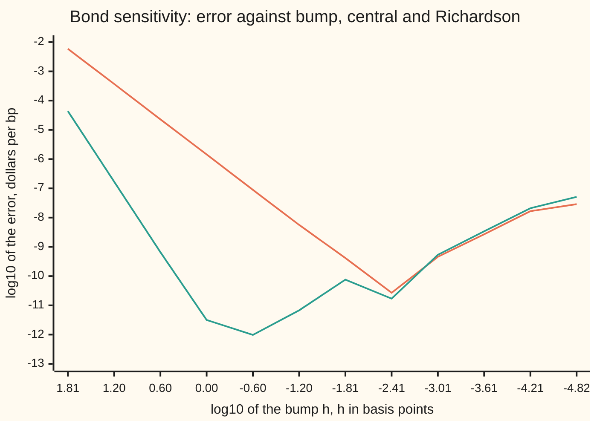

# Richardson extrapolation: combine two step sizes to cancel the leading error term

[Syllabus](../../../SYLLABUS.md) → [Numerical analysis](../README.md) → [Derivatives by Machine](../README.md#s08) → Richardson extrapolation

---

## General Overview

A bond pays $40 a year for 30 years and returns $1,000 with the last payment. At a market yield of 5% it is worth $846.28 (an illustrative bond, priced with yearly payments). A risk desk wants its **sensitivity**: how many dollars the price moves when the yield moves by one **basis point** (bp, a hundredth of a percent). Differentiating the price formula term by term gives the true answer, −1.3620117671 dollars per bp.

Most pricing code has no formula for the slope, so the desk **bumps**: reprice 1 bp up and 1 bp down, subtract, and divide by the 2 bp span. That central difference gives −1.362013207700, off by 1.441e-06 dollars per bp. Bump 2 bp each way instead and the error is 5.762e-06: four times larger (the ratio prints as 4.0000), as the step doubled.

That factor of four is the key. The error is not noise. It is a fixed number times the step squared. Two bumps pin that number down, so it can be subtracted: four times the 1 bp answer, minus the 2 bp answer, all divided by 3, gives −1.362011767094. The error is now 3.149e-12, smaller by a factor of 4.5751e+05, from the same four repricings.

Smaller bumps then stop helping. Below about a quarter of a basis point the combined answer gets worse, because each price carries a rounding error of about 1.588e-12 dollars, and dividing by a tiny step magnifies it.

This is the shelf's bond, per $1,000 of face, priced at 5% instead of 4.50%: the $10 million position in [Forward, backward and central differences](01-forward-backward-and-central-differences.md) is 10,000 of these bonds. On that position, at 4.50%, the same four repricings cut the central error from −0.016687 to +4.418e-08 dollars per bp.

**When an approximation's error is a known power of the step times an unknown constant, two step sizes determine that constant, and one weighted combination of the two answers removes it; the leftover error is a higher power of the step, until rounding sets a floor.**

**What kind of fact this is:** a theorem (the error series of the central difference and its cancellation), proved on this card in Why it works. The rounding floor and the best step are an estimate from an error model, checked against measured errors.

### The picture: error against bump size



Orange is the plain central difference; green is Richardson's combination of bumps h and 2h. The bumps run from 64 bp down to 1/65,536 bp, a factor of 4 per point. While the step is large, orange falls 1.2 decades per point (slope 2) and green 2.4 (slope 4). Green hits the rounding floor near h = 1/4 bp, at 10^−12.01; orange keeps falling to about 1/256 bp and still bottoms out above green. Below that, both lines climb together: rounding has taken over and nothing is left to cancel.

---

## The formula

Notation first, in words. $x$ is the yield in basis points, so 5% is $x_0 = 500$. $P(x)$ is the bond's price in dollars at yield $x$. $P'$, $P'''$ and $P^{(5)}$ are its first, third and fifth derivatives with respect to $x$. The bump is $h$ basis points each way.

The central difference, from [Forward, backward and central differences](01-forward-backward-and-central-differences.md), and its full error series:

$$D(h) = \frac{P(x_0 + h) - P(x_0 - h)}{2h} = P'(x_0) + \frac{h^2}{6}P'''(x_0) + \frac{h^4}{120}P^{(5)}(x_0) + \cdots$$

**Read it aloud:** the bumped slope is the true slope, plus a sixth of the step squared times the third derivative, plus a smaller term in the step to the fourth, with no odd powers.

Richardson's combination of the 1 bp and 2 bp answers:

$$R(h) = \frac{4D(h) - D(2h)}{3} = D(h) + \frac{D(h) - D(2h)}{3} = P'(x_0) - \frac{h^4}{30}P^{(5)}(x_0) + \cdots$$

**Read it aloud:** take the small-step answer and push it further, by a third of how far it moved from the large-step answer; what is left of the error starts at the step to the fourth.

The general rule, for any method whose answer $A(h)$ has error $c\,h^p$ plus higher powers, with steps $h$ and $rh$:

$$R = \frac{r^p A(h) - A(rh)}{r^p - 1}$$

**Read it aloud:** weight the small-step answer by the step ratio raised to the error's power, subtract the large-step answer, and divide by the weights' total.

The same two answers also measure the error of $D(h)$, for free:

$$D(h) - P'(x_0) \approx \frac{D(2h) - D(h)}{3}$$

| Symbol | Plain meaning | In our example | Push it up and the answer… |
| --- | --- | --- | --- |
| $x$, $x_0$, $y$ | yield in basis points; the yield where the slope is wanted; the yield as a decimal, $x/10{,}000$ | $x_0 = 500$, y = 0.05 | the price falls |
| $P(x)$ | the bond's price in dollars at yield $x$ | 846.2754897312 at 500 bp | — |
| $P'(x_0)$ | the true sensitivity, dollars per bp | −1.3620117671 | — |
| $P''$ to $P^{(6)}$ | higher derivatives of the price; $P'''$ per bp³ and $P^{(5)}$ per bp⁵ lead the errors | $P'''$ = −8.643616e-06, $P^{(5)}$ = −7.818464e-11 | larger truncation error |
| $h$ | the bump, in bp each way | 1 and 2 | larger truncation, smaller rounding |
| $D(h)$ | central difference with bump $h$ | −1.362013207700 at h = 1 | — |
| $R(h)$ | Richardson's combination of $D(h)$ and $D(2h)$ | −1.362011767094 at h = 1 | — |
| $A(h)$, $c$, $p$, $r$ | any method's answer at step h; its leading error coefficient; that error's power; the step ratio | for $D$: $c = P'''/6$, p = 2, r = 2 | — |
| $u$ | unit roundoff, $2^{-53}$: the largest relative rounding in one double operation | 1.110e-16 | larger rounding floor |
| $\eta$ | rounding error in one computed price, dollars (Greek eta) | about 1.588e-12 | larger best step, larger floor |
| $h^\ast$ | the bump that minimises the modelled total error | 0.744 bp for $R$, 0.0082 bp for $D$ | — |
| $s$, $M_6$, $\xi_\pm$ | proof helpers: a bump size standing for h or 2h; a ceiling on the size of $P^{(6)}$; unknown points inside the bumps | — | — |

### When it holds

- **The error power is known.** The weights 4 and 3 assume an $h^2$ error. Used with weights 2 and 1, as if the error were size $h$, the answer is off by 2.881e-06, worse than the plain 1 bp bump.
- **The step ratio matches the weights.** Bumps of 1 and 3 bp need $r^p = 9$: then the error is 6.320e-12. Using 4 leaves 2.401e-06.
- **The function is smooth across both bumps.** The series needs six continuous derivatives between $x_0 - 2h$ and $x_0 + 2h$. A price capped half a basis point away has a kink inside the bumps, and the combination is off by 0.2841.
- **Truncation is larger than rounding.** Once the step is so small that the rounding error $1.5\eta/h$ leads, cancelling the truncation term buys nothing. For this bond that happens below about 1/4 bp.

---

## Why it works

### Step 0: the error is a formula, not noise

The error must follow a known power of the step, with a fixed but unknown coefficient. Then each step size gives one equation in two unknowns: the true answer and the coefficient. Two step sizes give two equations, solved for the true answer.

[Error bounds and Romberg](../05-Quadrature/02-error-bounds-and-romberg.md) does this for the trapezoid rule's area. This card does it for a slope, and adds what is new for a slope: rounding that grows as the step shrinks, so it sets a best step, not just a floor.

### Step 1: the central difference has only even powers

Expand both bumped prices with [Taylor's theorem](../../06-Calculus%20and%20analysis/03-What%20Derivatives%20Tell%20You/05-taylors-theorem.md) about $x_0$:

$$P(x_0 \pm h) = P \pm hP' + \tfrac{h^2}{2}P'' \pm \tfrac{h^3}{6}P''' + \tfrac{h^4}{24}P^{(4)} \pm \tfrac{h^5}{120}P^{(5)} + \cdots$$

Subtract the down price from the up price. The even-order terms appear with the same sign in both, so they cancel. The odd ones double. Divide by $2h$:

$$D(h) = P' + \tfrac{h^2}{6}P''' + \tfrac{h^4}{120}P^{(5)} + \cdots$$

A quicker way to see that no odd powers can appear: swapping $h$ for $-h$ swaps the two prices and flips the sign of $2h$, so $D(-h) = D(h)$. A function equal to its own mirror image has only even powers.

For the bond at 1 bp, the series predicts an error of −1.441e-06. The measured error is −1.441e-06.

### Step 2: two bumps cancel the step-squared term

Call the leading coefficient $c = P'''/6$. Then

- $D(1) \approx P' + c$
- $D(2) \approx P' + 4c$

Four times the first, minus the second, removes $c$ and leaves three copies of $P'$. Divide by 3:

$$R(1) = \frac{4D(1) - D(2)}{3}$$

Carry the next term along. $D(h)$ has $\tfrac{h^4}{120}P^{(5)}$ and $D(2h)$ has 16 times that. So $R(h)$ keeps $\tfrac{4 - 16}{3}\cdot\tfrac{h^4}{120}P^{(5)} = -\tfrac{h^4}{30}P^{(5)}$. For the bond at 1 bp this predicts +2.606e-12. The measured error is +3.149e-12. The remaining gap is rounding, which Step 4 sizes.

The same algebra with any step ratio $r$ and error power $p$ gives the general rule $(r^pA(h) - A(rh))/(r^p - 1)$.

Spread over the four prices, $R(h)$ puts weights $\tfrac{1}{12h}(1, -8, 8, -1)$ on $P(x_0 - 2h)$, $P(x_0 - h)$, $P(x_0 + h)$, $P(x_0 + 2h)$. That is the five-point fourth-order stencil, built directly on [Stencils to order](02-stencils-for-higher-and-mixed-derivatives.md). Richardson reaches it without solving for any weights.

<details>
<summary>Detailed proof: the error of R(h), with its remainder</summary>

Assume $P$ has six continuous derivatives on $[x_0 - 2h, x_0 + 2h]$. Taylor's theorem with remainder gives, for $s = h$ and $s = 2h$,

$$D(s) = P' + \frac{s^2}{6}P''' + \frac{s^4}{120}P^{(5)} + \frac{s^5}{1440}\Bigl(P^{(6)}(\xi_+) - P^{(6)}(\xi_-)\Bigr)$$

for some points $\xi_\pm$ within $s$ of $x_0$. The last term is at most $s^5 M_6/720$ in size, where $M_6$ bounds $|P^{(6)}|$ on the interval.

Form $4D(h) - D(2h)$. The $P'$ terms give $3P'$. The $s^2$ terms give $\tfrac{4h^2 - 4h^2}{6}P''' = 0$. The $s^4$ terms give $\tfrac{4h^4 - 16h^4}{120}P^{(5)} = -\tfrac{h^4}{10}P^{(5)}$. The remainders total at most $\tfrac{4h^5 + 32h^5}{720}M_6$. Divide by 3:

$$\Bigl|R(h) - P' + \tfrac{h^4}{30}P^{(5)}\Bigr| \le \frac{h^5 M_6}{60}.$$

So the error of $R(h)$ is $-\tfrac{h^4}{30}P^{(5)}$ plus something of size $h^5$ at most. (If $P$ also has a seventh derivative, as the bond's price does, the even-power symmetry of Step 1 makes that leftover of size $h^6$.) The check confirms the leading term directly: at h = 8 bp the measured error of $R$ is 1.00009 times $-\tfrac{h^4}{30}P^{(5)}$. $\blacksquare$

</details>

### Step 3: the gap between the two answers is the error estimate

From the same two lines, $D(2) - D(1) \approx 3c$. So the error of the 1 bp answer is about a third of the gap:

$$D(1) - P' \approx \frac{D(2) - D(1)}{3} = -1.441\text{e-}06$$

Estimate over truth: 1.00000. The desk gets the error of its plain bump without knowing the true slope. This is an **estimate**, not a bound: it is right only while the $h^2$ term leads.

### Step 4: rounding sets a floor, and moves the best step

Each computed price is slightly wrong. For this bond a main cause is storing the bumped yield: $1 + y$ is rounded to a double, a relative change of at most $u = 2^{-53}$ (see [Machine epsilon and cancellation](../01-Floating%20Point%20and%20Error/03-rounding-cancellation-and-machine-epsilon.md)). That shifts the yield by $u(1 + y)$, which is $u(1+y)\times 10^4$ bp, and moves the price by $|P'|$ times that:

$$\eta \approx u\,(1 + y)\,|P'| \times 10^4 = 1.588\text{e-}12 \text{ dollars}$$

The two prices in $D(h)$ are divided by $2h$, so rounding adds up to $\eta/h$. $R(h)$ uses four prices with weights $\tfrac43\cdot\tfrac1{2h}$ and $\tfrac13\cdot\tfrac1{4h}$, each used twice, so its rounding is up to $1.5\eta/h$. Extrapolation trades a little more rounding for far less truncation.

The modelled total for $R$ is $|P^{(5)}|h^4/30 + 1.5\eta/h$. Setting its slope to zero gives $h^5 = 45\eta / (4|P^{(5)}|)$:

| | Best bump $h^\ast$, model | Error there, model | Best in the sweep, measured |
| --- | --- | --- | --- |
| Central $D(h)$ | 0.0082 bp | 2.90e-10 | 2.66e-11 at 0.0039 bp |
| Richardson $R(h)$ | 0.744 bp | 4.00e-12 | 9.79e-13 at 0.2500 bp |

The model is an estimate of the typical size. Real rounding errors partly cancel, so the measured minima sit below it, by a factor of 4.1 for $R$ and 10.9 for $D$. The pattern is the point: extrapolation wants a step 91 times larger, and there it is still more accurate. Why the best step lands where it does in general is the subject of [Choosing the step](04-choosing-the-step-truncation-against-rounding.md).

### Step 5: what it costs

$D(1)$ costs two repricings. $R(1)$ costs four: the 1 bp pair and the 2 bp pair. For two extra repricings the error fell from 1.441e-06 to 3.149e-12, a factor of 4.5751e+05. The plain central difference never reaches that accuracy on this bond: its best error in the sweep is 2.66e-11.

---

## Worked numbers, by hand

From the check's output, at a 5% yield, in dollars per bp.

| Step | Arithmetic | Value |
| --- | --- | --- |
| bump 1 bp each way | $D(1)$ | −1.362013207700 |
| bump 2 bp each way | $D(2)$ | −1.362017529518 |
| gap between them | −1.362017529518 − (−1.362013207700) | −0.000004321818 |
| error estimate for $D(1)$ | gap ÷ 3 | −0.000001440606 |
| extrapolate | −1.362013207700 − (−0.000001440606) | **−1.362011767094** |
| true error | against −1.3620117671 from the formula | **+3.149e-12** |

The bond loses $1.362011767094 for each basis point the yield rises, per $1,000 of face value, right to eleven decimal places.

### What breaks if you drop a piece

| Mistake | Comes out at | What went wrong |
| --- | --- | --- |
| Weights 2 and 1: $2D(1) - D(2)$ | −1.3620088859, off +2.881e-06 | treats the error as size h; worse than $D(1)$ alone |
| Forward differences with weights 4 and 3 | −1.3609470737, off +1.065e-03 | a forward difference's error is size h, so it needs weights 2 and 1 |
| Bumps of 1 and 3 bp with weights 4 and 3 | −1.3620093661, off +2.401e-06 | ratio 3 needs $3^2 = 9$; with 9 and 8, off +6.320e-12 |
| Richardson at h = 1/65,536 bp | −1.3620117164, off +5.071e-08 | rounding, $1.5\eta/h$, dominates; 16103 times worse than at 1 bp |
| Prices rounded to the cent, h = 1 bp | −1.3591666667, off +2.845e-03 | $\eta$ is now half a cent; the step must grow |
| A price capped at its 499.5 bp value | −1.0779599760, off +2.841e-01 | a kink inside the bumps: no Taylor series, nothing to cancel |

The rounded-to-the-cent row shows how a coarse pricer changes the advice. With $\eta$ half a cent, the plain 1 bp bump is off +2.012e-03 and an 8 bp bump +1.368e-04. Richardson with bumps of 32 and 64 bp is off +5.864e-05: wide bumps, extrapolated, beat the 1 bp and 8 bp bumps. A narrow bump can land closer by luck, but nothing in the prices says which one; the wide, extrapolated pair is reliably near the best the noise allows.

---

## Code, from first principles, and it actually runs

The code prices the bond by repeated multiplication of the yearly discount factor, then reaches the slope three independent ways: the price formula differentiated term by term (the known answer); the central difference and Richardson's combination at bumps from 64 bp down to 1/65,536 bp; and the Taylor series, which predicts each method's error from $P'''$ and $P^{(5)}$ alone. Asserts check the gain, the observed orders against 2 and 4, the series against the measured errors, the free estimate, the rounding floor, and every row of What breaks. Only +, −, × and ÷ touch the prices, so Python and Rust agree to the bit; logs and powers appear only in the reporting lines.

### Python

```python
# Richardson extrapolation -- the check behind the card.  Only math is imported,
# for log10 and pow in the reporting lines.  The bond (illustrative): $1,000 face,
# 30 years, a $40 coupon once a year, priced at a 5% yield.  x is the yield in
# basis points (bp, hundredths of a percent), so bumps h are in bp and every
# derivative is in dollars per bp.  Road 1: the price formula differentiated term
# by term.  Road 2: central differences, alone and combined (Richardson).  Road 3:
# the Taylor series, predicting each difference's error from P''' and P^(5).
import math
C, F, N, X0, BP = 40.0, 1000.0, 30, 500.0, 1e-4
def price(x):                                  # discount factors by repeated multiply
    v, d, s = 1.0 / (1.0 + x * BP), 1.0, 0.0
    for t in range(1, N + 1):
        d *= v
        s += C * d
    return s + F * d
def deriv(x, k):                               # k-th derivative of price, term by term
    v, s = 1.0 / (1.0 + x * BP), 0.0
    for t in range(1, N + 1):
        f, d = 1.0, 1.0
        for j in range(t + k): d *= v
        for j in range(k): f *= -(t + j) * BP
        s += (C + (F if t == N else 0.0)) * f * d
    return s
def cen(p, h, x=X0): return (p(x + h) - p(x - h)) / (2 * h)
def rich(p, h, x=X0): return (4 * cen(p, h, x) - cen(p, 2 * h, x)) / 3
def e(v): return f"{v:+.3e}"
P0, P1, P3, P5 = price(X0), deriv(X0, 1), deriv(X0, 3), deriv(X0, 5)
print(f"price at 5%, dollars                 {P0:.10f}")
print(f"exact P', dollars per bp             {P1:.10f}")
print(f"P''' per bp^3 and P^(5) per bp^5     {P3:.6e} {P5:.6e}")
D1, D2 = cen(price, 1.0), cen(price, 2.0)
R1 = (4 * D1 - D2) / 3
est = (D2 - D1) / 3                            # the free error estimate for D(1)
for name, val in [("central, 1 bp each way", D1), ("central, 2 bp each way", D2),
                  ("Richardson (4 D(1) - D(2))/3", R1)]:
    print(f"{name:<30}{val:.12f}  error {e(val - P1)}")
print(f"error ratio D(2)/D(1)                {(D2 - P1) / (D1 - P1):.4f}")
print(f"gap D(2)-D(1) {D2 - D1:.12f}, a third of it {est:.12f}")
print(f"free estimate (D(2)-D(1))/3          {e(est)}  ratio to true {est / (D1 - P1):.5f}")
print(f"series: P'''h^2/6 + P5 h^4/120, h=1  {e(P3 / 6 + P5 / 120)}")
print(f"series: -P5 h^4/30, h=1              {e(-P5 / 30)}")
r8 = (rich(price, 8.0) - P1) / (-P5 * 8.0 ** 4 / 30)
print(f"R(8) error over -P5 h^4/30, h=8      {r8:.5f}")
print(f"gain at 1 bp, central error / Richardson error  {abs((D1 - P1) / (R1 - P1)):.4e}")
S, Q1 = 10000.0, deriv(450.0, 1)               # the shelf's $10m position: 10,000 bonds at 4.50%
print(f"shelf $10m at 4.50%: price {S * price(450.0):.6f}; error central {S * (cen(price, 1.0, 450.0) - Q1):+.6f}, "
      f"Richardson {e(S * (rich(price, 1.0, 450.0) - Q1))} $/bp")
print("h bp, log10 h, central error, Richardson error, log10 of each")
sweep = [4.0 ** k for k in range(3, -9, -1)]
ce, re = [], []
for h in sweep:
    a, b = cen(price, h) - P1, rich(price, h) - P1
    ce.append(abs(a)); re.append(abs(b))
    print(f"{h:12.9f} {math.log10(h):6.2f} {e(a)} {e(b)} {math.log10(abs(a)):6.2f} {math.log10(abs(b)):6.2f}")
u = 2.0 ** -53                                 # unit roundoff, written out
eta = u * (1 + X0 * BP) * abs(P1) / BP         # price moved by one rounding of 1 + y
hr = (45 * eta / (4 * abs(P5))) ** 0.2         # minimise |P5| h^4/30 + 1.5 eta/h
hc = (3 * eta / abs(P3)) ** (1 / 3)            # minimise |P3| h^2/6 + eta/h
print(f"rounding per price eta, dollars      {eta:.3e}")
print(f"best h, Richardson and central, bp   {hr:.3f} {hc:.4f}")
mr, mc = abs(P5) * hr ** 4 / 30 + 1.5 * eta / hr, abs(P3) * hc ** 2 / 6 + eta / hc
print(f"error model at best h, R and central {mr:.2e} {mc:.2e}")
print(f"observed best: Richardson {min(re):.2e} at h {sweep[re.index(min(re))]:.4f}, "
      f"central {min(ce):.2e} at h {sweep[ce.index(min(ce))]:.4f}")
print(f"u {u:.3e}; model over measured best, R and central {mr / min(re):.1f} "
      f"{mc / min(ce):.1f}; best-step ratio {hr / hc:.0f}; R(4^-8) over R(1) {re[-1] / re[3]:.0f}")
# what breaks
def fwd(h): return (price(X0 + h) - P0) / h
w1 = 2 * D1 - D2                               # treats the error as size h, not h^2
w2 = (4 * fwd(1.0) - fwd(2.0)) / 3             # forward difference: error is size h
w3 = (4 * D1 - cen(price, 3.0)) / 3            # bumps 1 and 3 with the factor for 1 and 2
ok3 = (9 * D1 - cen(price, 3.0)) / 8           # the right factor, 3^2 = 9
w4 = rich(price, 4.0 ** -8)
def cents(x): return math.floor(price(x) * 100 + 0.5) / 100
w5 = rich(cents, 1.0)
print(f"prices to the cent: central 1 bp {e(cen(cents, 1.0) - P1)}, central 8 bp "
      f"{e(cen(cents, 8.0) - P1)}, Richardson 32 bp {e(rich(cents, 32.0) - P1)}")
cap = price(X0 - 0.5)                          # a cap half a bp below: a kink
def capped(x): return min(price(x), cap)
w6 = rich(capped, 1.0)
for name, val in [("weights 2 and 1", w1), ("forward differences, 4 and 3", w2),
                  ("bumps 1 and 3, factor 4", w3), ("bumps 1 and 3, factor 9", ok3),
                  ("Richardson at h = 4^-8 bp", w4), ("prices to the cent", w5),
                  ("capped price, kink at 499.5 bp", w6)]:
    print(f"{name:<32}{val:.10f}  error {e(val - P1)}")
assert abs(R1 - P1) < 1e-10 and abs(D1 - P1) > 1e-7             # the gain is real
assert abs((D2 - P1) / (D1 - P1) - 4) < 0.01                    # central: order 2
assert abs(re[1] / re[2] / 256 - 1) < 0.01                       # Richardson: order 4
assert abs((D1 - P1) / (P3 / 6 + P5 / 120) - 1) < 1e-3          # series predicts error
assert abs(r8 - 1) < 1e-2                                       # series predicts R's error
assert abs(est / (D1 - P1) - 1) < 1e-3                          # free estimate
assert 0.25 <= sweep[re.index(min(re))] <= 4 and re[-1] > 100 * re[3]  # rounding stops it
assert min(abs(w1 - P1), abs(w2 - P1), abs(w3 - P1), abs(w5 - P1), abs(w6 - P1)) > 1e-7
assert abs(ok3 - P1) < 1e-10 and abs(w6 - P1) > 0.01
print("ALL CHECKS PASS")
```

**Ran 2026-11-11 on macOS, Python 3.14.10, standard library only. All checks passed. Output, pasted from the run:**

```
price at 5%, dollars                 846.2754897312
exact P', dollars per bp             -1.3620117671
P''' per bp^3 and P^(5) per bp^5     -8.643616e-06 -7.818464e-11
central, 1 bp each way        -1.362013207700  error -1.441e-06
central, 2 bp each way        -1.362017529518  error -5.762e-06
Richardson (4 D(1) - D(2))/3  -1.362011767094  error +3.149e-12
error ratio D(2)/D(1)                4.0000
gap D(2)-D(1) -0.000004321818, a third of it -0.000001440606
free estimate (D(2)-D(1))/3          -1.441e-06  ratio to true 1.00000
series: P'''h^2/6 + P5 h^4/120, h=1  -1.441e-06
series: -P5 h^4/30, h=1              +2.606e-12
R(8) error over -P5 h^4/30, h=8      1.00009
gain at 1 bp, central error / Richardson error  4.5751e+05
shelf $10m at 4.50%: price 9185555.572786; error central -0.016687, Richardson +4.418e-08 $/bp
h bp, log10 h, central error, Richardson error, log10 of each
64.000000000   1.81 -5.912e-03 +4.395e-05  -2.23  -4.36
16.000000000   1.20 -3.688e-04 +1.709e-07  -3.43  -6.77
 4.000000000   0.60 -2.305e-05 +6.674e-10  -4.64  -9.18
 1.000000000   0.00 -1.441e-06 +3.149e-12  -5.84 -11.50
 0.250000000  -0.60 -9.004e-08 +9.792e-13  -7.05 -12.01
 0.062500000  -1.20 -5.633e-09 -6.789e-12  -8.25 -11.17
 0.015625000  -1.81 -4.123e-10 -7.576e-11  -9.38 -10.12
 0.003906250  -2.41 -2.665e-11 -1.695e-11 -10.57 -10.77
 0.000976562  -3.01 +4.536e-10 +5.312e-10  -9.34  -9.27
 0.000244141  -3.61 -2.690e-09 -3.427e-09  -8.57  -8.47
 0.000061035  -4.21 -1.666e-08 -2.085e-08  -7.78  -7.68
 0.000015259  -4.82 +2.898e-08 +5.071e-08  -7.54  -7.29
rounding per price eta, dollars      1.588e-12
best h, Richardson and central, bp   0.744 0.0082
error model at best h, R and central 4.00e-12 2.90e-10
observed best: Richardson 9.79e-13 at h 0.2500, central 2.66e-11 at h 0.0039
u 1.110e-16; model over measured best, R and central 4.1 10.9; best-step ratio 91; R(4^-8) over R(1) 16103
prices to the cent: central 1 bp +2.012e-03, central 8 bp +1.368e-04, Richardson 32 bp +5.864e-05
weights 2 and 1                 -1.3620088859  error +2.881e-06
forward differences, 4 and 3    -1.3609470737  error +1.065e-03
bumps 1 and 3, factor 4         -1.3620093661  error +2.401e-06
bumps 1 and 3, factor 9         -1.3620117671  error +6.320e-12
Richardson at h = 4^-8 bp       -1.3620117164  error +5.071e-08
prices to the cent              -1.3591666667  error +2.845e-03
capped price, kink at 499.5 bp  -1.0779599760  error +2.841e-01
ALL CHECKS PASS
```

### Rust

Same numbers, same labels, built with `rustc --edition 2021 -O`.

```rust
// Richardson extrapolation -- the same check as the Python, in Rust.  No crates.
// The bond (illustrative): $1,000 face, 30 years, a $40 coupon once a year, priced
// at a 5% yield.  x is the yield in basis points (bp), so bumps h are in bp and
// every derivative is in dollars per bp.  Road 1: the price formula differentiated
// term by term.  Road 2: central differences, alone and combined (Richardson).
// Road 3: the Taylor series, predicting each difference's error from P''' and P^(5).
const C: f64 = 40.0;
const F: f64 = 1000.0;
const N: usize = 30;
const X0: f64 = 500.0;
const BP: f64 = 1e-4;
fn price(x: f64) -> f64 {                       // discount factors by repeated multiply
    let (v, mut d, mut s) = (1.0 / (1.0 + x * BP), 1.0, 0.0);
    for _ in 1..=N { d *= v; s += C * d; }
    s + F * d
}
fn deriv(x: f64, k: usize) -> f64 {             // k-th derivative of price, term by term
    let (v, mut s) = (1.0 / (1.0 + x * BP), 0.0);
    for t in 1..=N {
        let (mut f, mut d) = (1.0, 1.0);
        for _ in 0..t + k { d *= v; }
        for j in 0..k { f *= -((t + j) as f64) * BP; }
        s += (C + if t == N { F } else { 0.0 }) * f * d;
    }
    s
}
fn cen(p: &dyn Fn(f64) -> f64, h: f64) -> f64 { (p(X0 + h) - p(X0 - h)) / (2.0 * h) }
fn rich(p: &dyn Fn(f64) -> f64, h: f64) -> f64 { (4.0 * cen(p, h) - cen(p, 2.0 * h)) / 3.0 }
fn sci(v: f64, prec: usize, plus: bool) -> String {   // Python-style e-notation
    let s = format!("{:.*e}", prec, v);
    let (m, ex) = s.split_once('e').unwrap();
    let n: i32 = ex.parse().unwrap();
    let sign = if plus && v >= 0.0 { "+" } else { "" };
    format!("{}{}e{}{:02}", sign, m, if n < 0 { '-' } else { '+' }, n.abs())
}
fn e(v: f64) -> String { sci(v, 3, true) }
fn main() {
    let pf = |x: f64| price(x);
    let (p0, p1, p3, p5) = (price(X0), deriv(X0, 1), deriv(X0, 3), deriv(X0, 5));
    println!("price at 5%, dollars                 {:.10}", p0);
    println!("exact P', dollars per bp             {:.10}", p1);
    println!("P''' per bp^3 and P^(5) per bp^5     {} {}", sci(p3, 6, false), sci(p5, 6, false));
    let (d1, d2) = (cen(&pf, 1.0), cen(&pf, 2.0));
    let r1 = (4.0 * d1 - d2) / 3.0;
    let est = (d2 - d1) / 3.0;                  // the free error estimate for D(1)
    for (name, val) in [("central, 1 bp each way", d1), ("central, 2 bp each way", d2),
                        ("Richardson (4 D(1) - D(2))/3", r1)] {
        println!("{:<30}{:.12}  error {}", name, val, e(val - p1));
    }
    println!("error ratio D(2)/D(1)                {:.4}", (d2 - p1) / (d1 - p1));
    println!("gap D(2)-D(1) {:.12}, a third of it {:.12}", d2 - d1, est);
    println!("free estimate (D(2)-D(1))/3          {}  ratio to true {:.5}", e(est), est / (d1 - p1));
    println!("series: P'''h^2/6 + P5 h^4/120, h=1  {}", e(p3 / 6.0 + p5 / 120.0));
    println!("series: -P5 h^4/30, h=1              {}", e(-p5 / 30.0));
    let r8 = (rich(&pf, 8.0) - p1) / (-p5 * 8f64.powi(4) / 30.0);
    println!("R(8) error over -P5 h^4/30, h=8      {:.5}", r8);
    println!("gain at 1 bp, central error / Richardson error  {}", sci(((d1 - p1) / (r1 - p1)).abs(), 4, false));
    let (sh, q1) = (|x: f64| price(x - 50.0), deriv(450.0, 1)); // the shelf's $10m position at 4.50%
    println!("shelf $10m at 4.50%: price {:.6}; error central {:+.6}, Richardson {} $/bp",
             10000.0 * price(450.0), 10000.0 * (cen(&sh, 1.0) - q1), e(10000.0 * (rich(&sh, 1.0) - q1)));
    println!("h bp, log10 h, central error, Richardson error, log10 of each");
    let sweep: Vec<f64> = (-8..=3).rev().map(|k| 4f64.powi(k)).collect();
    let (mut ce, mut re) = (vec![], vec![]);
    for &h in &sweep {
        let (a, b) = (cen(&pf, h) - p1, rich(&pf, h) - p1);
        ce.push(a.abs()); re.push(b.abs());
        println!("{:12.9} {:6.2} {} {} {:6.2} {:6.2}", h, h.log10(), e(a), e(b), a.abs().log10(), b.abs().log10());
    }
    let u = 2f64.powi(-53);                     // unit roundoff, written out
    let eta = u * (1.0 + X0 * BP) * p1.abs() / BP;   // price moved by one rounding of 1 + y
    let hr = (45.0 * eta / (4.0 * p5.abs())).powf(0.2);
    let hc = (3.0 * eta / p3.abs()).powf(1.0 / 3.0);
    println!("rounding per price eta, dollars      {}", sci(eta, 3, false));
    println!("best h, Richardson and central, bp   {:.3} {:.4}", hr, hc);
    let (mr, mc) = (p5.abs() * hr.powi(4) / 30.0 + 1.5 * eta / hr, p3.abs() * hc * hc / 6.0 + eta / hc);
    println!("error model at best h, R and central {} {}", sci(mr, 2, false), sci(mc, 2, false));
    let argmin = |v: &Vec<f64>| (0..v.len()).fold(0, |b, i| if v[i] < v[b] { i } else { b });
    let (ir, ic) = (argmin(&re), argmin(&ce));
    println!("observed best: Richardson {} at h {:.4}, central {} at h {:.4}",
             sci(re[ir], 2, false), sweep[ir], sci(ce[ic], 2, false), sweep[ic]);
    println!("u {}; model over measured best, R and central {:.1} {:.1}; best-step ratio {:.0}; R(4^-8) over R(1) {:.0}",
             sci(u, 3, false), mr / re[ir], mc / ce[ic], hr / hc, re[11] / re[3]);
    // what breaks
    let fwd = |h: f64| (price(X0 + h) - p0) / h;
    let w1 = 2.0 * d1 - d2;                     // treats the error as size h, not h^2
    let w2 = (4.0 * fwd(1.0) - fwd(2.0)) / 3.0; // forward difference: error is size h
    let w3 = (4.0 * d1 - cen(&pf, 3.0)) / 3.0;  // bumps 1 and 3 with the factor for 1 and 2
    let ok3 = (9.0 * d1 - cen(&pf, 3.0)) / 8.0; // the right factor, 3^2 = 9
    let w4 = rich(&pf, 4f64.powi(-8));
    let cents = |x: f64| (price(x) * 100.0 + 0.5).floor() / 100.0;
    let w5 = rich(&cents, 1.0);
    println!("prices to the cent: central 1 bp {}, central 8 bp {}, Richardson 32 bp {}",
             e(cen(&cents, 1.0) - p1), e(cen(&cents, 8.0) - p1), e(rich(&cents, 32.0) - p1));
    let cap = price(X0 - 0.5);                  // a cap half a bp below: a kink
    let capped = |x: f64| price(x).min(cap);
    let w6 = rich(&capped, 1.0);
    for (name, val) in [("weights 2 and 1", w1), ("forward differences, 4 and 3", w2),
                        ("bumps 1 and 3, factor 4", w3), ("bumps 1 and 3, factor 9", ok3),
                        ("Richardson at h = 4^-8 bp", w4), ("prices to the cent", w5),
                        ("capped price, kink at 499.5 bp", w6)] {
        println!("{:<32}{:.10}  error {}", name, val, e(val - p1));
    }
    assert!((r1 - p1).abs() < 1e-10 && (d1 - p1).abs() > 1e-7);      // the gain is real
    assert!(((d2 - p1) / (d1 - p1) - 4.0).abs() < 0.01);             // central: order 2
    assert!((re[1] / re[2] / 256.0 - 1.0).abs() < 0.01);             // Richardson: order 4
    assert!(((d1 - p1) / (p3 / 6.0 + p5 / 120.0) - 1.0).abs() < 1e-3); // series predicts error
    assert!((r8 - 1.0).abs() < 1e-2);                              // series predicts R's error
    assert!((est / (d1 - p1) - 1.0).abs() < 1e-3);                   // free estimate
    assert!(sweep[ir] >= 0.25 && sweep[ir] <= 4.0 && re[11] > 100.0 * re[3]); // rounding stops it
    assert!([w1, w2, w3, w5, w6].iter().all(|w| (w - p1).abs() > 1e-7));
    assert!((ok3 - p1).abs() < 1e-10 && (w6 - p1).abs() > 0.01);
    println!("ALL CHECKS PASS");
}
```

**Ran 2026-11-11 on macOS, rustc 1.98.1, no crates. All checks passed. Output, pasted from the run:**

```
price at 5%, dollars                 846.2754897312
exact P', dollars per bp             -1.3620117671
P''' per bp^3 and P^(5) per bp^5     -8.643616e-06 -7.818464e-11
central, 1 bp each way        -1.362013207700  error -1.441e-06
central, 2 bp each way        -1.362017529518  error -5.762e-06
Richardson (4 D(1) - D(2))/3  -1.362011767094  error +3.149e-12
error ratio D(2)/D(1)                4.0000
gap D(2)-D(1) -0.000004321818, a third of it -0.000001440606
free estimate (D(2)-D(1))/3          -1.441e-06  ratio to true 1.00000
series: P'''h^2/6 + P5 h^4/120, h=1  -1.441e-06
series: -P5 h^4/30, h=1              +2.606e-12
R(8) error over -P5 h^4/30, h=8      1.00009
gain at 1 bp, central error / Richardson error  4.5751e+05
shelf $10m at 4.50%: price 9185555.572786; error central -0.016687, Richardson +4.418e-08 $/bp
h bp, log10 h, central error, Richardson error, log10 of each
64.000000000   1.81 -5.912e-03 +4.395e-05  -2.23  -4.36
16.000000000   1.20 -3.688e-04 +1.709e-07  -3.43  -6.77
 4.000000000   0.60 -2.305e-05 +6.674e-10  -4.64  -9.18
 1.000000000   0.00 -1.441e-06 +3.149e-12  -5.84 -11.50
 0.250000000  -0.60 -9.004e-08 +9.792e-13  -7.05 -12.01
 0.062500000  -1.20 -5.633e-09 -6.789e-12  -8.25 -11.17
 0.015625000  -1.81 -4.123e-10 -7.576e-11  -9.38 -10.12
 0.003906250  -2.41 -2.665e-11 -1.695e-11 -10.57 -10.77
 0.000976562  -3.01 +4.536e-10 +5.312e-10  -9.34  -9.27
 0.000244141  -3.61 -2.690e-09 -3.427e-09  -8.57  -8.47
 0.000061035  -4.21 -1.666e-08 -2.085e-08  -7.78  -7.68
 0.000015259  -4.82 +2.898e-08 +5.071e-08  -7.54  -7.29
rounding per price eta, dollars      1.588e-12
best h, Richardson and central, bp   0.744 0.0082
error model at best h, R and central 4.00e-12 2.90e-10
observed best: Richardson 9.79e-13 at h 0.2500, central 2.66e-11 at h 0.0039
u 1.110e-16; model over measured best, R and central 4.1 10.9; best-step ratio 91; R(4^-8) over R(1) 16103
prices to the cent: central 1 bp +2.012e-03, central 8 bp +1.368e-04, Richardson 32 bp +5.864e-05
weights 2 and 1                 -1.3620088859  error +2.881e-06
forward differences, 4 and 3    -1.3609470737  error +1.065e-03
bumps 1 and 3, factor 4         -1.3620093661  error +2.401e-06
bumps 1 and 3, factor 9         -1.3620117671  error +6.320e-12
Richardson at h = 4^-8 bp       -1.3620117164  error +5.071e-08
prices to the cent              -1.3591666667  error +2.845e-03
capped price, kink at 499.5 bp  -1.0779599760  error +2.841e-01
ALL CHECKS PASS
```

The two outputs match line for line.

### Lean

Lean proves the remainder bound of the Detailed proof, the general rule and the five-point stencil, for any function and bump meeting their hypotheses.

- If $P$ has six continuous derivatives on $[x_0 - 2h, x_0 + 2h]$, with $\lvert P^{(6)}\rvert \le M_6$ there, then $\bigl\lvert R(h) - P'(x_0) + \tfrac{h^4}{30}P^{(5)}(x_0)\bigr\rvert \le h^5 M_6/60$.
- Say $A(h)$ is the true value, plus $c\,h^p$, plus a leftover at most a fixed multiple of some power $h^q$ for small $h$. If $r^p \ne 1$, then $(r^pA(h) - A(rh))/(r^p - 1)$ is the true value plus a leftover of that same size, whatever $c$ is.
- For any $h \ne 0$, $R(h)$ equals the five-point stencil $\bigl(P(x_0 - 2h) - 8P(x_0 - h) + 8P(x_0 + h) - P(x_0 + 2h)\bigr)/(12h)$.
- The card's fractions check out: $-\tfrac{1}{30}$ and $\tfrac{1}{60}$, the weights 4 and 3, the factor 9 for 1 and 3 bp, the 1.5 and the 45/4.

The bond's numbers, the observed orders, the rounding floor, the best bump and every row of What breaks are left to Python and Rust.

```lean
-- Richardson extrapolation: four times the central difference at bump h, minus the one at bump 2h, over 3, has error -h^4/30 times the fifth derivative plus at most h^5 M₆/60, and the same weighting removes a known leading error power from any method.
import Mathlib.Analysis.Calculus.IteratedDeriv.Defs
import Mathlib.Analysis.Calculus.ContDiff.Defs
import Mathlib.Analysis.Asymptotics.Defs
import Mathlib.Order.Filter.Basic
import Mathlib.Tactic.NormNum
import Mathlib.Analysis.Calculus.Taylor
import Mathlib.Analysis.Asymptotics.Lemmas
import Mathlib.Tactic.LinearCombination
import Mathlib.Tactic.FieldSimp
import Mathlib.Tactic.Linarith
import Mathlib.Tactic.Positivity

/-! `P` is the price as a function of the yield `x` (any real function will do), `x₀` the point
where the slope is wanted, and `h > 0` the bump each way. "Six continuous derivatives between
`x₀ - 2h` and `x₀ + 2h`" is Mathlib's `ContDiffOn ℝ 6 P (Icc (x₀ - 2h) (x₀ + 2h))`, and every
derivative, `P'`, `P^(5)` and `P^(6)`, is taken within that interval with `iteratedDerivWithin`.
`M` is the card's `M₆`, a ceiling on `|P^(6)|` across the interval. -/

open Set Filter Asymptotics Topology

theorem rx_iDW_eq (P : ℝ → ℝ) (S : Set ℝ) (a y z : ℝ) (k : ℕ) (hk : k ≤ 6)
    (hS : UniqueDiffOn ℝ S) (hsub : uIcc a y ⊆ S) (hay : a ≠ y)
    (hP : ContDiffOn ℝ 6 P S) (hz : z ∈ uIcc a y) :
    iteratedDerivWithin k P (uIcc a y) z = iteratedDerivWithin k P S z := by
  rw [iteratedDerivWithin_eq_iteratedFDerivWithin, iteratedDerivWithin_eq_iteratedFDerivWithin,
    iteratedFDerivWithin_subset hsub (uniqueDiffOn_uIcc hay) hS (hP.of_le (by exact_mod_cast hk)) hz]

#print axioms rx_iDW_eq

theorem rx_taylor_six (P : ℝ → ℝ) (S : Set ℝ) (a y : ℝ)
    (hS : UniqueDiffOn ℝ S) (hsub : uIcc a y ⊆ S) (hay : a ≠ y)
    (hP : ContDiffOn ℝ 6 P S) :
    ∃ ξ ∈ S, P y = P a + iteratedDerivWithin 1 P S a * (y - a)
      + iteratedDerivWithin 2 P S a * (y - a) ^ 2 / 2
      + iteratedDerivWithin 3 P S a * (y - a) ^ 3 / 6
      + iteratedDerivWithin 4 P S a * (y - a) ^ 4 / 24
      + iteratedDerivWithin 5 P S a * (y - a) ^ 5 / 120
      + iteratedDerivWithin 6 P S ξ * (y - a) ^ 6 / 720 := by
  have hu : UniqueDiffOn ℝ (uIcc a y) := uniqueDiffOn_uIcc hay
  have hP' : ContDiffOn ℝ 6 P (uIcc a y) := hP.mono hsub
  have hd : DifferentiableOn ℝ (iteratedDerivWithin 5 P (uIcc a y)) (uIcc a y) :=
    hP'.differentiableOn_iteratedDerivWithin (by norm_num) hu
  obtain ⟨ξ, hξ, h⟩ := taylor_mean_remainder_lagrange (n := 5) hay (hP'.of_le (by norm_num))
    (hd.mono uIoo_subset_uIcc_self)
  have hξ' : ξ ∈ uIcc a y := uIoo_subset_uIcc_self hξ
  have ha : a ∈ uIcc a y := left_mem_uIcc
  refine ⟨ξ, hsub hξ', ?_⟩
  rw [taylor_within_apply] at h
  simp only [Finset.sum_range_succ, Finset.sum_range_zero, smul_eq_mul] at h
  rw [rx_iDW_eq P S a y ξ 6 le_rfl hS hsub hay hP hξ'] at h
  rw [rx_iDW_eq P S a y a 1 (by norm_num) hS hsub hay hP ha,
    rx_iDW_eq P S a y a 2 (by norm_num) hS hsub hay hP ha,
    rx_iDW_eq P S a y a 3 (by norm_num) hS hsub hay hP ha,
    rx_iDW_eq P S a y a 4 (by norm_num) hS hsub hay hP ha,
    rx_iDW_eq P S a y a 5 (by norm_num) hS hsub hay hP ha,
    iteratedDerivWithin_zero] at h
  simp only [Nat.factorial] at h
  push_cast at h
  linear_combination h

#print axioms rx_taylor_six

/-- The central difference `D(h) = (P(x₀ + h) - P(x₀ - h)) / (2h)`. -/
noncomputable def centralDiff (P : ℝ → ℝ) (x₀ h : ℝ) : ℝ :=
  (P (x₀ + h) - P (x₀ - h)) / (2 * h)

/-- Richardson's combination of the bumps `h` and `2h`: `R(h) = (4 D(h) - D(2h)) / 3`. -/
noncomputable def richardson (P : ℝ → ℝ) (x₀ h : ℝ) : ℝ :=
  (4 * centralDiff P x₀ h - centralDiff P x₀ (2 * h)) / 3

/-- Richardson's error, with its remainder: if `P` has six continuous derivatives on
`[x₀ - 2h, x₀ + 2h]` and `|P^(6)| ≤ M` there, then `R(h) = (4 D(h) - D(2h)) / 3` equals
`P'(x₀) - h^4/30 · P^(5)(x₀)` up to an error of at most `h^5 M / 60`. The step-squared
term of the central difference has cancelled. -/
theorem richardson_error_bound (P : ℝ → ℝ) (x₀ h M : ℝ) (hh : 0 < h)
    (hP : ContDiffOn ℝ 6 P (Icc (x₀ - 2 * h) (x₀ + 2 * h)))
    (hM : ∀ x ∈ Icc (x₀ - 2 * h) (x₀ + 2 * h),
      |iteratedDerivWithin 6 P (Icc (x₀ - 2 * h) (x₀ + 2 * h)) x| ≤ M) :
    |richardson P x₀ h - iteratedDerivWithin 1 P (Icc (x₀ - 2 * h) (x₀ + 2 * h)) x₀
        + h ^ 4 / 30 * iteratedDerivWithin 5 P (Icc (x₀ - 2 * h) (x₀ + 2 * h)) x₀|
      ≤ h ^ 5 * M / 60 := by
  set S := Icc (x₀ - 2 * h) (x₀ + 2 * h) with hSdef
  have hS : UniqueDiffOn ℝ S := uniqueDiffOn_Icc (by linarith)
  have mem : ∀ t, |t| ≤ 2 * h → x₀ + t ∈ S := by
    intro t ht
    rw [abs_le] at ht
    constructor <;> linarith
  have sub : ∀ t, |t| ≤ 2 * h → uIcc x₀ (x₀ + t) ⊆ S := by
    intro t ht
    have h0 := mem 0 (by simp; linarith)
    simp only [add_zero] at h0
    exact uIcc_subset_Icc h0 (mem t ht)
  have ne : ∀ t, t ≠ 0 → x₀ ≠ x₀ + t := fun t ht h => ht (by linarith)
  obtain ⟨ξ1, hξ1, e1⟩ := rx_taylor_six P S x₀ (x₀ + h) hS
    (sub h (by rw [abs_of_pos hh]; linarith)) (ne h hh.ne') hP
  obtain ⟨ξ2, hξ2, e2⟩ := rx_taylor_six P S x₀ (x₀ + -h) hS
    (sub (-h) (by rw [abs_neg, abs_of_pos hh]; linarith)) (ne (-h) (by linarith)) hP
  obtain ⟨ξ3, hξ3, e3⟩ := rx_taylor_six P S x₀ (x₀ + 2 * h) hS
    (sub (2 * h) (by rw [abs_of_pos (by linarith)])) (ne (2 * h) (by linarith)) hP
  obtain ⟨ξ4, hξ4, e4⟩ := rx_taylor_six P S x₀ (x₀ + -(2 * h)) hS
    (sub (-(2 * h)) (by rw [abs_neg, abs_of_pos (by linarith)])) (ne (-(2 * h)) (by linarith)) hP
  rw [← sub_eq_add_neg] at e2 e4
  have key : richardson P x₀ h - iteratedDerivWithin 1 P S x₀
        + h ^ 4 / 30 * iteratedDerivWithin 5 P S x₀
      = h ^ 5 * (4 * (iteratedDerivWithin 6 P S ξ1 - iteratedDerivWithin 6 P S ξ2)
        - 32 * (iteratedDerivWithin 6 P S ξ3 - iteratedDerivWithin 6 P S ξ4)) / 4320 := by
    unfold richardson centralDiff
    rw [e1, e2, e3, e4]
    field_simp
    ring
  rw [key]
  have b1 := hM ξ1 hξ1
  have b2 := hM ξ2 hξ2
  have b3 := hM ξ3 hξ3
  have b4 := hM ξ4 hξ4
  have hX : |4 * (iteratedDerivWithin 6 P S ξ1 - iteratedDerivWithin 6 P S ξ2)
        - 32 * (iteratedDerivWithin 6 P S ξ3 - iteratedDerivWithin 6 P S ξ4)| ≤ 72 * M := by
    rw [abs_le] at b1 b2 b3 b4 ⊢
    constructor <;> linarith [b1.1, b1.2, b2.1, b2.2, b3.1, b3.2, b4.1, b4.2]
  have h5 : 0 < h ^ 5 := by positivity
  rw [abs_div, abs_mul, abs_of_pos h5, abs_of_pos (by norm_num : (0:ℝ) < 4320)]
  have := mul_le_mul_of_nonneg_left hX h5.le
  rw [div_le_iff₀ (by norm_num)]
  nlinarith

/-- The general rule: if a method's answer `A(s)` is the true value `L` plus `c s^p` plus an
error of size `s^q` (the higher powers) as the step `s → 0`, and the step ratio `r` has
`r^p ≠ 1`, then the combination `(r^p A(h) - A(r h)) / (r^p - 1)` differs from `L` by an error
of size `h^q` as `h → 0`: the `c h^p` term is gone, whatever `c` is. -/
theorem richardson_general_rule (A : ℝ → ℝ) (L c r : ℝ) (p q : ℕ) (hr : r ^ p ≠ 1)
    (hA : (fun s => A s - L - c * s ^ p) =O[𝓝 0] (fun s => s ^ q)) :
    (fun h => (r ^ p * A h - A (r * h)) / (r ^ p - 1) - L) =O[𝓝 0] (fun h => h ^ q) := by
  have hr' : r ^ p - 1 ≠ 0 := sub_ne_zero.mpr hr
  have ht : Tendsto (fun h : ℝ => r * h) (𝓝 0) (𝓝 0) := by
    have := ((continuous_const_mul r).tendsto 0)
    simpa using this
  have h1 : (fun h => A (r * h) - L - c * (r * h) ^ p) =O[𝓝 0] (fun h : ℝ => (r * h) ^ q) :=
    hA.comp_tendsto ht
  have h2 : (fun h : ℝ => (r * h) ^ q) =O[𝓝 0] (fun h : ℝ => h ^ q) := by
    simp_rw [mul_pow]
    exact (isBigO_refl _ _).const_mul_left _
  have h3 := ((hA.const_mul_left (r ^ p)).sub (h1.trans h2)).const_mul_left ((r ^ p - 1)⁻¹)
  refine h3.congr_left fun h => ?_
  field_simp
  ring

/-- Spread over the four prices, `R(h)` is the five-point stencil: weights `1, -8, 8, -1`
over `12h` on `P(x₀ - 2h), P(x₀ - h), P(x₀ + h), P(x₀ + 2h)`. -/
theorem richardson_eq_five_point_stencil (P : ℝ → ℝ) (x₀ h : ℝ) (hh : h ≠ 0) :
    richardson P x₀ h =
      (P (x₀ - 2 * h) - 8 * P (x₀ - h) + 8 * P (x₀ + h) - P (x₀ + 2 * h)) / (12 * h) := by
  unfold richardson centralDiff
  field_simp
  ring

/-! The card's whole-number arithmetic. -/

-- Step 2: D(h) carries h^4/120 · P^(5) and D(2h) sixteen times that, so R(h) keeps
-- (4 - 16)/3 · 1/120 = -1/30 of h^4 P^(5).
example : ((4 : ℚ) - 16) / 3 * (1 / 120) = -1 / 30 := by norm_num
-- The proof's remainders total (4 h^5 + 32 h^5)/720 · M₆; divided by 3 that is h^5 M₆/60.
example : ((4 : ℚ) + 32) / 720 / 3 = 1 / 60 := by norm_num
-- The general rule with step ratio r = 2 and error power p = 2 gives the weights 4 and 3.
example : (2 : ℚ) ^ 2 = 4 ∧ (2 : ℚ) ^ 2 - 1 = 3 := by norm_num
-- Bumps of 1 and 3 bp need r^p = 3^2 = 9, and divide by 8.
example : (3 : ℚ) ^ 2 = 9 ∧ (3 : ℚ) ^ 2 - 1 = 8 := by norm_num
-- Step 4: weights 4/3 · 1/(2h) and 1/3 · 1/(4h), each used twice, give rounding 3/2 · η/h.
example : 2 * ((4 : ℚ) / 3 * (1 / 2) + 1 / 3 * (1 / 4)) = 3 / 2 := by norm_num
-- Setting the slope of h^4 |P^(5)|/30 + 3/2 · η/h to zero: h^5 = (3/2 · 30 / 4) η/|P^(5)| = 45/4 · η/|P^(5)|.
example : (3 : ℚ) / 2 * 30 / 4 = 45 / 4 := by norm_num

#print axioms richardson_error_bound
#print axioms richardson_general_rule
#print axioms richardson_eq_five_point_stencil
```

**Checked 2026-11-11 on macOS, Lean 4.36.0-rc2, Mathlib v4.36.0-rc2. Every proof is complete and uses only Lean's standard axioms. Output, pasted from the run:**

```
'rx_iDW_eq' depends on axioms: [propext, Classical.choice, Quot.sound]
'rx_taylor_six' depends on axioms: [propext, Classical.choice, Quot.sound]
'richardson_error_bound' depends on axioms: [propext, Classical.choice, Quot.sound]
'richardson_general_rule' depends on axioms: [propext, Classical.choice, Quot.sound]
'richardson_eq_five_point_stencil' depends on axioms: [propext, Classical.choice, Quot.sound]
```

> [!TIP]
> **Try changing**
> - Guess first: make `rich` return `2 * cen(p, h, x) - cen(p, 2 * h, x)`, with no division: the weights for an error of size h. Does the sweep's 1 bp row get better or worse than plain central? Worse: its Richardson column reads +2.881e-06, the "weights 2 and 1" error, and the order-4 assert stops the run.
> - Guess first: does Richardson at 1/65,536 bp beat Richardson at 1 bp? No. The last row of the sweep reads +5.071e-08, against +3.149e-12 at 1 bp.
> - Guess first: with prices rounded to the cent, which wins, a central 8 bp bump or Richardson on 32 and 64 bp? Richardson: +5.864e-05 against +1.368e-04, on the "prices to the cent" line.

---

## The usual mistake

> [!warning]
> **Extrapolating where rounding already rules.** Richardson cancels truncation error, the part that falls with the step. It cannot cancel rounding, which grows as the step shrinks, and it makes rounding 1.5 times worse. At 1/65,536 bp the combined answer is off +5.071e-08, 16103 times worse than at 1 bp. Shrink the step only while the error ratio between neighbouring steps still reads 4 for $D$ or 16 for $R$.
>
> - **Wrong weights for the power.** Weights 2 and 1 on a central difference give an error of +2.881e-06, worse than doing nothing.
> - **Steps not in the assumed ratio.** Bumps of 1 and 3 bp with the factor 4 leave +2.401e-06; the factor must be 9.
> - **A kink in the bump range.** A price capped half a basis point away gives −1.0779599760 against −1.3620117671. A callable bond near its call price, or a barrier, behaves this way.
> - **Fixed bumps on a coarse pricer.** Prices to the cent make a 1 bp Richardson answer off +2.845e-03. Widen the bumps until truncation and rounding are of the same size.

---

## Where you meet it in real life

- **Risk systems.** Bumped sensitivities such as a bond's dollar value of a basis point are often computed at two bump sizes; the combination is the five-point stencil, and the gap gives an error estimate for the report.
- **Integration.** Romberg's table is Richardson applied column after column to the trapezoid rule ([Error bounds and Romberg](../05-Quadrature/02-error-bounds-and-romberg.md)).
- **Differential equation solvers.** Running a stepper at step h and h/2 and combining the two answers raises the order by one or two, and the difference is the error estimate that sets the next step size. The Bulirsch–Stoer method extrapolates a whole sequence of steps.
- **Grid studies in engineering.** A flow or stress problem solved on two meshes and extrapolated to zero mesh size gives the reported discretisation error. Richardson's 1911 paper did this for a masonry dam.

> **Say it back**
> A central difference's error is a fixed number times the step squared, plus smaller even powers.
> Doubling the step multiplies that error by 4, so four times the 1 bp answer minus the 2 bp answer, divided by 3, removes it.
> For the 30-year bond the error falls from 1.441e-06 to 3.149e-12 dollars per bp, for two extra repricings, and a third of the gap between the two answers estimates the plain bump's error.
> Rounding is not cancelled; it grows as the step shrinks, so the extrapolated answer is best near a quarter of a basis point and gets worse below it.

---

## What this builds on

- [Forward, backward and central differences](01-forward-backward-and-central-differences.md): the central difference and its $h^2$ error, which this card cancels.
- [Error bounds and Romberg](../05-Quadrature/02-error-bounds-and-romberg.md): the same cancellation on the trapezoid rule, and the even-power series behind it.
- [Taylor's theorem](../../06-Calculus%20and%20analysis/03-What%20Derivatives%20Tell%20You/05-taylors-theorem.md): the expansion of each bumped price in Step 1.
- [Duration and convexity](../../12-Financial%20mathematics/01-Money%2C%20Dates%20and%20Discounting/06-duration-and-convexity.md): why a bond's slope against yield is the number a desk hedges with.

## Where this goes next

- [Choosing the step](04-choosing-the-step-truncation-against-rounding.md): the best bump in general, from the balance of truncation against rounding that Step 4 met here.
- [Complex steps and dual numbers](05-complex-step-and-dual-numbers.md): a derivative with no subtraction, so no rounding floor to stop the gain.

Extrapolation pushes the floor down but cannot remove it, because the bumped prices are still subtracted; whether a slope can be computed with no subtraction at all is the open question.

---

## Sources

Verified 2026-11-11: every link below resolves to the publisher's page.

- Richardson, L. F. "The approximate arithmetical solution by finite differences of physical problems involving differential equations, with an application to the stresses in a masonry dam." *Philosophical Transactions of the Royal Society A* 210 (1911): 307–357. [doi:10.1098/rsta.1911.0009](https://doi.org/10.1098/rsta.1911.0009). The first use of $h^2$ extrapolation, on a finite-difference grid.
- Richardson, L. F., and J. A. Gaunt. "The deferred approach to the limit." *Philosophical Transactions of the Royal Society A* 226 (1927): 299–361. [doi:10.1098/rsta.1927.0008](https://doi.org/10.1098/rsta.1927.0008). The general method: known powers of the step, removed one at a time.
- Joyce, D. C. "Survey of extrapolation processes in numerical analysis." *SIAM Review* 13 (1971): 435–490. [doi:10.1137/1013092](https://doi.org/10.1137/1013092). Richardson's method alongside its relatives, with their error analysis.
- Sidi, A. *Practical Extrapolation Methods: Theory and Applications*. Cambridge University Press, 2003. [Publisher page](https://www.cambridge.org/core/books/practical-extrapolation-methods/21A93C2B0793CF09B2F3ABEF78F3F9B9). A modern treatment of the theory, including how errors in the inputs pass through the combination.
