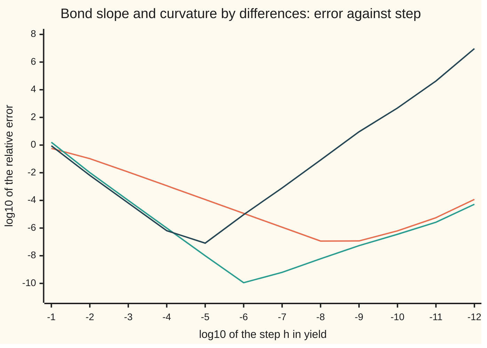

# Choosing the step: truncation falls, rounding rises, and the best step sits in between

[Syllabus](../../../SYLLABUS.md) → [Numerical analysis](../README.md) → [Derivatives by Machine](../README.md#s08) → Choosing the step

---

## General Overview

A 30-year bond pays a $5 coupon each year on $100 of face value. At a yield of 5% a year (0.05 as a decimal), it is worth exactly $100. A risk system wants its slope: the dollars the price moves per unit of yield. The exact slope is −1537.245102688, which is −0.153725 dollars per basis point (a hundredth of a percentage point).

The system has no formula for the slope, so it bumps the yield. It reprices at 0.05 + h, subtracts the old price and divides by the bump h. A bump of a trillionth (h = 1e-12) gives −1537.0744677. Only four digits are right, and the error is pure rounding: the formula's own error at that step (its truncation error) is 1.14e-11 of the slope, ten million times smaller.

Now store the same yield in basis points, as 500, and bump it by a trillionth of a basis point. The slope comes out as 0.0. Not one digit survives. A trillionth bump on prices quoted to the cent also returns 0.0.

So how big should the step be, and when is no step good enough?

**The best step is about a fixed root of machine precision times the size of the input: the square root for a forward difference, the cube root for a central one, the fourth root for a second derivative, rounded to a step the machine stores exactly; on noisy data the derivative is ill-posed, and the step itself becomes the only control on the noise.**

**What kind of fact this is:** a theorem about the best step for a stated error model, proved on this card in Why it works, plus a rule of thumb that rests on a scaling assumption, tested on the bond.

### The picture: error against step for three formulas

The horizontal axis is the base-10 logarithm of the step in decimal yield: −6 is a step of 10^−6. The vertical axis is the base-10 logarithm of the typical relative error, taken over 201 yields from 0.049 to 0.051.



Orange: forward difference for the slope. Green: central difference for the slope. Dark blue: central second difference for the curvature. Each falls while truncation rules, then climbs as rounding takes over. The bottoms sit at different steps: 1e-8, 1e-6 and 1e-5. The second difference climbs fastest, because it divides by the step twice.

---

## The formula

The balance itself is on [Numerical derivatives](../../06-Calculus%20and%20analysis/03-What%20Derivatives%20Tell%20You/08-numerical-derivatives-and-sensitivity.md): truncation grows with the step, rounding shrinks with it, and the best step balances them. This card writes all three formulas as one law, then turns it into a rule that needs no derivatives.

A difference formula for the $k$-th derivative, accurate to order $p$, has a total error of about

$$E(h) \;\approx\; A\,h^{p} \;+\; \frac{B\,\eta}{h^{k}}.$$

**Read it aloud:** the error is a truncation part that grows like the step to the power $p$, plus a rounding part, the noise in each value divided by the step to the power $k$.

It is smallest at

$$h^\ast = \left(\frac{k\,B\,\eta}{p\,A}\right)^{1/(p+k)}, \qquad E^\ast = \Big(1 + \frac{p}{k}\Big)\,A\,(h^\ast)^{p}.$$

**Read it aloud:** the best step is the $(p+k)$-th root of the noise over the truncation constant, and at that step the truncation part is $k/(p+k)$ of the whole error.

When the derivatives are unknown, the rule is

$$h \;=\; \varepsilon_{\text{mach}}^{\,1/(p+k)}\,\max\big(|x|,\ x_{\text{typ}}\big), \quad \text{rounded to a power of two.}$$

**Read it aloud:** take the $(p+k)$-th root of machine epsilon, scale it by the size of the input, and round it to a step the machine stores exactly.

The three formulas on this shelf fill in the letters:

| Formula | Difference | $k$ | $p$ | $A$ | $B$ | Best step grows like | Best error grows like |
| --- | --- | --- | --- | --- | --- | --- | --- |
| Forward | $\big(f(x+h) - f(x)\big)/h$ | 1 | 1 | $\lvert f''\rvert/2$ | 2 | $\eta^{1/2}$ | $\eta^{1/2}$ |
| Central | $\big(f(x+h) - f(x-h)\big)/(2h)$ | 1 | 2 | $\lvert f'''\rvert/6$ | 1 | $\eta^{1/3}$ | $\eta^{2/3}$ |
| Second | $\big(f(x+h) - 2f(x) + f(x-h)\big)/h^2$ | 2 | 2 | $\lvert f''''\rvert/12$ | 4 | $\eta^{1/4}$ | $\eta^{1/2}$ |

| Symbol | Plain meaning | In our example | Push it up and the answer… |
| --- | --- | --- | --- |
| $f(x)$ | the function being differentiated | the bond price $P(y)$: 100.000000000 dollars at 0.05 | — |
| $f'$, $f''$, $f'''$, $f''''$, $f^{(j)}$ | its first to fourth derivatives; $f^{(j)}$ is the $j$-th | −1537.245102688, 35046.6671183, −931746.817574, 26954091.1777 | larger $A$, smaller best step |
| $x$ | the input where the derivative is wanted | the yield, 0.05 as a decimal or 500 in basis points | the rule's step grows with it |
| $h$ | the step, in the same units as $x$ | 1e-12, then the rule's 9.31e-10 | truncation grows, rounding shrinks |
| $k$, $p$ | the derivative's order and the formula's order of accuracy | $k = 1$, $p = 1$ for forward | — |
| $A$, $B$ | the truncation constant (a derivative over a count) and the noise multiplier | $A = 35046.6671183/2$, $B = 2$ for forward | best step shrinks, grows |
| $\eta$ | the noise in each computed value of $f$, read "eta" | 1.64e-13 dollars, estimated from the code; 0.005 on cent quotes | best step and best error grow |
| $\varepsilon_{\text{mach}}$ | machine epsilon, $2^{-52}$: the gap between 1 and the next double | 2.22e-16 | — |
| $x_{\text{typ}}$ | a typical size of $x$, in its own units, used when $x$ is near zero | 0.05 for a yield | larger floor on the step |
| $h^\ast$, $E^\ast$ | the best step and the error there | 4.32e-9 and about 9.85e-8 of the slope, forward | — |
| $E(h)$ | the total error at step $h$ | 1.11e-4 of the slope at 1e-12, forward | — |
| $a$, $w$ | height and width of a wiggle added to the data (Step 5) | 0.004 dollars and 0.0001 in yield | the slope gap $2\pi a/w$ grows |

Here $2\pi$ is twice pi, the full turn of a sine wave.

### When it holds

- **The noise is a fixed size per value.** Code with a stopping tolerance, such as an iterative solver, has noise that jumps when its iteration count changes. Then $\eta$ is the size of that jump, and only a measured $\eta$ is safe.
- **The function changes on the scale of $x$.** The rule assumes $\lvert f^{(j)}\rvert \approx \lvert f\rvert/\lvert x\rvert^j$ (Step 2). An input near zero breaks this; that is what $x_{\text{typ}}$ is for.
- **The function is smooth across the bump.** The truncation law needs $f''$, $f'''$ or $f''''$ across $[x - h, x + h]$. At a kink no step helps.
- **The step reaches the function intact.** If $x + h$ is rounded, the quotient divides by the wrong step (Step 3).
- **The data are computed, not measured.** Measured or quoted data carry far larger noise, and the ill-posedness of differentiation then dominates (Step 5).

---

## Why it works

### Step 0: two errors pull in opposite directions

Every difference quotient makes two errors ([Two different errors](../01-Floating%20Point%20and%20Error/04-truncation-versus-rounding-error.md)). Truncation comes from the finite step; Taylor's theorem gives it as $A h^p$. Rounding comes from noise $\eta$ in each value of $f$; the formula adds a few such values and divides by $h^k$, so it grows as $B\eta/h^k$. One rises as $h$ falls, the other falls. A sum of a rising and a falling power has one lowest point.

### Step 1: the best step for any formula

Set the rate of change of $E(h)$ to zero:

$$p A h^{p-1} - \frac{k B \eta}{h^{k+1}} = 0 \quad\Longrightarrow\quad h^{p+k} = \frac{k B \eta}{p A}.$$

At that step, $p A h^p = k B \eta / h^k$. So the rounding part is $p/k$ times the truncation part, and the total is $(1 + p/k) A h^p$.

<details>
<summary>Detailed proof: this point is the minimum, and the error there falls like a power of the noise</summary>

For $h > 0$, $E'(h) = pAh^{p-1} - kB\eta h^{-k-1}$. Multiply by $h^{k+1} > 0$: the sign of $E'(h)$ is the sign of $pAh^{p+k} - kB\eta$. That is negative below $h^\ast$ and positive above it. So $E$ falls, then rises, and $h^\ast$ is its only minimum.

Substitute $h^\ast$ into $A h^p$:

$$E^\ast = \Big(1 + \frac{p}{k}\Big) A \left(\frac{kB\eta}{pA}\right)^{p/(p+k)} \;\propto\; A^{k/(p+k)}\,\eta^{p/(p+k)}.$$

For forward, $p/(p+k) = 1/2$; for central, $2/3$; for the second difference, $1/2$. The best error is a fixed power of the noise. More noise always costs digits, but a higher order $p$ costs fewer of them.

</details>

For the bond the noise, estimated from the code (Step 3), is $\eta$ = 1.64e-13 dollars. The table compares the predicted best step with a search over powers of ten. The search measures the typical (root-mean-square) relative error over 201 yields.

| Formula | $h^\ast$ from $\eta$ | Its error | Law $E^\ast$ | Ratio | Best power of ten | Its error |
| --- | --- | --- | --- | --- | --- | --- |
| Forward | 4.32e-9 | 5.35e-8 | 9.85e-8 | 0.54 | 1e-8 | 1.14e-7 |
| Central | 8.07e-7 | 1.00e-10 | 1.98e-10 | 0.51 | 1e-6 | 1.12e-10 |
| Second | 2.32e-5 | 3.78e-8 | 6.92e-8 | 0.55 | 1e-5 | 8.17e-8 |

The law overstates the error by about two, as expected: it adds each value's noise at full size, while real rounding errors partly cancel.

### Step 2: why the step scales with the size of $x$

The law needs $\eta$ and a derivative, and usually neither is known. Two guesses replace them.

- **Noise:** a value computed in double precision is off by a small multiple of $\varepsilon_{\text{mach}}\,\lvert f\rvert$. For the bond, the estimated $\eta$ is 7.4 times $\varepsilon_{\text{mach}} P$.
- **Derivatives:** a function that changes on the scale of $x$ has $\lvert f^{(j)}\rvert \approx \lvert f\rvert/\lvert x\rvert^j$. For the bond those scales are 0.0534, 0.0475 and 0.0439, against a yield of 0.05.

Put both into $h^{p+k} = kB\eta/(pA)$. The factor $\lvert f\rvert$ cancels, and what is left is

$$h \;\approx\; \text{a modest constant} \times \varepsilon_{\text{mach}}^{1/(p+k)}\,\lvert x\rvert.$$

The roots of $\varepsilon_{\text{mach}}$ are 1.49e-8, 6.06e-6 and 1.22e-4 for $p + k$ = 2, 3, 4. The factor $\lvert x\rvert$ makes the rule blind to units. A yield of 0.05 gets a forward step of 9.31e-10; the same yield written as 500 basis points gets 7.63e-6 basis points. Both bump the bond by about the same amount. Their typical errors are 5.91e-8 and 1.26e-7. The second is about twice the first because the code divides by 10,000 to turn basis points back into a yield, so its step is no longer exact (Step 3).

A fixed step is not blind to units. A trillionth is 2e-11 of a yield of 0.05, but only 2e-15 of 500. Turned back into a yield, the second step is 1e-16. That is smaller than the spacing of doubles near 1 + y, which the code forms first, so the price never changes and the slope comes out as 0.0.

The constants do not matter much. The rule's forward step, 9.31e-10, is 4.6 times smaller than $h^\ast$ = 4.32e-9, yet its error, 5.91e-8, is almost the same as the 5.35e-8 at $h^\ast$. Near its minimum $E(h)$ is flat. For a forward difference, the law says a step some factor too large or too small multiplies the error by the average of that factor and its reciprocal; the run lost even less.

### Step 3: the step the machine actually takes

A computer cannot store most numbers exactly. It stores $x + h$ as the nearest double, so the step that reaches $f$ is $(x + h) - x$, not $h$. In basis points, a trillionth added to 500 becomes a step of 1.023182e-12, which is 2.32e-2 too long. A quotient divided by $h$ is then 2.3% wrong before any other error.

The classic repair is to compute the step that was taken:

```text
temp = x + h
h = temp - x        (exact: both are doubles close together)
```

That fixes the step in $x$. The bond code then forms $1 + y$, a bigger number with coarser spacing, and rounds again. A step that is a **power of two**, and no smaller than the spacing of doubles near the largest number it is added to, is exact at every stage. Over the 201 yields:

| Step | Typical relative error | Same step times 1.0001 |
| --- | --- | --- |
| $2^{-30}$ (about 9.31e-10) | 5.91e-8 | 1.31e-7 |
| $2^{-40}$ (about a trillionth) | 6.29e-5 | 1.26e-4 |

An exact step halves the error at both sizes. The inexact step adds the rounding of the inputs to the rounding of the outputs. The best power of ten, 1e-8, loses for another reason: it is too large, and truncation alone gives 1.14e-7. Its neighbour 1e-9 is about the rule's size but not exact, and loses a factor of two: 1.19e-7 against 5.91e-8.

The noise $\eta$ itself can be measured. Take many values of $f$ a tiny distance apart and form their fourth differences. The smooth part of $f$ is wiped out, and what remains is noise magnified by a known factor, $\sqrt{70}$. Four hundred prices 1e-12 apart give the estimate $\eta$ = 1.64e-13 dollars. The Python check also computes the exact rounding error of 100 of those prices in fractions, and asserts that the estimate is within a factor of two of its typical size.

### Step 4: the best step for a second derivative

The bond's convexity comes from the second difference. It divides by $h^2$, so its rounding part is $4\eta/h^2$, and $k = 2$. The best step is a fourth root of the noise, and the best error a square root:

$$h^\ast = \left(\frac{48\,\eta}{\lvert f''''\rvert}\right)^{1/4}, \qquad E^\ast = 2\sqrt{\frac{\eta\,\lvert f''''\rvert}{3}}.$$

The rule gives $2^{-17}$, about 7.63e-6, with a typical error of 7.47e-8. That is about half the digits of a double, as for a forward slope. Reusing the central slope's step, 2.38e-7, for the curvature gives 7.68e-5: a thousand times worse.

### Step 5: on noisy data, differentiation is ill-posed

A problem is **well-posed** when it has a solution, only one, and the solution moves only a little when the data move a little. Differentiation fails the last test.

Add a small wiggle to the bond's price curve: $a \sin\!\big(2\pi (y - 0.05)/w\big)$, with height $a$ = 0.004 dollars and width $w$ = 0.0001. Every price moves by less than half a cent. The slope at 0.05 moves by $2\pi a / w$ = 251.3, and the code computes −1285.9 instead of −1537.2. Make $w$ smaller and the gap grows without limit. So data that agree to within half a cent can have any slopes at all.

In practice the noise is fixed by the data, and the step decides how much of it is amplified. On prices quoted to the cent, $\eta$ = 0.005. A central bump of a trillionth sees two equal quotes and returns 0.0. A one-basis-point bump returns −1500.0, off by 2.42%. The law's step is $(3\eta/\lvert P'''\rvert)^{1/3}$ = 2.53e-3 (25.3 basis points). It returns −1538.6, off by 1.36 against the law's estimate of 2.97 (ratio 0.46).

The step works as a smoothing setting: larger steps average more noise and admit more truncation. The best error falls only like $\eta^{2/3}$, so ten times cleaner quotes buy about 4.6 times less error. Fitting a low-degree polynomial to many quotes by least squares, then differentiating the fit, averages more noise per answer; in signal processing this is the Savitzky–Golay filter.

---

## Worked numbers, by hand

The slope from prices quoted to the cent, at the best central step.

| Step | Arithmetic | Value |
| --- | --- | --- |
| noise per quote | half a cent | 0.005 |
| third derivative | closed-form sum | −931746.817574 |
| inside the root | 3 × 0.005 ÷ 931746.817574 | 1.61e-8 |
| best step | cube root of 1.61e-8 | 2.5250e-3 |
| quotes at 0.05 − h and 0.05 + h | price, rounded to the cent | 104.00 and 96.23 |
| slope | (96.23 − 104.00) ÷ (2 × 2.5250e-3) | **−1538.6** |
| error, and the law's estimate | 1538.6 − 1537.245; 931746.8 × h²/6 + 0.005/h | 1.36 against 2.97 |

The bumped slope is right to about one part in a thousand. No step does reliably better: some steps land closer by luck, but nothing in the quotes says which.

### What breaks if you drop a piece

| Mistake | Comes out at | What went wrong |
| --- | --- | --- |
| A trillionth step on a yield stored as 500 basis points | slope 0.0 | The step is 1e-16 in decimal yield, lost when the code forms 1 + y |
| The rule's step without the factor $\lvert x\rvert$, on 500 basis points | typical error 5.77e-5, against 1.26e-7 | The step 1.49e-8 was meant for an input of size 1 |
| The central slope's step reused for the second difference | typical error 7.68e-5, against 7.47e-8 | A second derivative needs the fourth root, not the cube root |
| A step that is not exact, $2^{-30}$ times 1.0001 | typical error 1.31e-7, against 5.91e-8 | The rounded inputs add their own noise |
| A one-basis-point central bump on cent quotes | −1500.0, off by 2.42% | Noise of 0.005 divided by a step of 0.0001 |

The code prints all five.

---

## Code, from first principles, and it actually runs

The code prices the bond by a loop of 30 discounted coupons. It reaches each answer by three independent roads. Road one is the exact derivatives: closed-form sums, checked against exact fractions in Python and, in both languages, against the par-bond identity (a bond whose coupon equals its yield is worth exactly its face value). Road two is the difference quotients at 15 powers of ten over 201 yields, with the best found by search. Road three predicts the best step from the noise, which the code measures itself from fourth differences. The asserts require the prediction to land within a factor of 10 of the search, its error to sit between 0.3 and 1 times the law, the predicted step to beat every power of ten, and, on cent quotes, the law's step to beat a one-basis-point bump tenfold in typical error over the 201 yields.

### Python

```python
# Choosing the step -- the check behind the card.  Python standard library only.
# Road 1: exact derivatives of the bond price, as float sums and exact fractions.
# Road 2: difference quotients at many steps over 201 yields; the best found by search.
# Road 3: the best step predicted from the measured noise and the error law.
from fractions import Fraction
from math import sqrt, log10, sin, pi, floor

def price(y):                       # 30-year bond, 5% annual coupon, $100 face
    d = 1.0 / (1.0 + y); df = 1.0; s = 0.0
    for t in range(1, 31):
        df *= d; s += 5.0 * df
    return s + 100.0 * df

def deriv(y, k):                    # k-th derivative in closed form, as a float sum
    d = 1.0 / (1.0 + y); s = 0.0
    for t in range(1, 31):
        r = 1.0; dp = 1.0
        for j in range(k): r *= -(t + j)
        for j in range(t + k): dp *= d
        s += (5.0 if t < 30 else 105.0) * r * dp
    return s

def exact(y, k):                    # the same sum in exact fractions (Python only)
    d = 1 / (1 + Fraction(y)); s = Fraction(0)
    for t in range(1, 31):
        r = 1
        for j in range(k): r *= -(t + j)
        s += (5 if t < 30 else 105) * r * d ** (t + k)
    return s

def cbrt(a):                        # cube root by Newton's method, + - * / only
    r = 1.0
    for _ in range(200): r = (2.0 * r + a / (r * r)) / 3.0
    return r

def root(a, n): return sqrt(a) if n == 2 else (cbrt(a) if n == 3 else sqrt(sqrt(a)))

def pow2(h):                        # nearest power of two: an exactly stored step
    p = 1.0
    while p > h: p /= 2.0
    while p * 2.0 <= h: p *= 2.0
    return p * 2.0 if h / p > sqrt(2.0) else p

def fwd(f, x, h): return (f(x + h) - f(x)) / h
def cen(f, x, h): return (f(x + h) - f(x - h)) / (2.0 * h)
def sec(f, x, h): return (f(x + h) - 2.0 * f(x) + f(x - h)) / (h * h)
def E(v, d=2):
    m, e = f"{v:.{d}e}".split("e"); return f"{m}e{int(e)}"
def rel(v, t): return abs(v - t) / abs(t)

eps = 2.0 ** -52
x = 0.05
bp = lambda b: price(b / 1e4)        # the same bond, yield kept in basis points
D = [deriv(x, k) for k in range(5)]
for k in range(5): assert rel(D[k], float(exact(x, k))) < 1e-13
assert abs(D[0] - 100.0) < 1e-12        # coupon = yield: a par bond is worth its face
c = cbrt(eps); assert rel(c * c * c, eps) < 1e-15   # the cube root cubes back
print(f"house: 30-year bond, 5% coupon, yield 0.05, price {D[0]:.9f}")
print(f"eps_mach = {E(eps)}; its roots 1/2, 1/3, 1/4: {E(sqrt(eps))}, {E(c)}, {E(sqrt(sqrt(eps)))}")
print(f"exact: P' = {D[1]:.9f} ({D[1] / 1e4:.6f} per bp), P'' = {D[2]:.7f}")
print(f"exact: P''' = {D[3]:.6f}, P'''' = {D[4]:.4f}")

vals = [price(x + i * 1e-12) for i in range(400)]   # noise from 4th differences
for _ in range(4): vals = [vals[i + 1] - vals[i] for i in range(len(vals) - 1)]
eta = sqrt(sum(v * v for v in vals) / len(vals) / 70.0)
true_rms = sqrt(sum(float(Fraction(price(x + i * 1e-12)) - exact(x + i * 1e-12, 0)) ** 2
                    for i in range(100)) / 100)
assert 0.5 < eta / true_rms < 2.0     # the estimate matches the exact noise
print(f"noise: eta = {E(eta)} dollars from 4th differences of 400 prices, {eta / (eps * D[0]):.1f} eps P")
print(f"scale: (P/|P^(j)|)^(1/j) for j = 2, 3, 4: {sqrt(D[0] / D[2]):.4f}, "
      f"{cbrt(D[0] / abs(D[3])):.4f}, {sqrt(sqrt(D[0] / D[4])):.4f}")

h = 1e-12
v = fwd(price, x, h); vb = fwd(bp, 500.0, h) * 1e4
print(f"trillionth, decimal: slope {v:.7f}, rel error {E(rel(v, D[1]))}, "
      f"truncation part {E(h * D[2] / 2 / abs(D[1]))}")
st = (500.0 + h) - 500.0
print(f"trillionth, bp: slope {vb:.1f}, step taken {E(st, 6)} bp, {E((st - h) / h)} too long")
assert vb == 0.0 and rel(v, D[1]) > 1e5 * h * D[2] / 2 / abs(D[1])

Y = [0.049 + i * 1e-5 for i in range(201)]          # 201 yields, 0.049 to 0.051
T = {k: [deriv(y, k) for y in Y] for k in (1, 2)}
def rms(g, h, k, unit=1.0):         # typical relative error of rule g; h in x's units
    s = 0.0
    for y, t in zip(Y, T[k]):
        v = g(price, y, h) if unit == 1.0 else g(bp, y * unit, h) * unit ** k
        s += rel(v, t) ** 2
    return sqrt(s / len(Y))

rows = [("forward", fwd, 1, 1, D[2] / 2, 2.0), ("central", cen, 2, 1, D[3] / 6, 1.0),
        ("second", sec, 2, 2, D[4] / 12, 4.0)]
p10 = [1.0]
for _ in range(16): p10.append(p10[-1] * 10.0)
print("chart, log10 h: [" + ", ".join(f"{log10(1.0 / p10[j]):.0f}" for j in range(1, 13)) + "]")
print("rule     rule h   rms err  bp h     bp err   h* (eta) rms err  law      ratio best 10^-j rms err")
for name, g, p, k, A, B in rows:
    hr = pow2(root(eps, p + k) * x)
    hb = pow2(root(eps, p + k) * 500.0); er, eb = rms(g, hr, k), rms(g, hb, k, 1e4)
    hs = root(k * B * eta / (p * abs(A)), p + k)
    es = rms(g, hs, k); law = (1 + p / k) * abs(A) * (hs if p == 1 else hs * hs) / abs(D[k])
    errs = [rms(g, 1.0 / p10[j], k) for j in range(1, 16)]
    j = errs.index(min(errs)) + 1
    print(f"{name:8} {E(hr):8} {E(er):8} {E(hb):8} {E(eb):8} {E(hs):8} {E(es):8} {E(law):8} "
          f"{es / law:.2f}  {j:<10} {E(errs[j - 1])}")
    assert hs / 10 < 1.0 / p10[j] < hs * 10 and 0.3 < es / law < 1.0 and es < errs[j - 1]
    print(f"chart, {name}, [" + ", ".join(f"{log10(errs[i]):.2f}" for i in range(12)) + "]")

for base, label in [(2.0 ** -30, "2^-30"), (2.0 ** -40, "2^-40")]:
    a, b = rms(fwd, base, 1), rms(fwd, base * 1.0001, 1)
    print(f"step {label}: rms rel error {E(a)}; same step x1.0001: {E(b)}")
    assert b > 1.5 * a                # the inexact step is clearly worse
t8, r8, r9 = 1e-8 * D[2] / 2 / abs(D[1]), rms(fwd, 1e-8, 1), rms(fwd, 1e-9, 1)
print(f"powers of ten: 1e-8 truncation alone {E(t8)}; 1e-9 rms rel error {E(r9)}")
assert abs(r8 / t8 - 1) < 0.01 and r9 > 1.5 * rms(fwd, 2.0 ** -30, 1)   # 1e-8 too big; 1e-9 inexact

d = 0.005                           # prices quoted to the cent
q = lambda y: floor(price(y) * 100.0 + 0.5) / 100.0
hq = cbrt(3.0 * d / abs(D[3])); est = abs(D[3]) * hq * hq / 6 + d / hq   # the law's estimate
vq = [cen(q, x, h) for h in (1e-12, 1e-4, hq)]
print(f"cent quotes: 3 eta/|P3| = {E(3.0 * d / abs(D[3]))}, h* = {E(hq, 4)}, quotes {q(x - hq):.2f} and {q(x + hq):.2f}")
print(f"cent quotes: central at 1e-12 {vq[0]:.1f}; at 1 bp {vq[1]:.1f} (rel {E(rel(vq[1], D[1]))})")
print(f"cent quotes: best h {E(hq)}, slope {vq[2]:.1f}, error {abs(vq[2] - D[1]):.2f}, "
      f"estimate {est:.2f}, ratio {abs(vq[2] - D[1]) / est:.2f}")
assert vq[0] == 0.0 and abs(vq[2] - D[1]) <= est and rel(vq[1], D[1]) > 0.01
qe = lambda h: sqrt(sum((cen(q, y, h) - t) ** 2 for y, t in zip(Y, T[1])) / len(Y))   # typical, 201 yields
assert qe(hq) < 0.1 * qe(1e-4)      # the law's step beats a 1 bp bump tenfold, not by luck
a, w = 0.004, 1e-4
wig = lambda y: price(y) + a * sin(2.0 * pi * (y - x) / w)
vw = cen(wig, x, 1e-7)
print(f"wiggle a = {a}, w = {w}: slope gap {2 * pi * a / w:.1f}, computed {vw:.1f}")
assert abs((vw - D[1]) - 2 * pi * a / w) < 1.0

print(f"breaks: unscaled step sqrt(eps) on 500 bp: rms {E(rms(fwd, pow2(sqrt(eps)), 1, 1e4))}")
print(f"breaks: second derivative at central's step: rms {E(rms(sec, pow2(cbrt(eps) * x), 2))}")
hq2 = cbrt(3.0 * 0.0005 / abs(D[3])); qt = lambda y: floor(price(y) * 1000.0 + 0.5) / 1000.0
print(f"try: tenth-cent quotes: best h {E(hq2)}, error {abs(cen(qt, x, hq2) - D[1]):.2f}")
y0 = 0.0001; t0 = deriv(y0, 1)
print(f"try: yield 0.0001: forward rel error {E(rel(fwd(price, y0, pow2(sqrt(eps) * y0)), t0))}"
      f" with |x|; {E(rel(fwd(price, y0, pow2(sqrt(eps) * 0.05)), t0))} with x_typ 0.05")
print("ALL CHECKS PASS")
```

**Ran 2026-11-11 on macOS, Python 3.14.10, standard library only. All checks passed. Output, pasted from the run:**

```text
house: 30-year bond, 5% coupon, yield 0.05, price 100.000000000
eps_mach = 2.22e-16; its roots 1/2, 1/3, 1/4: 1.49e-8, 6.06e-6, 1.22e-4
exact: P' = -1537.245102688 (-0.153725 per bp), P'' = 35046.6671183
exact: P''' = -931746.817574, P'''' = 26954091.1777
noise: eta = 1.64e-13 dollars from 4th differences of 400 prices, 7.4 eps P
scale: (P/|P^(j)|)^(1/j) for j = 2, 3, 4: 0.0534, 0.0475, 0.0439
trillionth, decimal: slope -1537.0744677, rel error 1.11e-4, truncation part 1.14e-11
trillionth, bp: slope 0.0, step taken 1.023182e-12 bp, 2.32e-2 too long
chart, log10 h: [-1, -2, -3, -4, -5, -6, -7, -8, -9, -10, -11, -12]
rule     rule h   rms err  bp h     bp err   h* (eta) rms err  law      ratio best 10^-j rms err
forward  9.31e-10 5.91e-8  7.63e-6  1.26e-7  4.32e-9  5.35e-8  9.85e-8  0.54  8          1.14e-7
chart, forward, [-0.24, -0.98, -1.95, -2.94, -3.94, -4.94, -5.94, -6.94, -6.93, -6.20, -5.25, -3.93]
central  2.38e-7  1.19e-10 3.91e-3  1.14e-10 8.07e-7  1.00e-10 1.98e-10 0.51  6          1.12e-10
chart, central, [0.20, -1.99, -4.00, -6.00, -8.00, -9.95, -9.20, -8.22, -7.27, -6.45, -5.58, -4.28]
second   7.63e-6  7.47e-8  6.25e-2  1.33e-7  2.32e-5  3.78e-8  6.92e-8  0.55  5          8.17e-8
chart, second, [-0.05, -2.19, -4.19, -6.19, -7.09, -5.03, -3.10, -1.08, 0.96, 2.68, 4.63, 6.97]
step 2^-30: rms rel error 5.91e-8; same step x1.0001: 1.31e-7
step 2^-40: rms rel error 6.29e-5; same step x1.0001: 1.26e-4
powers of ten: 1e-8 truncation alone 1.14e-7; 1e-9 rms rel error 1.19e-7
cent quotes: 3 eta/|P3| = 1.61e-8, h* = 2.5250e-3, quotes 104.00 and 96.23
cent quotes: central at 1e-12 0.0; at 1 bp -1500.0 (rel 2.42e-2)
cent quotes: best h 2.53e-3, slope -1538.6, error 1.36, estimate 2.97, ratio 0.46
wiggle a = 0.004, w = 0.0001: slope gap 251.3, computed -1285.9
breaks: unscaled step sqrt(eps) on 500 bp: rms 5.77e-5
breaks: second derivative at central's step: rms 7.68e-5
try: tenth-cent quotes: best h 1.17e-3, error 0.29
try: yield 0.0001: forward rel error 5.21e-5 with |x|; 8.23e-8 with x_typ 0.05
ALL CHECKS PASS
```

### Rust

```rust
// Choosing the step -- the check behind the card.  Rust std only, no crates.
// Road 1: exact derivatives of the bond price as float sums, and the par identity.
// Road 2: difference quotients at many steps over 201 yields; the best found by search.
// Road 3: the best step predicted from the measured noise and the error law.
type Rule = fn(&dyn Fn(f64) -> f64, f64, f64) -> f64;

fn price(y: f64) -> f64 { // 30-year bond, 5% annual coupon, $100 face
    let d = 1.0 / (1.0 + y);
    let (mut df, mut s) = (1.0, 0.0);
    for _ in 1..31 { df *= d; s += 5.0 * df; }
    s + 100.0 * df
}
fn bp(b: f64) -> f64 { price(b / 1e4) } // the same bond, yield kept in basis points

fn deriv(y: f64, k: usize) -> f64 { // k-th derivative in closed form, as a float sum
    let d = 1.0 / (1.0 + y);
    let mut s = 0.0;
    for t in 1..31usize {
        let (mut r, mut dp) = (1.0, 1.0);
        for j in 0..k { r *= -((t + j) as f64); }
        for _ in 0..t + k { dp *= d; }
        s += (if t < 30 { 5.0 } else { 105.0 }) * r * dp;
    }
    s
}

fn cbrt(a: f64) -> f64 { // cube root by Newton's method, + - * / only
    let mut r = 1.0;
    for _ in 0..200 { r = (2.0 * r + a / (r * r)) / 3.0; }
    r
}
fn root(a: f64, n: usize) -> f64 {
    if n == 2 { a.sqrt() } else if n == 3 { cbrt(a) } else { a.sqrt().sqrt() }
}
fn pow2(h: f64) -> f64 { // nearest power of two: an exactly stored step
    let mut p = 1.0;
    while p > h { p /= 2.0; }
    while p * 2.0 <= h { p *= 2.0; }
    if h / p > 2f64.sqrt() { p * 2.0 } else { p }
}

fn fwd(f: &dyn Fn(f64) -> f64, x: f64, h: f64) -> f64 { (f(x + h) - f(x)) / h }
fn cen(f: &dyn Fn(f64) -> f64, x: f64, h: f64) -> f64 { (f(x + h) - f(x - h)) / (2.0 * h) }
fn sec(f: &dyn Fn(f64) -> f64, x: f64, h: f64) -> f64 { (f(x + h) - 2.0 * f(x) + f(x - h)) / (h * h) }
fn e(v: f64) -> String { format!("{:.2e}", v) }
fn rel(v: f64, t: f64) -> f64 { (v - t).abs() / t.abs() }

fn rms(g: Rule, h: f64, k: usize, unit: f64, ys: &[f64], ts: &[Vec<f64>]) -> f64 {
    let mut s = 0.0; // typical relative error of rule g; h in x's units
    for (i, &y) in ys.iter().enumerate() {
        let v = if unit == 1.0 { g(&price, y, h) } else {
            let mut u = 1.0;
            for _ in 0..k { u *= unit; }
            g(&bp, y * unit, h) * u
        };
        s += rel(v, ts[k][i]).powi(2);
    }
    (s / ys.len() as f64).sqrt()
}

fn main() {
    let eps = 2f64.powi(-52);
    let x = 0.05;
    let dd: Vec<f64> = (0..5).map(|k| deriv(x, k)).collect();
    assert!((dd[0] - 100.0).abs() < 1e-12); // coupon = yield: a par bond is worth its face
    let c = cbrt(eps);
    assert!(rel(c * c * c, eps) < 1e-15); // the cube root cubes back
    assert!(rel(cen(&price, x, 1e-6), dd[1]) < 1e-9 && rel(sec(&price, x, 1e-4), dd[2]) < 1e-6);
    println!("house: 30-year bond, 5% coupon, yield 0.05, price {:.9}", dd[0]);
    println!("eps_mach = {}; its roots 1/2, 1/3, 1/4: {}, {}, {}", e(eps), e(eps.sqrt()), e(c), e(eps.sqrt().sqrt()));
    println!("exact: P' = {:.9} ({:.6} per bp), P'' = {:.7}", dd[1], dd[1] / 1e4, dd[2]);
    println!("exact: P''' = {:.6}, P'''' = {:.4}", dd[3], dd[4]);

    let mut vals: Vec<f64> = (0..400).map(|i| price(x + i as f64 * 1e-12)).collect();
    for _ in 0..4 { vals = (0..vals.len() - 1).map(|i| vals[i + 1] - vals[i]).collect(); }
    let eta = (vals.iter().fold(0.0, |s, v| s + v * v) / vals.len() as f64 / 70.0).sqrt();
    println!("noise: eta = {} dollars from 4th differences of 400 prices, {:.1} eps P", e(eta), eta / (eps * dd[0]));
    println!("scale: (P/|P^(j)|)^(1/j) for j = 2, 3, 4: {:.4}, {:.4}, {:.4}",
             (dd[0] / dd[2]).sqrt(), cbrt(dd[0] / dd[3].abs()), (dd[0] / dd[4]).sqrt().sqrt());

    let h = 1e-12;
    let (v, vb) = (fwd(&price, x, h), fwd(&bp, 500.0, h) * 1e4);
    println!("trillionth, decimal: slope {:.7}, rel error {}, truncation part {}",
             v, e(rel(v, dd[1])), e(h * dd[2] / 2.0 / dd[1].abs()));
    let st = (500.0 + h) - 500.0;
    println!("trillionth, bp: slope {:.1}, step taken {:.6e} bp, {} too long", vb, st, e((st - h) / h));
    assert!(vb == 0.0 && rel(v, dd[1]) > 1e5 * h * dd[2] / 2.0 / dd[1].abs());

    let ys: Vec<f64> = (0..201).map(|i| 0.049 + i as f64 * 1e-5).collect();
    let ts: Vec<Vec<f64>> = (0..3).map(|k| ys.iter().map(|&y| deriv(y, k)).collect()).collect();
    let rows: [(&str, Rule, usize, usize, f64, f64); 3] = [
        ("forward", fwd, 1, 1, dd[2] / 2.0, 2.0), ("central", cen, 2, 1, dd[3] / 6.0, 1.0),
        ("second", sec, 2, 2, dd[4] / 12.0, 4.0)];
    let mut p10 = vec![1.0];
    for _ in 0..16 { let l = p10[p10.len() - 1]; p10.push(l * 10.0); }
    println!("chart, log10 h: [{}]", (1..13).map(|j| format!("{:.0}", (1.0f64 / p10[j]).log10())).collect::<Vec<_>>().join(", "));
    println!("rule     rule h   rms err  bp h     bp err   h* (eta) rms err  law      ratio best 10^-j rms err");
    for &(name, g, p, k, a, b) in rows.iter() {
        let hr = pow2(root(eps, p + k) * x);
        let hb = pow2(root(eps, p + k) * 500.0);
        let (er, eb) = (rms(g, hr, k, 1.0, &ys, &ts), rms(g, hb, k, 1e4, &ys, &ts));
        let hs = root(k as f64 * b * eta / (p as f64 * a.abs()), p + k);
        let es = rms(g, hs, k, 1.0, &ys, &ts);
        let law = (1.0 + p as f64 / k as f64) * a.abs() * (if p == 1 { hs } else { hs * hs }) / dd[k].abs();
        let errs: Vec<f64> = (1..16).map(|j| rms(g, 1.0 / p10[j], k, 1.0, &ys, &ts)).collect();
        let mut j = 0;
        for i in 0..errs.len() { if errs[i] < errs[j] { j = i; } }
        let j = j + 1;
        println!("{:<8} {:<8} {:<8} {:<8} {:<8} {:<8} {:<8} {:<8} {:.2}  {:<10} {}", name, e(hr), e(er),
                 e(hb), e(eb), e(hs), e(es), e(law), es / law, j, e(errs[j - 1]));
        assert!(hs / 10.0 < 1.0 / p10[j] && 1.0 / p10[j] < hs * 10.0 && es / law > 0.3 && es / law < 1.0 && es < errs[j - 1]);
        let pts: Vec<String> = errs[..12].iter().map(|v| format!("{:.2}", v.log10())).collect();
        println!("chart, {}, [{}]", name, pts.join(", "));
    }

    for &(base, label) in [(2f64.powi(-30), "2^-30"), (2f64.powi(-40), "2^-40")].iter() {
        let (a, b) = (rms(fwd, base, 1, 1.0, &ys, &ts), rms(fwd, base * 1.0001, 1, 1.0, &ys, &ts));
        println!("step {}: rms rel error {}; same step x1.0001: {}", label, e(a), e(b));
        assert!(b > 1.5 * a); // the inexact step is clearly worse
    }
    let (t8, r8, r9) = (1e-8 * dd[2] / 2.0 / dd[1].abs(), rms(fwd, 1e-8, 1, 1.0, &ys, &ts), rms(fwd, 1e-9, 1, 1.0, &ys, &ts));
    println!("powers of ten: 1e-8 truncation alone {}; 1e-9 rms rel error {}", e(t8), e(r9));
    assert!((r8 / t8 - 1.0).abs() < 0.01 && r9 > 1.5 * rms(fwd, 2f64.powi(-30), 1, 1.0, &ys, &ts)); // 1e-8 too big; 1e-9 inexact

    let d = 0.005; // prices quoted to the cent
    let q = |y: f64| (price(y) * 100.0 + 0.5).floor() / 100.0;
    let hq = cbrt(3.0 * d / dd[3].abs());
    let est = dd[3].abs() * hq * hq / 6.0 + d / hq; // the law's estimate
    let vq: Vec<f64> = [1e-12, 1e-4, hq].iter().map(|&h| cen(&q, x, h)).collect();
    println!("cent quotes: 3 eta/|P3| = {}, h* = {:.4e}, quotes {:.2} and {:.2}",
             e(3.0 * d / dd[3].abs()), hq, q(x - hq), q(x + hq));
    println!("cent quotes: central at 1e-12 {:.1}; at 1 bp {:.1} (rel {})", vq[0], vq[1], e(rel(vq[1], dd[1])));
    println!("cent quotes: best h {}, slope {:.1}, error {:.2}, estimate {:.2}, ratio {:.2}",
             e(hq), vq[2], (vq[2] - dd[1]).abs(), est, (vq[2] - dd[1]).abs() / est);
    assert!(vq[0] == 0.0 && (vq[2] - dd[1]).abs() <= est && rel(vq[1], dd[1]) > 0.01);
    let qe = |h: f64| ((0..ys.len()).map(|i| (cen(&q, ys[i], h) - ts[1][i]).powi(2)).fold(0.0, |s, v| s + v) / ys.len() as f64).sqrt();
    assert!(qe(hq) < 0.1 * qe(1e-4)); // typical over 201 yields: the law's step beats a 1 bp bump tenfold, not by luck
    let (a, w) = (0.004, 1e-4);
    let pi = std::f64::consts::PI;
    let wig = |y: f64| price(y) + a * (2.0 * pi * (y - x) / w).sin();
    let vw = cen(&wig, x, 1e-7);
    println!("wiggle a = {}, w = {}: slope gap {:.1}, computed {:.1}", a, w, 2.0 * pi * a / w, vw);
    assert!(((vw - dd[1]) - 2.0 * pi * a / w).abs() < 1.0);

    println!("breaks: unscaled step sqrt(eps) on 500 bp: rms {}", e(rms(fwd, pow2(eps.sqrt()), 1, 1e4, &ys, &ts)));
    println!("breaks: second derivative at central's step: rms {}", e(rms(sec, pow2(cbrt(eps) * x), 2, 1.0, &ys, &ts)));
    let hq2 = cbrt(3.0 * 0.0005 / dd[3].abs());
    let qt = |y: f64| (price(y) * 1000.0 + 0.5).floor() / 1000.0;
    println!("try: tenth-cent quotes: best h {}, error {:.2}", e(hq2), (cen(&qt, x, hq2) - dd[1]).abs());
    let (y0, t0) = (0.0001, deriv(0.0001, 1));
    println!("try: yield 0.0001: forward rel error {} with |x|; {} with x_typ 0.05",
             e(rel(fwd(&price, y0, pow2(eps.sqrt() * y0)), t0)), e(rel(fwd(&price, y0, pow2(eps.sqrt() * 0.05)), t0)));
    println!("ALL CHECKS PASS");
}
```

**Ran 2026-11-11 on macOS, rustc 1.98.1, no crates. All checks passed. Output, pasted from the run:**

```text
house: 30-year bond, 5% coupon, yield 0.05, price 100.000000000
eps_mach = 2.22e-16; its roots 1/2, 1/3, 1/4: 1.49e-8, 6.06e-6, 1.22e-4
exact: P' = -1537.245102688 (-0.153725 per bp), P'' = 35046.6671183
exact: P''' = -931746.817574, P'''' = 26954091.1777
noise: eta = 1.64e-13 dollars from 4th differences of 400 prices, 7.4 eps P
scale: (P/|P^(j)|)^(1/j) for j = 2, 3, 4: 0.0534, 0.0475, 0.0439
trillionth, decimal: slope -1537.0744677, rel error 1.11e-4, truncation part 1.14e-11
trillionth, bp: slope 0.0, step taken 1.023182e-12 bp, 2.32e-2 too long
chart, log10 h: [-1, -2, -3, -4, -5, -6, -7, -8, -9, -10, -11, -12]
rule     rule h   rms err  bp h     bp err   h* (eta) rms err  law      ratio best 10^-j rms err
forward  9.31e-10 5.91e-8  7.63e-6  1.26e-7  4.32e-9  5.35e-8  9.85e-8  0.54  8          1.14e-7
chart, forward, [-0.24, -0.98, -1.95, -2.94, -3.94, -4.94, -5.94, -6.94, -6.93, -6.20, -5.25, -3.93]
central  2.38e-7  1.19e-10 3.91e-3  1.14e-10 8.07e-7  1.00e-10 1.98e-10 0.51  6          1.12e-10
chart, central, [0.20, -1.99, -4.00, -6.00, -8.00, -9.95, -9.20, -8.22, -7.27, -6.45, -5.58, -4.28]
second   7.63e-6  7.47e-8  6.25e-2  1.33e-7  2.32e-5  3.78e-8  6.92e-8  0.55  5          8.17e-8
chart, second, [-0.05, -2.19, -4.19, -6.19, -7.09, -5.03, -3.10, -1.08, 0.96, 2.68, 4.63, 6.97]
step 2^-30: rms rel error 5.91e-8; same step x1.0001: 1.31e-7
step 2^-40: rms rel error 6.29e-5; same step x1.0001: 1.26e-4
powers of ten: 1e-8 truncation alone 1.14e-7; 1e-9 rms rel error 1.19e-7
cent quotes: 3 eta/|P3| = 1.61e-8, h* = 2.5250e-3, quotes 104.00 and 96.23
cent quotes: central at 1e-12 0.0; at 1 bp -1500.0 (rel 2.42e-2)
cent quotes: best h 2.53e-3, slope -1538.6, error 1.36, estimate 2.97, ratio 0.46
wiggle a = 0.004, w = 0.0001: slope gap 251.3, computed -1285.9
breaks: unscaled step sqrt(eps) on 500 bp: rms 5.77e-5
breaks: second derivative at central's step: rms 7.68e-5
try: tenth-cent quotes: best h 1.17e-3, error 0.29
try: yield 0.0001: forward rel error 5.21e-5 with |x|; 8.23e-8 with x_typ 0.05
ALL CHECKS PASS
```

### Lean

Lean proves the best steps of Steps 1 and 4 and the wiggle of Step 5, for any positive constants and any orders $p, k \ge 1$.

- The law $E(h) = A h^p + B\eta/h^k$ falls up to $h^\ast = (kB\eta/(pA))^{1/(p+k)}$ and rises after it, so $h^\ast$ is its only minimum for $h > 0$.
- At $h^\ast$ the rounding part is $p/k$ times the truncation part, and $E^\ast = (1 + p/k)\,A\,(h^\ast)^p$.
- For the second difference, $E(h) = (\lvert f''''\rvert/12)\,h^2 + 4\eta/h^2$ is smallest at $h^\ast = (48\eta/\lvert f''''\rvert)^{1/4}$, with $E^\ast = 2\sqrt{\eta\,\lvert f''''\rvert/3}$.
- Adding the wiggle $a \sin\!\big(2\pi (y - x)/w\big)$ to any function with a slope at $x$ moves every value by at most $a$, and the slope at $x$ by exactly $2\pi a/w$.
- The best error's exponents $p/(p+k)$ are 1/2, 2/3 and 1/2 for forward, central and second, and $kB/(pA)$ is $48/\lvert f''''\rvert$ for the second difference.

Whether real errors follow the law, the scaling rule, exact steps, the measured noise and the bond's numbers are left to Python and Rust.

```lean
-- Choosing the step: the error law A h^p + B η / h^k has one best step, the (p+k)-th root of kBη/(pA), with error (1 + p/k) A h^p there, and a wiggle of height a and width w moves the slope by 2πa/w.
import Mathlib.Analysis.SpecialFunctions.Pow.Real
import Mathlib.Analysis.SpecialFunctions.Sqrt
import Mathlib.Analysis.SpecialFunctions.Trigonometric.Deriv
import Mathlib.Tactic.NormNum
import Mathlib.Analysis.Calculus.Deriv.MeanValue

/-! A difference formula for the `k`-th derivative with order of accuracy `p` has total error
about `E h = A * h ^ p + B * η / h ^ k` at step `h > 0`: a truncation part `A * h ^ p`
and a rounding part `B * η / h ^ k`, where `η` is the noise in each value of `f`.
The best step `h⋆` is written `hs`; the root is Mathlib's real power `x ^ (1 / (p + k))`. -/

/-- The best step for any difference formula: with `A, B, η > 0` and orders `p, k ≥ 1`,
the error `E h = A h^p + B η / h^k` falls for `0 < h ≤ h⋆` and rises for `h ≥ h⋆`,
where `h⋆ = (k B η / (p A))^(1/(p+k))`, so `h⋆` is its only minimum on `h > 0`.
At `h⋆` the rounding part is `p/k` times the truncation part,
and the total error is `E⋆ = (1 + p/k) A (h⋆)^p`. -/
theorem best_step_minimizes_error_law (A B η : ℝ) (p k : ℕ)
    (hA : 0 < A) (hB : 0 < B) (hη : 0 < η) (hp : 0 < p) (hk : 0 < k) :
    let E : ℝ → ℝ := fun h => A * h ^ p + B * η / h ^ k
    let hs : ℝ := ((k : ℝ) * B * η / ((p : ℝ) * A)) ^ ((1 : ℝ) / ((p : ℝ) + k))
    0 < hs ∧
    hs ^ (p + k) = (k : ℝ) * B * η / ((p : ℝ) * A) ∧
    StrictAntiOn E (Set.Ioc 0 hs) ∧
    StrictMonoOn E (Set.Ici hs) ∧
    (∀ h : ℝ, 0 < h → h ≠ hs → E hs < E h) ∧
    B * η / hs ^ k = ((p : ℝ) / k) * (A * hs ^ p) ∧
    E hs = (1 + (p : ℝ) / k) * A * hs ^ p := by
  intro E hs
  have hpR : (0 : ℝ) < p := by exact_mod_cast hp
  have hkR : (0 : ℝ) < k := by exact_mod_cast hk
  have hc : 0 < (k : ℝ) * B * η / ((p : ℝ) * A) := by positivity
  have hspos : 0 < hs := Real.rpow_pos_of_pos hc _
  have hspow : hs ^ (p + k) = (k : ℝ) * B * η / ((p : ℝ) * A) := by
    have hne : ((p : ℝ) + k) ≠ 0 := by positivity
    rw [← Real.rpow_natCast, ← Real.rpow_mul hc.le]
    push_cast
    rw [one_div_mul_cancel hne, Real.rpow_one]
  have hkey : (p : ℝ) * A * hs ^ (p + k) = k * B * η := by
    rw [hspow]; field_simp
  clear_value hs
  obtain ⟨p', rfl⟩ : ∃ p', p = p' + 1 := ⟨p - 1, by omega⟩
  obtain ⟨k', rfl⟩ : ∃ k', k = k' + 1 := ⟨k - 1, by omega⟩
  -- derivative
  have hd : ∀ h : ℝ, 0 < h → HasDerivAt E
      (A * (((p' + 1 : ℕ) : ℝ) * h ^ p') - B * η * (((k' + 1 : ℕ) : ℝ) * h ^ k') / (h ^ (k' + 1)) ^ 2) h := by
    intro h hh
    have h1 := (hasDerivAt_pow (p' + 1) h).const_mul A
    have h2 := (hasDerivAt_const h (B * η)).div (hasDerivAt_pow (k' + 1) h) (pow_ne_zero _ hh.ne')
    simp only [Nat.add_sub_cancel] at h1 h2
    convert h1.add h2 using 1
    ring
  have hderiv : ∀ h : ℝ, 0 < h → deriv E h =
      (A * (((p' + 1 : ℕ) : ℝ) * h ^ p') - B * η * (((k' + 1 : ℕ) : ℝ) * h ^ k') / (h ^ (k' + 1)) ^ 2) :=
    fun h hh => (hd h hh).deriv
  -- sign of derivative
  have hsign : ∀ h : ℝ, 0 < h →
      (A * (((p' + 1 : ℕ) : ℝ) * h ^ p') - B * η * (((k' + 1 : ℕ) : ℝ) * h ^ k') / (h ^ (k' + 1)) ^ 2)
        = h ^ k' * (((p' + 1 : ℕ) : ℝ) * A * h ^ (p' + 1 + (k' + 1)) - (k' + 1 : ℕ) * B * η)
            / (h ^ (k' + 1)) ^ 2 := by
    intro h hh
    have : h ^ (k' + 1) ≠ 0 := pow_ne_zero _ hh.ne'
    field_simp
    ring
  have hcont : ∀ S : Set ℝ, S ⊆ Set.Ioi 0 → ContinuousOn E S :=
    fun S hS x hx => (hd x (hS hx)).continuousAt.continuousWithinAt
  have hanti : StrictAntiOn E (Set.Ioc 0 hs) := by
    apply strictAntiOn_of_deriv_neg (convex_Ioc 0 hs) (hcont _ Set.Ioc_subset_Ioi_self)
    intro h hh
    rw [interior_Ioc] at hh
    rw [hderiv h hh.1, hsign h hh.1]
    apply div_neg_of_neg_of_pos _ (pow_pos (pow_pos hh.1 _) _)
    apply mul_neg_of_pos_of_neg (pow_pos hh.1 _)
    rw [sub_neg, ← hkey]
    apply mul_lt_mul_of_pos_left _ (by positivity)
    exact pow_lt_pow_left₀ hh.2 hh.1.le (by omega)
  have hmono : StrictMonoOn E (Set.Ici hs) := by
    apply strictMonoOn_of_deriv_pos (convex_Ici hs)
      (hcont _ (fun x hx => lt_of_lt_of_le hspos hx))
    intro h hh
    rw [interior_Ici] at hh
    have h0 : 0 < h := hspos.trans hh
    rw [hderiv h h0, hsign h h0]
    apply div_pos _ (by positivity)
    apply mul_pos (pow_pos h0 _)
    rw [sub_pos, ← hkey]
    apply mul_lt_mul_of_pos_left _ (by positivity)
    exact pow_lt_pow_left₀ hh hspos.le (by omega)
  have hratio : B * η / hs ^ (k' + 1) = (((p' + 1 : ℕ) : ℝ) / ((k' + 1 : ℕ) : ℝ)) * (A * hs ^ (p' + 1)) := by
    have hne : hs ^ (k' + 1) ≠ 0 := pow_ne_zero _ hspos.ne'
    have hkne : ((k' + 1 : ℕ) : ℝ) ≠ 0 := by positivity
    rw [pow_add] at hkey
    field_simp
    linear_combination (-1 : ℝ) * hkey
  refine ⟨hspos, hspow, hanti, hmono, ?_, hratio, ?_⟩
  · intro h hh hne
    rcases lt_or_gt_of_ne hne with hlt | hgt
    · exact hanti ⟨hh, hlt.le⟩ ⟨hspos, le_rfl⟩ hlt
    · exact hmono (Set.mem_Ici.mpr le_rfl) (Set.mem_Ici.mpr hgt.le) hgt
  · show A * hs ^ (p' + 1) + B * η / hs ^ (k' + 1) = _
    rw [hratio]; ring

/-- The best step for a second derivative: the central second difference has
`k = 2`, `p = 2`, truncation constant `|f''''| / 12` and noise multiplier `4`,
so with `F = |f''''| > 0` and `η > 0` its error `E h = (F/12) h^2 + 4 η / h^2`
is smallest at `h⋆ = (48 η / F)^(1/4)`, a fourth root of the noise,
and the best error there is `E⋆ = 2 sqrt(η F / 3)`, a square root of the noise. -/
theorem second_difference_best_step (F η : ℝ) (hF : 0 < F) (hη : 0 < η) :
    let E : ℝ → ℝ := fun h => F / 12 * h ^ 2 + 4 * η / h ^ 2
    let hs : ℝ := (48 * η / F) ^ ((1 : ℝ) / 4)
    0 < hs ∧
    (∀ h : ℝ, 0 < h → E hs ≤ E h) ∧
    E hs = 2 * Real.sqrt (η * F / 3) := by
  intro E hs
  have hc : 0 < 48 * η / F := by positivity
  have hspos : 0 < hs := Real.rpow_pos_of_pos hc _
  have h4 : hs ^ 4 = 48 * η / F := by
    rw [← Real.rpow_natCast, ← Real.rpow_mul hc.le]
    norm_num
  clear_value hs
  have h4' : 4 * η = F * hs ^ 4 / 12 := by
    rw [h4]; field_simp; ring
  refine ⟨hspos, ?_, ?_⟩
  · intro h hh
    have key : E h - E hs = F / 12 * (h ^ 2 - hs ^ 2) ^ 2 / h ^ 2 := by
      show F / 12 * h ^ 2 + 4 * η / h ^ 2 - (F / 12 * hs ^ 2 + 4 * η / hs ^ 2) = _
      rw [h4']
      field_simp
      ring
    have : 0 ≤ E h - E hs := by rw [key]; positivity
    linarith
  · show F / 12 * hs ^ 2 + 4 * η / hs ^ 2 = _
    have hsq : η * F / 3 = (F * hs ^ 2 / 12) ^ 2 := by
      have : η = F * hs ^ 4 / 48 := by linarith
      rw [this]; ring
    rw [hsq, Real.sqrt_sq (by positivity), h4']
    field_simp
    ring

/-- Differentiation is ill-posed: add a wiggle `a sin(2π (y - x) / w)` of height `a > 0`
and width `w > 0` to a function `f` with slope `f'` at `x`.
Every value moves by at most `a`, yet the slope at `x` moves by exactly `2π a / w`,
which grows without limit as `w` shrinks. -/
theorem wiggle_moves_slope (f : ℝ → ℝ) (f' x a w : ℝ) (ha : 0 < a) (hw : 0 < w)
    (hf : HasDerivAt f f' x) :
    let g : ℝ → ℝ := fun y => f y + a * Real.sin (2 * Real.pi * (y - x) / w)
    (∀ y : ℝ, |g y - f y| ≤ a) ∧
    HasDerivAt g (f' + 2 * Real.pi * a / w) x := by
  intro g
  refine ⟨fun y => ?_, ?_⟩
  · show |f y + a * Real.sin (2 * Real.pi * (y - x) / w) - f y| ≤ a
    rw [add_sub_cancel_left, abs_mul, abs_of_pos ha]
    exact mul_le_of_le_one_right ha.le (Real.abs_sin_le_one _)
  · have h1 : HasDerivAt (fun y => 2 * Real.pi * (y - x) / w) (2 * Real.pi * 1 / w) x :=
      (((hasDerivAt_id x).sub_const x).const_mul (2 * Real.pi)).div_const w
    have h2 := (h1.sin.const_mul a)
    have h3 := hf.add h2
    convert h3 using 1
    simp
    ring

/-! The table's exponents and constants, checked exactly. -/

-- The best error falls like `η ^ (p / (p + k))`: 1/2 forward, 2/3 central, 1/2 second.
example : ((1 : ℚ) / (1 + 1), (2 : ℚ) / (2 + 1), (2 : ℚ) / (2 + 2)) = (1 / 2, 2 / 3, 1 / 2) := by
  norm_num

-- Second difference: `k B / (p A)` with `B = 4`, `A = F / 12` gives `48 / F`.
example : (2 : ℚ) * 4 / (2 * (1 / 12)) = 48 := by norm_num

#print axioms best_step_minimizes_error_law
#print axioms second_difference_best_step
#print axioms wiggle_moves_slope
```

**Checked 2026-11-11 on macOS, Lean 4.36.0-rc2, Mathlib v4.36.0-rc2. Every proof is complete and uses only Lean's standard axioms. Output, pasted from the run:**

```
'best_step_minimizes_error_law' depends on axioms: [propext, Classical.choice, Quot.sound]
'second_difference_best_step' depends on axioms: [propext, Classical.choice, Quot.sound]
'wiggle_moves_slope' depends on axioms: [propext, Classical.choice, Quot.sound]
```

> [!TIP]
> **Try changing**
> - Guess first: quotes to a tenth of a cent instead of a cent. Set the rounding to 1000 and $\eta$ to 0.0005. The best step shrinks from 2.53e-3 to 1.17e-3, and the error falls from 1.36 to 0.29: about 4.6 times, as $\eta^{2/3}$ predicts.
> - Guess first: a yield of 0.0001, almost zero. The rule with $\lvert x\rvert$ alone gives a step far too small, and a relative error of 5.21e-5. With $x_{\text{typ}}$ = 0.05 the error is 8.23e-8.
> - Guess first: use $h^\ast$ from the measured noise instead of the rule. The forward error moves only from 5.91e-8 to 5.35e-8: the bottom of the curve is flat.

---

## The usual mistake

> [!warning]
> **Picking the step as an absolute number.** A step such as 1e-6 or 1e-12 means nothing until it is compared with the size of the input. A trillionth gave four digits on a yield of 0.05 and none on the same yield written as 500 basis points. Scale the step by $\max(\lvert x\rvert, x_{\text{typ}})$.
>
> Smaller traps:
> - **One root for every formula.** The square root is for forward slopes, the cube root for central slopes and the fourth root for second differences. The cube-root step used for the bond's curvature gives 7.68e-5 against 7.47e-8.
> - **Ignoring the step the machine took.** A trillionth added to 500 becomes a step 2.32e-2 too long. Use `temp = x + h; h = temp - x`, or a power of two.
> - **Assuming the noise is $\varepsilon_{\text{mach}}$.** The bond's estimated noise is 7.4 times $\varepsilon_{\text{mach}} P$, and code with a stopping tolerance can be far noisier. When in doubt, measure the noise.
> - **Shrinking the step on measured data.** On cent quotes a one-basis-point bump is off by 2.42% and a trillionth returns 0.0. With noisy data the step must grow until truncation and noise balance.

---

## Where you meet it in real life

- **Bond and swap risk.** Desks bump a curve by one basis point to get DV01, the dollar change per basis point. That bump is far above the rule's step, which is safe when the pricer is noisy: [Duration and convexity](../../12-Financial%20mathematics/01-Money%2C%20Dates%20and%20Discounting/06-duration-and-convexity.md) derives the exact sensitivity it approximates.
- **Optimisation software.** An optimiser given no gradient builds one from forward differences, one input at a time, with this rule's square-root step.
- **Stiff equation solvers.** Implicit solvers need a Jacobian, the table of all first derivatives, and often build it from scaled differences.
- **Laboratory data.** Spectra, chromatograms and position logs are differentiated after least-squares smoothing, the Savitzky–Golay filter, because raw differences of measured data are mostly noise.
- **Simulated prices.** A Monte Carlo price carries random noise far above rounding, so its bump must be much larger: [Bumping a simulated price](08-bumped-sensitivities-and-monte-carlo-noise.md).

> **Say it back**
> A difference quotient has a truncation error that grows with the step and a rounding error that grows as the step shrinks. The best step is the $(p+k)$-th root of the noise over a derivative, and with no derivatives known it is that root of machine epsilon times the size of the input. A forward slope takes the square root, a central slope the cube root, and a second derivative the fourth root. The step should be one the machine stores exactly, such as a power of two. On noisy data no step is safe from the noise, because differentiation is ill-posed; the step becomes a smoothing setting.

---

## What this builds on

- [Two different errors](../01-Floating%20Point%20and%20Error/04-truncation-versus-rounding-error.md): the split of every error into truncation and rounding, which this card turns into a best step.
- [Richardson extrapolation](03-richardson-extrapolation.md): combining two steps to cancel the leading truncation term, which raises $p$ and so enlarges the best step.
- [Numerical derivatives](../../06-Calculus%20and%20analysis/03-What%20Derivatives%20Tell%20You/08-numerical-derivatives-and-sensitivity.md): the forward and central error laws, and the square-root and cube-root steps for a known noise level.

## Where this goes next

- [Complex steps and dual numbers](05-complex-step-and-dual-numbers.md): a slope with no subtraction, so the rounding term disappears and the step can be as small as a trillionth.
- [Bumping a simulated price](08-bumped-sensitivities-and-monte-carlo-noise.md): the same trade-off when the noise is random, and how shared random draws shrink it.

The formulas this card tunes come from [Forward, backward and central differences](01-forward-backward-and-central-differences.md) and [Stencils to order](02-stencils-for-higher-and-mixed-derivatives.md). Derivatives with no step at all come from [Forward-mode automatic differentiation](06-forward-mode-automatic-differentiation.md) and [Reverse mode](07-reverse-mode-automatic-differentiation.md).

This card leaves one question open: when the noise is random, as in a simulated price, how large must the step be, and can the two prices be made to share their noise so that it cancels?

---

## Sources

Verified 2026-11-11: every link below resolves to the publisher's page.

- Dennis, J. E., and Robert B. Schnabel. *Numerical Methods for Unconstrained Optimization and Nonlinear Equations*. SIAM Classics in Applied Mathematics, 1996. [doi:10.1137/1.9781611971200](https://doi.org/10.1137/1.9781611971200). The scaled step $\sqrt{\varepsilon_{\text{mach}}}\max(\lvert x\rvert, x_{\text{typ}})$ for finite-difference derivatives, with a typical size for inputs near zero.
- Moré, Jorge J., and Stefan M. Wild. "Estimating Computational Noise." *SIAM Journal on Scientific Computing* 33, no. 3 (2011): 1292–1314. [doi:10.1137/100786125](https://doi.org/10.1137/100786125). Measuring $\eta$ from high-order differences, as in Step 3.
- Moré, Jorge J., and Stefan M. Wild. "Estimating Derivatives of Noisy Simulations." *ACM Transactions on Mathematical Software* 38, no. 3 (2012): 1–21. [doi:10.1145/2168773.2168777](https://doi.org/10.1145/2168773.2168777). Choosing the difference step from the measured noise.
- Hanke, Martin, and Otmar Scherzer. "Inverse Problems Light: Numerical Differentiation." *The American Mathematical Monthly* 108, no. 6 (2001): 512–521. [doi:10.1080/00029890.2001.11919778](https://doi.org/10.1080/00029890.2001.11919778). Differentiation of noisy data as an ill-posed problem, and the step as its regulariser.
- Savitzky, Abraham, and M. J. E. Golay. "Smoothing and Differentiation of Data by Simplified Least Squares Procedures." *Analytical Chemistry* 36, no. 8 (1964): 1627–1639. [doi:10.1021/ac60214a047](https://doi.org/10.1021/ac60214a047). The least-squares smoothing filter for differentiating measured data.
