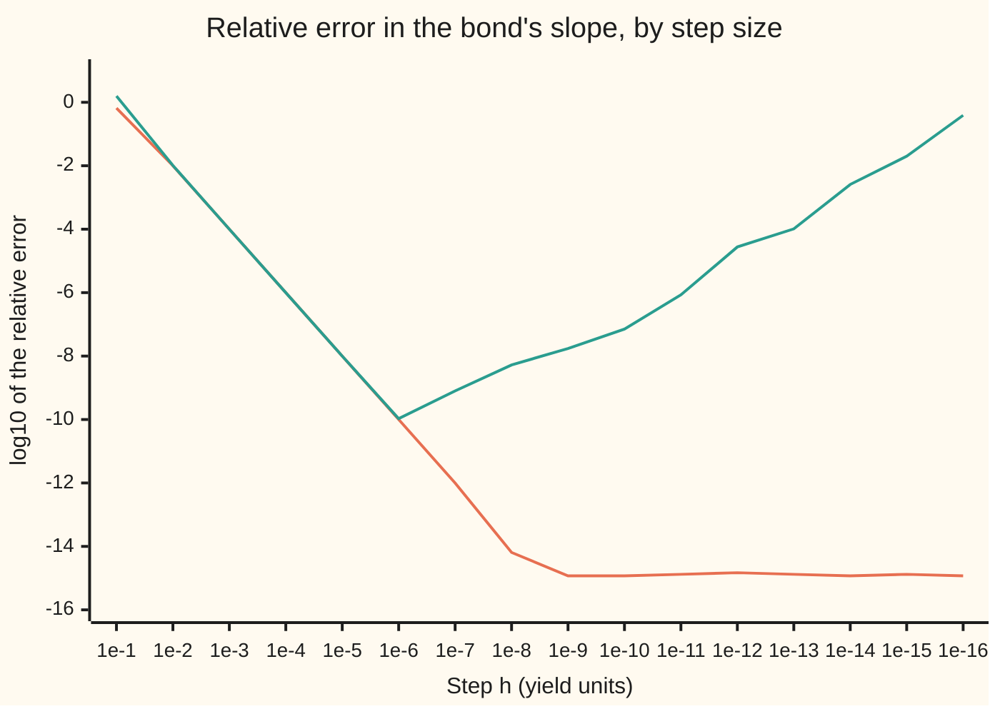

# Complex steps and dual numbers: a derivative with no subtraction to cancel

[Syllabus](../../../SYLLABUS.md) → [Numerical analysis](../README.md) → [Derivatives by Machine](../README.md#s08) → Complex steps and dual numbers

---

## General Overview

A risk desk holds a 30-year bond: $100 face value, a $5 coupon paid once a year, priced at a 5% yield. At that yield the price is exactly $100.000000000000. The desk wants the bond's slope: how many dollars the price moves per unit change in yield. Scaled to one basis point (0.01 percentage point), that slope is the DV01, the dollar value of one basis point. The bond is illustrative; the arithmetic is exact.

The usual way is to bump. Reprice at 5.01% and subtract: the price moves by −0.153549432112, so the bump reads the DV01 as 0.153549432112. The true DV01 is 0.153724510269. Shrinking the bump fixes the curvature error but brings in a new one: two nearly equal prices are subtracted, and rounding takes over. The best central difference (reprice one step up and one step down, subtract, divide by twice the step), at a step of 1e-6, keeps only about ten digits: relative error 1.07e-10.

The complex step does something else. Price the bond at the complex yield 0.05 + 1e-20 i, where i is the square root of −1, using the same pricing code. The imaginary part of the answer, divided by 1e-20, is the slope. Nothing is subtracted, so the step can be as tiny as 1e-20 or even 1e-300. The result is −1537.245102688 per unit of yield, relative error 1.33e-15: about a dozen roundings' worth, built up inside the pricing loop, none of it from the step.

A dual number is the same trick with the step taken to its limit. It is a pair $a + b\varepsilon$, where $\varepsilon$ is a new symbol whose square is exactly zero. Price at 0.05 + ε and the code returns 100.000000000000 − 1537.2451026883ε: the price and its slope together, with no step at all.

**A complex step reads a first derivative off the imaginary part of one complex evaluation, with error $h^2 P'''/6$ and no cancellation, so a tiny step gives full accuracy; a dual number, with $\varepsilon^2 = 0$, removes even that $h^2$ term and carries the exact slope through the same code.**

**What kind of fact this is:** a theorem, proved on this card in Why it works: the complex step's error bound for a function given by a power series with real coefficients. The dual-number result is an algebraic identity, exact up to rounding.

### The picture: two ways to the bond's slope, error against step

The vertical axis is the base-10 logarithm of the relative error: −10 means the answer is right to one part in 10 billion. The step $h$ is in units of yield, so 1e-4 is one basis point.



Orange: the complex step. It falls two decades per decade of step, then sits flat near −15, the floor set by rounding inside the pricing loop. Green: the central difference. It falls at the same rate until a step of 1e-6, then climbs as cancellation takes over. The two lines agree above 1e-6 because both errors are $h^2 P'''/6$ in size, with opposite signs.

---

## The formula

$$P'(y) \;=\; \frac{\operatorname{Im} P(y + ih)}{h} \;+\; \frac{h^2}{6}P'''(y) \;+\; O(h^4) \quad (h \to 0), \qquad P(y + \varepsilon) \;=\; P(y) + P'(y)\,\varepsilon$$

**Read it aloud:** the slope is the imaginary part of the price at a complex yield, divided by the step, plus a small error that shrinks like the step squared; and the price at a dual yield is the price plus the slope times ε, exactly.

Here $O(h^4)$ means "a term no bigger than a constant times $h^4$ as $h$ shrinks to 0". The price of the bond is

$$P(y) = \sum_{t=1}^{N} C\,v^{t} + F\,v^{N}, \qquad v = \frac{1}{1+y}.$$

| Symbol | Plain meaning | In our example | Push it up and the answer… |
| --- | --- | --- | --- |
| $P(y)$ | the bond's price, in dollars per $100 face, at yield $y$ | 100.000000000000 at 5% | — |
| $y$ | the yield: the discount rate per year, as a decimal | 0.05 | the price falls |
| $C$, $F$, $N$ | coupon per year, face value repaid at the end, number of years | $5, $100, 30 | slope grows in size with $N$ |
| $v$, $t$ | one year's discount factor $1/(1+y)$; the year of a payment | 0.952380952381; 1 to 30 | — |
| $h$ | the step: a change in yield for a difference, the size of the imaginary part for a complex step | 1e-20 | complex-step error grows like $h^2$ |
| $i$, $\operatorname{Re}$, $\operatorname{Im}$ | the square root of −1; the real part and imaginary part of a complex number | $\operatorname{Im} P(0.05 + 10^{-20} i)$ = −1.537245103e-17 | — |
| $P'$, $P''$, $P'''$ | slope, curvature and third derivative of price against yield ($P''''$, $P^{(k)}$: fourth and $k$-th) | −1537.2451026883, 35046.667118, −931746.817574 | — |
| $\varepsilon$, $a + b\varepsilon$ | the dual unit, a symbol with $\varepsilon^2 = 0$; a dual number, a value $a$ carrying a slope part $b$ (in Step 2, $a + bi$ and $c + di$ are two complex numbers being multiplied) | $P(0.05 + \varepsilon)$ = 100 − 1537.2451026883ε | — |
| $u$ | the unit roundoff $2^{-53}$: the largest relative error of one rounding in a double | 1.11e-16 | — |
| DV01 | the dollar value of one basis point: $-P'(y) \times 10^{-4}$ | 0.153724510269 | — |
| $a_k$, $M$, $\rho$, $z$, $j$ | used in the proof only: the $k$-th power-series coefficient of $P$ about $y$; a bound on $\lvert P \rvert$; the radius of a disc where that bound holds; a complex offset from $y$; a counter over odd powers | $\rho$ < 1.05 here | — |

### When it holds

- **The code is analytic all the way through.** Every step must be a power series in its input, such as +, ×, ÷, exp or log. A call to abs() on a complex number returns its length and drops the imaginary part: with an abs() guard left in the pricing code, the complex step returns 0.000000000. The dual number, which takes the sign of its real part, still returns −1537.245102688.
- **The function is real on the real line.** The power-series coefficients must be real, so that the imaginary part holds only odd powers of $h$. Code that already works with complex inputs, such as a transform, needs dual numbers instead.
- **The step is small but not subnormal.** Below about 1e-308 a double loses precision (a subnormal number). At $h$ = 1e-320 the slope comes out at −1537.354249012, relative error 7.10e-5.
- **Only the first derivative.** The real part gives $P - h^2P''/2$, so a second derivative needs a subtraction again. At $h$ = 1e-20 that formula returns −4.55e27.

---

## Why it works

### Step 0: put the step where the answer cannot cancel it

A difference quotient subtracts two prices that agree in almost every digit. Rounding in each price, about $u$ times $100, survives the subtraction and is then divided by a small step. That is cancellation, as [Choosing the step](04-choosing-the-step-truncation-against-rounding.md) shows.

The complex step moves the yield sideways instead, into the imaginary direction. The price's response to that sideways move lands in its own slot, the imaginary part, which starts at exactly 0. No large number is ever subtracted from it.

### Step 1: the Taylor series, with an imaginary step

A function with a complex derivative ([The complex derivative](../../07-Complex%20analysis/02-Holomorphic%20Functions/01-complex-derivative-and-cauchy-riemann.md)) equals its power series out to the nearest singularity, the nearest point where that derivative fails ([Taylor series in the plane](../../07-Complex%20analysis/04-Taylor%20Series%2C%20Zeros%20and%20Rigidity/01-taylor-series-in-the-plane.md)). The bond's price is one: it is built from $1/(1+y)$ by multiplying and adding, and its only trouble spot is $y = -1$.

Expand at a complex yield:

$$P(y + ih) = P(y) + ih\,P'(y) - \frac{h^2}{2}P''(y) - i\frac{h^3}{6}P'''(y) + \frac{h^4}{24}P''''(y) + \dots$$

The powers of $i$ cycle: $i^2 = -1$, $i^3 = -i$, $i^4 = 1$. Every derivative of $P$ at a real yield is real. So the odd powers of $h$ land in the imaginary part and the even powers in the real part:

$$\operatorname{Im} P(y + ih) = hP'(y) - \frac{h^3}{6}P'''(y) + \dots, \qquad \operatorname{Re} P(y + ih) = P(y) - \frac{h^2}{2}P''(y) + \dots$$

Divide the first by $h$. The slope appears with error $-h^2P'''/6$, from one evaluation and no subtraction.

<details>
<summary>Detailed proof: the error is at most a constant times h², for every h smaller than the radius</summary>

Suppose $P$ has a power series about $y$, $P(y + z) = \sum_k a_k z^k$, valid for $\lvert z\rvert \le \rho$, and $\lvert P\rvert \le M$ on that circle. Each $a_k = P^{(k)}(y)/k!$ is real, since $P$ is real for real yields.

Cauchy's estimate ([Derivatives from the boundary](../../07-Complex%20analysis/03-Contour%20Integrals%20and%20Cauchy%27s%20Theorem/06-derivatives-from-the-boundary.md)) gives $\lvert a_k\rvert \le M/\rho^k$.

Put $z = ih$ with $0 < h < \rho$. Since $i^{2j+1} = (-1)^j i$, the imaginary part is

$$\operatorname{Im} P(y + ih) = \sum_{j \ge 0} (-1)^j a_{2j+1} h^{2j+1}.$$

The $j = 0$ term is $a_1 h = hP'(y)$. Divide by $h$ and bound the rest:

$$\Big\lvert \frac{\operatorname{Im} P(y+ih)}{h} - P'(y)\Big\rvert \le \sum_{j\ge1} \frac{M}{\rho^{2j+1}} h^{2j} = \frac{M}{\rho}\cdot\frac{(h/\rho)^2}{1-(h/\rho)^2}.$$

For $h \le \rho/2$ this is at most $\tfrac{4}{3}Mh^2/\rho^3$: order 2, with the leading term $-a_3h^2 = -h^2P'''/6$.

For the bond, the price has a pole at $y = -1$, so any $\rho$ below 1.05 works. That is why the series still converges at $h$ = 1e-1, though the answer there is 66% off (−524.078489222, relative error −6.59e-1).

</details>

### Step 2: why rounding stays small

Follow the imaginary parts through the pricing loop. Each payment's discount $v^t$ has a negative imaginary part. Each multiplication $(a + bi)(c + di)$ forms its imaginary part as $a\,d + b\,c$, a sum of two negative numbers. No two nearly equal numbers are subtracted anywhere in the imaginary parts. So each operation adds a relative error of a few $u$ at most: about $2u$ for a product, whose imaginary part takes three roundings (two multiplications and an addition).

The real part's formula $a\,c - b\,d$ does subtract, but $b\,d$ is of size $h^2$: at 1e-20 it is far below one rounding of $a\,c$. The step $h$ also never meets a large number in an addition, so it is never rounded away. At 1e-300 the imaginary parts are still ordinary doubles, above the subnormal range that starts near 1e-308.

The result: from $h$ = 1e-9 down to 1e-300 the relative error stays between 1.18e-15 and 1.63e-15, about a dozen times $u$. That is rounding built up along the slope's own chain of about 30 products, the same size as the dual number's error (−1.18e-15, below). None of it comes from the step.

### Step 3: the order is 2, and the observed errors say so

The error's law is $-h^2P'''/(6P')$, relative, which is $-101.019113\,h^2$ here. At $h$ = 1e-3 it predicts −1.01e-4, and the run gives −1.01e-4. Dividing each error by the next one down, decade by decade, gives observed orders 1.9981, 2.0000, 2.0000, 2.0000.

The central difference $\big(P(y+h) - P(y-h)\big)/(2h)$ has the same leading error with the opposite sign, $+h^2P'''/6$ ([Forward, backward and central differences](01-forward-backward-and-central-differences.md)). At $h$ = 1e-2 the two errors are −1.01e-2 and 1.01e-2. The difference is that the central difference cannot go below about 1e-6 before rounding wins.

### Step 4: let the step shrink to nothing, and you get a dual number

The $h^2$ error comes from one fact: $(ih)^2 = -h^2$ is not zero. A **dual number** replaces $ih$ by a symbol $\varepsilon$ whose square is exactly 0. A dual number $a + b\varepsilon$ carries a value $a$ and a slope part $b$.

With $\varepsilon^2 = 0$ the Taylor series stops after one term:

$$P(y + \varepsilon) = P(y) + P'(y)\,\varepsilon + \tfrac12 P''(y)\,\varepsilon^2 + \dots = P(y) + P'(y)\,\varepsilon.$$

The arithmetic follows from $\varepsilon^2 = 0$:

- sum: $(a + b\varepsilon) + (c + d\varepsilon) = (a + c) + (b + d)\varepsilon$;
- product: $(a + b\varepsilon)(c + d\varepsilon) = ac + (ad + bc)\varepsilon$, the product rule;
- reciprocal: $1/(a + b\varepsilon) = 1/a - (b/a^2)\varepsilon$, since multiplying back gives $1 + 0\varepsilon$.

Each rule is the derivative rule for that operation, applied to the slope part. Chained through a program, they apply the chain rule line by line. This is forward-mode differentiation, which [Automatic differentiation](../../15-Optimization/02-Unconstrained%20Methods/10-automatic-differentiation-and-backpropagation.md) already runs on the Rosenbrock valley. It is the complex step with $h \to 0$ taken in the algebra, not in the arithmetic.

### Step 5: what each costs

Counted in real operations on the 30-year bond:

| Method | Operations | Relative error |
| --- | ---: | ---: |
| One price, plain doubles | 92 | — |
| Central difference, best step 1e-6 | 186 | 1.07e-10 |
| Dual number | 242 | −1.18e-15 |
| Complex step, $h$ = 1e-20 | 303 | 1.33e-15 |

A complex multiplication costs six real operations and a dual one four, because the dual product drops the $b\,d$ term. So the dual number is cheaper and exact in its algebra. The complex step's advantage is that many languages, Fortran, C and Python among them, already have a complex type and complex exp, log and power. A program written for real numbers often runs on complex ones with only its declarations changed.

---

## Worked numbers, by hand

Carry the dual yield $0.05 + \varepsilon$ through the price. The complex step at $h$ = 1e-20 gives imaginary parts equal to these slope parts times $10^{-20}$, up to rounding: its final imaginary part is −1.537245103e-17.

| Step | Arithmetic | Value |
| --- | --- | --- |
| one year's discount | $1/(1.05 + \varepsilon) = 1/1.05 - (1/1.05^2)\,\varepsilon$ | 0.952380952381 − 0.907029478458ε |
| 30 years' discount | $v^{30}$, slope part $-30\,v^{31}$ | 0.231377448656 − 6.610784247ε |
| check | $1.05^{30}$ by 30 multiplications | 4.321942375151 |
| the 30 coupons | $5(v + v^2 + \dots + v^{30})$ | 76.862255134 − 876.166677957ε |
| the face value | $100\,v^{30}$ | 23.137744866 − 661.078424731ε |
| price | coupons + face | 100.000000000000 − 1537.2451026883ε |
| exact slope | $-(F/y)(1 - 1.05^{-30})$, true at par | **−1537.2451026883** |
| DV01 | $1537.2451026883 \times 10^{-4}$ | **0.153724510269** |

A one-basis-point rise in yield costs 15.37 cents per $100 of face value, to first order. The bumped estimate, 0.153549432112, is short by the bond's curvature over one basis point, not by a pricing error.

### What breaks if you drop a piece

| Mistake | Comes out at | What went wrong |
| --- | --- | --- |
| A large complex step, $h$ = 1e-1 | −524.078489222, relative error −6.59e-1 | The $h^2$ and higher terms are not small; use 1e-20 |
| An abs() guard left in the pricing code | complex step 0.000000000; dual −1537.245102688 | abs() on a complex number is its length, which has no imaginary part |
| Second derivative from the real part, $2(P - \operatorname{Re}P(y+ih))/h^2$ | −4.55e27 at $h$ = 1e-20; 35046.644615 at 1e-4 (exact 35046.667118) | The real part brings back the subtraction the trick avoided |
| A central difference at $h$ = 1e-12 | −1537.287630526, relative error 2.77e-5 | Cancellation: two equal-looking prices divided by a tiny step |
| A subnormal step, $h$ = 1e-320 | −1537.354249012, relative error 7.10e-5 | Every imaginary part is subnormal and keeps far fewer than a double's 53 bits, so each rounding is coarse; dividing by the same stored step cancels the step's own error |

---

## Code, from first principles, and it actually runs

The script writes one pricing routine and runs it on three number types: a plain real, a complex number written out as a pair, and a dual number. Each type counts its real operations. There are three independent roads to the slope: the exact closed form $-(F/y)(1 - 1.05^{-30})$ with a term-by-term sum beside it; the complex step at 19 step sizes; and the dual number. The closed form comes from writing the price as $(C/y)(1 - v^N) + F\,v^N$ and differentiating: at par, where $C/y = F$, the terms in $v^{N+1}$ cancel. The central difference runs alongside for contrast. The Python version also checks the stored exact slope against rational arithmetic, and the complex step against the language's own complex type.

### Python

```python
# Complex steps and dual numbers -- the check behind the card.  Python standard
# library only; fractions gives the exact answer, used only inside an assert.
# Road one: the exact slope -(F/y)(1 - 1.05^-30) and a term-by-term sum.
# Road two: the complex step Im P(y + ih) / h at many steps h.  Road three: a
# dual number carried through the same pricing code.  For contrast: the central
# difference.  Each number type counts its real operations (flops).
import math
from fractions import Fraction
OPS = [0]
def tick(n): OPS[0] += n
def sci(x, d=2):                                # 1.23e-5, the same in Rust
    m, e = f"{x:.{d}e}".split("e")
    return f"{m}e{int(e)}"
class R:                                        # a plain real number, counted
    def __init__(s, a): s.a = a
    def addc(s, k): tick(1); return R(s.a + k)
    def add(s, o): tick(1); return R(s.a + o.a)
    def mul(s, o): tick(1); return R(s.a * o.a)
    def scal(s, k): tick(1); return R(k * s.a)
    def recip(s): tick(1); return R(1.0 / s.a)
    def mag(s): return R(abs(s.a))
class Cx:                                       # a + b i, i * i = -1, written out
    def __init__(s, a, b): s.a, s.b = a, b
    def addc(s, k): tick(1); return Cx(s.a + k, s.b)
    def add(s, o): tick(2); return Cx(s.a + o.a, s.b + o.b)
    def mul(s, o): tick(6); return Cx(s.a * o.a - s.b * o.b, s.a * o.b + s.b * o.a)
    def scal(s, k): tick(2); return Cx(k * s.a, k * s.b)
    def recip(s):
        tick(5); den = s.a * s.a + s.b * s.b
        return Cx(s.a / den, -s.b / den)
    def mag(s): return Cx(math.sqrt(s.a * s.a + s.b * s.b), 0.0)   # abs() of a complex
class Dual:                                     # a + b eps, eps * eps = 0
    def __init__(s, a, b): s.a, s.b = a, b
    def addc(s, k): tick(1); return Dual(s.a + k, s.b)
    def add(s, o): tick(2); return Dual(s.a + o.a, s.b + o.b)
    def mul(s, o): tick(4); return Dual(s.a * o.a, s.a * o.b + s.b * o.a)
    def scal(s, k): tick(2); return Dual(k * s.a, k * s.b)
    def recip(s):
        tick(3); r = 1.0 / s.a
        return Dual(r, -s.b * r * r)
    def mag(s): return Dual(abs(s.a), s.b if s.a >= 0.0 else -s.b)
C, F, N, Y = 5.0, 100.0, 30, 0.05               # 5% annual coupon, $100 face, 30 years, 5% yield
EX = -1537.2451026882836                        # exact dP/dy, rounded once (asserted below)
def legs(y, guard=False):                       # ONE pricing routine for every number type
    if guard: y = y.mag()                       # "a negative yield is a typo": take abs
    v = y.addc(1.0).recip()                     # one year's discount factor 1/(1+y)
    d = v; s = d.scal(C)
    for _ in range(N - 1):
        d = d.mul(v); s = s.add(d.scal(C))      # coupon t is worth C v^t today
    return v, d, s                              # v, v^30, the coupons' value
def price(y, guard=False):
    v, d, s = legs(y, guard)
    return s.add(d.scal(F))                     # plus the face value in year 30
def cs(h, y=Y): return price(Cx(y, h)).b / h    # the complex step
def cd(h): return (price(R(Y + h)).a - price(R(Y - h)).a) / (2 * h)
def rel(x): return (x - EX) / EX
g = 1.0
for _ in range(N): g *= 1.0 + Y                 # road one: 1.05^30, then the closed form
cf = -(F / Y) * (1.0 - 1.0 / g)
d1 = d2 = d3 = 0.0; v = 1.0 / (1.0 + Y); vt = 1.0
for t in range(1, N + 1):                       # road one again: term by term
    vt *= v; c = C + (F if t == N else 0.0)
    d1 -= c * t * vt * v; d2 += c * t * (t + 1) * vt * v * v; d3 -= c * t * (t + 1) * (t + 2) * vt * v * v * v
p0 = price(R(Y)).a; p1 = price(R(Y + 1e-4)).a; K = d3 / (6 * EX)
print(f"bond: price at 5% = {p0:.12f}; 1.05^30 = {g:.12f}; u = 2^-53 = {sci(2.0 ** -53)}")
print(f"exact dP/dy {EX:.10f}; closed form in doubles rel err {sci(rel(cf))}, term by term {sci(rel(d1))}")
print(f"d2P/dy2 = {d2:.6f}, d3P/dy3 = {d3:.6f}; complex-step law: rel err = -{K:.6f} h^2")
print(f"1bp bump: P(5.01%) = {p1:.12f}, change {p1 - p0:.12f}; true DV01 {-EX * 1e-4:.12f}")
print("k   complex step      rel err     central difference  rel err")
er, ec, lc, ld = {}, {}, [], []
for k in list(range(1, 17)) + [20, 100, 300]:
    h = float(f"1e-{k}"); a = cs(h); er[k] = rel(a)
    tail = ""
    if k <= 16:
        ec[k] = rel(cd(h)); tail = f"{cd(h):18.9f}  {sci(ec[k]):>9}"
        lc.append(f"{math.log10(abs(er[k])):.2f}"); ld.append(f"{math.log10(abs(ec[k])):.2f}")
    print(f"{k:<3} {a:16.9f}  {sci(er[k]):>9}  {tail}".rstrip())
print("chart complex step log10 |rel err|: " + ", ".join(lc))
print("chart central log10 |rel err|: " + ", ".join(ld))
print("complex step: order from k to k+1 (theory 2): " + ", ".join(f"{math.log10(er[k] / er[k + 1]):.4f}" for k in range(2, 6))
      + f"; law at h=1e-3 {sci(-K * 1e-6)}")
OPS[0] = 0; du = price(Dual(Y, 1.0)); n_du = OPS[0]
OPS[0] = 0; p_r = price(R(Y)); n_r = OPS[0]
OPS[0] = 0; c20 = price(Cx(Y, 1e-20)); n_cx = OPS[0]
print(f"dual: P(5% + eps) = {du.a:.12f} + ({du.b:.10f}) eps, rel err {sci(rel(du.b))}")
print(f"complex at h=1e-20: real {c20.a:.12f}, imag {sci(c20.b, 9)}; imag/h minus dual {sci(c20.b / 1e-20 - du.b)}")
v, d, s = legs(Dual(Y, 1.0))
print(f"by hand (dual): v = {v.a:.12f} + ({v.b:.12f}) eps; v^30 = {d.a:.12f} + ({d.b:.9f}) eps")
print(f"by hand (dual): coupons {s.a:.9f} + ({s.b:.9f}) eps; face 100 v^30 = {F * d.a:.9f} + ({F * d.b:.9f}) eps")
print(f"flops: one price {n_r}, central difference {2 * n_r + 2}, complex step {n_cx + 1}, dual {n_du}")
gc = price(Cx(Y, 1e-20), True).b / 1e-20 + 0.0      # the abs() guard left in the code
gd = price(Dual(Y, 1.0), True)
sr = 2 * (p0 - price(Cx(Y, 1e-20)).a) / 1e-40; s4 = 2 * (p0 - price(Cx(Y, 1e-4)).a) / 1e-8
print(f"break, abs() guard: complex step {gc:.9f}, dual {gd.b:.9f}")
print(f"break, 2nd derivative from the real part: h=1e-20 {sci(sr)}, h=1e-4 {s4:.6f} (exact {d2:.6f})")
avg = (cs(1e-2) + cd(1e-2)) / 2
s320 = cs(float("1e-320"))
print(f"try: mean of complex step and central at h=1e-2 {avg:.9f}, rel err {sci(rel(avg))}")
print(f"try: h=1e-320 (subnormal) gives {s320:.9f}, rel err {sci(rel(s320))}; seed 1e-4: {price(Dual(Y, 1e-4)).b:.12f}")
assert abs(Fraction(EX) - (-2000) * (1 - Fraction(20, 21) ** 30)) < Fraction(1, 2 ** 43)
assert abs(rel(cf)) < 1e-14 and abs(rel(d1)) < 1e-14       # two roads to the exact slope
assert abs(er[20]) < 4e-15 and abs(rel(du.b)) < 4e-15        # complex step and dual: full accuracy
assert min(abs(e) for e in ec.values()) > 1e-11              # the best central difference is 1000x worse
assert abs(er[3] / (-K * 1e-6) - 1) < 1e-3                   # error follows -h^2 f'''/(6 f')
assert abs(er[3] + ec[3]) < 1e-3 * abs(er[3])                # equal size, opposite sign
assert gc == 0.0 and abs(rel(gd.b)) < 4e-15                  # abs() kills the complex step, not the dual
assert abs((complex(1 + Y, 1e-20) ** -30).imag / 1e-20 + 30 * 1.05 ** -31) < 1e-9   # library cross-check
print("ALL CHECKS PASS")
```

**Ran 2026-11-11 on macOS, Python 3.14.10, standard library only. All checks passed. Output, pasted from the run:**

```
bond: price at 5% = 100.000000000000; 1.05^30 = 4.321942375151; u = 2^-53 = 1.11e-16
exact dP/dy -1537.2451026883; closed form in doubles rel err 4.44e-16, term by term -1.18e-15
d2P/dy2 = 35046.667118, d3P/dy3 = -931746.817574; complex-step law: rel err = -101.019113 h^2
1bp bump: P(5.01%) = 99.846450567888, change -0.153549432112; true DV01 0.153724510269
k   complex step      rel err     central difference  rel err
1     -524.078489222   -6.59e-1     -3987.289658216     1.59e0
2    -1521.784645481   -1.01e-2     -1552.843222608    1.01e-2
3    -1537.089818435   -1.01e-4     -1537.400400708    1.01e-4
4    -1537.243549778   -1.01e-6     -1537.246655600    1.01e-6
5    -1537.245087159   -1.01e-8     -1537.245118228    1.01e-8
6    -1537.245102533  -1.01e-10     -1537.245102853   1.07e-10
7    -1537.245102687  -1.01e-12     -1537.245103904   7.91e-10
8    -1537.245102688  -6.51e-15     -1537.245094596   -5.26e-9
9    -1537.245102688   1.18e-15     -1537.245076122   -1.73e-8
10   -1537.245102688   1.18e-15     -1537.245211125    7.05e-8
11   -1537.245102688   1.33e-15     -1537.246419048    8.56e-7
12   -1537.245102688   1.48e-15     -1537.287630526    2.77e-5
13   -1537.245102688   1.33e-15     -1537.401317364    1.02e-4
14   -1537.245102688   1.18e-15     -1541.167193864    2.55e-3
15   -1537.245102688   1.33e-15     -1506.350599811   -2.01e-2
16   -1537.245102688   1.18e-15     -2131.628207280    3.87e-1
20   -1537.245102688   1.33e-15
100  -1537.245102688   1.48e-15
300  -1537.245102688   1.63e-15
chart complex step log10 |rel err|: -0.18, -2.00, -4.00, -6.00, -8.00, -10.00, -12.00, -14.19, -14.93, -14.93, -14.88, -14.83, -14.88, -14.93, -14.88, -14.93
chart central log10 |rel err|: 0.20, -1.99, -4.00, -6.00, -8.00, -9.97, -9.10, -8.28, -7.76, -7.15, -6.07, -4.56, -3.99, -2.59, -1.70, -0.41
complex step: order from k to k+1 (theory 2): 1.9981, 2.0000, 2.0000, 2.0000; law at h=1e-3 -1.01e-4
dual: P(5% + eps) = 100.000000000000 + (-1537.2451026883) eps, rel err -1.18e-15
complex at h=1e-20: real 100.000000000000, imag -1.537245103e-17; imag/h minus dual -3.87e-12
by hand (dual): v = 0.952380952381 + (-0.907029478458) eps; v^30 = 0.231377448656 + (-6.610784247) eps
by hand (dual): coupons 76.862255134 + (-876.166677957) eps; face 100 v^30 = 23.137744866 + (-661.078424731) eps
flops: one price 92, central difference 186, complex step 303, dual 242
break, abs() guard: complex step 0.000000000, dual -1537.245102688
break, 2nd derivative from the real part: h=1e-20 -4.55e27, h=1e-4 35046.644615 (exact 35046.667118)
try: mean of complex step and central at h=1e-2 -1537.313934044, rel err 4.48e-5
try: h=1e-320 (subnormal) gives -1537.354249012, rel err 7.10e-5; seed 1e-4: -0.153724510269
ALL CHECKS PASS
```

### Rust

```rust
// Complex steps and dual numbers -- the check behind the card.  Rust std only.
// Road one: the exact slope -(F/y)(1 - 1.05^-30) and a term-by-term sum.
// Road two: the complex step Im P(y + ih) / h at many steps h.  Road three: a
// dual number carried through the same pricing code.  For contrast: the central
// difference.  Each number type counts its real operations (flops).
use std::sync::atomic::{AtomicUsize, Ordering::Relaxed};
static OPS: AtomicUsize = AtomicUsize::new(0);
fn tick(n: usize) { OPS.fetch_add(n, Relaxed); }
fn sci(x: f64, d: usize) -> String { format!("{:.*e}", d, x) }
trait Num: Copy {
    fn addc(self, k: f64) -> Self;
    fn add(self, o: Self) -> Self;
    fn mul(self, o: Self) -> Self;
    fn scal(self, k: f64) -> Self;
    fn recip(self) -> Self;
    fn mag(self) -> Self;
}
#[derive(Clone, Copy)] struct R { a: f64 } // a plain real number, counted
impl Num for R {
    fn addc(self, k: f64) -> R { tick(1); R { a: self.a + k } }
    fn add(self, o: R) -> R { tick(1); R { a: self.a + o.a } }
    fn mul(self, o: R) -> R { tick(1); R { a: self.a * o.a } }
    fn scal(self, k: f64) -> R { tick(1); R { a: k * self.a } }
    fn recip(self) -> R { tick(1); R { a: 1.0 / self.a } }
    fn mag(self) -> R { R { a: self.a.abs() } }
}
#[derive(Clone, Copy)] struct Cx { a: f64, b: f64 } // a + b i, i * i = -1
impl Num for Cx {
    fn addc(self, k: f64) -> Cx { tick(1); Cx { a: self.a + k, b: self.b } }
    fn add(self, o: Cx) -> Cx { tick(2); Cx { a: self.a + o.a, b: self.b + o.b } }
    fn mul(self, o: Cx) -> Cx { tick(6); Cx { a: self.a * o.a - self.b * o.b, b: self.a * o.b + self.b * o.a } }
    fn scal(self, k: f64) -> Cx { tick(2); Cx { a: k * self.a, b: k * self.b } }
    fn recip(self) -> Cx {
        tick(5); let den = self.a * self.a + self.b * self.b;
        Cx { a: self.a / den, b: -self.b / den }
    }
    fn mag(self) -> Cx { Cx { a: (self.a * self.a + self.b * self.b).sqrt(), b: 0.0 } } // abs() of a complex
}
#[derive(Clone, Copy)] struct Dual { a: f64, b: f64 } // a + b eps, eps * eps = 0
impl Num for Dual {
    fn addc(self, k: f64) -> Dual { tick(1); Dual { a: self.a + k, b: self.b } }
    fn add(self, o: Dual) -> Dual { tick(2); Dual { a: self.a + o.a, b: self.b + o.b } }
    fn mul(self, o: Dual) -> Dual { tick(4); Dual { a: self.a * o.a, b: self.a * o.b + self.b * o.a } }
    fn scal(self, k: f64) -> Dual { tick(2); Dual { a: k * self.a, b: k * self.b } }
    fn recip(self) -> Dual {
        tick(3); let r = 1.0 / self.a;
        Dual { a: r, b: -self.b * r * r }
    }
    fn mag(self) -> Dual { Dual { a: self.a.abs(), b: if self.a >= 0.0 { self.b } else { -self.b } } }
}
const C: f64 = 5.0; const F: f64 = 100.0; const N: usize = 30; const Y: f64 = 0.05;
const EX: f64 = -1537.2451026882836; // exact dP/dy, rounded once
fn legs<T: Num>(y: T, guard: bool) -> (T, T, T) { // ONE pricing routine for every number type
    let y = if guard { y.mag() } else { y }; // "a negative yield is a typo": take abs
    let v = y.addc(1.0).recip(); // one year's discount factor 1/(1+y)
    let mut d = v; let mut s = d.scal(C);
    for _ in 0..N - 1 { d = d.mul(v); s = s.add(d.scal(C)); } // coupon t is worth C v^t today
    (v, d, s) // v, v^30, the coupons' value
}
fn price<T: Num>(y: T, guard: bool) -> T { let (_, d, s) = legs(y, guard); s.add(d.scal(F)) }
fn cs(h: f64) -> f64 { price(Cx { a: Y, b: h }, false).b / h } // the complex step
fn pr(y: f64) -> f64 { price(R { a: y }, false).a }
fn cd(h: f64) -> f64 { (pr(Y + h) - pr(Y - h)) / (2.0 * h) }
fn rel(x: f64) -> f64 { (x - EX) / EX }
fn ten(k: i32) -> f64 { format!("1e-{}", k).parse().unwrap() }
fn main() {
    let mut g = 1.0;
    for _ in 0..N { g *= 1.0 + Y; } // road one: 1.05^30, then the closed form
    let cf = -(F / Y) * (1.0 - 1.0 / g);
    let (mut d1, mut d2, mut d3) = (0.0f64, 0.0f64, 0.0f64);
    let v = 1.0 / (1.0 + Y); let mut vt = 1.0;
    for ti in 1..=N { // road one again: term by term
        let t = ti as f64; vt *= v; let c = C + if ti == N { F } else { 0.0 };
        d1 -= c * t * vt * v; d2 += c * t * (t + 1.0) * vt * v * v; d3 -= c * t * (t + 1.0) * (t + 2.0) * vt * v * v * v;
    }
    let (p0, p1, k3) = (pr(Y), pr(Y + 1e-4), d3 / (6.0 * EX));
    println!("bond: price at 5% = {:.12}; 1.05^30 = {:.12}; u = 2^-53 = {}", p0, g, sci(2f64.powi(-53), 2));
    println!("exact dP/dy {:.10}; closed form in doubles rel err {}, term by term {}", EX, sci(rel(cf), 2), sci(rel(d1), 2));
    println!("d2P/dy2 = {:.6}, d3P/dy3 = {:.6}; complex-step law: rel err = -{:.6} h^2", d2, d3, k3);
    println!("1bp bump: P(5.01%) = {:.12}, change {:.12}; true DV01 {:.12}", p1, p1 - p0, -EX * 1e-4);
    println!("k   complex step      rel err     central difference  rel err");
    let mut er = std::collections::HashMap::new(); let mut ec = Vec::new();
    let (mut lc, mut ld) = (Vec::new(), Vec::new());
    for k in (1..17).chain([20, 100, 300]) {
        let h = ten(k); let a = cs(h); er.insert(k, rel(a));
        let mut tail = String::new();
        if k <= 16 {
            ec.push(rel(cd(h))); tail = format!("{:18.9}  {:>9}", cd(h), sci(rel(cd(h)), 2));
            lc.push(format!("{:.2}", rel(a).abs().log10())); ld.push(format!("{:.2}", rel(cd(h)).abs().log10()));
        }
        println!("{}", format!("{:<3} {:16.9}  {:>9}  {}", k, a, sci(rel(a), 2), tail).trim_end());
    }
    println!("chart complex step log10 |rel err|: {}", lc.join(", "));
    println!("chart central log10 |rel err|: {}", ld.join(", "));
    let ord: Vec<String> = (2..6).map(|k| format!("{:.4}", (er[&k] / er[&(k + 1)]).log10())).collect();
    println!("complex step: order from k to k+1 (theory 2): {}; law at h=1e-3 {}", ord.join(", "), sci(-k3 * 1e-6, 2));
    OPS.store(0, Relaxed); let du = price(Dual { a: Y, b: 1.0 }, false); let n_du = OPS.load(Relaxed);
    OPS.store(0, Relaxed); pr(Y); let n_r = OPS.load(Relaxed);
    OPS.store(0, Relaxed); let c20 = price(Cx { a: Y, b: 1e-20 }, false); let n_cx = OPS.load(Relaxed);
    println!("dual: P(5% + eps) = {:.12} + ({:.10}) eps, rel err {}", du.a, du.b, sci(rel(du.b), 2));
    println!("complex at h=1e-20: real {:.12}, imag {}; imag/h minus dual {}", c20.a, sci(c20.b, 9), sci(c20.b / 1e-20 - du.b, 2));
    let (v, d, s) = legs(Dual { a: Y, b: 1.0 }, false);
    println!("by hand (dual): v = {:.12} + ({:.12}) eps; v^30 = {:.12} + ({:.9}) eps", v.a, v.b, d.a, d.b);
    println!("by hand (dual): coupons {:.9} + ({:.9}) eps; face 100 v^30 = {:.9} + ({:.9}) eps", s.a, s.b, F * d.a, F * d.b);
    println!("flops: one price {}, central difference {}, complex step {}, dual {}", n_r, 2 * n_r + 2, n_cx + 1, n_du);
    let gc = price(Cx { a: Y, b: 1e-20 }, true).b / 1e-20 + 0.0; // the abs() guard left in the code
    let gd = price(Dual { a: Y, b: 1.0 }, true);
    let sr = 2.0 * (p0 - price(Cx { a: Y, b: 1e-20 }, false).a) / 1e-40;
    let s4 = 2.0 * (p0 - price(Cx { a: Y, b: 1e-4 }, false).a) / 1e-8;
    println!("break, abs() guard: complex step {:.9}, dual {:.9}", gc, gd.b);
    println!("break, 2nd derivative from the real part: h=1e-20 {}, h=1e-4 {:.6} (exact {:.6})", sci(sr, 2), s4, d2);
    let avg = (cs(1e-2) + cd(1e-2)) / 2.0;
    let s320 = cs(ten(320));
    println!("try: mean of complex step and central at h=1e-2 {:.9}, rel err {}", avg, sci(rel(avg), 2));
    println!("try: h=1e-320 (subnormal) gives {:.9}, rel err {}; seed 1e-4: {:.12}", s320, sci(rel(s320), 2), price(Dual { a: Y, b: 1e-4 }, false).b);
    assert!(rel(cf).abs() < 1e-14 && rel(d1).abs() < 1e-14); // two roads to the exact slope
    assert!(er[&20].abs() < 4e-15 && rel(du.b).abs() < 4e-15); // complex step and dual: full accuracy
    assert!(ec.iter().all(|e| e.abs() > 1e-11)); // the best central difference is 1000x worse
    assert!((er[&3] / (-k3 * 1e-6) - 1.0).abs() < 1e-3); // error follows -h^2 f'''/(6 f')
    assert!((er[&3] + ec[2]).abs() < 1e-3 * er[&3].abs()); // equal size, opposite sign
    assert!(gc == 0.0 && rel(gd.b).abs() < 4e-15); // abs() kills the complex step, not the dual
    println!("ALL CHECKS PASS");
}
```

**Ran 2026-11-11 on macOS, rustc 1.98.1, no crates. All checks passed. Output, pasted from the run:**

```
bond: price at 5% = 100.000000000000; 1.05^30 = 4.321942375151; u = 2^-53 = 1.11e-16
exact dP/dy -1537.2451026883; closed form in doubles rel err 4.44e-16, term by term -1.18e-15
d2P/dy2 = 35046.667118, d3P/dy3 = -931746.817574; complex-step law: rel err = -101.019113 h^2
1bp bump: P(5.01%) = 99.846450567888, change -0.153549432112; true DV01 0.153724510269
k   complex step      rel err     central difference  rel err
1     -524.078489222   -6.59e-1     -3987.289658216     1.59e0
2    -1521.784645481   -1.01e-2     -1552.843222608    1.01e-2
3    -1537.089818435   -1.01e-4     -1537.400400708    1.01e-4
4    -1537.243549778   -1.01e-6     -1537.246655600    1.01e-6
5    -1537.245087159   -1.01e-8     -1537.245118228    1.01e-8
6    -1537.245102533  -1.01e-10     -1537.245102853   1.07e-10
7    -1537.245102687  -1.01e-12     -1537.245103904   7.91e-10
8    -1537.245102688  -6.51e-15     -1537.245094596   -5.26e-9
9    -1537.245102688   1.18e-15     -1537.245076122   -1.73e-8
10   -1537.245102688   1.18e-15     -1537.245211125    7.05e-8
11   -1537.245102688   1.33e-15     -1537.246419048    8.56e-7
12   -1537.245102688   1.48e-15     -1537.287630526    2.77e-5
13   -1537.245102688   1.33e-15     -1537.401317364    1.02e-4
14   -1537.245102688   1.18e-15     -1541.167193864    2.55e-3
15   -1537.245102688   1.33e-15     -1506.350599811   -2.01e-2
16   -1537.245102688   1.18e-15     -2131.628207280    3.87e-1
20   -1537.245102688   1.33e-15
100  -1537.245102688   1.48e-15
300  -1537.245102688   1.63e-15
chart complex step log10 |rel err|: -0.18, -2.00, -4.00, -6.00, -8.00, -10.00, -12.00, -14.19, -14.93, -14.93, -14.88, -14.83, -14.88, -14.93, -14.88, -14.93
chart central log10 |rel err|: 0.20, -1.99, -4.00, -6.00, -8.00, -9.97, -9.10, -8.28, -7.76, -7.15, -6.07, -4.56, -3.99, -2.59, -1.70, -0.41
complex step: order from k to k+1 (theory 2): 1.9981, 2.0000, 2.0000, 2.0000; law at h=1e-3 -1.01e-4
dual: P(5% + eps) = 100.000000000000 + (-1537.2451026883) eps, rel err -1.18e-15
complex at h=1e-20: real 100.000000000000, imag -1.537245103e-17; imag/h minus dual -3.87e-12
by hand (dual): v = 0.952380952381 + (-0.907029478458) eps; v^30 = 0.231377448656 + (-6.610784247) eps
by hand (dual): coupons 76.862255134 + (-876.166677957) eps; face 100 v^30 = 23.137744866 + (-661.078424731) eps
flops: one price 92, central difference 186, complex step 303, dual 242
break, abs() guard: complex step 0.000000000, dual -1537.245102688
break, 2nd derivative from the real part: h=1e-20 -4.55e27, h=1e-4 35046.644615 (exact 35046.667118)
try: mean of complex step and central at h=1e-2 -1537.313934044, rel err 4.48e-5
try: h=1e-320 (subnormal) gives -1537.354249012, rel err 7.10e-5; seed 1e-4: -0.153724510269
ALL CHECKS PASS
```

### Lean

Lean proves the complex step's error bound from the Detailed proof and the dual-number rules, for any function meeting their hypotheses.

- Say $P$ has a complex derivative on the disc of radius $\rho$ about $y$, is real for real yields, and $\lvert P\rvert \le M$ on its edge. Then for $0 < h < \rho$, the complex step misses $P'(y)$ by at most $\frac{M}{\rho}\cdot\frac{(h/\rho)^2}{1-(h/\rho)^2}$.
- Under the same hypotheses, for $h \le \rho/2$ that error is at most $\tfrac{4}{3}Mh^2/\rho^3$: order 2.
- For any polynomial $p$ with real coefficients, $p(y + \varepsilon) = p(y) + p'(y)\,\varepsilon$ exactly.
- When $a \ne 0$, $1/(a + b\varepsilon) = 1/a - (b/a^2)\,\varepsilon$, the reciprocal rule used for $v$.
- In exact fractions, the bond's price at 5% is exactly 100 dollars, and the slope $-2000(1 - 1.05^{-30})$ equals the term-by-term sum.

The $-h^2P'''/6$ error law, the rounding floor, the observed orders, the operation counts and every row of What breaks are left to Python and Rust.

```lean
-- Complex steps and dual numbers: the complex step Im f(y + ih)/h misses the slope by at most a constant times h², and a dual number carries the exact slope.
import Mathlib.Analysis.Complex.CauchyIntegral
import Mathlib.Analysis.Complex.RealDeriv
import Mathlib.Analysis.Complex.Liouville
import Mathlib.Analysis.Complex.TaylorSeries
import Mathlib.Algebra.DualNumber
import Mathlib.Algebra.Polynomial.Taylor
import Mathlib.Algebra.Polynomial.Derivative
import Mathlib.Algebra.BigOperators.Intervals
import Mathlib.Tactic.NormNum

open Complex Metric DualNumber TrivSqZeroExt

lemma im_deriv_eq_zero_of_real (g : ℂ → ℂ) (y ρ : ℝ) (hg : DifferentiableOn ℂ g (ball (y : ℂ) ρ))
    (hr : ∀ x : ℝ, |x - y| < ρ → (g x).im = 0) (x : ℝ) (hx : |x - y| < ρ) :
    (deriv g x).im = 0 := by
  have hmem : (x : ℂ) ∈ ball (y : ℂ) ρ := by
    rw [mem_ball, Complex.dist_eq, ← ofReal_sub, norm_real, Real.norm_eq_abs]; exact hx
  have hd : HasDerivAt g (deriv g x) x :=
    (hg.differentiableAt (isOpen_ball.mem_nhds hmem)).hasDerivAt
  have h1 := hd.comp_ofReal
  have h2 : HasDerivAt (fun t : ℝ => (g t).im) (deriv g x).im x := by
    have h4 : HasDerivAt (fun z => -I * g z) (-I * deriv g x) x := hd.const_mul (-I)
    simpa using h4.real_of_complex
  have h3 : (fun t : ℝ => (g t).im) =ᶠ[nhds x] fun _ => (0 : ℝ) := by
    have : ball y ρ ∈ nhds x := isOpen_ball.mem_nhds (by rw [mem_ball, Real.dist_eq]; exact hx)
    filter_upwards [this] with t ht
    exact hr t (by rw [mem_ball, Real.dist_eq] at ht; exact ht)
  exact h2.unique ((hasDerivAt_const x (0 : ℝ)).congr_of_eventuallyEq h3)

#print axioms im_deriv_eq_zero_of_real

lemma im_iteratedDeriv_eq_zero_of_real (y ρ : ℝ) (n : ℕ) : ∀ g : ℂ → ℂ,
    DifferentiableOn ℂ g (ball (y : ℂ) ρ) → (∀ x : ℝ, |x - y| < ρ → (g x).im = 0) →
    ∀ x : ℝ, |x - y| < ρ → (iteratedDeriv n g x).im = 0 := by
  induction n with
  | zero => intro g _ hr x hx; simpa using hr x hx
  | succ n ih =>
    intro g hg hr x hx
    rw [iteratedDeriv_succ']
    exact ih (deriv g) (hg.deriv isOpen_ball)
      (fun x hx => im_deriv_eq_zero_of_real g y ρ hg hr x hx) x hx

#print axioms im_iteratedDeriv_eq_zero_of_real

/-- The complex step's error bound. Let `P` be a real function whose complex extension `f`
is real on the real line (`f x = P x`) and has a complex derivative on the closed disc of
radius `ρ` about the real point `y`, with `|f| ≤ M` on the circle of that disc. Then for
every step `0 < h < ρ`, the slope read off the imaginary part, `Im f(y + ih) / h`, differs
from the true slope `P'(y)` by at most `(M/ρ)·(h/ρ)²/(1 − (h/ρ)²)`; and for `h ≤ ρ/2` this
is at most `(4/3)·M·h²/ρ³`, so the error is of order `h²`. -/
theorem complex_step_error_le
    (f : ℂ → ℂ) (P : ℝ → ℝ) (y ρ M h : ℝ)
    (hf : DifferentiableOn ℂ f (closedBall (y : ℂ) ρ))
    (hreal : ∀ x : ℝ, f x = P x)
    (hM : ∀ z ∈ sphere (y : ℂ) ρ, ‖f z‖ ≤ M)
    (hh : 0 < h) (hhρ : h < ρ) :
    |(f (y + h * I)).im / h - deriv P y| ≤ M / ρ * ((h / ρ) ^ 2 / (1 - (h / ρ) ^ 2)) ∧
      (h ≤ ρ / 2 → |(f (y + h * I)).im / h - deriv P y| ≤ 4 / 3 * M * h ^ 2 / ρ ^ 3) := by
  have hρ : 0 < ρ := hh.trans hhρ
  have hfb : DifferentiableOn ℂ f (ball (y : ℂ) ρ) := hf.mono ball_subset_closedBall
  have hre : ∀ x : ℝ, |x - y| < ρ → (f x).im = 0 := fun x _ => by rw [hreal]; simp
  set c : ℕ → ℂ := fun n => iteratedDeriv n f y with hc
  have creal : ∀ n, c n = ((c n).re : ℂ) := fun n => by
    apply Complex.ext <;> simp only [ofReal_re, ofReal_im]
    exact im_iteratedDeriv_eq_zero_of_real y ρ n f hfb hre y (by simpa using hρ)
  have hcb : ∀ n, ‖c n‖ ≤ n.factorial * M / ρ ^ n := fun n =>
    norm_iteratedDeriv_le_of_forall_mem_sphere_norm_le n hρ (hf.diffContOnCl_ball subset_rfl) hM
  -- real coefficients
  set a : ℕ → ℝ := fun n => ((n.factorial : ℝ))⁻¹ * (c n).re with ha
  have hab : ∀ n, |a n| ≤ M / ρ ^ n := fun n => by
    have h1 : |(c n).re| ≤ n.factorial * M / ρ ^ n := (abs_re_le_norm _).trans (hcb n)
    have hfac : (0 : ℝ) < n.factorial := by exact_mod_cast n.factorial_pos
    rw [ha, abs_mul, abs_inv, abs_of_pos hfac]
    calc (n.factorial : ℝ)⁻¹ * |(c n).re| ≤ (n.factorial : ℝ)⁻¹ * (n.factorial * M / ρ ^ n) :=
          mul_le_mul_of_nonneg_left h1 (by positivity)
      _ = M / ρ ^ n := by field_simp
  -- Taylor series at z = y + h I
  have hz : (y : ℂ) + h * I ∈ ball (y : ℂ) ρ := by
    rw [mem_ball, Complex.dist_eq, add_sub_cancel_left, norm_mul, norm_real, Complex.norm_I,
      mul_one, Real.norm_eq_abs, abs_of_pos hh]
    exact hhρ
  have H := Complex.hasSum_taylorSeries_on_ball hfb hz
  rw [add_sub_cancel_left] at H
  have hT : ∀ n, ((n.factorial : ℂ))⁻¹ • ((h : ℂ) * I) ^ n • c n = (a n : ℂ) * ((h : ℂ) * I) ^ n :=
    fun n => by
      rw [creal n]; simp only [ha, smul_eq_mul, ofReal_mul, ofReal_inv, ofReal_natCast]; ring
  have H' : HasSum (fun n => (a n : ℂ) * ((h : ℂ) * I) ^ n) (f (y + h * I)) := by
    convert H using 1; funext n; exact (hT n).symm
  have H2 := Complex.hasSum_im H'
  have hpow : ∀ k : ℕ, ((h : ℂ) * I) ^ (2 * k) = (((-1) ^ k * h ^ (2 * k) : ℝ) : ℂ) := fun k => by
    rw [pow_mul, mul_pow, I_sq]; push_cast; ring
  have hodd : ∀ k : ℕ, ((a (2 * k + 1) : ℂ) * ((h : ℂ) * I) ^ (2 * k + 1)).im
      = a (2 * k + 1) * (-1) ^ k * h ^ (2 * k + 1) := fun k => by
    rw [pow_succ, hpow k]
    simp only [mul_im, mul_re, ofReal_re, ofReal_im, I_re, I_im]
    ring
  have hinj : Function.Injective (fun k : ℕ => 2 * k + 1) := fun i j hij => by
    simp only at hij; omega
  have H3 : HasSum (fun k : ℕ => a (2 * k + 1) * (-1) ^ k * h ^ (2 * k + 1))
      (f (y + h * I)).im := by
    have := (hinj.hasSum_iff (f := fun n => ((a n : ℂ) * ((h : ℂ) * I) ^ n).im) (a := (f (y + h * I)).im)
      (fun n hn => by
        obtain ⟨k, rfl | rfl⟩ := Nat.even_or_odd' n
        · rw [hpow k, ← ofReal_mul, ofReal_im]
        · exact absurd ⟨k, rfl⟩ hn)).mpr H2
    convert this using 1; funext k; exact (hodd k).symm
  have H4 : HasSum (fun k : ℕ => a (2 * k + 1) * (-1) ^ k * h ^ (2 * k))
      ((f (y + h * I)).im / h) := by
    convert H3.div_const h using 2 with k
    rw [pow_succ]; field_simp
  have H5 := (hasSum_nat_add_iff' 1).mpr H4
  simp only [Finset.sum_range_one, pow_zero, mul_one, mul_zero] at H5
  -- the true slope
  have hderiv : deriv P y = a 1 := by
    have hdf : HasDerivAt f (deriv f y) y :=
      (hfb.differentiableAt (isOpen_ball.mem_nhds (mem_ball_self hρ))).hasDerivAt
    have h1 := hdf.real_of_complex
    have hPf : (fun x : ℝ => (f x).re) = P := funext fun x => by rw [hreal]; simp
    rw [hPf] at h1
    rw [h1.deriv, ha, hc]; simp
  rw [hderiv]
  -- the geometric majorant
  set q := h / ρ with hq
  have hq0 : 0 ≤ q ^ 2 := by positivity
  have hq1 : q ^ 2 < 1 := by
    have : q < 1 := (div_lt_one hρ).mpr hhρ
    have : 0 < q := div_pos hh hρ
    nlinarith
  have G : HasSum (fun k : ℕ => M / ρ * (q ^ 2) ^ (k + 1)) (M / ρ * (q ^ 2 / (1 - q ^ 2))) := by
    have := (hasSum_geometric_of_lt_one hq0 hq1).mul_left (M / ρ * q ^ 2)
    convert this using 1
    · funext k; ring
    · rw [div_eq_mul_inv]; ring
  have hterm : ∀ k : ℕ, |a (2 * (k + 1) + 1) * (-1) ^ (k + 1) * h ^ (2 * (k + 1))|
      ≤ M / ρ * (q ^ 2) ^ (k + 1) := fun k => by
    rw [abs_mul, abs_mul, abs_pow, abs_neg, abs_one, one_pow, mul_one, abs_pow, abs_of_pos hh]
    calc |a (2 * (k + 1) + 1)| * h ^ (2 * (k + 1))
        ≤ M / ρ ^ (2 * (k + 1) + 1) * h ^ (2 * (k + 1)) :=
          mul_le_mul_of_nonneg_right (hab _) (by positivity)
      _ = M / ρ * (q ^ 2) ^ (k + 1) := by
          have e : ((h / ρ) ^ 2) ^ (k + 1) = h ^ (2 * (k + 1)) / ρ ^ (2 * (k + 1)) := by
            rw [← pow_mul, div_pow]
          rw [hq, e, pow_succ ρ]; field_simp
  have hmain : |(f (y + h * I)).im / h - a 1| ≤ M / ρ * (q ^ 2 / (1 - q ^ 2)) := by
    rw [abs_le]; constructor
    · have := hasSum_le (fun k => neg_le_of_abs_le (hterm k)) G.neg H5
      linarith
    · exact hasSum_le (fun k => le_of_abs_le (hterm k)) H5 G
  refine ⟨hmain, fun h2 => hmain.trans ?_⟩
  have hM0 : 0 ≤ M := by
    have hs : (y : ℂ) + ρ ∈ sphere (y : ℂ) ρ := by
      rw [mem_sphere, Complex.dist_eq, add_sub_cancel_left, norm_real, Real.norm_eq_abs,
        abs_of_pos hρ]
    exact (norm_nonneg _).trans (hM _ hs)
  have hqh : q ≤ 1 / 2 := by rw [hq, div_le_iff₀ hρ]; linarith
  have hqp : 0 < q := div_pos hh hρ
  have hq2 : q ^ 2 / (1 - q ^ 2) ≤ 4 / 3 * q ^ 2 := by
    have h14 : q ^ 2 ≤ 1 / 4 := by nlinarith
    rw [div_le_iff₀ (by linarith)]; nlinarith [mul_le_mul_of_nonneg_left h14 hq0]
  calc M / ρ * (q ^ 2 / (1 - q ^ 2)) ≤ M / ρ * (4 / 3 * q ^ 2) :=
        mul_le_mul_of_nonneg_left hq2 (div_nonneg hM0 hρ.le)
    _ = 4 / 3 * M * h ^ 2 / ρ ^ 3 := by rw [hq]; field_simp

/-- A dual number carries the exact slope: for a polynomial `p` with real coefficients,
evaluating at the dual yield `y + ε` (where `ε² = 0`) gives `p(y) + p'(y) ε`, with no step
and no truncation error. -/
theorem dual_number_eval_eq_value_add_slope (p : Polynomial ℝ) (y : ℝ) :
    Polynomial.aeval (inl y + ε : ℝ[ε]) p =
      inl (p.eval y) + inl (p.derivative.eval y) * ε := by
  rw [Polynomial.aeval_add_of_sq_eq_zero _ _ _ (by rw [sq, eps_mul_eps])]
  rw [← algebraMap_eq_inl, Polynomial.aeval_algebraMap_apply_eq_algebraMap_eval,
    Polynomial.aeval_algebraMap_apply_eq_algebraMap_eval]

/-- The dual-number reciprocal rule used for the discount factor `1/(1 + y)`: when `a ≠ 0`,
`1/(a + bε) = 1/a − (b/a²) ε`, the derivative rule for a reciprocal. -/
theorem dual_number_inv_eq (a b : ℝ) (ha : a ≠ 0) :
    (inl a + inl b * ε : ℝ[ε])⁻¹ = inl a⁻¹ - inl (b / a ^ 2) * ε := by
  ext <;> simp
  field_simp

/-- The card's bond at par: a $5 annual coupon for 30 years plus $100 face, discounted at
5% (so `v = 1/1.05 = 20/21`), is worth exactly $100. -/
example :
    (∑ t ∈ Finset.range 30, (5 : ℚ) * (20 / 21) ^ (t + 1)) + 100 * (20 / 21) ^ 30 = 100 := by
  norm_num [Finset.sum_range_succ]

/-- The card's exact slope at par: `P'(0.05) = -(F/y)(1 - 1.05^-30) = -2000 (1 - (20/21)^30)`,
checked against the term-by-term sum `-Σ c_t t v^(t+1)`. -/
example :
    (∑ t ∈ Finset.range 30, -(5 : ℚ) * (t + 1) * (20 / 21) ^ (t + 2))
        - 100 * 30 * (20 / 21) ^ 31 = -2000 * (1 - (20 / 21) ^ 30) := by
  norm_num [Finset.sum_range_succ]

#print axioms complex_step_error_le
#print axioms dual_number_eval_eq_value_add_slope
#print axioms dual_number_inv_eq
```

**Checked 2026-11-11 on macOS, Lean 4.36.0-rc2, Mathlib v4.36.0-rc2. Every proof is complete and uses only Lean's standard axioms. Output, pasted from the run:**

```
'im_deriv_eq_zero_of_real' depends on axioms: [propext, Classical.choice, Quot.sound]
'im_iteratedDeriv_eq_zero_of_real' depends on axioms: [propext, Classical.choice, Quot.sound]
'complex_step_error_le' depends on axioms: [propext, Classical.choice, Quot.sound]
'dual_number_eval_eq_value_add_slope' depends on axioms: [propext, Classical.choice, Quot.sound]
'dual_number_inv_eq' depends on axioms: [propext, Classical.choice, Quot.sound]
```

> [!TIP]
> **Try changing**
> - **Average the complex step and the central difference at $h$ = 1e-2.** Guess first: their errors are −1.01e-2 and 1.01e-2, so does the mean land on the slope? Nearly: −1537.313934044, relative error 4.48e-5. The $h^2$ terms cancel; the $h^4$ terms do not.
> - **Seed the dual number with 1e-4 instead of 1** (`Dual(Y, 1e-4)`). Guess first: what comes out? The slope part scales with the seed: −0.153724510269, minus the DV01 itself.
> - **Take the complex step at 1e-320.** Guess first: smaller was always fine before, so is it now? No: the step is subnormal, and the slope comes out at −1537.354249012, relative error 7.10e-5.

---

## The usual mistake

> [!warning]
> **Running the complex step through code that is not analytic.** The trick needs every operation on the path to be a power series in its input. abs(), a complex conjugate, a square root of a sum of squares, or a step that keeps only the real part all destroy the imaginary part without an error message. With one abs() guard in the bond's code, the complex step reports a slope of 0.000000000 while the dual number still reports −1537.245102688.
>
> - **Taking the step too large out of habit.** A difference-sized step of 1e-1 gives −524.078489222, a relative error of −6.59e-1. There is no rounding penalty for small steps here, so use 1e-20.
> - **Reading a second derivative off the real part.** The real part is $P - h^2P''/2$, so the curvature needs a subtraction: at 1e-20 it returns −4.55e27.
> - **Going below the smallest normal double.** At 1e-320 the relative error rises to 7.10e-5.
> - **Calling a one-basis-point bump the DV01.** The bump gives 0.153549432112 against 0.153724510269; the gap is curvature.

---

## Where you meet it in real life

- **Aircraft and engine design.** Shape-optimisation codes written for real numbers are recompiled with complex declarations to get sensitivities of lift or drag accurate to rounding, and to test hand-written adjoint codes.
- **Bond and swap desks.** A curve's sensitivities feed hedges every day. A dual-number or complex-step slope removes the bump-size argument from the report.
- **Testing a hand-coded gradient.** A gradient routine is checked against a complex step to 15 digits, instead of against a difference that agrees to only ten.
- **Automatic differentiation tools.** Forward mode in many tools is a dual-number type with the same rules as the code here, usually behind overloaded operators (+, × and ÷ redefined for the new type) instead of the named methods used here.

> **Say it back**
> A difference quotient subtracts two nearly equal prices, so a small step loses digits to rounding. The complex step moves the yield in the imaginary direction instead, and reads the slope off the imaginary part, with no subtraction. Its error is $-h^2P'''/6$, so a step of 1e-20 gives the bond's slope to a relative error of 1.33e-15. A dual number, with $\varepsilon^2 = 0$, drops even that term and carries the exact slope through the same code. Both fail if the code calls abs() or anything else that is not a power series, and neither gives a second derivative for free.

---

## What this builds on

- [Choosing the step](04-choosing-the-step-truncation-against-rounding.md): why a difference quotient's best step leaves only about ten digits, the limit this card removes.
- [The complex derivative](../../07-Complex%20analysis/02-Holomorphic%20Functions/01-complex-derivative-and-cauchy-riemann.md): holomorphic functions, the starting point for the power series this card expands; [Taylor series in the plane](../../07-Complex%20analysis/04-Taylor%20Series%2C%20Zeros%20and%20Rigidity/01-taylor-series-in-the-plane.md) proves that each equals its power series, the reason the imaginary part holds the slope.
- [Automatic differentiation](../../15-Optimization/02-Unconstrained%20Methods/10-automatic-differentiation-and-backpropagation.md): dual numbers and forward mode on the optimisation wing, met there on the Rosenbrock valley.

## Where this goes next

- [Forward-mode automatic differentiation](06-forward-mode-automatic-differentiation.md): the next card. It carries dual numbers through a longer pricing function by operator overloading, and compares the result with symbolic algebra.
- [Reverse mode](07-reverse-mode-automatic-differentiation.md): every sensitivity of one output in one backward sweep.
- [Bumping a simulated price](08-bumped-sensitivities-and-monte-carlo-noise.md): the shelf's rescue for a difference quotient whose price is itself noisy. [Richardson extrapolation](03-richardson-extrapolation.md), earlier on the shelf, is the other rescue: it cancels the $h^2$ term instead of avoiding the subtraction.

Both tricks here give one slope per run; this card leaves open how to get fifty curve sensitivities without fifty runs.

---

## Sources

Verified 2026-11-11: every link below resolves to the publisher's page.

- Lyness, J. N., and C. B. Moler. "Numerical differentiation of analytic functions." *SIAM Journal on Numerical Analysis* 4(2), 1967, 202–210. [doi:10.1137/0704019](https://doi.org/10.1137/0704019). The first use of complex arguments to compute derivatives.
- Squire, William, and George Trapp. "Using complex variables to estimate derivatives of real functions." *SIAM Review* 40(1), 1998, 110–112. [doi:10.1137/S003614459631241X](https://doi.org/10.1137/S003614459631241X). The one-evaluation formula $\operatorname{Im}f(x+ih)/h$ and its freedom from cancellation.
- Martins, Joaquim R. R. A., Peter Sturdza, and Juan J. Alonso. "The complex-step derivative approximation." *ACM Transactions on Mathematical Software* 29(3), 2003, 245–262. [doi:10.1145/838250.838251](https://doi.org/10.1145/838250.838251). Practice: which functions need redefining (abs among them) and the link to forward-mode differentiation.
- Griewank, Andreas, and Andrea Walther. *Evaluating Derivatives*, 2nd ed. SIAM, 2008. [doi:10.1137/1.9780898717761](https://doi.org/10.1137/1.9780898717761). Forward mode, dual-number arithmetic and operation counts.
- Clifford, W. K. "Preliminary sketch of biquaternions." *Proceedings of the London Mathematical Society* s1-4(1), 1871, 381–395. [doi:10.1112/plms/s1-4.1.381](https://doi.org/10.1112/plms/s1-4.1.381). The algebra of a unit whose square is zero, the origin of dual numbers.
