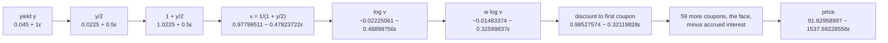

# Forward-mode automatic differentiation: differentiate the code, one operation at a time

[Syllabus](../../../SYLLABUS.md) → [Numerical analysis](../README.md) → [Derivatives by Machine](../README.md#s08) → Forward-mode automatic differentiation

---

## General Overview

A trader holds a 30-year bond, a different one from the par bond on [Complex steps and dual numbers](05-complex-step-and-dual-numbers.md). It pays a 4% coupon: 2 dollars every half year on each 100 dollars of face value. The market yield is 4.5%, and the bond settles (changes hands) two months into a six-month coupon period. The bond and its yield are illustrative. A short pricing function, under twenty lines of ordinary code, gives its clean price as 91.83 dollars per 100 of face. The clean price is the quoted price: it leaves out the accrued interest, the part of the next coupon the seller has already earned.

The risk desk wants one more number: how much the price moves when the yield moves one basis point (0.01%). That number is the **DV01**, the dollar value of one basis point. It needs the slope of the price against the yield, wanted to every digit the price itself has.

Bumping the yield by one basis point and repricing gives a slope of −1535.87. The true slope is −1537.69. The bump is off by 1.82, in the fourth significant digit, because the price curve bends inside the step. A smaller step trades that error for rounding noise.

Forward-mode automatic differentiation removes the step. Every number in the pricer carries a second number beside it: its slope against the yield. Each addition, multiplication, division, logarithm and exponential updates both numbers by the derivative rule for that one operation. Run the unchanged pricer this way and it returns the price and the exact slope together: 91.82958997 and −1537.69228556, so the DV01 is $0.15376923.

**Forward mode runs the program itself on numbers that carry a slope, so each operation applies its own derivative rule, and the output arrives with its exact derivative, correct to rounding, for about three times the work of one run.**

**What kind of fact this is:** a method, exact up to rounding. It rests on a theorem, proved on this card in Why it works: dual-number arithmetic reproduces the chain rule, line by line.

### The picture: the first lines of the pricer, value and slope together

Each box is one line of the pricer. The first number is the value. The number after ε is the slope against the yield. Both are printed by the checks.



Schematic, not to scale. Here $w = 4/6$, the fraction of a half year until the next coupon. The pricer never sees a formula for the slope. It sees one operation at a time.

---

## The formula

A reminder from [Complex steps and dual numbers](05-complex-step-and-dual-numbers.md): a **dual number** is $a + b\,\varepsilon$, where $\varepsilon$ ("epsilon", the dual unit) is a symbol with $\varepsilon^2 = 0$. Here $a$ is the value part and $b$ the slope part.

$$f(a + b\,\varepsilon) \;=\; f(a) + f'(a)\,b\,\varepsilon, \qquad\text{so}\qquad P(y + 1\,\varepsilon) \;=\; P(y) + P'(y)\,\varepsilon$$

**Read it aloud:** give any operation a value with a slope attached, and it returns its own value with the slope multiplied by its own rate of change there; chain the operations of a whole pricer, start the yield's slope at 1, and the price comes out with its derivative attached.

| Symbol | Plain meaning | In our example | Push it up and the answer… |
| --- | --- | --- | --- |
| $y$ | the bond's yield, a yearly rate | 0.045 (4.5%) | price falls, and the slope shrinks in size |
| $\varepsilon$ | the dual unit: a symbol whose square is 0 | — | — |
| $a + b\,\varepsilon$, $c + d\,\varepsilon$ | dual numbers: value parts $a$, $c$; slope parts $b$, $d$ | $0.045 + 1\,\varepsilon$ for the yield | — |
| $f$, $f'$; $f_k$, $u_k$ | any one operation in the code, and its derivative; in the proof, line $k$'s operation and its value | $\log$, with $f'(a) = 1/a$ | — |
| $P(y)$ | the bond's clean price per 100 dollars of face: the pricer's output | 91.82958997 | — |
| $P'(y)$, $P'''(y)$ | the slope of price against yield, the number wanted; its third derivative, which sets a central bump's error | −1537.69228556; $h^2P'''/6$ = −0.00163506 | — |
| $\text{DV01}$ | price lost per one basis point rise: $-P'(y) \times 0.0001$ | 0.15376923 dollars | grows with maturity |
| $v$ | one half year's discount factor, $1/(1 + y/2)$ | 0.97799511 | every cash flow is worth more |
| $w$; $n$ | fraction of a half year until the next coupon; coupons still to be paid | 4/6; 60 | more coupons: the slope grows in size, and the price falls here, since the 4% coupon is below the 4.5% yield |
| $h$ | the bump, for the difference roads only | 0.0001 (one basis point) | the bump's error grows with it |
| $L$ | operations in one plain run of the pricer | 188 | every cost scales with it |

Each operation gets its own rule for the slope part. These are the derivative rules from calculus, written for pairs:

| Operation | Value part | Slope part |
| --- | --- | --- |
| $(a + b\varepsilon) + (c + d\varepsilon)$ | $a + c$ | $b + d$ |
| $(a + b\varepsilon) \times (c + d\varepsilon)$ | $ac$ | $ad + bc$ |
| $(a + b\varepsilon) \div (c + d\varepsilon)$ | $a/c$ | $(b - (a/c)\,d)/c$ |
| $\exp(a + b\varepsilon)$ | $e^a$ | $e^a\, b$ |
| $\log(a + b\varepsilon)$ | $\log a$ | $b/a$ |

### When it holds

- **Every operation has a slope where it runs.** Sums, products, quotients by a nonzero number, exp everywhere and log for positive inputs all do. A square root or an absolute value at 0 does not, and the rule there returns infinity or an arbitrary choice.
- **The code computes the same formula near the point.** Forward mode differentiates the path the program took. A pricer that rounds the yield to a whole basis point is flat between roundings, so its slope is 0. The checks print this case.
- **Every operation is overloaded.** A line that turns the dual into a plain float, or calls a routine written only for floats, drops the slope part without an error message.
- **One input per run.** The yield's slope part starts at 1 and every constant's at 0. A pricer with five inputs needs five runs for five slopes. Seeding all five at once gives their sum.
- **Exact means exact up to rounding.** No step size enters, so there is no truncation error. The slope is about as accurate as the price.

---

## Why it works

### Step 0: a program is a chain of single operations

The pricer does not compute the price in one stroke. It halves, adds, divides, takes a logarithm, multiplies, exponentiates, then loops 60 times through two multiplies and an add. Each line is one operation whose derivative is known exactly.

The [Chain rule](../../06-Calculus%20and%20analysis/02-Derivatives/03-chain-rule.md) says the slope of the whole chain is the product of the slopes along it, each read at the value the chain actually reached. So carry two numbers through every line: the value, and the slope of that value against the yield. Each line updates the slope by its own rule. Nothing is approximated.

[Automatic differentiation](../../15-Optimization/02-Unconstrained%20Methods/10-automatic-differentiation-and-backpropagation.md) already runs this by hand on a short program and checks it against a difference. This card carries it through real code, with division, logarithm, exponential and a loop, and compares it with symbolic differentiation.

### Step 1: dual arithmetic is the derivative rules

Multiply two dual numbers and expand:

$$(a + b\varepsilon)(c + d\varepsilon) = ac + (ad + bc)\,\varepsilon + bd\,\varepsilon^2 = ac + (ad + bc)\,\varepsilon.$$

The slope part is the product rule. Division, exp and log follow the same way, using $\varepsilon^2 = 0$ in each Taylor expansion (a function written as a sum of powers of the step). A difference quotient keeps the $h^2$ and higher terms and divides them by $h$; that leftover is its error. With $\varepsilon$ in place of $h$, every power above the first is zero by definition, so nothing is left over.

<details>
<summary>Detailed proof: every line's slope part is the exact derivative</summary>

Number the pricer's lines $1, 2, \dots, L$. Line $k$ computes $u_k = f_k(u_i, u_j)$ from earlier lines or constants, where $f_k$ is one of $+$, $-$, $\times$, $\div$, $\exp$, $\log$.

**Claim.** When the pricer runs on $y + 1\,\varepsilon$, line $k$ holds $u_k(y) + u_k'(y)\,\varepsilon$, where $u_k(y)$ is the value the plain pricer computes on that line and $u_k'(y)$ is its derivative against the yield.

**Base.** The input holds $y + 1\varepsilon$, and $dy/dy = 1$. A constant holds its value plus $0\varepsilon$, and its derivative is 0.

**Step.** Suppose the claim holds for $u_i$ and $u_j$. Line $k$ applies its rule from the table above. For $\times$ the slope part is $u_i u_j' + u_i' u_j$, the product rule. For $\div$ it is $(u_i' - (u_i/u_j)\,u_j')/u_j$, the quotient rule. For $\exp$ and $\log$ it is $f_k'(u_i)\,u_i'$, the chain rule. For $+$ and $-$ it is $u_i' \pm u_j'$. In each case the slope part is $u_k'(y)$, by the rule that calculus proves for that operation.

By induction the last line holds $P(y) + P'(y)\,\varepsilon$. The proof never looks at the formula for $P$, only at the lines that compute it. A loop is just more lines; a branch picks which lines run. That is why a rounded yield returns slope 0: the lines that ran include a flat step.

</details>

### Step 2: the same code runs on a new kind of number

The pricer is written once. Python's `__add__`, `__mul__` and `__truediv__`, and Rust's `Add`, `Mul` and `Div` traits (Rust's way of attaching an operator to a type), let a new type answer `+`, `*` and `/`. This is **operator overloading**: the language looks up the operation by the type of the numbers it receives.

So the same `clean_price` runs on plain floats, on dual numbers, and on symbolic expressions. Feed it `Dual(0.045, 1.0)`, the yield with slope 1, and the price comes back with its slope. No line of the pricer changes.

### Step 3: the cost is a fixed multiple of one run

Count operations. One plain run of the 30-year pricer does 188. In the dual run, each add or subtract does one more for the slope part; each multiply or divide does three more; exp and log do one more each, reusing the value.

The dual run does 622 operations in all, 3.30851064 times one plain run. Counted by hand from the pricer's lines, the plain run is $3n + 8$ operations and the dual run $10n + 22$, for $n$ coupons; the checks assert both at $n$ = 60. The multiple stays near three at every maturity: the 1-year bond takes 14 plain operations and 42 dual ones.

The limit is the direction. One run gives the slope against one input. A bond priced off 50 curve points needs 50 runs for 50 sensitivities. [Adjoint differentiation](../../12-Financial%20mathematics/07-Greeks%20by%20Numbers%20and%20Calibration/03-adjoint-differentiation-in-outline.md) already runs forward mode on the Black-Scholes tape, one input per pass, and shows when the backward sweep beats it.

### Step 4: symbolic differentiation applies the same rules to a formula, and the formula swells

**Symbolic differentiation** builds a formula for the derivative and then evaluates it. The checks do this too: the same pricer, run on an expression type, records a formula tree instead of a number. A textbook differentiator then applies the same five rules to the tree, and the result is evaluated at 4.5%. It returns −1537.69228556, the dual's slope.

The cost is the size of the formula. The pricer stores the discount factor once and reuses it. A formula written out in full copies it everywhere it is used, and the product rule copies each factor again:

| Years to maturity | Plain run, operations | Dual run, operations | Price formula, nodes written out | Slope formula, nodes written out | Slope formula, distinct nodes |
| ---: | ---: | ---: | ---: | ---: | ---: |
| 1 | 14 | 42 | 61 | 231 | 34 |
| 5 | 38 | 122 | 589 | 4,151 | 90 |
| 10 | 68 | 222 | 1,969 | 20,691 | 160 |
| 30 | 188 | 622 | 15,489 | 370,851 | 440 |

A node is one operation, variable or constant in the formula. The dual run grows in step with the number of coupons. The written-out slope formula grows far faster: from 20,691 nodes at 10 years to 370,851 at 30. Each coupon's discount is a product of all the earlier steps, and the product rule copies every one of them. That growth is **expression swell**.

The last column is the cure. Keep one copy of each shared piece, and the 30-year slope formula has only 440 distinct nodes, in line with the dual run's 622 operations. A formula with every repeated piece shared is a program. Forward mode is symbolic differentiation with the sharing kept, evaluated at one number as it goes.

---

## Worked numbers, by hand

The pricer's first lines on the dual yield $0.045 + 1\,\varepsilon$, then the loop.

| Step | Arithmetic | Value |
| --- | --- | --- |
| seed the yield | slope part 1: the yield against itself | $0.045 + 1\,\varepsilon$ |
| halve it | both parts ÷ 2 | $0.0225 + 0.5\,\varepsilon$ |
| add 1 | a constant's slope part is 0 | $1.0225 + 0.5\,\varepsilon$ |
| $v = 1/(1 + y/2)$ | value $1/1.0225$; slope $(0 - 0.97799511 \times 0.5)/1.0225$ | $0.97799511 - 0.47823722\,\varepsilon$ |
| $\log v$ | slope $-0.47823722 / 0.97799511$ | $-0.02225061 - 0.48899756\,\varepsilon$ |
| times $w = 4/6$ | both parts × 4/6 | $-0.01483374 - 0.32599837\,\varepsilon$ |
| exp: discount to the first coupon | value $e^{-0.01483374}$; slope $0.98527574 \times (-0.32599837)$ | $0.98527574 - 0.32119828\,\varepsilon$ |
| first coupon, $2 \times$ that | both parts × 2 | $1.97055148 - 0.64239657\,\varepsilon$ |
| 59 more coupons, the face, minus accrued | the same rules, 60 passes through the loop | $91.82958997 - 1537.69228556\,\varepsilon$ |
| DV01 | $1537.69228556 \times 0.0001$ | **0.15376923 dollars** |

Per 100 dollars of face, a one basis point rise in the yield costs 15.38 cents. Repricing at 4.51% gives 91.67600312, a fall of 0.15358685. The small gap is the curve's bend over the basis point, which the bump includes and a derivative does not.

Four roads give the slope. The dual, the symbolic formula, and calculus by hand ($P'(y)$ as a sum of each cash flow's time × amount × discount) agree to every printed digit: both gaps from the hand value print as 0.00000000. The central bump, $(P(y+h) - P(y-h))/2h$ with $h$ one basis point, gives −1537.69392063, off by −0.00163506. That is its truncation error: with the third derivative $P'''$ from calculus by hand, the leading error $h^2P'''/6$ of [Forward, backward and central differences](01-forward-backward-and-central-differences.md) comes to −0.00163506. The one-sided bump gives −1535.86847247, off by 1.82381309.

### What breaks if you drop a piece

The correct slope is −1537.69228556.

| Mistake | Comes out at | What went wrong |
| --- | --- | --- |
| Product rule with one half dropped: slope part $ad$ instead of $ad + bc$ | −44.90924506 | Each step of the loop `df * v` forgets the slope the discount already carried |
| Chain factor dropped in exp: slope part $e^a$ instead of $e^a b$ | −1415.04240003 | The exp line acts as if its input moved one for one with the yield |
| The pricer rounds the yield to a whole basis point first | 0 (a one basis point bump on the same pricer gives −1535.86847247) | Rounding is flat between steps, and forward mode differentiates the code that ran; this is "the code computes the same formula near the point" failing |
| One-sided bump of one basis point instead of a derivative | −1535.86847247 | The price curve bends inside the step: off by 1.82381309 |

Every number in the table is printed by both checks.

---

## Code, from first principles, and it actually runs

The scripts write a dual-number type, a symbolic expression type with a textbook differentiator, and one generic pricer that runs on plain floats, duals and expressions alike. Every dual operation is counted. There are **four independent roads** to the slope: the dual run, the symbolic derivative evaluated, the derivative worked out by hand as a sum over cash flows, and central bumps of one basis point. The price itself is checked against the closed-form geometric sum of the coupons.

### Python

```python
# Forward-mode automatic differentiation check, standard library only: one pricer, three number types.
import math, sys; sys.setrecursionlimit(20000)
OPS, MISTAKE = [0, 0], ""   # operations done [on values, on slopes]; "" or "product" or "chain"

class Dual:           # a + b eps, with eps * eps = 0: a value carrying its slope
    def __init__(s, v, d=0.0): s.v, s.d = v, d
    def __add__(s, o): o = lift(o); OPS[0] += 1; OPS[1] += 1; return Dual(s.v + o.v, s.d + o.d)
    def __sub__(s, o): o = lift(o); OPS[0] += 1; OPS[1] += 1; return Dual(s.v - o.v, s.d - o.d)
    def __mul__(s, o):
        o = lift(o); OPS[0] += 1; OPS[1] += 3
        return Dual(s.v * o.v, s.v * o.d if MISTAKE == "product" else s.v * o.d + s.d * o.v)
    def __truediv__(s, o):
        o = lift(o); OPS[0] += 1; OPS[1] += 3; q = s.v / o.v
        return Dual(q, (s.d - q * o.d) / o.v)
    def __rtruediv__(s, o): return lift(o) / s
    def __rmul__(s, o): return lift(o) * s
    __radd__ = __add__
    def exp(s):
        e = math.exp(s.v); OPS[0] += 1; OPS[1] += 1
        return Dual(e, e if MISTAKE == "chain" else e * s.d)
    def log(s): OPS[0] += 1; OPS[1] += 1; return Dual(math.log(s.v), s.d / s.v)
    def round_bp(s): OPS[0] += 1; return Dual(math.floor(s.v * 1e4 + 0.5) / 1e4, 0.0)

def lift(o): return o if isinstance(o, Dual) else Dual(float(o))

class Ex:             # a symbolic expression: an operation and its inputs
    def __init__(s, op, a=None, b=None, c=0.0): s.op, s.a, s.b, s.c = op, a, b, c
    def __add__(s, o): return Ex("+", s, ex(o))
    def __radd__(s, o): return Ex("+", ex(o), s)
    def __sub__(s, o): return Ex("-", s, ex(o))
    def __mul__(s, o): return Ex("*", s, ex(o))
    def __rmul__(s, o): return Ex("*", ex(o), s)
    def __truediv__(s, o): return Ex("/", s, ex(o))
    def __rtruediv__(s, o): return Ex("/", ex(o), s)
    def exp(s): return Ex("exp", s)
    def log(s): return Ex("log", s)

def ex(o): return o if isinstance(o, Ex) else Ex("c", c=float(o))
def mk(op, a, b):     # build a node, dropping terms that are the constant 0 (None)
    if op == "+": return b if a is None else a if b is None else Ex("+", a, b)
    if op == "-": return a if b is None else Ex("-", ex(0.0) if a is None else a, b)
    if op == "*": return None if a is None or b is None else Ex("*", a, b)
    return None if a is None else Ex("/", a, b)

def diff(e, memo):    # the textbook rules, applied to the expression's tree
    if id(e) not in memo:
        a, b = e.a, e.b
        da, db = (diff(a, memo) if a else None), (diff(b, memo) if b else None)
        memo[id(e)] = {"c": lambda: None, "y": lambda: Ex("c", c=1.0),
            "+": lambda: mk("+", da, db), "-": lambda: mk("-", da, db),
            "*": lambda: mk("+", mk("*", da, b), mk("*", a, db)),
            "/": lambda: mk("/", mk("-", mk("*", da, b), mk("*", a, db)), Ex("*", b, b)),
            "exp": lambda: mk("*", e, da), "log": lambda: mk("/", da, a)}[e.op]()
    return memo[id(e)]

def evaluate(e, y, memo):
    if id(e) not in memo:
        p = evaluate(e.a, y, memo) if e.a else 0.0
        q = evaluate(e.b, y, memo) if e.b else 0.0
        memo[id(e)] = {"c": lambda: e.c, "y": lambda: y, "+": lambda: p + q, "-": lambda: p - q,
            "*": lambda: p * q, "/": lambda: p / q, "exp": lambda: math.exp(p),
            "log": lambda: math.log(p)}[e.op]()
    return memo[id(e)]

def sizes(e, memo, seen):  # nodes written out in full; seen collects the distinct nodes
    if id(e) not in memo:
        seen.add(id(e))
        memo[id(e)] = 1 + sum(sizes(k, memo, seen) for k in (e.a, e.b) if k)
    return memo[id(e)]

def EXP(x): return x.exp() if hasattr(x, "exp") else math.exp(x)
def LOG(x): return x.log() if hasattr(x, "log") else math.log(x)

def clean_price(y, years=30, rounded=False):
    # clean price per $100 face of a 4% bond paying $2 a half year, 2 months into a period
    if rounded: y = y.round_bp()   # quote the yield to a whole basis point first
    face, cpn = 100.0, 2.0         # face value; the coupon paid each half year
    n = 2 * years                  # coupons still to come: 60
    w = 4.0 / 6.0                  # periods until the next coupon: 4 months of 6
    v = 1.0 / (1.0 + y / 2.0)      # one half year's discount factor
    df = EXP(w * LOG(v))           # discount to the first coupon, v to the power w
    pv = 0.0
    for k in range(n):
        pv = pv + cpn * df         # add this coupon's present value
        if k < n - 1:
            df = df * v            # step the discount one half year further out
    pv = pv + face * df            # the face value comes back with the last coupon
    accrued = cpn * (1.0 - w)      # coupon already earned by the seller
    return pv - accrued

def by_hand(y, years=30, m=1):     # d^m P/dy^m on paper: d^m(v^t)/dy^m = (-1/2)^m t(t+1)...(t+m-1) v^(t+m)
    v, w, n, s = 1.0 / (1.0 + y / 2.0), 4.0 / 6.0, 2 * years, 0.0
    rise = lambda t: math.prod(t + j for j in range(m)) * v ** (t + m) * (-0.5) ** m
    for k in range(n): s += 2.0 * rise(w + k)   # the coupons of 2; the face of 100 comes with the last
    return s + 100.0 * rise(w + n - 1)

y0, h = 0.045, 1e-4
plain, hand, d3 = clean_price(y0), by_hand(y0), by_hand(y0, m=3)
vv = 1.0 / (1.0 + y0 / 2.0)        # closed form: the 60 coupons as one geometric sum
annuity = vv ** (4 / 6) * (2.0 * (1 - vv ** 60) / (1 - vv) + 100.0 * vv ** 59) - 2.0 / 3.0
OPS[:] = [0, 0]; pd = clean_price(Dual(y0, 1.0)); ops_v, ops_d = OPS[0], OPS[1]
P = clean_price(Ex("y")); dP = diff(P, {}); sym_p, sym_d = evaluate(P, y0, {}), evaluate(dP, y0, {})
up, down = clean_price(y0 + h), clean_price(y0 - h)
fwd, ctr = (up - plain) / h, (up - down) / (2 * h)
MISTAKE = "product"; bad_prod = clean_price(Dual(y0, 1.0)).d
MISTAKE = "chain"; bad_chain = clean_price(Dual(y0, 1.0)).d
MISTAKE = ""; rnd = clean_price(Dual(y0, 1.0), rounded=True).d
rnd_bump = (clean_price(Dual(y0 + h), rounded=True).v - clean_price(Dual(y0), rounded=True).v) / h
d10, y6 = clean_price(Dual(y0, 1.0), years=10), clean_price(Dual(0.06, 1.0))
rows = [("price, plain floats", plain), ("price, closed-form annuity", annuity),
        ("price, dual value part", pd.v), ("price, symbolic evaluated", sym_p),
        ("1 dP/dy, dual slope part", pd.d), ("2 dP/dy, symbolic derivative", sym_d), ("3 dP/dy, calculus by hand", hand),
        ("  gap, dual - by hand", pd.d - hand), ("  gap, symbolic - by hand", sym_d - hand), ("4 dP/dy, central 1bp bumps", ctr),
        ("  dP/dy, one-sided 1bp bump", fwd), ("  gap, one-sided bump - dual", fwd - pd.d), ("  gap, central bumps - dual", ctr - pd.d),
        ("  h^2 P'''/6, P''' by hand", h * h * d3 / 6), ("DV01 = -dP/dy x 0.0001", -pd.d * h),
        ("operations, dual run / plain run", (ops_v + ops_d) / ops_v),
        ("price after +1bp", up), ("price change after +1bp", up - plain), ("modified duration -P'/P", -pd.d / plain),
        ("wrong: product rule half dropped", bad_prod), ("wrong: chain factor dropped", bad_chain),
        ("wrong: yield rounded to 1bp, AD", rnd), ("  same pricer, 1bp bump", rnd_bump),
        ("try: 10-year bond, price", d10.v), ("try: 10-year bond, dP/dy", d10.d),
        ("try: 30-year at 6%, price", y6.v), ("try: 30-year at 6%, dP/dy", y6.d)]
for name, v in rows:
    print(f"{name:<34} {v:>16.8f}")
tr, lab = [Dual(y0, 1.0)], ["y", "y/2", "1 + y/2", "v = 1/(1 + y/2)", "log v", "w log v", "exp(w log v)", "2 x that"]
for f in (lambda a: a / 2.0, lambda a: 1.0 + a, lambda a: 1.0 / a, Dual.log, lambda a: (4.0 / 6.0) * a, Dual.exp, lambda a: 2.0 * a): tr.append(f(tr[-1]))
for name, d in zip(lab, tr): print(f"trace {name:<16} value {d.v:>12.8f}  slope {d.d:>12.8f}")
print("years  plain ops  dual ops  price nodes  slope nodes  distinct")
for yrs in (1, 5, 10, 30):
    OPS[:] = [0, 0]; clean_price(Dual(y0, 1.0), years=yrs); seen = set()
    E = clean_price(Ex("y"), years=yrs); pn = sizes(E, {}, set()); sn = sizes(diff(E, {}), {}, seen)
    print(f"{yrs:>5} {OPS[0]:>10} {OPS[0] + OPS[1]:>9} {pn:>12} {sn:>12} {len(seen):>9}")
assert abs(plain - annuity) < 1e-10, "price against the closed-form annuity formula"
assert abs(pd.v - plain) < 1e-12, "the dual's value part is the plain price"
assert abs(pd.d - hand) < 1e-9, "dual slope against calculus by hand"
assert abs(sym_d - hand) < 1e-9, "symbolic derivative against calculus by hand"
assert abs(ctr - hand - h * h * d3 / 6) < 2e-8, "central 1bp bump: error h^2 P'''/6 (next term 7e-10, rounding under 2e-8)"
assert abs(bad_prod - hand) > 1.0 and abs(bad_chain - hand) > 1.0, "broken rules must show"
assert abs(rnd - hand) > 1000.0 and abs(rnd_bump - fwd) < 1e-9, "rounding hides the slope"
assert (ops_v, ops_v + ops_d) == (3 * 60 + 8, 10 * 60 + 22), "operations counted by hand: 3n + 8 plain, 10n + 22 dual"
print("ALL CHECKS PASS")
```

**Ran 2026-11-11 on macOS, Python 3.14.10, standard library only. All checks passed. Output, pasted from the run:**

```
price, plain floats                     91.82958997
price, closed-form annuity              91.82958997
price, dual value part                  91.82958997
price, symbolic evaluated               91.82958997
1 dP/dy, dual slope part             -1537.69228556
2 dP/dy, symbolic derivative         -1537.69228556
3 dP/dy, calculus by hand            -1537.69228556
  gap, dual - by hand                    0.00000000
  gap, symbolic - by hand                0.00000000
4 dP/dy, central 1bp bumps           -1537.69392063
  dP/dy, one-sided 1bp bump          -1535.86847247
  gap, one-sided bump - dual             1.82381309
  gap, central bumps - dual             -0.00163506
  h^2 P'''/6, P''' by hand              -0.00163506
DV01 = -dP/dy x 0.0001                   0.15376923
operations, dual run / plain run         3.30851064
price after +1bp                        91.67600312
price change after +1bp                 -0.15358685
modified duration -P'/P                 16.74506318
wrong: product rule half dropped       -44.90924506
wrong: chain factor dropped          -1415.04240003
wrong: yield rounded to 1bp, AD          0.00000000
  same pricer, 1bp bump              -1535.86847247
try: 10-year bond, price                96.05713928
try: 10-year bond, dP/dy              -769.16768152
try: 30-year at 6%, price               72.37389977
try: 30-year at 6%, dP/dy            -1086.25546263
trace y                value   0.04500000  slope   1.00000000
trace y/2              value   0.02250000  slope   0.50000000
trace 1 + y/2          value   1.02250000  slope   0.50000000
trace v = 1/(1 + y/2)  value   0.97799511  slope  -0.47823722
trace log v            value  -0.02225061  slope  -0.48899756
trace w log v          value  -0.01483374  slope  -0.32599837
trace exp(w log v)     value   0.98527574  slope  -0.32119828
trace 2 x that         value   1.97055148  slope  -0.64239657
years  plain ops  dual ops  price nodes  slope nodes  distinct
    1         14        42           61          231        34
    5         38       122          589         4151        90
   10         68       222         1969        20691       160
   30        188       622        15489       370851       440
ALL CHECKS PASS
```

### Rust

The same program, std only. The `Num` trait lets one generic `clean_price` run on `f64`, `Dual` and `Ex`, as duck typing does in Python.

```rust
// Forward-mode automatic differentiation check, std only: one pricer, three number types.
use std::cell::Cell;
use std::collections::{HashMap, HashSet};
use std::ops::{Add, Div, Mul, Sub};
use std::rc::Rc;
thread_local! {
    static OPS: Cell<(usize, usize)> = Cell::new((0, 0)); // operations: (on values, on slopes)
    static MISTAKE: Cell<u8> = Cell::new(0);               // 0 correct, 1 product, 2 chain
}
fn tick(v: usize, d: usize) { OPS.with(|o| { let (a, b) = o.get(); o.set((a + v, b + d)) }); }
fn mistake() -> u8 { MISTAKE.with(|m| m.get()) }
fn set_mistake(k: u8) { MISTAKE.with(|m| m.set(k)); }
fn ops(reset: bool) -> (usize, usize) { OPS.with(|o| { let r = o.get(); if reset { o.set((0, 0)) }; r }) }
trait Num: Clone + Add<Output = Self> + Sub<Output = Self> + Mul<Output = Self> + Div<Output = Self> {
    fn c(x: f64) -> Self; fn exp(&self) -> Self; fn ln(&self) -> Self; fn round_bp(&self) -> Self;
}
impl Num for f64 {
    fn c(x: f64) -> Self { x } fn exp(&self) -> Self { f64::exp(*self) } fn ln(&self) -> Self { f64::ln(*self) }
    fn round_bp(&self) -> Self { (self * 1e4 + 0.5).floor() / 1e4 }
}
#[derive(Clone, Copy)]
struct Dual { v: f64, d: f64 } // a + b eps, with eps * eps = 0: a value carrying its slope
impl Add for Dual { type Output = Dual; fn add(self, o: Dual) -> Dual { tick(1, 1); Dual { v: self.v + o.v, d: self.d + o.d } } }
impl Sub for Dual { type Output = Dual; fn sub(self, o: Dual) -> Dual { tick(1, 1); Dual { v: self.v - o.v, d: self.d - o.d } } }
impl Mul for Dual { type Output = Dual; fn mul(self, o: Dual) -> Dual { tick(1, 3);
    Dual { v: self.v * o.v, d: if mistake() == 1 { self.v * o.d } else { self.v * o.d + self.d * o.v } } } }
impl Div for Dual { type Output = Dual; fn div(self, o: Dual) -> Dual { tick(1, 3);
    let q = self.v / o.v; Dual { v: q, d: (self.d - q * o.d) / o.v } } }
impl Num for Dual {
    fn c(x: f64) -> Self { Dual { v: x, d: 0.0 } }
    fn exp(&self) -> Self { tick(1, 1); let e = self.v.exp(); Dual { v: e, d: if mistake() == 2 { e } else { e * self.d } } }
    fn ln(&self) -> Self { tick(1, 1); Dual { v: self.v.ln(), d: self.d / self.v } }
    fn round_bp(&self) -> Self { tick(1, 0); Dual { v: (self.v * 1e4 + 0.5).floor() / 1e4, d: 0.0 } }
}
enum Node { C(f64), Y, Bin(char, Ex, Ex), Un(char, Ex) } // a symbolic expression
#[derive(Clone)] struct Ex(Rc<Node>);
fn node(n: Node) -> Ex { Ex(Rc::new(n)) }
fn key(e: &Ex) -> usize { Rc::as_ptr(&e.0) as usize }
impl Add for Ex { type Output = Ex; fn add(self, o: Ex) -> Ex { node(Node::Bin('+', self, o)) } }
impl Sub for Ex { type Output = Ex; fn sub(self, o: Ex) -> Ex { node(Node::Bin('-', self, o)) } }
impl Mul for Ex { type Output = Ex; fn mul(self, o: Ex) -> Ex { node(Node::Bin('*', self, o)) } }
impl Div for Ex { type Output = Ex; fn div(self, o: Ex) -> Ex { node(Node::Bin('/', self, o)) } }
impl Num for Ex {
    fn c(x: f64) -> Self { node(Node::C(x)) } fn round_bp(&self) -> Self { self.clone() }
    fn exp(&self) -> Self { node(Node::Un('e', self.clone())) } fn ln(&self) -> Self { node(Node::Un('l', self.clone())) }
}
// build a node, dropping terms that are the constant 0 (None)
fn mk(op: char, a: Option<Ex>, b: Option<Ex>) -> Option<Ex> {
    match op {
        '+' => match (a, b) { (None, b) => b, (a, None) => a, (Some(a), Some(b)) => Some(a + b) },
        '-' => match (a, b) { (a, None) => a, (a, Some(b)) => Some(a.unwrap_or(Ex::c(0.0)) - b) },
        '*' => match (a, b) { (Some(a), Some(b)) => Some(a * b), _ => None },
        _ => match (a, b) { (Some(a), Some(b)) => Some(a / b), _ => None },
    }
}
fn diff(e: &Ex, memo: &mut HashMap<usize, Option<Ex>>) -> Option<Ex> { // the textbook rules
    if let Some(r) = memo.get(&key(e)) { return r.clone(); }
    let r = match &*e.0 {
        Node::C(_) => None,
        Node::Y => Some(Ex::c(1.0)),
        Node::Bin(op, a, b) => {
            let (da, db) = (diff(a, memo), diff(b, memo));
            let (sa, sb) = (Some(a.clone()), Some(b.clone()));
            match op { '+' | '-' => mk(*op, da, db), '*' => mk('+', mk('*', da, sb), mk('*', sa, db)),
                _ => mk('/', mk('-', mk('*', da, sb.clone()), mk('*', sa, db)), Some(b.clone() * b.clone())) }
        }
        Node::Un('e', a) => mk('*', Some(e.clone()), diff(a, memo)),
        Node::Un(_, a) => mk('/', diff(a, memo), Some(a.clone())),
    };
    memo.insert(key(e), r.clone());
    r
}
fn evaluate(e: &Ex, y: f64, memo: &mut HashMap<usize, f64>) -> f64 {
    if let Some(r) = memo.get(&key(e)) { return *r; }
    let r = match &*e.0 {
        Node::C(c) => *c,
        Node::Y => y,
        Node::Bin(op, a, b) => { let (p, q) = (evaluate(a, y, memo), evaluate(b, y, memo));
            match op { '+' => p + q, '-' => p - q, '*' => p * q, _ => p / q } }
        Node::Un(op, a) => { let p = evaluate(a, y, memo); if *op == 'e' { p.exp() } else { p.ln() } }
    };
    memo.insert(key(e), r);
    r
}
// nodes written out in full; seen collects the distinct nodes
fn sizes(e: &Ex, memo: &mut HashMap<usize, u64>, seen: &mut HashSet<usize>) -> u64 {
    if let Some(r) = memo.get(&key(e)) { return *r; }
    seen.insert(key(e));
    let r = 1 + match &*e.0 { Node::Bin(_, a, b) => sizes(a, memo, seen) + sizes(b, memo, seen),
        Node::Un(_, a) => sizes(a, memo, seen), _ => 0 };
    memo.insert(key(e), r);
    r
}

// clean price per $100 face of a 4% bond paying $2 a half year, 2 months into a period
fn clean_price<T: Num>(y: T, years: usize, rounded: bool) -> T {
    let y = if rounded { y.round_bp() } else { y }; // quote the yield to a whole basis point first
    let (face, cpn) = (100.0, 2.0);                 // face value; the coupon paid each half year
    let n = 2 * years;                              // coupons still to come: 60
    let w = 4.0 / 6.0;                              // periods until the next coupon: 4 months of 6
    let v = T::c(1.0) / (T::c(1.0) + y / T::c(2.0)); // one half year's discount factor
    let mut df = (T::c(w) * v.ln()).exp();          // discount to the first coupon, v to the power w
    let mut pv = T::c(0.0);
    for k in 0..n {
        pv = pv + T::c(cpn) * df.clone();           // add this coupon's present value
        if k < n - 1 { df = df * v.clone(); }       // step the discount one half year further out
    }
    pv = pv + T::c(face) * df;                      // the face value comes back with the last coupon
    let accrued = cpn * (1.0 - w);                  // coupon already earned by the seller
    pv - T::c(accrued)
}
fn by_hand(y: f64, years: usize, m: i32) -> f64 { // d^m P/dy^m on paper: d^m(v^t)/dy^m = (-1/2)^m t(t+1)...(t+m-1) v^(t+m)
    let (v, w, n) = (1.0 / (1.0 + y / 2.0), 4.0 / 6.0, 2 * years);
    let rise = |t: f64| (0..m).map(|j| t + j as f64).product::<f64>() * v.powf(t + m as f64) * (-0.5f64).powi(m);
    let mut s = 0.0; for k in 0..n { s += 2.0 * rise(w + k as f64); } // the coupons of 2; the face of 100 comes with the last
    s + 100.0 * rise(w + n as f64 - 1.0)
}
fn dual(y: f64) -> Dual { Dual { v: y, d: 1.0 } }

fn main() {
    let (y0, h) = (0.045, 1e-4);
    let (plain, hand, d3) = (clean_price(y0, 30, false), by_hand(y0, 30, 1), by_hand(y0, 30, 3));
    let vv = 1.0 / (1.0 + y0 / 2.0); let annuity = vv.powf(4.0 / 6.0) * (2.0 * (1.0 - vv.powf(60.0)) / (1.0 - vv) + 100.0 * vv.powf(59.0)) - 2.0 / 3.0;
    ops(true); let pd = clean_price(dual(y0), 30, false); let (ops_v, ops_d) = ops(false);
    let p = clean_price(Ex(Rc::new(Node::Y)), 30, false); let dp = diff(&p, &mut HashMap::new()).unwrap();
    let (sym_p, sym_d) = (evaluate(&p, y0, &mut HashMap::new()), evaluate(&dp, y0, &mut HashMap::new()));
    let (up, down) = (clean_price(y0 + h, 30, false), clean_price(y0 - h, 30, false)); let (fwd, ctr) = ((up - plain) / h, (up - down) / (2.0 * h));
    set_mistake(1); let bad_prod = clean_price(dual(y0), 30, false).d;
    set_mistake(2); let bad_chain = clean_price(dual(y0), 30, false).d;
    set_mistake(0); let rnd = clean_price(dual(y0), 30, true).d;
    let rnd_bump = (clean_price(y0 + h, 30, true) - clean_price(y0, 30, true)) / h;
    let (d10, y6) = (clean_price(dual(y0), 10, false), clean_price(dual(0.06), 30, false));
    let rows = [("price, plain floats", plain), ("price, closed-form annuity", annuity),
        ("price, dual value part", pd.v), ("price, symbolic evaluated", sym_p),
        ("1 dP/dy, dual slope part", pd.d), ("2 dP/dy, symbolic derivative", sym_d), ("3 dP/dy, calculus by hand", hand),
        ("  gap, dual - by hand", pd.d - hand), ("  gap, symbolic - by hand", sym_d - hand), ("4 dP/dy, central 1bp bumps", ctr),
        ("  dP/dy, one-sided 1bp bump", fwd), ("  gap, one-sided bump - dual", fwd - pd.d), ("  gap, central bumps - dual", ctr - pd.d),
        ("  h^2 P'''/6, P''' by hand", h * h * d3 / 6.0), ("DV01 = -dP/dy x 0.0001", -pd.d * h),
        ("operations, dual run / plain run", (ops_v + ops_d) as f64 / ops_v as f64),
        ("price after +1bp", up), ("price change after +1bp", up - plain), ("modified duration -P'/P", -pd.d / plain),
        ("wrong: product rule half dropped", bad_prod), ("wrong: chain factor dropped", bad_chain),
        ("wrong: yield rounded to 1bp, AD", rnd), ("  same pricer, 1bp bump", rnd_bump),
        ("try: 10-year bond, price", d10.v), ("try: 10-year bond, dP/dy", d10.d),
        ("try: 30-year at 6%, price", y6.v), ("try: 30-year at 6%, dP/dy", y6.d)];
    for (name, v) in rows.iter() { println!("{:<34} {:>16.8}", name, v); }
    let lab = ["y", "y/2", "1 + y/2", "v = 1/(1 + y/2)", "log v", "w log v", "exp(w log v)", "2 x that"];
    let fs: [fn(Dual) -> Dual; 7] = [|a| a / Dual::c(2.0), |a| Dual::c(1.0) + a, |a| Dual::c(1.0) / a, |a| a.ln(),
        |a| Dual::c(4.0 / 6.0) * a, |a| a.exp(), |a| Dual::c(2.0) * a];
    let mut tr = vec![dual(y0)]; for f in fs { let x = f(*tr.last().unwrap()); tr.push(x); }
    for (name, d) in lab.iter().zip(tr.iter()) { println!("trace {:<16} value {:>12.8}  slope {:>12.8}", name, d.v, d.d); }
    println!("years  plain ops  dual ops  price nodes  slope nodes  distinct");
    for yrs in [1usize, 5, 10, 30] {
        ops(true); clean_price(dual(y0), yrs, false); let (a, b) = ops(false);
        let e = clean_price(Ex(Rc::new(Node::Y)), yrs, false);
        let (pn, mut seen) = (sizes(&e, &mut HashMap::new(), &mut HashSet::new()), HashSet::new());
        let sn = sizes(&diff(&e, &mut HashMap::new()).unwrap(), &mut HashMap::new(), &mut seen);
        println!("{:>5} {:>10} {:>9} {:>12} {:>12} {:>9}", yrs, a, a + b, pn, sn, seen.len());
    }
    assert!((plain - annuity).abs() < 1e-10, "price against the closed-form annuity formula");
    assert!((pd.v - plain).abs() < 1e-12, "the dual's value part is the plain price");
    assert!((pd.d - hand).abs() < 1e-9, "dual slope against calculus by hand");
    assert!((sym_d - hand).abs() < 1e-9, "symbolic derivative against calculus by hand");
    assert!((ctr - hand - h * h * d3 / 6.0).abs() < 2e-8, "central 1bp bump: error h^2 P'''/6 (next term 7e-10, rounding under 2e-8)");
    assert!((bad_prod - hand).abs() > 1.0 && (bad_chain - hand).abs() > 1.0, "broken rules must show");
    assert!((rnd - hand).abs() > 1000.0 && (rnd_bump - fwd).abs() < 1e-9, "rounding hides the slope");
    assert!((ops_v, ops_v + ops_d) == (3 * 60 + 8, 10 * 60 + 22), "operations counted by hand: 3n + 8 plain, 10n + 22 dual");
    println!("ALL CHECKS PASS");
}
```

**Ran 2026-11-11 on macOS, rustc 1.98.1, no crates. All checks passed. Output, pasted from the run:**

```
price, plain floats                     91.82958997
price, closed-form annuity              91.82958997
price, dual value part                  91.82958997
price, symbolic evaluated               91.82958997
1 dP/dy, dual slope part             -1537.69228556
2 dP/dy, symbolic derivative         -1537.69228556
3 dP/dy, calculus by hand            -1537.69228556
  gap, dual - by hand                    0.00000000
  gap, symbolic - by hand                0.00000000
4 dP/dy, central 1bp bumps           -1537.69392063
  dP/dy, one-sided 1bp bump          -1535.86847247
  gap, one-sided bump - dual             1.82381309
  gap, central bumps - dual             -0.00163506
  h^2 P'''/6, P''' by hand              -0.00163506
DV01 = -dP/dy x 0.0001                   0.15376923
operations, dual run / plain run         3.30851064
price after +1bp                        91.67600312
price change after +1bp                 -0.15358685
modified duration -P'/P                 16.74506318
wrong: product rule half dropped       -44.90924506
wrong: chain factor dropped          -1415.04240003
wrong: yield rounded to 1bp, AD          0.00000000
  same pricer, 1bp bump              -1535.86847247
try: 10-year bond, price                96.05713928
try: 10-year bond, dP/dy              -769.16768152
try: 30-year at 6%, price               72.37389977
try: 30-year at 6%, dP/dy            -1086.25546263
trace y                value   0.04500000  slope   1.00000000
trace y/2              value   0.02250000  slope   0.50000000
trace 1 + y/2          value   1.02250000  slope   0.50000000
trace v = 1/(1 + y/2)  value   0.97799511  slope  -0.47823722
trace log v            value  -0.02225061  slope  -0.48899756
trace w log v          value  -0.01483374  slope  -0.32599837
trace exp(w log v)     value   0.98527574  slope  -0.32119828
trace 2 x that         value   1.97055148  slope  -0.64239657
years  plain ops  dual ops  price nodes  slope nodes  distinct
    1         14        42           61          231        34
    5         38       122          589         4151        90
   10         68       222         1969        20691       160
   30        188       622        15489       370851       440
ALL CHECKS PASS
```

The two outputs are identical line for line.

### Lean

Lean proves forward mode exact for every program of sums, differences, products, quotients, exp and log, wherever each operation has a slope.

- Suppose every operation has a slope where it runs: every divisor is nonzero and every log input is positive. Then the program's output $P$ has a slope at $y$.
- Under the same condition, running the program on $y + 1\,\varepsilon$ returns exactly $P(y) + P'(y)\,\varepsilon$. Here exp and log use the table's rules, and $+$, $-$, $\times$, $\div$ use dual arithmetic.
- Dual multiplication is the product rule: $(a + b\varepsilon)(c + d\varepsilon) = ac + (ad + bc)\,\varepsilon$ for all real $a$, $b$, $c$, $d$.
- Dual division is the quotient rule: for $c \neq 0$, $(a + b\varepsilon) \div (c + d\varepsilon) = a/c + ((b - (a/c)\,d)/c)\,\varepsilon$.
- The count formulas $3n + 8$ and $10n + 22$ give the table's operations at $n$ = 2, 10, 20 and 60 coupons. Lean checks only this arithmetic.

The pricer's numbers, counting its operations, the formula sizes and the effect of rounding are left to the Python and Rust checks.

```lean
-- Forward-mode automatic differentiation: running a program of sums, products, quotients, exp and log on the dual number y + 1ε returns its value plus its exact derivative times ε.
import Mathlib.Algebra.DualNumber
import Mathlib.Analysis.SpecialFunctions.Log.Deriv

open DualNumber TrivSqZeroExt

/-- A straight-line program in one input: the input `y`, real constants, and the
operations `+`, `−`, `×`, `÷`, `exp` and `log`, each line built from earlier lines. -/
inductive Prog : Type
  | var : Prog
  | const : ℝ → Prog
  | add : Prog → Prog → Prog
  | sub : Prog → Prog → Prog
  | mul : Prog → Prog → Prog
  | div : Prog → Prog → Prog
  | exp : Prog → Prog
  | log : Prog → Prog

namespace Prog

/-- The plain run of the program on a real input. -/
noncomputable def eval : Prog → ℝ → ℝ
  | var, y => y
  | const c, _ => c
  | add p q, y => p.eval y + q.eval y
  | sub p q, y => p.eval y - q.eval y
  | mul p q, y => p.eval y * q.eval y
  | div p q, y => p.eval y / q.eval y
  | exp p, y => Real.exp (p.eval y)
  | log p, y => Real.log (p.eval y)

/-- The card's rule for `exp` on a dual number: `exp (a + bε) = e^a + e^a b ε`. -/
noncomputable def dualExp (x : DualNumber ℝ) : DualNumber ℝ :=
  inl (Real.exp x.fst) + (Real.exp x.fst * x.snd) • ε

/-- The card's rule for `log` on a dual number: `log (a + bε) = log a + (b / a) ε`. -/
noncomputable def dualLog (x : DualNumber ℝ) : DualNumber ℝ :=
  inl (Real.log x.fst) + (x.snd / x.fst) • ε

/-- The same program run on dual numbers: constants enter with slope part 0, and
`+`, `−`, `×`, `÷` are Mathlib's dual-number arithmetic (`÷` is multiplication by the inverse). -/
noncomputable def evalDual : Prog → DualNumber ℝ → DualNumber ℝ
  | var, x => x
  | const c, _ => inl c
  | add p q, x => p.evalDual x + q.evalDual x
  | sub p q, x => p.evalDual x - q.evalDual x
  | mul p q, x => p.evalDual x * q.evalDual x
  | div p q, x => p.evalDual x * (q.evalDual x)⁻¹
  | exp p, x => dualExp (p.evalDual x)
  | log p, x => dualLog (p.evalDual x)

/-- "Every operation has a slope where it runs": every divisor is nonzero and every
`log` input is positive at the point `y`. -/
def HasSlopeAt : Prog → ℝ → Prop
  | var, _ => True
  | const _, _ => True
  | add p q, y => p.HasSlopeAt y ∧ q.HasSlopeAt y
  | sub p q, y => p.HasSlopeAt y ∧ q.HasSlopeAt y
  | mul p q, y => p.HasSlopeAt y ∧ q.HasSlopeAt y
  | div p q, y => p.HasSlopeAt y ∧ q.HasSlopeAt y ∧ q.eval y ≠ 0
  | exp p, y => p.HasSlopeAt y
  | log p, y => p.HasSlopeAt y ∧ 0 < p.eval y

end Prog

/-- Componentwise form of forward mode: the real part of the dual run is the plain run,
and the slope part is a derivative of the plain run. -/
theorem forward_mode_components (p : Prog) (y : ℝ) (h : p.HasSlopeAt y) :
    (p.evalDual (inl y + ε)).fst = p.eval y ∧
      HasDerivAt p.eval (p.evalDual (inl y + ε)).snd y := by
  induction p with
  | var =>
    refine ⟨?_, ?_⟩
    · simp [Prog.evalDual, Prog.eval]
    · have : (fun y : ℝ => Prog.var.eval y) = id := by funext z; rfl
      simp only [Prog.evalDual, snd_add, snd_inl, snd_eps, zero_add, this]
      exact hasDerivAt_id y
  | const c =>
    refine ⟨by simp [Prog.evalDual, Prog.eval], ?_⟩
    have : (fun y : ℝ => (Prog.const c).eval y) = fun _ => c := by funext z; rfl
    simp only [Prog.evalDual, snd_inl, this]
    exact hasDerivAt_const y c
  | add p q ihp ihq =>
    obtain ⟨hp1, hp2⟩ := ihp h.1
    obtain ⟨hq1, hq2⟩ := ihq h.2
    refine ⟨by simp [Prog.evalDual, Prog.eval, hp1, hq1], ?_⟩
    have : (fun y : ℝ => (Prog.add p q).eval y) = fun z => p.eval z + q.eval z := by
      funext z; rfl
    simp only [Prog.evalDual, snd_add, this]
    exact hp2.add hq2
  | sub p q ihp ihq =>
    obtain ⟨hp1, hp2⟩ := ihp h.1
    obtain ⟨hq1, hq2⟩ := ihq h.2
    refine ⟨by simp [Prog.evalDual, Prog.eval, hp1, hq1], ?_⟩
    have : (fun y : ℝ => (Prog.sub p q).eval y) = fun z => p.eval z - q.eval z := by
      funext z; rfl
    simp only [Prog.evalDual, snd_sub, this]
    exact hp2.sub hq2
  | mul p q ihp ihq =>
    obtain ⟨hp1, hp2⟩ := ihp h.1
    obtain ⟨hq1, hq2⟩ := ihq h.2
    refine ⟨by simp [Prog.evalDual, Prog.eval, hp1, hq1], ?_⟩
    have : (fun y : ℝ => (Prog.mul p q).eval y) = fun z => p.eval z * q.eval z := by
      funext z; rfl
    simp only [Prog.evalDual, DualNumber.snd_mul, this]
    convert hp2.mul hq2 using 1
    simp [hp1, hq1]
    ring
  | div p q ihp ihq =>
    obtain ⟨hp1, hp2⟩ := ihp h.1
    obtain ⟨hq1, hq2⟩ := ihq h.2.1
    have hq0 : q.eval y ≠ 0 := h.2.2
    refine ⟨by simp [Prog.evalDual, Prog.eval, hp1, hq1, div_eq_mul_inv], ?_⟩
    have : (fun y : ℝ => (Prog.div p q).eval y) = fun z => p.eval z / q.eval z := by
      funext z; rfl
    simp only [Prog.evalDual, DualNumber.snd_mul, this]
    convert hp2.div hq2 hq0 using 1
    simp [hp1, hq1, smul_eq_mul, MulOpposite.smul_eq_mul_unop]
    field_simp
    ring
  | exp p ihp =>
    obtain ⟨hp1, hp2⟩ := ihp h
    refine ⟨by simp [Prog.evalDual, Prog.eval, Prog.dualExp, hp1], ?_⟩
    have : (fun y : ℝ => (Prog.exp p).eval y) = fun z => Real.exp (p.eval z) := by
      funext z; rfl
    simp only [Prog.evalDual, Prog.dualExp, this]
    convert hp2.exp using 1
    simp [hp1]
  | log p ihp =>
    obtain ⟨hp1, hp2⟩ := ihp h.1
    have hpos : 0 < p.eval y := h.2
    refine ⟨by simp [Prog.evalDual, Prog.eval, Prog.dualLog, hp1], ?_⟩
    have : (fun y : ℝ => (Prog.log p).eval y) = fun z => Real.log (p.eval z) := by
      funext z; rfl
    simp only [Prog.evalDual, Prog.dualLog, this]
    convert hp2.log hpos.ne' using 1
    simp [hp1]

#print axioms forward_mode_components

/-- Forward mode is exact: if every operation of the program has a slope where it runs,
then running the program on the seeded input `y + 1ε` returns `P(y) + P'(y) ε`, where
`P` is the plain program, `P` is differentiable at `y`, and `P'(y)` is its derivative. -/
theorem forward_mode_gives_exact_derivative (p : Prog) (y : ℝ) (h : p.HasSlopeAt y) :
    DifferentiableAt ℝ p.eval y ∧
      p.evalDual (inl y + ε) = inl (p.eval y) + deriv p.eval y • ε := by
  obtain ⟨h1, h2⟩ := forward_mode_components p y h
  refine ⟨h2.differentiableAt, ?_⟩
  ext
  · simp [h1]
  · simp [h2.deriv]

/-- Dual multiplication is the product rule:
`(a + bε)(c + dε) = ac + (ad + bc) ε`. -/
theorem dual_mul_is_product_rule (a b c d : ℝ) :
    (inl a + b • ε : DualNumber ℝ) * (inl c + d • ε) = inl (a * c) + (a * d + b * c) • ε := by
  ext <;> simp [smul_eq_mul, MulOpposite.smul_eq_mul_unop]

/-- Dual division is the quotient rule: for `c ≠ 0`,
`(a + bε) ÷ (c + dε) = a/c + ((b − (a/c) d)/c) ε`. -/
theorem dual_div_is_quotient_rule (a b c d : ℝ) (hc : c ≠ 0) :
    (inl a + b • ε : DualNumber ℝ) * (inl c + d • ε)⁻¹ =
      inl (a / c) + ((b - (a / c) * d) / c) • ε := by
  ext
  · simp [div_eq_mul_inv]
  · simp [smul_eq_mul, MulOpposite.smul_eq_mul_unop]
    field_simp
    ring

-- The card's operation counts for n coupons: 3n + 8 plain and 10n + 22 dual.
-- 30-year bond, n = 60: 188 plain, 622 dual.
example : 3 * 60 + 8 = 188 ∧ 10 * 60 + 22 = 622 := by norm_num
-- 1-year bond, n = 2: 14 plain, 42 dual.
example : 3 * 2 + 8 = 14 ∧ 10 * 2 + 22 = 42 := by norm_num
-- 5-year bond, n = 10: 38 plain, 122 dual.
example : 3 * 10 + 8 = 38 ∧ 10 * 10 + 22 = 122 := by norm_num
-- 10-year bond, n = 20: 68 plain, 222 dual.
example : 3 * 20 + 8 = 68 ∧ 10 * 20 + 22 = 222 := by norm_num

#print axioms forward_mode_gives_exact_derivative
#print axioms dual_mul_is_product_rule
#print axioms dual_div_is_quotient_rule
```

**Checked 2026-11-11 on macOS, Lean 4.36.0-rc2, Mathlib v4.36.0-rc2. Every proof is complete and uses only Lean's standard axioms. Output, pasted from the run:**

```
'forward_mode_components' depends on axioms: [propext, Classical.choice, Quot.sound]
'forward_mode_gives_exact_derivative' depends on axioms: [propext, Classical.choice, Quot.sound]
'dual_mul_is_product_rule' depends on axioms: [propext, Classical.choice, Quot.sound]
'dual_div_is_quotient_rule' depends on axioms: [propext, Classical.choice, Quot.sound]
```

> [!TIP]
> **Try changing**
> - Guess first: does a 10-year bond have a third of the 30-year slope? Run `clean_price(Dual(y0, 1.0), years=10)`. The price is 96.05713928 and the slope −769.16768152: half, not a third, because the far coupons are discounted hardest.
> - Guess first: at a 6% yield, is the slope bigger or smaller? Run `clean_price(Dual(0.06, 1.0))`. The price falls to 72.37389977 and the slope shrinks to −1086.25546263. The slope itself moves with the yield: that is convexity.
> - Guess first: in `Dual.__truediv__`, change `s.d - q * o.d` to `s.d + q * o.d`. The value part is untouched, so the price still prints 91.82958997, but the assert against calculus by hand stops the run.
> - Guess first: set `MISTAKE = "chain"` before the main run. The slope comes out at −1415.04240003, and the assert stops the run.

---

## The usual mistake

> [!warning]
> **Believing forward mode differentiates the function you meant.** It differentiates the code that ran. A pricer that rounds the yield to a whole basis point returns slope 0, while a one basis point bump of the same pricer returns −1535.86847247. The same happens with a table lookup, a branch on the value, or a solver loop stopped by a tolerance. Read the code's path before trusting its slope.
>
> Smaller traps, each with the wrong number it gives here:
> - **Calling it a careful bump.** A one basis point bump gives −1535.86847247; forward mode takes no step and gives −1537.69228556.
> - **Calling it symbolic algebra.** A formula written out in full for the 30-year slope has 370,851 nodes; the dual run does 622 operations.
> - **Forgetting the chain factor in a new rule.** Exp without its $b$ gives −1415.04240003.
> - **Dropping half the product rule.** The slope collapses to −44.90924506.

---

## Where you meet it in real life

- **Bond and swap desks.** A yield or curve point is one input, so forward mode returns its DV01 with the price in one run. The quantity it computes is the dollar form of [Duration and convexity](../../12-Financial%20mathematics/01-Money%2C%20Dates%20and%20Discounting/06-duration-and-convexity.md).
- **Solving for the yield.** Finding the yield that matches a quoted price is a Newton iteration, and Newton needs the slope at every step. The dual run supplies it exactly: [Newton and secant](../02-Root%20Finding%20and%20Fixed%20Points/02-newton-and-secant-with-convergence-orders.md), applied in [Yield from price](../../12-Financial%20mathematics/01-Money%2C%20Dates%20and%20Discounting/07-yield-from-price.md).
- **Stiff equation solvers.** An implicit step solves a nonlinear system by Newton, which needs a Jacobian (the table of every output's slope against every input). Forward mode fills it one column per run: [Stiffness](../06-ODE%20Solvers/05-stiffness-a-stability-and-the-dahlquist-barriers.md).
- **Machine-learning libraries.** They offer forward mode as the Jacobian-vector product: one directional slope of every output in one run, used where outputs outnumber inputs.

> **Say it back**
> Forward mode runs the program itself on dual numbers, each a value with its slope attached. Every operation applies its own derivative rule to the slope part, so the output carries the exact derivative, correct to rounding, with no step to choose. On the 30-year bond the dual run gives −1537.69228556 and a DV01 of $0.15376923, for 3.30851064 times the work of one plain run. Symbolic differentiation applies the same rules to a formula, which swells to 370,851 nodes unless shared pieces are kept once. The slope is the slope of the code that ran, so a rounding step inside the pricer returns 0.

---

## What this builds on

- [Complex steps and dual numbers](05-complex-step-and-dual-numbers.md): defines the dual number $a + b\varepsilon$ with $\varepsilon^2 = 0$, and shows one dual evaluation of a bond: a par bond with an annual coupon, not this card's bond, so the two slopes differ slightly. This card carries the dual through a whole program.
- [Chain rule](../../06-Calculus%20and%20analysis/02-Derivatives/03-chain-rule.md): the theorem underneath. Slopes multiply along a chain, read where the chain actually is.
- [Automatic differentiation](../../15-Optimization/02-Unconstrained%20Methods/10-automatic-differentiation-and-backpropagation.md): forward and reverse mode by hand on a short program, with their costs. This card adds division, exp, log, loops and the symbolic comparison.
- [Adjoint differentiation](../../12-Financial%20mathematics/07-Greeks%20by%20Numbers%20and%20Calibration/03-adjoint-differentiation-in-outline.md): the first use in finance, forward mode on the Black-Scholes tape one input per pass, beside the backward sweep.

## Where this goes next

- [Reverse mode](07-reverse-mode-automatic-differentiation.md): records the run and sweeps slopes from the output back, so all the sensitivities of one price cost a few runs, however many inputs there are.

Neighbours on this shelf:

- [Forward, backward and central differences](01-forward-backward-and-central-differences.md) and [Choosing the step](04-choosing-the-step-truncation-against-rounding.md): the bumps this card replaces, and why their step has no right size.
- [Stencils to order](02-stencils-for-higher-and-mixed-derivatives.md): the bond's curvature from bumps, the number this card's open question asks for.
- [Bumping a simulated price](08-bumped-sensitivities-and-monte-carlo-noise.md): prices from random paths, where bumping is still the usual road.

The question this card leaves open: one dual run gives the slope, but can the curvature, the bond's convexity, come out of the code as exactly and as cheaply?

---

## Sources

Verified 2026-11-11: every link below resolves to the publisher's page.

- Clifford, W. K. "Preliminary Sketch of Biquaternions." *Proceedings of the London Mathematical Society* s1-4, no. 1 (1871): 381–395. [doi:10.1112/plms/s1-4.1.381](https://doi.org/10.1112/plms/s1-4.1.381). The origin of dual numbers, the symbol whose square is zero.
- Wengert, R. E. "A Simple Automatic Derivative Evaluation Program." *Communications of the ACM* 7, no. 8 (1964): 463–464. [doi:10.1145/355586.364791](https://doi.org/10.1145/355586.364791). Forward mode as first published: a program differentiated line by line as it runs.
- Rall, Louis B. *Automatic Differentiation: Techniques and Applications*. Lecture Notes in Computer Science 120. Springer, 1981. [doi:10.1007/3-540-10861-0](https://doi.org/10.1007/3-540-10861-0). The first book on the method: formula translation and differentiation, Taylor coefficients, and examples of software.
- Griewank, Andreas, and Andrea Walther. *Evaluating Derivatives: Principles and Techniques of Algorithmic Differentiation*, 2nd ed. SIAM, 2008. [doi:10.1137/1.9780898717761](https://doi.org/10.1137/1.9780898717761). The standard text: the tangent (forward) mode, its operation counts, and its limits at kinks and branches.
- Baydin, Atılım Güneş, Barak A. Pearlmutter, Alexey Andreyevich Radul, and Jeffrey Mark Siskind. "Automatic Differentiation in Machine Learning: a Survey." *Journal of Machine Learning Research* 18, no. 153 (2018): 1–43. [Journal page](https://www.jmlr.org/papers/v18/17-468.html). Sets automatic, symbolic and numerical differentiation side by side, including expression swell.
