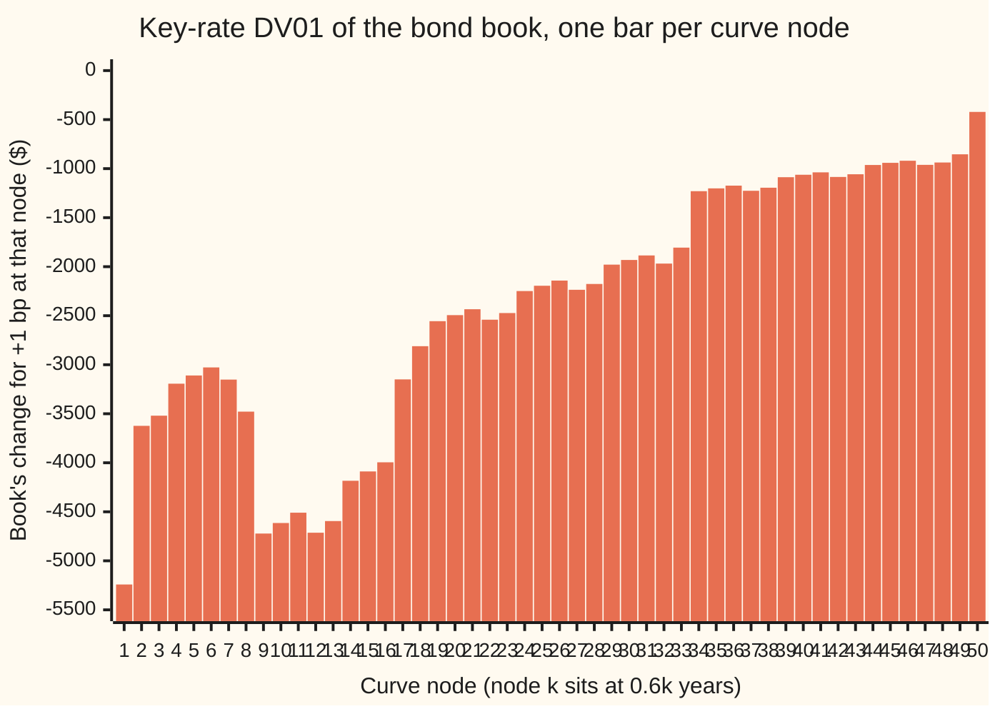
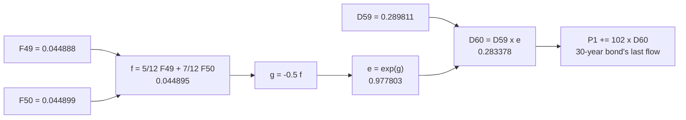

# Reverse mode: every sensitivity of one output for roughly the cost of one run

[Syllabus](../../../SYLLABUS.md) → [Numerical analysis](../README.md) → [Derivatives by Machine](../README.md#s08) → Reverse mode

---

## General Overview

A bond desk holds four government bonds: $50 million face of a 30-year bond, $30 million of a 10-year, $20 million of a 20-year, and a $40 million short position in a 5-year. Their coupons are 4%, 3.5%, 4.5% and 3% a year, paid twice a year. Every coupon is discounted off one yield curve. The curve is stored as 50 numbers, one forward rate (the rate charged for borrowing over a short stretch of time starting at that date) every 0.6 years out to 30 years. The book is worth $60,481,845.01 today (an illustrative book and curve).

Risk wants 50 numbers, not one. For each of the 50 curve points: how many dollars does the book gain or lose if that one rate rises by one basis point (0.01%)? These are the **key-rate DV01s** ("dollar value of one basis point"). Here each DV01 keeps its sign, as a change in book value, so a loss is negative; the single-bond cards on this shelf quote a bond's loss as a positive DV01. Nudging each point up and down and repricing costs 101 pricings. Carrying a derivative forward through the code, as [Forward-mode automatic differentiation](06-forward-mode-automatic-differentiation.md) does, needs one run per curve point: 50 runs.

Reverse mode prices the book once while the arithmetic writes itself down as a **tape** (a list of every operation, in order, with its inputs). Then one backward walk over the tape returns all 50 sensitivities at once. Here the record plus the walk cost 3.81 pricings' worth of arithmetic. The 50 numbers agree with a closed formula to about one part in 10^15.

**Reverse mode records the program as it runs, then walks the record backwards, multiplying by each step's local slope; one walk returns the output's sensitivity to every input for a fixed multiple of one run, and keeping only occasional snapshots instead of the whole record (checkpointing) caps its memory.**

**What kind of fact this is:** a method, exact up to rounding. That the walk returns the vector-Jacobian product is a theorem, proved on this card in Why it works. The cost is an operation count at the stated size, not a timing.

### The picture: fifty sensitivities from one sweep



Each bar is one node's DV01, all 50 from a single backward sweep. Every bar is negative: higher rates lower every discount factor after that node. The steps show the book's cash flows. At node 9 (5.4 years) the bars grow, because the short 5-year bond, which offsets the rest, has repaid at 5 years. They shrink after 10 years (node 17) and 20 years (node 34), where the 10-year and 20-year bonds stop paying. Node 50 only touches the last half-year, so its bar is the smallest. The small ripple that repeats every five nodes (3 years) is not a cash flow: half-year periods sit unevenly on the 0.6-year grid, so two nodes in every five carry a little more of the periods' weight. Node 1 also takes the first period flat, which makes its bar the largest.

---

## The formula

Notation first. The curve's nodes are $F_1, \dots, F_{50}$: node $k$ is the forward rate (the rate charged for borrowing over a short stretch of time starting then) at $0.6k$ years. Time runs in 60 half-year periods $m = 1, \dots, 60$. The pricer is one loop over the periods:

$$f_m = (1 - w_m)\,F_k + w_m\,F_{k+1}, \qquad D_m = D_{m-1}\,e^{-f_m/2}, \qquad P_b = \sum_m c_{b,m}\,D_m, \qquad V = \sum_b q_b\,P_b$$

In words: read the rate $f_m$ for period $m$ off the curve at the period's midpoint, by a straight line between the two nodes $F_k$ and $F_{k+1}$ on either side of it (before node 1, use $F_1$ flat). Shrink the discount factor $D_m$ (today's value of $1 paid at the end of period $m$) by that half-year's rate, compounded continuously. Each bond's price $P_b$ per $100 face is its cash flows $c_{b,m}$ times the discount factors. The book value $V$ adds the prices times the holdings $q_b$.

This card introduces the **adjoint** $\bar{x}$, read "x-bar": the derivative of the chosen output with respect to the value $x$. It is not a mean. The finance wing and the optimisation wing use the same bar ([Adjoint differentiation](../../12-Financial%20mathematics/07-Greeks%20by%20Numbers%20and%20Calibration/03-adjoint-differentiation-in-outline.md), [Automatic differentiation](../../15-Optimization/02-Unconstrained%20Methods/10-automatic-differentiation-and-backpropagation.md)).

Write the whole program as $L$ small steps, $\varphi_1$ to $\varphi_L$. Step $i$ has a **local Jacobian** $J_i$: the small table of slopes of its outputs against its inputs. The chain rule makes the program's **Jacobian** $J$ (the table of slopes of every output against every input; here 4 rows, one per bond, by 50 columns, one per node) the product of the local tables. Reverse mode multiplies that product from the output end:

$$\bar{x}^{\mathsf T} \;=\; \bar{y}^{\mathsf T} J \;=\; \Big(\big((\bar{y}^{\mathsf T} J_L)\,J_{L-1}\big)\cdots\Big)\,J_1, \qquad \bar{y} = q$$

The superscript $\mathsf T$ (transpose) writes a column of numbers as a row.

**Read it aloud:** the inputs' adjoints are the output weights times the Jacobian, worked out by passing a row of numbers backwards through one step's slopes at a time.

Seed the four bond prices with the holdings, $\bar{y} = q$, and the result is the book's gradient in one sweep. That is a **vector-Jacobian product**: one row vector times $J$, never the whole table $J$.

| Symbol | Plain meaning | In our example | Push it up and the answer… |
| --- | --- | --- | --- |
| $F_k$ | forward-rate node $k$, at $0.6k$ years | $F_1$ = 0.031427, $F_{50}$ = 0.044899 | the book falls by that node's DV01 per bp |
| $m$, $f_m$, $w_m$, $g$ | half-year period; its rate, read at its midpoint; weight on the upper node; the exponent $-f_m/2$ | period 60: $f$ = 0.044895, $w = 7/12$ | — |
| $D_m$ | discount factor: today's value of $1 paid at the end of period $m$ | $D_{60}$ = 0.283378 | — |
| $c_{b,m}$, $P_b$ | bond $b$'s cash flow in period $m$, per $100 face; its price | 30-year: 2 a period, 102 at the end; price 97.830791 | — |
| $q_b$, $V$ | holding of bond $b$ in units of $100 face; book value | 500,000 of the 30-year; $60,481,845.01 | — |
| $\bar{x}$ | adjoint: derivative of the seeded output with respect to $x$ | $\bar{D}_{60}$ = 51,000,000 | — |
| $J$; $\varphi_i$, $J_i$ | Jacobian of the four prices against the 50 nodes; step $i$ and its local slopes | 4 by 50 | — |
| $\bar{y}$, $\mathsf T$, $\Phi$ | the seed: weights on the outputs; transpose (column written as a row); the weighted output $\sum_b \bar{y}_b P_b$ | $q$, the holdings; $\Phi = V$ | the gradient scales with it |
| $\dot{x}$ | tangent: forward mode's derivative in one chosen direction | one node seeded at 1 | — |
| $v_j$, $N$; $L$, $E$ | value $j$ on the tape, of $N$; operations on it; **edges** (input-to-step links) | $N$ = 673; 618; 867 | sweep cost grows with $E$ |
| $S$, $s$; $n$, $p$ | loop steps; checkpoint spacing; numbers of inputs and outputs | 60; 8; 50 and 1 | bigger $s$: fewer stored states, longer tape |
| DV01 | change in $V$ for +1 bp at one node: $\bar{F}_k \times 10^{-4}$ | node 50: −421.53 | — |

### When it holds

- **Every step has a slope where it runs.** Sums, products and `exp` always do. A step such as `max(x, 0)` at 0 has none, and the tape returns whatever slope its rule records.
- **The derivative wanted is that of the path taken.** A branch is recorded only as the operations it ran. Here the branch tests the date, not a rate, so the path never changes with the nodes. A branch that tests an input loses the jump at its edge.
- **Few outputs, many inputs.** One sweep gives one weighted row of $J$. Four separate bond rows need four sweeps; with many outputs and few inputs, forward mode is cheaper.
- **The tape fits in memory, or the loop is checkpointed.** The tape grows with the run: 673 entries here, millions for a long simulation. Checkpointing trades memory for one extra forward run.
- **Exact up to rounding.** There is no step size, so no truncation error. The sweep also differentiates any bug in the pricer faithfully.

---

## Why it works

### Step 0: a long product of slopes can be multiplied from either end

The chain rule says the program's Jacobian is the product of its steps' local Jacobians, outer step on the left ([Chain rule in several variables](../../06-Calculus%20and%20analysis/07-Several%20Variables/04-multivariable-chain-rule-and-jacobians.md)). Matrix products can be grouped in any order and give the same table. The cost depends on the grouping.

- **From the input end**, start with one direction $\dot{x}$ (a column) and multiply $J_1\dot{x}$, then $J_2(J_1\dot{x})$, and so on. Every product is a matrix times a column. The result is one column of $J$: one node's effect on all four bonds. Fifty nodes need fifty runs. That is forward mode.
- **From the output end**, start with one row $\bar{y}^{\mathsf T}$ and multiply $\bar{y}^{\mathsf T}J_L$, then $(\bar{y}^{\mathsf T}J_L)J_{L-1}$. Every product is a row times a matrix. The result is one row of $J$, weighted by $\bar{y}$: the book's slope against all 50 nodes. That is reverse mode.

So the choice is between one run per input and one sweep per output. This book has 50 inputs and one output that matters.

The finance wing already records a Black-Scholes price by hand, sweeps it back for all six slopes at under twice a forward pass, and notes the memory the tape needs ([Adjoint differentiation](../../12-Financial%20mathematics/07-Greeks%20by%20Numbers%20and%20Calibration/03-adjoint-differentiation-in-outline.md)). The optimisation wing sweeps a short program by hand for fifty partials and proves a 5-operations-per-line bound ([Automatic differentiation](../../15-Optimization/02-Unconstrained%20Methods/10-automatic-differentiation-and-backpropagation.md)). This card does not repeat the optimisation wing's hand sweep of a short program; it follows one node by hand and lets the tape do the rest. It builds the tape automatically, through a loop and a branch, reads the sweep as a vector-Jacobian product, and caps its memory.

### Step 1: the tape writes itself as the pricer runs

The pricer contains no derivative code. Its numbers are replaced by a small type that does two things on every `+`, `*` and `exp`: it computes the value, and it appends one entry to the tape. The entry lists the step's inputs and its local slope against each:

| Operation | Value | Entry on the tape |
| --- | --- | --- |
| `a + b` | $a + b$ | (a, 1), (b, 1) |
| `a * b` | $ab$ | (a, $b$), (b, $a$) |
| `a * w`, w a plain number (a weight, −0.5 or a cash flow) | $aw$ | (a, $w$) |
| `exp(a)` | $e^a$ | (a, $e^a$) |

A language that lets a program redefine `+` and `*` for its own types does this with **operator overloading**: the Python check overloads them; the Rust check passes the same four operations through a small trait.

Loops and branches cost nothing extra. The loop over 60 periods simply runs 60 times, and each pass appends its entries. The branch that reads the curve records only the arm that ran. Period 1 sits before node 1, so its rate is $F_1$ times 1: one entry. Every other period blends two nodes: two scalings and an addition, three entries. The tape never holds an `if`. It holds the straight-line program that this particular run executed.

For the book the tape has 673 entries: 55 inputs (50 nodes, the starting discount factor and four starting prices of zero) and 618 operations with 867 edges between them.

Here is the tape for the last period, $m = 60$, as values flow forward (schematic):



Left to right is the record. The sweep walks the same arrows right to left, starting from the seed on $P_1$.

### Step 2: the sweep is a row vector times the Jacobian

Seed each output's adjoint with its weight. Then visit the tape's entries from last to first. At each entry, multiply its adjoint by each recorded slope and **add** the result into that input's adjoint. When the walk reaches the inputs, their adjoints are $\bar{y}^{\mathsf T}J$.

Each visit is one row-times-local-Jacobian product, because the entry's slopes are exactly its local Jacobian. Reverse order guarantees an entry's adjoint is complete before it is used. Every step that reads a value comes later on the tape, so it is swept earlier.

<details>
<summary>Detailed proof: the backward walk returns the vector-Jacobian product</summary>

Number the tape's values $v_1, \dots, v_N$, each built only from earlier ones. Fix the seed weights $\bar{y}$ on the outputs. Define $\Phi$ as the weighted output $\sum_b \bar{y}_b P_b$, viewed as a function of $v_j$ with everything after $v_j$ recomputed from it.

**Claim.** After the walk has processed entries $N$ down to $j + 1$, the slot for $v_j$ holds $\partial\Phi/\partial v_j$.

**Base.** Before any entry is processed, an output's slot holds its seed $\bar{y}_b = \partial\Phi/\partial P_b$, and every other slot holds 0. A value used by no later step has no route to $\Phi$ except as an output, so the claim holds at the top.

**Step.** The value $v_j$ reaches $\Phi$ only through the later entries $k$ that read it. Each of those has been processed, by the order of the walk, and each added $\bar{v}_k\,\partial v_k/\partial v_j$ to slot $j$. By the induction hypothesis $\bar{v}_k = \partial\Phi/\partial v_k$. The multivariable chain rule gives $\partial\Phi/\partial v_j = \sum_k (\partial\Phi/\partial v_k)(\partial v_k/\partial v_j)$, plus $\bar{y}_j$ if $v_j$ is itself an output. That is exactly what the slot holds.

At the inputs $F_k$ the slot holds $\partial\Phi/\partial F_k = \sum_b \bar{y}_b\,\partial P_b/\partial F_k$, which is entry $k$ of $\bar{y}^{\mathsf T}J$. ∎

</details>

The check confirms the identity two ways. Four sweeps, each seeded with 1 on one bond, give the four rows of $J$; combining them with the holdings matches the single $q$-seeded sweep with a gap of 2.8e-16 of the largest DV01. One forward-mode run, seeded on node 50, gives the column for that node; its entry for the 30-year bond is −0.000843 dollars per $100 face per bp, the same as the reverse row's.

### Step 3: count the cost, and see why many inputs favour reverse

Count one unit per operation and two units (a multiply and an add) per edge. One pricing is 618 units. Recording plus one sweep is 618 + 2 × 867 units, 3.81 pricings. There are 1.40 edges per operation, never more than 2, since no step has more than two inputs. Nothing in that count mentions the number of nodes. (The finance card counts a multiply-and-add as one unit, not two, so its sweep comes out at half this share.)

```
Cost to get all 50 key-rate DV01s, in pricings of arithmetic
record + 1 sweep (reverse)    |#                                          3.81
record + 4 sweeps (4 rows)    |###                                       12.22
central bumps, 2 per node     |#####################                       101
forward mode, 1 run per node  |########################################  190.3
```

Forward mode carries a tangent beside every value. Counted the same way, each of its runs costs what a record plus a sweep costs, and it needs 50 of them. Bumping needs 101 plain pricings. Reverse mode needs one record and one sweep. With $n$ inputs and $p$ outputs, reverse mode pays per output and forward mode pays per input. The book has $n$ = 50 and one weighted output.

### Step 4: checkpointing caps the tape's memory

The tape keeps every intermediate value until the sweep, so memory grows with the length of the run. A 60-period loop needs 673 entries; a simulation with a million steps needs millions.

**Checkpointing** keeps only the loop's **state** (the few numbers one period hands to the next: $D_m$ and the four running prices) every $s$ periods, and no tape. The sweep then goes segment by segment, last first:

1. Restart from the segment's stored state, recording a tape for that segment only.
2. Seed the segment's final state with the adjoints handed back by the later segment ($\bar{D}$ and the four $\bar{P}$).
3. Sweep the short tape. Add its node adjoints into the running totals, and hand the adjoints of its starting state to the segment before.

Every period is computed twice: once in the first run, without a tape, and once again, with a tape, during the sweep. So checkpointing costs one extra forward run, whatever $s$ is.

| Checkpoint every $s$ periods | Stored states | Peak tape entries | Gap to the full tape |
| --- | --- | --- | --- |
| 60 (no checkpoints) | 1 | 673 | 0.0e0 |
| 15 | 4 | 253 | 0.0e0 |
| 8 | 8 | 165 | 0.0e0 |
| 4 | 15 | 111 | 7.1e-17 |
| 1 | 60 | 69 | 0.0e0 |

Each stored state is five numbers. Each peak tape includes 55 entries for the segment's inputs. Fewer checkpoints mean a longer segment tape; more checkpoints mean more stored states. When a period's tape and the state are of similar size, the balance falls near $s \approx \sqrt{S}$, so memory grows like $\sqrt{S}$ instead of $S$. Nested schedules, which checkpoint inside segments too, bring memory down to growing like $\log S$, for a number of recomputations of each period that also grows like $\log S$ (the *revolve* algorithm in Sources).

---

## Worked numbers, by hand

Node 50 is the one node a sweep can follow by hand. It sits at 30 years, so it enters only period 60, with weight 7/12. Only the 30-year bond pays in period 60: its last coupon plus the face, 102 per $100. Seed the bond's price with its holding, $\bar{P}_1$ = 500,000, and walk the period-60 tape backwards.

| Step | Arithmetic | Value |
| --- | --- | --- |
| period 60's rate, forward | 5/12 × 0.044888 + 7/12 × 0.044899 | 0.044895 |
| half-year discount ratio $e^{g}$, forward | $e^{-0.044895/2}$ | 0.977803 |
| discount factors, forward | $D_{59}$; $D_{60} = D_{59} \times 0.977803$ | 0.289811; 0.283378 |
| $\bar{D}_{60}$, from $P_1 \mathrel{+}= 102\,D_{60}$ | 102 × 500,000 | 51,000,000 |
| $\bar{g}$, through $D_{60} = D_{59}\,e^{g}$ | $D_{59}\,e^{g}\,\bar{D}_{60} = D_{60}\,\bar{D}_{60}$, unrounded | 14,452,287.23 |
| $\bar{f}_{60}$, through $g = -0.5 f$ | −0.5 × 14,452,287.23 | −7,226,143.62 |
| $\bar{F}_{50}$, through the blend | 7/12 × (−7,226,143.62) | −4,215,250.44 |
| DV01 of node 50 | −4,215,250.44 × 0.0001 | **−421.53** |

A one basis point rise at the 30-year node costs the book $421.53. The full sweep's bar for node 50 is the same number. The walk also hands $e^{g}\,\bar{D}_{60}$ = 49,867,943.52 back to $D_{59}$: the adjoint that carries period 60's value back into every earlier node.

The house example is the whole curve moved up one basis point at once. Repriced, the book falls by $120,012.15. The 50 DV01s sum to −$120,145.25. The gap, 133.10, is the price's bend against the rates (the **convexity term**, half the second difference of the book's value over ±1 bp), which the repricing measures separately at 133.21. A first derivative cannot see it.

### What breaks if you drop a piece

The right sum of the 50 DV01s is −120,145.25 dollars per bp.

| Mistake | Comes out at | What went wrong |
| --- | --- | --- |
| Sweep the tape in recording order | 0.00 | every entry is read before any later step has added to it |
| Seed every bond with 1 instead of its holding | −0.44 | the sweep returns the slope of the four prices' plain sum per $100, not the book |
| Restart each checkpointed segment with $\bar{D} = 0$ | −18,113.64 | each node then reaches only the cash flows in its own 8-period segment |
| Treat $D_{m-1}$ as a constant in every period | −3,024.09 | each node then moves only its own period's discounting, not every later one |

---

## Code, from first principles, and it actually runs

The code prices the four-bond book on the 50-node curve with one plain loop that contains no derivative code. Run with taped numbers, it records itself; one sweep seeded with the holdings returns all 50 DV01s. Four roads reach the same 50 numbers: the reverse sweep, 50 forward-mode runs with dual numbers, a closed formula for each node's slope, and 100 bumped prices. The asserts compare the sweep with the closed form, forward mode, the bumps, the hand sweep for node 50 and the checkpointed sweep, and check the parallel repricing against the DV01 sum plus the convexity term.

### Python

```python
# Reverse mode -- the check behind the card.  Standard library only.
# A bond book priced off a forward-rate curve with 50 nodes, one every 0.6 years
# out to 30 years (illustrative).  Four bonds, 60 half-year periods.  The tape is
# built by operator overloading as the pricing loop runs.  Roads: one reverse
# sweep; 50 forward-mode runs with dual numbers; a closed form; 100 bumped prices.
import math
NODES, STEPS, C = 50, 60, 8
F0 = [0.03 + 0.015 * (1 - math.exp(-0.6 * k / 6)) for k in range(1, NODES + 1)]
CPN, MAT = (4.0, 3.5, 3.0, 4.5), (60, 20, 10, 40)        # % a year; maturity in half-years
HOLD = (500000.0, 300000.0, -400000.0, 200000.0)         # units of $100 face; negative = short
def flows(m): return [c / 2 + (100.0 if m == n else 0.0) if m <= n else 0.0 for c, n in zip(CPN, MAT)]
def weights(m):            # midpoint of period m, (2m-1)/4 years, read off the node grid
    k, r = divmod(5 * (2 * m - 1), 12)
    return ((0, 1.0),) if k == 0 else ((k - 1, 1 - r / 12), (k, r / 12))   # flat before node 1
TAPE = []                  # one entry per value: its (parent, local slope) pairs
class V:
    def __init__(s, v, parents=()): s.v, s.i = v, len(TAPE); TAPE.append(parents)
    def __add__(a, b): return V(a.v + b.v, ((a.i, 1.0), (b.i, 1.0)))
    def __mul__(a, b): return V(a.v * b.v, ((a.i, b.v), (b.i, a.v))) if isinstance(b, V) else V(a.v * b, ((a.i, b),))
def vexp(a): e = math.exp(a.v); return V(e, ((a.i, e),))
class Du:                  # dual number a + b eps, eps^2 = 0
    def __init__(s, a, b=0.0): s.a, s.b = a, b
    def __add__(x, y): return Du(x.a + y.a, x.b + y.b)
    def __mul__(x, y): return Du(x.a * y.a, x.a * y.b + x.b * y.a) if isinstance(y, Du) else Du(x.a * y, x.b * y)
def dexp(x): e = math.exp(x.a); return Du(e, e * x.b)
def run(F, ex, D, vals, m0=1, m1=STEPS):   # the pricer: one loop, one branch, no derivative code
    for m in range(m0, m1 + 1):
        f = None
        for j, w in weights(m):
            f = F[j] * w if f is None else f + F[j] * w
        D = D * ex(f * -0.5)
        vals = [v + D * c if c else v for v, c in zip(vals, flows(m))]
    return D, vals
def sweep(seed, order=-1):  # seed: {tape index: adjoint}; order=+1 is the mistake
    bar = [0.0] * len(TAPE)
    for i, s in seed.items(): bar[i] += s
    for i in (range(len(TAPE) - 1, -1, -1) if order < 0 else range(len(TAPE))):
        for p, d in TAPE[i]: bar[p] += bar[i] * d
    return bar
def tot(xs):               # plain left-to-right sum (Python's sum() compensates)
    t = 0.0
    for x in xs: t += x
    return t
def sci(v): m, e = f"{v:.1e}".split("e"); return f"{m}e{int(e)}"
def price(F): return tot(q * v for q, v in zip(HOLD, run(F, math.exp, 1.0, [0.0] * 4)[1]))
def dv(g): return " ".join(f"{x * 1e-4:9.2f}" for x in g)
# 1 reverse mode: record once, sweep once, seeded with the holdings vector q
TAPE.clear(); Fv = [V(x) for x in F0]; D0 = V(1.0); z = [V(0.0) for _ in range(4)]
P = run(Fv, vexp, D0, z)[1]
L = sum(1 for e in TAPE if e); E = sum(len(e) for e in TAPE); size = len(TAPE)
bar = sweep({p.i: q for p, q in zip(P, HOLD)}); g_rev = [bar[x.i] for x in Fv]
rows = [[sweep({P[b].i: 1.0})[x.i] for x in Fv] for b in range(4)]
g_ones = [sweep({p.i: 1.0 for p in P})[x.i] for x in Fv]
g_fwd_order = [sweep({p.i: q for p, q in zip(P, HOLD)}, +1)[x.i] for x in Fv]
print("bond prices per $100: " + " ".join(f"{p.v:.6f}" for p in P))
print(f"book value ${price(F0):.2f}; nodes F1 {F0[0]:.6f}, F49 {F0[48]:.6f}, F50 {F0[49]:.6f}")
print(f"tape: {size} entries ({NODES + 5} inputs), {L} operations, {E} edges")
print("key-rate DV01, $ per bp, nodes 1..50 (10 a line):")
for r in range(5): print(dv(g_rev[10 * r:10 * r + 10]))
# 2 forward mode: 50 runs, each seeded on one node; each run gives a Jacobian column
cols = []
for k in range(NODES):
    Fd = [Du(x, 1.0 if j == k else 0.0) for j, x in enumerate(F0)]
    cols.append([v.b for v in run(Fd, dexp, Du(1.0), [Du(0.0)] * 4)[1]])
g_fwd = [tot(q * c for q, c in zip(HOLD, col)) for col in cols]
# 3 closed form: dD_m/dF_j = -0.5 D_m (sum over periods i <= m of weight on node j)
g_cf, acc, D = [0.0] * NODES, [0.0] * NODES, 1.0
for m in range(1, STEPS + 1):
    for j, w in weights(m): acc[j] += w
    D *= math.exp(-0.5 * tot(F0[j] * w for j, w in weights(m)))
    cash = tot(q * c for q, c in zip(HOLD, flows(m)))
    for j in range(NODES): g_cf[j] += -0.5 * D * acc[j] * cash
# 4 bump and revalue, central, h = 1e-6 per node: 100 extra pricings
def bumped(h): return [(price([x + h * (j == k) for j, x in enumerate(F0)])
                         - price([x - h * (j == k) for j, x in enumerate(F0)])) / (2 * h) for k in range(NODES)]
g_bump = bumped(1e-6)
def gap(a, b): return max(abs(x - y) for x, y in zip(a, b)) / max(abs(y) for y in b)
print(f"largest gap / largest DV01: forward mode {sci(gap(g_fwd, g_rev))}, closed form {sci(gap(g_cf, g_rev))}, "
      f"bump {sci(gap(g_bump, g_rev))}")
vjp = [tot(q * r[j] for q, r in zip(HOLD, rows)) for j in range(NODES)]
print(f"q^T J from 4 row sweeps vs 1 seeded sweep: gap {sci(gap(vjp, g_rev))}")
print(f"30-year bond row, node 50: reverse {rows[0][49] * 1e-4:.6f}, forward column {cols[49][0] * 1e-4:.6f} per $100 per bp")
# house example: the whole curve up 1 bp, by repricing, against the sum of 50 sensitivities
up, dn = price([x + 1e-4 for x in F0]), price([x - 1e-4 for x in F0])
par = up - price(F0); s = tot(g_rev) * 1e-4; cvx = (up + dn - 2 * price(F0)) / 2
print(f"parallel +1bp: repriced change {par:.2f}, sum of 50 DV01s {s:.2f}, gap {par - s:.2f}, convexity term {cvx:.2f}")
# by hand: node 50 enters only period 60, weight 7/12; only the 30-year bond pays then (102)
D59 = run(F0, math.exp, 1.0, [0.0] * 4, 1, 59)[0]; f60 = 5 / 12 * F0[48] + 7 / 12 * F0[49]
e60 = math.exp(-0.5 * f60); Db = HOLD[0] * 102.0; gb = e60 * D59 * Db; Fb = 7 / 12 * -0.5 * gb
print(f"hand, period 60: f {f60:.6f}, e {e60:.6f}, D59 {D59:.6f}, D60 {D59 * e60:.6f}, Dbar {Db:.0f}, "
      f"gbar {gb:.2f}, fbar {-0.5 * gb:.2f}, F50bar {Fb:.2f}, DV01 {Fb * 1e-4:.2f}, D59bar from here {e60 * Db:.2f}")
# checkpointing: keep the 5-number state every C steps, re-record one segment at a time
def checkpointed(c, keep_D=True):
    cps, st = [], (1.0, [0.0] * 4)
    for m0 in range(1, STEPS + 1, c):
        cps.append((m0, st)); st = run(F0, math.exp, st[0], st[1], m0, min(m0 + c - 1, STEPS))
    gF, dbar, vbar, peak = [0.0] * NODES, 0.0, list(HOLD), 0
    for m0, (d, vs) in reversed(cps):
        TAPE.clear(); Fs = [V(x) for x in F0]; Ds = V(d); Vs = [V(x) for x in vs]
        D1, V1 = run(Fs, vexp, Ds, Vs, m0, min(m0 + c - 1, STEPS)); peak = max(peak, len(TAPE))
        seed = {p.i: q for p, q in zip(V1, vbar)}; seed[D1.i] = seed.get(D1.i, 0.0) + dbar
        b = sweep(seed); gF = [x + b[y.i] for x, y in zip(gF, Fs)]
        dbar, vbar = (b[Ds.i] if keep_D else 0.0), [b[y.i] for y in Vs]
    return gF, len(cps), peak
for c in (60, 15, C, 4, 1):
    gc, ncp, peak = checkpointed(c)
    print(f"checkpoint every {c:2d} steps: {ncp:2d} stored states, peak tape {peak:4d} entries, gap {sci(gap(gc, g_rev))}")
g_drop, g_drop1 = checkpointed(C, False)[0], checkpointed(1, False)[0]
print(f"cost in pricings: record + 1 sweep {(L + 2 * E) / L:.2f}, record + 4 sweeps {(L + 8 * E) / L:.2f}, "
      f"forward mode {NODES * (L + 2 * E) / L:.1f}, bumps {2 * NODES + 1}; edges per operation {E / L:.2f}")
g_tiny = bumped(1e-12)
print(f"wrong: seed 1 on every bond: {tot(g_ones) * 1e-4:.2f}; sweep in recording order: {tot(g_fwd_order) * 1e-4:.2f}; "
      f"drop D-bar at checkpoints: {tot(g_drop) * 1e-4:.2f}; at every step: {tot(g_drop1) * 1e-4:.2f}")
print(f"trap: per unit rate {tot(g_rev):.2f}; bump h = 1e-12, total {tot(g_tiny) * 1e-4:.2f}, worst gap {sci(gap(g_tiny, g_rev))}")
assert gap(g_cf, g_rev) < 1e-12, "closed form"
assert gap(g_fwd, g_rev) < 1e-12, "forward mode"
assert gap(g_bump, g_rev) < 1e-6, "bump and revalue"
assert gap(vjp, g_rev) < 1e-12, "one seeded sweep = q^T J"
assert abs(par - s - cvx) < 0.01 * abs(cvx), "parallel bp: first order plus convexity"
assert abs(Fb - g_rev[49]) < 1e-9 * abs(Fb), "hand sweep for node 50"
assert gap(checkpointed(C)[0], g_rev) < 1e-12, "checkpointed sweep"
assert gap(g_drop, g_rev) > 0.01, "the state's adjoint must cross segment boundaries"
print("ALL CHECKS PASS")
```

**Ran 2026-11-11 on macOS, Python 3.14.10, standard library only. All checks passed. Output, pasted from the run:**

```
bond prices per $100: 97.830791 97.725565 97.676994 106.597888
book value $60481845.01; nodes F1 0.031427, F49 0.044888, F50 0.044899
tape: 673 entries (55 inputs), 618 operations, 867 edges
key-rate DV01, $ per bp, nodes 1..50 (10 a line):
 -5241.40  -3623.44  -3519.70  -3193.43  -3109.65  -3027.55  -3151.65  -3478.40  -4721.91  -4614.37
 -4509.19  -4713.46  -4594.53  -4183.67  -4088.42  -3995.37  -3149.63  -2810.94  -2555.86  -2494.25
 -2434.11  -2540.73  -2472.98  -2248.65  -2194.55  -2141.76  -2235.75  -2176.34  -1979.11  -1931.70
 -1885.45  -1968.45  -1805.61  -1229.93  -1201.31  -1173.40  -1226.03  -1194.63  -1087.45  -1062.42
 -1038.00  -1084.88  -1057.42   -962.85   -940.96   -919.61   -961.46   -937.46   -853.92   -421.53
largest gap / largest DV01: forward mode 5.7e-16, closed form 1.0e-15, bump 4.9e-10
q^T J from 4 row sweeps vs 1 seeded sweep: gap 2.8e-16
30-year bond row, node 50: reverse -0.000843, forward column -0.000843 per $100 per bp
parallel +1bp: repriced change -120012.15, sum of 50 DV01s -120145.25, gap 133.10, convexity term 133.21
hand, period 60: f 0.044895, e 0.977803, D59 0.289811, D60 0.283378, Dbar 51000000, gbar 14452287.23, fbar -7226143.62, F50bar -4215250.44, DV01 -421.53, D59bar from here 49867943.52
checkpoint every 60 steps:  1 stored states, peak tape  673 entries, gap 0.0e0
checkpoint every 15 steps:  4 stored states, peak tape  253 entries, gap 0.0e0
checkpoint every  8 steps:  8 stored states, peak tape  165 entries, gap 0.0e0
checkpoint every  4 steps: 15 stored states, peak tape  111 entries, gap 7.1e-17
checkpoint every  1 steps: 60 stored states, peak tape   69 entries, gap 0.0e0
cost in pricings: record + 1 sweep 3.81, record + 4 sweeps 12.22, forward mode 190.3, bumps 101; edges per operation 1.40
wrong: seed 1 on every bond: -0.44; sweep in recording order: 0.00; drop D-bar at checkpoints: -18113.64; at every step: -3024.09
trap: per unit rate -1201452530.68; bump h = 1e-12, total -120146.57, worst gap 5.1e-4
ALL CHECKS PASS
```

### Rust

```rust
// Reverse mode -- the same check as the Python, in Rust.  No crates.  Same book, same
// 50-node curve (illustrative), same tape recorded by the arithmetic as the loop runs.
// Roads: one reverse sweep; 50 forward-mode runs; a closed form; 100 bumped prices.
const NODES: usize = 50; const STEPS: usize = 60; const C: usize = 8;
const CPN: [f64; 4] = [4.0, 3.5, 3.0, 4.5]; // % a year
const MAT: [usize; 4] = [60, 20, 10, 40]; // maturity in half-years
const HOLD: [f64; 4] = [500000.0, 300000.0, -400000.0, 200000.0]; // units of $100 face
fn flows(m: usize) -> Vec<f64> { (0..4).map(|b| if m <= MAT[b] { CPN[b] / 2.0 + if m == MAT[b] { 100.0 } else { 0.0 } } else { 0.0 }).collect() }
fn weights(m: usize) -> Vec<(usize, f64)> { // midpoint of period m, (2m-1)/4 years, read off the node grid
    let (k, r) = ((5 * (2 * m - 1)) / 12, (5 * (2 * m - 1)) % 12); // k = 0: flat before node 1
    if k == 0 { vec![(0, 1.0)] } else { vec![(k - 1, 1.0 - r as f64 / 12.0), (k, r as f64 / 12.0)] }
}
trait Alg { // the four operations the pricer uses, for plain, dual and taped numbers
    type N: Clone;
    fn add(&mut self, a: &Self::N, b: &Self::N) -> Self::N; fn mul(&mut self, a: &Self::N, b: &Self::N) -> Self::N;
    fn scale(&mut self, a: &Self::N, c: f64) -> Self::N; fn exp(&mut self, a: &Self::N) -> Self::N;
}
struct Plain;
impl Alg for Plain { type N = f64;
    fn add(&mut self, a: &f64, b: &f64) -> f64 { a + b } fn mul(&mut self, a: &f64, b: &f64) -> f64 { a * b }
    fn scale(&mut self, a: &f64, c: f64) -> f64 { a * c } fn exp(&mut self, a: &f64) -> f64 { a.exp() }
}
#[derive(Clone, Copy)] struct Du(f64, f64); // dual number a + b eps, eps^2 = 0
struct Dual;
impl Alg for Dual { type N = Du;
    fn add(&mut self, x: &Du, y: &Du) -> Du { Du(x.0 + y.0, x.1 + y.1) } fn scale(&mut self, x: &Du, c: f64) -> Du { Du(x.0 * c, x.1 * c) }
    fn mul(&mut self, x: &Du, y: &Du) -> Du { Du(x.0 * y.0, x.0 * y.1 + x.1 * y.0) } fn exp(&mut self, x: &Du) -> Du { let e = x.0.exp(); Du(e, e * x.1) }
}
struct Tape { par: Vec<Vec<(usize, f64)>>, val: Vec<f64> } // one entry per value: (parent, local slope)
impl Tape {
    fn push(&mut self, v: f64, p: Vec<(usize, f64)>) -> usize { self.val.push(v); self.par.push(p); self.val.len() - 1 }
    fn leaf(&mut self, v: f64) -> usize { self.push(v, vec![]) }
    fn sweep(&self, seed: &[(usize, f64)], backward: bool) -> Vec<f64> {
        let mut bar = vec![0.0; self.val.len()]; // backward = false is the mistake
        for &(i, s) in seed { bar[i] += s; }
        let order: Vec<usize> = if backward { (0..self.val.len()).rev().collect() } else { (0..self.val.len()).collect() };
        for i in order { for &(p, d) in &self.par[i] { bar[p] += bar[i] * d; } }
        bar
    }
}
impl Alg for Tape { type N = usize;
    fn add(&mut self, a: &usize, b: &usize) -> usize { let v = self.val[*a] + self.val[*b]; self.push(v, vec![(*a, 1.0), (*b, 1.0)]) }
    fn mul(&mut self, a: &usize, b: &usize) -> usize { let (x, y) = (self.val[*a], self.val[*b]); self.push(x * y, vec![(*a, y), (*b, x)]) }
    fn scale(&mut self, a: &usize, c: f64) -> usize { let v = self.val[*a] * c; self.push(v, vec![(*a, c)]) }
    fn exp(&mut self, a: &usize) -> usize { let e = self.val[*a].exp(); self.push(e, vec![(*a, e)]) }
}
// the pricer: one loop, one branch, no derivative code
fn run<A: Alg>(al: &mut A, f: &[A::N], d0: A::N, v0: Vec<A::N>, m0: usize, m1: usize) -> (A::N, Vec<A::N>) {
    let (mut d, mut vals) = (d0, v0);
    for m in m0..=m1 {
        let mut fr: Option<A::N> = None;
        for (j, w) in weights(m) {
            let t = al.scale(&f[j], w);
            fr = Some(match fr { None => t, Some(x) => al.add(&x, &t) });
        }
        let g = al.scale(&fr.unwrap(), -0.5); let e = al.exp(&g);
        d = al.mul(&d, &e); let cf = flows(m);
        for b in 0..4 { if cf[b] != 0.0 { let t = al.scale(&d, cf[b]); vals[b] = al.add(&vals[b], &t); } }
    }
    (d, vals)
}
fn tot(xs: &[f64]) -> f64 { let mut t = 0.0; for x in xs { t += x; } t }
fn sci(v: f64) -> String { format!("{:.1e}", v) }
fn price(f: &[f64]) -> f64 { let v = run(&mut Plain, f, 1.0, vec![0.0; 4], 1, STEPS).1; tot(&(0..4).map(|b| HOLD[b] * v[b]).collect::<Vec<_>>()) }
fn dv(g: &[f64]) -> String { g.iter().map(|x| format!("{:9.2}", x * 1e-4)).collect::<Vec<_>>().join(" ") }
fn gap(a: &[f64], b: &[f64]) -> f64 { a.iter().zip(b).map(|(x, y)| (x - y).abs()).fold(0.0, f64::max) / b.iter().map(|y| y.abs()).fold(0.0, f64::max) }
fn bumped(f0: &[f64], h: f64) -> Vec<f64> {
    let sh = |k: usize, s: f64| -> Vec<f64> { f0.iter().enumerate().map(|(j, x)| x + s * h * ((j == k) as u8 as f64)).collect() };
    (0..NODES).map(|k| (price(&sh(k, 1.0)) - price(&sh(k, -1.0))) / (2.0 * h)).collect()
}
fn new_tape() -> Tape { Tape { par: vec![], val: vec![] } }
fn checkpointed(f0: &[f64], c: usize, keep_d: bool) -> (Vec<f64>, usize, usize) {
    let (mut cps, mut st) = (vec![], (1.0, vec![0.0; 4]));
    for m0 in (1..=STEPS).step_by(c) {
        cps.push((m0, st.clone())); st = run(&mut Plain, f0, st.0, st.1, m0, (m0 + c - 1).min(STEPS));
    }
    let (mut gf, mut dbar, mut vbar, mut peak) = (vec![0.0; NODES], 0.0, HOLD.to_vec(), 0);
    for (m0, (d, vs)) in cps.iter().rev() {
        let mut t = new_tape();
        let fs: Vec<usize> = f0.iter().map(|x| t.leaf(*x)).collect(); let ds = t.leaf(*d);
        let vsl: Vec<usize> = vs.iter().map(|x| t.leaf(*x)).collect();
        let (d1, v1) = run(&mut t, &fs, ds, vsl.clone(), *m0, (m0 + c - 1).min(STEPS));
        peak = peak.max(t.val.len()); let mut seed: Vec<(usize, f64)> = (0..4).map(|b| (v1[b], vbar[b])).collect();
        seed.push((d1, dbar)); let b = t.sweep(&seed, true);
        for j in 0..NODES { gf[j] += b[fs[j]]; }
        dbar = if keep_d { b[ds] } else { 0.0 };
        vbar = vsl.iter().map(|y| b[*y]).collect();
    }
    (gf, cps.len(), peak)
}
fn main() {
    let f0: Vec<f64> = (1..=NODES).map(|k| 0.03 + 0.015 * (1.0 - (-0.6 * k as f64 / 6.0).exp())).collect();
    // 1 reverse mode: record once, sweep once, seeded with the holdings vector q
    let mut t = new_tape();
    let fv: Vec<usize> = f0.iter().map(|x| t.leaf(*x)).collect(); let d0 = t.leaf(1.0);
    let z: Vec<usize> = (0..4).map(|_| t.leaf(0.0)).collect();
    let p = run(&mut t, &fv, d0, z, 1, STEPS).1;
    let (l, e) = (t.par.iter().filter(|e| !e.is_empty()).count(), t.par.iter().map(|e| e.len()).sum::<usize>());
    let (lf, ef) = (l as f64, e as f64);
    let pick = |bar: Vec<f64>| -> Vec<f64> { fv.iter().map(|i| bar[*i]).collect() };
    let qseed: Vec<(usize, f64)> = (0..4).map(|b| (p[b], HOLD[b])).collect();
    let g_rev = pick(t.sweep(&qseed, true));
    let rows: Vec<Vec<f64>> = (0..4).map(|b| pick(t.sweep(&[(p[b], 1.0)], true))).collect();
    let g_ones = pick(t.sweep(&(0..4).map(|b| (p[b], 1.0)).collect::<Vec<_>>(), true));
    let g_fwd_order = pick(t.sweep(&qseed, false));
    println!("bond prices per $100: {}", p.iter().map(|i| format!("{:.6}", t.val[*i])).collect::<Vec<_>>().join(" "));
    println!("book value ${:.2}; nodes F1 {:.6}, F49 {:.6}, F50 {:.6}", price(&f0), f0[0], f0[48], f0[49]);
    println!("tape: {} entries ({} inputs), {} operations, {} edges", t.val.len(), NODES + 5, l, e);
    println!("key-rate DV01, $ per bp, nodes 1..50 (10 a line):");
    for r in 0..5 { println!("{}", dv(&g_rev[10 * r..10 * r + 10])); }
    // 2 forward mode: 50 runs, each seeded on one node; each run gives a Jacobian column
    let cols: Vec<Vec<f64>> = (0..NODES).map(|k| {
        let fd: Vec<Du> = f0.iter().enumerate().map(|(j, x)| Du(*x, if j == k { 1.0 } else { 0.0 })).collect();
        run(&mut Dual, &fd, Du(1.0, 0.0), vec![Du(0.0, 0.0); 4], 1, STEPS).1.iter().map(|v| v.1).collect()
    }).collect();
    let g_fwd: Vec<f64> = cols.iter().map(|c| tot(&(0..4).map(|b| HOLD[b] * c[b]).collect::<Vec<_>>())).collect();
    // 3 closed form: dD_m/dF_j = -0.5 D_m (sum over periods i <= m of weight on node j)
    let (mut g_cf, mut acc, mut d) = (vec![0.0; NODES], vec![0.0; NODES], 1.0);
    for m in 1..=STEPS {
        for (j, w) in weights(m) { acc[j] += w; }
        d *= (-0.5 * tot(&weights(m).iter().map(|(j, w)| f0[*j] * w).collect::<Vec<_>>())).exp();
        let cf = flows(m);
        let cash = tot(&(0..4).map(|b| HOLD[b] * cf[b]).collect::<Vec<_>>());
        for j in 0..NODES { g_cf[j] += -0.5 * d * acc[j] * cash; }
    }
    // 4 bump and revalue, central, h = 1e-6 per node: 100 extra pricings
    let g_bump = bumped(&f0, 1e-6);
    println!("largest gap / largest DV01: forward mode {}, closed form {}, bump {}",
        sci(gap(&g_fwd, &g_rev)), sci(gap(&g_cf, &g_rev)), sci(gap(&g_bump, &g_rev)));
    let vjp: Vec<f64> = (0..NODES).map(|j| tot(&(0..4).map(|b| HOLD[b] * rows[b][j]).collect::<Vec<_>>())).collect();
    println!("q^T J from 4 row sweeps vs 1 seeded sweep: gap {}", sci(gap(&vjp, &g_rev)));
    println!("30-year bond row, node 50: reverse {:.6}, forward column {:.6} per $100 per bp", rows[0][49] * 1e-4, cols[49][0] * 1e-4);
    // house example: the whole curve up 1 bp, by repricing, against the sum of 50 sensitivities
    let up = price(&f0.iter().map(|x| x + 1e-4).collect::<Vec<_>>());
    let dn = price(&f0.iter().map(|x| x - 1e-4).collect::<Vec<_>>());
    let (par, s, cvx) = (up - price(&f0), tot(&g_rev) * 1e-4, (up + dn - 2.0 * price(&f0)) / 2.0);
    println!("parallel +1bp: repriced change {:.2}, sum of 50 DV01s {:.2}, gap {:.2}, convexity term {:.2}", par, s, par - s, cvx);
    // by hand: node 50 enters only period 60, weight 7/12; only the 30-year bond pays then (102)
    let (d59, f60) = (run(&mut Plain, &f0, 1.0, vec![0.0; 4], 1, 59).0, 5.0 / 12.0 * f0[48] + 7.0 / 12.0 * f0[49]);
    let (e60, db) = ((-0.5 * f60).exp(), HOLD[0] * 102.0);
    let gb = e60 * d59 * db; let fb = 7.0 / 12.0 * -0.5 * gb;
    println!("hand, period 60: f {:.6}, e {:.6}, D59 {:.6}, D60 {:.6}, Dbar {:.0}, gbar {:.2}, fbar {:.2}, F50bar {:.2}, DV01 {:.2}, D59bar from here {:.2}",
        f60, e60, d59, d59 * e60, db, gb, -0.5 * gb, fb, fb * 1e-4, e60 * db);
    // checkpointing: keep the 5-number state every C steps, re-record one segment at a time
    for c in [60, 15, C, 4, 1] {
        let (gc, ncp, peak) = checkpointed(&f0, c, true);
        println!("checkpoint every {:2} steps: {:2} stored states, peak tape {:4} entries, gap {}", c, ncp, peak, sci(gap(&gc, &g_rev)));
    }
    let (g_drop, g_drop1) = (checkpointed(&f0, C, false).0, checkpointed(&f0, 1, false).0);
    println!("cost in pricings: record + 1 sweep {:.2}, record + 4 sweeps {:.2}, forward mode {:.1}, bumps {}; edges per operation {:.2}",
        (lf + 2.0 * ef) / lf, (lf + 8.0 * ef) / lf, NODES as f64 * (lf + 2.0 * ef) / lf, 2 * NODES + 1, ef / lf);
    let g_tiny = bumped(&f0, 1e-12);
    println!("wrong: seed 1 on every bond: {:.2}; sweep in recording order: {:.2}; drop D-bar at checkpoints: {:.2}; at every step: {:.2}",
        tot(&g_ones) * 1e-4, tot(&g_fwd_order) * 1e-4, tot(&g_drop) * 1e-4, tot(&g_drop1) * 1e-4);
    println!("trap: per unit rate {:.2}; bump h = 1e-12, total {:.2}, worst gap {}", tot(&g_rev), tot(&g_tiny) * 1e-4, sci(gap(&g_tiny, &g_rev)));
    assert!(gap(&g_cf, &g_rev) < 1e-12, "closed form");
    assert!(gap(&g_fwd, &g_rev) < 1e-12, "forward mode");
    assert!(gap(&g_bump, &g_rev) < 1e-6, "bump and revalue");
    assert!(gap(&vjp, &g_rev) < 1e-12, "one seeded sweep = q^T J");
    assert!((par - s - cvx).abs() < 0.01 * cvx.abs(), "parallel bp: first order plus convexity");
    assert!((fb - g_rev[49]).abs() < 1e-9 * fb.abs(), "hand sweep for node 50");
    assert!(gap(&checkpointed(&f0, C, true).0, &g_rev) < 1e-12, "checkpointed sweep");
    assert!(gap(&g_drop, &g_rev) > 0.01, "the state's adjoint must cross segment boundaries");
    println!("ALL CHECKS PASS");
}
```

**Ran 2026-11-11 on macOS, rustc 1.98.1, no crates. All checks passed. Output, pasted from the run:**

```
bond prices per $100: 97.830791 97.725565 97.676994 106.597888
book value $60481845.01; nodes F1 0.031427, F49 0.044888, F50 0.044899
tape: 673 entries (55 inputs), 618 operations, 867 edges
key-rate DV01, $ per bp, nodes 1..50 (10 a line):
 -5241.40  -3623.44  -3519.70  -3193.43  -3109.65  -3027.55  -3151.65  -3478.40  -4721.91  -4614.37
 -4509.19  -4713.46  -4594.53  -4183.67  -4088.42  -3995.37  -3149.63  -2810.94  -2555.86  -2494.25
 -2434.11  -2540.73  -2472.98  -2248.65  -2194.55  -2141.76  -2235.75  -2176.34  -1979.11  -1931.70
 -1885.45  -1968.45  -1805.61  -1229.93  -1201.31  -1173.40  -1226.03  -1194.63  -1087.45  -1062.42
 -1038.00  -1084.88  -1057.42   -962.85   -940.96   -919.61   -961.46   -937.46   -853.92   -421.53
largest gap / largest DV01: forward mode 5.7e-16, closed form 1.0e-15, bump 4.9e-10
q^T J from 4 row sweeps vs 1 seeded sweep: gap 2.8e-16
30-year bond row, node 50: reverse -0.000843, forward column -0.000843 per $100 per bp
parallel +1bp: repriced change -120012.15, sum of 50 DV01s -120145.25, gap 133.10, convexity term 133.21
hand, period 60: f 0.044895, e 0.977803, D59 0.289811, D60 0.283378, Dbar 51000000, gbar 14452287.23, fbar -7226143.62, F50bar -4215250.44, DV01 -421.53, D59bar from here 49867943.52
checkpoint every 60 steps:  1 stored states, peak tape  673 entries, gap 0.0e0
checkpoint every 15 steps:  4 stored states, peak tape  253 entries, gap 0.0e0
checkpoint every  8 steps:  8 stored states, peak tape  165 entries, gap 0.0e0
checkpoint every  4 steps: 15 stored states, peak tape  111 entries, gap 7.1e-17
checkpoint every  1 steps: 60 stored states, peak tape   69 entries, gap 0.0e0
cost in pricings: record + 1 sweep 3.81, record + 4 sweeps 12.22, forward mode 190.3, bumps 101; edges per operation 1.40
wrong: seed 1 on every bond: -0.44; sweep in recording order: 0.00; drop D-bar at checkpoints: -18113.64; at every step: -3024.09
trap: per unit rate -1201452530.68; bump h = 1e-12, total -120146.57, worst gap 5.1e-4
ALL CHECKS PASS
```

### Lean

Lean proves the sweep's rules for any program written as a list of steps, of any length and any sizes.

- If every step has a slope where it runs, the backward sweep returns $\bar{y}^{\mathsf T} J$: the seed row times the whole program's Jacobian.
- Under the same condition, the adjoint the sweep leaves on input $k$ is the slope of the weighted output $\Phi$ against that input.
- Checkpointing gives exactly the full tape's adjoints. Restart the last segment from its stored state and sweep it, then sweep the earlier steps from its adjoints.
- The tape's counts hold: 55 inputs and 618 operations make 673 entries, and 867 edges are at most 2 × 618.
- Bumping 50 nodes both ways, plus the base price, is 101 pricings.
- The hand sweep's numbers hold: period 60 weights node 50 by 7/12 and node 49 by 5/12, and $\bar{D}_{60}$ = 102 × 500,000 = 51,000,000.
- Checkpointing every 60, 15, 8, 4 and 1 periods stores 1, 4, 8, 15 and 60 states.

Recording the tape as the pricer runs, the 50 DV01s, rounding, the costs and the cross-checks are left to the Python and Rust checks.

```lean
-- Reverse mode: for a program made of steps that each have a derivative where they run, the backward sweep that multiplies a seed row by each step's local Jacobian, last step first, returns the seed row times the whole program's Jacobian, and a checkpointed sweep done segment by segment gives the same answer.
import Mathlib.Analysis.Calculus.FDeriv.Comp
import Mathlib.Analysis.Calculus.FDeriv.Pi
import Mathlib.Analysis.Calculus.FDeriv.Add
import Mathlib.Analysis.Calculus.FDeriv.Mul
import Mathlib.LinearAlgebra.Matrix.ToLin
import Mathlib.Tactic.NormNum

open Matrix

/-- The program's run. Step `i` reads the `d i` numbers the program holds before it and hands
`d (i + 1)` numbers to the next step. `runState φ x i` is what the program holds after its first
`i` steps, started from the inputs `x`. Loops and branches have already been unrolled into the
straight-line list of steps that this run executed. -/
def runState {d : ℕ → ℕ} (φ : ∀ i, (Fin (d i) → ℝ) → (Fin (d (i + 1)) → ℝ))
    (x : Fin (d 0) → ℝ) : (i : ℕ) → Fin (d i) → ℝ
  | 0 => x
  | i + 1 => φ i (runState φ x i)

/-- The Jacobian of a map at a point: entry (r, c) is the slope of output r against input c. -/
noncomputable def jac {m n : ℕ} (f : (Fin n → ℝ) → (Fin m → ℝ)) (a : Fin n → ℝ) :
    Matrix (Fin m) (Fin n) ℝ :=
  LinearMap.toMatrix' (fderiv ℝ f a : (Fin n → ℝ) →ₗ[ℝ] (Fin m → ℝ))

/-- The backward sweep over the first `L` steps. Start from the seed row `ybar` on the last
step's outputs; multiply it by the last step's local Jacobian, read where that step ran; then by
the step before's; and so on back to the inputs. -/
noncomputable def sweep {d : ℕ → ℕ} (φ : ∀ i, (Fin (d i) → ℝ) → (Fin (d (i + 1)) → ℝ))
    (x : Fin (d 0) → ℝ) : (L : ℕ) → (Fin (d L) → ℝ) → (Fin (d 0) → ℝ)
  | 0, ybar => ybar
  | L + 1, ybar => sweep φ x L (vecMul ybar (jac (φ L) (runState φ x L)))

theorem runState_differentiableAt {d : ℕ → ℕ}
    (φ : ∀ i, (Fin (d i) → ℝ) → (Fin (d (i + 1)) → ℝ)) (x : Fin (d 0) → ℝ) (L : ℕ)
    (hφ : ∀ i < L, DifferentiableAt ℝ (φ i) (runState φ x i)) :
    DifferentiableAt ℝ (fun z => runState φ z L) x := by
  induction L with
  | zero => exact differentiableAt_id
  | succ L ih =>
    have h1 := ih (fun i hi => hφ i (Nat.lt_succ_of_lt hi))
    have h2 := hφ L (Nat.lt_succ_self L)
    exact h2.comp x h1

theorem runState_shift {d : ℕ → ℕ}
    (φ : ∀ i, (Fin (d i) → ℝ) → (Fin (d (i + 1)) → ℝ)) (x : Fin (d 0) → ℝ) (s t : ℕ) :
    runState (d := fun i => d (s + i)) (fun i => φ (s + i)) (runState φ x s) t
      = runState φ x (s + t) := by
  induction t with
  | zero => rfl
  | succ t ih =>
    show φ (s + t) (runState (d := fun i => d (s + i)) (fun i => φ (s + i)) (runState φ x s) t) = _
    rw [ih]; rfl

/-- **Reverse mode returns the vector-Jacobian product.** Write a program as `L` steps
φ₀, …, φ_{L-1}. If every step has a derivative (a slope) at the point where it actually runs,
then the backward sweep, which multiplies the seed row ȳ by each step's local Jacobian from the
last step to the first, returns ȳᵀ J, where J is the Jacobian of the whole program at the inputs:
x̄ᵀ = ((ȳᵀ J_L) J_{L-1}) ⋯ J_1 = ȳᵀ J. -/
theorem reverse_sweep_eq_vector_jacobian_product {d : ℕ → ℕ}
    (φ : ∀ i, (Fin (d i) → ℝ) → (Fin (d (i + 1)) → ℝ)) (x : Fin (d 0) → ℝ) (L : ℕ)
    (ybar : Fin (d L) → ℝ)
    (hφ : ∀ i < L, DifferentiableAt ℝ (φ i) (runState φ x i)) :
    sweep φ x L ybar = vecMul ybar (jac (fun z => runState φ z L) x) := by
  induction L with
  | zero =>
    show ybar = vecMul ybar (jac (fun z => z) x)
    simp [jac]
  | succ L ih =>
    have h1 := runState_differentiableAt φ x L (fun i hi => hφ i (Nat.lt_succ_of_lt hi))
    have h2 := hφ L (Nat.lt_succ_self L)
    have hc : fderiv ℝ (fun z => runState φ z (L + 1)) x
        = (fderiv ℝ (φ L) (runState φ x L)).comp (fderiv ℝ (fun z => runState φ z L) x) :=
      fderiv_comp (g := φ L) (f := fun z => runState φ z L) x h2 h1
    show sweep φ x L (vecMul ybar (jac (φ L) (runState φ x L))) = _
    rw [ih _ (fun i hi => hφ i (Nat.lt_succ_of_lt hi)), vecMul_vecMul]
    congr 1
    simp only [jac, hc]
    rw [← LinearMap.toMatrix'_comp]
    rfl

/-- **The sweep returns the gradient of the weighted output.** Under the same condition, the
adjoint the sweep leaves on input k is the partial derivative, with respect to input k, of the
weighted output Φ = Σ_b ȳ_b y_b. Seeding the four bond prices with the holdings therefore gives
the book value's slope against every curve node in one sweep. -/
theorem reverse_sweep_eq_partial_of_weighted_output {d : ℕ → ℕ}
    (φ : ∀ i, (Fin (d i) → ℝ) → (Fin (d (i + 1)) → ℝ)) (x : Fin (d 0) → ℝ) (L : ℕ)
    (ybar : Fin (d L) → ℝ)
    (hφ : ∀ i < L, DifferentiableAt ℝ (φ i) (runState φ x i)) (k : Fin (d 0)) :
    sweep φ x L ybar k =
      fderiv ℝ (fun z => ∑ b, ybar b * runState φ z L b) x (Pi.single k 1) := by
  rw [reverse_sweep_eq_vector_jacobian_product φ x L ybar hφ]
  have hd := (runState_differentiableAt φ x L hφ).hasFDerivAt
  have hb : ∀ b, HasFDerivAt (fun z => ybar b * runState φ z L b)
      (ybar b • (ContinuousLinearMap.proj b).comp (fderiv ℝ (fun z => runState φ z L) x)) x :=
    fun b => (hasFDerivAt_pi'.1 hd b).const_mul (ybar b)
  have hs := HasFDerivAt.fun_sum (u := Finset.univ) (fun b _ => hb b)
  rw [hs.fderiv]
  simp [vecMul, dotProduct, jac, LinearMap.toMatrix'_apply]

/-- **Checkpointing gives the same adjoints.** Split the run after `s` steps. Store only the state
the program holds there, restart the last `t` steps from it and sweep that segment alone, seeded
with ȳ; then hand the adjoints of its starting state to a sweep of the first `s` steps. The result
is exactly the sweep of the full `s + t`-step tape. -/
theorem checkpointed_sweep_eq_full_sweep {d : ℕ → ℕ}
    (φ : ∀ i, (Fin (d i) → ℝ) → (Fin (d (i + 1)) → ℝ)) (x : Fin (d 0) → ℝ) (s t : ℕ)
    (ybar : Fin (d (s + t)) → ℝ) :
    sweep φ x (s + t) ybar =
      sweep φ x s (sweep (d := fun i => d (s + i)) (fun i => φ (s + i)) (runState φ x s) t ybar) := by
  induction t with
  | zero => rfl
  | succ t ih =>
    show sweep φ x (s + t) (vecMul ybar (jac (φ (s + t)) (runState φ x (s + t)))) =
      sweep φ x s (sweep (d := fun i => d (s + i)) (fun i => φ (s + i)) (runState φ x s) t
        (vecMul ybar (jac (φ (s + t))
          (runState (d := fun i => d (s + i)) (fun i => φ (s + i)) (runState φ x s) t))))
    rw [runState_shift, ih]

-- The tape: 50 nodes, one starting discount factor and four starting prices are the 55 inputs;
-- with 618 operations the tape holds 673 entries.
example : (50 + 1 + 4) + 618 = 673 := by norm_num

-- No step has more than two inputs, so 867 edges are at most twice the 618 operations.
example : 867 ≤ 2 * 618 := by norm_num

-- Central bumps on 50 nodes need 2 × 50 + 1 = 101 pricings.
example : 2 * 50 + 1 = 101 := by norm_num

-- Period 60's midpoint, 29.75 years, sits between node 49 (29.4 years) and node 50 (30 years)
-- with weight 7/12 on node 50 and 5/12 on node 49.
example : ((60 - 1 / 2 : ℚ) / 2 - 49 * (3 / 5)) / (3 / 5) = 7 / 12 := by norm_num
example : (5 / 12 : ℚ) + 7 / 12 = 1 := by norm_num

-- The seed on D₆₀ by hand: the 30-year bond pays 102 per $100 in period 60, held 500,000 times.
example : 102 * 500000 = 51000000 := by norm_num

-- Stored states for a 60-period loop checkpointed every 60, 15, 8, 4 and 1 periods.
example : [60, 15, 8, 4, 1].map (fun s => (60 + s - 1) / s) = [1, 4, 8, 15, 60] := by decide

#print axioms runState_differentiableAt
#print axioms runState_shift
#print axioms reverse_sweep_eq_vector_jacobian_product
#print axioms reverse_sweep_eq_partial_of_weighted_output
#print axioms checkpointed_sweep_eq_full_sweep
```

**Checked 2026-11-11 on macOS, Lean 4.36.0-rc2, Mathlib v4.36.0-rc2. Every proof is complete and uses only Lean's standard axioms. Output, pasted from the run:**

```
'runState_differentiableAt' depends on axioms: [propext, Classical.choice, Quot.sound]
'runState_shift' depends on axioms: [propext, Classical.choice, Quot.sound]
'reverse_sweep_eq_vector_jacobian_product' depends on axioms: [propext, Classical.choice, Quot.sound]
'reverse_sweep_eq_partial_of_weighted_output' depends on axioms: [propext, Classical.choice, Quot.sound]
'checkpointed_sweep_eq_full_sweep' depends on axioms: [propext, Classical.choice, Quot.sound]
```

> [!TIP]
> **Try changing**
> - **Guess first: how much memory does checkpointing every period save?** Read the line for a spacing of 1 (`c = 1` in the code's checkpoint loop). Answer: the peak tape falls from 673 entries to 69, but 60 states are stored, five numbers each.
> - **Guess first: what does one bond's own row look like at node 50?** Compare the seeded sweep with `rows[0]`, the sweep seeded with 1 on the 30-year bond only. Answer: −0.000843 dollars per $100 face per bp, the same as forward mode's column for node 50.
> - **Guess first: what does sweeping in recording order give?** The line `sweep(..., +1)` does it. Answer: every DV01 is 0.00, because no adjoint has arrived when each entry is read.
> - **Guess first: is a smaller bump a better cross-check?** Compare `bumped(1e-6)` with `bumped(1e-12)`. Answer: the worst gap grows from 4.9e-10 to 5.1e-4 of the largest DV01, as rounding takes over.

---

## The usual mistake

> [!warning]
> **Reading an adjoint as a DV01.** The sweep returns the book's change per unit of rate, and one unit is 100%, or 10,000 bp. Summed over the nodes that is −1,201,452,530.68 dollars per unit of rate, a number with no meaning for a 1 bp move. Multiply by 0.0001 to get −120,145.25 per bp.
>
> - **Expecting the 50 DV01s to add up to the repriced parallel move.** They sum to −120,145.25; repricing the +1 bp curve gives −120,012.15. The 133.10 gap is the convexity term, not an error in the sweep.
> - **Checking the sweep against a bump that is far too small.** With a nudge of 1e-12 the central difference's worst gap is 5.1e-4 of the largest DV01, and its sum is −120,146.57: rounding, not reverse mode, is wrong ([Choosing the step](04-choosing-the-step-truncation-against-rounding.md)).
> - **Sweeping once per bond when only the book is wanted.** Four sweeps cost 12.22 pricings; one sweep seeded with the holdings costs 3.81 and gives the same book gradient to 2.8e-16.
> - **Dropping the state's adjoint at a checkpoint.** Each segment must start its sweep from the adjoints the later segment hands back. Without $\bar{D}$ the sum is −18,113.64.

---

## Where you meet it in real life

- **Bank risk systems.** Interest-rate books are risk-managed by sensitivity to every quoted curve point, often hundreds of them. Adjoint pricers deliver all of them from one sweep, overnight or intraday.
- **Training neural networks.** A network's loss is one number depending on millions of weights. [Backpropagation](../../14-Applied%20and%20computational/06-Machine%20Learning%20Mathematics/04-backpropagation.md) is reverse mode on that program, done a layer at a time, and long sequence models use checkpointing to fit the stored values in memory.
- **Weather forecasting.** Variational data assimilation adjusts millions of starting values of a forecast model to fit observations. The gradient comes from the model's adjoint, run backwards over the forecast window with checkpoints.
- **Aircraft and car design.** Adjoint flow solvers give the drag's sensitivity to every point of a wing or body surface for the cost of about one extra flow solve.

> **Say it back**
> Reverse mode prices once while every operation writes its value and local slopes onto a tape, through any loop or branch. One backward walk then multiplies the output weights through the slopes and adds where a value was used twice. That walk is a row vector times the Jacobian, so seeding the bonds with the holdings gives the book's 50 key-rate DV01s at once, for 3.81 pricings of work. The cost grows with the number of outputs, not inputs, which is why it beats 50 forward runs or 101 bumped prices. Checkpointing stores only the loop's state every few periods and re-records each segment during the sweep, trading one extra run for much less memory.

---

## What this builds on

- [Forward-mode automatic differentiation](06-forward-mode-automatic-differentiation.md): carries one tangent forward per run; this card's second road, and the cost it beats when inputs are many.
- [Adjoint differentiation](../../12-Financial%20mathematics/07-Greeks%20by%20Numbers%20and%20Calibration/03-adjoint-differentiation-in-outline.md): the finance wing's hand-recorded Black-Scholes tape and its six Greeks for under twice a forward pass; this card automates the recording.
- [Chain rule in several variables](../../06-Calculus%20and%20analysis/07-Several%20Variables/04-multivariable-chain-rule-and-jacobians.md): Jacobians multiply along a chain; reverse mode is that product grouped from the output end.
- [Automatic differentiation](../../15-Optimization/02-Unconstrained%20Methods/10-automatic-differentiation-and-backpropagation.md): the hand sweep for fifty partials and the proof that a sweep costs at most five evaluations.
- [Backpropagation](../../14-Applied%20and%20computational/06-Machine%20Learning%20Mathematics/04-backpropagation.md): reverse mode on a layered network, the most common use.

---

## Where this goes next

- [Bumping a simulated price](08-bumped-sensitivities-and-monte-carlo-noise.md): the next card. When the price is a Monte Carlo average, bumping becomes noisy; common random numbers rescue it, and a sweep along each simulated path is the alternative.
- [Complex steps and dual numbers](05-complex-step-and-dual-numbers.md) and [Forward, backward and central differences](01-forward-backward-and-central-differences.md): the cheaper tools when inputs are few, and the cross-checks every adjoint code is tested against.

The question this card leaves open: the sweep gives every first derivative cheaply, but can the curvature, here the 133.21 convexity term and its 50-by-50 table of second derivatives, be had nearly as cheaply?

---

## Sources

Verified 2026-11-11: every link below resolves to the publisher's page.

- Griewank, Andreas, and Andrea Walther. *Evaluating Derivatives: Principles and Techniques of Algorithmic Differentiation*, 2nd ed. SIAM, 2008. [doi:10.1137/1.9780898717761](https://doi.org/10.1137/1.9780898717761). The standard text: tapes built by overloading, the vector-Jacobian view, the cost bound and checkpointing.
- Griewank, Andreas, and Andrea Walther. "Algorithm 799: revolve: An Implementation of Checkpointing for the Reverse or Adjoint Mode of Computational Differentiation." *ACM Transactions on Mathematical Software* 26, no. 1 (2000): 19–45. [doi:10.1145/347837.347846](https://doi.org/10.1145/347837.347846). The nested checkpoint schedule whose memory grows like the logarithm of the run.
- Linnainmaa, Seppo. "Taylor Expansion of the Accumulated Rounding Error." *BIT Numerical Mathematics* 16, no. 2 (1976): 146–160. [doi:10.1007/BF01931367](https://doi.org/10.1007/BF01931367). An early published reverse sweep over a computational graph.
- Capriotti, Luca. "Fast Greeks by Algorithmic Differentiation." *Journal of Computational Finance* 14, no. 3 (2011): 3–35. [doi:10.21314/JCF.2011.234](https://doi.org/10.21314/JCF.2011.234). Reverse mode on pricing code, with measured speed-ups over bumping.
- Baydin, Atılım Güneş, Barak A. Pearlmutter, Alexey Andreyevich Radul, and Jeffrey Mark Siskind. "Automatic Differentiation in Machine Learning: A Survey." *Journal of Machine Learning Research* 18, no. 153 (2018): 1–43. [Journal page](https://jmlr.org/papers/v18/17-468.html). Forward and reverse mode as Jacobian-vector and vector-Jacobian products, and their costs.
