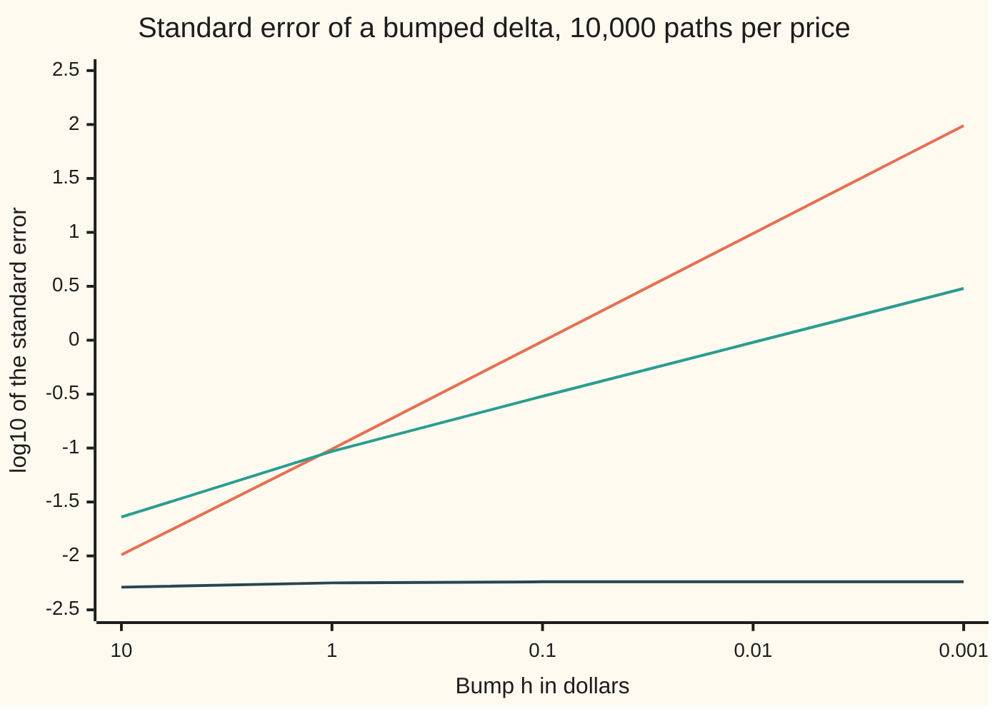
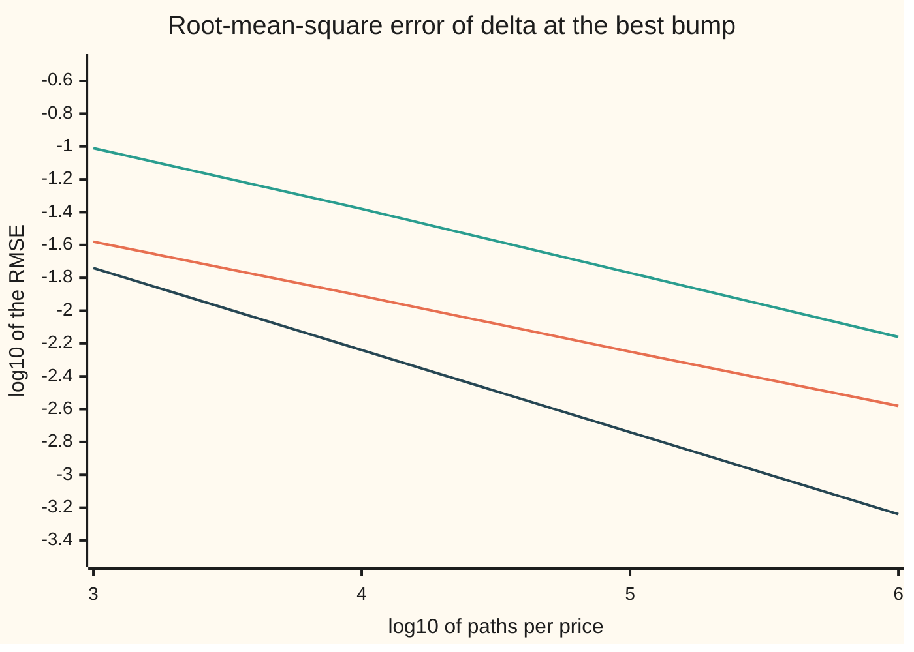
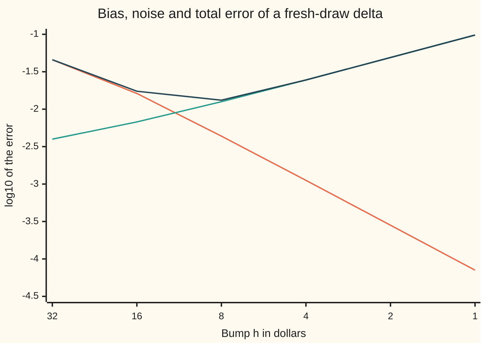

# Bumping a simulated price: why common random numbers rescue a noisy sensitivity

[Syllabus](../../../SYLLABUS.md) → [Numerical analysis](../README.md) → [Derivatives by Machine](../README.md#s08) → Bumping a simulated price

---

## General Overview

Acme shares trade at 100 dollars. A one-year option to buy one Acme share for 100 dollars is worth 9.227006 dollars in the finance wing's house market: bank rate 5 percent, dividend yield 2 percent, volatility 20 percent. These market numbers are illustrative. The wanted number is **delta**, the option's change in dollars per dollar move in Acme. The exact answer is 0.586851, and a desk wants it to about two decimals.

Here the price comes from a simulation of 10,000 paths. A **path** is one random future for Acme, and the price is the average payoff over all paths. To get delta, bump the share price up and down by a small amount $h$, reprice, and divide the change by $2h$.

Do that with a new set of random numbers for each price, and a one-cent bump returns a delta of **14.6241**, with a **standard error** (the typical miss of an average of random draws) of 9.7316. Do it again with the **same** 10,000 random numbers for both prices, and the one-cent bump returns **0.5902**, with a standard error of 0.0057.

That second trick is called **common random numbers**: both prices see the same random futures, so the random part cancels in the difference. This card asks the next question. With noise in play, what is the best bump, and how fast does the error fall as paths are added?

**A bumped Monte Carlo delta has a bias that grows with the bump and a noise that grows as the bump shrinks; shared draws stop the noise growing, so the error falls like one over the square root of the path count instead of one over its cube root, and a payoff that jumps lands in between.**

**What kind of fact this is:** a method with its error analysed. The three rates are theorems about the leading terms of the error, derived on this card in Why it works. The market is a model, an assumption, and its numbers are illustrative.

### The picture: how the noise grows as the bump shrinks

The chart shows the exact standard error of one 10,000-path delta at five bump sizes. Both axes are powers of ten, so a line that climbs one step for each step to the right is noise growing like one over the bump.



- **Steepest line, orange:** the call with fresh draws. Each tenfold cut in the bump makes the noise ten times larger.
- **Less steep line, green:** a digital option with shared draws. It starts above the orange line at the largest bump and crosses it near a bump of 1. A digital pays a fixed sum or nothing, so its payoff jumps. Each tenfold cut makes the noise about three times larger.
- **Bottom line, dark blue:** the call with shared draws. The noise does not move.

---

## The formula

Notation first, in words. $V(s)$ is the exact price when Acme starts at $s$ dollars. $Y_i(s)$ is the discounted payoff of path $i$, which is the payoff brought back to today's dollars. A hat marks a computed number, as on the first shelf. So $\hat V(s)$, the simulated price, is the average of $Y_i(s)$ over $n$ paths, and $\hat\Delta_h$ is the bumped delta computed from paths with bump $h$:

$$\hat\Delta_h = \frac{\hat V(S+h) - \hat V(S-h)}{2h}$$

**Read it aloud:** the computed delta is the simulated price a bump above, minus the simulated price a bump below, divided by the full gap.

With **fresh draws**, the two averages use different random numbers. With **shared draws**, path $i$ uses the same random number $Z_i$ for both prices.

Its error has two parts. The **bias** $\beta(h)$ is how far the estimate's long-run average sits from the true delta. The **noise** is its standard error. The **mean-square error**, MSE, adds their squares:

$$\mathrm{MSE}(h) = \beta(h)^2 + \frac{v(h)}{n}, \qquad \beta(h) \approx \tfrac16 V'''\,h^2$$

**Read it aloud:** the expected squared error is the bias squared plus one path's variance divided by the number of paths, and the bias is one sixth of the third derivative times the bump squared.

The **root-mean-square error**, RMSE, is the square root of the MSE. It is in the same units as delta. Everything on this card turns on how $v(h)$, the variance of one path's contribution, behaves as $h$ shrinks:

| Case | One path's variance $v(h)$ for small $h$ | Best bump scales like | Best RMSE falls like |
| --- | --- | --- | --- |
| Fresh draws, any payoff | $c/h^2$ | $n^{-1/6}$ | $n^{-1/3}$ |
| Shared draws, a payoff that jumps | $c/h$ | $n^{-1/5}$ | $n^{-2/5}$ |
| Shared draws, a payoff with no jump | stays bounded | any small $h$ | $n^{-1/2}$ |

| Symbol | Plain meaning | In our example | Push it up and the answer… |
| --- | --- | --- | --- |
| $h$, $h^{*}$ | the bump, in dollars; $h^{*}$ is the best bump | 0.01 to 32; $h^{*}$ = 10.158 fresh | bias grows; noise shrinks |
| $n$ | paths per price | 10,000 | noise shrinks like $1/\sqrt n$ |
| $V(s)$, $\hat V(s)$ | the exact price with Acme at $s$, and the simulated one | 9.227006 for the call | — |
| $\Delta$ | delta, the slope of $V$ at $S$ | 0.586851 call; 1.895058 digital | — |
| $\hat\Delta_h$ | the bumped delta computed from paths | 0.5902 at one cent, shared | — |
| $V'''$ | the third derivative of the price in $S$ | −0.000426 call; −0.004205 digital | bias grows |
| $\beta(h)$, $\beta_3$ | bias: average estimate minus the truth; $\beta_3 = V'''/6$ is its constant | −0.00699 at $h$ = 10.158 | — |
| $v(h)$, $c$ | one path's variance; $c$ is its constant for small $h$ | see the table above | noise grows |
| $Y_i$, $Z_i$, $G_i$ | path $i$'s discounted payoff, its bell-curve random number, and its growth factor | — | — |
| $A$, $p(h)$, $\phi$, $d_2$ | the digital's discounted payment; the chance a path ends in the band; the bell-curve height (not the golden ratio of the secant card, nor a hat function of shelf 07); the strike's bell-curve distance | $A$ is 100 dollars, discounted one year | — |
| MSE, RMSE | mean-square error, and its square root | RMSE 0.01221 at the fresh best bump | — |
| $S, K, r, q, T, \sigma$ | Acme's price today, strike, bank rate, dividend yield, years, volatility | 100, 100, 5%, 2%, 1, 20% | — |

The **digital** on this card pays 100 dollars if Acme ends above 100 dollars, and nothing otherwise. It is a hundred of the finance wing's one-dollar digitals.

### When it holds

- **The price is smooth in $S$.** The bias formula needs a third derivative. The call and the digital both have one: averaging over paths smooths the payoff's kink and jump.
- **The draws are truly shared.** Path $i$ must use the same random numbers in both prices, in the same order. A simulation that uses a varying count of numbers per path can drift out of step.
- **The payoff has no jump, for the full rate.** A call's payoff moves by at most the bump times the path's growth, so shared draws cap its noise. A jump, such as the digital's fixed payment, breaks that cap.
- **Enough paths land in the band.** For a digital at a tiny bump, only a few paths change their payment. The run's own standard error is then itself unreliable.

---

## Why it works

### Step 0: one error made of two parts

A random estimate misses for two reasons. Its long-run average may sit off the truth: the bias. Each run scatters around that average: the noise. The average squared miss is exactly bias squared plus variance, and the run's own standard error sees only the second.

### Step 1: the bias is the same with fresh or shared draws

Each average of payoffs has the exact price as its long-run average. So the long-run average of $\hat\Delta_h$ is $(V(S+h) - V(S-h))/(2h)$, whatever draws are used. That is the central difference of the exact price, and its error is about $\tfrac16 V''' h^2$ ([Forward, backward and central differences](01-forward-backward-and-central-differences.md)).

For the call, $V'''$ is −0.000426. The check also recovers the digital's −0.004205 from a bump of its exact price, which confirms the formula behind it.

### Step 2: fresh draws make the noise grow like one over the bump

With fresh draws the two averages are independent. Their difference has the variance of one plus the variance of the other. Dividing by $2h$ multiplies that spread by $1/(2h)$. The payoffs' spread hardly changes as $h$ shrinks, so the noise grows like $1/h$.

The run shows it: the exact standard error is 0.0978 at a one-dollar bump and 9.7803 at a one-cent bump, a hundred times larger for a bump a hundred times smaller.

### Step 3: balancing bias against noise

With fresh draws the MSE is $\beta_3^2 h^4 + c/(n h^2)$, where $\beta_3 = V'''/6$. The first term falls as the bump shrinks and the second rises. The sum is smallest where its slope is zero:

$$h^{*} = \left(\frac{c}{2\beta_3^{2}\,n}\right)^{1/6}$$

At 10,000 paths that formula gives 9.910 dollars. A direct search on the exact error finds 10.158. The best bump is about a tenth of the share price.

At that bump the noise is $\sqrt 2$ times the bias, so both parts matter. Put $h^{*}$ back in and the MSE goes like $n^{-2/3}$. The RMSE therefore falls like $n^{-1/3}$: a thousand times the paths buys only ten times the accuracy.

### Step 4: shared draws stop the noise growing, for a payoff with no jump

With shared draws, the bumped-up and bumped-down payoffs on one path come from the same future. The finance card shows the identity behind this. The variance of a difference is the two variances minus twice how much they move together, and shared draws make them move together strongly ([Bump and revalue](../../12-Financial%20mathematics/07-Greeks%20by%20Numbers%20and%20Calibration/01-bump-and-revalue-and-common-random-numbers.md)). For a call, one path's difference divided by $2h$ is at most that path's discounted growth factor, so $v(h)$ stays bounded.

Then the MSE is $\beta_3^2 h^4 + v/n$. Nothing pulls the bump up, so take it small. A one-cent bump has a bias under 0.00001, and the RMSE falls at the full Monte Carlo rate $n^{-1/2}$ ([Monte Carlo](../../09-Probability%20and%20statistics/11-Simulation/04-monte-carlo-estimates-and-error.md)).

### Step 5: a jump in the payoff breaks the cap

The digital pays 100 dollars, discounted, or nothing. On one path, the two bumped payoffs are either equal or differ by the full payment. They differ only when the path ends in a thin band of width proportional to $h$ around the strike.

So the path's contribution is zero with high chance and the payment divided by $2h$ with a chance proportional to $h$. Its variance is about (payment over $2h$) squared times $h$, which is $c/h$. At a one-cent bump, only 3 of the 10,000 paths changed their payment.

The MSE is now $\beta_3^2 h^4 + c/(n h)$. Its best bump shrinks like $n^{-1/5}$: 5.419 dollars at 10,000 paths, against 5.399 from the formula. The RMSE falls like $n^{-2/5}$, between the other two cases.

<details>
<summary>Detailed proof: the three best bumps and the three rates</summary>

Write $\beta(h) = \beta_3 h^2 + O(h^4)$ with $\beta_3 = V'''/6$, from the Taylor expansion of the exact price.

**Fresh draws.** The legs are independent, so
$$\mathrm{Var}\,\hat\Delta_h = \frac{\mathrm{Var}\,Y(S+h) + \mathrm{Var}\,Y(S-h)}{4h^2 n} \to \frac{c}{h^2 n}, \qquad c = \tfrac12 \mathrm{Var}\,Y(S).$$
Set the derivative of $\beta_3^2 h^4 + c/(nh^2)$ to zero: $4\beta_3^2 h^3 = 2c/(nh^3)$, so $h^6 = c/(2\beta_3^2 n)$. At that $h$ the noise squared $c/(nh^2)$ equals $2\beta_3^2 h^4$, twice the bias squared. The MSE is $3\beta_3^2 h^4$, which is a constant times $n^{-2/3}$.

**Shared draws, no jump.** For the call, $|Y_i(S+h) - Y_i(S-h)| \le 2h\,e^{-rT} G_i$, where $G_i$ is path $i$'s growth factor. So $v(h) \le e^{-2rT}\,E[G^2]$ for every $h$. Choose any $h$ with $h^2 \le n^{-1/2}$; then the bias squared is at most a constant over $n$, and the MSE is a constant over $n$.

**Shared draws, a jump.** Let $A$ be the discounted payment. Path $i$ contributes $A/(2h)$ when $(S-h)G_i \le K < (S+h)G_i$, and 0 otherwise. That band has chance $p(h) = 2h\,\phi(d_2)/(S\sigma\sqrt T) + O(h^3)$, where $\phi$ is the bell-curve height and $d_2$ is the bell-curve distance of the strike. So
$$v(h) = \frac{A^2}{4h^2}p(h) - O(1) \to \frac{c}{h}, \qquad c = \frac{A^2\,\phi(d_2)}{2S\sigma\sqrt T}.$$
Set the derivative of $\beta_3^2 h^4 + c/(nh)$ to zero: $4\beta_3^2 h^3 = c/(nh^2)$, so $h^5 = c/(4\beta_3^2 n)$. The noise squared is then $4\beta_3^2h^4$, four times the bias squared. The MSE is $5\beta_3^2 h^4$, a constant times $n^{-4/5}$, so the RMSE falls like $n^{-2/5}$.

These are leading-order statements as $n \to \infty$. The check computes the full error, with no leading-term cut, from closed-form prices and Simpson's rule, and confirms them.

</details>

### The picture: best error against paths

Each line is the RMSE at its best bump, for 1,000 to 1,000,000 paths, computed from closed-form prices and Simpson's rule (a weighted sum of parabola areas), not from a simulation. Both axes are powers of ten, so the slope of each line is its rate.



Orange is the call with fresh draws, green the digital with shared draws, dark blue the call with shared draws at a one-cent bump. Over the last decade the slopes are 0.334, 0.390 and 0.500, against 1/3, 2/5 and 1/2 from the theorems. The digital is still approaching its rate.

---

## Worked numbers, by hand

The call and the digital, 10,000 paths per price, each at its own best bump. All numbers come from the run below.

| Case | Bump | Bias | Noise | RMSE, by hand |
| --- | --- | --- | --- | --- |
| Call, fresh draws | 10.158 | −0.00699 | 0.01001 | sqrt(0.00699² + 0.01001²) = **0.01221** |
| Digital, shared draws | 5.419 | −0.02046 | 0.03597 | sqrt(0.02046² + 0.03597²) = **0.04138** |
| Call, shared draws | 0.010 | −0.00000 | 0.00574 | **0.00574** |

Three checks on those rows:

1. **The balance.** For fresh draws, the noise over the bias is 0.01001 / 0.00699 = 1.43, near the $\sqrt 2$ = 1.41 of Step 3. For the digital it is 0.03597 / 0.02046 = 1.76, approaching the 2 of Step 5. The run prints both ratios.
2. **The measured error.** A hundred independent runs at those bumps give RMSEs of 0.01137, 0.04426 and 0.00534. Measured over exact, that is 0.931, 1.069 and 0.931: each about 7 percent off, about what a hundred runs can resolve.
3. **The cost.** Both methods compute two payoffs per path pair; shared draws need half the random numbers. At 10,000 paths their error is 0.00574 against 0.01221, less than half. At 1,000 paths it is 0.01814 against 0.02654.

### What breaks if you drop a piece

| Mistake | Comes out at | What went wrong |
| --- | --- | --- |
| Fresh draws, a one-cent bump | 14.6241, standard error 9.7316 | Noise grows like one over the bump |
| Fresh draws, the cube-root bump 0.000606 dollars | standard error 161.5 | That rule assumes the only noise is rounding |
| Shared draws on the digital, a one-cent bump | RMSE 0.9492, against 0.04138 at its best bump | Only a few paths change payment, each by a huge amount |
| Fresh draws, bump kept at 10.158 while paths grow to 1,000,000 | RMSE 0.00706, against 0.00261 at its best bump | The bias does not fall with more paths |

---

## How the error moves as the bump shrinks

The call, fresh draws, 10,000 paths per price. The bump halves at each step from 32 dollars to 1 dollar. Each entry is the base-10 logarithm of an error's size, as printed by the checks.

| Bump $h$ (dollars) | log10 of the bias | log10 of the noise | log10 of the RMSE | Larger part |
| ---: | ---: | ---: | ---: | --- |
| 32 | −1.34 | −2.40 | −1.34 | bias |
| 16 | −1.79 | −2.17 | −1.76 | bias |
| 8 | −2.36 | −1.90 | −1.88 | noise |
| 4 | −2.95 | −1.61 | −1.61 | noise |
| 2 | −3.55 | −1.31 | −1.31 | noise |
| 1 | −4.15 | −1.01 | −1.01 | noise |



Orange is the size of the bias, green the noise, dark blue the RMSE.

- **The bias falls fast.** Each halving of the bump cuts it about fourfold: in powers of ten, about 0.6 per step at the small bumps.
- **The noise rises slowly.** Each halving doubles it: about 0.3 per step.
- **The total follows whichever is larger.** It bottoms out at −1.88 near 8 dollars. The exact search puts the best bump at 10.158.

More paths lower the green line and leave the orange one alone, so the best bump moves right, to smaller bumps: the $n^{-1/6}$ of Step 3.

---

## Code, from first principles, and it actually runs

Nothing imported holds an answer. The bell-curve area is a series. The random numbers come from SplitMix64, a small generator written out in full ([Random numbers from a computer](../../09-Probability%20and%20statistics/11-Simulation/01-pseudo-random-numbers.md)), and Box-Muller turns them into bell-curve draws. The roads:

1. **Closed forms.** Exact deltas and third derivatives for the call and the digital, with the digital's $V'''$ confirmed by a bump of its exact price.
2. **Exact error, searched.** Exact variances by **Simpson's rule** (a weighted sum of parabola areas) or the bell-curve area. A **golden-section search** (shrink a bracket around the lowest point by a fixed ratio each step) finds the best bump.
3. **Theory.** The leading-term formulas for the best bump, held to within 2 percent of the search at a million paths, and the observed orders held to the theorems.
4. **Simulation.** One run's own standard errors against the exact ones, and 100 independent runs' measured RMSE against the exact RMSE.

### Python

```python
# Bumping a simulated price -- the check behind the card.  Standard library only.
# The bell-curve area is a series, the random numbers come from SplitMix64, both written
# out here; the exact variances come from Simpson's rule, never from the simulation.
from math import cos, exp, log, log10, pi, sin, sqrt
S, K, R, Q, SIG, T, CASH = 100.0, 100.0, 0.05, 0.02, 0.20, 1.0, 100.0
W, DISC, DRIFT, MASK = SIG * sqrt(T), exp(-R * T), (R - Q - 0.5 * SIG * SIG) * T, (1 << 64) - 1
def phi(x): return exp(-0.5 * x * x) / sqrt(2.0 * pi)      # bell-curve height
def area(x):                                      # bell-curve area left of x
    if abs(x) > 8.0: return 0.0 if x < 0.0 else 1.0
    term = total = x                              # x + x^3/3 + x^5/(3*5) + ...
    for k in range(1, 120):
        term *= x * x / (2 * k + 1); total += term
    return 0.5 + phi(x) * total
def d2(s): return (log(s / K) + DRIFT) / W
def call(s): return s * exp(-Q * T) * area(d2(s) + W) - K * DISC * area(d2(s))
def digi(s): return CASH * DISC * area(d2(s))     # pays CASH if the share ends above K
def zcut(s): return (log(K / s) - DRIFT) / W      # draws above this finish in the money
B = d2(S)
DC = exp(-Q * T) * area(B + W)                    # exact call delta
DD = CASH * DISC * phi(B) / (S * W)               # exact digital delta
SPC = -exp(-Q * T) * phi(B + W) / (S * W) / S * ((B + W) / W + 1.0)       # call V'''
SPD = CASH * DISC * phi(B) / (W * S ** 3) * (B * (B / W + 1.0) / W - 1.0 / W ** 2 + 2.0 * (B / W + 1.0))
def simpson(f, a, b, m=400):                      # integral of f(z) phi(z) from a to b
    hh = (b - a) / m
    t = f(a) * phi(a) + f(b) * phi(b)
    for i in range(1, m):
        z = a + i * hh; t += (4.0 if i % 2 else 2.0) * f(z) * phi(z)
    return t * hh / 3.0
def grow(z): return exp(DRIFT + W * z)
def ey2(s): return simpson(lambda z: (DISC * (s * grow(z) - K)) ** 2, zcut(s), 9.0)
def bias(kind, h):
    v = digi if kind == "dig" else call
    return (v(S + h) - v(S - h)) / (2.0 * h) - (DD if kind == "dig" else DC)
def var1(kind, h):                                # exact variance of ONE path's estimate
    if kind == "fresh":
        return (ey2(S + h) - call(S + h) ** 2 + ey2(S - h) - call(S - h) ** 2) / (4.0 * h * h)
    up, dn = zcut(S + h), zcut(S - h)
    if kind == "dig":
        m2 = (CASH * DISC / (2.0 * h)) ** 2 * (area(dn) - area(up))
        return m2 - (digi(S + h) - digi(S - h)) ** 2 / (4.0 * h * h)
    m2 = (simpson(lambda z: (DISC * ((S + h) * grow(z) - K) / (2.0 * h)) ** 2, up, dn)
          + simpson(lambda z: (DISC * grow(z)) ** 2, dn, 9.0))
    return m2 - ((call(S + h) - call(S - h)) / (2.0 * h)) ** 2
def rmse(kind, h, n): return sqrt(bias(kind, h) ** 2 + var1(kind, h) / n)
def best(kind, n):                                # golden-section search on log h
    a, b, g = log(0.01), log(60.0), (sqrt(5.0) - 1.0) / 2.0
    for _ in range(60):
        c, d = b - g * (b - a), a + g * (b - a)
        if rmse(kind, exp(c), n) < rmse(kind, exp(d), n): b = d
        else: a = c
    return exp(0.5 * (a + b))
def theory(kind, n):                              # best bump from the leading terms alone
    if kind == "fresh":
        return ((ey2(S) - call(S) ** 2) / 2.0 / (2.0 * (SPC / 6.0) ** 2 * n)) ** (1.0 / 6.0)
    return (CASH * CASH * DISC * DISC * phi(B) / (2.0 * S * W) / (4.0 * (SPD / 6.0) ** 2 * n)) ** 0.2
def normals(seed, n):                             # SplitMix64, then Box-Muller
    st, out = seed, []
    def unif():
        nonlocal st
        st = (st + 0x9E3779B97F4A7C15) & MASK
        z = ((st ^ (st >> 30)) * 0xBF58476D1CE4E5B9) & MASK
        z = ((z ^ (z >> 27)) * 0x94D049BB133111EB) & MASK
        return (((z ^ (z >> 31)) >> 11) + 0.5) / 9007199254740992.0
    for _ in range(n // 2):
        rad, ang = sqrt(-2.0 * log(unif())), 2.0 * pi * unif()
        out.append(rad * cos(ang)); out.append(rad * sin(ang))
    return out
def cpay(s, z): return DISC * max(s * grow(z) - K, 0.0)
def dpay(s, z): return CASH * DISC if s * grow(z) > K else 0.0
def stats(xs):                                    # mean and standard error, in order
    m = 0.0
    for x in xs: m += x
    m /= len(xs); v = 0.0
    for x in xs: v += (x - m) * (x - m)
    return m, sqrt(v / (len(xs) - 1) / len(xs))
def estimate(kind, h, za, zb):                    # fresh: up leg on za, down leg on zb
    if kind == "fresh":
        (u, su), (d, sd) = stats([cpay(S + h, z) for z in za]), stats([cpay(S - h, z) for z in zb])
        return (u - d) / (2.0 * h), sqrt(su * su + sd * sd) / (2.0 * h)
    pay = dpay if kind == "dig" else cpay
    return stats([(pay(S + h, z) - pay(S - h, z)) / (2.0 * h) for z in za])
KINDS, NP = ("fresh", "dig", "shared"), 10000
print("--- 1. exact answers from the closed forms ---")
print(f"call:    price {call(S):.6f}  delta {DC:.6f}  V''' {SPC:.6f}")
print(f"digital: price {digi(S):.6f}  delta {DD:.6f}  V''' {SPD:.6f}  from a bump {6 * bias('dig', 0.1) / 0.01:.6f}")
ZA, ZB = normals(20261111, NP), normals(777, NP)
print(f"--- 2. one run, {NP} paths per leg: delta (standard error) ---")
print(f"{'h':>6}  {'fresh call':>19}  {'shared call':>19}  {'shared digital':>19}")
one = {}
for h in (10.0, 1.0, 0.1, 0.01):
    one[h] = [estimate(k, h, ZA, ZB) for k in ("fresh", "shared", "dig")]
    print(f"{h:>6.2f}" + "".join(f"  {m:>9.4f} ({s:>7.4f})" for m, s in one[h]))
for h in (1.0, 0.01): print(f"exact se at h = {h:.2f}:" + "".join(f"  {sqrt(var1(k, h) / NP):.4f}" for k in ("fresh", "shared", "dig")))
print(f"digital paths whose two legs differ at h = 0.01: {sum(dpay(S + 0.01, z) != dpay(S - 0.01, z) for z in ZA)}")
print("--- 3. exact root-mean-square error at the best bump, n paths per leg ---")
print(f"{'n':>8}  {'fresh h*':>8} {'theory':>7} {'rmse':>8}  {'digital h*':>10} {'theory':>7} {'rmse':>8}  {'shared, h=0.01':>14}")
rates = {k: [] for k in KINDS}
for n in (1000, 10000, 100000, 1000000):
    for k in KINDS:
        hk = 0.01 if k == "shared" else best(k, n)
        rates[k].append((hk, rmse(k, hk, n)))
    (hf, ef), (hd, ed), (_, es) = (rates[k][-1] for k in KINDS)
    print(f"{n:>8}  {hf:>8.3f} {theory('fresh', n):>7.3f} {ef:>8.5f}  {hd:>10.3f} {theory('dig', n):>7.3f} {ed:>8.5f}  {es:>14.5f}")
order = {k: log10(rates[k][2][1]) - log10(rates[k][3][1]) for k in KINDS}
print(f"observed order, last decade: fresh {order['fresh']:.3f} (theory 0.333)  digital {order['dig']:.3f} "
      f"(theory 0.400)  shared {order['shared']:.3f} (theory 0.500)")
RUNS, sq, hs = 100, {k: 0.0 for k in KINDS}, {k: rates[k][1][0] for k in KINDS}
for j in range(RUNS):
    za, zb = normals(5000 + 2 * j, NP), normals(5001 + 2 * j, NP)
    for k in KINDS:
        sq[k] += (estimate(k, hs[k], za, zb)[0] - (DD if k == "dig" else DC)) ** 2
print(f"--- 4. {RUNS} independent runs of {NP} paths at those bumps: measured against exact ---")
for k in KINDS:
    print(f"{k:<7} h = {hs[k]:>7.3f}  bias {bias(k, hs[k]):+.5f}  noise {sqrt(var1(k, hs[k]) / NP):.5f}  "
          f"exact rmse {rmse(k, hs[k], NP):.5f}  measured {sqrt(sq[k] / RUNS):.5f}  measured/exact {sqrt(sq[k] / RUNS) / rmse(k, hs[k], NP):.3f}")
nb = lambda k: sqrt(var1(k, hs[k]) / NP) / abs(bias(k, hs[k])); print(f"noise / |bias| at those bumps: fresh {nb('fresh'):.2f} (leading order {sqrt(2.0):.2f}), digital {nb('dig'):.2f} (leading order 2.00)")
print(f"--- 5. what breaks, {NP} paths per leg unless stated ---")
hc = (2.0 ** -52) ** (1.0 / 3.0) * S              # the cube-root rule for a pricer with no noise
print(f"fresh call, cube-root bump {hc:.6f}: exact se {sqrt(var1('fresh', hc) / NP):.1f}")
print(f"fresh call, one-cent bump: one run gives {one[0.01][0][0]:.4f}, se {one[0.01][0][1]:.4f}")
print(f"shared digital, one-cent bump: exact rmse {rmse('dig', 0.01, NP):.4f}, at its best bump {rates['dig'][1][1]:.5f}")
print(f"fresh call, h = {hs['fresh']:.3f} kept at 1000000 paths: exact rmse {rmse('fresh', hs['fresh'], 10 ** 6):.5f}, "
      f"at its best bump {rates['fresh'][3][1]:.5f}")
print("--- 6. chart points, every value is log10 ---")
for k in KINDS:
    print(f"chart, se at n = 10000, h = 10 to 0.001, {k:<6}"
          + "".join(f" {log10(sqrt(var1(k, h) / NP)):.2f}" for h in (10.0, 1.0, 0.1, 0.01, 0.001)))
for k in KINDS: print(f"chart, best rmse, n = 1e3 to 1e6, {k:<6}" + "".join(f" {log10(r):.2f}" for _, r in rates[k]))
for lab, f in (("bias", lambda h: abs(bias("fresh", h))), ("noise", lambda h: sqrt(var1("fresh", h) / NP)),
               ("rmse", lambda h: rmse("fresh", h, NP))):
    print(f"chart, fresh call, h = 32 to 1, {lab:<5}" + "".join(f" {log10(f(h)):.2f}" for h in (32.0, 16.0, 8.0, 4.0, 2.0, 1.0)))
assert abs(6.0 * bias("dig", 0.1) / 0.01 - SPD) < 0.01 * abs(SPD), "digital V''' formula against a bump"
assert abs(one[0.01][0][1] / sqrt(var1("fresh", 0.01) / NP) - 1.0) < 0.05, "fresh se: run against Simpson"
assert abs(one[1.0][2][1] / sqrt(var1("dig", 1.0) / NP) - 1.0) < 0.10, "digital se: run against exact"
assert abs(one[0.01][1][0] - DC) < 3.0 * one[0.01][1][1], "shared call delta within three standard errors"
assert one[0.01][0][1] > 1000.0 * one[0.01][1][1], "fresh draws are 1000 times noisier at one cent"
for k in ("fresh", "dig"): assert abs(rates[k][3][0] / theory(k, 10 ** 6) - 1.0) < 0.02, "best bump vs theory"
for k, p in (("fresh", 1 / 3), ("dig", 0.4), ("shared", 0.5)): assert abs(order[k] - p) < 0.02, "order vs theorem"
for k in KINDS: assert abs(sqrt(sq[k] / RUNS) / rmse(k, hs[k], NP) - 1.0) < 0.2, "100 runs against the exact rmse"
print("ALL CHECKS PASS")
```

**Ran 2026-11-11 on macOS, Python 3.14.10, standard library only. All checks passed. Output, pasted from the run:**

```
--- 1. exact answers from the closed forms ---
call:    price 9.227006  delta 0.586851  V''' -0.000426
digital: price 49.458109  delta 1.895058  V''' -0.004205  from a bump -0.004205
--- 2. one run, 10000 paths per leg: delta (standard error) ---
     h           fresh call          shared call       shared digital
 10.00     0.5906 ( 0.0101)     0.5830 ( 0.0052)     1.8254 ( 0.0231)
  1.00     0.7242 ( 0.0974)     0.5904 ( 0.0057)     1.8026 ( 0.0908)
  0.10     1.9877 ( 0.9732)     0.5900 ( 0.0057)     1.8073 ( 0.2926)
  0.01    14.6241 ( 9.7316)     0.5902 ( 0.0057)     1.4268 ( 0.8237)
exact se at h = 1.00:  0.0978  0.0057  0.0930
exact se at h = 0.01:  9.7803  0.0057  0.9492
digital paths whose two legs differ at h = 0.01: 3
--- 3. exact root-mean-square error at the best bump, n paths per leg ---
       n  fresh h*  theory     rmse  digital h*  theory     rmse  shared, h=0.01
    1000    15.417  14.545  0.02654       8.616   8.557  0.09699         0.01814
   10000    10.158   9.910  0.01221       5.419   5.399  0.04138         0.00574
  100000     6.827   6.751  0.00564       3.413   3.407  0.01714         0.00181
 1000000     4.623   4.600  0.00261       2.151   2.149  0.00698         0.00057
observed order, last decade: fresh 0.334 (theory 0.333)  digital 0.390 (theory 0.400)  shared 0.500 (theory 0.500)
--- 4. 100 independent runs of 10000 paths at those bumps: measured against exact ---
fresh   h =  10.158  bias -0.00699  noise 0.01001  exact rmse 0.01221  measured 0.01137  measured/exact 0.931
dig     h =   5.419  bias -0.02046  noise 0.03597  exact rmse 0.04138  measured 0.04426  measured/exact 1.069
shared  h =   0.010  bias -0.00000  noise 0.00574  exact rmse 0.00574  measured 0.00534  measured/exact 0.931
noise / |bias| at those bumps: fresh 1.43 (leading order 1.41), digital 1.76 (leading order 2.00)
--- 5. what breaks, 10000 paths per leg unless stated ---
fresh call, cube-root bump 0.000606: exact se 161.5
fresh call, one-cent bump: one run gives 14.6241, se 9.7316
shared digital, one-cent bump: exact rmse 0.9492, at its best bump 0.04138
fresh call, h = 10.158 kept at 1000000 paths: exact rmse 0.00706, at its best bump 0.00261
--- 6. chart points, every value is log10 ---
chart, se at n = 10000, h = 10 to 0.001, fresh  -1.99 -1.01 -0.01 0.99 1.99
chart, se at n = 10000, h = 10 to 0.001, dig    -1.64 -1.03 -0.52 -0.02 0.48
chart, se at n = 10000, h = 10 to 0.001, shared -2.29 -2.25 -2.24 -2.24 -2.24
chart, best rmse, n = 1e3 to 1e6, fresh  -1.58 -1.91 -2.25 -2.58
chart, best rmse, n = 1e3 to 1e6, dig    -1.01 -1.38 -1.77 -2.16
chart, best rmse, n = 1e3 to 1e6, shared -1.74 -2.24 -2.74 -3.24
chart, fresh call, h = 32 to 1, bias  -1.34 -1.79 -2.36 -2.95 -3.55 -4.15
chart, fresh call, h = 32 to 1, noise -2.40 -2.17 -1.90 -1.61 -1.31 -1.01
chart, fresh call, h = 32 to 1, rmse  -1.34 -1.76 -1.88 -1.61 -1.31 -1.01
ALL CHECKS PASS
```

### Rust

Same inputs, same labels, no crates. The series, the generator, Simpson's rule and the search are written out again.

```rust
// Bumping a simulated price -- the same check in Rust, std only, no crates.
// The bell-curve area is a series, the random numbers come from SplitMix64, both written
// out here; the exact variances come from Simpson's rule, never from the simulation.
use std::f64::consts::PI;
const S: f64 = 100.0; const K: f64 = 100.0; const R: f64 = 0.05; const Q: f64 = 0.02;
const SIG: f64 = 0.20; const T: f64 = 1.0; const CASH: f64 = 100.0; const NP: usize = 10000; const KINDS: [&str; 3] = ["fresh", "dig", "shared"];
fn w() -> f64 { SIG * T.sqrt() } fn disc() -> f64 { (-R * T).exp() } fn drift() -> f64 { (R - Q - 0.5 * SIG * SIG) * T }
fn phi(x: f64) -> f64 { (-0.5 * x * x).exp() / (2.0 * PI).sqrt() }   // bell-curve height
fn area(x: f64) -> f64 {                          // bell-curve area left of x
    if x.abs() > 8.0 { return if x < 0.0 { 0.0 } else { 1.0 }; }
    let (mut term, mut total) = (x, x);            // x + x^3/3 + x^5/(3*5) + ...
    for k in 1..120 { term *= x * x / (2 * k + 1) as f64; total += term; }
    0.5 + phi(x) * total
}
fn d2(s: f64) -> f64 { ((s / K).ln() + drift()) / w() }
fn call(s: f64) -> f64 { s * (-Q * T).exp() * area(d2(s) + w()) - K * disc() * area(d2(s)) }
fn digi(s: f64) -> f64 { CASH * disc() * area(d2(s)) }   // pays CASH if the share ends above K
fn zcut(s: f64) -> f64 { ((K / s).ln() - drift()) / w() } // draws above this finish in the money
fn grow(z: f64) -> f64 { (drift() + w() * z).exp() }
fn sq(x: f64) -> f64 { x.powf(2.0) }
fn simpson(f: &dyn Fn(f64) -> f64, a: f64, b: f64) -> f64 {   // integral of f(z) phi(z)
    let m = 400; let hh = (b - a) / m as f64;
    let mut t = f(a) * phi(a) + f(b) * phi(b);
    for i in 1..m { let z = a + i as f64 * hh; t += (if i % 2 == 1 { 4.0 } else { 2.0 }) * f(z) * phi(z); }
    t * hh / 3.0
}
fn ey2(s: f64) -> f64 { simpson(&|z| sq(disc() * (s * grow(z) - K)), zcut(s), 9.0) }
struct Exact { b: f64, dc: f64, dd: f64, spc: f64, spd: f64 }
fn exact() -> Exact {
    let (b, w, disc) = (d2(S), w(), disc());
    Exact { b, dc: (-Q * T).exp() * area(b + w), dd: CASH * disc * phi(b) / (S * w),
            spc: -(-Q * T).exp() * phi(b + w) / (S * w) / S * ((b + w) / w + 1.0),
            spd: CASH * disc * phi(b) / (w * S.powf(3.0)) * (b * (b / w + 1.0) / w - 1.0 / w.powf(2.0) + 2.0 * (b / w + 1.0)) }
}
fn bias(e: &Exact, kind: &str, h: f64) -> f64 {
    if kind == "dig" { (digi(S + h) - digi(S - h)) / (2.0 * h) - e.dd } else { (call(S + h) - call(S - h)) / (2.0 * h) - e.dc }
}
fn var1(kind: &str, h: f64) -> f64 {              // exact variance of ONE path's estimate
    if kind == "fresh" { return (ey2(S + h) - sq(call(S + h)) + ey2(S - h) - sq(call(S - h))) / (4.0 * h * h); }
    let (up, dn) = (zcut(S + h), zcut(S - h));
    if kind == "dig" {
        let m2 = sq(CASH * disc() / (2.0 * h)) * (area(dn) - area(up));
        return m2 - sq(digi(S + h) - digi(S - h)) / (4.0 * h * h);
    }
    let m2 = simpson(&|z| sq(disc() * ((S + h) * grow(z) - K) / (2.0 * h)), up, dn)
        + simpson(&|z| sq(disc() * grow(z)), dn, 9.0);
    m2 - sq((call(S + h) - call(S - h)) / (2.0 * h))
}
fn rmse(e: &Exact, kind: &str, h: f64, n: f64) -> f64 { (sq(bias(e, kind, h)) + var1(kind, h) / n).sqrt() }
fn best(e: &Exact, kind: &str, n: f64) -> f64 {   // golden-section search on log h
    let (mut a, mut b, g) = (0.01f64.ln(), 60.0f64.ln(), (5.0f64.sqrt() - 1.0) / 2.0);
    for _ in 0..60 {
        let (c, d) = (b - g * (b - a), a + g * (b - a));
        if rmse(e, kind, c.exp(), n) < rmse(e, kind, d.exp(), n) { b = d; } else { a = c; }
    }
    (0.5 * (a + b)).exp()
}
fn theory(e: &Exact, kind: &str, n: f64) -> f64 { // best bump from the leading terms alone
    if kind == "fresh" { return ((ey2(S) - sq(call(S))) / 2.0 / (2.0 * sq(e.spc / 6.0) * n)).powf(1.0 / 6.0); }
    (CASH * CASH * disc() * disc() * phi(e.b) / (2.0 * S * w()) / (4.0 * sq(e.spd / 6.0) * n)).powf(0.2)
}
fn normals(seed: u64, n: usize) -> Vec<f64> {     // SplitMix64, then Box-Muller
    let (mut st, mut out) = (seed, Vec::with_capacity(n));
    let mut unif = || { st = st.wrapping_add(0x9E3779B97F4A7C15);
        let mut z = (st ^ (st >> 30)).wrapping_mul(0xBF58476D1CE4E5B9);
        z = (z ^ (z >> 27)).wrapping_mul(0x94D049BB133111EB);
        (((z ^ (z >> 31)) >> 11) as f64 + 0.5) / 9007199254740992.0
    };
    for _ in 0..n / 2 {
        let rad = (-2.0 * unif().ln()).sqrt(); let ang = 2.0 * PI * unif();
        out.push(rad * ang.cos()); out.push(rad * ang.sin());
    }
    out
}
fn cpay(s: f64, z: f64) -> f64 { disc() * (s * grow(z) - K).max(0.0) }
fn dpay(s: f64, z: f64) -> f64 { if s * grow(z) > K { CASH * disc() } else { 0.0 } }
fn stats(xs: &[f64]) -> (f64, f64) {              // mean and standard error, in order
    let (n, mut m, mut v) = (xs.len() as f64, 0.0, 0.0);
    for x in xs { m += x; }
    m /= n; for x in xs { v += (x - m) * (x - m); }
    (m, (v / (n - 1.0) / n).sqrt())
}
fn estimate(kind: &str, h: f64, za: &[f64], zb: &[f64]) -> (f64, f64) {   // fresh: up on za, down on zb
    if kind == "fresh" {
        let (u, su) = stats(&za.iter().map(|&z| cpay(S + h, z)).collect::<Vec<f64>>());
        let (d, sd) = stats(&zb.iter().map(|&z| cpay(S - h, z)).collect::<Vec<f64>>());
        return ((u - d) / (2.0 * h), (su * su + sd * sd).sqrt() / (2.0 * h));
    }
    let pay = if kind == "dig" { dpay } else { cpay };
    stats(&za.iter().map(|&z| (pay(S + h, z) - pay(S - h, z)) / (2.0 * h)).collect::<Vec<f64>>())
}
fn main() {
    let e = exact();
    let truth = |k: &str| if k == "dig" { e.dd } else { e.dc };
    println!("--- 1. exact answers from the closed forms ---");
    println!("call:    price {:.6}  delta {:.6}  V''' {:.6}", call(S), e.dc, e.spc);
    println!("digital: price {:.6}  delta {:.6}  V''' {:.6}  from a bump {:.6}", digi(S), e.dd, e.spd, 6.0 * bias(&e, "dig", 0.1) / 0.01);
    let (za0, zb0) = (normals(20261111, NP), normals(777, NP));
    println!("--- 2. one run, {} paths per leg: delta (standard error) ---", NP);
    println!("{:>6}  {:>19}  {:>19}  {:>19}", "h", "fresh call", "shared call", "shared digital");
    let mut one: Vec<Vec<(f64, f64)>> = Vec::new();
    for h in [10.0, 1.0, 0.1, 0.01] {
        let row: Vec<(f64, f64)> = ["fresh", "shared", "dig"].iter().map(|k| estimate(k, h, &za0, &zb0)).collect();
        let cells: String = row.iter().map(|(m, s)| format!("  {:>9.4} ({:>7.4})", m, s)).collect();
        println!("{:>6.2}{}", h, cells); one.push(row);
    }
    for h in [1.0, 0.01] {
        let cells: String = ["fresh", "shared", "dig"].iter().map(|k| format!("  {:.4}", (var1(k, h) / NP as f64).sqrt())).collect();
        println!("exact se at h = {:.2}:{}", h, cells);
    }
    println!("digital paths whose two legs differ at h = 0.01: {}", za0.iter().filter(|&&z| dpay(S + 0.01, z) != dpay(S - 0.01, z)).count());
    println!("--- 3. exact root-mean-square error at the best bump, n paths per leg ---");
    println!("{:>8}  {:>8} {:>7} {:>8}  {:>10} {:>7} {:>8}  {:>14}", "n", "fresh h*", "theory", "rmse", "digital h*", "theory", "rmse", "shared, h=0.01");
    let mut rates: Vec<Vec<(f64, f64)>> = vec![Vec::new(), Vec::new(), Vec::new()];
    for n in [1000.0, 10000.0, 100000.0, 1000000.0] {
        for (i, k) in KINDS.iter().enumerate() {
            let hk = if *k == "shared" { 0.01 } else { best(&e, k, n) };
            rates[i].push((hk, rmse(&e, k, hk, n)));
        }
        let ((hf, ef), (hd, ed), (_, es)) = (rates[0][rates[0].len() - 1], rates[1][rates[1].len() - 1], rates[2][rates[2].len() - 1]);
        println!("{:>8}  {:>8.3} {:>7.3} {:>8.5}  {:>10.3} {:>7.3} {:>8.5}  {:>14.5}",
                 n as u64, hf, theory(&e, "fresh", n), ef, hd, theory(&e, "dig", n), ed, es);
    }
    let order: Vec<f64> = (0..3).map(|i| rates[i][2].1.log10() - rates[i][3].1.log10()).collect();
    println!("observed order, last decade: fresh {:.3} (theory 0.333)  digital {:.3} (theory 0.400)  shared {:.3} (theory 0.500)",
             order[0], order[1], order[2]);
    let (runs, hs, mut sqe) = (100u64, [rates[0][1].0, rates[1][1].0, rates[2][1].0], [0.0f64; 3]);
    for j in 0..runs {
        let (za, zb) = (normals(5000 + 2 * j, NP), normals(5001 + 2 * j, NP));
        for (i, k) in KINDS.iter().enumerate() { sqe[i] += sq(estimate(k, hs[i], &za, &zb).0 - truth(k)); }
    }
    println!("--- 4. {} independent runs of {} paths at those bumps: measured against exact ---", runs, NP);
    for (i, k) in KINDS.iter().enumerate() {
        println!("{:<7} h = {:>7.3}  bias {:+.5}  noise {:.5}  exact rmse {:.5}  measured {:.5}  measured/exact {:.3}", k, hs[i], bias(&e, k, hs[i]),
                 (var1(k, hs[i]) / NP as f64).sqrt(), rmse(&e, k, hs[i], NP as f64), (sqe[i] / runs as f64).sqrt(), (sqe[i] / runs as f64).sqrt() / rmse(&e, k, hs[i], NP as f64));
    }
    let nb = |k: &str, i: usize| (var1(k, hs[i]) / NP as f64).sqrt() / bias(&e, k, hs[i]).abs();
    println!("noise / |bias| at those bumps: fresh {:.2} (leading order {:.2}), digital {:.2} (leading order 2.00)", nb("fresh", 0), 2f64.sqrt(), nb("dig", 1));
    println!("--- 5. what breaks, {} paths per leg unless stated ---", NP);
    let hc = 2.0f64.powf(-52.0).powf(1.0 / 3.0) * S;   // the cube-root rule for a pricer with no noise
    println!("fresh call, cube-root bump {:.6}: exact se {:.1}", hc, (var1("fresh", hc) / NP as f64).sqrt());
    println!("fresh call, one-cent bump: one run gives {:.4}, se {:.4}", one[3][0].0, one[3][0].1);
    println!("shared digital, one-cent bump: exact rmse {:.4}, at its best bump {:.5}", rmse(&e, "dig", 0.01, NP as f64), rates[1][1].1);
    println!("fresh call, h = {:.3} kept at 1000000 paths: exact rmse {:.5}, at its best bump {:.5}",
             hs[0], rmse(&e, "fresh", hs[0], 1e6), rates[0][3].1);
    println!("--- 6. chart points, every value is log10 ---");
    for k in KINDS {
        let cells: String = [10.0, 1.0, 0.1, 0.01, 0.001].iter().map(|&h| format!(" {:.2}", (var1(k, h) / NP as f64).sqrt().log10())).collect();
        println!("chart, se at n = 10000, h = 10 to 0.001, {:<6}{}", k, cells);
    }
    for (i, k) in KINDS.iter().enumerate() {
        let cells: String = rates[i].iter().map(|&(_, r)| format!(" {:.2}", r.log10())).collect();
        println!("chart, best rmse, n = 1e3 to 1e6, {:<6}{}", k, cells);
    }
    let parts: [(&str, Box<dyn Fn(f64) -> f64>); 3] = [("bias", Box::new(|h| bias(&e, "fresh", h).abs())),
        ("noise", Box::new(|h| (var1("fresh", h) / NP as f64).sqrt())), ("rmse", Box::new(|h| rmse(&e, "fresh", h, NP as f64)))];
    for (lab, f) in parts.iter() {
        let cells: String = [32.0, 16.0, 8.0, 4.0, 2.0, 1.0].iter().map(|&h| format!(" {:.2}", f(h).log10())).collect();
        println!("chart, fresh call, h = 32 to 1, {:<5}{}", lab, cells);
    }
    assert!((6.0 * bias(&e, "dig", 0.1) / 0.01 - e.spd).abs() < 0.01 * e.spd.abs(), "digital V''' formula against a bump");
    assert!((one[3][0].1 / (var1("fresh", 0.01) / NP as f64).sqrt() - 1.0).abs() < 0.05, "fresh se: run against Simpson");
    assert!((one[1][2].1 / (var1("dig", 1.0) / NP as f64).sqrt() - 1.0).abs() < 0.10, "digital se: run against exact");
    assert!((one[3][1].0 - e.dc).abs() < 3.0 * one[3][1].1, "shared call delta within three standard errors");
    assert!(one[3][0].1 > 1000.0 * one[3][1].1, "fresh draws are 1000 times noisier at one cent");
    for i in 0..2 { assert!((rates[i][3].0 / theory(&e, KINDS[i], 1e6) - 1.0).abs() < 0.02, "best bump vs theory"); }
    for (i, p) in [1.0 / 3.0, 0.4, 0.5].iter().enumerate() { assert!((order[i] - p).abs() < 0.02, "order vs theorem"); }
    for i in 0..3 { assert!(((sqe[i] / runs as f64).sqrt() / rmse(&e, KINDS[i], hs[i], NP as f64) - 1.0).abs() < 0.2, "100 runs against the exact rmse"); }
    println!("ALL CHECKS PASS");
}
```

**Ran 2026-11-11 on macOS, rustc 1.98.1, no crates. All checks passed. Output, pasted from the run:**

```
--- 1. exact answers from the closed forms ---
call:    price 9.227006  delta 0.586851  V''' -0.000426
digital: price 49.458109  delta 1.895058  V''' -0.004205  from a bump -0.004205
--- 2. one run, 10000 paths per leg: delta (standard error) ---
     h           fresh call          shared call       shared digital
 10.00     0.5906 ( 0.0101)     0.5830 ( 0.0052)     1.8254 ( 0.0231)
  1.00     0.7242 ( 0.0974)     0.5904 ( 0.0057)     1.8026 ( 0.0908)
  0.10     1.9877 ( 0.9732)     0.5900 ( 0.0057)     1.8073 ( 0.2926)
  0.01    14.6241 ( 9.7316)     0.5902 ( 0.0057)     1.4268 ( 0.8237)
exact se at h = 1.00:  0.0978  0.0057  0.0930
exact se at h = 0.01:  9.7803  0.0057  0.9492
digital paths whose two legs differ at h = 0.01: 3
--- 3. exact root-mean-square error at the best bump, n paths per leg ---
       n  fresh h*  theory     rmse  digital h*  theory     rmse  shared, h=0.01
    1000    15.417  14.545  0.02654       8.616   8.557  0.09699         0.01814
   10000    10.158   9.910  0.01221       5.419   5.399  0.04138         0.00574
  100000     6.827   6.751  0.00564       3.413   3.407  0.01714         0.00181
 1000000     4.623   4.600  0.00261       2.151   2.149  0.00698         0.00057
observed order, last decade: fresh 0.334 (theory 0.333)  digital 0.390 (theory 0.400)  shared 0.500 (theory 0.500)
--- 4. 100 independent runs of 10000 paths at those bumps: measured against exact ---
fresh   h =  10.158  bias -0.00699  noise 0.01001  exact rmse 0.01221  measured 0.01137  measured/exact 0.931
dig     h =   5.419  bias -0.02046  noise 0.03597  exact rmse 0.04138  measured 0.04426  measured/exact 1.069
shared  h =   0.010  bias -0.00000  noise 0.00574  exact rmse 0.00574  measured 0.00534  measured/exact 0.931
noise / |bias| at those bumps: fresh 1.43 (leading order 1.41), digital 1.76 (leading order 2.00)
--- 5. what breaks, 10000 paths per leg unless stated ---
fresh call, cube-root bump 0.000606: exact se 161.5
fresh call, one-cent bump: one run gives 14.6241, se 9.7316
shared digital, one-cent bump: exact rmse 0.9492, at its best bump 0.04138
fresh call, h = 10.158 kept at 1000000 paths: exact rmse 0.00706, at its best bump 0.00261
--- 6. chart points, every value is log10 ---
chart, se at n = 10000, h = 10 to 0.001, fresh  -1.99 -1.01 -0.01 0.99 1.99
chart, se at n = 10000, h = 10 to 0.001, dig    -1.64 -1.03 -0.52 -0.02 0.48
chart, se at n = 10000, h = 10 to 0.001, shared -2.29 -2.25 -2.24 -2.24 -2.24
chart, best rmse, n = 1e3 to 1e6, fresh  -1.58 -1.91 -2.25 -2.58
chart, best rmse, n = 1e3 to 1e6, dig    -1.01 -1.38 -1.77 -2.16
chart, best rmse, n = 1e3 to 1e6, shared -1.74 -2.24 -2.74 -3.24
chart, fresh call, h = 32 to 1, bias  -1.34 -1.79 -2.36 -2.95 -3.55 -4.15
chart, fresh call, h = 32 to 1, noise -2.40 -2.17 -1.90 -1.61 -1.31 -1.01
chart, fresh call, h = 32 to 1, rmse  -1.34 -1.76 -1.88 -1.61 -1.31 -1.01
ALL CHECKS PASS
```

The two outputs agree digit for digit. Both programs add their sums in the same order and call the machine's own exponential, logarithm, sine and cosine.

### Lean

Lean proves the algebra behind the three rates and the call's cap, for any $\beta_3 \ne 0$, $c > 0$ and $n > 0$.

- **Fresh draws.** Over all bumps $h > 0$, $\beta_3^2 h^4 + c/(nh^2)$ is smallest at $h^{*} = (c/(2\beta_3^2 n))^{1/6}$. There it equals $3(\beta_3^2)^{1/3}(c/2)^{2/3}\,n^{-2/3}$.
- **Shared draws, a payoff that jumps.** Over all $h > 0$, $\beta_3^2 h^4 + c/(nh)$ is smallest at $h^{*} = (c/(4\beta_3^2 n))^{1/5}$. There it equals $5(\beta_3^2)^{1/5}(c/4)^{4/5}\,n^{-4/5}$.
- **Shared draws, a payoff with no jump.** Say one path's variance $v(h)$ is at most $V$ for every $h > 0$. Then any bump with $h^2 \le n^{-1/2}$ gives $\beta_3^2 h^4 + v(h)/n \le (\beta_3^2 + V)/n$.
- **The balance.** At the best bump, the noise squared is twice the bias squared with fresh draws, and four times it for a payoff that jumps.
- **The call's cap.** On one path with growth factor $G \ge 0$ and bump $h \ge 0$, the two discounted call payoffs differ by at most $2h\,e^{-rT}G$.
- **The cost.** At the rate $n^{-1/3}$, a thousand times the paths buys ten times the accuracy, since $10^3 = 1000$.

That the MSE takes these forms, the values of $c$ and $\beta_3$, and every simulated number are left to the Python and Rust checks.

```lean
-- Bumping a simulated price: the best bump balances bias against noise, so the error of a bumped delta falls like n^(-1/3) with fresh draws, n^(-2/5) for a jumping payoff with shared draws, and n^(-1/2) for a call with shared draws, whose noise shared draws cap.
import Mathlib.Analysis.SpecialFunctions.Pow.Real
import Mathlib.Analysis.SpecialFunctions.Exp
import Mathlib.Order.Filter.Extr

open Set

/-- The three error rates of a bumped Monte Carlo delta. Write `β₃ = V'''/6` for the bias
constant, so the bias squared is `β₃² h⁴`, and let `n` be the number of paths per price.

* Fresh draws: one path's variance is `c / h²`, the mean-square error is
  `β₃² h⁴ + c / (n h²)`, its best bump is `h* = (c / (2 β₃² n))^(1/6)`, and the smallest
  mean-square error is `3 (β₃²)^(1/3) (c/2)^(2/3) n^(-2/3)`, so the error falls like `n^(-1/3)`.
* Shared draws on a payoff that jumps: one path's variance is `c / h`, the mean-square error
  is `β₃² h⁴ + c / (n h)`, its best bump is `h* = (c / (4 β₃² n))^(1/5)`, and the smallest
  mean-square error is `5 (β₃²)^(1/5) (c/4)^(4/5) n^(-4/5)`, so the error falls like `n^(-2/5)`.
* Shared draws on a payoff with no jump: one path's variance `v(h)` stays below a bound `V`,
  and any bump with `h² ≤ n^(-1/2)` gives a mean-square error at most `(β₃² + V) / n`,
  so the error falls like `n^(-1/2)`. -/
theorem bumped_delta_error_rates (β₃ c n : ℝ) (hβ : β₃ ≠ 0) (hc : 0 < c) (hn : 0 < n) :
    (IsMinOn (fun h : ℝ => β₃ ^ 2 * h ^ 4 + c / (n * h ^ 2)) (Ioi 0)
        ((c / (2 * β₃ ^ 2 * n)) ^ (1 / 6 : ℝ)) ∧
      β₃ ^ 2 * ((c / (2 * β₃ ^ 2 * n)) ^ (1 / 6 : ℝ)) ^ 4
          + c / (n * ((c / (2 * β₃ ^ 2 * n)) ^ (1 / 6 : ℝ)) ^ 2)
        = 3 * (β₃ ^ 2) ^ (1 / 3 : ℝ) * (c / 2) ^ (2 / 3 : ℝ) * n ^ (-(2 / 3) : ℝ)) ∧
    (IsMinOn (fun h : ℝ => β₃ ^ 2 * h ^ 4 + c / (n * h)) (Ioi 0)
        ((c / (4 * β₃ ^ 2 * n)) ^ (1 / 5 : ℝ)) ∧
      β₃ ^ 2 * ((c / (4 * β₃ ^ 2 * n)) ^ (1 / 5 : ℝ)) ^ 4
          + c / (n * (c / (4 * β₃ ^ 2 * n)) ^ (1 / 5 : ℝ))
        = 5 * (β₃ ^ 2) ^ (1 / 5 : ℝ) * (c / 4) ^ (4 / 5 : ℝ) * n ^ (-(4 / 5) : ℝ)) ∧
    (∀ (v : ℝ → ℝ) (V : ℝ), (∀ h, 0 < h → v h ≤ V) →
      ∀ h : ℝ, 0 < h → h ^ 2 ≤ n ^ (-(1 / 2) : ℝ) →
        β₃ ^ 2 * h ^ 4 + v h / n ≤ (β₃ ^ 2 + V) / n) := by
  have ha : 0 < β₃ ^ 2 := by positivity
  refine ⟨⟨?_, ?_⟩, ⟨?_, ?_⟩, ?_⟩
  · set x := c / (2 * β₃ ^ 2 * n) with hxdef
    have hx : 0 < x := by positivity
    set s := x ^ (1 / 6 : ℝ) with hsdef
    have hs : 0 < s := Real.rpow_pos_of_pos hx _
    have hs6 : s ^ 6 = x := by
      rw [hsdef, show (1 / 6 : ℝ) = ((6 : ℕ) : ℝ)⁻¹ by norm_num]
      exact Real.rpow_inv_natCast_pow hx.le (by norm_num)
    have hcx : c = 2 * β₃ ^ 2 * n * s ^ 6 := by
      rw [hs6, hxdef]; field_simp
    intro h hh
    simp only [mem_ofPred_eq, mem_Ioi] at hh ⊢
    rw [← sub_nonneg]
    have key : β₃ ^ 2 * h ^ 4 + c / (n * h ^ 2) - (β₃ ^ 2 * s ^ 4 + c / (n * s ^ 2))
        = β₃ ^ 2 * (h ^ 2 - s ^ 2) ^ 2 * (h ^ 2 + 2 * s ^ 2) / h ^ 2 := by
      rw [hcx]; field_simp; ring
    rw [key]; positivity
  · set x := c / (2 * β₃ ^ 2 * n) with hxdef
    have hx : 0 < x := by positivity
    set s := x ^ (1 / 6 : ℝ) with hsdef
    have hs : 0 < s := Real.rpow_pos_of_pos hx _
    have hs6 : s ^ 6 = x := by
      rw [hsdef, show (1 / 6 : ℝ) = ((6 : ℕ) : ℝ)⁻¹ by norm_num]
      exact Real.rpow_inv_natCast_pow hx.le (by norm_num)
    have hcx : c = 2 * β₃ ^ 2 * n * s ^ 6 := by
      rw [hs6, hxdef]; field_simp
    have hs4 : s ^ 4 = x ^ (2 / 3 : ℝ) := by
      rw [hsdef, ← Real.rpow_natCast, ← Real.rpow_mul hx.le]; norm_num
    have h1 : (β₃ ^ 2) ^ (1 / 3 : ℝ) * (β₃ ^ 2) ^ (2 / 3 : ℝ) = β₃ ^ 2 := by
      rw [← Real.rpow_add ha]; norm_num
    have h2 : n ^ (2 / 3 : ℝ) * n ^ (-(2 / 3) : ℝ) = 1 := by
      rw [← Real.rpow_add hn]; norm_num
    have hc2 : c / 2 = x * (β₃ ^ 2 * n) := by rw [hxdef]; field_simp
    calc β₃ ^ 2 * s ^ 4 + c / (n * s ^ 2) = 3 * β₃ ^ 2 * s ^ 4 := by
          rw [hcx]; field_simp; ring
      _ = 3 * (β₃ ^ 2) ^ (1 / 3 : ℝ) * (c / 2) ^ (2 / 3 : ℝ) * n ^ (-(2 / 3) : ℝ) := by
          rw [hc2, Real.mul_rpow hx.le (by positivity), Real.mul_rpow ha.le hn.le, ← hs4]
          linear_combination (-3 * s ^ 4) * h1
            - 3 * s ^ 4 * (β₃ ^ 2) ^ (1 / 3 : ℝ) * (β₃ ^ 2) ^ (2 / 3 : ℝ) * h2
  · set x := c / (4 * β₃ ^ 2 * n) with hxdef
    have hx : 0 < x := by positivity
    set s := x ^ (1 / 5 : ℝ) with hsdef
    have hs : 0 < s := Real.rpow_pos_of_pos hx _
    have hs5 : s ^ 5 = x := by
      rw [hsdef, show (1 / 5 : ℝ) = ((5 : ℕ) : ℝ)⁻¹ by norm_num]
      exact Real.rpow_inv_natCast_pow hx.le (by norm_num)
    have hcx : c = 4 * β₃ ^ 2 * n * s ^ 5 := by
      rw [hs5, hxdef]; field_simp
    intro h hh
    simp only [mem_ofPred_eq, mem_Ioi] at hh ⊢
    rw [← sub_nonneg]
    have key : β₃ ^ 2 * h ^ 4 + c / (n * h) - (β₃ ^ 2 * s ^ 4 + c / (n * s))
        = β₃ ^ 2 * (h - s) ^ 2 * (h ^ 3 + 2 * h ^ 2 * s + 3 * h * s ^ 2 + 4 * s ^ 3) / h := by
      rw [hcx]; field_simp; ring
    rw [key]; positivity
  · set x := c / (4 * β₃ ^ 2 * n) with hxdef
    have hx : 0 < x := by positivity
    set s := x ^ (1 / 5 : ℝ) with hsdef
    have hs : 0 < s := Real.rpow_pos_of_pos hx _
    have hs5 : s ^ 5 = x := by
      rw [hsdef, show (1 / 5 : ℝ) = ((5 : ℕ) : ℝ)⁻¹ by norm_num]
      exact Real.rpow_inv_natCast_pow hx.le (by norm_num)
    have hcx : c = 4 * β₃ ^ 2 * n * s ^ 5 := by
      rw [hs5, hxdef]; field_simp
    have hs4 : s ^ 4 = x ^ (4 / 5 : ℝ) := by
      rw [hsdef, ← Real.rpow_natCast, ← Real.rpow_mul hx.le]; norm_num
    have h1 : (β₃ ^ 2) ^ (1 / 5 : ℝ) * (β₃ ^ 2) ^ (4 / 5 : ℝ) = β₃ ^ 2 := by
      rw [← Real.rpow_add ha]; norm_num
    have h2 : n ^ (4 / 5 : ℝ) * n ^ (-(4 / 5) : ℝ) = 1 := by
      rw [← Real.rpow_add hn]; norm_num
    have hc2 : c / 4 = x * (β₃ ^ 2 * n) := by rw [hxdef]; field_simp
    calc β₃ ^ 2 * s ^ 4 + c / (n * s) = 5 * β₃ ^ 2 * s ^ 4 := by
          rw [hcx]; field_simp; ring
      _ = 5 * (β₃ ^ 2) ^ (1 / 5 : ℝ) * (c / 4) ^ (4 / 5 : ℝ) * n ^ (-(4 / 5) : ℝ) := by
          rw [hc2, Real.mul_rpow hx.le (by positivity), Real.mul_rpow ha.le hn.le, ← hs4]
          linear_combination (-5 * s ^ 4) * h1
            - 5 * s ^ 4 * (β₃ ^ 2) ^ (1 / 5 : ℝ) * (β₃ ^ 2) ^ (4 / 5 : ℝ) * h2
  · intro v V hv h hh hh2
    have hn2 : (n ^ (-(1 / 2) : ℝ)) ^ 2 = n⁻¹ := by
      rw [← Real.rpow_natCast, ← Real.rpow_mul hn.le]; norm_num
      exact Real.rpow_neg_one n
    have h4 : h ^ 4 ≤ n⁻¹ := by
      rw [← hn2, show h ^ 4 = (h ^ 2) ^ 2 by ring]
      exact pow_le_pow_left₀ (by positivity) hh2 2
    have hvh := hv h hh
    rw [add_div]
    have : β₃ ^ 2 * h ^ 4 ≤ β₃ ^ 2 / n := by
      rw [div_eq_mul_inv]; exact mul_le_mul_of_nonneg_left h4 ha.le
    have : v h / n ≤ V / n := div_le_div_of_nonneg_right hvh hn.le
    linarith

/-- At the best bump the two parts of the error balance in a fixed ratio: with fresh draws
the noise squared `c / (n h*²)` is twice the bias squared `β₃² h*⁴` (noise over bias is
`√2`), and for a payoff that jumps the noise squared `c / (n h*)` is four times the bias
squared (noise over bias is 2). -/
theorem best_bump_noise_to_bias (β₃ c n : ℝ) (hβ : β₃ ≠ 0) (hc : 0 < c) (hn : 0 < n) :
    c / (n * ((c / (2 * β₃ ^ 2 * n)) ^ (1 / 6 : ℝ)) ^ 2)
        = 2 * (β₃ ^ 2 * ((c / (2 * β₃ ^ 2 * n)) ^ (1 / 6 : ℝ)) ^ 4) ∧
    c / (n * (c / (4 * β₃ ^ 2 * n)) ^ (1 / 5 : ℝ))
        = 4 * (β₃ ^ 2 * ((c / (4 * β₃ ^ 2 * n)) ^ (1 / 5 : ℝ)) ^ 4) := by
  have ha : 0 < β₃ ^ 2 := by positivity
  constructor
  · set x := c / (2 * β₃ ^ 2 * n) with hxdef
    have hx : 0 < x := by positivity
    set s := x ^ (1 / 6 : ℝ) with hsdef
    have hs : 0 < s := Real.rpow_pos_of_pos hx _
    have hs6 : s ^ 6 = x := by
      rw [hsdef, show (1 / 6 : ℝ) = ((6 : ℕ) : ℝ)⁻¹ by norm_num]
      exact Real.rpow_inv_natCast_pow hx.le (by norm_num)
    have hcx : c = 2 * β₃ ^ 2 * n * s ^ 6 := by
      rw [hs6, hxdef]; field_simp
    rw [hcx]; field_simp
  · set x := c / (4 * β₃ ^ 2 * n) with hxdef
    have hx : 0 < x := by positivity
    set s := x ^ (1 / 5 : ℝ) with hsdef
    have hs : 0 < s := Real.rpow_pos_of_pos hx _
    have hs5 : s ^ 5 = x := by
      rw [hsdef, show (1 / 5 : ℝ) = ((5 : ℕ) : ℝ)⁻¹ by norm_num]
      exact Real.rpow_inv_natCast_pow hx.le (by norm_num)
    have hcx : c = 4 * β₃ ^ 2 * n * s ^ 5 := by
      rw [hs5, hxdef]; field_simp
    rw [hcx]; field_simp

/-- Shared draws cap a call's noise: on one path with growth factor `G ≥ 0`, the discounted
call payoffs `e^(-rT) max(sG - K, 0)` at `s = S + h` and `s = S - h` differ by at most
`2h e^(-rT) G`, so that path's difference divided by `2h` is at most its discounted growth
factor, whatever the bump. -/
theorem shared_draws_call_difference_capped (S K r T G h : ℝ) (hG : 0 ≤ G) (hh : 0 ≤ h) :
    |Real.exp (-r * T) * max ((S + h) * G - K) 0 - Real.exp (-r * T) * max ((S - h) * G - K) 0|
      ≤ 2 * h * Real.exp (-r * T) * G := by
  have hE : 0 < Real.exp (-r * T) := Real.exp_pos _
  rw [← mul_sub, abs_mul, abs_of_pos hE]
  have h1 := abs_max_sub_max_le_abs ((S + h) * G - K) ((S - h) * G - K) 0
  have h2 : |((S + h) * G - K) - ((S - h) * G - K)| = 2 * h * G := by
    rw [show ((S + h) * G - K) - ((S - h) * G - K) = 2 * h * G by ring]
    exact abs_of_nonneg (by positivity)
  rw [h2] at h1
  calc Real.exp (-r * T) * |max ((S + h) * G - K) 0 - max ((S - h) * G - K) 0|
      ≤ Real.exp (-r * T) * (2 * h * G) := mul_le_mul_of_nonneg_left h1 hE.le
    _ = 2 * h * Real.exp (-r * T) * G := by ring

-- A thousand times the paths buys only ten times the accuracy at the fresh-draw rate n^(-1/3).
example : (10 : ℕ) ^ 3 = 1000 := by decide

#print axioms bumped_delta_error_rates
#print axioms best_bump_noise_to_bias
#print axioms shared_draws_call_difference_capped
```

**Checked 2026-11-11 on macOS, Lean 4.36.0-rc2, Mathlib v4.36.0-rc2. Every proof is complete and uses only Lean's standard axioms. Output, pasted from the run:**

```
'bumped_delta_error_rates' depends on axioms: [propext, Classical.choice, Quot.sound]
'best_bump_noise_to_bias' depends on axioms: [propext, Classical.choice, Quot.sound]
'shared_draws_call_difference_capped' depends on axioms: [propext, Classical.choice, Quot.sound]
```

> [!TIP]
> **Try changing**
> - **Guess first: does the digital get better or worse with fresh draws?** In `estimate`, make the digital's down leg read `zb` instead of `za` (walk the two lists together with `zip`). Its noise now grows like one over the bump, and an assert stops the run.
> - **Guess first: what do four times the paths buy at a one-cent bump?** Change `NP` to `40000`. Every standard error in the one-run table halves, and the fresh one-cent delta is still useless.
> - **Guess first: how much does one unlucky seed matter?** Change `20261111` to another number. The fresh one-cent delta jumps to a different wild value; the shared call delta moves by about one standard error.

---

## The usual mistake

> [!warning]
> **Shrinking the bump to make a simulated delta more accurate.** With fresh draws, or with a payoff that jumps, a smaller bump makes the answer worse. At 10,000 paths, fresh draws return 14.6241 at a one-cent bump, against a true delta of 0.586851; at the best bump, 10.158 dollars, the RMSE is only 0.01221. The cube-root rule from [Choosing the step](04-choosing-the-step-truncation-against-rounding.md) is for rounding noise only; on a simulation it gives a bump of 0.000606 dollars and a standard error of 161.5.
>
> - **Quoting the standard error as the whole error.** At the fresh best bump the standard error is 0.01001, but the bias of −0.00699 lifts the true RMSE to 0.01221.
> - **Keeping the bump fixed while adding paths.** At a million paths, the 10.158-dollar bump leaves an RMSE of 0.00706, nearly three times the 0.00261 a smaller bump gets.
> - **Trusting shared draws on a payoff that jumps.** At a one-cent bump the digital's RMSE is 0.9492, against 0.04138 at its best bump.
> - **Trusting the run's own standard error when few paths matter.** On the digital at one cent, the run said 0.8237 and the exact value is 0.9492, because only 3 paths carried it.

---

## Where you meet it in real life

- **A bank's overnight risk run.** Exotic contracts are priced by simulation, and every sensitivity is a bump. A fixed seed, so every bump reuses the same random numbers, is part of the design.
- **The shelf's house example, a 30-year bond bumped one basis point.** A basis point is a hundredth of a percent. When the bond's price comes from a simulated interest-rate model, as for a bond the issuer may repay early, a one basis point bump with fresh draws drowns in noise. Shared draws make it usable.
- **Barrier and digital contracts.** Their payoffs jump, so shared draws only partly help. Desks either widen the bump on purpose or smooth the payoff slightly before bumping.
- **Simulation outside finance.** Queue, supply-chain and reliability models are tuned by bumping an input and rerunning. The same three rates apply.

> **Say it back**
> A bumped Monte Carlo delta has a bias of about one sixth of the third derivative times the bump squared, plus noise from the paths. Fresh draws make the noise grow like one over the bump, so the best bump stays large and the error falls like n to the minus one third. Shared draws on a payoff with no jump stop the noise growing, so any small bump works and the error falls like n to the minus one half. A payoff that jumps sits between, at n to the minus two fifths.

---

## What this builds on

- [Choosing the step](04-choosing-the-step-truncation-against-rounding.md): the best step when the only noise is rounding. This card replaces rounding with simulation noise, which is far larger.
- [Bump and revalue](../../12-Financial%20mathematics/07-Greeks%20by%20Numbers%20and%20Calibration/01-bump-and-revalue-and-common-random-numbers.md): the first use of common random numbers on the Acme call, the variance-of-a-difference identity and the cap for a payoff with no jump, stated here in one line.
- [Monte Carlo](../../09-Probability%20and%20statistics/11-Simulation/04-monte-carlo-estimates-and-error.md): the standard error of an average of n draws, and the $n^{-1/2}$ rate that shared draws restore.

## Where this goes next

- [Greeks inside the simulation](../../12-Financial%20mathematics/07-Greeks%20by%20Numbers%20and%20Calibration/02-pathwise-and-likelihood-ratio-greeks.md): take the bump to zero inside each path, and handle the digital by differentiating the probability density instead.
- [Forward-mode automatic differentiation](06-forward-mode-automatic-differentiation.md): differentiate the simulation code itself, path by path, with no bump to choose.
- [Reverse mode](07-reverse-mode-automatic-differentiation.md): every sensitivity of one simulated price for a small fixed multiple of one pricing.
- [Variance reduction](../../09-Probability%20and%20statistics/11-Simulation/05-variance-reduction.md): antithetic, control and stratified draws, which shrink the noise term further.

Left open: can a delta for a payoff that jumps reach the full $n^{-1/2}$ rate without any bump at all?

---

## Sources

Verified 2026-11-11: every link below resolves to the publisher's page.

- Glasserman, Paul. *Monte Carlo Methods in Financial Engineering*. Springer, 2003. [doi:10.1007/978-0-387-21617-1](https://doi.org/10.1007/978-0-387-21617-1). Section 7.1, finite-difference approximations: the bias and variance of bumped estimators, the best bump and the three convergence rates.
- L'Ecuyer, Pierre, and Gaétan Perron. "On the Convergence Rates of IPA and FDC Derivative Estimators." *Operations Research* 42, no. 4 (1994): 643–656. [doi:10.1287/opre.42.4.643](https://doi.org/10.1287/opre.42.4.643). Convergence rates of finite-difference estimators with and without common random numbers.
- Zazanis, Michael A., and Rajan Suri. "Convergence Rates of Finite-Difference Sensitivity Estimates for Stochastic Systems." *Operations Research* 41, no. 4 (1993): 694–703. [doi:10.1287/opre.41.4.694](https://doi.org/10.1287/opre.41.4.694). The mean-square error of forward and central differences in simulation, and the best bump as a power of the run length.
- Broadie, Mark, and Paul Glasserman. "Estimating Security Price Derivatives Using Simulation." *Management Science* 42, no. 2 (1996): 269–285. [doi:10.1287/mnsc.42.2.269](https://doi.org/10.1287/mnsc.42.2.269). Bumped, pathwise and likelihood-ratio deltas compared on options, including payoffs that jump.
