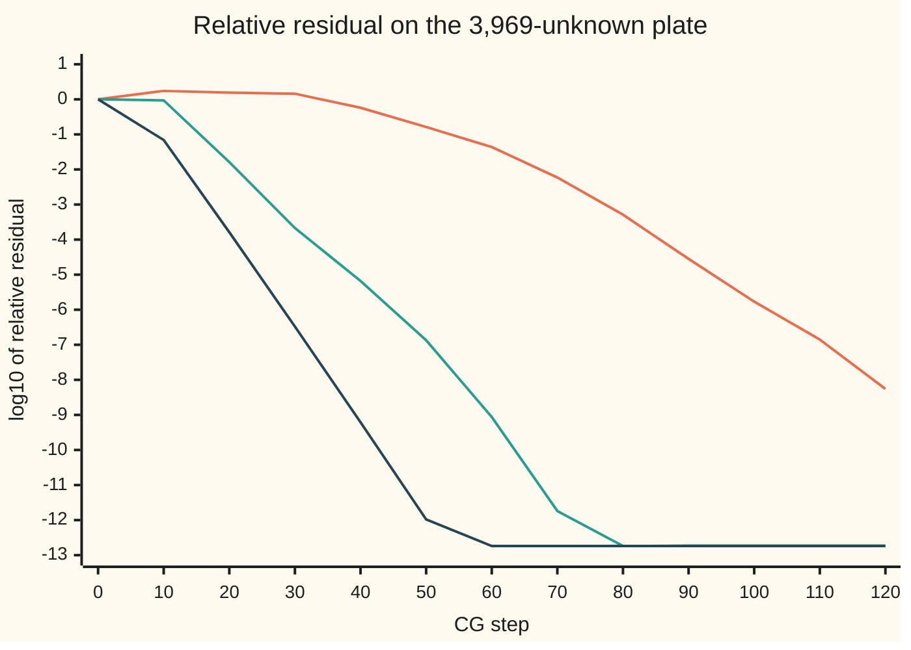
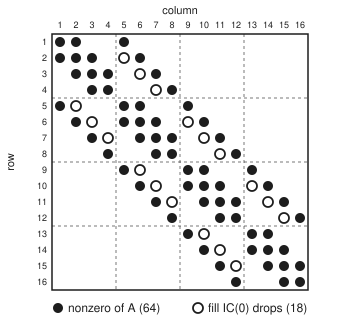

# Incomplete factorisations: LU and Cholesky that keep only the nonzeros you can afford

[Syllabus](../../../SYLLABUS.md) → [Numerical analysis](../README.md) → [Fast Solvers for Large Grids](../README.md#s09) → Incomplete factorisations

---

## General Overview

A steel plate, one metre square, is held at 0 C on its edges and warmed by a heater over its middle 25 cm square (the heater's strength is illustrative). What is the settled temperature at every point?

On a grid of 63 by 63 inside points (spacing $`h`$ = 1/64 m), the five-point rule of [Two space dimensions](../07-PDE%20Solvers/05-adi-and-multidimensional-grids.md) gives one linear system $`Au = b`$ with 3,969 unknowns and 19,593 nonzeros. The matrix is symmetric positive definite, so conjugate gradient (CG) applies ([Iterating instead of factoring](../03-Numerical%20Linear%20Algebra/09-iterative-methods-jacobi-gauss-seidel-and-conjugate-gradient.md)).

Plain CG needs 119 steps to cut the residual (how far $`Au`$ misses $`b`$) to 1e-8 of its start. The centre settles at 19.8941 C.

An exact Cholesky factor would finish in one step. But elimination creates new nonzeros, called **fill**, so the exact factor costs far more than $`A`$. An **incomplete factorisation** runs the same elimination and throws away all fill outside a pattern chosen in advance. The cheap approximate factor $`M = LU \approx A`$ is the **preconditioner**: CG works on $`M^{-1}A`$, which is much closer to the identity than $`A`$.

- **IC(0)**, incomplete Cholesky keeping exactly $`A`$'s nonzeros, cuts CG from 119 steps to 55.
- **MIC(0)**, which moves each dropped entry onto the diagonal, cuts it to 36.
- Each step pays for one forward and one back triangular solve: 114,093 flops against 78,876 (a flop is one add, subtract, multiply or divide).

**An incomplete factorisation runs Gaussian elimination but keeps only the entries in a chosen pattern, giving a factor that costs about as much to apply as one product with the matrix, yet is close enough to the matrix to cut conjugate gradient on the plate from 119 steps to 55, or to 36 with the modified rule.**

**What kind of fact this is:** a method resting on theorems. That the incomplete factor matches $`A`$ on the kept pattern, that it exists whenever $`A`$ is an M-matrix with every pivot positive and at least the exact pivot, and that the modified version keeps row sums are proved on this card. How the step counts grow as the grid is refined is stated from the named sources and measured here, not proved.

### The picture: the residual on the 63 by 63 plate



Orange: plain CG. Green: CG with IC(0). Dark blue: CG with MIC(0). Each point is the true residual, recomputed from scratch; one unit down is one more correct digit. The preconditioned runs flatten near −12.7, where rounding stops the fall. Plain CG's residual rises at first, because CG shrinks the error in $`A`$'s energy norm, not the residual.

---

## The formula

Gaussian elimination removes unknown $`k`$ by subtracting multiples of row $`k`$ from the later rows. Each later entry is updated by

```math
a_{ij} \leftarrow a_{ij} - \frac{a_{ik}\,a_{kj}}{a_{kk}}, \qquad i, j > k .
```

**Read it aloud:** entry $`(i, j)`$ loses the product of the two entries that link $`i`$ and $`j`$ to the point being removed, divided by that point's pivot.

When $`a_{ij}`$ was zero and both $`a_{ik}`$ and $`a_{kj}`$ are not, a new nonzero appears: fill. An incomplete factorisation fixes a pattern $`P`$ of kept positions and applies the update only there:

```math
\text{ILU}(P):\quad \text{do the update only if } (i, j) \in P, \qquad A = LU + R, \qquad R_{ij} = 0 \text{ for every } (i, j) \in P .
```

**Read it aloud:** run elimination, skip every update that lands outside the pattern, and the factors then reproduce $`A`$ exactly on the pattern; the leftover $`R`$ lives only where fill was dropped.

Three ways to choose the pattern:

- **ILU(0)**: $`P`$ is $`A`$'s own nonzeros. For a symmetric $`A`$ it is IC(0), incomplete Cholesky: $`M = \tilde L \tilde L^{T}`$ with $`\tilde L`$ the unit lower factor times the square roots of the pivots.
- **ILU(1), ILU(2), …**: give each entry a **level**: 0 for $`A`$'s nonzeros, and fill created through point $`k`$ gets $`\mathrm{lev}_{ij} = \min(\mathrm{lev}_{ij},\ \mathrm{lev}_{ik} + \mathrm{lev}_{kj} + 1)`$. ILU(1) keeps levels 0 and 1, and so on.
- **ILUT($`\tau`$)**: drop each new entry smaller than $`\tau`$ times the length of $`A`$'s row. The full method also caps the entries per row; this card's code does not.

Two repairs change the diagonal:

```math
\text{MILU:}\ u_{ii} \leftarrow u_{ii} + \textstyle\sum (\text{fill dropped in row } i), \qquad \text{shift:}\ \text{factor } A + \sigma\,\mathrm{diag}(A) \text{ instead of } A .
```

**Read it aloud:** the modified version adds each dropped entry back onto its row's diagonal, so $`M`$ and $`A`$ have the same row sums; the shifted version factors a slightly heavier diagonal so that no pivot goes negative.

| Symbol | Plain meaning | In our example | Push it up and the answer… |
| --- | --- | --- | --- |
| $`A`$, $`a_{ij}`$, $`p`$ | the five-point matrix and its entries; an eastward flow $`p`$ makes the west entry $`-1-p`$ and the east $`-1+p`$ | 4 on the diagonal, −1 off it; $`p`$ = 0.5 in the flow test | — |
| $`m`$, $`n`$, $`h`$ | inside points per side, unknowns $`n = m^2`$, grid spacing | 63, 3,969, 1/64 m; the hand example has 4 and 16 | CG and IC(0) steps double as $`m`$ doubles |
| $`u`$, $`b`$ | grid temperatures, C; the right side, $`h^2`$ times the heat source | centre 19.8941 C | — |
| $`P`$ | the pattern of kept positions | $`A`$'s 19,593 nonzeros for IC(0) | more kept, fewer steps, dearer steps |
| $`L`$, $`U`$, $`\ell_{ik}`$, $`u_{ii}`$ | incomplete factors (unit lower, upper), their entries, and the pivots on $`U`$'s diagonal (not the temperatures $`u`$); $`\tilde L`$ is the Cholesky-style factor | first pivots 4.0000, 3.7500 | — |
| $`M`$, $`r`$, $`z`$ | the preconditioner $`LU`$; each CG step solves $`Mz = r`$ for the current residual $`r`$ | — | — |
| $`R`$ | the remainder $`A - LU`$: zero on $`P`$, the dropped fill off it | −0.2500 at row 2, column 5 | bigger $`R`$, more steps |
| $`i`$, $`j`$, $`k`$; $`\mathrm{lev}`$ | row, column, and the point being eliminated; level of fill | IC(1) keeps 27,281 entries | — |
| $`\tau`$ | threshold for ILUT | 0.01 keeps 44,982 entries on the flow plate | larger $`\tau`$, sparser factor, more steps |
| $`\sigma`$ | diagonal shift, as a fraction of the diagonal | Kershaw's matrix breaks at 10%, works at 20% | safer pivots, a worse match to $`A`$ |
| $`\kappa`$ | condition number of $`A`$ in the 2-norm | 1659.4 | bigger error for the same residual |
| $`x`$; $`s`$, $`t`$; $`y`$, $`B`$, $`c`$, $`q`$, $`S`$, $`C`$, $`D`$ | a test vector with every entry positive, used to recognise an M-matrix; a grid point's column and row (Step 3); in Step 3's proof, $`x`$ without its first entry, $`A`$ without its first row and column, that column below the pivot and that row beside it, the block left after one elimination step, and the incomplete and exact blocks being compared | a smooth bump over the plate | — |
| $`d`$, $`\mathbf{1}`$ | an IC(0) pivot on the grid, written by its point's position; the vector of all ones | last 4 by 4 pivot 3.4147 | — |

### When it holds

- **$`A`$ is an M-matrix** (defined in Step 3). Then every pivot is positive. Kershaw's matrix is positive definite but not an M-matrix, and its fourth IC(0) pivot comes out −5.0000.
- **The factor must be symmetric when the solver is CG.** A threshold factor is not, and CG with it has not passed 1e-8 after 130 steps.
- **The dropped fill is small.** On the 4 by 4 plate it is at most 0.2925 against pivots above 3.4. Where dropped fill is large, $`M`$ is a poor copy of $`A`$.
- **A sensible ordering.** Numbering the points red-black (a checkerboard) instead of row by row costs IC(0) 60 steps instead of 55.

---

## Why it works

### Step 0: the idea

A preconditioner needs two things that pull against each other. $`M`$ must be close to $`A`$, so that $`M^{-1}A`$ is close to the identity and CG converges fast. And solving $`Mz = r`$ must cost about as much as one product with $`A`$.

The exact factor wins the first and loses the second; the diagonal does the reverse. An incomplete factor runs real elimination, so it captures how each point couples to its neighbours, but on a budget of nonzeros fixed in advance.

### Step 1: where fill comes from

Read the matrix as a graph: one dot per grid point, a line wherever $`a_{ij} \ne 0`$. Removing point $`k`$ by elimination joins every pair of its later neighbours, because the update above makes $`a_{ij}`$ nonzero whenever $`a_{ik}`$ and $`a_{kj}`$ are.

On the 4 by 4 grid, numbered row by row, point 1's later neighbours are point 2 (east) and point 5 (north). Removing point 1 joins them:

```math
a_{2,5} \leftarrow 0 - \frac{(-1)(-1)}{4} = -0.2500 .
```

Point 2 and point 5 are diagonal neighbours on the grid, three places apart in the numbering. Every first-generation fill on this grid lands the same way: on the two diagonals $`m - 1`$ places off the main one. IC(0) drops all of it; IC(1) keeps exactly those diagonals, which is why IC(1) on the 63 by 63 plate has $`19{,}593 + 2 \times 62^2 = 27{,}281`$ entries.

### Step 2: what the incomplete factor guarantees

Skipping updates outside $`P`$ leaves every update inside $`P`$ in place. So $`LU`$ reproduces $`A`$ on $`P`$, and off $`P`$ the difference is the skipped fill.

<details>
<summary>Detailed proof: A − LU is zero on the pattern and equals the dropped fill off it</summary>

Work row by row. Row $`i`$ starts as $`A`$'s row. For each $`k < i`$ with a nonzero at $`(i, k)`$, in increasing order, set $`\ell_{ik}`$ = (current entry $`(i, k)`$)$`/u_{kk}`$ and subtract $`\ell_{ik}`$ times row $`k`$ of $`U`$, only at positions in $`P`$. What remains from the diagonal rightward is row $`i`$ of $`U`$.

Entry $`(i, j)`$ of $`LU`$ is $`u_{ij} + \sum_{k<i} \ell_{ik} u_{kj}`$. At a position in $`P`$, the factorisation subtracted exactly those terms from $`a_{ij}`$ to make $`u_{ij}`$ (for $`j \ge i`$) or $`\ell_{ij}u_{jj}`$ (for $`j < i`$). So $`(LU)_{ij} = a_{ij}`$ there.

At a position outside $`P`$, the factorisation kept nothing: $`u_{ij}`$ or $`\ell_{ij}`$ is zero. So $`(LU)_{ij} = \sum_k \ell_{ik}u_{kj}`$, the total of the updates it skipped. Since $`a_{ij} = 0`$ there, $`(A - LU)_{ij}`$ is minus that total, which is the dropped fill. The code checks both halves on the 4 by 4 grid.

</details>

### Step 3: when every pivot is positive

Call $`A`$ an **M-matrix** when its off-diagonal entries are all zero or negative, and some vector $`x`$ with every entry positive gives $`Ax`$ with every entry positive (one of several equivalent definitions). The plate's matrix is one: the smooth bump $`x = \sin(\pi s h)\sin(\pi t h)`$, at the grid point in column $`s`$ and row $`t`$, gives $`Ax`$ a positive multiple of $`x`$.

The theorem of Meijerink and van der Vorst (1977): for an M-matrix, the incomplete factorisation exists for every pattern containing the diagonal, every pivot is positive, and each is at least the exact pivot. The proof keeps one invariant: the block not yet eliminated stays an M-matrix.

<details>
<summary>Detailed proof: the remaining block stays an M-matrix, so every pivot is positive</summary>

Split off the first unknown: $`A`$ has pivot $`a_{11}`$, first column below it $`c`$, first row beside it $`q^{T}`$, and the rest $`B`$. Split the test vector the same way, $`x = (x_1, y)`$.

Pivot positive. Row 1 of $`Ax > 0`$ says $`a_{11}x_1 > -q^{T}y`$. Every entry of $`q`$ is zero or negative and $`y`$ is positive, so the right side is at least 0. Hence $`a_{11} > 0`$.

One elimination step leaves $`S = B - c\,q^{T}/a_{11}`$. Its off-diagonal entries are $`b_{ij} - c_i q_j/a_{11}`$. Here $`b_{ij} \le 0`$, and $`c_i q_j \ge 0`$ as a product of two entries that are each zero or negative, so the entry is zero or negative.

$`S`$ passes the test with the vector $`y`$. From row 1, $`q^{T}y/a_{11} > -x_1`$. Every entry of $`-c`$ is at least 0, so

$`\displaystyle S\,y = B\,y - c\,\frac{q^{T}y}{a_{11}} \;\ge\; B\,y + c\,x_1 \;=\; (\text{rows 2 to } n \text{ of } Ax) > 0 .`$

Dropping fill. A dropped entry is an off-diagonal entry of $`S`$ at a position where $`b_{ij} = 0`$, so it equals $`-c_i q_j/a_{11} \le 0`$. Replacing it by 0 makes that entry larger and keeps it non-positive. Then $`S y`$ can only grow, so the reduced block still passes the test.

Induction. The reduced block is an M-matrix of size $`n - 1`$, so its own first pivot is positive, and so on to the last. Every pivot of the incomplete factor is positive.

Comparison with the exact factor. Run exact and incomplete elimination side by side. Suppose that at some stage the incomplete block $`C`$ and the exact block $`D`$ are both M-matrices with $`C \ge D`$ entry by entry. Then $`c_{11} \ge d_{11} > 0`$, and each off-diagonal $`c_{i1}`$, $`c_{1j}`$ is no further below zero than $`d_{i1}`$, $`d_{1j}`$. So $`c_{i1}c_{1j}/c_{11} \le d_{i1}d_{1j}/d_{11}`$, and every entry of the next incomplete block is at least the matching exact entry, before dropping. Dropping only raises entries. At the start $`C = D = A`$, so by induction every incomplete pivot is at least the exact one.

</details>

On the 4 by 4 plate the last IC(0) pivot is 3.4147 against the exact 3.3216. Without the M-matrix sign pattern the argument fails. Kershaw's matrix has $`a_{41} = +2`$, so the fill IC(0) drops at row 4, column 2 is positive, and dropping it drives the last pivot to −5.0000. The exact Cholesky pivots are 3.0000, 1.6667, 0.6000 and 0.3333, all positive.

### Step 4: why CG takes fewer steps, and why MIC(0) helps most

Preconditioned CG is CG applied to $`M^{-1/2}AM^{-1/2}`$, and its step count grows like the square root of that matrix's condition number. For the plain plate the condition number $`\kappa(A)`$, largest over smallest eigenvalue, is 1659.4, growing like $`h^{-2}`$. So plain CG takes 28, 59 and 119 steps on the 15, 31 and 63 grids: each halving of $`h`$ doubles the count.

IC(0) lowers the constant but not the growth: 16, 29 and 55. The slowest errors are the smooth ones, long gentle humps that $`A`$ barely changes, and IC(0) copies $`A`$ worst on exactly those.

MIC(0) keeps the row sums, $`M \cdot \mathbf{1} = A \cdot \mathbf{1}`$, where $`\mathbf{1}`$ is the vector of all ones. The proof is Step 2's: off the pattern, row $`i`$ of $`LU`$ holds minus the fill dropped from that row, and MIC adds that same fill to the diagonal, so the row's total is unchanged. The code checks it.

A smooth vector is nearly constant across one row's few entries, so a factor with $`A`$'s row sums is nearly right on smooth vectors too. Gustafsson (1978) proved that, with a small diagonal perturbation, the condition number then grows only like $`h^{-1}`$. Here the counts are 16, 23 and 36. MIC adds negative numbers to the diagonal and so can lose the M-matrix protection; the perturbation guards against that, and this plate did not need it.

### Step 5: more fill, other orderings

More fill buys fewer steps at a higher price per step. IC(1) needs 39 steps on the plate instead of 55, with 27,281 stored entries instead of 19,593.

An eastward flow over the plate makes the matrix nonsymmetric, so [BiCGSTAB](../03-Numerical%20Linear%20Algebra/13-bicgstab-and-short-recurrences.md) replaces CG. With $`p`$ = 0.5 the west neighbour counts 1.5 and the east 0.5. The matrix is still an M-matrix, so ILU(0) exists.

| Preconditioner | Factor nonzeros | BiCGSTAB steps to 1e-8 |
| --- | ---: | ---: |
| none | 19,593 (the matrix) | 52 |
| ILU(0) | 19,593 | 16 |
| ILU(1) | 27,281 | 11 |
| ILUT, $`\tau`$ = 0.01 | 44,982 | 7 |
| ILUT, $`\tau`$ = 0.001 | 128,353 | 4 |

The ordering decides which fill appears. Red-black numbering eliminates every red point first, and all the fill it creates between black points is dropped. IC(0) then needs 60 steps instead of 55. Duff and Meurant (1989) measured many orderings: those that run well in parallel tend to precondition worse.

### Step 6: the cost, and what "converged" means

One plain CG step costs one product (2 flops per nonzero), two dot products and three vector updates: $`2 \times 19{,}593 + 10 \times 3{,}969 = 78{,}876`$ flops. The two triangular solves add 2 flops per off-diagonal entry plus one division per row, for $`4 \times 19{,}593 + 9 \times 3{,}969 = 114{,}093`$ flops a step. Building IC(0) costs 38,812 flops, under half a CG step.

The stopping test, a relative residual below 1e-8, is a backward error ([Forward and backward error](../01-Floating%20Point%20and%20Error/06-forward-and-backward-error.md)). The relative error in $`u`$ can be $`\kappa`$ times larger: a bound of 0.00001659. The CG and IC(0) answers differ by 3.32e-10 of the peak temperature, far inside it.

---

## Worked numbers, by hand

The 4 by 4 grid: 16 unknowns numbered row by row, 64 nonzeros in $`A`$. IC(0) by the elimination rule.

| Step | Arithmetic | Value |
| --- | --- | --- |
| pivot 1 | $`a_{11}`$ | 4.0000 |
| pivot 2 | $`4 - (-1)(-1)/4`$ | 3.7500 |
| fill at row 2, column 5 | $`0 - (-1)(-1)/4`$, outside $`A`$'s pattern | **−0.2500, dropped** |
| pivot 5, IC(0) | $`4 - (-1)(-1)/4`$, point 1 is its south neighbour | 3.7500 |
| pivot 6, IC(0) | $`4 - 1/3.75 - 1/3.75`$: west and south neighbours | 3.4667 |
| last pivot, IC(0) against exact | the same recurrence, run to point 16 | 3.4147 against 3.3216 |
| all dropped fill | 9 mirror pairs, each 3 places off the diagonal | 18 entries, sizes 0.2500 to 0.2925 |
| remainder $`R = A - LU`$ | zero on the pattern, the dropped fill off it | −0.2500 at row 2, column 5 |

The first fill IC(0) throws away is −0.2500, a quarter of a neighbour coupling, at a position where $`A`$ has a zero; everything it keeps reproduces $`A`$ exactly. Exact elimination keeps every fill entry, that −0.2500 among them, so its pivot 6 comes out lower: 3.4051.

The rule for pivot 6 holds across the grid: each IC(0) pivot is $`d = 4 - 1/d_{\text{west}} - 1/d_{\text{south}}`$. The code runs this recurrence over the 63 by 63 grid as a second road and matches the general factorisation to 1e-12.

### The picture: the matrix and what IC(0) drops

<p align="center"></p>

Filled dots: the 64 nonzeros of $`A`$. Open circles: the 18 dropped fill entries. Dashed lines separate the grid's four rows. Drawn to scale, 16 units per entry; both checks print the dropped positions on their "figure," line.

### What breaks if you drop a piece

| Mistake | Comes out at | What went wrong |
| --- | --- | --- |
| IC(0) on a matrix that is not an M-matrix (Kershaw's) | pivot 4 is −5.0000; no square root exists | a positive off-diagonal entry makes dropped fill positive |
| Too small a shift on that matrix | 10% still breaks; 20% gives pivots 3.6000, 2.4889, 1.9929, 0.4817 | the shift must outweigh what dropping removed |
| A threshold factor inside CG | no pass of 1e-8 in 130 steps; log10 residual −0.95 | the factor is not symmetric, and CG needs symmetric $`M`$ |
| Counting steps, not flops | IC(0) takes 55 steps against 119, but 6,313,927 flops against 9,386,244 | each preconditioned step costs 114,093 flops, not 78,876 |

---

## Code, from first principles, and it actually runs

The code builds the five-point matrix as rows of (column, value) pairs, factors it by one general routine that handles ILU(0), ILU($`k`$), thresholds, the modified rule and shifts, and runs CG and BiCGSTAB with each factor. Five roads check it. The IC(0) pivots match the grid recurrence. $`A - LU`$, formed by a separate product, is zero on the pattern and equals the recorded dropped fill off it. The same routine with no dropping gives the exact factor, and CG with it finishes in 1 step. CG and IC(0) reach the same temperatures within the condition-number bound. Kershaw's exact Cholesky pivots are all positive while IC(0)'s fourth is not.

### Python

```python
# Incomplete factorisations -- the check behind the card.  Standard library
# only.  The heated plate's 5-point matrix: ILU(0), modified ILU(0), ILU(1),
# threshold dropping and diagonal shifts, used inside CG and BiCGSTAB.
import math
def grid(m, red_black=False, p=0.0):          # 5-point matrix; p = east-flow term
    cells = [(i, j) for j in range(m) for i in range(m)]
    if red_black: cells.sort(key=lambda c: (c[0] + c[1]) % 2)
    idx, A = {c: k for k, c in enumerate(cells)}, []
    for (i, j) in cells:
        row = {idx[(i, j)]: 4.0}
        for di, dj, v in ((-1, 0, -1 - p), (1, 0, -1 + p), (0, -1, -1.0), (0, 1, -1.0)):
            if (i + di, j + dj) in idx: row[idx[(i + di, j + dj)]] = v
        A.append(row)
    h, b = 1 / (m + 1), [0.0] * len(cells)    # heater: 1000 K/m^2 on the middle 0.25 m
    for (i, j), k in idx.items():
        if abs((i + 1) * h - 0.5) <= 0.125 and abs((j + 1) * h - 0.5) <= 0.125: b[k] = h * h * 1000
    return A, b, idx

def ilu(A, lev=0, tau=0.0, modified=False, shift=0.0):
    """Row-by-row LU keeping fill of level <= lev; returns (L, U), dropped fill, flops."""
    n, L, U, UL, drop, fl = len(A), [], [], [], {}, 0
    for i in range(n):
        w = dict(A[i]); w[i] *= 1 + shift; lv = {j: 0 for j in w}; k = -1
        while True:
            ks = [j for j in w if k < j < i]
            if not ks: break
            k = min(ks); w[k] /= U[k][k]; fl += 1
            for j, u in U[k].items():
                if j <= k: continue
                fl += 2; new = lv[k] + UL[k][j] + 1
                if j in w or new <= lev:
                    w[j] = w.get(j, 0.0) - w[k] * u; lv[j] = min(lv.get(j, new), new)
                else:                         # fill outside the kept pattern: drop it
                    drop[(i, j)] = drop.get((i, j), 0.0) - w[k] * u
                    if modified: w[i] -= w[k] * u; fl += 1
        size = math.sqrt(sum(v * v for v in A[i].values()))
        for j in [j for j in w if j != i and j not in A[i] and abs(w[j]) < tau * size]: del w[j]
        if w[i] <= 0: return None, (i, w[i]), fl   # breakdown: a pivot <= 0
        L.append({j: v for j, v in w.items() if j < i})
        U.append({j: v for j, v in w.items() if j >= i}); UL.append({j: lv[j] for j in U[-1]})
    return (L, U), drop, fl

def acc(pairs):                               # a plain left-to-right sum of products
    s = 0.0
    for a, c in pairs: s += a * c
    return s
def solve(F, r):                              # M z = r: forward with L, back with U
    L, U = F; n = len(r); y, z = [0.0] * n, [0.0] * n
    for i in range(n): y[i] = r[i] - acc((v, y[j]) for j, v in L[i].items())
    for i in range(n - 1, -1, -1):
        z[i] = (y[i] - acc((v, z[j]) for j, v in U[i].items() if j > i)) / U[i][i]
    return z

def mv(A, x): return [acc((v, x[j]) for j, v in row.items()) for row in A]
def dot(a, c): return acc(zip(a, c))
def rel(A, b, x): return math.sqrt(dot(r := [s - t for s, t in zip(b, mv(A, x))], r) / dot(b, b))
def nnz(F): return sum(len(l) + len(u) for l, u in zip(*F))
def pcg(A, b, F=None, steps=130):             # count = first step with ||r|| <= 1e-8 ||b||
    x, r, count, xs, hist = [0.0] * len(b), b[:], None, None, [0.0]
    z = solve(F, r) if F else r[:]; p = z[:]; rz = dot(r, z)
    for k in range(1, steps + 1):
        q = mv(A, p); a = rz / dot(p, q)
        x = [s + a * t for s, t in zip(x, p)]; r = [s - a * t for s, t in zip(r, q)]
        if count is None and dot(r, r) <= 1e-16 * dot(b, b): count, xs = k, x
        if k % 10 == 0: hist.append(math.log10(rel(A, b, x)))
        z = solve(F, r) if F else r[:]; rz, old = dot(r, z), rz
        p = [s + rz / old * t for s, t in zip(z, p)]
    return count, xs, hist

def bicgstab(A, b, F=None):
    P = (lambda y: solve(F, y)) if F else (lambda y: y[:])
    x = [0.0] * len(b); r = b[:]; rh = b[:]; rho = al = om = 1.0; v = p = [0.0] * len(b)
    for k in range(1, 300):
        rho, old = dot(rh, r), rho; be = rho / old * al / om
        p = [s + be * (t - om * u) for s, t, u in zip(r, p, v)]; ph = P(p); v = mv(A, ph)
        al = rho / dot(rh, v); s = [t - al * u for t, u in zip(r, v)]; sh = P(s); t = mv(A, sh)
        om = dot(t, s) / dot(t, t); x = [c + al * d + om * e for c, d, e in zip(x, ph, sh)]
        r = [c - om * d for c, d in zip(s, t)]
        if dot(r, r) <= 1e-16 * dot(b, b): return k, x

def piv(F): return [F[1][i][i] for i in range(len(F[1]))]
def fmt(xs): return " ".join(f"{x:.4f}" for x in xs)
def yn(c): return "yes" if c else "no"
A4, _, _ = grid(4); F4, drop4, _ = ilu(A4); E4 = ilu(A4, lev=99)[0]
print(f"4 by 4 grid: 16 unknowns, {sum(map(len, A4))} nonzeros in A")
print(f"first fill: row 2, column 5 gets 0 - (-1)(-1)/4 = {drop4[(1, 4)]:.4f}, dropped by IC(0)")
print("IC(0) pivots:", fmt(piv(F4))); print("exact pivots:", fmt(piv(E4)))
offs = sorted({abs(i - j) for i, j in drop4})
print(f"dropped fill: {len(drop4)} entries, all {offs[0]} places off the diagonal, "
      f"sizes {min(map(abs, drop4.values())):.4f} to {max(map(abs, drop4.values())):.4f}")
R4 = [[A4[i].get(j, 0.0) - F4[1][i].get(j, 0.0) - acc((v, F4[1][k].get(j, 0.0)) for k, v in F4[0][i].items())
       for j in range(16)] for i in range(16)]
on = max(abs(R4[i][j]) for i in range(16) for j in A4[i])
off = max(abs(R4[i][j] - drop4.get((i, j), 0.0)) for i in range(16) for j in range(16))
print(f"A - LU below 1e-14 on the pattern: {yn(on < 1e-14)}; equal to the dropped fill off it: {yn(off < 1e-14)}")
print("figure, 16 by 16 pattern, dropped fill at", " ".join(f"{i+1}:{j+1}" for i, j in sorted(drop4) if i < j))
print("grid   unknowns   CG  IC(0)  MIC(0)  IC(1)  IC(0) red-black")
for m in (15, 31, 63):
    A, b, idx = grid(m); Ar, br, _ = grid(m, red_black=True); F, _, ffl = ilu(A); M, _, mfl = ilu(A, modified=True)
    runs = [pcg(A, b), pcg(A, b, F), pcg(A, b, M), pcg(A, b, ilu(A, lev=1)[0]), pcg(Ar, br, ilu(Ar)[0])]
    print(f"{m:>4} {m * m:>10} " + " ".join(f"{c:>5}" for c, _, _ in runs))
d = {}                                        # second road to the IC(0) pivots: the grid recurrence
for j in range(63):
    for i in range(63): d[(i, j)] = 4 - (1 / d[(i - 1, j)] if i else 0) - (1 / d[(i, j - 1)] if j else 0)
gap = max(abs(d[c] - F[1][k][k]) for c, k in idx.items())
print(f"IC(0) pivots by the grid recurrence d = 4 - 1/d(west) - 1/d(south): agree to 1e-12: {yn(gap < 1e-12)}")
n, nz = m * m, sum(map(len, A)); cg_step, pc_step = 2 * nz + 10 * n, 4 * nz + 9 * n
print(f"63 by 63: n = {n}, nonzeros {nz}; IC(1) factor {nnz(ilu(A, lev=1)[0])}; IC(0) factor costs {ffl} flops, MIC(0) {mfl}")
print(f"flops per step: CG {cg_step}, preconditioned CG {pc_step}")
tot = [runs[0][0] * cg_step, runs[1][0] * pc_step + ffl, runs[2][0] * pc_step + mfl]
print(f"flops to 1e-8: CG {tot[0]}, IC(0) {tot[1]}, MIC(0) {tot[2]}")
for name, (c, _, h) in zip(("CG", "IC(0)", "MIC(0)"), runs):
    print(f"chart, {name:<6} log10 relative residual, steps 0 to 120 by 10:", " ".join(f"{v:.2f}" for v in h[:13]))
mid = idx[(31, 31)]; xc, xi = runs[0][1], runs[1][1]; kap = (math.sin(63 * math.pi / 128) / math.sin(math.pi / 128)) ** 2
diff, top = max(abs(s - t) for s, t in zip(xc, xi)), max(map(abs, xc))
print(f"centre temperature: CG {xc[mid]:.4f} C, IC(0) {xi[mid]:.4f} C; largest gap {diff / top:.2e} of the peak {top:.4f} C")
print(f"condition number of A: {kap:.1f}; bound on each answer's relative error {kap * 1e-8:.8f}")
A15, b15, _ = grid(15); c15 = pcg(A15, b15, ilu(A15, lev=99)[0], steps=1)[0]
print(f"15 by 15 with the full factor (no dropping): {c15} step")
print(f"estimate, 1023 by 1023: CG {runs[0][0] * 16}, IC(0) {runs[1][0] * 16}, MIC(0) {runs[2][0] * 4} steps")
K = [{0: 3.0, 1: -2.0, 3: 2.0}, {0: -2.0, 1: 3.0, 2: -2.0}, {1: -2.0, 2: 3.0, 3: -2.0}, {0: 2.0, 2: -2.0, 3: 3.0}]
fails = ilu(K)[1]; shifted = [ilu(K, shift=s)[0] for s in (0.1, 0.2)]
print(f"Kershaw: IC(0) pivot {fails[0] + 1} comes out {fails[1]:.4f}; exact pivots {fmt(piv(ilu(K, lev=99)[0]))}")
print(f"Kershaw shifted 10%: {'breaks' if shifted[0] is None else 'works'}; 20%: pivots {fmt(piv(shifted[1]))}")
G = ilu(A, tau=0.01, lev=99)[0]; cT = pcg(A, b, G)
print(f"CG with a threshold factor (tau 0.01, not symmetric): no pass in 130 steps, log10 residual {cT[2][-1]:.2f}")
mic_gap = max(abs(v - 1) for v in solve(M, [sum(r.values()) for r in A]))
print(f"MIC(0) keeps row sums: M^-1 (A times ones) = ones to 1e-12: {yn(mic_gap < 1e-12)}")
Aw, bw, _ = grid(63, p=0.5); out = [(bicgstab(Aw, bw)[0], nz)]
for opt in (dict(), dict(lev=1), dict(lev=99, tau=1e-2), dict(lev=99, tau=1e-3)):
    Fw = ilu(Aw, **opt)[0]; out.append((bicgstab(Aw, bw, Fw)[0], nnz(Fw)))
print("plate with flow, BiCGSTAB steps (factor nonzeros): none, ILU(0), ILU(1), tau 1e-2, tau 1e-3:",
      ", ".join(f"{c} ({z})" for c, z in out))
assert drop4[(1, 4)] == -0.25 and offs == [3] and len(drop4) == 18 and on < 1e-14 and off < 1e-14
assert all(s >= t - 1e-12 for s, t in zip(piv(F4), piv(E4))) and gap < 1e-12
assert runs[0][0] > 2 * runs[1][0] > 2 * runs[2][0] and runs[4][0] > runs[1][0] and c15 == 1
assert diff < 2 * kap * 1e-8 * top and mic_gap < 1e-12 and tot[2] < tot[1] < tot[0]
assert fails[0] == 3 and fails[1] < 0 and shifted[0] is None and min(piv(shifted[1])) > 0
assert cT[0] is None and out[1][1] == nz and out[0][0] > out[1][0] > out[2][0] > out[3][0]
print("ALL CHECKS PASS")
```

**Ran 2026-11-24 on macOS, Python 3.14.10, standard library only. All checks passed. Output, pasted from the run:**

```
4 by 4 grid: 16 unknowns, 64 nonzeros in A
first fill: row 2, column 5 gets 0 - (-1)(-1)/4 = -0.2500, dropped by IC(0)
IC(0) pivots: 4.0000 3.7500 3.7333 3.7321 3.7500 3.4667 3.4437 3.4417 3.7333 3.4437 3.4192 3.4170 3.7321 3.4417 3.4170 3.4147
exact pivots: 4.0000 3.7500 3.7333 3.7321 3.7321 3.4051 3.3690 3.3868 3.7047 3.3496 3.3022 3.3338 3.7000 3.3362 3.2846 3.3216
dropped fill: 18 entries, all 3 places off the diagonal, sizes 0.2500 to 0.2925
A - LU below 1e-14 on the pattern: yes; equal to the dropped fill off it: yes
figure, 16 by 16 pattern, dropped fill at 2:5 3:6 4:7 6:9 7:10 8:11 10:13 11:14 12:15
grid   unknowns   CG  IC(0)  MIC(0)  IC(1)  IC(0) red-black
  15        225    28    16    16    12    15
  31        961    59    29    23    22    30
  63       3969   119    55    36    39    60
IC(0) pivots by the grid recurrence d = 4 - 1/d(west) - 1/d(south): agree to 1e-12: yes
63 by 63: n = 3969, nonzeros 19593; IC(1) factor 27281; IC(0) factor costs 38812 flops, MIC(0) 46500
flops per step: CG 78876, preconditioned CG 114093
flops to 1e-8: CG 9386244, IC(0) 6313927, MIC(0) 4153848
chart, CG     log10 relative residual, steps 0 to 120 by 10: 0.00 0.24 0.19 0.16 -0.24 -0.79 -1.36 -2.23 -3.29 -4.55 -5.77 -6.85 -8.26
chart, IC(0)  log10 relative residual, steps 0 to 120 by 10: 0.00 -0.03 -1.79 -3.67 -5.18 -6.87 -9.06 -11.74 -12.74 -12.73 -12.73 -12.73 -12.73
chart, MIC(0) log10 relative residual, steps 0 to 120 by 10: 0.00 -1.16 -3.79 -6.48 -9.21 -11.98 -12.74 -12.74 -12.74 -12.74 -12.74 -12.74 -12.74
centre temperature: CG 19.8941 C, IC(0) 19.8941 C; largest gap 3.32e-10 of the peak 19.8941 C
condition number of A: 1659.4; bound on each answer's relative error 0.00001659
15 by 15 with the full factor (no dropping): 1 step
estimate, 1023 by 1023: CG 1904, IC(0) 880, MIC(0) 144 steps
Kershaw: IC(0) pivot 4 comes out -5.0000; exact pivots 3.0000 1.6667 0.6000 0.3333
Kershaw shifted 10%: breaks; 20%: pivots 3.6000 2.4889 1.9929 0.4817
CG with a threshold factor (tau 0.01, not symmetric): no pass in 130 steps, log10 residual -0.95
MIC(0) keeps row sums: M^-1 (A times ones) = ones to 1e-12: yes
plate with flow, BiCGSTAB steps (factor nonzeros): none, ILU(0), ILU(1), tau 1e-2, tau 1e-3: 52 (19593), 16 (19593), 11 (27281), 7 (44982), 4 (128353)
ALL CHECKS PASS
```

### Rust

Same numbers, same labels, built with `rustc --edition 2021 -O`. Sums run left to right in both languages, in the same order, so the two outputs agree digit for digit.

```rust
// Incomplete factorisations -- the same check as the Python, in Rust.  No
// crates.  The heated plate's 5-point matrix: ILU(0), modified ILU(0), ILU(1),
// threshold dropping and diagonal shifts, used inside CG and BiCGSTAB.
use std::collections::HashMap;
type Row = Vec<(usize, f64)>; // a sparse row, kept in insertion order
struct Fac { l: Vec<Row>, u: Vec<Row>, d: Vec<f64> }
fn get(row: &Row, j: usize) -> f64 { row.iter().find(|e| e.0 == j).map_or(0.0, |e| e.1) }
fn grid(m: usize, red_black: bool, p: f64) -> (Vec<Row>, Vec<f64>, Vec<usize>) {
    let mut cells: Vec<(usize, usize)> = (0..m * m).map(|k| (k % m, k / m)).collect();
    if red_black { cells.sort_by_key(|c| (c.0 + c.1) % 2); }
    let mut idx = vec![0; m * m]; for (k, c) in cells.iter().enumerate() { idx[c.1 * m + c.0] = k; }
    let (h, mut a, mut b) = (1.0 / (m + 1) as f64, Vec::new(), vec![0.0; m * m]);
    for &(i, j) in &cells {
        let mut row = vec![(idx[j * m + i], 4.0)];
        for (di, dj, v) in [(-1i64, 0i64, -1.0 - p), (1, 0, -1.0 + p), (0, -1, -1.0), (0, 1, -1.0)] {
            let (x, y) = (i as i64 + di, j as i64 + dj);
            if x >= 0 && y >= 0 && x < m as i64 && y < m as i64 { row.push((idx[y as usize * m + x as usize], v)); }
        }
        a.push(row);
        let (x, y) = ((i + 1) as f64 * h, (j + 1) as f64 * h);
        if (x - 0.5).abs() <= 0.125 && (y - 0.5).abs() <= 0.125 { b[idx[j * m + i]] = h * h * 1000.0; }
    }
    (a, b, idx)
}
// Row-by-row LU keeping fill of level <= lev; returns the factor or the breakdown, dropped fill, flops.
fn ilu(a: &[Row], lev: usize, tau: f64, modified: bool, shift: f64)
    -> (Result<Fac, (usize, f64)>, HashMap<(usize, usize), f64>, u64) {
    let (mut f, mut ul, mut drop, mut fl) = (Fac { l: vec![], u: vec![], d: vec![] }, Vec::<Vec<usize>>::new(), HashMap::new(), 0u64);
    for i in 0..a.len() {
        let (mut w, mut lv): (Row, Vec<usize>) = (a[i].clone(), vec![0; a[i].len()]);
        let mut pos: HashMap<usize, usize> = w.iter().enumerate().map(|(q, e)| (e.0, q)).collect();
        w[pos[&i]].1 *= 1.0 + shift; let mut k: i64 = -1;
        loop {
            let Some(kk) = w.iter().map(|e| e.0).filter(|&j| (j as i64) > k && j < i).min() else { break };
            k = kk as i64; let qk = pos[&kk]; w[qk].1 /= f.d[kk]; fl += 1; let wk = w[qk].1;
            for (t, &(j, u)) in f.u[kk].iter().enumerate() {
                if j <= kk { continue; }
                fl += 2; let new = lv[qk] + ul[kk][t] + 1;
                if let Some(&q) = pos.get(&j) { w[q].1 = w[q].1 - wk * u; lv[q] = lv[q].min(new); }
                else if new <= lev { pos.insert(j, w.len()); w.push((j, 0.0 - wk * u)); lv.push(new); }
                else {  // fill outside the kept pattern: drop it
                    let e = drop.entry((i, j)).or_insert(0.0); *e = *e - wk * u;
                    if modified { let qi = pos[&i]; w[qi].1 -= wk * u; fl += 1; }
                }
            }
        }
        let size = a[i].iter().fold(0.0, |s, e| s + e.1 * e.1).sqrt();
        let keep: Vec<bool> = w.iter().map(|e| e.0 == i || a[i].iter().any(|x| x.0 == e.0) || e.1.abs() >= tau * size).collect();
        let lvk: Vec<usize> = lv.iter().zip(&keep).filter(|p| *p.1).map(|p| *p.0).collect();
        let w: Row = w.iter().zip(&keep).filter(|p| *p.1).map(|p| *p.0).collect();
        let di = get(&w, i); if di <= 0.0 { return (Err((i, di)), drop, fl); } // breakdown: a pivot <= 0
        f.l.push(w.iter().filter(|e| e.0 < i).cloned().collect()); f.u.push(w.iter().filter(|e| e.0 >= i).cloned().collect());
        ul.push(w.iter().zip(&lvk).filter(|p| p.0 .0 >= i).map(|p| *p.1).collect());
        f.d.push(di);
    }
    (Ok(f), drop, fl)
}
fn acc<I: Iterator<Item = (f64, f64)>>(pairs: I) -> f64 { let mut s = 0.0; for (a, c) in pairs { s += a * c; } s }
fn solve(f: &Fac, r: &[f64]) -> Vec<f64> { // M z = r: forward with L, back with U
    let n = r.len(); let (mut y, mut z) = (vec![0.0; n], vec![0.0; n]);
    for i in 0..n { y[i] = r[i] - acc(f.l[i].iter().map(|&(j, v)| (v, y[j]))); }
    for i in (0..n).rev() { z[i] = (y[i] - acc(f.u[i].iter().filter(|e| e.0 > i).map(|&(j, v)| (v, z[j])))) / f.d[i]; }
    z
}
fn mv(a: &[Row], x: &[f64]) -> Vec<f64> { a.iter().map(|row| acc(row.iter().map(|&(j, v)| (v, x[j])))).collect() }
fn dot(a: &[f64], c: &[f64]) -> f64 { acc(a.iter().zip(c).map(|(&s, &t)| (s, t))) }
fn rel(a: &[Row], b: &[f64], x: &[f64]) -> f64 { let r: Vec<f64> = b.iter().zip(mv(a, x)).map(|(s, t)| s - t).collect(); (dot(&r, &r) / dot(b, b)).sqrt() }
fn nnz(f: &Fac) -> usize { f.l.iter().zip(&f.u).map(|(l, u)| l.len() + u.len()).sum() }
fn prec(f: Option<&Fac>, r: &[f64]) -> Vec<f64> { match f { Some(f) => solve(f, r), None => r.to_vec() } }
fn pcg(a: &[Row], b: &[f64], f: Option<&Fac>, steps: usize) -> (Option<usize>, Vec<f64>, Vec<f64>) {
    let (mut x, mut r, mut count, mut xs, mut hist) = (vec![0.0; b.len()], b.to_vec(), None, vec![], vec![0.0]);
    let mut z = prec(f, &r); let mut p = z.clone(); let mut rz = dot(&r, &z);
    for k in 1..=steps {
        let q = mv(a, &p); let al = rz / dot(&p, &q);
        x = x.iter().zip(&p).map(|(s, t)| s + al * t).collect(); r = r.iter().zip(&q).map(|(s, t)| s - al * t).collect();
        if count.is_none() && dot(&r, &r) <= 1e-16 * dot(b, b) { count = Some(k); xs = x.clone(); }
        if k % 10 == 0 { hist.push(rel(a, b, &x).log10()); }
        z = prec(f, &r); let old = rz; rz = dot(&r, &z);
        p = z.iter().zip(&p).map(|(s, t)| s + rz / old * t).collect();
    }
    (count, xs, hist)
}
fn bicgstab(a: &[Row], b: &[f64], f: Option<&Fac>) -> Option<usize> {
    let n = b.len(); let (mut x, mut r, rh) = (vec![0.0; n], b.to_vec(), b.to_vec());
    let (mut rho, mut al, mut om, mut v, mut p) = (1.0, 1.0, 1.0, vec![0.0; n], vec![0.0; n]);
    for k in 1..300 {
        let old = rho; rho = dot(&rh, &r); let be = rho / old * al / om;
        p = (0..n).map(|i| r[i] + be * (p[i] - om * v[i])).collect(); let ph = prec(f, &p); v = mv(a, &ph);
        al = rho / dot(&rh, &v); let s: Vec<f64> = (0..n).map(|i| r[i] - al * v[i]).collect();
        let sh = prec(f, &s); let t = mv(a, &sh); om = dot(&t, &s) / dot(&t, &t);
        x = (0..n).map(|i| x[i] + al * ph[i] + om * sh[i]).collect(); r = (0..n).map(|i| s[i] - om * t[i]).collect();
        if dot(&r, &r) <= 1e-16 * dot(b, b) { return Some(k); }
    }
    None
}
fn fmt(xs: &[f64]) -> String { xs.iter().map(|x| format!("{:.4}", x)).collect::<Vec<_>>().join(" ") }
fn yn(c: bool) -> &'static str { if c { "yes" } else { "no" } }
fn fac(r: (Result<Fac, (usize, f64)>, HashMap<(usize, usize), f64>, u64)) -> Fac { r.0.ok().unwrap() }
fn main() {
    let (a4, _, _) = grid(4, false, 0.0); let (f4r, drop4, _) = ilu(&a4, 0, 0.0, false, 0.0);
    let (f4, e4) = (f4r.ok().unwrap(), fac(ilu(&a4, 99, 0.0, false, 0.0)));
    println!("4 by 4 grid: 16 unknowns, {} nonzeros in A", a4.iter().map(|r| r.len()).sum::<usize>());
    println!("first fill: row 2, column 5 gets 0 - (-1)(-1)/4 = {:.4}, dropped by IC(0)", drop4[&(1, 4)]);
    println!("IC(0) pivots: {}", fmt(&f4.d)); println!("exact pivots: {}", fmt(&e4.d));
    let mut offs: Vec<usize> = drop4.keys().map(|&(i, j)| i.abs_diff(j)).collect(); offs.sort(); offs.dedup();
    let sizes: Vec<f64> = drop4.values().map(|v| v.abs()).collect();
    println!("dropped fill: {} entries, all {} places off the diagonal, sizes {:.4} to {:.4}", drop4.len(), offs[0],
             sizes.iter().cloned().fold(f64::MAX, f64::min), sizes.iter().cloned().fold(0.0, f64::max));
    let r4 = |i: usize, j: usize| get(&a4[i], j) - get(&f4.u[i], j) - acc(f4.l[i].iter().map(|&(k, v)| (v, get(&f4.u[k], j))));
    let on = (0..16).flat_map(|i| a4[i].iter().map(move |e| (i, e.0))).map(|(i, j)| r4(i, j).abs()).fold(0.0, f64::max);
    let off = (0..256).map(|q| (r4(q / 16, q % 16) - drop4.get(&(q / 16, q % 16)).unwrap_or(&0.0)).abs()).fold(0.0, f64::max);
    println!("A - LU below 1e-14 on the pattern: {}; equal to the dropped fill off it: {}", yn(on < 1e-14), yn(off < 1e-14));
    let mut fig: Vec<&(usize, usize)> = drop4.keys().filter(|p| p.0 < p.1).collect(); fig.sort();
    println!("figure, 16 by 16 pattern, dropped fill at {}", fig.iter().map(|p| format!("{}:{}", p.0 + 1, p.1 + 1)).collect::<Vec<_>>().join(" "));
    println!("grid   unknowns   CG  IC(0)  MIC(0)  IC(1)  IC(0) red-black");
    let (mut a, mut b, mut idx, mut runs) = (vec![], vec![], vec![], vec![]);
    let (mut ff, mut mm, mut ffl, mut mfl) = (None, None, 0, 0);
    for m in [15, 31, 63] {
        (a, b, idx) = grid(m, false, 0.0); let (ar, br, _) = grid(m, true, 0.0);
        let (f, _, fl1) = ilu(&a, 0, 0.0, false, 0.0); let (mo, _, fl2) = ilu(&a, 0, 0.0, true, 0.0);
        let (f, mo, f1, fr) = (f.ok().unwrap(), mo.ok().unwrap(), fac(ilu(&a, 1, 0.0, false, 0.0)), fac(ilu(&ar, 0, 0.0, false, 0.0)));
        runs = vec![pcg(&a, &b, None, 130), pcg(&a, &b, Some(&f), 130), pcg(&a, &b, Some(&mo), 130),
                    pcg(&a, &b, Some(&f1), 130), pcg(&ar, &br, Some(&fr), 130)];
        println!("{:>4} {:>10} {}", m, m * m, runs.iter().map(|r| format!("{:>5}", r.0.unwrap())).collect::<Vec<_>>().join(" "));
        (ff, mm, ffl, mfl) = (Some(f), Some(mo), fl1, fl2);
    }
    let (f, mo, c) = (ff.unwrap(), mm.unwrap(), |q: usize| runs[q].0.unwrap());
    let mut d = vec![0.0; 63 * 63]; // second road to the IC(0) pivots: the grid recurrence
    for q in 0..63 * 63 { d[q] = 4.0 - if q % 63 > 0 { 1.0 / d[q - 1] } else { 0.0 } - if q >= 63 { 1.0 / d[q - 63] } else { 0.0 }; }
    let gap = (0..63 * 63).map(|q| (d[q] - f.d[idx[q]]).abs()).fold(0.0, f64::max);
    println!("IC(0) pivots by the grid recurrence d = 4 - 1/d(west) - 1/d(south): agree to 1e-12: {}", yn(gap < 1e-12));
    let (n, nz) = (63 * 63, a.iter().map(|r| r.len()).sum::<usize>()); let (cg_step, pc_step) = (2 * nz + 10 * n, 4 * nz + 9 * n);
    println!("63 by 63: n = {}, nonzeros {}; IC(1) factor {}; IC(0) factor costs {} flops, MIC(0) {}", n, nz, nnz(&fac(ilu(&a, 1, 0.0, false, 0.0))), ffl, mfl);
    println!("flops per step: CG {}, preconditioned CG {}", cg_step, pc_step);
    let tot = [c(0) * cg_step, c(1) * pc_step + ffl as usize, c(2) * pc_step + mfl as usize];
    println!("flops to 1e-8: CG {}, IC(0) {}, MIC(0) {}", tot[0], tot[1], tot[2]);
    for (name, r) in ["CG", "IC(0)", "MIC(0)"].iter().zip(&runs) {
        println!("chart, {:<6} log10 relative residual, steps 0 to 120 by 10: {}", name, r.2[..13].iter().map(|v| format!("{:.2}", v)).collect::<Vec<_>>().join(" "));
    }
    let (mid, xc, xi) = (idx[31 * 63 + 31], &runs[0].1, &runs[1].1);
    let kap = ((63.0 * std::f64::consts::PI / 128.0).sin() / (std::f64::consts::PI / 128.0).sin()).powi(2);
    let (diff, top) = (xc.iter().zip(xi).map(|(s, t)| (s - t).abs()).fold(0.0, f64::max), xc.iter().map(|v| v.abs()).fold(0.0, f64::max));
    println!("centre temperature: CG {:.4} C, IC(0) {:.4} C; largest gap {:.2e} of the peak {:.4} C", xc[mid], xi[mid], diff / top, top);
    println!("condition number of A: {:.1}; bound on each answer's relative error {:.8}", kap, kap * 1e-8);
    let (a15, b15, _) = grid(15, false, 0.0); let c15 = pcg(&a15, &b15, Some(&fac(ilu(&a15, 99, 0.0, false, 0.0))), 1).0;
    println!("15 by 15 with the full factor (no dropping): {} step", c15.unwrap());
    println!("estimate, 1023 by 1023: CG {}, IC(0) {}, MIC(0) {} steps", c(0) * 16, c(1) * 16, c(2) * 4);
    let k: Vec<Row> = vec![vec![(0, 3.0), (1, -2.0), (3, 2.0)], vec![(0, -2.0), (1, 3.0), (2, -2.0)],
                           vec![(1, -2.0), (2, 3.0), (3, -2.0)], vec![(0, 2.0), (2, -2.0), (3, 3.0)]];
    let fails = ilu(&k, 0, 0.0, false, 0.0).0.err().unwrap(); let (s1, s2) = (ilu(&k, 0, 0.0, false, 0.1).0, fac(ilu(&k, 0, 0.0, false, 0.2)));
    println!("Kershaw: IC(0) pivot {} comes out {:.4}; exact pivots {}", fails.0 + 1, fails.1, fmt(&fac(ilu(&k, 99, 0.0, false, 0.0)).d));
    println!("Kershaw shifted 10%: {}; 20%: pivots {}", if s1.is_err() { "breaks" } else { "works" }, fmt(&s2.d));
    let g = fac(ilu(&a, 99, 0.01, false, 0.0)); let ct = pcg(&a, &b, Some(&g), 130);
    println!("CG with a threshold factor (tau 0.01, not symmetric): no pass in 130 steps, log10 residual {:.2}", ct.2[ct.2.len() - 1]);
    let mic_gap = solve(&mo, &a.iter().map(|r| r.iter().map(|e| e.1).sum()).collect::<Vec<f64>>()).iter().map(|v| (v - 1.0).abs()).fold(0.0, f64::max);
    println!("MIC(0) keeps row sums: M^-1 (A times ones) = ones to 1e-12: {}", yn(mic_gap < 1e-12));
    let (aw, bw, _) = grid(63, false, 0.5); let mut out = vec![(bicgstab(&aw, &bw, None).unwrap(), nz)];
    for (lev, tau) in [(0, 0.0), (1, 0.0), (99, 1e-2), (99, 1e-3)] {
        let fw = fac(ilu(&aw, lev, tau, false, 0.0)); out.push((bicgstab(&aw, &bw, Some(&fw)).unwrap(), nnz(&fw)));
    }
    println!("plate with flow, BiCGSTAB steps (factor nonzeros): none, ILU(0), ILU(1), tau 1e-2, tau 1e-3: {}",
             out.iter().map(|o| format!("{} ({})", o.0, o.1)).collect::<Vec<_>>().join(", "));
    assert!(drop4[&(1, 4)] == -0.25 && offs == vec![3] && drop4.len() == 18 && on < 1e-14 && off < 1e-14);
    assert!(f4.d.iter().zip(&e4.d).all(|(s, t)| *s >= t - 1e-12) && gap < 1e-12);
    assert!(c(0) > 2 * c(1) && 2 * c(1) > 2 * c(2) && c(4) > c(1) && c15 == Some(1));
    assert!(diff < 2.0 * kap * 1e-8 * top && mic_gap < 1e-12 && tot[2] < tot[1] && tot[1] < tot[0]);
    assert!(fails.0 == 3 && fails.1 < 0.0 && s1.is_err() && s2.d.iter().cloned().fold(f64::MAX, f64::min) > 0.0);
    assert!(ct.0.is_none() && out[1].1 == nz && out[0].0 > out[1].0 && out[1].0 > out[2].0 && out[2].0 > out[3].0);
    println!("ALL CHECKS PASS");
}
```

**Ran 2026-11-24 on macOS, rustc 1.98.1, no crates. All checks passed. Output, pasted from the run:**

```
4 by 4 grid: 16 unknowns, 64 nonzeros in A
first fill: row 2, column 5 gets 0 - (-1)(-1)/4 = -0.2500, dropped by IC(0)
IC(0) pivots: 4.0000 3.7500 3.7333 3.7321 3.7500 3.4667 3.4437 3.4417 3.7333 3.4437 3.4192 3.4170 3.7321 3.4417 3.4170 3.4147
exact pivots: 4.0000 3.7500 3.7333 3.7321 3.7321 3.4051 3.3690 3.3868 3.7047 3.3496 3.3022 3.3338 3.7000 3.3362 3.2846 3.3216
dropped fill: 18 entries, all 3 places off the diagonal, sizes 0.2500 to 0.2925
A - LU below 1e-14 on the pattern: yes; equal to the dropped fill off it: yes
figure, 16 by 16 pattern, dropped fill at 2:5 3:6 4:7 6:9 7:10 8:11 10:13 11:14 12:15
grid   unknowns   CG  IC(0)  MIC(0)  IC(1)  IC(0) red-black
  15        225    28    16    16    12    15
  31        961    59    29    23    22    30
  63       3969   119    55    36    39    60
IC(0) pivots by the grid recurrence d = 4 - 1/d(west) - 1/d(south): agree to 1e-12: yes
63 by 63: n = 3969, nonzeros 19593; IC(1) factor 27281; IC(0) factor costs 38812 flops, MIC(0) 46500
flops per step: CG 78876, preconditioned CG 114093
flops to 1e-8: CG 9386244, IC(0) 6313927, MIC(0) 4153848
chart, CG     log10 relative residual, steps 0 to 120 by 10: 0.00 0.24 0.19 0.16 -0.24 -0.79 -1.36 -2.23 -3.29 -4.55 -5.77 -6.85 -8.26
chart, IC(0)  log10 relative residual, steps 0 to 120 by 10: 0.00 -0.03 -1.79 -3.67 -5.18 -6.87 -9.06 -11.74 -12.74 -12.73 -12.73 -12.73 -12.73
chart, MIC(0) log10 relative residual, steps 0 to 120 by 10: 0.00 -1.16 -3.79 -6.48 -9.21 -11.98 -12.74 -12.74 -12.74 -12.74 -12.74 -12.74 -12.74
centre temperature: CG 19.8941 C, IC(0) 19.8941 C; largest gap 3.32e-10 of the peak 19.8941 C
condition number of A: 1659.4; bound on each answer's relative error 0.00001659
15 by 15 with the full factor (no dropping): 1 step
estimate, 1023 by 1023: CG 1904, IC(0) 880, MIC(0) 144 steps
Kershaw: IC(0) pivot 4 comes out -5.0000; exact pivots 3.0000 1.6667 0.6000 0.3333
Kershaw shifted 10%: breaks; 20%: pivots 3.6000 2.4889 1.9929 0.4817
CG with a threshold factor (tau 0.01, not symmetric): no pass in 130 steps, log10 residual -0.95
MIC(0) keeps row sums: M^-1 (A times ones) = ones to 1e-12: yes
plate with flow, BiCGSTAB steps (factor nonzeros): none, ILU(0), ILU(1), tau 1e-2, tau 1e-3: 52 (19593), 16 (19593), 11 (27281), 7 (44982), 4 (128353)
ALL CHECKS PASS
```

The two outputs match line for line.

### Lean

Lean proves the M-matrix theorem and the pattern match for matrices of every size, and checks the card's exact hand numbers.

- Suppose $`A`$ is an M-matrix and the pattern keeps the diagonal. Then every pivot of the incomplete factor is positive.
- Under the same conditions, each incomplete pivot is at least the matching exact pivot.
- Suppose every pivot is nonzero. Then $`LU`$ equals $`A`$ at every position in the pattern, so $`R`$ is zero there.
- The hand numbers hold exactly: the dropped fill −1/4, pivots 15/4 and 52/15, the matrix sizes and the flop counts.
- Kershaw's matrix has $`a_{41} = +2`$, so it is not an M-matrix. Its exact pivots are 3, 5/3, 3/5 and 1/3; its fourth IC(0) pivot is −5.

Dropped fill off the pattern, the MIC(0) row sums, the floating-point runs and all step counts are left to the Python and Rust checks.

```lean
-- Incomplete factorisations: for an M-matrix, incomplete elimination on any pattern that holds the diagonal has every pivot positive and at least the exact pivot, and the incomplete factors reproduce the matrix exactly on the pattern.
import Mathlib.Data.Matrix.Mul
import Mathlib.Basic.Real.Basic
import Mathlib.LinearAlgebra.Matrix.Notation
import Mathlib.Data.Fin.Tuple.Basic
import Mathlib.Tactic.NormNum
import Mathlib.Tactic.FinCases
import Mathlib.Tactic.Linarith
import Mathlib.Tactic.FieldSimp
import Mathlib.Tactic.Ring
import Mathlib.Algebra.Order.BigOperators.Group.Finset

open Matrix

/-! ### How the card's objects are written here

The matrix `A` is a real `n × n` matrix, `A : Matrix (Fin n) (Fin n) ℝ`, with unknowns numbered
from `0`. The pattern of kept positions is `P : Fin n → Fin n → Prop`; `P i j` means position
`(i, j)` is kept.

Mathlib has no M-matrix or incomplete factorisation, so they are written out here as the card
defines them.

* `IsMMatrix A` is the card's Step 3 definition: every off-diagonal entry is zero or negative,
  and some vector `x` with every entry positive gives `A x` with every entry positive.
* `iluStep P A` is one step of incomplete elimination (the card's update rule). Unknown `0` is
  removed, and entry `(i, j)` of what is left becomes `a_ij - a_i0 a_0j / a_00` only when
  `(i, j)` is in the pattern; outside the pattern the update is skipped.
* `iluPivots n P A` lists the pivots `u_00, u_11, ...`: the first is `a_00`, the rest are the
  pivots of the block `iluStep P A` with the pattern cut down to it.
* `iluL n P A` (unit lower) and `iluU n P A` (upper) are the incomplete factors: row `0` of `U`
  is row `0` of `A`, column `0` of `L` below the diagonal is `a_i0 / a_00`, and the rest are the
  factors of the block that is left.
* The exact factorisation is the same rule with every position kept, `P = fun _ _ => True`. -/

/-- The card's M-matrix (Step 3): off-diagonal entries zero or negative, and some vector with
every entry positive is sent to a vector with every entry positive. -/
def IsMMatrix {n : ℕ} (A : Matrix (Fin n) (Fin n) ℝ) : Prop :=
  (∀ i j, i ≠ j → A i j ≤ 0) ∧ ∃ x : Fin n → ℝ, (∀ i, 0 < x i) ∧ ∀ i, 0 < (A *ᵥ x) i

open Classical in
/-- One step of incomplete elimination with pattern `P`: remove unknown `0`, and update entry
`(i, j)` of the rest by `a_ij ← a_ij - a_i0 a_0j / a_00` only when `(i, j)` is kept. -/
noncomputable def iluStep {n : ℕ} (P : Fin (n + 1) → Fin (n + 1) → Prop)
    (A : Matrix (Fin (n + 1)) (Fin (n + 1)) ℝ) : Matrix (Fin n) (Fin n) ℝ :=
  Matrix.of fun i j =>
    if P i.succ j.succ then A i.succ j.succ - A i.succ 0 * A 0 j.succ / A 0 0
    else A i.succ j.succ

/-- The pivots `u_00, u_11, ...` of incomplete elimination with pattern `P`. -/
noncomputable def iluPivots : (n : ℕ) → (Fin n → Fin n → Prop) →
    Matrix (Fin n) (Fin n) ℝ → Fin n → ℝ
  | 0, _, _ => Fin.elim0
  | n + 1, P, A =>
      Fin.cons (A 0 0) (iluPivots n (fun i j => P i.succ j.succ) (iluStep P A))

/-- The unit lower incomplete factor `L`. -/
noncomputable def iluL : (n : ℕ) → (Fin n → Fin n → Prop) →
    Matrix (Fin n) (Fin n) ℝ → Matrix (Fin n) (Fin n) ℝ
  | 0, _, _ => 0
  | n + 1, P, A =>
      Matrix.of fun i j =>
        Fin.cons (α := fun _ => ℝ) (Fin.cons (α := fun _ => ℝ) 1 (fun _ => 0) j)
          (fun i' => Fin.cons (α := fun _ => ℝ) (A i'.succ 0 / A 0 0)
            (fun j' => iluL n (fun a b => P a.succ b.succ) (iluStep P A) i' j') j) i

/-- The upper incomplete factor `U`, whose diagonal holds the pivots. -/
noncomputable def iluU : (n : ℕ) → (Fin n → Fin n → Prop) →
    Matrix (Fin n) (Fin n) ℝ → Matrix (Fin n) (Fin n) ℝ
  | 0, _, _ => 0
  | n + 1, P, A =>
      Matrix.of fun i j =>
        Fin.cons (α := fun _ => ℝ) (A 0 j)
          (fun i' => Fin.cons (α := fun _ => ℝ) 0
            (fun j' => iluU n (fun a b => P a.succ b.succ) (iluStep P A) i' j') j) i


/-- An M-matrix has a positive first diagonal entry. -/
theorem isMMatrix_zero_pos {n : ℕ} (A : Matrix (Fin (n + 1)) (Fin (n + 1)) ℝ)
    (hA : IsMMatrix A) : 0 < A 0 0 := by
  obtain ⟨hZ, x, hx, hAx⟩ := hA
  have h0 := hAx 0
  simp only [mulVec, dotProduct, Fin.sum_univ_succ] at h0
  have hs : ∑ j : Fin n, A 0 j.succ * x j.succ ≤ 0 :=
    Finset.sum_nonpos fun j _ =>
      mul_nonpos_of_nonpos_of_nonneg (hZ 0 j.succ (Fin.succ_ne_zero j).symm) (hx _).le
  have : 0 < A 0 0 * x 0 := by linarith
  exact pos_of_mul_pos_left this (hx 0).le

/-- The exact Schur complement times the cut-down vector. -/
theorem schur_mulVec {n : ℕ} (A : Matrix (Fin (n + 1)) (Fin (n + 1)) ℝ) (h0 : A 0 0 ≠ 0)
    (x : Fin (n + 1) → ℝ) (i : Fin n) :
    ∑ j : Fin n, (A i.succ j.succ - A i.succ 0 * A 0 j.succ / A 0 0) * x j.succ =
      (A *ᵥ x) i.succ - A i.succ 0 / A 0 0 * (A *ᵥ x) 0 := by
  simp only [mulVec, dotProduct, Fin.sum_univ_succ, sub_mul, Finset.sum_sub_distrib]
  rw [mul_add, Finset.mul_sum]
  have : ∀ j : Fin n, A i.succ 0 * A 0 j.succ / A 0 0 * x j.succ =
      A i.succ 0 / A 0 0 * (A 0 j.succ * x j.succ) := fun j => by ring
  simp only [this]
  field_simp
  ring

/-- Entrywise, one incomplete step of an M-matrix with any pattern is at least the exact step. -/
theorem schur_le_iluStep {n : ℕ} (P : Fin (n + 1) → Fin (n + 1) → Prop)
    (A : Matrix (Fin (n + 1)) (Fin (n + 1)) ℝ) (hZ : ∀ i j, i ≠ j → A i j ≤ 0)
    (h0 : 0 < A 0 0) (i j : Fin n) :
    A i.succ j.succ - A i.succ 0 * A 0 j.succ / A 0 0 ≤ iluStep P A i j := by
  have h1 := hZ i.succ 0 (Fin.succ_ne_zero i)
  have h2 := hZ 0 j.succ (Fin.succ_ne_zero j).symm
  have : 0 ≤ A i.succ 0 * A 0 j.succ / A 0 0 :=
    div_nonneg (mul_nonneg_of_nonpos_of_nonpos h1 h2) h0.le
  simp only [iluStep, of_apply]
  split_ifs <;> linarith

/-- One incomplete step keeps the off-diagonal entries zero or negative. -/
theorem iluStep_offdiag {n : ℕ} (P : Fin (n + 1) → Fin (n + 1) → Prop)
    (A : Matrix (Fin (n + 1)) (Fin (n + 1)) ℝ) (hZ : ∀ i j, i ≠ j → A i j ≤ 0)
    (h0 : 0 < A 0 0) : ∀ i j, i ≠ j → iluStep P A i j ≤ 0 := by
  intro i j hij
  have h1 := hZ i.succ 0 (Fin.succ_ne_zero i)
  have h2 := hZ 0 j.succ (Fin.succ_ne_zero j).symm
  have h3 := hZ i.succ j.succ (fun h => hij (Fin.succ_injective _ h))
  have : 0 ≤ A i.succ 0 * A 0 j.succ / A 0 0 :=
    div_nonneg (mul_nonneg_of_nonpos_of_nonpos h1 h2) h0.le
  simp only [iluStep, of_apply]
  split_ifs <;> linarith

/-- One incomplete step of an M-matrix, with any pattern, is again an M-matrix. -/
theorem iluStep_isMMatrix {n : ℕ} (P : Fin (n + 1) → Fin (n + 1) → Prop)
    (A : Matrix (Fin (n + 1)) (Fin (n + 1)) ℝ) (hA : IsMMatrix A) :
    IsMMatrix (iluStep P A) := by
  have h0 := isMMatrix_zero_pos A hA
  obtain ⟨hZ, x, hx, hAx⟩ := hA
  refine ⟨iluStep_offdiag P A hZ h0, fun i => x i.succ, fun i => hx _, fun i => ?_⟩
  have key := schur_mulVec A h0.ne' x i
  have hle : ∑ j : Fin n, (A i.succ j.succ - A i.succ 0 * A 0 j.succ / A 0 0) * x j.succ ≤
      ∑ j : Fin n, iluStep P A i j * x j.succ :=
    Finset.sum_le_sum fun j _ =>
      mul_le_mul_of_nonneg_right (schur_le_iluStep P A hZ h0 i j) (hx _).le
  have hc : 0 ≤ -(A i.succ 0 / A 0 0) :=
    neg_nonneg.mpr (div_nonpos_of_nonpos_of_nonneg (hZ _ _ (Fin.succ_ne_zero i)) h0.le)
  have := mul_nonneg hc (hAx 0).le
  have h1 := hAx i.succ
  simp only [mulVec, dotProduct] at hle ⊢
  simp only [mulVec, dotProduct] at key this h1
  linarith

/-- The comparison, generalised: exact elimination on an M-matrix `A` gives pivots no larger than
incomplete elimination on any `B ≥ A` whose off-diagonal entries are zero or negative. -/
theorem exact_pivot_le_ilu_pivot_of_le : ∀ (n : ℕ) (A B : Matrix (Fin n) (Fin n) ℝ)
    (P : Fin n → Fin n → Prop), IsMMatrix A → (∀ i j, A i j ≤ B i j) →
    (∀ i j, i ≠ j → B i j ≤ 0) →
    ∀ i, iluPivots n (fun _ _ => True) A i ≤ iluPivots n P B i
  | 0, _, _, _, _, _, _, i => Fin.elim0 i
  | n + 1, A, B, P, hA, hAB, hBZ, i => by
    have hA0 := isMMatrix_zero_pos A hA
    have hB0 : 0 < B 0 0 := lt_of_lt_of_le hA0 (hAB 0 0)
    have hAZ := hA.1
    refine Fin.cases ?_ (fun i => ?_) i
    · simpa [iluPivots] using hAB 0 0
    · simp only [iluPivots, Fin.cons_succ]
      refine exact_pivot_le_ilu_pivot_of_le n (iluStep (fun _ _ => True) A) (iluStep P B)
        (fun a b => P a.succ b.succ) (iluStep_isMMatrix _ A hA) (fun a b => ?_)
        (iluStep_offdiag P B hBZ hB0) i
      refine le_trans ?_ (schur_le_iluStep P B hBZ hB0 a b)
      have e : iluStep (fun _ _ => True) A a b =
          A a.succ b.succ - A a.succ 0 * A 0 b.succ / A 0 0 := by simp [iluStep]
      rw [e]
      have h1 := hAZ a.succ 0 (Fin.succ_ne_zero a)
      have h2 := hAZ 0 b.succ (Fin.succ_ne_zero b).symm
      have g1 := hBZ a.succ 0 (Fin.succ_ne_zero a)
      have g2 := hBZ 0 b.succ (Fin.succ_ne_zero b).symm
      have f1 := hAB a.succ 0
      have f2 := hAB 0 b.succ
      have hprod : B a.succ 0 * B 0 b.succ ≤ A a.succ 0 * A 0 b.succ := by
        nlinarith
      have hdiv : B a.succ 0 * B 0 b.succ / B 0 0 ≤ A a.succ 0 * A 0 b.succ / A 0 0 :=
        div_le_div₀ (mul_nonneg_of_nonpos_of_nonpos h1 h2) hprod hA0 (hAB 0 0)
      linarith [hAB a.succ b.succ]

#print axioms isMMatrix_zero_pos
#print axioms schur_mulVec
#print axioms schur_le_iluStep
#print axioms iluStep_offdiag
#print axioms iluStep_isMMatrix
#print axioms exact_pivot_le_ilu_pivot_of_le

/-- **Meijerink and van der Vorst (1977), the card's Step 3.** If `A` is an M-matrix, then
incomplete elimination with any pattern that keeps the diagonal never breaks down: every pivot
of the incomplete factor is positive. -/
theorem ilu_pivots_pos_of_isMMatrix {n : ℕ} (A : Matrix (Fin n) (Fin n) ℝ)
    (hA : IsMMatrix A) (P : Fin n → Fin n → Prop) (hP : ∀ i, P i i) :
    ∀ i, 0 < iluPivots n P A i := by
  induction n with
  | zero => exact fun i => Fin.elim0 i
  | succ n ih =>
    intro i
    refine Fin.cases ?_ (fun i => ?_) i
    · simpa [iluPivots] using isMMatrix_zero_pos A hA
    · simp only [iluPivots, Fin.cons_succ]
      exact ih (iluStep P A) (iluStep_isMMatrix P A hA) _ (fun i => hP i.succ) i

/-- **The comparison half of Step 3.** If `A` is an M-matrix, then every pivot of incomplete
elimination with a pattern that keeps the diagonal is at least the matching pivot of exact
elimination (the same rule keeping every position). -/
theorem exact_pivot_le_ilu_pivot {n : ℕ} (A : Matrix (Fin n) (Fin n) ℝ)
    (hA : IsMMatrix A) (P : Fin n → Fin n → Prop) (hP : ∀ i, P i i) :
    ∀ i, iluPivots n (fun _ _ => True) A i ≤ iluPivots n P A i := by
  exact exact_pivot_le_ilu_pivot_of_le n A A P hA (fun _ _ => le_rfl) hA.1

/-- **The card's Step 2.** When incomplete elimination runs (every pivot is nonzero), the
incomplete factors reproduce `A` exactly on the pattern: `(L U)_ij = a_ij` for every kept
position `(i, j)`, so the remainder `R = A - L U` is zero there. -/
theorem ilu_factors_match_on_pattern {n : ℕ} (A : Matrix (Fin n) (Fin n) ℝ)
    (P : Fin n → Fin n → Prop) (hpiv : ∀ i, iluPivots n P A i ≠ 0) :
    ∀ i j, P i j → (iluL n P A * iluU n P A) i j = A i j := by
  induction n with
  | zero => exact fun i => Fin.elim0 i
  | succ n ih =>
    have h0 : A 0 0 ≠ 0 := by simpa [iluPivots] using hpiv 0
    have hpiv' : ∀ i, iluPivots n (fun a b => P a.succ b.succ) (iluStep P A) i ≠ 0 := by
      intro i
      simpa [iluPivots] using hpiv i.succ
    intro i j hij
    cases i using Fin.cases with
    | zero =>
      simp [iluL, iluU, Matrix.mul_apply, Fin.sum_univ_succ]
    | succ i' =>
      cases j using Fin.cases with
      | zero =>
        simp [iluL, iluU, Matrix.mul_apply, Fin.sum_univ_succ]
        field_simp
      | succ j' =>
        have := ih (iluStep P A) (fun a b => P a.succ b.succ) hpiv' i' j' hij
        rw [Matrix.mul_apply] at this
        simp only [iluL, iluU, Matrix.mul_apply, Fin.sum_univ_succ, of_apply, Fin.cons_succ,
          Fin.cons_zero, this]
        simp only [iluStep, of_apply, hij, ↓reduceIte]
        field_simp
        ring

/-! ### The card's exact worked numbers -/

-- The 4 by 4 grid: the first fill, 0 - (-1)(-1)/4 = -1/4, dropped by IC(0);
-- pivot 2 (and pivot 5) is 4 - (-1)(-1)/4 = 15/4; pivot 6 is 4 - 1/(15/4) - 1/(15/4) = 52/15.
example : (0 : ℚ) - (-1) * (-1) / 4 = -1 / 4 := by norm_num
example : (4 : ℚ) - (-1) * (-1) / 4 = 15 / 4 := by norm_num
example : (4 : ℚ) - 1 / (15 / 4) - 1 / (15 / 4) = 52 / 15 := by norm_num

-- Five-point matrix sizes: the m by m grid has 5 m^2 - 4 m nonzeros (64 at m = 4, 19,593 at
-- m = 63), IC(0) drops 2 (m - 1)^2 fill entries at m = 4 (18), and IC(1) keeps
-- 19,593 + 2 × 62^2 = 27,281 entries at m = 63.
example : 5 * 4 ^ 2 - 4 * 4 = 64 ∧ 63 * 63 = 3969 ∧ 5 * 63 ^ 2 - 4 * 63 = 19593 := by norm_num
example : 2 * (4 - 1) ^ 2 = 18 ∧ 19593 + 2 * 62 ^ 2 = 27281 := by norm_num

-- Flop counts on the 63 by 63 plate: a plain CG step, a preconditioned step, and the totals.
example : 2 * 19593 + 10 * 3969 = 78876 ∧ 4 * 19593 + 9 * 3969 = 114093 := by norm_num
example : 119 * 78876 = 9386244 ∧ 55 * 114093 + 38812 = 6313927 := by norm_num

-- Kershaw's matrix: positive definite but not an M-matrix (entry (4, 1) is +2).
/-- Kershaw's 4 by 4 matrix from the card's "What breaks". -/
def kershaw : Matrix (Fin 4) (Fin 4) ℝ :=
  !![3, -2, 0, 2; -2, 3, -2, 0; 0, -2, 3, -2; 2, 0, -2, 3]

example : 0 < kershaw 3 0 := by norm_num [kershaw]

-- Exact elimination: pivots 3, 5/3, 3/5, 1/3, all positive.
example : iluPivots 4 (fun _ _ => True) kershaw = ![3, 5 / 3, 3 / 5, 1 / 3] := by
  funext i
  fin_cases i <;>
    norm_num [iluPivots, iluStep, kershaw, Fin.succ_zero_eq_one, Fin.succ_one_eq_two] <;> rfl

-- IC(0), keeping only Kershaw's own nonzeros: the fourth pivot comes out -5.
example : iluPivots 4 (fun i j => kershaw i j ≠ 0) kershaw 3 = -5 := by
  norm_num [iluPivots, iluStep, kershaw, Fin.succ_zero_eq_one, Fin.succ_one_eq_two]
  rfl

#print axioms ilu_pivots_pos_of_isMMatrix
#print axioms exact_pivot_le_ilu_pivot
#print axioms ilu_factors_match_on_pattern
```

**Checked 2026-11-24 on macOS, Lean 4.36.0-rc2, Mathlib v4.36.0-rc2. Every proof is complete and uses only Lean's standard axioms. Output, pasted from the run:**

```
'isMMatrix_zero_pos' depends on axioms: [propext, Classical.choice, Quot.sound]
'schur_mulVec' depends on axioms: [propext, Classical.choice, Quot.sound]
'schur_le_iluStep' depends on axioms: [propext, Classical.choice, Quot.sound]
'iluStep_offdiag' depends on axioms: [propext, Classical.choice, Quot.sound]
'iluStep_isMMatrix' depends on axioms: [propext, Classical.choice, Quot.sound]
'exact_pivot_le_ilu_pivot_of_le' depends on axioms: [propext, Classical.choice, Quot.sound]
'ilu_pivots_pos_of_isMMatrix' depends on axioms: [propext, Classical.choice, Quot.sound]
'exact_pivot_le_ilu_pivot' depends on axioms: [propext, Classical.choice, Quot.sound]
'ilu_factors_match_on_pattern' depends on axioms: [propext, Classical.choice, Quot.sound]
```

> [!TIP]
> **Try changing**
> Guess first, then run it. The asserts are pinned to the card's numbers, so some experiments stop the program.
> - **A smaller shift for Kershaw's matrix.** Guess first: does 15% work? Change the second shift from `0.2` to `0.15`. It still breaks: the factor is missing, and the line that prints its pivots stops the program.
> - **A stronger flow.** Guess first: does ILU(0) need more steps when the flow is stronger? Set `p=0.9` in the flow plate's `grid` call. Plain BiCGSTAB takes 54 steps and ILU(0) 14; the matrix is still an M-matrix, and the asserts still pass.
> - **A finer threshold.** Guess first: what does $`\tau`$ = 0.0001 buy? Change `1e-3` in the last option to `1e-4`. BiCGSTAB needs 2 steps, but the factor holds 239,482 entries against the matrix's 19,593. The printed label still says 1e-3.

---

## The usual mistake

> [!warning]
> **Assuming incomplete Cholesky exists because the matrix is symmetric positive definite.** The exact factor exists for every such matrix; the incomplete one need not. Kershaw's matrix `[[3, -2, 0, 2], [-2, 3, -2, 0], [0, -2, 3, -2], [2, 0, -2, 3]]` has exact pivots 3.0000, 1.6667, 0.6000 and 0.3333, yet IC(0)'s fourth pivot is −5.0000. The guarantee needs an M-matrix. Outside that class, check every pivot and be ready to shift: here 10% still fails and 20% works.
>
> - **Reading fewer steps as the same saving in work.** IC(0) takes 55 steps against 119, but 6,313,927 flops against 9,386,244.
> - **Using a nonsymmetric factor with CG.** A threshold factor has not passed 1e-8 after 130 steps (log10 residual −0.95). Use IC with CG, or a nonsymmetric solver.
> - **Expecting the step count to stay put on a finer grid.** For IC(0) it doubles each time $`h`$ halves: 16, 29, 55.

---

## Where you meet it in real life

- **Groundwater and oil reservoir simulation.** Each time step solves a pressure equation, an M-matrix on millions of cells. Incomplete Cholesky with CG was the standard solver there for decades.
- **Fluid flow solvers.** Flow carries quantities one way, so the matrices are nonsymmetric. ILU(0) or ILUT inside BiCGSTAB or GMRES is a default in general-purpose sparse solver libraries.
- **Circuit analysis.** A resistor network gives a symmetric M-matrix with one row per node, which incomplete Cholesky preconditions directly.
- **Inside multigrid.** An incomplete factor can serve as multigrid's smoother: a cheap sweep that removes the rough part of the error.

> **Say it back**
> Elimination on a sparse matrix creates fill, new nonzeros that make the exact factor costly. An incomplete factorisation runs the same elimination but keeps only a chosen pattern, so its factor reproduces the matrix exactly on that pattern and costs about one product to apply. For an M-matrix every pivot stays positive, so the factor always exists; outside that class it can break down and needs a diagonal shift. On the 3,969-unknown plate, IC(0) cuts CG from 119 steps to 55 and MIC(0) to 36, but the count still grows as the grid is refined.

---

## What this builds on

- [Sparse storage and Krylov methods](../03-Numerical%20Linear%20Algebra/10-sparse-matrices-and-krylov-methods.md): compressed rows, Krylov solvers and the diagonal preconditioner. That card left open how to precondition a matrix whose trouble is not just scaling; incomplete factors are the first answer.
- [Cholesky](../03-Numerical%20Linear%20Algebra/04-cholesky-decomposition.md): the exact $`A = LL^{T}`$ whose fill this card drops, and the pivots it compares against.
- [LU with partial pivoting](../03-Numerical%20Linear%20Algebra/02-lu-decomposition-and-pivoting.md): the elimination update applied entry by entry, here without pivoting, which M-matrices do not need.
- [Two space dimensions](../07-PDE%20Solvers/05-adi-and-multidimensional-grids.md): the five-point matrix of the heated plate and its band, the system solved here.
- [BiCGSTAB](../03-Numerical%20Linear%20Algebra/13-bicgstab-and-short-recurrences.md): the short-recurrence solver for nonsymmetric matrices, used here on the plate with a flow.
- [Iterating instead of factoring](../03-Numerical%20Linear%20Algebra/09-iterative-methods-jacobi-gauss-seidel-and-conjugate-gradient.md): conjugate gradient and its step count tied to the condition number.

## Where this goes next

- [Multigrid](02-multigrid-smoothing-and-the-v-cycle.md): smoothing plus a coarse grid, so the step count stops growing as the grid is refined.
- [Algebraic multigrid](03-algebraic-multigrid.md): the coarse grids read from the matrix alone, for problems with no tidy grid.
- [Domain decomposition](04-domain-decomposition-and-schwarz-methods.md): split the plate into pieces solved in parallel, with a coarse problem to tie them together.

On the house plate of 1,023 by 1,023 points, about a million unknowns, the doubling rule gives an estimate of 1,904 CG steps and 880 with IC(0), and the slower growth of MIC(0) gives 144. All three keep growing with the grid; this card leaves open how to build a preconditioner whose step count does not.

---

## Sources

Verified 2026-11-24: every link below resolves to the publisher's page.

- Meijerink, J. A., and H. A. van der Vorst. "An Iterative Solution Method for Linear Systems of Which the Coefficient Matrix Is a Symmetric M-Matrix." *Mathematics of Computation* 31, no. 137 (1977): 148–162. [doi:10.1090/S0025-5718-1977-0438681-4](https://doi.org/10.1090/S0025-5718-1977-0438681-4). The existence theorem for M-matrices and incomplete Cholesky with CG.
- Kershaw, David S. "The Incomplete Cholesky–Conjugate Gradient Method for the Iterative Solution of Systems of Linear Equations." *Journal of Computational Physics* 26, no. 1 (1978): 43–65. [doi:10.1016/0021-9991(78)90098-0](https://doi.org/10.1016/0021-9991%2878%2990098-0). The positive definite matrix on which IC(0) breaks down, and the repair by changing pivots.
- Gustafsson, Ivar. "A Class of First Order Factorization Methods." *BIT* 18 (1978): 142–156. [doi:10.1007/BF01931691](https://doi.org/10.1007/BF01931691). Modified incomplete Cholesky and the improved growth of its condition number.
- Duff, Iain S., and Gérard A. Meurant. "The Effect of Ordering on Preconditioned Conjugate Gradients." *BIT* 29 (1989): 635–657. [doi:10.1007/BF01932738](https://doi.org/10.1007/BF01932738). How the numbering of the unknowns changes the incomplete factor and the step count.
- Saad, Yousef. *Iterative Methods for Sparse Linear Systems*, 2nd ed. SIAM, 2003. [doi:10.1137/1.9780898718003](https://doi.org/10.1137/1.9780898718003). Chapter 10: ILU(0), levels of fill, ILUT and modified ILU.
