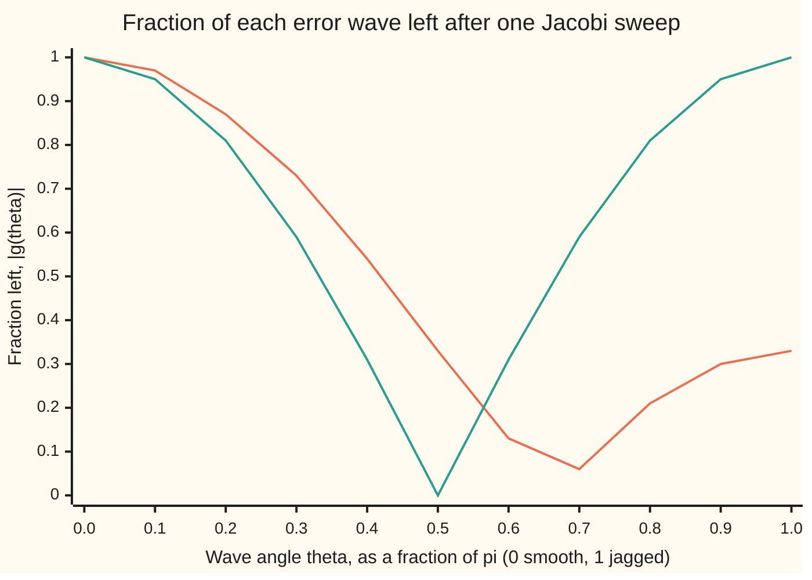
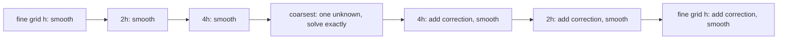
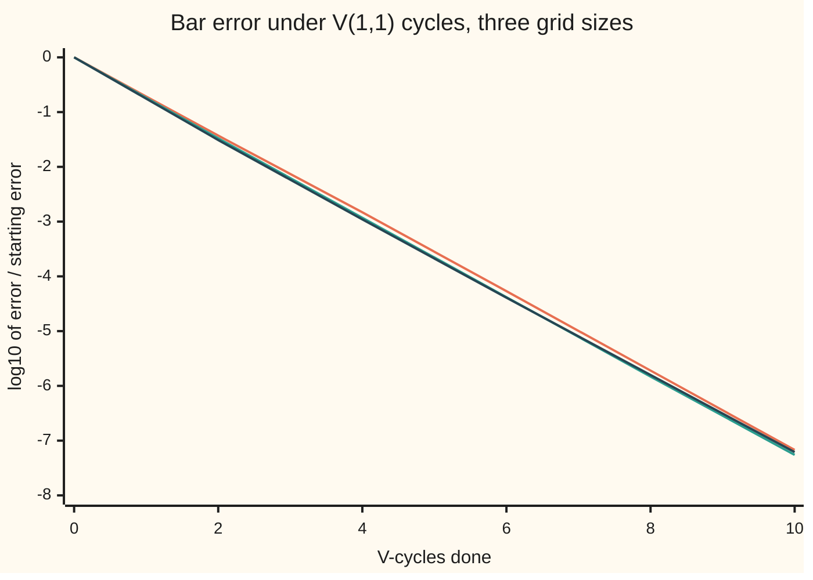

# Multigrid: smooth on the fine grid, correct on the coarse grid, and solve in O(N) work

[Syllabus](../../../SYLLABUS.md) → [Numerical analysis](../README.md) → [Fast Solvers for Large Grids](../README.md#s09) → Multigrid

---

## General Overview

A steel plate, 1 m square, is held at 0 C on all four edges and heated in the middle. The heating is illustrative, chosen so that the exact settled temperature is known: 100 C at the centre, falling smoothly to 0 C at the edges. The engineer wants the settled temperature to the accuracy the grid allows.

The grid has 1,023 by 1,023 inside points, just under 1 mm apart: 1,046,529 unknown temperatures. Each point's equation ties it to its four neighbours ([Two space dimensions](../07-PDE%20Solvers/05-adi-and-multidimensional-grids.md)). Two standard routes are both far too slow:

- **Factoring.** A band Cholesky factorisation costs about 1.1e12 flops (a flop is one add, subtract, multiply or divide). That is an estimate from the band formula.
- **Relaxing.** Jacobi sweeps ([Iterating instead of factoring](../03-Numerical%20Linear%20Algebra/09-iterative-methods-jacobi-gauss-seidel-and-conjugate-gradient.md)) shrink the slowest error so little that one more correct digit takes about 489,266 sweeps.

**Multigrid** solves the plate in 118,323,907 counted flops: 113 flops per unknown, about 9,256 times fewer than the factorisation. The centre reads 100.000038 C. The grid itself can do no better than about 0.078 thousandths of a degree, and multigrid's remaining solver error is smaller than that.

It works because Jacobi wipes out jagged error (error that flips sign from point to point) in a few sweeps, but barely touches smooth error (error that changes slowly across the plate).

Smooth error on a fine grid looks jagged on a grid twice as coarse, which also has a quarter of the points. So multigrid alternates: a sweep or two on the fine grid for the jagged part, then a correction from a coarser grid for the smooth part, and the same idea again on that coarser grid.

**Relaxation removes jagged error fast and smooth error slowly, so multigrid relaxes a little on each grid and hands the smooth remainder down to a coarser grid, where it is jagged again; every cycle then cuts the error by a fixed factor whatever the grid size, at a cost proportional to the number of unknowns.**

**What kind of fact this is:** a method resting on theorems. The damping factor of weighted Jacobi, the exact two-grid factor 1/9 on the bar, and the work bound are proved on this card in Why it works. The convergence of the V-cycle and of full multigrid for general grids is stated with its key steps and its source; the code measures both.

### The picture: what one sweep does to each wave

The mechanism is easiest to see on the 1 m steel bar of [Finite differences on a grid](../07-PDE%20Solvers/02-finite-differences-consistency-stability-and-convergence.md): one line of grid points, the plate cut down to one dimension. Write the error as a sum of waves, from the smoothest (one hump across the bar) to the most jagged (sign flips at every point). The angle $`\theta`$ runs from 0 (smooth) to $`\pi`$ (most jagged). The chart shows how much of each wave survives one sweep of Jacobi on the bar.



The orange line is weighted Jacobi with weight $`\omega = 2/3`$. Every wave in the right half, the jagged half, keeps at most 0.33 of itself. The green line is plain Jacobi, $`\omega = 1`$: it kills the middle wave but leaves the most jagged wave almost whole. Both lines start at 1.00 on the left: no Jacobi sweep removes smooth error quickly. That is the coarse grid's job.

---

## The formula

On the bar, $`-u'' = f`$ on a grid of $`n`$ inside points with spacing $`h = 1/(n+1)`$. The $`k`$-th error wave is $`\sin(k\pi x)`$ sampled at the grid points, with angle $`\theta = k\pi h`$. One sweep of weighted Jacobi multiplies that wave by

```math
g(\theta) = 1 - 2\,\omega\,\sin^2(\theta/2).
```

**Read it aloud:** "the fraction of a wave left after one sweep is one, minus twice the weight times the squared sine of half the wave's angle."

A two-grid cycle smooths $`\nu_1`$ times, corrects on the coarse grid, and smooths $`\nu_2`$ times. Its effect on the error $`e`$ is

```math
e \;\leftarrow\; S^{\nu_2}\,\big(I - P\,A_{2h}^{-1}\,R\,A_h\big)\,S^{\nu_1}\,e, \qquad A_{2h} = R\,A_h\,P.
```

**Read it aloud:** "smooth, then subtract the coarse grid's best guess of the remaining error, then smooth again; the coarse matrix is the fine matrix squeezed between restriction and interpolation."

A **V-cycle** replaces the exact coarse solve $`A_{2h}^{-1}`$ by one V-cycle on the coarse grid, recursively, down to a grid with one unknown. Each level has a quarter of the points of the one above it on the plate, so the work is a geometric series:

```math
W_V \;\le\; W_0\,\big(1 + \tfrac14 + \tfrac1{16} + \cdots\big) \;=\; \tfrac43\,W_0 .
```

| Symbol | Plain meaning | In our example | Push it up and the answer… |
| --- | --- | --- | --- |
| $`h`$ | grid spacing; the coarse grid has spacing $`2h`$ | 1/1024 m on the plate | coarser grid: larger discretisation error |
| $`n`$, $`N`$ | inside points per side; total unknowns ($`N = n^2`$ on the plate) | 1,023; 1,046,529 | work grows in proportion to $`N`$, the cycle count does not |
| $`k`$, $`\theta`$ | wave number and its angle $`\theta = k\pi h`$ | $`k = 63`$, $`\theta = 0.9844\pi`$ | more jagged: damped faster by the smoother |
| $`\omega`$ | Jacobi weight: how far each update moves toward the balanced value | 2/3 on the bar, 4/5 on the plate | at 1, the most jagged wave survives whole |
| $`g(\theta)`$ | fraction of a wave left after one sweep; a minus sign flips the wave | −0.33253 at $`k = 63`$ | size closer to 1: slower smoothing |
| $`A_h`$, $`A_{2h}`$; $`D`$, $`I`$ | the fine and coarse matrices of the grid equations; the diagonal of $`A_h`$, and the identity (leaves every vector as it is) | $`\mathrm{tridiag}(-1, 2, -1)/h^2`$ on the bar, so $`D = 2/h^2`$ | |
| $`R`$, $`P`$ | restriction (fine to coarse, weights 1/4, 1/2, 1/4) and interpolation (coarse to fine, straight lines) | full weighting, linear | |
| $`u`$, $`f`$; $`e`$, $`r`$; $`\beta`$ | current guess and heat source (right-hand side); error (exact grid answer minus $`u`$) and residual $`r = f - A_h u`$; $`\beta`$, the plate's exact grid answer over the true temperature | $`r`$ is computable; $`e`$ is not; $`100(\beta - 1)`$ C = 0.07844 mC at 1,023 | |
| $`S`$; $`\nu_1`$, $`\nu_2`$ | one smoothing sweep as a matrix on the error; sweeps before and after the coarse correction | weighted Jacobi; 1 and 1, a V(1,1) cycle | more sweeps: smaller factor per cycle, more work per cycle |
| $`s`$, $`c`$, $`\lambda`$ | $`\sin^2(\theta/2)`$ and $`\cos^2(\theta/2)`$ for a wave; $`\lambda`$ the two-grid factor on a pair of waves (Step 4) | $`s = c = 1/2`$ at $`\theta = \pi/2`$; $`\lambda = 1/9`$ | |
| $`\gamma`$ | coarse cycles per level: 1 is a V-cycle, 2 a W-cycle | 1 | at 2: factor 0.113 instead of 0.196 |
| $`W_0`$, $`W_V`$ | flops per unknown on the finest level alone, and for the whole V-cycle | 30.75 and 41.00 | |

The residual $`r`$ here is not shelf 07's mesh ratio. The spectral radius $`\rho`$ (largest eigenvalue size) from [Iterating instead of factoring](../03-Numerical%20Linear%20Algebra/09-iterative-methods-jacobi-gauss-seidel-and-conjugate-gradient.md) is the **long-run factor**: the fraction of the error left per cycle once only the slowest error remains. The **factor per cycle** below is measured: the average over cycles 6 to 10 from one random start. That early average flatters plain Jacobi and injection below, so their long-run factors are measured too.

### When it holds

- **The smoother must damp every jagged wave.** On the bar, weights well inside 0 to 1 do, and $`\omega = 2/3`$ is the best. With $`\omega = 1`$ the V-cycle stalls: its long-run factor is 0.999991.
- **Smooth error must be well represented on the coarse grid.** That needs a smooth underlying problem, such as heat in one uniform material. With jumps in the material or stretched cells, geometric coarsening fails and [Algebraic multigrid](03-algebraic-multigrid.md) reads the coarse grids from the matrix instead.
- **Restriction and interpolation must be accurate enough.** Taking every second residual value (injection) instead of the 1/4, 1/2, 1/4 average gives 0.632652 per cycle over cycles 6 to 10 instead of 0.196084, and 0.782796 in the long run.
- **The matrix should be symmetric positive definite, or close to it.** The proof below uses real eigenvalues and orthogonal waves. Strongly one-directional flow needs different smoothers.
- **Full multigrid needs enough cycles per level.** With one V(1,1) cycle per level the solver error at the plate's centre is 1.36751 thousandths of a degree, well above the 0.07844 grid error.

---

## Why it works

### Step 0: the smoother and the coarse grid cover each other's blind spots

Jacobi replaces each value by a blend of its neighbours. A jagged error, where neighbours disagree in sign, is averaged away at once. A smooth error, where neighbours agree, is left almost unchanged. So relaxation alone stalls.

Now take the smooth error that is left and look at it on a grid with twice the spacing. A wave with angle $`\theta`$ on the fine grid has angle $`2\theta`$ on the coarse grid. A wave that was smooth is now twice as jagged, and the coarse grid's own Jacobi sweeps can attack it. The coarse grid also has half the points (a quarter on the plate), so this costs little.

Repeat the halving until one unknown is left, and every wave is jagged on some grid. That is the whole method.

### Step 1: the waves are the eigenvectors, and one sweep scales each one

On the bar, $`A_h = \mathrm{tridiag}(-1, 2, -1)/h^2`$. Apply it to the wave $`v_j = \sin(jk\pi h)`$. The sum of the two neighbours is $`2\cos(\theta)\,v_j`$, by the sine addition formula. So

```math
A_h v = \frac{2 - 2\cos\theta}{h^2}\,v = \frac{4\sin^2(\theta/2)}{h^2}\,v .
```

Weighted Jacobi changes the error by $`e \leftarrow e - \omega D^{-1} A_h e`$, where $`D = 2/h^2`$ is the diagonal. On the wave this multiplies by $`1 - \omega (h^2/2)(4/h^2)\sin^2(\theta/2) = 1 - 2\omega\sin^2(\theta/2)`$. That is $`g(\theta)`$.

The check applies one real sweep to six waves on the 63-point bar and measures what is left. Formula and measurement agree to 12 digits.

### Step 2: the best weight is 2/3, and it damps every jagged wave to at most 1/3

The jagged half is $`\theta`$ from $`\pi/2`$ to $`\pi`$, so $`\sin^2(\theta/2)`$ runs from 1/2 to 1. Over that range $`g`$ falls in a straight line in $`\sin^2(\theta/2)`$, from $`1 - \omega`$ down to $`1 - 2\omega`$. The worst wave is at one end or the other. The best weight makes both ends equal in size:

```math
1 - \omega = -(1 - 2\omega) \quad\Longrightarrow\quad \omega = \tfrac23, \qquad |g| \le \tfrac13 .
```

At $`\theta = \pi`$: $`|1 - 4/3| = 1/3`$. At $`\theta = \pi/2`$: $`|1 - (4/3)(1/2)| = 1/3`$. The check scans waves 32 to 63 and finds the largest factor 0.333333.

The smooth end is hopeless for any weight. The smoothest wave on the 1,023-point bar keeps 0.999996863 of itself per sweep.

On the plate, $`g = 1 - \omega(\sin^2(\theta_1/2) + \sin^2(\theta_2/2))`$, with one angle per direction. A wave is jagged if either angle is at least $`\pi/2`$. The same balancing gives $`\omega = 4/5`$ and a smoothing factor of 0.600000; with $`\omega = 2/3`$ it is 0.666667.

### Step 3: the coarse grid corrects the smooth part

After smoothing, the error $`e`$ is smooth but unknown. Its residual is known: $`r = f - A_h u = A_h e`$. So the error solves the **residual equation** $`A_h e = r`$, and a smooth $`e`$ can be found on a coarser grid:

1. Restrict the residual: $`r_{2h} = R\,r`$. Full weighting averages each coarse point's fine value with its two neighbours, weights 1/4, 1/2, 1/4.
2. Solve $`A_{2h}\,e_{2h} = r_{2h}`$ on the coarse grid.
3. Interpolate the correction back, $`P\,e_{2h}`$, by straight lines between coarse points, and add it to $`u`$.

Which coarse matrix? The **Galerkin** choice is $`A_{2h} = R A_h P`$: interpolate, apply the fine matrix, restrict. On the bar it equals the coarse grid's own matrix. The check builds $`R A_h P`$ on 7 points, multiplies by $`(2h)^2`$, and gets the column $`(-1.00, 2.00, -1.00)`$ exactly. On the plate the Galerkin product spreads to nine points; this card uses the coarse grid's own five-point matrix there, which is the usual geometric choice.

### Step 4: on the bar, the two-grid factor is exactly 1/9

The coarse correction cannot see wave $`k`$ and its partner $`n + 1 - k`$ apart: on the coarse points they look the same, up to a sign. So the two-grid cycle maps each pair of waves to itself, and it is a 2 by 2 matrix per pair.

Write $`s = \sin^2(\theta/2)`$ and $`c = \cos^2(\theta/2)`$ for the smoother wave of the pair. The coarse correction on the pair is the matrix with both rows $`(s, c)`$. It removes most of the smooth wave's error but pushes some into the jagged partner, which the smoothing then removes.

One sweep before and one after gives a rank-one 2 by 2 matrix whose only nonzero eigenvalue is

```math
\lambda(s) = s\,(1 - 2\omega s)^2 + c\,(1 - 2\omega c)^2 .
```

With $`\omega = 2/3`$ every power of $`s`$ cancels and $`\lambda = 1/9`$ for every pair. The factor does not depend on $`k`$, so it does not depend on $`h`$: a finer grid is not harder.

<details>
<summary>Detailed proof: the pair matrix and the cancellation to 1/9</summary>

Number the inside points $`j = 1, \dots, n`$, with $`n`$ odd. Let $`w_k`$ have entries $`\sin(jk\pi h)`$, and let $`k' = n + 1 - k`$. At even points $`j = 2i`$, the entries of $`w_{k'}`$ are $`-\sin(2ik\pi h)`$, the negative of $`w_k`$'s.

Full weighting maps $`w_k`$ to $`c\,\bar w_k`$ and $`w_{k'}`$ to $`-s\,\bar w_k`$, where $`\bar w_k`$ is the coarse wave. Linear interpolation maps $`\bar w_k`$ to $`c\,w_k - s\,w_{k'}`$. The fine matrix scales $`w_k`$ by $`4s/h^2`$ and $`w_{k'}`$ by $`4c/h^2`$. The coarse matrix scales $`\bar w_k`$ by $`4\sin^2\theta/(4h^2) = 4sc/h^2`$.

So the coarse correction on $`w_k`$ subtracts $`P A_{2h}^{-1} R A_h w_k = (4s/h^2)\,c\,(h^2/4sc)\,(c\,w_k - s\,w_{k'}) = c\,w_k - s\,w_{k'}`$. That leaves $`s\,w_k + s\,w_{k'}`$. On $`w_{k'}`$ the same steps leave $`c\,w_k + c\,w_{k'}`$. In the basis $`(w_k, w_{k'})`$ the correction is

$`\displaystyle K = \begin{pmatrix} s & c \\ s & c \end{pmatrix} = \begin{pmatrix} 1 \\ 1 \end{pmatrix} \begin{pmatrix} s & c \end{pmatrix}.`$

The smoother is $`S = \mathrm{diag}(a, b)`$ with $`a = 1 - 2\omega s`$ and $`b = 1 - 2\omega c`$. The cycle $`S K S`$ has the same nonzero eigenvalue as $`K S^2`$, a rank-one matrix whose eigenvalue is its trace:

$`\displaystyle \lambda = s\,a^2 + c\,b^2 .`$

Put $`\omega = 2/3`$ and $`c = 1 - s`$. Then $`a = 1 - 4s/3`$ and $`b = (4s - 1)/3`$. Expanding,

$`\displaystyle s\,a^2 = s - \tfrac{8}{3}s^2 + \tfrac{16}{9}s^3, \qquad c\,b^2 = \tfrac19\big(1 - 9s + 24s^2 - 16s^3\big).`$

The sum is $`1/9`$: the $`s`$, $`s^2`$ and $`s^3`$ terms cancel. The check evaluates $`\lambda`$ at 1,023 values of $`s`$ and finds the largest 0.111111.

</details>

### Step 5: recursion gives the V-cycle and the W-cycle

Solving the coarse problem exactly is still too expensive. So solve it approximately, by the same method: smooth on the coarse grid, correct on a coarser one, and so on down to one unknown, which is solved exactly.



Schematic: each arrow toward the coarsest grid restricts the residual, and each arrow back interpolates a correction. Drawn level by level, the path is a V. Doing two coarse cycles at each level ($`\gamma = 2`$) gives a W-cycle.

The V-cycle's coarse solve is only approximate, so it is a little worse than the two-grid ideal. Measured on the bar from a random start:

| Grid | V(1,1) factor per cycle | Two-grid factor (Step 4) |
| --- | --- | --- |
| 63 points | 0.188843 | 0.111111 |
| 255 points | 0.189976 | 0.111111 |
| 1,023 points | 0.196084 | 0.111111 |

The factor stays near 0.19 as the grid grows sixteenfold. The W-cycle measures 0.113224, close to the two-grid 1/9, and a V(2,1) cycle 0.109044. The often-quoted "about 0.1 per cycle" is the two-grid value, not V(1,1)'s.

The proof that the V-cycle factor stays below a fixed number less than 1 on every grid rests on a smoothing property and an approximation property. It is in chapter 3 of the 2001 *Multigrid* text in Sources; this card states it and measures it.

### Step 6: the work is a geometric series

On the plate, one V(1,1) cycle on the finest level costs, per unknown, two smoothing sweeps of 9 flops, one residual of 7, a share of the restriction (11 flops per coarse point, a quarter as many points) and a share of the interpolation and update (8 per coarse point, plus 1 per fine point):

```math
W_0 = 2(9) + 7 + \tfrac{11}{4} + \tfrac{8}{4} + 1 = 30.75 .
```

Each coarser level has a quarter of the points, so the whole V-cycle costs at most $`\tfrac43 W_0 = 41.00`$ flops per unknown. The code counts 40.957, and the ratio of the whole cycle to its finest level is 1.3320, just under 4/3.

A W-cycle visits each coarser level twice as often: $`1 + \tfrac24 + \tfrac4{16} + \cdots = 2`$ on the plate. On the bar the levels only halve, so a V-cycle costs at most twice its finest level and a W-cycle grows like $`N \log_2 N`$.

### Step 7: full multigrid gets to the grid's accuracy in one pass

A V-cycle from a zero guess must remove an error of size 100 C. But the grid's own error, the **discretisation error** (the gap between the exact grid answer and the true temperature), is only $`O(h^2)`$ as $`h \to 0`$. There is no point solving far below it.

**Full multigrid (FMG)** starts on the coarsest grid, where the problem is trivial, and works up:

1. Solve on the coarsest grid.
2. Interpolate that answer to the next finer grid as a starting guess.
3. Run a fixed number of V-cycles there.
4. Repeat steps 2 and 3 up to the finest grid.

Each starting guess is already within the coarser grid's discretisation error, about four times the finer grid's. A fixed number of cycles with a small enough factor then gets below the finer grid's error. The code runs two V(1,1) cycles per level. The total cost is about $`\tfrac43`$ times the finest level's cycles, still proportional to $`N`$. The theorem, with its exact condition on the cycle factor, is in chapter 2 of the 2001 *Multigrid* text and chapter 3 of *A Multigrid Tutorial*, both in Sources.

### Step 8: one V-cycle is also a preconditioner

A V-cycle with the same smoother before and after, and with restriction a fixed multiple of interpolation turned on its side (its transpose: full weighting is half of linear interpolation's transpose on the bar, a quarter on the plate), is symmetric, so it can replace the incomplete factors of [Incomplete factorisations](01-incomplete-factorisation-preconditioners.md) as the preconditioner inside conjugate gradient. Conjugate gradient then repairs the few waves the cycle handles badly. This pairing is common when the problem is not quite smooth enough for multigrid alone. [Algebraic multigrid](03-algebraic-multigrid.md) runs this pairing and counts its steps.

---

## Worked numbers, by hand

The bar's waves, and then the plate's cost and accuracy.

| Step | Arithmetic | Value |
| --- | --- | --- |
| Best weight on the bar | balance $`1 - \omega = 2\omega - 1`$ | $`\omega = 2/3`$ |
| Most jagged wave, $`\theta = \pi`$ | $`1 - 2(2/3)(1)`$ | $`-1/3`$ |
| Middle wave, $`\theta = \pi/2`$ | $`1 - 2(2/3)(1/2)`$ | $`1/3`$ |
| Smoothest wave on 63 points, $`\theta = \pi/64`$ | $`1 - (4/3)\sin^2(\pi/128)`$ | 0.99920 |
| Two-grid factor at the middle pair, $`s = c = 1/2`$ | $`\tfrac12(1/3)^2 + \tfrac12(1/3)^2`$ | $`1/9 = 0.111111`$ |
| Plate, finest-level flops per unknown | $`18 + 7 + 2.75 + 2 + 1`$ | 30.75 |
| Plate, V-cycle flops per unknown | $`\tfrac43 \times 30.75`$ | 41.00 (counted: 40.957) |
| Plate, FMG with two V-cycles per level | $`\tfrac43 \times (2 \times 41.00 + 3)`$ | 113.33 (counted: 113.063) |
| Plate, total FMG flops | $`113.063 \times 1{,}046{,}529`$ | **118,323,907** |

The million-unknown plate costs about 113 flops per unknown, and the answer is already as accurate as the grid allows.

How accurate, on the three plates (errors in thousandths of a degree, mC; "solver" is the gap to the exact grid answer, "grid" the gap from the exact grid answer to the true temperature, both largest over the plate):

| Plate | Solver error after FMG | Grid error (closed form) | Total error, true |
| --- | --- | --- | --- |
| 63 by 63 | 10.61914 | 20.08218 | 9.91688 |
| 255 by 255 | 0.67424 | 1.25499 | 0.60939 |
| 1,023 by 1,023 | 0.04222 | 0.07844 | 0.03800 |

The solver error stays at about half the grid error on every plate. Both fall about sixteenfold each time $`h`$ is divided by four: the $`O(h^2)`$ rate. The total is smaller than the grid error here only because the two errors have opposite signs; that is luck, not a guarantee.

### What breaks if you drop a piece

| Mistake | Comes out at | What went wrong |
| --- | --- | --- |
| Plain Jacobi, $`\omega = 1`$, as the smoother | long-run factor 0.999991 | The most jagged wave keeps all of itself, and the coarse grid cannot see it |
| Injection: copy every second residual | long-run factor 0.782796 | The jagged part of the residual reaches the coarse grid at full strength, looks smooth there, and is wrongly corrected |
| No smoothing at all | V-cycle factor 1.000000 | The coarse correction alone is a projection: after one cycle it removes nothing more |
| One V-cycle per level in FMG | centre's solver error 1.36751 mC | Above the 0.07844 mC grid error: the solver stopped too early |

---

## Code, from first principles, and it actually runs

The code builds weighted Jacobi, full weighting, linear and bilinear interpolation, the V-cycle, the W-cycle and full multigrid from lists of numbers, and counts every flop on the plate. It takes five independent roads:

1. The damping formula against one real sweep on six waves.
2. The Fourier two-grid factor 1/9 against the measured W-cycle.
3. The Galerkin product $`R A_h P`$ against the coarse grid's own matrix.
4. Full multigrid on the plate against the closed-form exact grid answer, $`100\,\beta\sin(\pi x)\sin(\pi y)`$ with $`\beta = (\pi h/2)^2/\sin^2(\pi h/2)`$, and against the true temperature.
5. The geometric-series work bound against counted flops.

Random starts come from SplitMix64 with seed 2026, written out in both languages.

### Python

```python
# Multigrid: smooth on the fine grid, correct on the coarse grid -- the check behind the card.
# Standard library only.  Part 1: the bar, -u'' = f on (0, 1) with u = 0 at both ends.  Part 2: the
# 1 m plate, -(u_xx + u_yy) = f with 0 C edges, heated so the exact answer is 100 sin(pi x) sin(pi y) C.
from math import sin, pi, sqrt, log, log10
M64 = (1 << 64) - 1
def splitmix(s):                            # SplitMix64: new state and a value in [-1, 1)
    s = (s + 0x9E3779B97F4A7C15) & M64
    z = ((s ^ (s >> 30)) * 0xBF58476D1CE4E5B9) & M64
    z = ((z ^ (z >> 27)) * 0x94D049BB133111EB) & M64
    return s, ((z ^ (z >> 31)) >> 11) / 2.0 ** 52 - 1.0
def norm(v): return sqrt(sum(x * x for x in v))
def mC(x): return f"{1000 * x:10.5f}"    # an error in C, printed in thousandths of a degree
# ---- the bar: u holds the inside values; both ends are 0 ----
def jacobi1(u, f, h, w):                    # one weighted-Jacobi sweep
    p = [0.0] + u + [0.0]
    return [p[i + 1] + w * 0.5 * (h * h * f[i] + p[i] + p[i + 2] - 2.0 * p[i + 1]) for i in range(len(u))]
def resid1(u, f, h):                        # residual r = f - A u
    p = [0.0] + u + [0.0]
    return [f[i] - (2.0 * p[i + 1] - p[i] - p[i + 2]) / (h * h) for i in range(len(u))]
def restrict1(r, inject=False):             # coarse point j sits on fine point 2j+1
    return r[1::2] if inject else [0.25 * (r[2 * j] + 2.0 * r[2 * j + 1] + r[2 * j + 2]) for j in range(len(r) // 2)]
def prolong1(e):                            # linear interpolation, coarse to fine
    p = [0.0] + e + [0.0]
    return [x for j in range(len(e) + 1) for x in (0.5 * (p[j] + p[j + 1]), p[j + 1])][:-1]
def cycle1(u, f, h, w=2 / 3, nu=(1, 1), gamma=1, inject=False):
    if len(u) == 1: return [0.5 * h * h * f[0]]          # one unknown: solve it exactly
    for _ in range(nu[0]): u = jacobi1(u, f, h, w)       # pre-smooth
    rc = restrict1(resid1(u, f, h), inject); ec = [0.0] * len(rc)
    for _ in range(gamma): ec = cycle1(ec, rc, 2 * h, w, nu, gamma, inject)   # coarse correction
    u = [a + b for a, b in zip(u, prolong1(ec))]
    for _ in range(nu[1]): u = jacobi1(u, f, h, w)       # post-smooth
    return u
def rate1(n, K=10, **kw):                   # K cycles from a random start with f = 0, so u is the error
    s, u = 2026, []
    for _ in range(n): s, x = splitmix(s); u.append(x)
    hist = [norm(u)]
    for _ in range(K): u = cycle1(u, [0.0] * n, 1.0 / (n + 1), **kw); hist.append(norm(u))
    return hist, (hist[-1] / hist[-6]) ** 0.2          # mean factor over the last 5 cycles
# ---- 1. one sweep on the mode sin(k pi x): measured shrink against 1 - 2w sin^2(theta/2) ----
n, h, w, worst = 63, 1.0 / 64, 2.0 / 3.0, 0.0; print("mode k  theta/pi  formula   measured   (one sweep, w = 2/3, n = 63)")
for k in (1, 8, 16, 32, 48, 63):
    v, g = [sin(k * pi * (i + 1) * h) for i in range(n)], 1.0 - 2.0 * w * sin(k * pi * h / 2) ** 2
    meas = norm(jacobi1(v, [0.0] * n, h, w)) / norm(v); worst = max(worst, abs(meas - abs(g)))
    print(f"{k:6d} {k * h:9.4f} {g:9.5f} {meas:9.5f}")
hi = max(abs(1.0 - 2.0 * w * sin(k * pi * h / 2) ** 2) for k in range(32, 64)); print(f"largest high-mode factor, k = 32..63     {hi:.6f}")
print("chart theta/pi     " + " ".join(f"{t / 10:4.1f}" for t in range(11)))
for ww in (2 / 3, 1.0):
    print(f"chart |g|, w = {ww:.2f} " + " ".join(f"{abs(1 - 2 * ww * sin(t * pi / 20) ** 2):4.2f}" for t in range(11)))
for ww in (2 / 3, 0.8):                      # plate: g = 1 - w (s1 + s2); high = some angle >= pi/2
    sm = max(abs(1 - ww * (sin(a * pi / 80) ** 2 + sin(b * pi / 80) ** 2)) for a in range(41) for b in range(41) if max(a, b) >= 20)
    print(f"plate smoothing factor, w = {ww:.2f}        {sm:.6f}")
# ---- 2. Galerkin coarse operator R A P on 7 points, against the 3-point grid's own matrix ----
Ah = lambda v: [-x / 64.0 for x in resid1(v, [0.0] * 7, 0.125)]      # h^2 A v, h = 1/8
RAP = [[4.0 * x for x in restrict1(Ah(prolong1([1.0 if i == j else 0.0 for i in range(3)])))] for j in range(3)]
print("(2h)^2 R A P, middle column:   " + " ".join(f"{x:5.2f}" for x in RAP[1]))
# ---- 3. two-grid factor by Fourier analysis against measured cycles ----
tg = lambda w: max(s * (1 - 2 * w * s) ** 2 + (1 - s) * (1 - 2 * w * (1 - s)) ** 2 for s in (sin(k * pi / 2048) ** 2 for k in range(1, 1024)))
fourier = tg(w); print(f"two-grid factor, Fourier, w = 2/3        {fourier:.6f}"); hists, rates = {}, {}
for n in (63, 255, 1023):
    hists[n], rates[n] = rate1(n); print(f"V(1,1) factor per cycle, n = {n:4d}        {rates[n]:.6f}")
    print(f"chart log10 error, n = {n:4d}" + " ".join(f"{log10(e / hists[n][0]):6.2f}" for e in hists[n][::2]))
other = [("V(2,1) factor, n = 1023", dict(nu=(2, 1))), ("W(1,1) factor, n = 1023", dict(gamma=2)),
         ("wrong: plain Jacobi, w = 1", dict(w=1.0)), ("wrong: injection, not full weighting", dict(inject=True)),
         ("wrong: no smoothing at all", dict(nu=(0, 0))), ("long run: injection, cycles 146 to 150", dict(inject=True, K=150))]
res = {label: rate1(1023, **kw)[1] for label, kw in other}
for label in res: print(f"{label:<40} {res[label]:.6f}")
slow = [sin(pi * (i + 1) / 1024) - sin(1023 * pi * (i + 1) / 1024) for i in range(1023)]   # waves k = 1 and k = 1023 together
lr1 = norm(cycle1(slow, [0.0] * 1023, 1 / 1024, w=1.0)) / norm(slow); print(f"long run: plain Jacobi, slowest pair     {lr1:.6f}, two-grid {tg(1.0):.6f}\nJacobi alone, n = 1023, factor per sweep {1 - 2 * w * sin(pi / 2048) ** 2:.9f}")
FL = [0]        # ---- 4. the plate: grids are lists of rows with a border of zeros; FL counts + - * / kernel by kernel ----
def grid(m): return [[0.0] * (m + 2) for _ in range(m + 2)]
def smooth2(u, f, h, w):                    # weighted Jacobi, 9 flops a point
    m, h2, w4, R = len(u) - 2, h * h, 0.25 * w, range(1, len(u) - 1); out = [u[0]]
    for i in R:
        a, b, c, fr = u[i - 1], u[i], u[i + 1], f[i]
        out.append([0.0] + [b[j] + w4 * (h2 * fr[j] + a[j] + c[j] + b[j - 1] + b[j + 1] - 4.0 * b[j]) for j in R] + [0.0])
    FL[0] += 9 * m * m; return out + [u[-1]]
def resid2(u, f, h):                        # r = f - A u, 7 flops a point
    m, q, R = len(u) - 2, 1.0 / (h * h), range(1, len(u) - 1); out = [[0.0] * (m + 2)]
    for i in R:
        a, b, c, fr = u[i - 1], u[i], u[i + 1], f[i]
        out.append([0.0] + [fr[j] - q * (4.0 * b[j] - a[j] - c[j] - b[j - 1] - b[j + 1]) for j in R] + [0.0])
    FL[0] += 7 * m * m; return out + [[0.0] * (m + 2)]
def restrict2(r):                           # full weighting, 1-2-1 by 1-2-1 over 16, 11 flops a point
    mc = (len(r) - 3) // 2; out = grid(mc)
    for I in range(1, mc + 1):
        a, b, c = r[2 * I - 1], r[2 * I], r[2 * I + 1]
        out[I] = [0.0] + [0.0625 * (a[k - 1] + a[k + 1] + c[k - 1] + c[k + 1] + 2.0 * (a[k] + c[k] + b[k - 1] + b[k + 1])
                                    + 4.0 * b[k]) for k in range(2, 2 * mc + 1, 2)] + [0.0]
    FL[0] += 11 * mc * mc; return out
def prolong_add(u, e):                      # bilinear interpolation of e, added into u
    mc = len(e) - 2; m = 2 * mc + 1
    for I in range(mc + 1):
        e0, e1 = e[I], e[I + 1]; ra, rb = [0.0] * (m + 2), [0.0] * (m + 2)
        for J in range(mc + 1):
            ra[2 * J], ra[2 * J + 1] = e0[J], 0.5 * (e0[J] + e0[J + 1])
            rb[2 * J], rb[2 * J + 1] = 0.5 * (e0[J] + e1[J]), 0.25 * (e0[J] + e0[J + 1] + e1[J] + e1[J + 1])
        if I > 0: u[2 * I] = [x + y for x, y in zip(u[2 * I], ra)]
        u[2 * I + 1] = [x + y for x, y in zip(u[2 * I + 1], rb)]
    FL[0] += 8 * (mc + 1) ** 2 + m * m; return u
def vcycle2(u, f, h, w=0.8):
    if len(u) == 3: return [[0.0] * 3, [0.0, 0.25 * h * h * f[1][1], 0.0], [0.0] * 3]
    u = smooth2(u, f, h, w); rc = restrict2(resid2(u, f, h))
    u = prolong_add(u, vcycle2(grid(len(rc) - 2), rc, 2 * h, w)); return smooth2(u, f, h, w)
def heat(m):                                # sin(pi x) at the grid lines, and f = 200 pi^2 sin sin
    s = [sin(pi * i / (m + 1)) for i in range(m + 2)]; return s, [[200.0 * pi * pi * a * b for b in s] for a in s]
def fmg(m, per_level):                      # full multigrid: solve coarse, interpolate, cycle, repeat
    u = grid(1)
    for L in range(1, round(log(m + 1, 2)) + 1):
        mm = 2 ** L - 1; s, f = heat(mm)
        if mm > 1: u = prolong_add(grid(mm), u)
        for _ in range(per_level): u = vcycle2(u, f, 1.0 / (mm + 1), 0.8)
    return u, s
print("plate     N    V flops/N  V/finest  FMG flops/N  alg err mC disc err mC total err mC"); plate = {}
for m in (63, 255, 1023):
    _, f = heat(m); FL[0] = 0; vcycle2(grid(m), f, 1.0 / (m + 1)); vflops = FL[0]
    FL[0] = 0; vcycle2(grid((m - 1) // 2), heat((m - 1) // 2)[1], 2.0 / (m + 1)); vratio = vflops / (vflops - FL[0])
    FL[0] = 0; u, s = fmg(m, 2); N = m * m
    beta = (pi / (2 * m + 2)) ** 2 / sin(pi / (2 * m + 2)) ** 2        # closed form: u_h = 100 beta sin sin
    alg = max(abs(u[i][j] - 100 * beta * s[i] * s[j]) for i in range(m + 2) for j in range(m + 2))
    tot = max(abs(u[i][j] - 100 * s[i] * s[j]) for i in range(m + 2) for j in range(m + 2))
    plate[m] = (vflops / N, vratio, FL[0] / N, alg, 100 * (beta - 1), tot, FL[0], u[(m + 1) // 2][(m + 1) // 2])
    print(f"{m:5d} {N:8d} {vflops / N:9.3f} {vratio:9.4f} {FL[0] / N:11.3f}" + mC(alg) + " " + mC(100 * (beta - 1)) + "  " + mC(tot))
u1, _ = fmg(1023, 1); one = abs(u1[512][512] - 100 * (pi / 2048) ** 2 / sin(pi / 2048) ** 2)
print(f"plate centre after FMG, 1023^2           {plate[1023][7]:.6f} C (exact 100)\nFMG flops for 1,046,529 unknowns         {plate[1023][6]}")
wf = 2 * 9 + 7 + 11 / 4 + 8 / 4 + 1                   # finest-level flops a point: 2 smooths, residual, restrict, interpolate
print(f"work model: finest {wf:.2f}, V x4/3 {4 / 3 * wf:.2f}, FMG {4 / 3 * (2 * 4 / 3 * wf + 3):.2f}, Cholesky/FMG {1046529 * 1023 ** 2 / plate[1023][6]:.0f}")
print("wrong: one V-cycle per level, centre err" + mC(one) + " mC")
print(f"estimate: band Cholesky, N m^2 flops     {1046529 * 1023 ** 2 / 1e12:.1f}e12\nestimate: plate Jacobi sweeps per digit  {log(10) / -log(1 - 2 * sin(pi / 2048) ** 2):.0f}")
assert worst < 1e-12, "measured shrink of each mode equals 1 - 2w sin^2(theta/2)"
assert abs(hi - 1 / 3) < 1e-12, "every high mode shrinks by at least 1/3"
assert RAP[1] == [-1.0, 2.0, -1.0], "Galerkin R A P equals the coarse grid's own matrix"
assert abs(fourier - 1 / 9) < 1e-12, "two-grid factor is exactly 1/9 for every mode pair"
assert abs(res["W(1,1) factor, n = 1023"] - 1 / 9) < 0.01, "W-cycle measures the two-grid factor"
assert max(rates.values()) - min(rates.values()) < 0.02 and max(rates.values()) < 0.25, "V rate free of n"
assert res["wrong: plain Jacobi, w = 1"] > 0.9 and abs(lr1 - tg(1.0)) < 1e-9, "w = 1: the slowest pair keeps (1 - 2s)^2 a cycle"
assert res["long run: injection, cycles 146 to 150"] > 0.7 > res["wrong: injection, not full weighting"], "injection's early average flatters it"
assert all(plate[m][1] < 4 / 3 + 0.01 and plate[m][0] <= 4 / 3 * wf for m in plate), "counted V work within 4/3 of finest level"
assert plate[1023][3] < plate[1023][4], "FMG algebraic error below the closed-form discretisation error"
assert one > 10 * plate[1023][4], "one V-cycle per level stops short of discretisation accuracy"
print("ALL CHECKS PASS")
```

**Ran 2026-11-24 on macOS, Python 3.14.10, standard library only. All checks passed. Output, pasted from the run:**

```
mode k  theta/pi  formula   measured   (one sweep, w = 2/3, n = 63)
     1    0.0156   0.99920   0.99920
     8    0.1250   0.94925   0.94925
    16    0.2500   0.80474   0.80474
    32    0.5000   0.33333   0.33333
    48    0.7500  -0.13807   0.13807
    63    0.9844  -0.33253   0.33253
largest high-mode factor, k = 32..63     0.333333
chart theta/pi      0.0  0.1  0.2  0.3  0.4  0.5  0.6  0.7  0.8  0.9  1.0
chart |g|, w = 0.67 1.00 0.97 0.87 0.73 0.54 0.33 0.13 0.06 0.21 0.30 0.33
chart |g|, w = 1.00 1.00 0.95 0.81 0.59 0.31 0.00 0.31 0.59 0.81 0.95 1.00
plate smoothing factor, w = 0.67        0.666667
plate smoothing factor, w = 0.80        0.600000
(2h)^2 R A P, middle column:   -1.00  2.00 -1.00
two-grid factor, Fourier, w = 2/3        0.111111
V(1,1) factor per cycle, n =   63        0.188843
chart log10 error, n =   63  0.00  -1.43  -2.83  -4.27  -5.72  -7.17
V(1,1) factor per cycle, n =  255        0.189976
chart log10 error, n =  255  0.00  -1.48  -2.93  -4.38  -5.83  -7.26
V(1,1) factor per cycle, n = 1023        0.196084
chart log10 error, n = 1023  0.00  -1.51  -2.96  -4.39  -5.80  -7.21
V(2,1) factor, n = 1023                  0.109044
W(1,1) factor, n = 1023                  0.113224
wrong: plain Jacobi, w = 1               0.961559
wrong: injection, not full weighting     0.632652
wrong: no smoothing at all               1.000000
long run: injection, cycles 146 to 150   0.782796
long run: plain Jacobi, slowest pair     0.999991, two-grid 0.999991
Jacobi alone, n = 1023, factor per sweep 0.999996863
plate     N    V flops/N  V/finest  FMG flops/N  alg err mC disc err mC total err mC
   63     3969    40.349    1.3131     109.413  10.61914   20.08218     9.91688
  255    65025    40.831    1.3281     112.284   0.67424    1.25499     0.60939
 1023  1046529    40.957    1.3320     113.063   0.04222    0.07844     0.03800
plate centre after FMG, 1023^2           100.000038 C (exact 100)
FMG flops for 1,046,529 unknowns         118323907
work model: finest 30.75, V x4/3 41.00, FMG 113.33, Cholesky/FMG 9256
wrong: one V-cycle per level, centre err   1.36751 mC
estimate: band Cholesky, N m^2 flops     1.1e12
estimate: plate Jacobi sweeps per digit  489266
ALL CHECKS PASS
```

### Rust

```rust
// Multigrid: smooth on the fine grid, correct on the coarse grid -- the same check in Rust.
// std only, no crates.  Part 1: the bar, -u'' = f on (0, 1) with u = 0 at both ends.  Part 2: the
// 1 m plate, -(u_xx + u_yy) = f with 0 C edges, heated so the exact answer is 100 sin(pi x) sin(pi y) C.
use std::f64::consts::PI;
type G = Vec<Vec<f64>>;
fn splitmix(s: u64) -> (u64, f64) {                      // SplitMix64: new state and a value in [-1, 1)
    let s = s.wrapping_add(0x9E3779B97F4A7C15); let mut z = (s ^ (s >> 30)).wrapping_mul(0xBF58476D1CE4E5B9);
    z = (z ^ (z >> 27)).wrapping_mul(0x94D049BB133111EB);
    (s, ((z ^ (z >> 31)) >> 11) as f64 / 2f64.powi(52) - 1.0) }
fn norm(v: &[f64]) -> f64 { v.iter().map(|x| x * x).sum::<f64>().sqrt() }
fn mc(x: f64) -> String { format!("{:10.5}", 1000.0 * x) }   // an error in C, printed in thousandths
fn pad(u: &[f64]) -> Vec<f64> { let mut p = vec![0.0]; p.extend_from_slice(u); p.push(0.0); p }
// ---- the bar: u holds the inside values; both ends are 0 ----
fn jacobi1(u: &[f64], f: &[f64], h: f64, w: f64) -> Vec<f64> {      // one weighted-Jacobi sweep
    let p = pad(u); (0..u.len()).map(|i| p[i + 1] + w * 0.5 * (h * h * f[i] + p[i] + p[i + 2] - 2.0 * p[i + 1])).collect() }
fn resid1(u: &[f64], f: &[f64], h: f64) -> Vec<f64> {               // residual r = f - A u
    let p = pad(u); (0..u.len()).map(|i| f[i] - (2.0 * p[i + 1] - p[i] - p[i + 2]) / (h * h)).collect() }
fn restrict1(r: &[f64], inject: bool) -> Vec<f64> {      // coarse point j sits on fine point 2j+1
    (0..r.len() / 2).map(|j| if inject { r[2 * j + 1] } else { 0.25 * (r[2 * j] + 2.0 * r[2 * j + 1] + r[2 * j + 2]) }).collect() }
fn prolong1(e: &[f64]) -> Vec<f64> {                      // linear interpolation, coarse to fine
    let (p, mut out) = (pad(e), Vec::new());
    for j in 0..e.len() + 1 { out.push(0.5 * (p[j] + p[j + 1])); out.push(p[j + 1]); }
    out.pop(); out }
#[derive(Clone, Copy)] struct Kw { w: f64, nu: (usize, usize), gamma: usize, inject: bool, cycles: usize }
const BASE: Kw = Kw { w: 2.0 / 3.0, nu: (1, 1), gamma: 1, inject: false, cycles: 10 };
fn cycle1(mut u: Vec<f64>, f: &[f64], h: f64, k: Kw) -> Vec<f64> {
    if u.len() == 1 { return vec![0.5 * h * h * f[0]]; }          // one unknown: solve it exactly
    for _ in 0..k.nu.0 { u = jacobi1(&u, f, h, k.w); }             // pre-smooth
    let rc = restrict1(&resid1(&u, f, h), k.inject); let mut ec = vec![0.0; rc.len()];
    for _ in 0..k.gamma { ec = cycle1(ec, &rc, 2.0 * h, k); }     // coarse correction
    let p = prolong1(&ec); u = u.iter().zip(p.iter()).map(|(a, b)| a + b).collect();
    for _ in 0..k.nu.1 { u = jacobi1(&u, f, h, k.w); }             // post-smooth
    u }
fn rate1(n: usize, k: Kw) -> (Vec<f64>, f64) {           // k.cycles cycles from a random start, f = 0
    let (mut s, mut u) = (2026u64, Vec::new());
    for _ in 0..n { let (s2, x) = splitmix(s); s = s2; u.push(x); }
    let (mut hist, zero) = (vec![norm(&u)], vec![0.0; n]);
    for _ in 0..k.cycles { u = cycle1(u, &zero, 1.0 / (n as f64 + 1.0), k); hist.push(norm(&u)); }
    let r = (hist[k.cycles] / hist[k.cycles - 5]).powf(0.2); (hist, r) }     // mean factor over the last 5 cycles
// ---- the plate: grids are rows with a border of zeros; FL counts + - * / kernel by kernel ----
fn grid(m: usize) -> G { vec![vec![0.0; m + 2]; m + 2] }
fn smooth2(u: &G, f: &G, h: f64, w: f64, fl: &mut u64) -> G {     // weighted Jacobi, 9 flops a point
    let (m, h2, w4, mut out) = (u.len() - 2, h * h, 0.25 * w, grid(u.len() - 2));
    for i in 1..=m { for j in 1..=m {
        let (a, b, c) = (&u[i - 1], &u[i], &u[i + 1]); out[i][j] = b[j] + w4 * (h2 * f[i][j] + a[j] + c[j] + b[j - 1] + b[j + 1] - 4.0 * b[j]);
    } } *fl += 9 * (m * m) as u64; out
}
fn resid2(u: &G, f: &G, h: f64, fl: &mut u64) -> G {              // r = f - A u, 7 flops a point
    let (m, q, mut out) = (u.len() - 2, 1.0 / (h * h), grid(u.len() - 2));
    for i in 1..=m { for j in 1..=m {
        let (a, b, c) = (&u[i - 1], &u[i], &u[i + 1]); out[i][j] = f[i][j] - q * (4.0 * b[j] - a[j] - c[j] - b[j - 1] - b[j + 1]);
    } } *fl += 7 * (m * m) as u64; out
}
fn restrict2(r: &G, fl: &mut u64) -> G {                           // full weighting, 11 flops a point
    let mc = (r.len() - 3) / 2; let mut out = grid(mc);
    for i in 1..=mc { for j in 1..=mc {
        let (a, b, c, k) = (&r[2 * i - 1], &r[2 * i], &r[2 * i + 1], 2 * j); out[i][j] = 0.0625 * (a[k - 1] + a[k + 1] + c[k - 1] + c[k + 1] + 2.0 * (a[k] + c[k] + b[k - 1] + b[k + 1]) + 4.0 * b[k]);
    } } *fl += 11 * (mc * mc) as u64; out
}
fn prolong_add(mut u: G, e: &G, fl: &mut u64) -> G {               // bilinear interpolation of e, added into u
    let (mc, m) = (e.len() - 2, 2 * e.len() - 3);
    for i in 0..=mc {
        let (e0, e1, mut ra, mut rb) = (&e[i], &e[i + 1], vec![0.0; m + 2], vec![0.0; m + 2]);
        for j in 0..=mc {
            ra[2 * j] = e0[j]; ra[2 * j + 1] = 0.5 * (e0[j] + e0[j + 1]);
            rb[2 * j] = 0.5 * (e0[j] + e1[j]); rb[2 * j + 1] = 0.25 * (e0[j] + e0[j + 1] + e1[j] + e1[j + 1]);
        }
        for x in 0..m + 2 { if i > 0 { u[2 * i][x] += ra[x]; } u[2 * i + 1][x] += rb[x]; }
    }
    *fl += (8 * (mc + 1) * (mc + 1) + m * m) as u64; u
}
fn vcycle2(u: G, f: &G, h: f64, w: f64, fl: &mut u64) -> G {
    if u.len() == 3 { let mut g = grid(1); g[1][1] = 0.25 * h * h * f[1][1]; return g; }
    let u = smooth2(&u, f, h, w, fl); let rc = restrict2(&resid2(&u, f, h, fl), fl);
    let ec = vcycle2(grid(rc.len() - 2), &rc, 2.0 * h, w, fl); smooth2(&prolong_add(u, &ec, fl), f, h, w, fl)
}
fn heat(m: usize) -> (Vec<f64>, G) {                      // sin(pi x) at the grid lines, f = 200 pi^2 sin sin
    let s: Vec<f64> = (0..m + 2).map(|i| (PI * i as f64 / (m as f64 + 1.0)).sin()).collect();
    let f = s.iter().map(|a| s.iter().map(|b| 200.0 * PI * PI * a * b).collect()).collect(); (s, f)
}
fn fmg(m: usize, per_level: usize, fl: &mut u64) -> (G, Vec<f64>) {   // solve coarse, interpolate, cycle, repeat
    let (mut u, mut mm, mut s) = (grid(1), 1usize, Vec::new());
    while mm <= m {
        let (s2, f) = heat(mm); s = s2; if mm > 1 { u = prolong_add(grid(mm), &u, fl); }
        for _ in 0..per_level { u = vcycle2(u, &f, 1.0 / (mm as f64 + 1.0), 0.8, fl); } mm = 2 * mm + 1;
    } (u, s) }
fn main() {
    // ---- 1. one sweep on the mode sin(k pi x): measured shrink against 1 - 2w sin^2(theta/2) ----
    let (n, h, w, mut worst) = (63usize, 1.0 / 64.0, 2.0 / 3.0, 0.0f64);
    println!("mode k  theta/pi  formula   measured   (one sweep, w = 2/3, n = 63)");
    for k in [1usize, 8, 16, 32, 48, 63] {
        let v: Vec<f64> = (0..n).map(|i| (k as f64 * PI * (i + 1) as f64 * h).sin()).collect();
        let g = 1.0 - 2.0 * w * (k as f64 * PI * h / 2.0).sin().powi(2);
        let meas = norm(&jacobi1(&v, &vec![0.0; n], h, w)) / norm(&v); worst = worst.max((meas - g.abs()).abs());
        println!("{:6} {:9.4} {:9.5} {:9.5}", k, k as f64 * h, g, meas);
    }
    let hi = (32..64).map(|k| (1.0 - 2.0 * w * (k as f64 * PI * h / 2.0).sin().powi(2)).abs()).fold(0.0f64, f64::max);
    println!("largest high-mode factor, k = 32..63     {:.6}", hi);
    let row = |vals: Vec<String>| vals.join(" ");
    println!("chart theta/pi     {}", row((0..11).map(|t| format!("{:4.1}", t as f64 / 10.0)).collect()));
    for ww in [2.0 / 3.0, 1.0f64] {
        println!("chart |g|, w = {:.2} {}", ww, row((0..11).map(|t| format!("{:4.2}", (1.0 - 2.0 * ww * (t as f64 * PI / 20.0).sin().powi(2)).abs())).collect()));
    }
    for ww in [2.0 / 3.0, 0.8f64] {                       // plate: g = 1 - w (s1 + s2); high = some angle >= pi/2
        let mut sm = 0.0f64; for a in 0..41 { for b in 0..41 { if a.max(b) >= 20 {
            sm = sm.max((1.0 - ww * ((a as f64 * PI / 80.0).sin().powi(2) + (b as f64 * PI / 80.0).sin().powi(2))).abs()); } } }
        println!("plate smoothing factor, w = {:.2}        {:.6}", ww, sm);
    }
    // ---- 2. Galerkin coarse operator R A P on 7 points, against the 3-point grid's own matrix ----
    let ah = |v: &[f64]| -> Vec<f64> { resid1(v, &[0.0; 7], 0.125).iter().map(|x| -x / 64.0).collect() };
    let rap: Vec<Vec<f64>> = (0..3).map(|j| { let e: Vec<f64> = (0..3).map(|i| if i == j { 1.0 } else { 0.0 }).collect();
        restrict1(&ah(&prolong1(&e)), false).iter().map(|x| 4.0 * x).collect() }).collect();
    println!("(2h)^2 R A P, middle column:   {}", row(rap[1].iter().map(|x| format!("{:5.2}", x)).collect()));
    // ---- 3. two-grid factor by Fourier analysis against measured cycles ----
    let tg = |w: f64| (1..1024).map(|k| (k as f64 * PI / 2048.0).sin().powi(2))
        .map(|s| s * (1.0 - 2.0 * w * s).powi(2) + (1.0 - s) * (1.0 - 2.0 * w * (1.0 - s)).powi(2)).fold(0.0f64, f64::max);
    let fourier = tg(w); println!("two-grid factor, Fourier, w = 2/3        {:.6}", fourier);
    let mut rates = Vec::new();
    for n in [63usize, 255, 1023] {
        let (hist, r) = rate1(n, BASE); rates.push(r);
        println!("V(1,1) factor per cycle, n = {:4}        {:.6}", n, r);
        println!("chart log10 error, n = {:4}{}", n, hist.iter().step_by(2).map(|e| format!("{:6.2}", (e / hist[0]).log10())).collect::<Vec<_>>().join(" "));
    }
    let other = [("V(2,1) factor, n = 1023", Kw { nu: (2, 1), ..BASE }), ("W(1,1) factor, n = 1023", Kw { gamma: 2, ..BASE }),
                 ("wrong: plain Jacobi, w = 1", Kw { w: 1.0, ..BASE }), ("wrong: injection, not full weighting", Kw { inject: true, ..BASE }),
                 ("wrong: no smoothing at all", Kw { nu: (0, 0), ..BASE }), ("long run: injection, cycles 146 to 150", Kw { inject: true, cycles: 150, ..BASE })];
    let res: Vec<f64> = other.iter().map(|(_, k)| rate1(1023, *k).1).collect();
    for (i, (label, _)) in other.iter().enumerate() { println!("{:<40} {:.6}", label, res[i]); }
    let slow: Vec<f64> = (0..1023).map(|i| (PI * (i + 1) as f64 / 1024.0).sin() - (1023.0 * PI * (i + 1) as f64 / 1024.0).sin()).collect(); // waves k = 1 and k = 1023 together
    let lr1 = norm(&cycle1(slow.clone(), &vec![0.0; 1023], 1.0 / 1024.0, Kw { w: 1.0, ..BASE })) / norm(&slow); println!("long run: plain Jacobi, slowest pair     {:.6}, two-grid {:.6}", lr1, tg(1.0));
    println!("Jacobi alone, n = 1023, factor per sweep {:.9}", 1.0 - 2.0 * w * (PI / 2048.0).sin().powi(2));
    // ---- 4. the plate ----
    println!("plate     N    V flops/N  V/finest  FMG flops/N  alg err mC disc err mC total err mC");
    let mut plate = Vec::new();
    for m in [63usize, 255, 1023] {
        let mut fl = 0u64; let (_, f) = heat(m);
        vcycle2(grid(m), &f, 1.0 / (m as f64 + 1.0), 0.8, &mut fl); let vflops = fl;
        let mut fc = 0u64; let (_, fcoarse) = heat((m - 1) / 2);
        vcycle2(grid((m - 1) / 2), &fcoarse, 2.0 / (m as f64 + 1.0), 0.8, &mut fc);
        let vratio = vflops as f64 / (vflops - fc) as f64;
        let mut ff = 0u64; let (u, s) = fmg(m, 2, &mut ff); let nn = (m * m) as f64;
        let x = PI / (2 * m + 2) as f64; let beta = x * x / x.sin().powi(2);  // closed form: u_h = 100 beta sin sin
        let (mut alg, mut tot) = (0.0f64, 0.0f64);
        for i in 0..m + 2 { for j in 0..m + 2 {
            alg = alg.max((u[i][j] - 100.0 * beta * s[i] * s[j]).abs()); tot = tot.max((u[i][j] - 100.0 * s[i] * s[j]).abs()); } }
        println!("{:5} {:8} {:9.3} {:9.4} {:11.3}{} {}  {}", m, m * m, vflops as f64 / nn, vratio, ff as f64 / nn, mc(alg), mc(100.0 * (beta - 1.0)), mc(tot));
        plate.push((vratio, alg, 100.0 * (beta - 1.0), ff, u[(m + 1) / 2][(m + 1) / 2], vflops as f64 / nn));
    }
    let (mut f1, x) = (0u64, PI / 2048.0); let (u1, _) = fmg(1023, 1, &mut f1); let one = (u1[512][512] - 100.0 * x * x / x.sin().powi(2)).abs();
    println!("plate centre after FMG, 1023^2           {:.6} C (exact 100)", plate[2].4);
    println!("FMG flops for 1,046,529 unknowns         {}", plate[2].3);
    let wf = 2.0 * 9.0 + 7.0 + 11.0 / 4.0 + 8.0 / 4.0 + 1.0;      // finest-level flops a point: 2 smooths, residual, restrict, interpolate
    println!("work model: finest {:.2}, V x4/3 {:.2}, FMG {:.2}, Cholesky/FMG {:.0}", wf, 4.0 / 3.0 * wf, 4.0 / 3.0 * (2.0 * 4.0 / 3.0 * wf + 3.0), (1046529u64 * 1023 * 1023) as f64 / plate[2].3 as f64);
    println!("wrong: one V-cycle per level, centre err{} mC", mc(one));
    println!("estimate: band Cholesky, N m^2 flops     {:.1}e12", (1046529u64 * 1023 * 1023) as f64 / 1e12);
    println!("estimate: plate Jacobi sweeps per digit  {:.0}", 10f64.ln() / -(1.0 - 2.0 * (PI / 2048.0).sin().powi(2)).ln());
    assert!(worst < 1e-12, "measured shrink of each mode equals 1 - 2w sin^2(theta/2)");
    assert!((hi - 1.0 / 3.0).abs() < 1e-12, "every high mode shrinks by at least 1/3");
    assert!(rap[1] == vec![-1.0, 2.0, -1.0], "Galerkin R A P equals the coarse grid's own matrix");
    assert!((fourier - 1.0 / 9.0).abs() < 1e-12, "two-grid factor is exactly 1/9 for every mode pair");
    assert!((res[1] - 1.0 / 9.0).abs() < 0.01, "W-cycle measures the two-grid factor");
    let (rmax, rmin) = (rates.iter().cloned().fold(0.0, f64::max), rates.iter().cloned().fold(1.0, f64::min));
    assert!(rmax - rmin < 0.02 && rmax < 0.25, "V rate free of n");
    assert!(res[2] > 0.9 && (lr1 - tg(1.0)).abs() < 1e-9, "w = 1: the slowest pair keeps (1 - 2s)^2 a cycle");
    assert!(res[5] > 0.7 && 0.7 > res[3], "injection's early average flatters it");
    assert!(plate.iter().all(|p| p.0 < 4.0 / 3.0 + 0.01 && p.5 <= 4.0 / 3.0 * wf), "counted V work within 4/3 of finest level");
    assert!(plate[2].1 < plate[2].2, "FMG algebraic error below the closed-form discretisation error");
    assert!(one > 10.0 * plate[2].2, "one V-cycle per level stops short of discretisation accuracy");
    println!("ALL CHECKS PASS");
}
```

**Ran 2026-11-24 on macOS, rustc 1.98.1, no crates. All checks passed. Output, pasted from the run:**

```
mode k  theta/pi  formula   measured   (one sweep, w = 2/3, n = 63)
     1    0.0156   0.99920   0.99920
     8    0.1250   0.94925   0.94925
    16    0.2500   0.80474   0.80474
    32    0.5000   0.33333   0.33333
    48    0.7500  -0.13807   0.13807
    63    0.9844  -0.33253   0.33253
largest high-mode factor, k = 32..63     0.333333
chart theta/pi      0.0  0.1  0.2  0.3  0.4  0.5  0.6  0.7  0.8  0.9  1.0
chart |g|, w = 0.67 1.00 0.97 0.87 0.73 0.54 0.33 0.13 0.06 0.21 0.30 0.33
chart |g|, w = 1.00 1.00 0.95 0.81 0.59 0.31 0.00 0.31 0.59 0.81 0.95 1.00
plate smoothing factor, w = 0.67        0.666667
plate smoothing factor, w = 0.80        0.600000
(2h)^2 R A P, middle column:   -1.00  2.00 -1.00
two-grid factor, Fourier, w = 2/3        0.111111
V(1,1) factor per cycle, n =   63        0.188843
chart log10 error, n =   63  0.00  -1.43  -2.83  -4.27  -5.72  -7.17
V(1,1) factor per cycle, n =  255        0.189976
chart log10 error, n =  255  0.00  -1.48  -2.93  -4.38  -5.83  -7.26
V(1,1) factor per cycle, n = 1023        0.196084
chart log10 error, n = 1023  0.00  -1.51  -2.96  -4.39  -5.80  -7.21
V(2,1) factor, n = 1023                  0.109044
W(1,1) factor, n = 1023                  0.113224
wrong: plain Jacobi, w = 1               0.961559
wrong: injection, not full weighting     0.632652
wrong: no smoothing at all               1.000000
long run: injection, cycles 146 to 150   0.782796
long run: plain Jacobi, slowest pair     0.999991, two-grid 0.999991
Jacobi alone, n = 1023, factor per sweep 0.999996863
plate     N    V flops/N  V/finest  FMG flops/N  alg err mC disc err mC total err mC
   63     3969    40.349    1.3131     109.413  10.61914   20.08218     9.91688
  255    65025    40.831    1.3281     112.284   0.67424    1.25499     0.60939
 1023  1046529    40.957    1.3320     113.063   0.04222    0.07844     0.03800
plate centre after FMG, 1023^2           100.000038 C (exact 100)
FMG flops for 1,046,529 unknowns         118323907
work model: finest 30.75, V x4/3 41.00, FMG 113.33, Cholesky/FMG 9256
wrong: one V-cycle per level, centre err   1.36751 mC
estimate: band Cholesky, N m^2 flops     1.1e12
estimate: plate Jacobi sweeps per digit  489266
ALL CHECKS PASS
```

The chart below plots the "chart log10 error" lines: the error on the bar, relative to the random start, after every second V(1,1) cycle.



Orange: 63 points. Green: 255 points. Dark: 1,023 points. The three lines lie almost on top of each other: the error falls by more than seven digits in ten cycles, whatever the size.

### Lean

Lean proves the main formulas of Steps 1, 2, 4 and 6, on every grid size.

- Suppose the bar has $`n`$ inside points, spacing $`h = 1/(n+1)`$, and wave $`k`$ has angle $`\theta = k\pi h`$. Then the wave is zero at both ends of the bar.
- For that wave, $`A_h`$ multiplies it by $`4\sin^2(\theta/2)/h^2`$. So the wave is an eigenvector of $`A_h`$.
- Take any weight $`\omega`$. Then one weighted-Jacobi sweep multiplies wave $`k`$ by $`g(\theta) = 1 - 2\omega\sin^2(\theta/2)`$.
- Take $`\omega = 2/3`$ and a jagged wave on the grid, with $`\theta`$ at least $`\pi/2`$. Then $`|g(\theta)| \le 1/3`$.
- Take $`\omega = 2/3`$, any angle $`\theta`$, and $`S`$ and $`K`$ from Step 4's proof, with $`K`$ taken as given. Then the two eigenvalues of $`S K S`$ add to 1/9 and multiply to 0.
- Suppose the finest level costs $`W_0 \ge 0`$ and each coarser level costs a quarter of the one above. Then a V-cycle over any number of levels costs at most $`\tfrac43 W_0`$.
- Lean also checks the exact fractions behind the hand-worked numbers, such as 1/3, 1/9, 30.75, 41 and 340/3. It checks only this arithmetic.

The measured V-cycle and W-cycle factors, the counted flops and the plate's accuracy are left to the Python and Rust checks.

```lean
-- Multigrid: weighted Jacobi with weight 2/3 shrinks every jagged wave on the bar to at most a third, the two-grid cycle has factor exactly 1/9 on every pair of waves, and a V-cycle costs at most 4/3 of its finest level.
import Mathlib.Analysis.SpecialFunctions.Trigonometric.Basic
import Mathlib.LinearAlgebra.Matrix.Trace
import Mathlib.LinearAlgebra.Matrix.Determinant.Basic
import Mathlib.Algebra.BigOperators.Group.Finset.Basic
import Mathlib.Tactic.NormNum

open Real

/-! The bar: `-u'' = f` on `(0, 1)` with `u = 0` at both ends, on a grid of `n` inside points
with spacing `h = 1 / (n + 1)`. An error is a function `e : ℤ → ℝ` on the grid points; the bar's
inside points are `j = 1, ..., n` and its two ends are `j = 0` and `j = n + 1`.

* `barA h e j` is the grid matrix `A_h = tridiag(-1, 2, -1) / h ^ 2` applied to `e` at point `j`.
* `jacobiSweep h ω e j` is one sweep of weighted Jacobi on the error, `e ← e - ω D⁻¹ A_h e`,
  with `D = 2 / h ^ 2` the diagonal of `A_h`.
* `wave n k j = sin (j θ)` is the `k`-th error wave `sin (k π x)` sampled at the grid points,
  with angle `θ = k π h`. -/

/-- The bar's grid matrix `A_h = tridiag(-1, 2, -1) / h ^ 2`, applied to `e` at point `j`. -/
noncomputable def barA (h : ℝ) (e : ℤ → ℝ) (j : ℤ) : ℝ :=
  (2 * e j - e (j - 1) - e (j + 1)) / h ^ 2

/-- One weighted-Jacobi sweep on the error: `e ← e - ω D⁻¹ A_h e`, with `D = 2 / h ^ 2`. -/
noncomputable def jacobiSweep (h ω : ℝ) (e : ℤ → ℝ) (j : ℤ) : ℝ :=
  e j - ω * (h ^ 2 / 2) * barA h e j

/-- The angle `θ = k π h` of the `k`-th wave on the grid with `n` inside points, `h = 1 / (n + 1)`. -/
noncomputable def waveAngle (n k : ℕ) : ℝ := k * π * (1 / ((n : ℝ) + 1))

/-- The `k`-th error wave on the bar, `sin (k π x)` at the grid point `x = j h`. -/
noncomputable def wave (n k : ℕ) (j : ℤ) : ℝ := Real.sin (j * waveAngle n k)

/-- **Weighted Jacobi damps jagged waves.** On the bar with `n` inside points and
`h = 1 / (n + 1)`, the `k`-th wave `sin (k π x)` is zero at both ends, it is an eigenvector of
`A_h` with eigenvalue `4 sin² (θ / 2) / h ²`, and one weighted-Jacobi sweep with weight `ω`
multiplies it by `g(θ) = 1 - 2 ω sin² (θ / 2)`. With `ω = 2 / 3`, every jagged wave
(angle `θ` from `π / 2` to `π`, that is `n + 1 ≤ 2 k`) keeps at most a third of itself:
`|g(θ)| ≤ 1 / 3`. -/
theorem weighted_jacobi_damps_jagged_waves (n k : ℕ) (ω : ℝ) :
    wave n k 0 = 0 ∧ wave n k ((n : ℤ) + 1) = 0 ∧
    (∀ j : ℤ, barA (1 / ((n : ℝ) + 1)) (wave n k) j =
        4 * Real.sin (waveAngle n k / 2) ^ 2 / (1 / ((n : ℝ) + 1)) ^ 2 * wave n k j) ∧
    (∀ j : ℤ, jacobiSweep (1 / ((n : ℝ) + 1)) ω (wave n k) j =
        (1 - 2 * ω * Real.sin (waveAngle n k / 2) ^ 2) * wave n k j) ∧
    (ω = 2 / 3 → n + 1 ≤ 2 * k → k ≤ n →
        |1 - 2 * ω * Real.sin (waveAngle n k / 2) ^ 2| ≤ 1 / 3) := by
  set θ := waveAngle n k with hθ
  have hn : ((n : ℝ) + 1) ≠ 0 := by positivity
  have hh : (1 / ((n : ℝ) + 1)) ≠ 0 := by positivity
  have hcos : Real.cos θ = 1 - 2 * Real.sin (θ / 2) ^ 2 := by
    have h1 := Real.cos_two_mul (θ / 2)
    have h2 := Real.sin_sq_add_cos_sq (θ / 2)
    rw [show 2 * (θ / 2) = θ by ring] at h1
    linarith
  have heig : ∀ j : ℤ, barA (1 / ((n : ℝ) + 1)) (wave n k) j =
      4 * Real.sin (θ / 2) ^ 2 / (1 / ((n : ℝ) + 1)) ^ 2 * wave n k j := by
    intro j
    simp only [barA, wave]
    rw [← hθ]
    have e1 : ((j - 1 : ℤ) : ℝ) * θ = (j : ℝ) * θ - θ := by push_cast; ring
    have e2 : ((j + 1 : ℤ) : ℝ) * θ = (j : ℝ) * θ + θ := by push_cast; ring
    rw [e1, e2, Real.sin_sub, Real.sin_add, hcos]
    field_simp
    ring
  refine ⟨?_, ?_, heig, ?_, ?_⟩
  · simp [wave]
  · simp only [wave, waveAngle]
    have : (((n : ℤ) + 1 : ℤ) : ℝ) * ((k : ℝ) * π * (1 / ((n : ℝ) + 1))) = (k : ℝ) * π := by
      push_cast
      field_simp
    rw [this, Real.sin_nat_mul_pi]
  · intro j
    simp only [jacobiSweep]
    rw [heig j]
    field_simp
    ring
  · intro hω h1 h2
    subst hω
    have hn' : (0 : ℝ) < (n : ℝ) + 1 := by positivity
    have hk1 : ((n : ℝ) + 1) ≤ 2 * (k : ℝ) := by exact_mod_cast h1
    have hk2 : (k : ℝ) ≤ (n : ℝ) := by exact_mod_cast h2
    have hθe : θ = (k : ℝ) * π / ((n : ℝ) + 1) := by
      rw [hθ, waveAngle]; field_simp
    have hlo : π / 2 ≤ θ := by
      rw [hθe, le_div_iff₀ hn']
      nlinarith [Real.pi_pos]
    have hhi : θ ≤ π + π / 2 := by
      rw [hθe, div_le_iff₀ hn']
      nlinarith [Real.pi_pos]
    have hc := Real.cos_nonpos_of_pi_div_two_le_of_le hlo hhi
    have hs1 : Real.sin (θ / 2) ^ 2 ≤ 1 := Real.sin_sq_le_one _
    rw [abs_le]
    constructor <;> nlinarith

/-- **The two-grid factor on the bar is exactly 1/9.** For a pair of waves with
`s = sin² (θ / 2)` and `c = cos² (θ / 2)`, the coarse-grid correction is the matrix
`K` with both rows `(s, c)`, and one weighted-Jacobi sweep with `ω = 2 / 3` is
`S = diag (1 - 2 ω s, 1 - 2 ω c)`. The two-grid cycle `S K S` has trace
`λ = s (1 - 2 ω s) ² + c (1 - 2 ω c) ² = 1 / 9` and determinant `0`, so its eigenvalues are
`0` and `1 / 9`, whatever the angle `θ`, and so whatever the grid. -/
theorem two_grid_factor_eq_one_ninth (θ : ℝ) :
    let s := Real.sin (θ / 2) ^ 2
    let c := Real.cos (θ / 2) ^ 2
    let ω : ℝ := 2 / 3
    let S : Matrix (Fin 2) (Fin 2) ℝ := !![1 - 2 * ω * s, 0; 0, 1 - 2 * ω * c]
    let K : Matrix (Fin 2) (Fin 2) ℝ := !![s, c; s, c]
    (S * K * S).trace = 1 / 9 ∧ (S * K * S).det = 0 := by
  intro s c ω S K
  have hsc : s + c = 1 := Real.sin_sq_add_cos_sq (θ / 2)
  have hc : c = 1 - s := by linarith
  constructor
  · simp only [S, K, ω, Matrix.trace, Matrix.diag, Matrix.mul_apply, Fin.sum_univ_two,
      Matrix.of_apply, Matrix.cons_val', Matrix.cons_val_zero, Matrix.cons_val_one,
      Matrix.empty_val', Matrix.cons_val_fin_one]
    rw [hc]
    ring
  · simp only [S, K, Matrix.det_fin_two, Matrix.mul_apply, Fin.sum_univ_two,
      Matrix.of_apply, Matrix.cons_val', Matrix.cons_val_zero, Matrix.cons_val_one,
      Matrix.empty_val', Matrix.cons_val_fin_one]
    ring

/-- **A V-cycle costs at most 4/3 of its finest level.** On the plate each coarser level has a
quarter of the points of the one above, so if the finest level costs `W₀ ≥ 0`, a V-cycle over
any number `L` of levels costs `W₀ (1 + 1/4 + 1/16 + ⋯) ≤ (4 / 3) W₀`. -/
theorem v_cycle_work_le_four_thirds (W₀ : ℝ) (hW : 0 ≤ W₀) (L : ℕ) :
    ∑ ℓ ∈ Finset.range L, W₀ * (1 / 4 : ℝ) ^ ℓ ≤ 4 / 3 * W₀ := by
  rw [← Finset.mul_sum, geom_sum_eq (by norm_num : (1 / 4 : ℝ) ≠ 1)]
  have hp : 0 ≤ (1 / 4 : ℝ) ^ L := by positivity
  have : ((1 / 4 : ℝ) ^ L - 1) / (1 / 4 - 1) = 4 / 3 * (1 - (1 / 4 : ℝ) ^ L) := by
    field_simp; ring
  rw [this]
  nlinarith [mul_nonneg hW hp]

/-! The card's exact worked numbers. -/

-- Best weight on the bar: 1 - ω = -(1 - 2 ω) at ω = 2/3.
example : (1 : ℚ) - 2 / 3 = -(1 - 2 * (2 / 3)) := by norm_num
-- Most jagged wave, θ = π, sin² (θ/2) = 1: g = 1 - (4/3) = -1/3, size 1/3.
example : (1 : ℚ) - 2 * (2 / 3) * 1 = -1 / 3 ∧ |(1 : ℚ) - 4 / 3| = 1 / 3 := by norm_num
-- Middle wave, θ = π/2, sin² (θ/2) = 1/2: g = 1 - (4/3)(1/2) = 1/3.
example : |(1 : ℚ) - 4 / 3 * (1 / 2)| = 1 / 3 := by norm_num
-- Two-grid factor at the middle pair, s = c = 1/2: (1/2)(1/3)² + (1/2)(1/3)² = 1/9.
example : (1 / 2 : ℚ) * (1 / 3) ^ 2 + 1 / 2 * (1 / 3) ^ 2 = 1 / 9 := by norm_num
-- Plate, ω = 4/5: both ends of the jagged range have size 3/5.
example : (1 : ℚ) - 4 / 5 * (1 / 2) = 3 / 5 ∧ |(1 : ℚ) - 2 * (4 / 5)| = 3 / 5 := by norm_num
-- Plate, ω = 2/3: the ends are 2/3 and 1/3, so the smoothing factor is 2/3.
example : (1 : ℚ) - 2 / 3 * (1 / 2) = 2 / 3 ∧ |(1 : ℚ) - 2 * (2 / 3)| = 1 / 3 := by norm_num
-- Plate, finest-level flops per unknown: 2(9) + 7 + 11/4 + 8/4 + 1 = 123/4 (30.75).
example : (2 * 9 + 7 + 11 / 4 + 8 / 4 + 1 : ℚ) = 123 / 4 := by norm_num
-- Plate, V-cycle flops per unknown: (4/3)(123/4) = 41.
example : (4 / 3 : ℚ) * (123 / 4) = 41 := by norm_num
-- Plate, FMG with two V-cycles per level: (4/3)(2 × 41 + 3) = 340/3 (113.33).
example : (4 / 3 : ℚ) * (2 * 41 + 3) = 340 / 3 := by norm_num
-- A W-cycle on the plate: 1 + 2/4 + 4/16 + ⋯ = 2, as 1 / (1 - 1/2).
example : (1 : ℚ) / (1 - 1 / 2) = 2 := by norm_num
-- The plate's unknowns: 1,023 by 1,023 = 1,046,529.
example : 1023 * 1023 = 1046529 := by norm_num
-- On the 1,023-point bar the spacing is 1/1024.
example : (1 : ℚ) / (1023 + 1) = 1 / 1024 := by norm_num

#print axioms weighted_jacobi_damps_jagged_waves
#print axioms two_grid_factor_eq_one_ninth
#print axioms v_cycle_work_le_four_thirds
```

**Checked 2026-11-24 on macOS, Lean 4.36.0-rc2, Mathlib v4.36.0-rc2. Every proof is complete and uses only Lean's standard axioms. Output, pasted from the run:**

```
'weighted_jacobi_damps_jagged_waves' depends on axioms: [propext, Classical.choice, Quot.sound]
'two_grid_factor_eq_one_ninth' depends on axioms: [propext, Classical.choice, Quot.sound]
'v_cycle_work_le_four_thirds' depends on axioms: [propext, Classical.choice, Quot.sound]
```

> [!TIP]
> **Try changing**
> - Guess first: does a W-cycle beat a V-cycle by much? In `rate1`, pass `gamma=2`. The factor drops from 0.196084 to 0.113224, close to the two-grid 1/9, at more work per cycle.
> - Guess first: is one more sweep before the coarse correction worth it? Pass `nu=(2, 1)`. The factor falls to 0.109044.
> - Guess first: how much does the smoother's weight matter? Pass `w=1.0`. The factor rises to 0.961559, and the long-run line shows 0.999991: plain Jacobi is a poor smoother.
> - Guess first: is one V-cycle per level enough for full multigrid? Call `fmg(1023, 1)`. The solver error at the centre is 1.36751 mC, against a grid error of 0.07844 mC.

---

## The usual mistake

> [!warning]
> **Judging a smoother by how well it solves on its own.** Plain Jacobi, $`\omega = 1`$, is the faster solver alone: on smooth waves it removes more per sweep than $`\omega = 2/3`$. But it leaves the most jagged wave untouched, and inside a V-cycle the long-run factor rises to 0.999991. A smoother is judged only on the jagged half.
>
> Smaller traps:
> - **Quoting 0.1 per cycle for any V-cycle.** On the bar, 1/9 is the two-grid factor with an exact coarse solve. A V(1,1) cycle measures 0.196084.
> - **Restricting by injection.** Copying every second residual value instead of averaging gives 0.782796 per cycle in the long run.
> - **Leaving out the smoothing.** The coarse correction alone stalls at 1.000000 per cycle.
> - **Solving far below the grid's own error.** Each extra cycle past the 0.07844 mC grid error buys nothing for the true temperature. Full multigrid with a fixed number of cycles per level stops at the right place.

---

## Where you meet it in real life

- **Weather and ocean models.** Each time step solves an elliptic equation for pressure on a very large grid. Multigrid, or multigrid inside conjugate gradient, keeps that solve proportional to the grid size.
- **Engineering heat and flow codes.** Pressure-correction methods for fluid flow solve a Poisson equation, like this plate's, at every step.
- **Image editing.** Seamless cloning and gradient-domain editing solve a Poisson equation over the image's pixels; multigrid solves it in time proportional to the pixel count.
- **Structural analysis.** Finite element stiffness systems ([Assembly and error](../07-PDE%20Solvers/08-finite-element-assembly-and-error.md)) with millions of unknowns are solved by conjugate gradient preconditioned with a multigrid cycle.

> **Say it back**
> Weighted Jacobi with weight 2/3 removes at least two thirds of every jagged error wave per sweep, but almost none of a smooth wave. A smooth wave becomes jagged on a grid twice as coarse, so multigrid smooths, restricts the residual, corrects on the coarse grid and interpolates back. On the bar the two-grid factor is exactly 1/9 on every grid; the V(1,1) cycle measures about 0.19, also independent of the grid. The levels shrink geometrically, so a V-cycle costs at most 4/3 of its finest level on the plate. Full multigrid reaches the grid's own accuracy on a million unknowns for 113 flops per unknown.

---

## What this builds on

- [Incomplete factorisations](01-incomplete-factorisation-preconditioners.md): the other way to speed up conjugate gradient on a large grid; a V-cycle can take its place as the preconditioner.
- [Iterating instead of factoring](../03-Numerical%20Linear%20Algebra/09-iterative-methods-jacobi-gauss-seidel-and-conjugate-gradient.md): Jacobi, the spectral radius as the factor per sweep, and conjugate gradient. This card uses Jacobi as a smoother, not a solver.
- [Finite differences on a grid](../07-PDE%20Solvers/02-finite-differences-consistency-stability-and-convergence.md): the steel bar and the second-difference matrix, and the $`O(h^2)`$ discretisation error that full multigrid aims at.
- [Two space dimensions](../07-PDE%20Solvers/05-adi-and-multidimensional-grids.md): the five-point plate equations that this card solves at a million unknowns.
- [Assembly and error](../07-PDE%20Solvers/08-finite-element-assembly-and-error.md): finite element systems, the other large source of grid equations, and the error that a solver need not beat.
- [Counting the work](../01-Floating%20Point%20and%20Error/08-operation-counts-and-cost.md): flops, and comparing operation counts at a stated size.

## Where this goes next

- [Algebraic multigrid](03-algebraic-multigrid.md): the next card. It builds the coarse grids, $`R`$ and $`P`$ from the matrix alone, for problems with no tidy grid, using the Galerkin product $`R A P`$ of Step 3.
- [Domain decomposition](04-domain-decomposition-and-schwarz-methods.md): splitting the plate into pieces solved in parallel, with a coarse problem that plays the same role as multigrid's coarse grid.

The question this card leaves open: when the steel plate is replaced by a plate of steel and rubber, so that smooth error is no longer smooth across the joins, what should the coarse grid be?

---

## Sources

Verified 2026-11-24: every link below resolves to the publisher's page.

- Fedorenko, R. P. "The speed of convergence of one iterative process." *USSR Computational Mathematics and Mathematical Physics* 4, no. 3 (1964): 227–235. [doi:10.1016/0041-5553(64)90253-8](https://doi.org/10.1016/0041-5553(64)90253-8). The first proof that a two-grid method converges at a rate independent of the grid.
- Brandt, Achi. "Multi-level adaptive solutions to boundary-value problems." *Mathematics of Computation* 31, no. 138 (1977): 333–390. [doi:10.1090/S0025-5718-1977-0431719-X](https://doi.org/10.1090/S0025-5718-1977-0431719-X). Multigrid as a general method: Fourier smoothing analysis, the V- and W-cycles, and full multigrid.
- Briggs, William L., Van Emden Henson, and Steve F. McCormick. *A Multigrid Tutorial*, 2nd ed. SIAM, 2000. [doi:10.1137/1.9780898719505](https://doi.org/10.1137/1.9780898719505). Chapters 2 to 5: weighted Jacobi with weight 2/3, full weighting and interpolation, the V-cycle, full multigrid, the work count, and the two-grid analysis of the model problem.
- Trottenberg, Ulrich, Cornelis W. Oosterlee, and Anton Schüller. *Multigrid*. Academic Press, 2001. [Publisher page](https://shop.elsevier.com/books/multigrid/trottenberg/978-0-12-701070-0). Chapters 2 and 3: the smoothing factor on the plate, the Galerkin coarse operator, full multigrid, and the convergence theory for two-grid and V-cycles.
- Saad, Yousef. *Iterative Methods for Sparse Linear Systems*, 2nd ed. SIAM, 2003. [doi:10.1137/1.9780898718003](https://doi.org/10.1137/1.9780898718003). Chapter 13: multigrid in matrix form, including the Galerkin coarse operator and the smoothing and approximation properties.
