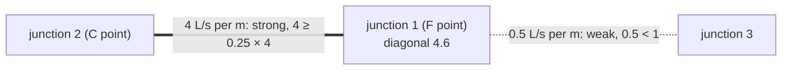
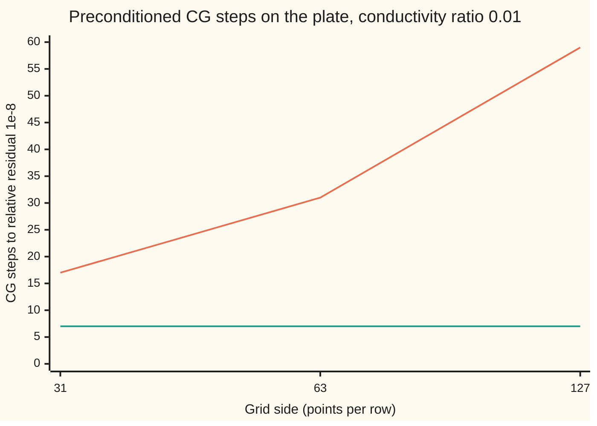

# Algebraic multigrid: choose the coarse grid from the matrix alone

[Syllabus](../../../SYLLABUS.md) → [Numerical analysis](../README.md) → [Fast Solvers for Large Grids](../README.md#s09) → Algebraic multigrid

---

## General Overview

Take the town water network of [Iterating instead of factoring](../03-Numerical%20Linear%20Algebra/09-iterative-methods-jacobi-gauss-seidel-and-conjugate-gradient.md): 250 junctions, 500 pipes, a supply main held at a head of 50 m. Head is pressure written as the height of a water column. Here the pipes come in four sizes: each passes 0.5, 1, 2 or 4 litres a second (L/s) per metre of head difference. Customers at each junction draw 0.1 L/s per metre of head. All these numbers are illustrative.

Balancing water at every junction gives one linear system, A x = b, with 250 unknown heads and 1,180 nonzero entries in A. A solver receives those 1,180 numbers and nothing else. It gets no map, no coordinates, no rule such as "every other junction".

[Multigrid](02-multigrid-smoothing-and-the-v-cycle.md) needs a coarse grid: a smaller copy of the problem on which smooth error is cheap to remove. On a square grid that is every other point. This network's junctions happen to sit on a 10 by 25 lattice, but the solver is not told so, and with pipes from 0.5 to 4 L/s per metre, "every other junction" ignores which ties matter: one junction can sit on a 4 L/s main and a 0.5 L/s service pipe at once. Treating those two neighbours alike is wrong.

**Algebraic multigrid** (AMG) builds the coarse grid from the matrix itself:

- A large off-diagonal entry is a **strong connection**: the two heads must move together.
- It picks **coarse points** (C points) so that every other point, a **fine point** (F point), is strongly tied to at least one of them.
- Each F point copies its correction from its strong C neighbours, with weights read off its row of A.
- The coarse matrix is computed from A and those weights, and the process repeats.

On the network this gives three levels: 250, 125 and 31 points. Used as a preconditioner (a cheap approximate inverse that makes an iteration converge faster), it lets conjugate gradient (CG, the standard iteration for symmetric positive definite systems) reach a relative residual below 1e-8 in 8 steps. Incomplete Cholesky needs 20 and plain conjugate gradient 82.

The method earns its name on a problem geometry gets wrong: a steel plate that conducts heat 100 times better along x than along y. Geometric multigrid's smoother (the cheap sweep that removes jagged error) then stalls; its error-reduction factor tends to 1 as the ratio grows. AMG reads the weak y entries, coarsens along x only, and keeps a factor of 0.1938 per cycle.

**Algebraic multigrid reads strong connections off the matrix, picks coarse points so every fine point has a strong coarse neighbour, interpolates with weights taken from the matrix rows, and forms the coarse matrix as PᵀAP, with P the table of those weights, so it needs no grid and follows whatever direction the matrix says is strong.**

**What kind of fact this is:** a method resting on theorems. That the coarse matrix stays symmetric positive definite and that the coarse correction is the best one available from the coarse grid are proved on this card in Why it works. The strength rule and the splitting are heuristics. Their convergence factors are measured here; a two-level convergence theorem for this class of matrices is stated with its source, not proved.

### The picture: one junction, one strong tie

Take one junction, junction 1, cut down to two pipes so the arithmetic stays visible: a 4 L/s pipe to junction 2 and a 0.5 L/s pipe to junction 3, plus its 0.1 L/s customer draw. With threshold 0.25, a tie is strong if it is at least a quarter of the junction's largest tie.



Junction 1 copies 0.978261 of junction 2's correction. The weak tie to junction 3 is not used for interpolation.

---

## The formula

Three rules build one level of the hierarchy. The first decides which ties matter:

```math
j \in S_i \iff -a_{ij} \;\ge\; \theta \,\max_{k \ne i} \left(-a_{ik}\right)
```

**Read it aloud:** j is a strong connection of i when its entry is at least θ times the largest off-diagonal entry in row i, signs flipped.

The second gives the interpolation weights, for an F point i with strong C neighbours $`P_i`$:

```math
e_i = \sum_{j \in P_i} w_{ij}\, e_j, \qquad w_{ij} = -\alpha_i \,\frac{a_{ij}}{a_{ii}}, \qquad \alpha_i = \frac{\sum_{k \ne i} a_{ik}}{\sum_{k \in P_i} a_{ik}}
```

**Read it aloud:** the fine point's correction is a weighted mix of its strong coarse neighbours' corrections; each weight is the tie over the diagonal, scaled up by α so the dropped ties are not lost.

The third forms the coarse matrix and the coarse-grid correction (the step that fixes smooth error):

```math
A_c = P^{T} A P, \qquad x \leftarrow x + P\, A_c^{-1} P^{T} (b - A x)
```

**Read it aloud:** the coarse matrix is A seen through the interpolation; the correction moves the residual to the coarse grid, solves there, and interpolates the answer back.

| Symbol | Plain meaning | In our example | Push it up and the answer… |
| --- | --- | --- | --- |
| $`A`$, $`a_{ij}`$, $`n`$, nnz | the matrix, its entry in row i and column j, its number of rows, and its number of stored entries; i, j, k number the points | network: 250 by 250, 1,180 nonzeros; junction 1: $`a_{11}`$ = 4.6 | — |
| $`x`$, $`b`$ | the unknowns (heads in metres, plate temperatures) and the right-hand side | heads from 46.9016 m down to 5.7544 m | — |
| $`\theta`$ | the strength threshold | 0.25 | fewer strong ties per point; the split changes (Try changing) |
| $`S_i`$ | the strong connections of point i | junction 1: junction 2 only | — |
| C, F | coarse points, kept on the next level; fine points, interpolated | plate, first level: 1,953 C and 2,016 F | more C: better interpolation, costlier levels |
| $`P_i`$ | the C points in $`S_i`$: where F point i interpolates from | junction 1: junction 2 | — |
| $`w_{ij}`$, $`\alpha_i`$ | interpolation weight; the scaling that spreads dropped ties over kept ones | 0.978261; 1.1250 | α = 1 loses constants (What breaks) |
| $`P`$, $`n_c`$, R | the interpolation matrix, n rows and $`n_c`$ columns, one per C point; R = Pᵀ moves residuals down | 250 by 125 on the network | — |
| $`A_c`$ | the Galerkin coarse matrix $`P^T A P`$ | 125 by 125, then 31 by 31 | — |
| $`e`$, $`r`$, $`\lVert e \rVert_A`$ | the error x* − x (x* the exact answer), the residual r = b − A x, so A e = r, and the energy norm $`\sqrt{e^T A e}`$; v is any vector | relative residual below 1e-8 at the stop | — |
| $`\sigma`$ | the plate's conductivity ratio, y over x | 0.01 | small σ: the y ties turn weak |
| $`\mu`$, $`q`$ | smoothing factor: the worst shrink of an oscillating error by one Gauss–Seidel sweep; q: measured residual factor per V-cycle | μ = 0.9804 at σ = 0.01; q = 0.1938 (AMG) against 0.7313 (geometric) | q near 1: the cycle stalls |

Three letters mean something else nearby, said once here: $`\theta`$ is the wave angle on [Multigrid](02-multigrid-smoothing-and-the-v-cycle.md), $`\sigma`$ the diagonal shift on [Incomplete factorisations](01-incomplete-factorisation-preconditioners.md), and $`\alpha`$ the diffusivity on shelf 07. On this card they are the strength threshold, the conductivity ratio and the interpolation scaling.

### When it holds

- **A is symmetric, with a positive diagonal and mostly negative off-diagonals**, as for diffusion, heat flow and pipe networks: a graph Laplacian plus a positive diagonal. If large positive off-diagonals appear, as in elasticity, the strength test misreads them; here a positive entry is moved onto the diagonal instead.
- **Smooth error is nearly constant along strong ties.** That is what the interpolation reproduces. In elasticity, rotations of a whole body are smooth too, and constants cannot represent them; smoothed aggregation with extra vectors handles that case.
- **Every F point has a strong C neighbour.** The first pass of the splitting guarantees it. Without one, $`\sum_{k \in P_i} a_{ik}`$ = 0 and the weight is undefined.
- **The smoother damps what the coarse grid cannot show.** Gauss–Seidel damps error that oscillates along strong ties. AMG keeps every direction with weak ties on the coarse grid, so the smoother never has to fix error in those directions.
- **The setup is paid once.** Building the levels costs work before the first solve. It pays when n is large or the same matrix is solved many times.

---

## Why it works

### Step 0: let the matrix define "smooth"

Multigrid splits the error in two. A few Gauss–Seidel sweeps (each sweep updates every point in turn from its neighbours' latest values) remove the part that jumps from point to point. What survives is smooth, and a coarse grid can hold it.

AMG asks the matrix what "smooth" means. An error that one sweep barely changes has a small residual: A e ≈ 0. Row i of that reads

```math
a_{ii}\, e_i \approx -\sum_{k \ne i} a_{ik}\, e_k .
```

So $`e_i`$ is close to a weighted average of its neighbours, weighted by the size of each entry. A large entry forces two values to stay together. A small one barely constrains them. Strength of connection, coarse points and weights all follow from this one line.

### Step 1: strength of connection

Measure each tie against the largest tie in the same row. Junction 1's largest tie is 4, so the cut is 0.25 × 4 = 1.00. The tie to junction 2, 4, passes; the tie to junction 3, 0.5, does not.

The measure is relative, not absolute. On the plate every row has x ties of 1 and y ties of σ = 0.01. Each point is strong only to its two x neighbours: 1.968 strong ties per point on average (points on the edge have one).

### Step 2: the C/F split

The split must give every F point a strong C neighbour, with as few C points as possible. The classical first pass (Ruge and Stüben) is greedy:

1. Give each point a score: how many points depend strongly on it.
2. Make the undecided point with the highest score a C point.
3. Make every undecided point that depends strongly on it an F point.
4. Raise the score of points those new F points depend on, since choosing one of them as C would serve an F point. Lower the score of the new C point's own strong neighbours.
5. Repeat until every point is decided.

On the plate, strong ties run along x only, so the pass alternates C and F along each row of 63 and treats each row separately. The first coarse level has 63 × 31 = 1,953 points: the plate halved in x and kept whole in y. This is **semi-coarsening**, coarsening along one direction only, and nobody asked for it: it came from the entries.

### Step 3: interpolation weights from the row

Start from the smooth-error line of Step 0 and keep only the strong C neighbours. Spread the dropped ties over the kept ones in proportion. That is the factor $`\alpha_i`$:

```math
a_{ii}\, e_i \approx -\alpha_i \sum_{j \in P_i} a_{ij}\, e_j \quad\Longrightarrow\quad w_{ij} = -\alpha_i\, \frac{a_{ij}}{a_{ii}} .
```

For junction 1, α = (4 + 0.5) ÷ 4 = 1.1250 and w = 1.1250 × 4 ÷ 4.6 = 0.978261.

If a row sums to zero, the weights sum to one: $`\sum_j w_{ij} = \sum_{k \ne i} (-a_{ik}) / a_{ii}`$ = 1. A constant error is then interpolated exactly. Junction 1's weights sum to 0.978261, not 1, because its row sums to the 0.1 L/s customer draw. On the plate, 1,830 F rows sum to zero, and their weight sums miss 1 by at most 2.220e-16, one rounding.

### Step 4: the Galerkin coarse matrix

The coarse matrix $`A_c = P^T A P`$ is the Galerkin choice: the product R A P of [Multigrid](02-multigrid-smoothing-and-the-v-cycle.md), with restriction R = Pᵀ. It is symmetric whenever A is, and positive definite (vᵀAv > 0 for every nonzero v) whenever P has independent columns. P does, because each C point's row of P is a single 1 in its own column.

It is also the best possible correction. The update $`P A_c^{-1} P^T r`$ removes the part of the error that the coarse grid can represent, measured in the energy norm $`\lVert e \rVert_A = \sqrt{e^T A e}`$. So a coarse-grid correction never increases that error.

<details>
<summary>Detailed proof: the coarse matrix is symmetric positive definite, and the correction is the best one from the coarse grid</summary>

Symmetry: $`(P^T A P)^T = P^T A^T P = P^T A P`$ because $`A^T = A`$.

Positive definite: take a coarse vector v ≠ 0. The C rows of P form the identity, so Pv ≠ 0. Then

$`\displaystyle v^T (P^T A P)\, v = (P v)^T A\, (P v) > 0.`$

Best correction: let e be the error, so A e = r. Look for the coarse vector v that makes $`\lVert e - P v \rVert_A`$ smallest. Setting the gradient of $`(e - Pv)^T A (e - Pv)`$ to zero gives

$`\displaystyle P^T A P\, v = P^T A\, e = P^T r, \qquad v = A_c^{-1} P^T r,`$

which is exactly the correction in The formula. The new error $`e - Pv`$ is A-orthogonal to every column of P, so by Pythagoras in the energy norm, $`\lVert e \rVert_A^2 = \lVert e - Pv \rVert_A^2 + \lVert P v \rVert_A^2`$, and the energy error cannot grow.

</details>

Ruge and Stüben, and later Stüben (2001), prove a two-level result for symmetric M-matrices (positive diagonal, off-diagonals zero or negative, positive definite). With this kind of interpolation and one coarse level solved exactly, the cycle converges at a rate bounded by how much of each F row the kept ties cover, not by n. No comparable general bound covers the full V-cycle, so this card measures q instead.

The checks compute $`P^T A P`$ in floating point at every level of the plate's hierarchy and find it symmetric to 2.776e-17.

### Step 5: why the matrix beats the geometry on the plate

Fourier analysis (as in [Von Neumann analysis](../07-PDE%20Solvers/03-von-neumann-analysis-and-the-cfl-condition.md)) gives Gauss–Seidel's smoothing factor μ: the worst shrink, per sweep, of any error wave that a grid coarsened in both directions cannot show.

| Conductivity ratio σ | 1 | 0.1 | 0.01 | 0.001 |
| --- | ---: | ---: | ---: | ---: |
| μ for one Gauss–Seidel sweep | 0.5000 | 0.8348 | 0.9804 | 0.9980 |

At σ = 1, μ = 0.5, the known value for the five-point stencil. As σ falls, μ tends to 1, close to 1 − 2σ. The worst wave is flat along x and wobbles along y. Gauss–Seidel barely touches it, because each point leans on its x neighbours, which carry the same value. A grid coarsened in y cannot hold it either. So nothing removes it, and the geometric V-cycle slows to 0.7313 per cycle.

AMG never coarsens across the weak y ties. Its coarse grid keeps every row of the plate, so a wave that wobbles along y but is smooth along x still lives on the coarse grid. The smoother only has to handle waves that oscillate along x, and it damps those well. AMG's cycle reduces the residual by 0.1938 per cycle.

Lower down, the coarse matrices change. The x ties weaken relative to the y ties at each level, and by the fourth level the y ties pass the threshold. The splitting then coarsens both ways: 441 points to 221, then 95, then 15. No rule told it to; the entries did.

On the even plate (σ = 1) both methods work: 0.1710 per cycle for AMG and 0.1676 for geometric coarsening.

### Step 6: AMG as a preconditioner for conjugate gradient

One V-cycle starting from zero, with a forward Gauss–Seidel sweep before the coarse correction and a backward sweep after, is a fixed linear operator. It is symmetric because the two sweeps mirror each other. It is also positive definite whenever the V-cycle converges as a solver, which the measured factors below 1 support here. Those two properties are what conjugate gradient needs from a preconditioner ([Iterating instead of factoring](../03-Numerical%20Linear%20Algebra/09-iterative-methods-jacobi-gauss-seidel-and-conjugate-gradient.md)).

The steps to a relative residual below 1e-8, on the plate at σ = 0.01:

| Grid side | Unknowns | Plain CG | IC(0)-CG | AMG-CG |
| ---: | ---: | ---: | ---: | ---: |
| 31 | 961 | 152 | 17 | 7 |
| 63 | 3,969 | 339 | 31 | 7 |
| 127 | 16,129 | 679 | 59 | 7 |

IC(0) is incomplete Cholesky with no fill ([Incomplete factorisations](01-incomplete-factorisation-preconditioners.md)). Its step count roughly doubles each time the grid side doubles. AMG's stays at 7. That flat line is the reason AMG exists: work close to a fixed multiple of the number of unknowns.



Orange (rising): CG with IC(0). Green (flat): CG with one AMG V-cycle per step. Plain CG, 152, 339 and 679 steps, is off the chart.

### Step 7: the other branch, smoothed aggregation, in outline

Classical AMG picks single points as coarse points. **Smoothed aggregation** (Vaněk, Mandel and Brezina, 1996) groups strongly tied points into small clusters, called aggregates, and makes each aggregate one coarse unknown.

1. The first interpolation copies the aggregate's value to all its members: a piecewise-constant P.
2. One damped Jacobi sweep is applied to each column of that P. Each column becomes a blend of itself and its neighbours, weighted by A, so neighbouring aggregates overlap smoothly.
3. The coarse matrix is again $`P^T A P`$.

It extends naturally to elasticity, where P must also carry rotations. This card does not run it.

---

## Worked numbers, by hand

| Step | Arithmetic | Value |
| --- | --- | --- |
| junction 1's largest tie | the larger of 4 and 0.5 | 4 |
| strength cut | 0.25 × 4 | 1.00 |
| tie to junction 2 | 4 ≥ 1.00 | strong |
| tie to junction 3 | 0.5 < 1.00 | weak |
| α | (4 + 0.5) ÷ 4 | 1.1250 |
| **weight** | 1.1250 × 4 ÷ 4.6 | **0.978261** |
| plate, first coarse level | 63 rows × 31 C points per row | 1,953 |
| plate, 127 × 127, AMG-CG cost | (7 × (one CG step + one V-cycle) + setup) ÷ 16,129 unknowns | 926 flops per unknown |
| plate, 127 × 127, IC(0)-CG cost | 59 × (one CG step + two triangular solves) ÷ 16,129 | 1,763 flops per unknown |

Junction 1 copies 97.8% of junction 2's correction; the missing 2.2% is the share of its water that leaves through customers rather than through pipes. On the largest plate AMG-CG needs 926 flops per unknown (a flop is one addition, subtraction, multiplication or division), against 1,763 for IC(0)-CG and 13,537 for plain CG.

The counts are formulas, not timings. A CG step costs 2 nnz + 10n. A V-cycle costs $`6\,\mathrm{nnz}(A) + 4\,\mathrm{nnz}(P) + 2n`$ on each level (two sweeps, a residual, two transfers), plus $`2 n_c^2`$ for the exact solve at the bottom. The setup's Galerkin products cost 1,395,046 flops at 127 × 127, less than one V-cycle's 1,613,518. The strength test and splitting are integer work, not counted. IC(0)-CG's totals leave out building the IC(0) factor, about half a CG step, which changes no comparison here.

At 31 × 31 the order flips: IC(0)-CG costs 501 flops per unknown and AMG-CG 812. AMG wins only once the grid is large enough, here from 63 × 63 (891 against 922).

### What breaks if you drop a piece

All four rows are run on the 63 × 63 plate with σ = 0.01, except the last.

| Mistake | Comes out at | What went wrong |
| --- | --- | --- |
| Coarsen by geometry: every other point both ways | 0.7313 per V-cycle, against 0.1938; levels 3969/961/225/49 | the y-wobbling error is neither smoothed nor representable |
| Call every tie strong: θ = 0 | 0.6548 per V-cycle; levels 3969/1985/510/130/40 | the split now coarsens across weak ties, like geometry |
| Drop α: use $`w_{ij} = -a_{ij}/a_{ii}`$ | 0.4847 per V-cycle | the weights of a zero-sum row add to less than 1, so a constant error is not reproduced |
| No preconditioner, at 127 × 127 | 679 CG steps, 13,537 flops per unknown, against 7 and 926 | plain CG's step count grows with the grid side |

---

## Code, from first principles, and it actually runs

The code builds the classical AMG setup (strength, the greedy split with a heap, direct interpolation, Galerkin products), then runs V-cycles and conjugate gradient. Five roads check it:

1. The hand weight 0.978261 against the code's own interpolation.
2. The Fourier smoothing factor against the known 0.5 at σ = 1 and against 1 − 2σ for small σ.
3. Plain CG, IC(0)-CG and AMG-CG on the same systems, which must agree, with the residual recomputed from scratch.
4. Two properties on real hierarchies: weights summing to 1 on zero-sum rows, and symmetric coarse matrices.
5. Geometric coarsening, with the same smoother and Galerkin products, run beside AMG.

Pipe sizes come from a written-out SplitMix64 generator, seed 20261124. The output prints the conductivity ratio σ as `eps`. The largest plate is 127 × 127, not the shelf's 1,023 × 1,023, so the run stays under a minute; the flat step count is what carries over.

### Python

```python
# Algebraic multigrid -- the check behind the card.  Standard library only.  A Ruge-Stuben hierarchy
# from the matrix alone, on a pipe network and an anisotropic plate, against geometric MG, IC(0) and CG.
import heapq, itertools; from math import sqrt, cos, sin, pi
M64, state = (1 << 64) - 1, [20261124]
def nxt():                                   # SplitMix64, written out
    state[0] = z = (state[0] + 0x9E3779B97F4A7C15) & M64
    z = ((z ^ (z >> 30)) * 0xBF58476D1CE4E5B9) & M64
    z = ((z ^ (z >> 27)) * 0x94D049BB133111EB) & M64
    return z ^ (z >> 31)
def sci(v): m, x = f"{v:.3e}".split("e"); return m + "e" + str(int(x))  # as Rust
def rdot(r, x):                              # a sparse row, pairs (j, a), times the vector x
    acc = 0.0
    for j, a in r: acc += a * x[j]
    return acc
def dot(u, v): return rdot(enumerate(u), v)
def mv(A, x): return [rdot(r, x) for r in A]
def nnz(A): return sum(len(r) for r in A)
def rows(d): return [sorted(r.items()) for r in d]
def off(r, i): return [(j, a) for j, a in r if j != i]
def strong(A, th):                           # j is strong for i if -a_ij >= th * (largest -a_ik)
    big = [max(-a for _, a in off(r, i)) for i, r in enumerate(A)]
    return [[j for j, a in off(r, i) if big[i] > 0 and -a >= th * big[i]] for i, r in enumerate(A)]
def split(S):                                # Ruge-Stuben first pass: 1 = C point, 0 = F point
    n = len(S); ST, cf = [[] for _ in range(n)], [-1] * n
    for i, j in ((i, j) for i in range(n) for j in S[i]): ST[j].append(i)   # ST[j]: depend strongly on j
    lam = [len(t) for t in ST]; heap = [(-lam[i], i) for i in range(n)]; heapq.heapify(heap)
    def bump(k, d): lam[k] += d; heapq.heappush(heap, (-lam[k], k))
    while heap:
        l, i = heapq.heappop(heap)
        if cf[i] != -1 or -l != lam[i]: continue
        cf[i] = 1
        for j in [j for j in ST[i] if cf[j] == -1]:
            cf[j] = 0
            for k in [k for k in S[j] if cf[k] == -1]: bump(k, 1)
        for k in [k for k in S[i] if cf[k] == -1]: bump(k, -1)
    return cf
def interp(A, S, cf, scale=True):            # direct interpolation, Stuben (2001)
    ci = list(itertools.accumulate([0] + cf[:-1])); P = []
    for i, r in enumerate(A):
        Pi = [j for j in S[i] if cf[j]]; neg = negP = dg = 0.0
        for j, a in r:
            if j == i or a > 0: dg += a      # a positive entry joins the diagonal
            else: neg += a; negP += a if j in Pi else 0.0
        P.append([(ci[i], 1.0)] if cf[i] else [(ci[j], -(neg / negP if scale else 1.0) * a / dg) for j, a in r if j in Pi])
    return P, sum(cf)
def rap(A, P, nc):                           # Galerkin coarse matrix P^T A P, and its flops
    Ac, fl = [dict() for _ in range(nc)], 0
    for i, r in enumerate(A):
        d = {}
        for j, a in r:
            for J, w in P[j]: d[J] = d.get(J, 0.0) + a * w; fl += 2
        for I, p in P[i]:
            for J, v in sorted(d.items()): Ac[I][J] = Ac[I].get(J, 0.0) + p * v; fl += 2
    return rows(Ac), fl
def setup(A, Ps=None, th=0.25, scale=True):  # Ps given: geometric coarsening instead
    lv, fl = [[A, None]], 0
    while len(lv[-1][0]) > 50 and (Ps is None or len(lv) <= len(Ps)):
        S = strong(lv[-1][0], th); P, nc = Ps[len(lv) - 1] if Ps else interp(lv[-1][0], S, split(S), scale)
        Ac, f = rap(lv[-1][0], P, nc); fl += f; lv[-1][1] = P; lv.append([Ac, None])
    return lv, ic0([[(j, dict(r).get(j, 0.0)) for j in range(len(lv[-1][0]))] for r in lv[-1][0]]), fl   # IC(0) of a full matrix: exact
def ic0(A):                                  # incomplete Cholesky: keep A's own nonzeros only
    L = []
    for i, r in enumerate(A):
        row = {}
        for k, a in [(k, a) for k, a in r if k < i]: row[k] = (a - rdot([(j, v) for j, v in row.items() if j in L[k][0]], L[k][0])) / L[k][1]
        L.append((row, sqrt(dict(r)[i] - rdot(row.items(), row))))
    return L
def icsolve(L, r):                           # L y = r, then L^T z = y
    y = r[:]
    for i in range(len(r)): y[i] = (y[i] - rdot(L[i][0].items(), y)) / L[i][1]
    for i in range(len(r) - 1, -1, -1):
        y[i] /= L[i][1]
        for k, v in L[i][0].items(): y[k] -= v * y[i]
    return y
def gs(A, x, b, order):                      # one Gauss-Seidel sweep
    for i in order: x[i] = (b[i] - rdot(off(A[i], i), x)) / dict(A[i])[i]
def vcyc(H, b, l=0):                         # one V-cycle, starting from x = 0
    if H[0][l][1] is None: return icsolve(H[1], b)   # coarsest level: solve exactly
    A, P = H[0][l]; n = len(A); x = [0.0] * n; gs(A, x, b, range(n))
    r = [u - v for u, v in zip(b, mv(A, x))]; rc = [0.0] * len(H[0][l + 1][0])
    for i, I, w in ((i, I, w) for i in range(n) for I, w in P[i]): rc[I] += w * r[i]
    ec = vcyc(H, rc, l + 1); x = [u + rdot(p, ec) for u, p in zip(x, P)]
    gs(A, x, b, range(n - 1, -1, -1)); return x
def pcg(A, b, M, tol=1e-8):                  # preconditioned conjugate gradient
    x, r = [0.0] * len(b), b[:]; z = M(r); p = z[:]; rz, nb, h = dot(r, z), sqrt(dot(b, b)), [1.0]
    while h[-1] >= tol and len(h) <= 2 * len(b):  # CG needs at most n steps without rounding; allow 2n
        q = mv(A, p); a = rz / dot(p, q); x = [u + a * v for u, v in zip(x, p)]; r = [u - a * v for u, v in zip(r, q)]
        z = M(r); rz2 = dot(r, z); be = rz2 / rz; p = [u + be * v for u, v in zip(z, p)]; rz = rz2
        h.append(sqrt(dot(r, r)) / nb)
    assert h[-1] < tol, "CG did not converge"; return x, h
def vfactor(A, b, H, k=10):                  # V-cycles alone: residual factor per cycle
    x = [0.0] * len(b)
    for _ in range(k + 1): r = [u - v for u, v in zip(b, mv(A, x))]; x = [u + v for u, v in zip(x, vcyc(H, r))]
    return (sqrt(dot(r, r)) / sqrt(dot(b, b))) ** (1.0 / k)
def vflops(lv): return sum(6 * nnz(A) + 4 * nnz(P) + 2 * len(A) for A, P in lv[:-1]) + 2 * len(lv[-1][0]) ** 2
def levels(H): return "/".join(str(len(l[0])) for l in H[0])
def network():                               # 10 rows of 25 junctions, 465 + 35 pipes
    d, b = [{i: 0.1} for i in range(250)], [0.0] * 250   # customers: 0.1 L/s per metre of head
    for i in range(250):
        for j in ([i + 1] if i % 25 < 24 else []) + ([i + 25] if i < 225 else []) + [-1] * ((i < 25) + (i % 25 == 0)):
            g = [0.5, 1.0, 2.0, 4.0][nxt() % 4]; d[i][i] += g   # pipe sizes, L/s per metre
            if j < 0: b[i] += 50.0 * g       # a feed from the main at 50 m
            else: d[j][j] += g; d[i][j] = d[j][i] = -g
    return rows(d), b
def plate(N, e):                             # conductivity 1 along x, e along y; heater at centre
    d = [{k: 2.0 + 2.0 * e} for k in range(N * N)]; b = [0.0] * (N * N); b[N * N // 2] = 1.0
    for k in range(N * N):
        for m, c, ok in ((k - 1, 1.0, k % N > 0), (k + 1, 1.0, k % N < N - 1), (k - N, e, k >= N), (k + N, e, k < N * N - N)):
            if ok: d[k][m] = -c
    return rows(d), b
def geo(N):                                  # bilinear interpolation, every other point both ways
    Ps = []
    while N * N > 50:
        n = (N - 1) // 2; w1 = lambda i: [((i - 1) // 2, 1.0)] if i % 2 else [(k, 0.5) for k in (i // 2 - 1, i // 2) if 0 <= k < n]
        Ps.append(([sorted((J * n + I, a * c) for J, a in w1(k // N) for I, c in w1(k % N)) for k in range(N * N)], n * n)); N = n
    return Ps
def mu(e):                                   # Gauss-Seidel smoothing factor over high frequencies
    cs = [(cos(p * pi / 128), sin(p * pi / 128), abs(p) >= 64) for p in range(-128, 128)]
    return max(sqrt(((c1 + e * c2) ** 2 + (s1 + e * s2) ** 2) / ((2 + 2 * e - c1 - e * c2) ** 2 + (s1 + e * s2) ** 2)) for c1, s1, h1 in cs for c2, s2, h2 in cs if h1 or h2)
def three(A, b, H): L = ic0(A); return [pcg(A, b, M) for M in (lambda r: r, lambda r: icsolve(L, r), lambda r: vcyc(H, r))]
A3 = [[(0, 4.6), (1, -4.0), (2, -0.5)], [(0, -4.0), (1, 4.1)], [(0, -0.5), (2, 0.6)]]; S3 = strong(A3, 0.25); P3, _ = interp(A3, S3, [0, 1, 1]); w = (4.5 / 4.0) * 4.0 / 4.6
print(f"hand,cut={0.25 * 4.0:.2f},junction1_strong_to=" + "+".join(str(j + 1) for j in S3[0]) + f",alpha={4.5 / 4.0:.4f},weight={w:.6f},code={P3[0][0][1]:.6f}")
ms = [mu(e) for e in (1.0, 0.1, 0.01, 0.001)]; print("smoothing,eps=1/0.1/0.01/0.001,gauss_seidel_mu=" + "/".join(f"{m:.4f}" for m in ms))
assert S3[0] == [1] and abs(P3[0][0][1] - w) < 1e-15 and abs(ms[0] - 0.5) < 1e-3 and all(abs(m - (1 - 2 * e)) < 5 * e * e for m, e in zip(ms[2:], (0.01, 0.001)))
A, b = network(); H = setup(A); runs = three(A, b, H); x = runs[2][0]   # the network: no grid used
r = [u - v for u, v in zip(b, mv(A, x))]; tr = sqrt(dot(r, r) / dot(b, b)); gap = max(abs(u - v) for y, _ in runs[:2] for u, v in zip(y, x))
print(f"network,junctions={len(A)},nonzeros={nnz(A)},levels={levels(H)},operator_complexity={sum(nnz(l[0]) for l in H[0]) / nnz(A):.3f},vcycle_factor={vfactor(A, b, H):.4f}")
print("network,cg_steps_plain/ic0/amg=" + "/".join(str(len(h) - 1) for _, h in runs) + f",true_residual={sci(tr)},max_gap_m={sci(gap)},heads_m={max(x):.4f}..{min(x):.4f}")
assert tr < 1.01e-8 and gap < 1e-4 and len(runs[2][1]) < len(runs[1][1]) < len(runs[0][1]); fac = {}
for e, name, args in (("0.01", "amg", ()), ("0.01", "geometric", (geo(63),)), ("0.01", "theta_0", (None, 0.0)), ("0.01", "no_alpha", (None, 0.25, False)), ("1", "amg", ()), ("1", "geometric", (geo(63),))):
    A, b = plate(63, float(e)); H = setup(A, *args); fac[e, name] = vfactor(A, b, H); print(f"plate63,eps={e},{name},levels={levels(H)},vcycle_factor={fac[e, name]:.4f}")
assert fac["0.01", "amg"] < 0.3 < fac["0.01", "geometric"] and max(fac["1", "amg"], fac["1", "geometric"]) < 0.3 and fac["0.01", "theta_0"] > 2 * fac["0.01", "amg"]
A, b = plate(63, 0.01); H = setup(A); S = strong(A, 0.25); cf = split(S); P, _ = interp(A, S, cf); one = [1.0] * len(A)
ones = [abs(rdot(P[i], one) - 1.0) for i in range(len(A)) if not cf[i] and abs(rdot(A[i], one)) < 1e-12]; asym = max(abs(dict(Ac[J]).get(I, 0.0) - a) for Ac, _ in H[0] for I in range(len(Ac)) for J, a in Ac[I])
print(f"plate63,first_level,C={sum(cf)},F={len(cf) - sum(cf)},strong_per_row={nnz(S) / len(S):.3f},zero_sum_F_rows={len(ones)},max_weight_sum_minus_1={sci(max(ones))},coarse_asymmetry={sci(asym)}"); assert max(ones) < 1e-12 and asym < 1e-12 and nnz(S) == 2 * 63 * 62
for N in (31, 63, 127):
    A, b = plate(N, 0.01); H = setup(A); runs = three(A, b, H); n, z = len(A), nnz(A); k = [len(h) - 1 for _, h in runs]
    base = 2 * z + 10 * n; fl = [k[0] * base, k[1] * (base + 2 * z), k[2] * (base + vflops(H[0])) + H[2]]
    print(f"plate,N={N},unknowns={n},cg_steps={k[0]}/{k[1]}/{k[2]},flops_per_unknown={fl[0] / n:.0f}/{fl[1] / n:.0f}/{fl[2] / n:.0f},amg_setup={H[2]:,},vcycle={vflops(H[0]):,}"); assert k[2] <= 10 < k[1] < k[0] and max(abs(u - v) for u, v in zip(runs[1][0], runs[2][0])) < 1e-6 * max(runs[2][0])
print("ALL CHECKS PASS")
```

**Ran 2026-11-24 on macOS, Python 3.14.10, standard library only. All checks passed. Output, pasted from the run:**

```
hand,cut=1.00,junction1_strong_to=2,alpha=1.1250,weight=0.978261,code=0.978261
smoothing,eps=1/0.1/0.01/0.001,gauss_seidel_mu=0.5000/0.8348/0.9804/0.9980
network,junctions=250,nonzeros=1180,levels=250/125/31,operator_complexity=2.008,vcycle_factor=0.1985
network,cg_steps_plain/ic0/amg=82/20/8,true_residual=1.172e-9,max_gap_m=2.137e-6,heads_m=46.9016..5.7544
plate63,eps=0.01,amg,levels=3969/1953/945/441/221/95/15,vcycle_factor=0.1938
plate63,eps=0.01,geometric,levels=3969/961/225/49,vcycle_factor=0.7313
plate63,eps=0.01,theta_0,levels=3969/1985/510/130/40,vcycle_factor=0.6548
plate63,eps=0.01,no_alpha,levels=3969/1953/945/441/221/95/19,vcycle_factor=0.4847
plate63,eps=1,amg,levels=3969/1985/510/132/35,vcycle_factor=0.1710
plate63,eps=1,geometric,levels=3969/961/225/49,vcycle_factor=0.1676
plate63,first_level,C=1953,F=2016,strong_per_row=1.968,zero_sum_F_rows=1830,max_weight_sum_minus_1=2.220e-16,coarse_asymmetry=2.776e-17
plate,N=31,unknowns=961,cg_steps=152/17/7,flops_per_unknown=3001/501/812,amg_setup=61,168,vcycle=83,746
plate,N=63,unknowns=3969,cg_steps=339/31/7,flops_per_unknown=6737/922/891,amg_setup=318,536,vcycle=381,070
plate,N=127,unknowns=16129,cg_steps=679/59/7,flops_per_unknown=13537/1763/926,amg_setup=1,395,046,vcycle=1,613,518
ALL CHECKS PASS
```

### Rust

```rust
// Algebraic multigrid -- the check behind the card.  Rust std only.  A Ruge-Stuben hierarchy
// from the matrix alone, on a pipe network and an anisotropic plate, against geometric MG, IC(0) and CG.
use std::{cmp::Reverse, collections::{BTreeMap, BinaryHeap}, f64::consts::PI};
type Row = Vec<(usize, f64)>; type Mat = Vec<Row>; type Map = BTreeMap<usize, f64>;
type Lv = Vec<(Mat, Option<Mat>)>; type Ic = Vec<(Map, f64)>; type Hier = (Lv, Ic, usize);
fn nxt(st: &mut u64) -> u64 { // SplitMix64, written out
    *st = st.wrapping_add(0x9E3779B97F4A7C15); let mut z = (*st ^ (*st >> 30)).wrapping_mul(0xBF58476D1CE4E5B9);
    z = (z ^ (z >> 27)).wrapping_mul(0x94D049BB133111EB); z ^ (z >> 31)
}
fn sci(v: f64) -> String { format!("{:.3e}", v) }
fn commas(v: usize) -> String {
    let d = v.to_string(); d.chars().enumerate().map(|(i, ch)| if i > 0 && (d.len() - i) % 3 == 0 { format!(",{}", ch) } else { ch.to_string() }).collect()
}
fn rdot(r: &[(usize, f64)], x: &[f64]) -> f64 { let mut acc = 0.0; for &(j, a) in r { acc += a * x[j]; } acc }
fn dot(u: &[f64], v: &[f64]) -> f64 { let mut acc = 0.0; for j in 0..u.len() { acc += u[j] * v[j]; } acc }
fn mv(a: &Mat, x: &[f64]) -> Vec<f64> { a.iter().map(|r| rdot(r, x)).collect() }
fn nnz(a: &Mat) -> usize { a.iter().map(|r| r.len()).sum() }
fn rows(d: Vec<Map>) -> Mat { d.into_iter().map(|r| r.into_iter().collect()).collect() }
fn get(r: &Row, i: usize) -> f64 { r.iter().find(|e| e.0 == i).map_or(0.0, |e| e.1) }
fn sub(b: &[f64], a: &[f64]) -> Vec<f64> { b.iter().zip(a).map(|(u, v)| u - v).collect() }
fn fmax(v: impl Iterator<Item = f64>) -> f64 { v.fold(f64::MIN, f64::max) }
fn strong(a: &Mat, th: f64) -> Vec<Vec<usize>> { // j is strong for i if -a_ij >= th * (largest -a_ik)
    a.iter().enumerate().map(|(i, r)| { let big = fmax(r.iter().filter(|e| e.0 != i).map(|e| -e.1));
        r.iter().filter(|e| e.0 != i && big > 0.0 && -e.1 >= th * big).map(|e| e.0).collect() }).collect()
}
fn split(s: &[Vec<usize>]) -> Vec<usize> { // Ruge-Stuben first pass: 1 = C point, 0 = F point, 2 = undecided
    let n = s.len(); let (mut st, mut cf) = (vec![vec![]; n], vec![2usize; n]);
    for i in 0..n { for &j in &s[i] { st[j].push(i); } } // st[j]: depend strongly on j
    let mut lam: Vec<i64> = st.iter().map(|t| t.len() as i64).collect();
    let mut heap: BinaryHeap<Reverse<(i64, usize)>> = (0..n).map(|i| Reverse((-lam[i], i))).collect();
    let bump = |k: usize, d: i64, lam: &mut Vec<i64>, heap: &mut BinaryHeap<_>| { lam[k] += d; heap.push(Reverse((-lam[k], k))); };
    while let Some(Reverse((l, i))) = heap.pop() {
        if cf[i] != 2 || -l != lam[i] { continue; } cf[i] = 1;
        for j in st[i].iter().copied().filter(|&j| cf[j] == 2).collect::<Vec<_>>() {
            cf[j] = 0; for &k in &s[j] { if cf[k] == 2 { bump(k, 1, &mut lam, &mut heap); } } }
        for &k in &s[i] { if cf[k] == 2 { bump(k, -1, &mut lam, &mut heap); } }
    }
    cf
}
fn interp(a: &Mat, s: &[Vec<usize>], cf: &[usize], scale: bool) -> (Mat, usize) { // direct interpolation, Stuben (2001)
    let ci: Vec<usize> = (0..cf.len()).scan(0, |c, i| { *c += cf[i]; Some(*c - cf[i]) }).collect();
    let p = a.iter().enumerate().map(|(i, r)| { if cf[i] == 1 { return vec![(ci[i], 1.0)]; }
        let pi: Vec<usize> = s[i].iter().copied().filter(|&j| cf[j] == 1).collect(); let (mut neg, mut negp, mut dg) = (0.0, 0.0, 0.0);
        for &(j, v) in r { if j == i || v > 0.0 { dg += v; } else { neg += v; if pi.contains(&j) { negp += v; } } } // positive: diagonal
        let al = if scale { neg / negp } else { 1.0 };
        r.iter().filter(|e| pi.contains(&e.0)).map(|&(j, v)| (ci[j], -al * v / dg)).collect() }).collect();
    (p, cf.iter().sum())
}
fn rap(a: &Mat, p: &Mat, nc: usize) -> (Mat, usize) { // Galerkin coarse matrix P^T A P, and its flops
    let (mut ac, mut fl) = (vec![Map::new(); nc], 0usize);
    for (i, r) in a.iter().enumerate() { let mut d = Map::new();
        for &(j, v) in r { for &(jj, w) in &p[j] { *d.entry(jj).or_insert(0.0) += v * w; fl += 2; } }
        for &(ii, q) in &p[i] { for (&jj, &v) in &d { *ac[ii].entry(jj).or_insert(0.0) += q * v; fl += 2; } } }
    (rows(ac), fl)
}
fn setup(a: Mat, ps: Option<&Vec<(Mat, usize)>>, th: f64, scale: bool) -> Hier { // ps given: geometric coarsening
    let (mut lv, mut fl): (Lv, usize) = (vec![(a, None)], 0);
    while lv.last().unwrap().0.len() > 50 && ps.map_or(true, |q| lv.len() <= q.len()) {
        let a = &lv.last().unwrap().0; let s = strong(a, th);
        let (p, nc) = match ps { Some(q) => q[lv.len() - 1].clone(), None => interp(a, &s, &split(&s), scale) };
        let (ac, f) = rap(a, &p, nc); fl += f; lv.last_mut().unwrap().1 = Some(p); lv.push((ac, None)); }
    let last = &lv.last().unwrap().0; let full: Mat = last.iter().map(|r| (0..last.len()).map(|j| (j, get(r, j))).collect()).collect();
    let l = ic0(&full); (lv, l, fl) // IC(0) of a full matrix: exact
}
fn ic0(a: &Mat) -> Ic { // incomplete Cholesky: keep A's own nonzeros only
    let mut l: Ic = vec![];
    for (i, r) in a.iter().enumerate() { let mut row = Map::new();
        for &(k, v) in r.iter().filter(|e| e.0 < i) {
            let mut acc = 0.0; for (j, w) in &row { if let Some(x) = l[k].0.get(j) { acc += w * x; } } row.insert(k, (v - acc) / l[k].1); }
        let mut acc = 0.0; for (_, w) in &row { acc += w * w; } l.push((row, (get(r, i) - acc).sqrt())); }
    l
}
fn icsolve(l: &Ic, r: &[f64]) -> Vec<f64> { // L y = r, then L^T z = y
    let mut y = r.to_vec();
    for i in 0..r.len() { let mut acc = 0.0; for (&j, &w) in &l[i].0 { acc += w * y[j]; } y[i] = (y[i] - acc) / l[i].1; }
    for i in (0..r.len()).rev() { y[i] /= l[i].1; for (&k, &w) in &l[i].0 { y[k] -= w * y[i]; } } y
}
fn gs(a: &Mat, x: &mut [f64], b: &[f64], fwd: bool) { // one Gauss-Seidel sweep
    for t in 0..a.len() { let i = if fwd { t } else { a.len() - 1 - t };
        let mut acc = 0.0; for &(j, v) in &a[i] { if j != i { acc += v * x[j]; } } x[i] = (b[i] - acc) / get(&a[i], i); }
}
fn vcyc(h: &Hier, b: &[f64], l: usize) -> Vec<f64> { // one V-cycle, starting from x = 0
    let (a, p) = (&h.0[l].0, match &h.0[l].1 { None => return icsolve(&h.1, b), Some(p) => p }); // coarsest: exact
    let mut x = vec![0.0; a.len()]; gs(a, &mut x, b, true); let r = sub(b, &mv(a, &x)); let mut rc = vec![0.0; h.0[l + 1].0.len()];
    for i in 0..a.len() { for &(ii, w) in &p[i] { rc[ii] += w * r[i]; } }
    let ec = vcyc(h, &rc, l + 1); for i in 0..a.len() { x[i] += rdot(&p[i], &ec); }
    gs(a, &mut x, b, false); x
}
fn pcg(a: &Mat, b: &[f64], m: &dyn Fn(&[f64]) -> Vec<f64>) -> (Vec<f64>, Vec<f64>) { // preconditioned conjugate gradient
    let (mut x, mut r) = (vec![0.0; b.len()], b.to_vec()); let z = m(&r); let mut p = z.clone(); let (mut rz, nb, mut h) = (dot(&r, &z), dot(b, b).sqrt(), vec![1.0]);
    while h[h.len() - 1] >= 1e-8 && h.len() <= 2 * b.len() { // CG needs at most n steps without rounding; allow 2n
        let q = mv(a, &p); let al = rz / dot(&p, &q); x = x.iter().zip(&p).map(|(u, v)| u + al * v).collect(); r = r.iter().zip(&q).map(|(u, v)| u - al * v).collect();
        let z = m(&r); let rz2 = dot(&r, &z); let be = rz2 / rz; p = z.iter().zip(&p).map(|(u, v)| u + be * v).collect(); rz = rz2;
        h.push(dot(&r, &r).sqrt() / nb); }
    assert!(h[h.len() - 1] < 1e-8, "CG did not converge"); (x, h)
}
fn vfactor(a: &Mat, b: &[f64], h: &Hier) -> f64 { // V-cycles alone: residual factor per cycle
    let (mut x, mut r) = (vec![0.0; b.len()], vec![]);
    for _ in 0..11 { r = sub(b, &mv(a, &x)); let e = vcyc(h, &r, 0); x = x.iter().zip(&e).map(|(u, v)| u + v).collect(); }
    (dot(&r, &r).sqrt() / dot(b, b).sqrt()).powf(1.0 / 10.0)
}
fn vflops(lv: &Lv) -> usize { lv[..lv.len() - 1].iter().map(|(a, p)| 6 * nnz(a) + 4 * nnz(p.as_ref().unwrap()) + 2 * a.len()).sum::<usize>() + 2 * lv[lv.len() - 1].0.len().pow(2) }
fn levels(lv: &Lv) -> String { lv.iter().map(|l| l.0.len().to_string()).collect::<Vec<_>>().join("/") }
fn network(st: &mut u64) -> (Mat, Vec<f64>) { // 10 rows of 25 junctions, 465 + 35 pipes
    let (mut d, mut b): (Vec<Map>, Vec<f64>) = ((0..250).map(|i| Map::from([(i, 0.1)])).collect(), vec![0.0; 250]); // customers: 0.1 L/s per metre
    for i in 0..250usize {
        let mut js: Vec<usize> = [(i + 1, i % 25 < 24), (i + 25, i < 225)].iter().filter(|e| e.1).map(|e| e.0).collect();
        js.extend(vec![usize::MAX; (i < 25) as usize + (i % 25 == 0) as usize]);
        for j in js { let g = [0.5, 1.0, 2.0, 4.0][(nxt(st) % 4) as usize]; *d[i].get_mut(&i).unwrap() += g; // pipe sizes, L/s per metre
            if j == usize::MAX { b[i] += 50.0 * g; } else { *d[j].get_mut(&j).unwrap() += g; d[i].insert(j, -g); d[j].insert(i, -g); } } // feed: 50 m main
    }
    (rows(d), b)
}
fn plate(n: usize, e: f64) -> (Mat, Vec<f64>) { // conductivity 1 along x, e along y; heater at centre
    let mut d: Vec<Map> = (0..n * n).map(|k| Map::from([(k, 2.0 + 2.0 * e)])).collect(); let mut b = vec![0.0; n * n]; b[n * n / 2] = 1.0;
    for k in 0..n * n { for (m, c, ok) in [(k.wrapping_sub(1), 1.0, k % n > 0), (k + 1, 1.0, k % n < n - 1), (k.wrapping_sub(n), e, k >= n), (k + n, e, k < n * n - n)] {
        if ok { d[k].insert(m, -c); } } }
    (rows(d), b)
}
fn geo(mut nn: usize) -> Vec<(Mat, usize)> { // bilinear interpolation, every other point both ways
    let mut ps = vec![];
    while nn * nn > 50 { let n = (nn - 1) / 2;
        let w1 = |i: usize| -> Row { if i % 2 == 1 { vec![((i - 1) / 2, 1.0)] } else { [i / 2, i / 2 + 1].iter().filter(|&&k| k >= 1 && k <= n).map(|&k| (k - 1, 0.5)).collect() } };
        ps.push(((0..nn * nn).map(|k| { let mut r: Row = w1(k / nn).iter().flat_map(|&(jj, a)| w1(k % nn).into_iter().map(move |(ii, c)| (jj * n + ii, a * c))).collect();
            r.sort_by(|u, v| u.0.cmp(&v.0)); r }).collect(), n * n)); nn = n; }
    ps
}
fn mu(e: f64) -> f64 { // Gauss-Seidel smoothing factor over high frequencies
    let cs: Vec<(f64, f64, bool)> = (-128i32..128).map(|p| ((p as f64 * PI / 128.0).cos(), (p as f64 * PI / 128.0).sin(), p.abs() >= 64)).collect();
    fmax(cs.iter().flat_map(|&(c1, s1, h1)| cs.iter().filter(move |c| h1 || c.2).map(move |&(c2, s2, _)|
        (((c1 + e * c2).powi(2) + (s1 + e * s2).powi(2)) / ((2.0 + 2.0 * e - c1 - e * c2).powi(2) + (s1 + e * s2).powi(2))).sqrt())))
}
fn three(a: &Mat, b: &[f64], h: &Hier) -> Vec<(Vec<f64>, Vec<f64>)> { // plain CG, IC(0)-CG, AMG-CG
    let l = ic0(a); vec![pcg(a, b, &|r: &[f64]| r.to_vec()), pcg(a, b, &|r: &[f64]| icsolve(&l, r)), pcg(a, b, &|r: &[f64]| vcyc(h, r, 0))]
}
fn main() {
    let (mut st, a3): (u64, Mat) = (20261124, vec![vec![(0, 4.6), (1, -4.0), (2, -0.5)], vec![(0, -4.0), (1, 4.1)], vec![(0, -0.5), (2, 0.6)]]);
    let s3 = strong(&a3, 0.25); let (p3, _) = interp(&a3, &s3, &[0, 1, 1], true); let w = (4.5 / 4.0) * 4.0 / 4.6;
    println!("hand,cut={:.2},junction1_strong_to={},alpha={:.4},weight={:.6},code={:.6}", 0.25 * 4.0, s3[0].iter().map(|j| (j + 1).to_string()).collect::<Vec<_>>().join("+"), 4.5 / 4.0, w, p3[0][0].1);
    let ms: Vec<f64> = [1.0, 0.1, 0.01, 0.001].iter().map(|&e| mu(e)).collect();
    println!("smoothing,eps=1/0.1/0.01/0.001,gauss_seidel_mu={}", ms.iter().map(|m| format!("{:.4}", m)).collect::<Vec<_>>().join("/"));
    assert!(s3[0] == vec![1] && (p3[0][0].1 - w).abs() < 1e-15 && (ms[0] - 0.5).abs() < 1e-3 && ms[2..].iter().zip([0.01, 0.001]).all(|(m, e)| (m - (1.0 - 2.0 * e)).abs() < 5.0 * e * e));
    let (a, b) = network(&mut st); let h = setup(a.clone(), None, 0.25, true); let runs = three(&a, &b, &h); let x = &runs[2].0; // no grid used
    let r = sub(&b, &mv(&a, x)); let tr = (dot(&r, &r) / dot(&b, &b)).sqrt(); let gap = fmax(runs[..2].iter().flat_map(|(y, _)| y.iter().zip(x).map(|(u, v)| (u - v).abs())));
    println!("network,junctions={},nonzeros={},levels={},operator_complexity={:.3},vcycle_factor={:.4}", a.len(), nnz(&a), levels(&h.0),
             h.0.iter().map(|l| nnz(&l.0)).sum::<usize>() as f64 / nnz(&a) as f64, vfactor(&a, &b, &h));
    println!("network,cg_steps_plain/ic0/amg={}/{}/{},true_residual={},max_gap_m={},heads_m={:.4}..{:.4}", runs[0].1.len() - 1, runs[1].1.len() - 1, runs[2].1.len() - 1,
             sci(tr), sci(gap), fmax(x.iter().cloned()), -fmax(x.iter().map(|v| -v)));
    assert!(tr < 1.01e-8 && gap < 1e-4 && runs[2].1.len() < runs[1].1.len() && runs[1].1.len() < runs[0].1.len());
    let g63 = geo(63); let mut fac = BTreeMap::new();
    for (e, name, ps, th, sc) in [("0.01", "amg", None, 0.25, true), ("0.01", "geometric", Some(&g63), 0.25, true), ("0.01", "theta_0", None, 0.0, true),
                                  ("0.01", "no_alpha", None, 0.25, false), ("1", "amg", None, 0.25, true), ("1", "geometric", Some(&g63), 0.25, true)] {
        let (a, b) = plate(63, e.parse().unwrap()); let h = setup(a.clone(), ps, th, sc); let f = vfactor(&a, &b, &h);
        fac.insert((e, name), f); println!("plate63,eps={},{},levels={},vcycle_factor={:.4}", e, name, levels(&h.0), f); }
    assert!(fac[&("0.01", "amg")] < 0.3 && 0.3 < fac[&("0.01", "geometric")] && fac[&("1", "amg")].max(fac[&("1", "geometric")]) < 0.3 && fac[&("0.01", "theta_0")] > 2.0 * fac[&("0.01", "amg")]);
    let (a, _) = plate(63, 0.01); let h = setup(a.clone(), None, 0.25, true); let s = strong(&a, 0.25); let cf = split(&s); let (p, _) = interp(&a, &s, &cf, true);
    let (one, ncf, ns) = (vec![1.0; a.len()], cf.iter().sum::<usize>(), s.iter().map(|v| v.len()).sum::<usize>());
    let ones: Vec<f64> = (0..a.len()).filter(|&i| cf[i] == 0 && rdot(&a[i], &one).abs() < 1e-12).map(|i| (rdot(&p[i], &one) - 1.0).abs()).collect(); let mo = fmax(ones.iter().cloned());
    let asym = fmax(h.0.iter().flat_map(|(ac, _)| (0..ac.len()).flat_map(move |i| ac[i].iter().map(move |&(j, v)| (get(&ac[j], i) - v).abs()))));
    println!("plate63,first_level,C={},F={},strong_per_row={:.3},zero_sum_F_rows={},max_weight_sum_minus_1={},coarse_asymmetry={}", ncf, a.len() - ncf, ns as f64 / s.len() as f64, ones.len(), sci(mo), sci(asym));
    assert!(mo < 1e-12 && asym < 1e-12 && ns == 2 * 63 * 62);
    for nn in [31usize, 63, 127] {
        let (a, b) = plate(nn, 0.01); let h = setup(a.clone(), None, 0.25, true); let runs = three(&a, &b, &h); let (n, z) = (a.len(), nnz(&a));
        let k: Vec<usize> = runs.iter().map(|r| r.1.len() - 1).collect(); let (base, vf) = (2 * z + 10 * n, vflops(&h.0));
        let fl: Vec<f64> = [k[0] * base, k[1] * (base + 2 * z), k[2] * (base + vf) + h.2].iter().map(|&f| f as f64 / n as f64).collect();
        println!("plate,N={},unknowns={},cg_steps={}/{}/{},flops_per_unknown={:.0}/{:.0}/{:.0},amg_setup={},vcycle={}", nn, n, k[0], k[1], k[2], fl[0], fl[1], fl[2], commas(h.2), commas(vf));
        let xm = fmax(runs[2].0.iter().cloned()); assert!(k[2] <= 10 && 10 < k[1] && k[1] < k[0] && runs[1].0.iter().zip(&runs[2].0).all(|(u, v)| (u - v).abs() < 1e-6 * xm)); }
    println!("ALL CHECKS PASS");
}
```

**Ran 2026-11-24 on macOS, rustc 1.98.1, no crates. All checks passed. Output, pasted from the run:**

```
hand,cut=1.00,junction1_strong_to=2,alpha=1.1250,weight=0.978261,code=0.978261
smoothing,eps=1/0.1/0.01/0.001,gauss_seidel_mu=0.5000/0.8348/0.9804/0.9980
network,junctions=250,nonzeros=1180,levels=250/125/31,operator_complexity=2.008,vcycle_factor=0.1985
network,cg_steps_plain/ic0/amg=82/20/8,true_residual=1.172e-9,max_gap_m=2.137e-6,heads_m=46.9016..5.7544
plate63,eps=0.01,amg,levels=3969/1953/945/441/221/95/15,vcycle_factor=0.1938
plate63,eps=0.01,geometric,levels=3969/961/225/49,vcycle_factor=0.7313
plate63,eps=0.01,theta_0,levels=3969/1985/510/130/40,vcycle_factor=0.6548
plate63,eps=0.01,no_alpha,levels=3969/1953/945/441/221/95/19,vcycle_factor=0.4847
plate63,eps=1,amg,levels=3969/1985/510/132/35,vcycle_factor=0.1710
plate63,eps=1,geometric,levels=3969/961/225/49,vcycle_factor=0.1676
plate63,first_level,C=1953,F=2016,strong_per_row=1.968,zero_sum_F_rows=1830,max_weight_sum_minus_1=2.220e-16,coarse_asymmetry=2.776e-17
plate,N=31,unknowns=961,cg_steps=152/17/7,flops_per_unknown=3001/501/812,amg_setup=61,168,vcycle=83,746
plate,N=63,unknowns=3969,cg_steps=339/31/7,flops_per_unknown=6737/922/891,amg_setup=318,536,vcycle=381,070
plate,N=127,unknowns=16129,cg_steps=679/59/7,flops_per_unknown=13537/1763/926,amg_setup=1,395,046,vcycle=1,613,518
ALL CHECKS PASS
```

### Lean

Lean proves three facts for matrices of every size: two about the Galerkin coarse matrix, and one about the interpolation weights.

- Take A symmetric positive definite and P with independent columns. Then the coarse matrix $`P^T A P`$ is symmetric positive definite too.
- Take any error e, its residual r = A e, and the correction P v with $`v = A_c^{-1} P^T r`$. Then $`\lVert e \rVert_A^2 = \lVert e - P v \rVert_A^2 + \lVert P v \rVert_A^2`$. The energy error cannot grow.
- Keep the same e and v, and take any other coarse vector w. Then $`\lVert e - P v \rVert_A^2 \le \lVert e - P w \rVert_A^2`$: no coarse correction does better.
- Take an F point i with positive diagonal, at least one strong C neighbour, negative ties to them, and a row summing to zero. Then its weights $`w_{ij}`$ sum to exactly 1.
- The hand numbers hold exactly: the cut 1.00, α = 9/8 = 1.1250, and junction 1's weight 45/46, which rounds to 0.978261.
- Junction 1's row sums to 0.1, so its weight misses 1 by exactly 1/46. The plate's first level has 63 × 31 = 1,953 points.

The strength rule, the C/F split, the cycle factors, the CG step counts and the flop counts are left to the Python and Rust checks.

```lean
-- Algebraic multigrid: the Galerkin coarse matrix PᵀAP of a symmetric positive definite A stays symmetric positive definite when P has independent columns, and the coarse-grid correction is the best one in the energy norm.
import Mathlib.LinearAlgebra.Matrix.PosDef
import Mathlib.LinearAlgebra.Matrix.ToLin
import Mathlib.LinearAlgebra.Matrix.NonsingularInverse
import Mathlib.Tactic.NormNum

/-! `A` is the `n × n` fine matrix, `P` the `n × m` interpolation matrix (one column per
coarse point), `A_c = Pᵀ * A * P` the Galerkin coarse matrix. Mathlib's `Matrix.PosDef`
means symmetric (Hermitian, which over `ℝ` is symmetric) with `vᵀ A v > 0` for every
nonzero `v`. "P has independent columns" is `LinearIndependent ℝ P.col`.
The energy norm squared of `e` is `e ⬝ᵥ (A *ᵥ e)`. -/

open Matrix

/-- Moving `P` across the dot product. -/
theorem amg_dot_mulVec_left {n m : ℕ} (P : Matrix (Fin n) (Fin m) ℝ) (y : Fin m → ℝ)
    (z : Fin n → ℝ) : (P *ᵥ y) ⬝ᵥ z = y ⬝ᵥ (Pᵀ *ᵥ z) := by
  rw [dotProduct_comm, dotProduct_mulVec, mulVec_transpose, dotProduct_comm]

/-- A symmetric matrix gives a symmetric bilinear form. -/
theorem amg_dot_symm {n : ℕ} (A : Matrix (Fin n) (Fin n) ℝ) (hA : Aᵀ = A)
    (x y : Fin n → ℝ) : x ⬝ᵥ (A *ᵥ y) = y ⬝ᵥ (A *ᵥ x) := by
  rw [dotProduct_mulVec, ← mulVec_transpose, hA, dotProduct_comm]

/-- Expanding the energy of a sum. -/
theorem amg_energy_add {n : ℕ} (A : Matrix (Fin n) (Fin n) ℝ) (hA : Aᵀ = A)
    (d u : Fin n → ℝ) :
    (d + u) ⬝ᵥ (A *ᵥ (d + u)) = d ⬝ᵥ (A *ᵥ d) + 2 * (u ⬝ᵥ (A *ᵥ d)) + u ⬝ᵥ (A *ᵥ u) := by
  have h := amg_dot_symm A hA d u
  simp only [mulVec_add, add_dotProduct, dotProduct_add]
  rw [h]; ring

#print axioms amg_dot_mulVec_left
#print axioms amg_dot_symm
#print axioms amg_energy_add

/-- The Galerkin coarse matrix stays symmetric positive definite: if `A` is symmetric
positive definite and the interpolation `P` has independent columns, then
`A_c = Pᵀ A P` is symmetric positive definite. -/
theorem galerkin_coarse_matrix_posDef {n m : ℕ} (A : Matrix (Fin n) (Fin n) ℝ)
    (hA : A.PosDef) (P : Matrix (Fin n) (Fin m) ℝ) (hP : LinearIndependent ℝ P.col) :
    (Pᵀ * A * P).PosDef := by
  have h := hA.conjTranspose_mul_mul_same (Matrix.mulVec_injective_iff.mpr hP)
  rwa [conjTranspose_eq_transpose_of_trivial] at h

/-- The coarse-grid correction is the best one available from the coarse grid: with
error `e`, residual `r = A e` and correction `P v`, `v = A_c⁻¹ Pᵀ r`, the energy error
splits by Pythagoras, `‖e‖_A² = ‖e - P v‖_A² + ‖P v‖_A²` (so it cannot grow), and no
other coarse vector `w` leaves a smaller energy error `‖e - P w‖_A`. -/
theorem coarse_correction_best_in_energy_norm {n m : ℕ} (A : Matrix (Fin n) (Fin n) ℝ)
    (hA : A.PosDef) (P : Matrix (Fin n) (Fin m) ℝ) (hP : LinearIndependent ℝ P.col)
    (e : Fin n → ℝ) (v : Fin m → ℝ) (hv : v = (Pᵀ * A * P)⁻¹ *ᵥ (Pᵀ *ᵥ (A *ᵥ e))) :
    e ⬝ᵥ (A *ᵥ e) = (e - P *ᵥ v) ⬝ᵥ (A *ᵥ (e - P *ᵥ v)) + (P *ᵥ v) ⬝ᵥ (A *ᵥ (P *ᵥ v)) ∧
    ∀ w : Fin m → ℝ, (e - P *ᵥ v) ⬝ᵥ (A *ᵥ (e - P *ᵥ v)) ≤ (e - P *ᵥ w) ⬝ᵥ (A *ᵥ (e - P *ᵥ w)) := by
  have hT : Aᵀ = A := by
    have := hA.1
    rwa [IsHermitian, conjTranspose_eq_transpose_of_trivial] at this
  have hAc : (Pᵀ * A * P).PosDef := by
    have h := hA.conjTranspose_mul_mul_same (Matrix.mulVec_injective_iff.mpr hP)
    rwa [conjTranspose_eq_transpose_of_trivial] at h
  have hdet : IsUnit (Pᵀ * A * P).det := (Matrix.isUnit_iff_isUnit_det _).mp hAc.isUnit
  have hsolve : (Pᵀ * A * P) *ᵥ v = Pᵀ *ᵥ (A *ᵥ e) := by
    rw [hv, mulVec_mulVec, mul_nonsing_inv _ hdet, one_mulVec]
  set d := e - P *ᵥ v with hd
  have horth0 : Pᵀ *ᵥ (A *ᵥ d) = 0 := by
    rw [hd, mulVec_sub, mulVec_sub, ← hsolve, mulVec_mulVec, mulVec_mulVec, sub_self]
  have horth : ∀ y : Fin m → ℝ, (P *ᵥ y) ⬝ᵥ (A *ᵥ d) = 0 := by
    intro y
    rw [amg_dot_mulVec_left, horth0, dotProduct_zero]
  refine ⟨?_, fun w => ?_⟩
  · have he : e = d + P *ᵥ v := by rw [hd, sub_add_cancel]
    conv_lhs => rw [he]
    rw [amg_energy_add A hT, horth]; ring
  · have he : e - P *ᵥ w = d + P *ᵥ (v - w) := by
      rw [hd, mulVec_sub]; abel
    rw [he, amg_energy_add A hT, horth]
    have hnn := hA.posSemidef.dotProduct_mulVec_nonneg (P *ᵥ (v - w))
    rw [star_trivial] at hnn
    linarith

/-- On a row that sums to zero the interpolation weights sum to one: for an F point `i`
with positive diagonal, at least one strong C neighbour, negative ties `a_ij < 0` to its
C neighbours `Pᵢ`, and `∑ₖ a_ik = 0`, the weights `w_ij = -αᵢ a_ij / a_ii` with
`αᵢ = (∑_{k ≠ i} a_ik) / (∑_{k ∈ Pᵢ} a_ik)` add up to exactly 1, so a constant error
is interpolated exactly. -/
theorem interpolation_weights_sum_to_one {n : ℕ} (A : Matrix (Fin n) (Fin n) ℝ) (i : Fin n)
    (Pi : Finset (Fin n)) (hdiag : 0 < A i i) (hPi : Pi.Nonempty)
    (hneg : ∀ j ∈ Pi, A i j < 0) (hrow : ∑ k, A i k = 0) :
    ∑ j ∈ Pi, -((∑ k ∈ Finset.univ.erase i, A i k) / (∑ k ∈ Pi, A i k)) * A i j / A i i = 1 := by
  have hS : ∑ k ∈ Pi, A i k < 0 := Finset.sum_neg hneg hPi
  have hR : ∑ k ∈ Finset.univ.erase i, A i k = -A i i := by
    have := Finset.add_sum_erase Finset.univ (fun k => A i k) (Finset.mem_univ i)
    linarith
  have hS0 : ∑ k ∈ Pi, A i k ≠ 0 := hS.ne
  have hd0 : A i i ≠ 0 := hdiag.ne'
  rw [hR]
  have : ∀ j ∈ Pi, -(-A i i / ∑ k ∈ Pi, A i k) * A i j / A i i
      = (1 / ∑ k ∈ Pi, A i k) * A i j := by
    intro j _
    field_simp
  rw [Finset.sum_congr rfl this, ← Finset.mul_sum]
  field_simp

/-! The card's worked numbers for junction 1, exactly: diagonal 4.6 = 46/10, a tie of
4 to junction 2 and 0.5 = 1/2 to junction 3, threshold 0.25 = 1/4. -/

-- Strength cut 0.25 × 4 = 1: the tie 4 is strong, the tie 0.5 is weak.
example : (1 / 4 : ℚ) * 4 = 1 ∧ (4 : ℚ) ≥ 1 / 4 * 4 ∧ (1 / 2 : ℚ) < 1 / 4 * 4 := by norm_num

-- α = (4 + 0.5) ÷ 4 = 9/8 = 1.1250, and the weight 1.1250 × 4 ÷ 4.6 = 45/46 ≈ 0.978261.
example : ((4 : ℚ) + 1 / 2) / 4 = 9 / 8 ∧ (9 / 8 : ℚ) * 4 / (46 / 10) = 45 / 46 := by norm_num

-- Junction 1's row sums to the 0.1 L/s customer draw, so its weight misses 1 by 1/46.
example : (46 / 10 : ℚ) - 4 - 1 / 2 = 1 / 10 ∧ 1 - (45 / 46 : ℚ) = 1 / 46 := by norm_num

-- The same weight from the formula applied to the card's 3 × 3 matrix `A3`.
example :
    let A3 : Matrix (Fin 3) (Fin 3) ℚ := !![46 / 10, -4, -1 / 2; -4, 41 / 10, 0; -1 / 2, 0, 6 / 10];
    -((A3 0 1 + A3 0 2) / A3 0 1) * A3 0 1 / A3 0 0 = 45 / 46 := by
  norm_num

-- The plate's first coarse level: 63 rows × 31 C points per row = 1,953 points.
example : 63 * 31 = 1953 := by decide

#print axioms galerkin_coarse_matrix_posDef
#print axioms coarse_correction_best_in_energy_norm
#print axioms interpolation_weights_sum_to_one
```

**Checked 2026-11-24 on macOS, Lean 4.36.0-rc2, Mathlib v4.36.0-rc2. Every proof is complete and uses only Lean's standard axioms. Output, pasted from the run:**

```
'amg_dot_mulVec_left' depends on axioms: [propext, Classical.choice, Quot.sound]
'amg_dot_symm' depends on axioms: [propext, Classical.choice, Quot.sound]
'amg_energy_add' depends on axioms: [propext, Classical.choice, Quot.sound]
'galerkin_coarse_matrix_posDef' depends on axioms: [propext, Classical.choice, Quot.sound]
'coarse_correction_best_in_energy_norm' depends on axioms: [propext, Classical.choice, Quot.sound]
'interpolation_weights_sum_to_one' depends on axioms: [propext, Classical.choice, Quot.sound]
```

> [!TIP]
> **Try changing**
> - **Guess first:** make the plate ten times more lopsided by changing `plate(63, float(e))` to `plate(63, float(e) ** 1.5)`, so σ = 0.01 becomes 0.001 (the labels still say 0.01). Geometric coarsening falls to 0.8140 per cycle and θ = 0 to 0.7908. AMG holds at 0.2005, and every check still passes.
> - **Guess first:** make every pipe the same size, `[1.0, 1.0, 1.0, 1.0]`. This is the network of [Iterating instead of factoring](../03-Numerical%20Linear%20Algebra/09-iterative-methods-jacobi-gauss-seidel-and-conjugate-gradient.md): the heads run from 44.8006 m to 3.7189 m, as there. AMG-CG takes 7 steps, IC(0)-CG 18 and plain CG 57.
> - **Guess first:** raise the threshold to `th=0.5` in `setup`. The network's levels become 250/116/40, the cycle factor 0.2232, and AMG-CG still needs 8 steps.
> - **Guess first:** tighten the stop to `tol=1e-12`. AMG-CG needs 10 steps at every plate size, IC(0)-CG 21, 39 and 73. The flat line stays flat.

---

## The usual mistake

> [!warning]
> **Coarsening by position instead of by the entries.** "Every other point" assumes every neighbour matters equally. On the plate with σ = 0.01, coarsening every other point both ways gives 0.7313 per V-cycle; reading the entries gives 0.1938. A grid that looks regular can hide a matrix that is not.
>
> - **Calling every tie strong.** With θ = 0 the split ignores the entries' sizes and does no better than geometry: 0.6548 per cycle.
> - **Dropping the α factor.** Interpolation then loses constants, and the cycle slows from 0.1938 to 0.4847.
> - **Counting steps but not flops.** On the 31 × 31 plate AMG-CG takes 7 steps to IC(0)-CG's 17, yet costs 812 flops per unknown to IC(0)'s 501. Each AMG step runs a whole V-cycle.
> - **Forgetting the setup.** The Galerkin products cost 1,395,046 flops on the 127 × 127 plate. That is under one V-cycle here, but on matrices whose coarse levels fill in, the setup can cost more than the solve.

---

## Where you meet it in real life

- **Groundwater and oil-reservoir simulation.** The pressure equation has permeabilities that jump by orders of magnitude on irregular meshes. Geometry says nothing about which ties are strong; the matrix does (Stüben, 2001).
- **Water and power networks.** Distribution networks and chip power grids are graph Laplacians plus a diagonal, like the pipe network here, with no coarse version to draw.
- **Finite elements on unstructured meshes.** Meshes refined around a crack or a bolt hole have no "every other point". Engineering solvers apply AMG as a black-box preconditioner to the assembled matrix.
- **Heat and diffusion in layered materials.** Composites and thin layers give the anisotropy of the plate; AMG finds the strong direction without being told.

> **Say it back**
> AMG builds multigrid's coarse levels from the matrix, with no grid. A tie is strong when its entry is a fair share of the row's largest. Coarse points are chosen so every fine point has a strong coarse neighbour, and fine points interpolate from them with weights read from their rows. The coarse matrix PᵀAP keeps symmetry and positive definiteness and gives the best correction the coarse grid can offer. On a plate 100 times stiffer in x, this coarsens along x alone and keeps 0.1938 per cycle where geometric coarsening drifts to 0.7313, and as a CG preconditioner it holds at 7 steps while the grid grows.

---

## What this builds on

- [Multigrid](02-multigrid-smoothing-and-the-v-cycle.md): smoothing, the coarse-grid correction and the V-cycle on a regular grid. This card keeps the cycle and replaces how the coarse grid is chosen.
- [Incomplete factorisations](01-incomplete-factorisation-preconditioners.md): IC(0), the preconditioner AMG is measured against here, and what a preconditioner must be for conjugate gradient.
- [Sparse storage and Krylov methods](../03-Numerical%20Linear%20Algebra/10-sparse-matrices-and-krylov-methods.md): storing only the nonzeros, the products every level runs on, and Krylov methods driven by a preconditioner.
- [The graph Laplacian](../../14-Applied%20and%20computational/07-Network%20Science%20and%20Spectral%20Graphs/03-graph-laplacian-and-spectral-clustering.md): the pipe network's matrix is a graph Laplacian with pipe sizes as weights, plus a positive diagonal. Its near-constant smooth vectors are what AMG interpolates.
- [Iterating instead of factoring](../03-Numerical%20Linear%20Algebra/09-iterative-methods-jacobi-gauss-seidel-and-conjugate-gradient.md): Gauss–Seidel, the smoother here, conjugate gradient, and the 500-pipe network itself.

## Where this goes next

- [Domain decomposition](04-domain-decomposition-and-schwarz-methods.md): splits the plate into overlapping pieces solved in parallel, with a small coarse grid so the pieces agree. On irregular problems that coarse space can itself be read from the matrix, as here.

This card's speed rests on measured factors; it leaves open how to prove a V-cycle bound for classical AMG on matrices as irregular as the ones it handles best.

---

## Sources

Verified 2026-11-24: every link below resolves to the publisher's page.

- Ruge, J. W., and K. Stüben. "Algebraic Multigrid." In *Multigrid Methods*, ed. S. F. McCormick, Frontiers in Applied Mathematics 3, 73–130. SIAM, 1987. [doi:10.1137/1.9781611971057.ch4](https://doi.org/10.1137/1.9781611971057.ch4). The strength rule, the C/F splitting and the classical setup.
- Stüben, Klaus. "A Review of Algebraic Multigrid." *Journal of Computational and Applied Mathematics* 128 (2001): 281–309. [doi:10.1016/S0377-0427(00)00516-1](https://doi.org/10.1016/S0377-0427(00)00516-1). Direct interpolation with the α scaling, the two-level convergence theory for symmetric M-matrices, and applications.
- Briggs, William L., Van Emden Henson, and Steve F. McCormick. *A Multigrid Tutorial*, 2nd ed. SIAM, 2000. [doi:10.1137/1.9780898719505](https://doi.org/10.1137/1.9780898719505). Chapter 8: AMG for readers who know geometric multigrid; the Galerkin condition and smoothing analysis.
- Vaněk, P., J. Mandel, and M. Brezina. "Algebraic Multigrid by Smoothed Aggregation for Second and Fourth Order Elliptic Problems." *Computing* 56 (1996): 179–196. [doi:10.1007/BF02238511](https://doi.org/10.1007/BF02238511). Smoothed aggregation, outlined in Step 7.
- Meijerink, J. A., and H. A. van der Vorst. "An Iterative Solution Method for Linear Systems of Which the Coefficient Matrix Is a Symmetric M-Matrix." *Mathematics of Computation* 31 (1977): 148–162. [doi:10.1090/S0025-5718-1977-0438681-4](https://doi.org/10.1090/S0025-5718-1977-0438681-4). Incomplete Cholesky as a CG preconditioner, the comparison method here.
