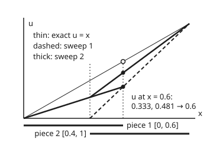
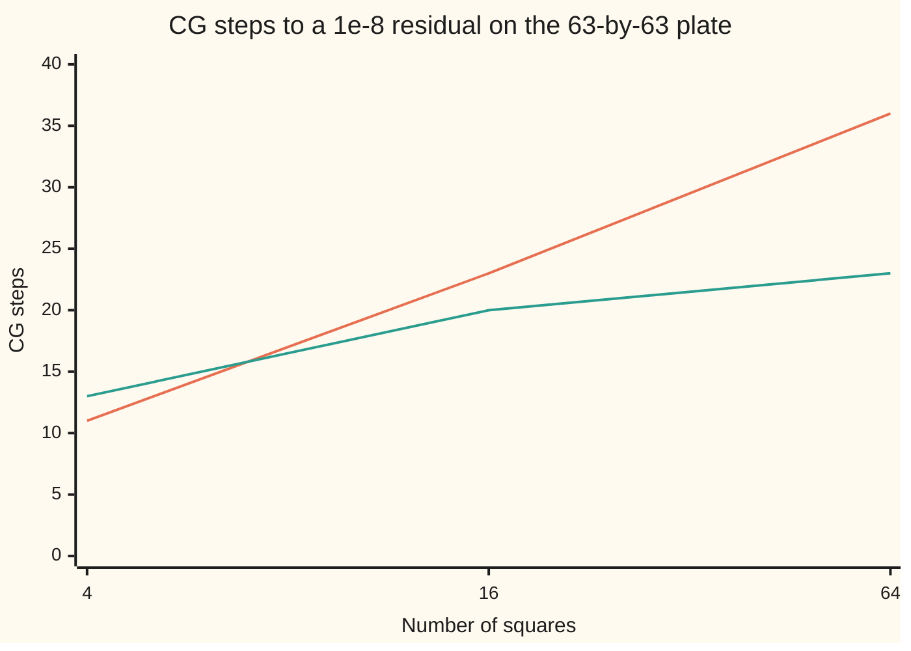

# Domain decomposition: solve on overlapping pieces, and add a coarse grid so the pieces agree

[Syllabus](../../../SYLLABUS.md) → [Numerical analysis](../README.md) → [Fast Solvers for Large Grids](../README.md#s09) → Domain decomposition

---

## General Overview

This shelf's house example is a steel plate one metre square. Its edges are held at 0 °C and a heater warms the middle. On a 1,023 by 1,023 grid, its steady temperatures are about a million unknowns in one linear system. No single processor should hold all of it. So cut the plate into squares, give each square to its own processor, and let each one solve only its own piece.

The catch: a piece's answer depends on its edge temperatures, and those depend on every other piece. In 1870 Hermann Amandus Schwarz found the fix. Let neighbouring pieces **overlap**. Solve one piece, hand its new values across the overlap to the next as edge values, solve that one, and repeat. This is the **alternating Schwarz method**.

The smallest case shows the whole mechanism. Take the problem $`-u'' = 0`$ on $`[0, 1]`$, with $`u(0) = 0`$ and $`u(1) = 1`$. Here $`u''`$ is the second derivative, the bending, so the answer is the straight line $`u = x`$. Cut it into two pieces, $`[0, 0.6]`$ and $`[0.4, 1]`$, which overlap on $`[0.4, 0.6]`$. From the second sweep on, each full sweep (both pieces once) multiplies the largest error by exactly 4/9 = 0.444444.

On the plate, all pieces work at once, as a **preconditioner**: a cheap approximate inverse that conjugate gradient (CG) uses to take fewer steps. CG is the step-by-step solver for symmetric systems from [Iterating instead of factoring](../03-Numerical%20Linear%20Algebra/09-iterative-methods-jacobi-gauss-seidel-and-conjugate-gradient.md).

The checks run a 63 by 63 version of the plate. Cut into 4, 16 and 64 squares, this **one-level** form needs 11, 23 and 36 CG steps: more pieces, more steps. Add one small **coarse grid**, a grid with one node at each inside corner where squares meet, and the counts become 13, 20 and 23. The estimated condition number (how much the system can magnify an error; CG's steps grow with its square root) stays near 6 to 8 instead of climbing from 16.3 to 198.5.

**Domain decomposition solves a big grid problem piece by piece on overlapping subdomains, where the overlap shrinks the error by a fixed factor each sweep, and a coarse grid carries the information that pieces can only pass to their neighbours, so the condition number, and with it the bound on the number of steps, stops growing as the pieces multiply.**

**What kind of fact this is:** a method resting on theorems. The 1-D factor 4/9 and the ceiling on the largest eigenvalue are proved on this card in Why it works. The two-level bound $`C(1 + H/\delta)`$, which keeps the bound on the step counts flat, is stated with its key steps and a named source, not proved here.

### The picture: two sweeps on two overlapping pieces

<p align="center"></p>

To scale: 280 px per unit across, 160 px per unit up, from the checks' `figure,` line. The bars underneath mark the two pieces. Dashed: sweep 1, from $`u = 0`$ inside; its piece-1 solve stays flat on the axis. Thick: sweep 2. The dots mark $`u(0.6)`$ after each sweep, 0.333333 and 0.481481; the open circle is the exact 0.6.

---

## The formula

Notation first, in words. A **piece**, or **subdomain**, is one part of the domain. The **overlap** is the strip two pieces share. Piece 1 is $`[0, b]`$ and piece 2 is $`[a, 1]`$, with $`a < b`$, so the overlap is $`[a, b]`$. Here $`a`$ = 0.4 and $`b`$ = 0.6. The **error** $`e_k`$ is the computed $`u`$ minus the true $`u`$ after $`k`$ full sweeps, and $`\lVert e_k\rVert_\infty`$ is its largest size anywhere on $`[0, 1]`$.

```math
\rho = \frac{a}{b}\cdot\frac{1-b}{1-a} = \frac{0.4}{0.6}\cdot\frac{0.4}{0.6} = \frac{4}{9}, \qquad \lVert e_{k+1}\rVert_\infty = \rho\,\lVert e_k\rVert_\infty \ \text{ for } k \ge 1
```

**Read it aloud:** each full sweep multiplies the largest error by the share of piece 1 that lies left of the overlap, times the share of piece 2 that lies right of it.

On a grid, the problem is one linear system $`A u = f`$. Here $`u`$ is the list of unknown grid values and $`f`$ is the load. A **restriction** $`R_i`$ picks out the unknowns of piece $`i`$, and its transpose $`R_i^{T}`$ puts a piece's values back in their places, with zeros elsewhere. Then $`A_i = R_i A R_i^{T}`$ is the piece's own matrix: the same grid equations with zero edge values. The **additive Schwarz preconditioner** solves every piece at once and adds the answers:

```math
M^{-1} r = R_0^{T} A_0^{-1} R_0\, r + \sum_{i=1}^{p} R_i^{T} A_i^{-1} R_i\, r, \qquad A_i = R_i A R_i^{T}, \quad A_0 = R_0 A R_0^{T}
```

**Read it aloud:** to precondition a residual, cut it into pieces, solve each piece exactly, add the answers, and add one solve on the coarse grid.

Drop the $`R_0`$ term and the method is **one-level**; keep it and it is **two-level**. $`R_0^{T}`$ spreads coarse values over the fine grid by straight-line interpolation in each direction (bilinear hats), and $`A_0 = R_0 A R_0^{T}`$ is the Galerkin coarse matrix of [Multigrid](02-multigrid-smoothing-and-the-v-cycle.md), Step 3: on the plate it ties each coarse node to nine, not the five of the coarse grid's own matrix. With $`H`$ the width of a square and $`\delta`$ the overlap width, the standard bounds read

```math
\kappa(M^{-1}A) \le C\,\frac{1}{H^{2}}\left(1 + \frac{H}{\delta}\right) \ \text{(one-level)}, \qquad \kappa(M^{-1}A) \le C\left(1 + \frac{H}{\delta}\right) \ \text{(two-level)}
```

**Read it aloud:** without a coarse grid the condition number grows like one over the square width squared; with one it depends only on how thick the overlap is compared with a square.

| Symbol | Plain meaning | In our example | Push it up and the answer… |
| --- | --- | --- | --- |
| $`x`$, $`y`$, $`u`$ | position across and along, m; the unknown (a straight line in 1-D, temperature rise in K on the plate) | exact $`u = x`$; plate centre 63.6610 K | — |
| $`a`$, $`b`$ | inner ends of the two 1-D pieces; overlap $`b - a`$ | 0.4 and 0.6; overlap 0.2 | wider overlap: smaller $`\rho`$ |
| $`\rho`$, $`e_k`$ | error factor per full sweep; error after $`k`$ sweeps | 4/9; largest error 0.4, then 0.177778 | $`\rho`$ up to 1: no progress |
| $`A`$, $`f`$, $`r`$ | grid matrix; load; residual $`f - Au`$ | 3,969 unknowns on the plate | — |
| $`h`$, $`H`$, $`\delta`$, $`p`$ | grid spacing; square width; overlap width; number of pieces | 1/64 m; 1/2, 1/4, 1/8 m; $`H/\delta`$ = 4; 4, 16, 64 | $`H/\delta`$ up: more steps |
| $`R_i`$, $`R_i^{T}`$, $`A_i`$ | pick out piece $`i`$; put it back; the piece's own matrix, zero edge values | largest piece 1,225, 361, 81 unknowns | — |
| $`R_0`$, $`A_0`$ | coarse grid restriction; coarse matrix | 1, 9, 49 coarse unknowns | — |
| $`M^{-1}`$, $`P_i`$ | the preconditioner, a sum of piece solves; one piece's correction as a map on errors (Step 3) | used inside CG | — |
| $`\kappa`$, $`\lambda`$ | condition number of $`M^{-1}A`$: largest eigenvalue $`\lambda`$ over smallest | estimate 7.7 two-level, 198.5 one-level, 64 squares | more CG steps, about as $`\sqrt{\kappa}`$ |
| $`C`$ | a constant free of $`h`$, $`H`$, $`\delta`$ and $`p`$ | not computed | — |
| $`I`$, $`\Gamma`$, $`S`$, $`g`$ | inside and interface unknowns; interface matrix and right side (Step 5) | $`S`$ = 0.04, $`g`$ = 0.02 | — |

### When it holds

- **The pieces overlap.** The 1-D factor needs $`a < b`$. With $`a = b = 0.5`$ the factor is 1, and the error sits at 0.5 for ever.
- **The problem is symmetric positive definite.** That makes each $`A_i`$ solvable and $`M^{-1}`$ symmetric positive definite, which CG needs. Heat conduction is; flow with strong wind is not, and then GMRES (a Krylov solver that does not need symmetry) replaces CG.
- **Additive Schwarz is used inside CG, not as a plain iteration.** Near a corner up to four pieces correct the same error, so $`\lambda_{\max}`$ reaches 4. Run as a plain iteration on 16 squares, the residual grows to 1.383e4 after 10 steps.
- **Many pieces need a coarse grid.** With 64 squares and no coarse grid, $`\lambda_{\min}`$ falls to 0.020 and CG takes 36 steps instead of 23.
- **The overlap is not too thin against the square.** With a coarse grid on 4 squares and only one shared grid line, $`H/\delta`$ = 16 and the estimate of $`\kappa`$ rises from 6.0 to 17.9.

---

## Why it works

### Step 0: a piece's solve is exact, except at its edge

Solving piece 1 with the right edge value would give the right answer on all of piece 1. Its only error comes from the wrong value at its edge $`x = b`$. The error inside a piece obeys the same equation with no load, so it is a smooth, relaxed shape: here a straight line. A straight line that is zero at one end is smaller everywhere in between than at its other end. The overlap lets the next piece read a value from inside, where the error has already shrunk.

### Step 1: the 1-D factor, proved

Track the error $`e = u_{\text{computed}} - x`$. Inside each solve it obeys $`-e'' = 0`$, so it is a straight line, and it is zero at the true ends 0 and 1.

1. Solve piece 1 with edge value error $`e(b)`$. The error is the line from 0 at $`x = 0`$ to $`e(b)`$ at $`x = b`$. So at $`a`$ it is $`e(a) = (a/b)\,e(b)`$.
2. Solve piece 2 with edge value error $`e(a)`$. The error is the line from $`e(a)`$ at $`x = a`$ to 0 at $`x = 1`$. So at $`b`$ it is $`e(a)\,(1-b)/(1-a)`$.
3. Put the two together: the new $`e(b)`$ is $`\rho\, e(b)`$ with $`\rho = (a/b)(1-b)/(1-a)`$.

After each sweep the error is two straight lines with its peak at $`a`$, so the largest error shrinks by the same $`\rho`$. With $`a = 0.4`$ and $`b = 0.6`$, $`\rho = (2/3)(2/3) = 4/9`$. Both factors are below 1 exactly when $`a < b`$: the overlap is what makes progress. The checks run the sweeps on a grid of step 0.01 and measure 0.444444. The grid answer to $`-u'' = 0`$ is exactly linear, so the grid and the proof agree to rounding.

### Step 2: alternating against additive

The alternating method uses each piece's newest values at once, like Gauss–Seidel by blocks. The additive form solves both pieces from the same old values and adds both corrections, like Jacobi by blocks ([Iterating instead of factoring](../03-Numerical%20Linear%20Algebra/09-iterative-methods-jacobi-gauss-seidel-and-conjugate-gradient.md)).

As a plain iteration the additive form does not converge. An error inside the overlap is corrected by both pieces, so it is removed twice: it flips sign every step and never shrinks, a factor of −1. The checks add a spike of 1 at $`x = 0.5`$ to the exact line and find the error there −1.000000 after one step and 1.000000 after 20. From $`u = 0`$ the error happens to stay a straight line across the overlap, set by its values at the overlap's two ends, and each step multiplies those by $`\sqrt{4/9} = 2/3`$: the checks measure 0.666667.

The additive form needs damping, or CG, to converge, but it has two strengths:

- **Every piece works at the same time.** On 64 processors the 64 piece solves run together.
- **It is symmetric.** $`M^{-1}`$ is a sum of symmetric pieces, so CG can use it. The alternating form is not symmetric unless the sweep is run forward and then back.

<details>
<summary>Detailed proof: the one-level additive Schwarz preconditioner is symmetric positive definite</summary>

Each $`A_i = R_i A R_i^{T}`$ is a principal submatrix of the symmetric positive definite $`A`$: it keeps the rows and columns of piece $`i`$. So each $`A_i`$ is symmetric positive definite, and so is $`A_i^{-1}`$.

For any residual $`r`$, write $`r_i = R_i r`$, the part of $`r`$ on piece $`i`$. Then

$`\displaystyle r^{T} M^{-1} r = \sum_{i=1}^{p} r_i^{T} A_i^{-1} r_i \ge 0.`$

Each term is zero only when $`r_i = 0`$. The pieces cover every grid node, so every $`r_i = 0`$ forces $`r = 0`$. So $`M^{-1}`$ is positive definite. It is symmetric because each term $`R_i^{T} A_i^{-1} R_i`$ is. The coarse term $`R_0^{T} A_0^{-1} R_0`$ is symmetric and never negative, so adding it keeps both properties.

</details>

### Step 3: why the largest eigenvalue is at most 4, and why the plain iteration blows up

Each term $`P_i = R_i^{T} A_i^{-1} R_i A`$ is a projection: it replaces the error by its best fit on piece $`i`$, measured in the energy $`e^{T}Ae`$. A projection never makes that energy larger, so it has no eigenvalue above 1.

Colour the squares with four colours, repeating a 2-by-2 pattern like a chessboard. Two squares of one colour are $`H`$ apart and the overlap reaches only $`\delta/2 < H/2`$ past each square, so they never touch. Their projections add to one projection. So $`M^{-1}A`$ is a sum of four projections, and $`\lambda_{\max} \le 4`$, or 5 with the coarse grid.

The checks estimate 4.000 one-level and 4.045 to 4.114 two-level. A plain iteration multiplies the error by $`1 - \lambda`$, which is $`-3`$ at $`\lambda = 4`$: the residual grows nearly threefold each step. CG instead picks its own step lengths, so a large $`\lambda_{\max}`$ costs it nothing much.

### Step 4: why the smallest eigenvalue falls without a coarse grid

The trouble is the smooth, plate-wide part of the error. In one CG step a piece can only pass information to its neighbours. With 64 squares, heat from the middle needs four squares' worth of hops to reach the edge. The pieces in the middle touch no cold edge, so on their own they cannot tell that the plate is anchored at 0 °C.

In eigenvalue terms: $`\lambda_{\min}`$ is small when some error can only be split among the pieces at a high cost in energy. Cutting a smooth, plate-wide bump into pieces forces each piece's share down to zero across a strip of width $`\delta`$. That costs energy in proportion to $`1/(H\delta)`$. So $`\lambda_{\min}`$ falls roughly as $`H^{2}`$ at fixed $`H/\delta`$. The checks estimate 0.246, 0.077 and 0.020 for 4, 16 and 64 squares.

The coarse grid removes the smooth part first. Its bilinear hats copy the bump to within an error of size about $`H`$ times its slope. What is left varies only on the scale of one square, and splitting that costs energy in proportion to $`1 + H/\delta`$, independent of $`p`$. This is the two-level bound. Its full proof needs the energy norms of [Finite elements](../07-PDE%20Solvers/07-finite-elements-galerkin-and-hat-functions.md) and more analysis than fits here; it is in Toselli and Widlund (2005, ch. 3) and, for thin overlaps, Dryja and Widlund (1994). On the plate, the checks' estimates of $`\lambda_{\min}`$ stay at 0.674, 0.558 and 0.537.

This is the same split as in [Multigrid](02-multigrid-smoothing-and-the-v-cycle.md): local work removes the rough error, a coarse grid removes the smooth error.

### Step 5: pieces that do not overlap, in outline

A second family cuts the domain without overlap and solves first for the values on the cuts, the **interface**. Number the inside unknowns $`I`$ and the interface unknowns $`\Gamma`$. Eliminating the insides leaves the **Schur complement** system on the interface alone:

```math
S\,u_\Gamma = g, \qquad S = A_{\Gamma\Gamma} - A_{\Gamma I}\,A_{II}^{-1}\,A_{I\Gamma}, \qquad g = f_\Gamma - A_{\Gamma I}\,A_{II}^{-1} f_I
```

**Read it aloud:** the interface matrix is its own block minus what the insides pass back to it once they are solved.

On the 1-D grid of step 0.01, cut at $`x = 0.5`$. Each side has 49 inside nodes, and the grid row reads $`-u_{j-1} + 2u_j - u_{j+1} = 0`$. A unit push at node 50 makes each side's answer rise linearly, to 49/50 at its node next to the cut. So $`S = 2 - 49/50 - 49/50 = 0.04`$. The right end's $`u(1) = 1`$ reaches the cut as $`g = 1/50 = 0.02`$, and $`u(0.5) = 0.02/0.04 = 0.5`$, exact.

On the plate the interface is the grid lines between squares, and $`S`$ is dense there. CG solves for $`u_\Gamma`$ with one solve per piece for each product with $`S`$, plus a coarse problem for the reason of Step 4. The balancing Neumann–Neumann and FETI (finite element tearing and interconnecting) methods work this way (Toselli and Widlund, 2005).

### Step 6: what "converged" means here

CG stops when the residual is below 1e-8 of the load. That is a small backward error, not yet a small error. So the checks also solve the plate directly by banded Cholesky ([Cholesky](../03-Numerical%20Linear%20Algebra/04-cholesky-decomposition.md)), with a relative residual of 1.643e-13. Every Schwarz run agrees with it to within 1.510e-8 K, against a centre value of 63.6610 K.

That is the error against the grid's own answer. The grid's distance from the true plate is discretisation error, which this card does not measure.

---

## Worked numbers, by hand

The 1-D example on pieces $`[0, 0.6]`$ and $`[0.4, 1]`$, starting from $`u = 0`$ inside. Each solve is a straight line between its two edge values.

| Step | Arithmetic | Value |
| --- | --- | --- |
| sweep 1, piece 1 | edge values 0 and 0: flat, so $`u(0.4)`$ | 0.000000 |
| sweep 1, piece 2 | line from 0 at 0.4 to 1 at 1: $`u(0.6) = 0.2 \div 0.6`$ | 0.333333 |
| largest error after sweep 1 | at $`x = 0.4`$: $`0.4 - 0`$ | 0.400000 |
| sweep 2, piece 1 | line from 0 to 0.333333 at 0.6: $`u(0.4) = (0.4 \div 0.6) \times 0.333333`$ | 0.222222 |
| sweep 2, piece 2 | $`u(0.6) = 0.222222 + (0.2 \div 0.6) \times (1 - 0.222222)`$ | 0.481481 |
| largest error after sweep 2 | $`0.4 - 0.222222`$ | 0.177778 |
| ratio | $`0.177778 \div 0.400000`$ | **0.444444 = 4/9** |

Sweeps 3 and 4 leave 0.079012 and 0.035117, each 4/9 of the one before, and 20 sweeps leave 8.139e-8.

The plate, from the checks. The grid has 63 by 63 inside nodes, a small version of the house example. The heater gives 1,600 W per square metre over the middle square from 0.375 m to 0.625 m. The plate is 1 cm of steel with a conductivity of 50 W per metre per kelvin. Both figures are illustrative. The temperature rise then obeys $`-(u_{xx} + u_{yy}) = 1{,}600 \div (50 \times 0.01) = 3{,}200`$ K per square metre under the heater, where $`u_{xx}`$ and $`u_{yy}`$ are its second derivatives across and along the plate. This is the plate of [Incomplete factorisations](01-incomplete-factorisation-preconditioners.md) with a heater 3.2 times as strong, so plain CG takes the same 119 steps and every temperature is 3.2 times as large.

| Method | Squares | Largest piece | Coarse unknowns | CG steps | $`\kappa`$ estimate | Centre, K |
| --- | ---: | ---: | ---: | ---: | ---: | ---: |
| plain CG | — | — | — | 119 | 1659.4 | 63.6610 |
| one-level | 4 | 1,225 | 0 | 11 | 16.3 | 63.6610 |
| one-level | 16 | 361 | 0 | 23 | 51.8 | 63.6610 |
| one-level | 64 | 81 | 0 | 36 | 198.5 | 63.6610 |
| two-level | 4 | 1,225 | 1 | 13 | 6.0 | 63.6610 |
| two-level | 16 | 361 | 9 | 20 | 7.4 | 63.6610 |
| two-level | 64 | 81 | 49 | **23** | **7.7** | **63.6610** |

The centre of the plate sits 63.6610 K above its edges. With a coarse grid, 64 squares take 23 steps, and each step is 64 small independent solves of at most 81 unknowns plus one 49-unknown coarse solve.

The $`\kappa`$ estimates come from CG's own step numbers. Its step lengths and direction weights fill a small tridiagonal table, the one [Lanczos](../03-Numerical%20Linear%20Algebra/14-lanczos-and-rayleigh-ritz.md) builds, and that table's eigenvalues approximate those of $`M^{-1}A`$. Those values lie inside the true eigenvalue range, so an estimate can only be low. It can stay low after CG has converged: the heater is symmetric about the plate's centre lines and diagonals, so CG only meets errors with that symmetry and never sees eigenvalues whose waves lack it. For plain CG the exact value is $`\cot^{2}(\pi h/2)`$ = 1659.4, and the estimate matches it.



Orange (rising): one-level additive Schwarz. Green (rising slowly): two-level, with the coarse grid. Plain CG needs 119 steps.

### What breaks if you drop a piece

| Mistake | Comes out at | What went wrong |
| --- | --- | --- |
| No overlap: pieces $`[0, 0.5]`$ and $`[0.5, 1]`$ | factor 1.000000; error 5.000e-1 after 20 sweeps | each piece hands back the edge value it was given |
| Overlap 0.02: $`[0, 0.51]`$ and $`[0.49, 1]`$ | factor 2401/2601 = 0.923106; error 1.071e-1 after 20 sweeps | the error barely shrinks across a thin strip |
| Additive Schwarz as a plain iteration, 16 squares | residual 1.383e4 at step 10, 8.164e8 at step 20 | $`\lambda_{\max}`$ = 4, so each step multiplies the error by about $`-3`$ |
| No coarse grid, 64 squares | 36 steps; $`\kappa`$ estimate 198.5 | smooth error crosses one square per step |
| Coarse grid, but one shared grid line on 4 squares | 17 steps; $`\kappa`$ estimate 17.9, against 13 and 6.0 | $`H/\delta`$ = 16 instead of 4 |

The thin-overlap case also shows the bound's shape on 16 squares: $`H/\delta`$ = 8 gives 24 steps and an estimate of 12.2.

---

## Code, from first principles, and it actually runs

The code runs the 1-D alternating and additive methods with Thomas solves ([The Thomas algorithm](../03-Numerical%20Linear%20Algebra/03-tridiagonal-systems-and-the-thomas-algorithm.md)) and the Schur interface solve. It then builds the 63-by-63 plate and runs CG with one-level and two-level additive Schwarz, each piece factored by banded Cholesky. Five roads check the answers:

- The proved factor $`(a/b)(1-b)/(1-a)`$ matches the measured error ratio for four overlaps.
- The additive iteration shrinks a straight-line error by 2/3 a step but flips a spike inside the overlap for ever, and the Schur solve matches $`S = 2/50`$ and $`u = 0.5`$.
- Every Schwarz–CG answer matches a direct banded Cholesky of the whole plate.
- The $`\kappa`$ estimator matches the closed form $`\cot^{2}(\pi h/2)`$ on plain CG.
- Asserts confirm that one-level counts grow, two-level estimates stay flat, and thinner overlaps do worse.

### Python

```python
# Domain decomposition and Schwarz methods -- the check behind the card.  Standard
# library only.  Part 1: -u'' = 0 on [0, 1] split into [0, 0.6] and [0.4, 1], grid
# step 0.01.  Part 2: the hot plate on a 63-by-63 grid, conjugate gradient with
# one-level and two-level additive Schwarz, checked against a banded Cholesky.
from math import gcd, sqrt, tan, pi
def e3(x): m, p = f"{x:.3e}".split("e"); return f"{m}e{int(p)}"  # as Rust's {:.3e}
def piece(u, lo, hi):  # solve -u'' = 0 strictly inside (lo, hi) by Thomas, ends fixed
    n = hi - lo - 1; c = [0.0] * n; d = [0.0] * n
    for k in range(n):
        rhs = (u[lo] if k == 0 else 0.0) + (u[hi] if k == n - 1 else 0.0)
        den = 2.0 + (c[k - 1] if k else 0.0)
        c[k] = -1.0 / den; d[k] = (rhs + (d[k - 1] if k else 0.0)) / den
    v = u[:]; v[hi - 1] = d[n - 1]
    for k in range(n - 2, -1, -1): v[lo + 1 + k] = d[k] - c[k] * v[lo + 2 + k]
    return v
def err(u): return max(abs(u[j] - j / 100) for j in range(101))
u0 = [0.0] * 100 + [1.0]
for ia, ib in [(40, 60), (45, 55), (49, 51), (50, 50)]:
    u, es = u0[:], [err(u0)]
    for k in range(20): u = piece(piece(u, 0, ib), ia, 100); es.append(err(u))
    g = gcd(ia * (100 - ib), ib * (100 - ia)); rho = ia * (100 - ib) / (ib * (100 - ia))
    assert abs(es[10] / es[9] - rho) < 1e-9  # the proved factor against the run
    print(f"1d,overlap={(ib - ia) / 100:.2f},factor={ia * (100 - ib) // g}/{ib * (100 - ia) // g}"
          f"={rho:.6f},observed={es[10] / es[9]:.6f},err_after_20={e3(es[20])}")
    if ia == 40: first = es[:5]
print("1d,max_error_after_sweeps_0_to_4," + ",".join(f"{e:.6f}" for e in first))
assert abs(first[1] - 0.4) < 1e-12 and abs(first[4] - 0.4 * (4 / 9) ** 3) < 1e-12
u, fig = u0[:], []
for k in range(2):
    u = piece(u, 0, 60); fig.append(u[40]); u = piece(u, 40, 100); fig.append(u[60])
print("figure,u(0.4)_then_u(0.6)_after_each_half_sweep," + ",".join(f"{v:.6f}" for v in fig))
def additive(u, k):  # additive form as a plain iteration: both pieces at once, k steps
    for _ in range(k): v1, v2 = piece(u, 0, 60), piece(u, 40, 100); u = [u[j] + (v1[j] - u[j]) + (v2[j] - u[j]) for j in range(101)]
    return u
ea = [err(additive(u0, k)) for k in range(1, 21)]  # from u = 0 the error stays a straight line across the overlap
s1, s20 = (additive([j / 100 + (j == 50) for j in range(101)], k)[50] - 0.5 for k in (1, 20))  # exact line + spike at x = 0.5
print(f"1d,additive_iteration,err_after_20={e3(ea[19])},observed_factor={ea[10] / ea[9]:.6f},spike_at_0.5_after_1_and_20={s1:.6f},{s20:.6f}")
assert abs(ea[10] / ea[9] - 2 / 3) < 1e-9 and abs(s1 + 1) < 1e-12 and abs(s20 - 1) < 1e-12  # 2/3 on a straight line; -1 inside the overlap
e = [0.0] * 101; e[50] = 1.0  # Schur complement: unit push at the interface x = 0.5
S = 2.0 - piece(e, 0, 50)[49] - piece(e, 50, 100)[51]; gr = piece(u0, 50, 100)[51]
print(f"1d,schur,S={S:.6f},g={gr:.6f},u(0.5)={gr / S:.6f}")
assert abs(S - 2 / 50) < 1e-12 and abs(gr / S - 0.5) < 1e-12
n, F = 63, 3200.0  # plate: 63x63 inside nodes, h = 1/64 m; heater 0.375 to 0.625 m
N, h = n * n, 1.0 / 64
b = [h * h * F if 24 <= k // n + 1 <= 40 and 24 <= k % n + 1 <= 40 else 0.0 for k in range(N)]
def matvec(x):
    y = [4.0 * v for v in x]
    for k in range(N):
        i, j = divmod(k, n)
        if i: y[k] -= x[k - n]
        if i < n - 1: y[k] -= x[k + n]
        if j: y[k] -= x[k - 1]
        if j < n - 1: y[k] -= x[k + 1]
    return y
def dot(x, y):
    s = 0.0
    for a, c in zip(x, y): s += a * c
    return s
def chol(m, w, ent):  # banded Cholesky: L[r][t] holds L(r, r - w + t)
    L = [[0.0] * (w + 1) for _ in range(m)]
    for r in range(m):
        for d in range(min(w, r), -1, -1):
            Lr, Lc, s = L[r], L[r - d], ent(r, r - d)
            for t in range(w - d): s -= Lr[t] * Lc[t + d]
            Lr[w - d] = sqrt(s) if d == 0 else s / Lc[w]
    return L
def csolve(L, m, w, rhs):
    y = rhs[:]
    for r in range(m):
        for t in range(max(0, w - r), w): y[r] -= L[r][t] * y[r - w + t]
        y[r] /= L[r][w]
    for r in range(m - 1, -1, -1):
        y[r] /= L[r][w]
        for t in range(max(0, w - r), w): y[r - w + t] -= L[r][t] * y[r]
    return y
def grid_ent(ny):
    return lambda r, c: 4.0 if r == c else -1.0 if (c == r - 1 and r % ny) or c == r - ny else 0.0
def make_prec(P, ext, two_level):  # P x P squares, each grown by ext cells a side
    H, sub, ph = 64 // P, [], []
    for p in range(P * P):
        I = range(max(1, p // P * H - ext + 1), min(n, (p // P + 1) * H + ext - 1) + 1)
        J = range(max(1, p % P * H - ext + 1), min(n, (p % P + 1) * H + ext - 1) + 1)
        idx = [(i - 1) * n + j - 1 for i in I for j in J]
        sub.append((idx, len(J), chol(len(idx), len(J), grid_ent(len(J)))))
    for p in range(1, P if two_level else 1):  # bilinear hats on the inside corners
        for q in range(1, P):
            ph.append([((i - 1) * n + j - 1, (1 - abs(i - p * H) / H) * (1 - abs(j - q * H) / H))
                       for i in range(p * H - H + 1, p * H + H) for j in range(q * H - H + 1, q * H + H)])
    M, wts = len(ph), [[wt for _, wt in f] for f in ph]
    cols = [matvec([dict(f).get(k, 0.0) for k in range(N)]) for f in ph]
    A0 = [[dot(wts[r], [cols[c][k] for k, _ in ph[r]]) for c in range(M)] for r in range(M)]
    L0 = chol(M, M - 1, lambda r, c: A0[r][c])
    def prec(r):
        z = [0.0] * N
        for idx, w, L in sub:
            for k, v in zip(idx, csolve(L, len(idx), w, [r[k] for k in idx])): z[k] += v
        y = csolve(L0, M, M - 1, [dot(wts[m], [r[k] for k, _ in ph[m]]) for m in range(M)])
        for f, v in zip(ph, y):
            for k, wt in f: z[k] += wt * v
        return z
    return prec, max(len(s[0]) for s in sub), M
def pcg(prec, tol=1e-8):  # also returns kappa estimated from CG's own numbers (Lanczos)
    x, r = [0.0] * N, b[:]; z = prec(r); p = z[:]; rz = dot(r, z); bn = sqrt(dot(b, b)); al, be = [], []
    while sqrt(dot(r, r)) > tol * bn:
        Ap = matvec(p); al.append(rz / dot(p, Ap))
        x = [a + al[-1] * c for a, c in zip(x, p)]; r = [a - al[-1] * c for a, c in zip(r, Ap)]
        z = prec(r); rz2 = dot(r, z); be.append(rz2 / rz); p = [a + be[-1] * c for a, c in zip(z, p)]; rz = rz2
    m = len(al); dg = [1 / al[0]] + [1 / al[k] + be[k - 1] / al[k - 1] for k in range(1, m)]
    o2 = [be[k] / (al[k] * al[k]) for k in range(m - 1)]
    def below(t):  # Sturm count: eigenvalues of the Lanczos table below t
        q = dg[0] - t; c = 1 if q < 0 else 0
        for k in range(1, m): q = dg[k] - t - o2[k - 1] / q; c += 1 if q < 0 else 0
        return c
    def eig(i):
        lo, hi = 0.0, 8.0
        for _ in range(80):
            if below((lo + hi) / 2) > i: hi = (lo + hi) / 2
            else: lo = (lo + hi) / 2
        return lo
    return x, m, eig(0), eig(m - 1)
Lf = chol(N, n, grid_ent(n)); xd = csolve(Lf, N, n, b); mid = 31 * n + 31
rd = [a - c for a, c in zip(b, matvec(xd))]
print(f"plate,unknowns={N},direct_centre_K={xd[mid]:.4f},direct_rel_residual={e3(sqrt(dot(rd, rd) / dot(b, b)))}")
x, k, lo, hi = pcg(lambda r: r[:]); ex = 1 / tan(pi / 128) ** 2  # exact kappa: cot^2(pi h / 2)
print(f"plate,plain_cg,steps={k},kappa_est={hi / lo:.1f},closed_form={ex:.1f}"); assert abs(hi / lo - ex) < 1.0
st, kap = {}, {}
for lev, P, ext in [(1, 2, 4), (1, 4, 2), (1, 8, 1), (2, 2, 4), (2, 4, 2), (2, 8, 1), (2, 2, 1), (2, 4, 1)]:
    pr, big, M = make_prec(P, ext, lev == 2); x, k, lo, hi = pcg(pr); st[lev, P, ext] = k; kap[lev, P, ext] = hi / lo
    gap = max(abs(a - c) for a, c in zip(x, xd))
    print(f"plate,levels={lev},squares={P * P},H/delta={64 // P / (2 * ext):.0f},largest_piece={big},coarse={M},"
          f"steps={k},lmin={lo:.3f},lmax={hi:.3f},kappa_est={hi / lo:.1f},centre_K={x[mid]:.4f},gap={e3(gap)}")
    assert gap < 1e-7 * xd[mid]  # Schwarz-CG against the direct solve
assert kap[1, 8, 1] > 10 * kap[1, 2, 4] and kap[2, 8, 1] < 1.5 * kap[2, 2, 4] and st[1, 8, 1] > 3 * st[1, 2, 4]
assert kap[2, 2, 1] > kap[2, 4, 1] > kap[2, 8, 1]  # thinner overlap, larger H/delta, worse
xr, pr = [0.0] * N, make_prec(4, 2, False)[0]  # additive Schwarz as a plain iteration
for k in range(21):
    rr = [a - c for a, c in zip(b, matvec(xr))]; xr = [a + c for a, c in zip(xr, pr(rr))]
    if k % 10 == 0: print(f"plate,additive_iteration,squares=16,step={k},rel_residual={e3(sqrt(dot(rr, rr) / dot(b, b)))}")
assert sqrt(dot(rr, rr) / dot(b, b)) > 1e6
print("ALL CHECKS PASS")
```

**Ran 2026-11-24 on macOS, Python 3.14.10, standard library only. All checks passed. Output, pasted from the run:**

```
1d,overlap=0.20,factor=4/9=0.444444,observed=0.444444,err_after_20=8.139e-8
1d,overlap=0.10,factor=81/121=0.669421,observed=0.669421,err_after_20=2.195e-4
1d,overlap=0.02,factor=2401/2601=0.923106,observed=0.923106,err_after_20=1.071e-1
1d,overlap=0.00,factor=1/1=1.000000,observed=1.000000,err_after_20=5.000e-1
1d,max_error_after_sweeps_0_to_4,0.990000,0.400000,0.177778,0.079012,0.035117
figure,u(0.4)_then_u(0.6)_after_each_half_sweep,0.000000,0.333333,0.222222,0.481481
1d,additive_iteration,err_after_20=1.804e-4,observed_factor=0.666667,spike_at_0.5_after_1_and_20=-1.000000,1.000000
1d,schur,S=0.040000,g=0.020000,u(0.5)=0.500000
plate,unknowns=3969,direct_centre_K=63.6610,direct_rel_residual=1.643e-13
plate,plain_cg,steps=119,kappa_est=1659.4,closed_form=1659.4
plate,levels=1,squares=4,H/delta=4,largest_piece=1225,coarse=0,steps=11,lmin=0.246,lmax=4.000,kappa_est=16.3,centre_K=63.6610,gap=1.510e-8
plate,levels=1,squares=16,H/delta=4,largest_piece=361,coarse=0,steps=23,lmin=0.077,lmax=4.000,kappa_est=51.8,centre_K=63.6610,gap=3.937e-9
plate,levels=1,squares=64,H/delta=4,largest_piece=81,coarse=0,steps=36,lmin=0.020,lmax=4.000,kappa_est=198.5,centre_K=63.6610,gap=2.990e-9
plate,levels=2,squares=4,H/delta=4,largest_piece=1225,coarse=1,steps=13,lmin=0.674,lmax=4.045,kappa_est=6.0,centre_K=63.6610,gap=1.199e-10
plate,levels=2,squares=16,H/delta=4,largest_piece=361,coarse=9,steps=20,lmin=0.558,lmax=4.105,kappa_est=7.4,centre_K=63.6610,gap=7.849e-9
plate,levels=2,squares=64,H/delta=4,largest_piece=81,coarse=49,steps=23,lmin=0.537,lmax=4.114,kappa_est=7.7,centre_K=63.6610,gap=5.821e-9
plate,levels=2,squares=4,H/delta=16,largest_piece=1024,coarse=1,steps=17,lmin=0.223,lmax=4.002,kappa_est=17.9,centre_K=63.6610,gap=1.325e-9
plate,levels=2,squares=16,H/delta=8,largest_piece=289,coarse=9,steps=24,lmin=0.330,lmax=4.021,kappa_est=12.2,centre_K=63.6610,gap=1.034e-8
plate,additive_iteration,squares=16,step=0,rel_residual=1.000e0
plate,additive_iteration,squares=16,step=10,rel_residual=1.383e4
plate,additive_iteration,squares=16,step=20,rel_residual=8.164e8
ALL CHECKS PASS
```

### Rust

```rust
// Domain decomposition and Schwarz methods -- the check behind the card.  Rust std
// only.  Part 1: -u'' = 0 on [0, 1] split into [0, 0.6] and [0.4, 1], grid
// step 0.01.  Part 2: the hot plate on a 63-by-63 grid, conjugate gradient with
// one-level and two-level additive Schwarz, checked against a banded Cholesky.
const NS: usize = 63;
const NN: usize = NS * NS;
type Mat = Vec<Vec<f64>>;
fn gcd(a: usize, b: usize) -> usize { if b == 0 { a } else { gcd(b, a % b) } }
fn piece(u: &[f64], lo: usize, hi: usize) -> Vec<f64> { // -u'' = 0 inside (lo, hi), Thomas
    let n = hi - lo - 1; let (mut c, mut d) = (vec![0.0; n], vec![0.0; n]);
    for k in 0..n {
        let rhs = (if k == 0 { u[lo] } else { 0.0 }) + (if k == n - 1 { u[hi] } else { 0.0 });
        let den = 2.0 + if k > 0 { c[k - 1] } else { 0.0 };
        c[k] = -1.0 / den; d[k] = (rhs + if k > 0 { d[k - 1] } else { 0.0 }) / den;
    }
    let mut v = u.to_vec(); v[hi - 1] = d[n - 1];
    for k in (0..n - 1).rev() { v[lo + 1 + k] = d[k] - c[k] * v[lo + 2 + k]; } v
}
fn err(u: &[f64]) -> f64 { (0..101).map(|j| (u[j] - j as f64 / 100.0).abs()).fold(0.0, f64::max) }
fn matvec(x: &[f64]) -> Vec<f64> {
    let mut y: Vec<f64> = x.iter().map(|v| 4.0 * v).collect();
    for k in 0..NN {
        let (i, j) = (k / NS, k % NS);
        if i > 0 { y[k] -= x[k - NS]; } if i < NS - 1 { y[k] -= x[k + NS]; }
        if j > 0 { y[k] -= x[k - 1]; } if j < NS - 1 { y[k] -= x[k + 1]; }
    } y
}
fn dot(x: &[f64], y: &[f64]) -> f64 { let mut s = 0.0; for (a, c) in x.iter().zip(y) { s += a * c; } s }
fn chol(m: usize, w: usize, ent: &dyn Fn(usize, usize) -> f64) -> Mat { // L[r][t] = L(r, r - w + t)
    let mut l = vec![vec![0.0; w + 1]; m];
    for r in 0..m {
        for d in (0..=w.min(r)).rev() {
            let mut s = ent(r, r - d);
            for t in 0..w - d { s -= l[r][t] * l[r - d][t + d]; }
            l[r][w - d] = if d == 0 { s.sqrt() } else { s / l[r - d][w] };
        }
    } l
}
fn csolve(l: &Mat, m: usize, w: usize, rhs: &[f64]) -> Vec<f64> {
    let mut y = rhs.to_vec();
    for r in 0..m {
        for t in w.saturating_sub(r)..w { y[r] -= l[r][t] * y[r + t - w]; } y[r] /= l[r][w];
    }
    for r in (0..m).rev() { y[r] /= l[r][w]; for t in w.saturating_sub(r)..w { y[r + t - w] -= l[r][t] * y[r]; } } y
}
fn grid_ent(ny: usize) -> impl Fn(usize, usize) -> f64 {
    move |r, c| if r == c { 4.0 } else if (c + 1 == r && r % ny != 0) || c + ny == r { -1.0 } else { 0.0 }
}
struct Prec { sub: Vec<(Vec<usize>, usize, Mat)>, ph: Vec<Vec<(usize, f64)>>, l0: Mat }
fn make_prec(p: usize, ext: usize, two: bool) -> (Prec, usize, usize) { // P x P squares, grown ext a side
    let (hh, mut sub, mut ph) = (64 / p, vec![], vec![]);
    for s in 0..p * p {
        let (a, c) = (s / p, s % p);
        let ii = ((a * hh + 1).saturating_sub(ext).max(1), ((a + 1) * hh + ext - 1).min(NS));
        let jj = ((c * hh + 1).saturating_sub(ext).max(1), ((c + 1) * hh + ext - 1).min(NS));
        let (mut idx, w) = (vec![], jj.1 - jj.0 + 1);
        for i in ii.0..=ii.1 { for j in jj.0..=jj.1 { idx.push((i - 1) * NS + j - 1); } }
        let l = chol(idx.len(), w, &grid_ent(w)); sub.push((idx, w, l));
    }
    for a in 1..(if two { p } else { 1 }) {
        for c in 1..p { let mut f = vec![];
            for i in a * hh - hh + 1..a * hh + hh { for j in c * hh - hh + 1..c * hh + hh {
                    let wi = 1.0 - ((i as f64 - (a * hh) as f64).abs()) / hh as f64;
                    let wj = 1.0 - ((j as f64 - (c * hh) as f64).abs()) / hh as f64;
                    f.push(((i - 1) * NS + j - 1, wi * wj));
            } }
            ph.push(f);
    } }
    let m = ph.len();
    let wts: Vec<Vec<f64>> = ph.iter().map(|f| f.iter().map(|q| q.1).collect()).collect();
    let cols: Vec<Vec<f64>> = ph.iter().map(|f| { let mut x = vec![0.0; NN]; for &(k, w) in f { x[k] = w; } matvec(&x) }).collect();
    let a0: Mat = (0..m).map(|r| (0..m).map(|c| dot(&wts[r], &ph[r].iter().map(|q| cols[c][q.0]).collect::<Vec<_>>())).collect()).collect();
    let l0 = if m > 0 { chol(m, m - 1, &|r, c| a0[r][c]) } else { vec![] };
    let big = sub.iter().map(|s| s.0.len()).max().unwrap(); (Prec { sub, ph, l0 }, big, m)
}
fn apply(pr: &Prec, r: &[f64]) -> Vec<f64> {
    let mut z = vec![0.0; NN];
    for (idx, w, l) in &pr.sub {
        let y = csolve(l, idx.len(), *w, &idx.iter().map(|&k| r[k]).collect::<Vec<_>>());
        for (k, v) in idx.iter().zip(y) { z[*k] += v; }
    } let m = pr.ph.len();
    if m > 0 {
        let rc: Vec<f64> = pr.ph.iter().map(|f| { let w: Vec<f64> = f.iter().map(|q| q.1).collect(); dot(&w, &f.iter().map(|q| r[q.0]).collect::<Vec<_>>()) }).collect();
        let y = csolve(&pr.l0, m, m - 1, &rc);
        for (f, v) in pr.ph.iter().zip(y) { for &(k, wt) in f { z[k] += wt * v; } }
    } z
}
fn pcg(b: &[f64], prec: &dyn Fn(&[f64]) -> Vec<f64>) -> (Vec<f64>, usize, f64, f64) {
    let (mut x, mut r) = (vec![0.0; NN], b.to_vec()); let z = prec(&r);
    let (mut p, mut rz, bn) = (z.clone(), dot(&r, &z), dot(b, b).sqrt());
    let (mut al, mut be): (Vec<f64>, Vec<f64>) = (vec![], vec![]);
    while dot(&r, &r).sqrt() > 1e-8 * bn {
        let ap = matvec(&p); let a = rz / dot(&p, &ap); al.push(a);
        for k in 0..NN { x[k] += a * p[k]; r[k] -= a * ap[k]; }
        let z = prec(&r); let rz2 = dot(&r, &z); be.push(rz2 / rz);
        for k in 0..NN { p[k] = z[k] + be[be.len() - 1] * p[k]; } rz = rz2;
    }
    let (m, mut dg) = (al.len(), vec![1.0 / al[0]]);
    for k in 1..m { dg.push(1.0 / al[k] + be[k - 1] / al[k - 1]); }
    let o2: Vec<f64> = (0..m - 1).map(|k| be[k] / (al[k] * al[k])).collect();
    let below = |t: f64| { // Sturm count: eigenvalues of the Lanczos table below t
        let mut q = dg[0] - t; let mut c = if q < 0.0 { 1 } else { 0 };
        for k in 1..m { q = dg[k] - t - o2[k - 1] / q; if q < 0.0 { c += 1; } } c
    };
    let eig = |i: usize| {
        let (mut lo, mut hi) = (0.0, 8.0);
        for _ in 0..80 { if below((lo + hi) / 2.0) > i { hi = (lo + hi) / 2.0 } else { lo = (lo + hi) / 2.0 } } lo
    };
    (x, m, eig(0), eig(m - 1))
}
fn e3(x: f64) -> String { format!("{:.3e}", x) }
fn main() {
    let (mut u0, mut first) = (vec![0.0; 101], vec![]); u0[100] = 1.0;
    for (ia, ib) in [(40usize, 60usize), (45, 55), (49, 51), (50, 50)] {
        let (mut u, mut es) = (u0.clone(), vec![err(&u0)]);
        for _ in 0..20 { u = piece(&piece(&u, 0, ib), ia, 100); es.push(err(&u)); }
        let (nu, de) = (ia * (100 - ib), ib * (100 - ia)); let (g, rho) = (gcd(nu, de), nu as f64 / de as f64);
        assert!((es[10] / es[9] - rho).abs() < 1e-9); // the proved factor against the run
        println!("1d,overlap={:.2},factor={}/{}={:.6},observed={:.6},err_after_20={}", (ib - ia) as f64 / 100.0, nu / g, de / g, rho, es[10] / es[9], e3(es[20]));
        if ia == 40 { first = es[..5].to_vec(); }
    }
    println!("1d,max_error_after_sweeps_0_to_4,{}", first.iter().map(|e| format!("{:.6}", e)).collect::<Vec<_>>().join(","));
    assert!((first[1] - 0.4).abs() < 1e-12 && (first[4] - 0.4 * (4.0f64 / 9.0).powi(3)).abs() < 1e-12);
    let (mut u, mut fig) = (u0.clone(), vec![]);
    for _ in 0..2 { u = piece(&u, 0, 60); fig.push(u[40]); u = piece(&u, 40, 100); fig.push(u[60]); }
    println!("figure,u(0.4)_then_u(0.6)_after_each_half_sweep,{}", fig.iter().map(|v| format!("{:.6}", v)).collect::<Vec<_>>().join(","));
    let additive = |mut u: Vec<f64>, k: usize| { // additive form as a plain iteration: both pieces at once, k steps
        for _ in 0..k { let (v1, v2) = (piece(&u, 0, 60), piece(&u, 40, 100)); u = (0..101).map(|j| u[j] + (v1[j] - u[j]) + (v2[j] - u[j])).collect(); } u };
    let ea: Vec<f64> = (1..21).map(|k| err(&additive(u0.clone(), k))).collect(); // from u = 0 the error stays a straight line across the overlap
    let sp: Vec<f64> = (0..101).map(|j| j as f64 / 100.0 + if j == 50 { 1.0 } else { 0.0 }).collect(); // exact line + spike at x = 0.5
    let (s1, s20) = (additive(sp.clone(), 1)[50] - 0.5, additive(sp, 20)[50] - 0.5);
    println!("1d,additive_iteration,err_after_20={},observed_factor={:.6},spike_at_0.5_after_1_and_20={:.6},{:.6}", e3(ea[19]), ea[10] / ea[9], s1, s20);
    assert!((ea[10] / ea[9] - 2.0 / 3.0).abs() < 1e-9 && (s1 + 1.0).abs() < 1e-12 && (s20 - 1.0).abs() < 1e-12); // 2/3 on a straight line; -1 inside the overlap
    let mut e = vec![0.0; 101]; e[50] = 1.0; // Schur complement: unit push at the interface x = 0.5
    let (s, gr) = (2.0 - piece(&e, 0, 50)[49] - piece(&e, 50, 100)[51], piece(&u0, 50, 100)[51]);
    println!("1d,schur,S={:.6},g={:.6},u(0.5)={:.6}", s, gr, gr / s);
    assert!((s - 2.0 / 50.0).abs() < 1e-12 && (gr / s - 0.5).abs() < 1e-12);
    let (f, h) = (3200.0, 1.0 / 64.0);
    let b: Vec<f64> = (0..NN).map(|k| if (24..=40).contains(&(k / NS + 1)) && (24..=40).contains(&(k % NS + 1)) { h * h * f } else { 0.0 }).collect();
    let lf = chol(NN, NS, &grid_ent(NS)); let (xd, mid) = (csolve(&lf, NN, NS, &b), 31 * NS + 31);
    let rd: Vec<f64> = b.iter().zip(matvec(&xd)).map(|(a, c)| a - c).collect();
    println!("plate,unknowns={},direct_centre_K={:.4},direct_rel_residual={}", NN, xd[mid], e3((dot(&rd, &rd) / dot(&b, &b)).sqrt()));
    let (_, k, lo, hi) = pcg(&b, &|r: &[f64]| r.to_vec());
    let ex = 1.0 / (std::f64::consts::PI / 128.0).tan().powi(2); // exact kappa: cot^2(pi h / 2)
    println!("plate,plain_cg,steps={},kappa_est={:.1},closed_form={:.1}", k, hi / lo, ex); assert!((hi / lo - ex).abs() < 1.0);
    let (mut st, mut kap) = (std::collections::HashMap::new(), std::collections::HashMap::new());
    for (lev, p, ext) in [(1, 2, 4), (1, 4, 2), (1, 8, 1), (2, 2, 4), (2, 4, 2), (2, 8, 1), (2, 2, 1), (2, 4, 1)] {
        let (pr, big, m) = make_prec(p, ext, lev == 2);
        let (x, k, lo, hi) = pcg(&b, &|r: &[f64]| apply(&pr, r));
        st.insert((lev, p, ext), k); kap.insert((lev, p, ext), hi / lo);
        let gap = x.iter().zip(&xd).map(|(a, c)| (a - c).abs()).fold(0.0, f64::max);
        println!("plate,levels={},squares={},H/delta={:.0},largest_piece={},coarse={},steps={},lmin={:.3},lmax={:.3},kappa_est={:.1},centre_K={:.4},gap={}",
            lev, p * p, (64 / p) as f64 / (2 * ext) as f64, big, m, k, lo, hi, hi / lo, x[mid], e3(gap));
        assert!(gap < 1e-7 * xd[mid]); // Schwarz-CG against the direct solve
    }
    assert!(kap[&(1, 8, 1)] > 10.0 * kap[&(1, 2, 4)] && kap[&(2, 8, 1)] < 1.5 * kap[&(2, 2, 4)] && st[&(1, 8, 1)] > 3 * st[&(1, 2, 4)]);
    assert!(kap[&(2, 2, 1)] > kap[&(2, 4, 1)] && kap[&(2, 4, 1)] > kap[&(2, 8, 1)]); // thinner overlap, worse
    let (pr, _, _) = make_prec(4, 2, false); // additive Schwarz as a plain iteration
    let (mut xr, mut rel) = (vec![0.0; NN], 0.0);
    for k in 0..=20 {
        let rr: Vec<f64> = b.iter().zip(matvec(&xr)).map(|(a, c)| a - c).collect();
        let z = apply(&pr, &rr); for i in 0..NN { xr[i] += z[i]; }
        rel = (dot(&rr, &rr) / dot(&b, &b)).sqrt();
        if k % 10 == 0 { println!("plate,additive_iteration,squares=16,step={},rel_residual={}", k, e3(rel)); }
    }
    assert!(rel > 1e6);
    println!("ALL CHECKS PASS");
}
```

**Ran 2026-11-24 on macOS, rustc 1.98.1, no crates. All checks passed. Output, pasted from the run:**

```
1d,overlap=0.20,factor=4/9=0.444444,observed=0.444444,err_after_20=8.139e-8
1d,overlap=0.10,factor=81/121=0.669421,observed=0.669421,err_after_20=2.195e-4
1d,overlap=0.02,factor=2401/2601=0.923106,observed=0.923106,err_after_20=1.071e-1
1d,overlap=0.00,factor=1/1=1.000000,observed=1.000000,err_after_20=5.000e-1
1d,max_error_after_sweeps_0_to_4,0.990000,0.400000,0.177778,0.079012,0.035117
figure,u(0.4)_then_u(0.6)_after_each_half_sweep,0.000000,0.333333,0.222222,0.481481
1d,additive_iteration,err_after_20=1.804e-4,observed_factor=0.666667,spike_at_0.5_after_1_and_20=-1.000000,1.000000
1d,schur,S=0.040000,g=0.020000,u(0.5)=0.500000
plate,unknowns=3969,direct_centre_K=63.6610,direct_rel_residual=1.643e-13
plate,plain_cg,steps=119,kappa_est=1659.4,closed_form=1659.4
plate,levels=1,squares=4,H/delta=4,largest_piece=1225,coarse=0,steps=11,lmin=0.246,lmax=4.000,kappa_est=16.3,centre_K=63.6610,gap=1.510e-8
plate,levels=1,squares=16,H/delta=4,largest_piece=361,coarse=0,steps=23,lmin=0.077,lmax=4.000,kappa_est=51.8,centre_K=63.6610,gap=3.937e-9
plate,levels=1,squares=64,H/delta=4,largest_piece=81,coarse=0,steps=36,lmin=0.020,lmax=4.000,kappa_est=198.5,centre_K=63.6610,gap=2.990e-9
plate,levels=2,squares=4,H/delta=4,largest_piece=1225,coarse=1,steps=13,lmin=0.674,lmax=4.045,kappa_est=6.0,centre_K=63.6610,gap=1.199e-10
plate,levels=2,squares=16,H/delta=4,largest_piece=361,coarse=9,steps=20,lmin=0.558,lmax=4.105,kappa_est=7.4,centre_K=63.6610,gap=7.849e-9
plate,levels=2,squares=64,H/delta=4,largest_piece=81,coarse=49,steps=23,lmin=0.537,lmax=4.114,kappa_est=7.7,centre_K=63.6610,gap=5.821e-9
plate,levels=2,squares=4,H/delta=16,largest_piece=1024,coarse=1,steps=17,lmin=0.223,lmax=4.002,kappa_est=17.9,centre_K=63.6610,gap=1.325e-9
plate,levels=2,squares=16,H/delta=8,largest_piece=289,coarse=9,steps=24,lmin=0.330,lmax=4.021,kappa_est=12.2,centre_K=63.6610,gap=1.034e-8
plate,additive_iteration,squares=16,step=0,rel_residual=1.000e0
plate,additive_iteration,squares=16,step=10,rel_residual=1.383e4
plate,additive_iteration,squares=16,step=20,rel_residual=8.164e8
ALL CHECKS PASS
```

### Lean

Lean proves Step 1's 1-D factor for any overlapping pieces, and the Detailed proof for any symmetric positive definite matrix.

- Take pieces $`[0, b]`$ and $`[a, 1]`$ with $`0 < a < b < 1`$, each solve's error a straight line. Then one sweep multiplies the error at $`b`$ by $`\rho = (a/b)(1-b)/(1-a)`$.
- Take the same pieces. Then the sweep's largest error on $`[0, 1]`$ is $`a/b`$ times the old edge error's size, reached at $`x = a`$.
- Together these give Step 1's claim: from the second sweep on, each sweep shrinks the largest error by $`\rho`$.
- Take $`a`$ and $`b`$ strictly between 0 and 1. Then $`\rho > 0`$, and $`a/b`$, $`(1-b)/(1-a)`$ and $`\rho`$ are each below 1 exactly when $`a < b`$.
- Take a symmetric positive definite $`A`$ and pieces that cover every unknown. Then each piece matrix $`A_i = R_i A R_i^{T}`$ is symmetric positive definite.
- Take the same $`A`$ and pieces. Then $`M^{-1}`$, with the coarse term for any $`R_0`$, is symmetric positive definite, as CG needs.
- The card's factors check out: 4/9 for the example, 2401/2601 for overlap 0.02, and 1 with no overlap.
- The hand table's 0.333333, 0.222222 and 0.481481 are exactly 1/3, 2/9 and 13/27, and the error ratio is exactly 4/9.
- Step 5's interface numbers check out: $`S = 1/25`$ and $`u(0.5) = 1/2`$.

The grid runs, the plate's step counts and $`\kappa`$ estimates, and every row of What breaks are left to Python and Rust.

```lean
-- Domain decomposition: each alternating Schwarz sweep on two overlapping pieces of [0, 1] multiplies the error by (a/b)((1 - b)/(1 - a)), which is below 1 exactly when the pieces overlap, and the additive Schwarz preconditioner of a symmetric positive definite matrix is symmetric positive definite.
import Mathlib.LinearAlgebra.Matrix.PosDef
import Mathlib.Order.Bounds.Basic
import Mathlib.Tactic

open Matrix Set

/-- The restriction `R_s`: the 0-1 matrix that picks out the unknowns of the piece `s`.
Its transpose puts a piece's values back in their places, with zeros elsewhere. -/
def restriction {n : Type*} [DecidableEq n] (s : Finset n) : Matrix s n ℝ :=
  (1 : Matrix n n ℝ).submatrix (fun j : s => (j : n)) id

lemma restriction_mul_mul_transpose {n : Type*} [Fintype n] [DecidableEq n] (s : Finset n)
    (A : Matrix n n ℝ) :
    restriction s * A * (restriction s)ᵀ = A.submatrix (fun j : s => (j : n)) (fun j : s => (j : n)) := by
  have h1 := one_submatrix_mul (α := ℝ) (fun j : s => (j : n)) (Equiv.refl n) A
  have h2 := mul_submatrix_one (α := ℝ) (Equiv.refl n) (fun j : s => (j : n))
    (A.submatrix (fun j : s => (j : n)) id)
  simp only [Equiv.coe_refl, Equiv.refl_symm, Function.id_comp] at h1 h2
  rw [restriction, transpose_submatrix, transpose_one, h1, h2, submatrix_submatrix]
  rfl

lemma restriction_mulVec_apply {n : Type*} [Fintype n] [DecidableEq n] (s : Finset n)
    (x : n → ℝ) (i : s) : (restriction s *ᵥ x) i = x i := by
  show ((1 : Matrix n n ℝ) *ᵥ x) (i : n) = x i
  rw [one_mulVec]

#print axioms restriction_mul_mul_transpose
#print axioms restriction_mulVec_apply

/-- The 1-D alternating Schwarz sweep for `-u'' = 0` on `[0, 1]`, pieces `[0, b]` and `[a, 1]`
with `0 < a < b < 1`. The error of each piece solve is a straight line that is zero at the true
end of its piece. Piece 1 starts from the edge error `e₀` at `x = b`; piece 2 starts from piece 1's
error at `x = a`. Then the new error at `b` is `ρ e₀` with `ρ = (a/b)((1 - b)/(1 - a))`, and the
largest error on `[0, 1]` after the sweep (piece 1's line on `[0, a]`, piece 2's on `[a, 1]`)
is `(a/b)|e₀|`. So each later sweep multiplies the largest error by the same `ρ`. -/
theorem alternating_schwarz_sweep_factor (a b : ℝ) (ha : 0 < a) (hab : a < b) (hb : b < 1)
    (e₀ : ℝ) (e₁ e₂ : ℝ → ℝ)
    (h₁ : ∃ m c : ℝ, ∀ x, e₁ x = m * x + c) (h₁0 : e₁ 0 = 0) (h₁b : e₁ b = e₀)
    (h₂ : ∃ m c : ℝ, ∀ x, e₂ x = m * x + c) (h₂a : e₂ a = e₁ a) (h₂1 : e₂ 1 = 0) :
    e₂ b = a / b * ((1 - b) / (1 - a)) * e₀ ∧
      IsGreatest ((fun x => |if x ≤ a then e₁ x else e₂ x|) '' Icc 0 1) (a / b * |e₀|) := by
  obtain ⟨m₁, c₁, hm₁⟩ := h₁
  obtain ⟨m₂, c₂, hm₂⟩ := h₂
  have hb0 : 0 < b := ha.trans hab
  have ha1 : 0 < 1 - a := by linarith
  have hbne : b ≠ 0 := hb0.ne'
  have hane : 1 - a ≠ 0 := ha1.ne'
  rw [hm₁] at h₁0 h₁b h₂a
  rw [hm₂] at h₂a h₂1
  have hc₁ : c₁ = 0 := by simpa using h₁0
  subst hc₁
  have hm₁e : m₁ = e₀ / b := by field_simp; linarith
  have hc₂ : c₂ = -m₂ := by linarith
  subst hc₂
  have hm₂e : m₂ = -(e₀ * a / b / (1 - a)) := by
    rw [hm₁e] at h₂a
    field_simp
    field_simp at h₂a
    linarith
  have he₁ : ∀ x, e₁ x = e₀ * x / b := fun x => by rw [hm₁, hm₁e]; ring
  have he₂ : ∀ x, e₂ x = e₀ * a / b * (1 - x) / (1 - a) := fun x => by
    rw [hm₂, hm₂e]; field_simp; ring
  refine ⟨?_, ?_, ?_⟩
  · rw [he₂]; field_simp
  · refine ⟨a, ⟨ha.le, by linarith⟩, ?_⟩
    simp only [le_refl, ite_true, he₁]
    rw [abs_div, abs_mul, abs_of_pos ha, abs_of_pos hb0]; ring
  · rintro y ⟨x, ⟨hx0, hx1⟩, rfl⟩
    dsimp only
    split_ifs with hxa
    · rw [he₁, abs_div, abs_mul, abs_of_nonneg hx0, abs_of_pos hb0]
      rw [div_mul_eq_mul_div, div_le_div_iff_of_pos_right hb0, mul_comm a]
      exact mul_le_mul_of_nonneg_left hxa (abs_nonneg _)
    · rw [not_le] at hxa
      rw [he₂, abs_div, abs_mul, abs_div, abs_mul, abs_of_pos ha, abs_of_pos hb0,
        abs_of_nonneg (by linarith : (0:ℝ) ≤ 1 - x), abs_of_pos ha1]
      rw [div_le_iff₀ ha1]
      have : |e₀| * a / b * (1 - x) ≤ |e₀| * a / b * (1 - a) :=
        mul_le_mul_of_nonneg_left (by linarith) (by positivity)
      calc |e₀| * a / b * (1 - x) ≤ |e₀| * a / b * (1 - a) := this
        _ = a / b * |e₀| * (1 - a) := by ring

/-- The two factors `a/b` and `(1 - b)/(1 - a)`, for inner ends `a` and `b` strictly inside
`(0, 1)`, are each below 1 exactly when `a < b`, that is when the pieces overlap; so is their
product `ρ`, which is always positive. -/
theorem schwarz_factor_lt_one_iff_overlap (a b : ℝ) (ha0 : 0 < a) (ha1 : a < 1)
    (hb0 : 0 < b) (hb1 : b < 1) :
    0 < a / b * ((1 - b) / (1 - a)) ∧
      (a / b < 1 ↔ a < b) ∧ ((1 - b) / (1 - a) < 1 ↔ a < b) ∧
      (a / b * ((1 - b) / (1 - a)) < 1 ↔ a < b) := by
  have h1a : 0 < 1 - a := by linarith
  have h1b : 0 < 1 - b := by linarith
  refine ⟨by positivity, by rw [div_lt_one hb0], by rw [div_lt_one h1a]; constructor <;> intro h <;> linarith, ?_⟩
  rw [div_mul_div_comm, div_lt_one (by positivity)]
  constructor
  · intro h; nlinarith
  · intro h; nlinarith

/-- Additive Schwarz preconditioner: if `A` is symmetric positive definite and the pieces cover
every unknown, then each piece matrix `A_i = R_i A R_iᵀ` is positive definite (so solvable), and
`M⁻¹ = R₀ᵀ A₀⁻¹ R₀ + ∑ R_iᵀ A_i⁻¹ R_i`, with `A₀ = R₀ A R₀ᵀ` for any coarse restriction `R₀`,
is symmetric positive definite, as conjugate gradient needs. -/
theorem additive_schwarz_preconditioner_posDef
    {n ι m : Type*} [Fintype n] [DecidableEq n] [Fintype ι] [Fintype m] [DecidableEq m]
    (A : Matrix n n ℝ) (hA : A.PosDef)
    (S : ι → Finset n) (hcover : ∀ k, ∃ i, k ∈ S i) (R₀ : Matrix m n ℝ) :
    (∀ i, (restriction (S i) * A * (restriction (S i))ᵀ).PosDef) ∧
      (R₀ᵀ * (R₀ * A * R₀ᵀ)⁻¹ * R₀ +
        ∑ i, (restriction (S i))ᵀ * (restriction (S i) * A * (restriction (S i))ᵀ)⁻¹ *
          restriction (S i)).PosDef := by
  have hloc : ∀ i, (restriction (S i) * A * (restriction (S i))ᵀ).PosDef := fun i => by
    rw [restriction_mul_mul_transpose]
    exact hA.submatrix Subtype.val_injective
  refine ⟨hloc, ?_⟩
  have hcoarse : (R₀ᵀ * (R₀ * A * R₀ᵀ)⁻¹ * R₀).PosSemidef := by
    have h1 : (R₀ * A * R₀ᵀ).PosSemidef := by
      simpa [conjTranspose_eq_transpose_of_trivial] using
        hA.posSemidef.mul_mul_conjTranspose_same R₀
    simpa [conjTranspose_eq_transpose_of_trivial] using
      h1.inv.conjTranspose_mul_mul_same R₀
  have hterm : ∀ i, ((restriction (S i))ᵀ * (restriction (S i) * A * (restriction (S i))ᵀ)⁻¹ *
          restriction (S i)).PosSemidef := fun i => by
    simpa [conjTranspose_eq_transpose_of_trivial] using
      (hloc i).inv.posSemidef.conjTranspose_mul_mul_same (restriction (S i))
  refine PosDef.posSemidef_add hcoarse ?_
  have hsum := posSemidef_sum Finset.univ (fun i _ => hterm i)
  refine PosDef.of_dotProduct_mulVec_pos hsum.isHermitian fun x hx => ?_
  obtain ⟨k, hk⟩ : ∃ k, x k ≠ 0 := by
    by_contra h; simp only [not_exists, not_not] at h; exact hx (funext h)
  obtain ⟨i, hi⟩ := hcover k
  rw [sum_mulVec, dotProduct_sum]
  have hnn : ∀ j ∈ Finset.univ, 0 ≤ star x ⬝ᵥ (((restriction (S j))ᵀ *
      (restriction (S j) * A * (restriction (S j))ᵀ)⁻¹ * restriction (S j)) *ᵥ x) :=
    fun j _ => (hterm j).dotProduct_mulVec_nonneg x
  refine lt_of_lt_of_le ?_ (Finset.single_le_sum hnn (Finset.mem_univ i))
  have hRx : restriction (S i) *ᵥ x ≠ 0 := by
    intro h
    apply hk
    have := congrFun h ⟨k, hi⟩
    rwa [restriction_mulVec_apply] at this
  have := (hloc i).inv.dotProduct_mulVec_pos hRx
  convert this using 1
  simp only [star_trivial, ← mulVec_mulVec, dotProduct_mulVec, vecMul_transpose]

-- The card's pieces [0, 0.6] and [0.4, 1]: ρ = (0.4/0.6)(0.4/0.6) = 4/9.
example : ((2 / 5 : ℚ) / (3 / 5)) * ((1 - 3 / 5) / (1 - 2 / 5)) = 4 / 9 := by norm_num

-- Overlap 0.02, pieces [0, 0.51] and [0.49, 1]: ρ = 2401/2601.
example : ((49 / 100 : ℚ) / (51 / 100)) * ((1 - 51 / 100) / (1 - 49 / 100)) = 2401 / 2601 := by
  norm_num

-- No overlap, a = b = 0.5: the factor is 1.
example : ((1 / 2 : ℚ) / (1 / 2)) * ((1 - 1 / 2) / (1 - 1 / 2)) = 1 := by norm_num

-- Worked numbers by hand: u(0.6) = 1/3 after sweep 1, u(0.4) = 2/9 and u(0.6) = 13/27
-- after sweep 2; largest errors 2/5 then 8/45, ratio 4/9.
example : (3 / 5 - 2 / 5 : ℚ) / (1 - 2 / 5) = 1 / 3 := by norm_num
example : (2 / 5 : ℚ) / (3 / 5) * (1 / 3) = 2 / 9 := by norm_num
example : (2 / 9 : ℚ) + (1 / 5) / (3 / 5) * (1 - 2 / 9) = 13 / 27 := by norm_num
example : ((2 / 5 : ℚ) - 2 / 9) / (2 / 5 - 0) = 4 / 9 := by norm_num

-- Schur complement on the grid of step 1/100, cut at x = 0.5:
-- S = 2 - 49/50 - 49/50 = 1/25, g = 1/50, u(0.5) = g/S = 1/2.
example : (2 : ℚ) - 49 / 50 - 49 / 50 = 1 / 25 := by norm_num
example : ((1 / 50 : ℚ)) / (1 / 25) = 1 / 2 := by norm_num

#print axioms alternating_schwarz_sweep_factor
#print axioms schwarz_factor_lt_one_iff_overlap
#print axioms additive_schwarz_preconditioner_posDef
```

**Checked 2026-11-24 on macOS, Lean 4.36.0-rc2, Mathlib v4.36.0-rc2. Every proof is complete and uses only Lean's standard axioms. Output, pasted from the run:**

```
'restriction_mul_mul_transpose' depends on axioms: [propext, Classical.choice, Quot.sound]
'restriction_mulVec_apply' depends on axioms: [propext, Classical.choice, Quot.sound]
'alternating_schwarz_sweep_factor' depends on axioms: [propext, Classical.choice, Quot.sound]
'schwarz_factor_lt_one_iff_overlap' depends on axioms: [propext, Classical.choice, Quot.sound]
'additive_schwarz_preconditioner_posDef' depends on axioms: [propext, Classical.choice, Quot.sound]
```

> [!TIP]
> **Try changing**
> - **Guess first:** change the pieces `(45, 55)` to `(35, 65)`, an overlap of 0.3. The factor becomes 49/169 = 0.289941, measured 0.289941, and 20 sweeps leave 2.129e-11.
> - **Guess first:** double the heater, `F = 6400.0`. Do the step counts change? No: the centre doubles to 127.3219 K, and every count and estimate stays the same, because the equations are linear and CG's stopping test is relative.
> - **Guess first:** tighten CG's stopping test to `tol=1e-12`. One-level needs 14, 29 and 46 steps; two-level needs 14, 26 and 34. Two-level counts still rise, but its $`\kappa`$ estimates stay at 6.0, 7.4 and 7.7, so CG's step bound is fixed; one-level's 198.5 keeps climbing. The gaps to the direct solve fall to about 1e-12 K.
> - **Guess first:** damp the plain iteration, `xr = [a + 0.25 * c for ...]`. It no longer blows up: the residual is 1.058e0 at step 10 and 7.972e-1 at step 20, a slow crawl. The assert that expects a blow-up stops the run.

---

## The usual mistake

> [!warning]
> **Adding more pieces without a coarse grid.** More squares make each piece cheaper, but the smooth error can cross only one square per step. On the plate, one-level steps go 11, 23, 36 and the $`\kappa`$ estimate goes 16.3, 51.8, 198.5. On the million-unknown house grid with many more squares, the one-level bound predicts that the count keeps climbing. The coarse grid, here at most 49 unknowns, holds the $`\kappa`$ estimate near 6 to 8. Its counts, 13, 20, 23, still rise, but under a bound that no longer grows.
>
> - **Cutting without overlap and alternating anyway.** The factor is 1: the error stays at 5.000e-1 for ever. Non-overlapping methods need the Schur complement of Step 5 instead.
> - **Running additive Schwarz as a plain iteration.** Corrections pile up where pieces overlap: the residual reaches 8.164e8 after 20 steps. Use it inside CG.
> - **Shrinking the overlap to save work.** One shared grid line on 4 squares raises the $`\kappa`$ estimate from 6.0 to 17.9 and the steps from 13 to 17.
> - **Reading a small residual as a small error.** The residual test passed at 1e-8; the gap to the direct solve, 1.510e-8 K at most, is the real check. Neither measures the grid's own discretisation error.

---

## Where you meet it in real life

- **Weather and climate models.** The globe is cut into tiles, one per processor group, with "halo" strips of overlap traded between neighbours each step. That trade is the overlap of this card.
- **Structural engineering.** Finite-element models of cars, aircraft and bridges with millions of unknowns are solved by FETI and balancing Neumann–Neumann methods, the non-overlapping family of Step 5.
- **Oil reservoirs and groundwater.** Pressure equations on large 3-D grids use two-level Schwarz preconditioners. Rock layers with very different permeability need richer coarse spaces than bilinear hats (Dolean, Jolivet and Nataf, 2015), or coarse levels read from the matrix as in [Algebraic multigrid](03-algebraic-multigrid.md).
- **Parallel solver libraries.** General-purpose solver packages offer additive Schwarz with a chosen overlap as a standard preconditioner for CG and GMRES.

> **Say it back**
> Domain decomposition cuts a big grid problem into pieces and solves each piece exactly. Overlapping pieces pass better edge values to each other, and in 1-D each sweep shrinks the error by a factor set by the overlap, 4/9 for pieces [0, 0.6] and [0.4, 1]. The additive form solves all pieces at once and is used as a preconditioner inside conjugate gradient. Without a coarse grid, smooth error crosses one piece per step, so steps grow as pieces multiply. A small coarse grid carries the smooth error at once and keeps the condition number near flat, so the steps grow only slowly: 13, 20 and 23 for 4, 16 and 64 squares.

---

## What this builds on

- [Multigrid](02-multigrid-smoothing-and-the-v-cycle.md): the split between local smoothing for rough error and a coarse grid for smooth error. The two-level Schwarz method uses the same coarse-grid idea, with piece solves as the local work.
- [Incomplete factorisations](01-incomplete-factorisation-preconditioners.md): a preconditioner as a cheap approximate inverse inside CG. Additive Schwarz is a preconditioner built from exact solves on pieces.
- [Sparse storage and Krylov methods](../03-Numerical%20Linear%20Algebra/10-sparse-matrices-and-krylov-methods.md): sparse matrices and preconditioned Krylov solvers. Its GMRES takes the place of CG when the problem is not symmetric.
- [Finite elements](../07-PDE%20Solvers/07-finite-elements-galerkin-and-hat-functions.md): hat functions and the energy pairing. The coarse grid's bilinear hats are the 2-D version, and the two-level bound is proved in that energy.

## Where this goes next

- [Sobolev and Poincare](../../18-Functional%20analysis/04-Distributions%20and%20Sobolev%20Spaces/09-sobolev-embedding-and-poincare-inequality.md): the Poincaré inequality bounds a function's size by its slope. Applied on each square, it is the key step in the proof of the two-level bound.
- [Dirichlet's principle](../../19-Partial%20differential%20equations/04-Laplace%2C%20Poisson%20and%20Potentials/06-dirichlet-principle-and-variational-form.md): the steady state stores the least energy. Each piece's correction in Step 3 is a best fit in that energy, and Schwarz built his 1870 method to prove that such a steady state exists on a region made of overlapping simpler ones.

The plate here is uniform steel; this card leaves open how to build a coarse space when the material jumps by orders of magnitude from one square to the next.

---

## Sources

Verified 2026-11-24: every link below resolves to the publisher's page.

- Toselli, Andrea, and Olof B. Widlund. *Domain Decomposition Methods — Algorithms and Theory*. Springer Series in Computational Mathematics. Springer, 2005. [doi:10.1007/b137868](https://doi.org/10.1007/b137868). Chapters 1 to 3: Schwarz's alternating method, the abstract additive framework, the colouring bound on $`\lambda_{\max}`$, and the one-level and two-level condition number bounds.
- Dryja, Maksymilian, and Olof B. Widlund. "Domain Decomposition Algorithms with Small Overlap." *SIAM Journal on Scientific Computing* 15, no. 3 (1994): 604–620. [doi:10.1137/0915040](https://doi.org/10.1137/0915040). The two-level bound $`C(1 + H/\delta)`$ when the overlap is thin.
- Dolean, Victorita, Pierre Jolivet, and Frédéric Nataf. *An Introduction to Domain Decomposition Methods: Algorithms, Theory, and Parallel Implementation*. SIAM, 2015. [doi:10.1137/1.9781611974065](https://doi.org/10.1137/1.9781611974065). Schwarz's alternating and additive methods, their parallel implementation, and coarse spaces for materials whose properties jump.
- Saad, Yousef. *Iterative Methods for Sparse Linear Systems*, 2nd ed. SIAM, 2003. [doi:10.1137/1.9780898718003](https://doi.org/10.1137/1.9780898718003). Chapters 6 and 14: the link between CG and Lanczos used for the $`\kappa`$ estimates, and Schwarz methods and the Schur complement as preconditioners.
