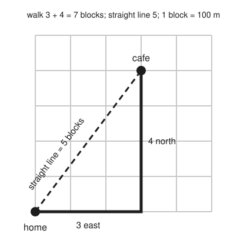

# Metric space: the three rules that make a distance mean something

[Syllabus](../../../SYLLABUS.md) → [Topology](../README.md) → [Metric Spaces](../README.md#s01) → Metric space

---

## General Overview

A café sits 3 blocks east and 4 blocks north of home, on a city street grid. A block is 100 m. On foot you must follow the streets, so the walk is 3 + 4 = 7 blocks, 700 m. A pigeon flies the straight line: 5 blocks, 500 m.

Both numbers are honest answers to "how far?". They measure different trips. Mathematics needs a test that says which formulas deserve the name **distance** at all. Then anything proved from the test holds for every distance that passes it.

The test is three rules:

1. **Zero only for the same place.** Two corners are 0 apart exactly when they are the same corner.
2. **Same both ways.** Home to café is as far as café to home.
3. **No shortcut through a detour.** Going via a third corner is never shorter than going direct.

Walking distance and the straight line both pass. Squared straight-line distance, one-way driving and "count only the east-west blocks" each fail one rule. A set of points with a distance that passes all three is a **metric space**.

The rules also do work. Ana texts that she is 7 blocks' walk from the park. Ben is 3 blocks' walk from it. Nobody knows where either stands. Rules 2 and 3 together say they are between 4 and 10 blocks apart, 400 m to 1 km, and the grid shows both ends really happen.

**A metric is a distance that is zero only from a point to itself, the same in both directions, and never beaten by a detour; those three rules are enough to bound a distance you cannot measure from two you can.**

**What kind of fact this is:** the three rules are a definition. Two theorems are proved on this card in Why it works: walking and straight-line distance obey the rules, and every metric obeys the two-sided bound.

### The picture: the walk and the straight line

<p align="center"></p>

Drawn to scale: 1 block = 60 drawing units, home at (60, 360), the turn at (240, 360), the café at (240, 120). The solid line is one shortest walk. The dashed line is the straight line no walker can use.

---

## The formula

A **point** is one member of a set $`X`$: here $`X`$ is the 36 street corners of a 6 by 6 grid. A **metric** on $`X`$ is a function $`d`$ that takes two points and returns a number, their distance. A function hands every input exactly one output ([Functions](../../01-Foundations/08-Relations%20and%20Functions/02-functions.md)); here the input is a pair of points, $`(x, y)`$. For all points $`x`$, $`y`$ and $`z`$ in $`X`$:

```math
\begin{aligned} &\text{Rule 1:} && d(x, y) = 0 \iff x = y \\ &\text{Rule 2:} && d(x, y) = d(y, x) \\ &\text{Rule 3:} && d(x, z) \le d(x, y) + d(y, z) \end{aligned}
```

**Read it aloud:** the distance is zero exactly when the two points are the same point. It reads the same both ways. And going from $`x`$ to $`z`$ direct is never longer than going via $`y`$.

Rule 3 is the **triangle inequality**. The pair $`(X, d)`$ is a **metric space**.

On the grid, a corner is written $`(e, n)`$: blocks east and blocks north of home. The two candidates are:

```math
d_{\text{walk}} = \lvert e_1 - e_2 \rvert + \lvert n_1 - n_2 \rvert, \qquad d_{\text{line}} = \sqrt{(e_1 - e_2)^2 + (n_1 - n_2)^2}
```

Home is $`(0, 0)`$ and the café is $`(3, 4)`$, so $`d_{\text{walk}} = 3 + 4 = 7`$ and $`d_{\text{line}} = \sqrt{9 + 16} = 5`$.

The rules give the tool this card is for, a **two-sided bound**:

```math
\lvert d(x, y) - d(y, z) \rvert \;\le\; d(x, z) \;\le\; d(x, y) + d(y, z)
```

**Read it aloud:** if you know how far $`x`$ and $`z`$ each are from a third point $`y`$, their own distance is at least the difference and at most the sum.

For Ana ($`x`$), the park ($`y`$) and Ben ($`z`$): $`\lvert 7 - 3 \rvert = 4 \le d(\text{Ana}, \text{Ben}) \le 7 + 3 = 10`$ blocks.

| Symbol | Plain meaning | In our example | Push it up and the answer… |
| --- | --- | --- | --- |
| $`X`$ | the set of points | the 36 corners | more triples to check: 46656 for 36 corners |
| $`x`$, $`y`$, $`z`$ | points of $`X`$; $`y`$ is the stop on the way | home, a stop, the café | — |
| $`d(x, y)`$ | the metric: the distance from $`x`$ to $`y`$ | 7 blocks on foot | — |
| $`\iff`$ | "exactly when": each side forces the other | $`d = 0`$ only for home to home | — |
| $`\le`$ | at most: equal is allowed | $`5 \le 3 + 4`$ | — |
| $`(e, n)`$ | a corner: blocks east and north of home | the café is $`(3, 4)`$ | — |
| $`\lvert \cdot \rvert`$ | absolute value: the size of a number, sign dropped | $`\lvert 0 - 3 \rvert = 3`$ | — |
| $`d_{\text{walk}}`$ | blocks along the streets | 7 | grows with every block east or north |
| $`d_{\text{line}}`$ | straight-line length, by Pythagoras | 5 | never more than $`d_{\text{walk}}`$ |
| $`\sqrt{\cdot}`$ | square root: the number that squared gives what is inside | $`\sqrt{25} = 5`$ | — |
| $`a`$, $`b`$, $`c`$, $`f`$ | east and north parts of the two legs, in the Step 2 proof | $`(3, 0)`$ then $`(0, 4)`$ | — |

### When it holds

- **Every pair and every triple.** The rules are about all points, not most. One failing triple, such as 0, 1 and 2 under squared distance, disqualifies the formula.
- **Two-way travel.** Rule 2 needs the trip back to cost what the trip out cost. On a one-way loop it fails, and so does the lower half of the bound: it puts a corner at least 2 blocks from itself.
- **Distinct points stay apart.** Rule 1 needs a positive distance between different points. Count only east-west blocks and home and the corner 1 block north are 0 apart, so "0 apart" no longer means "same place".
- **The bound needs a shared third point.** Ana's and Ben's distances must both be measured to the same park in the same metric. Mix walking for one and straight line for the other and the bound is no longer guaranteed.

---

## Why it works

### Step 0: a distance is the length of the shortest trip

Think of $`d(x, z)`$ as the length of the shortest trip from $`x`$ to $`z`$. A trip from $`x`$ to $`z`$ that stops at $`y`$ is one particular trip, so the shortest trip is no longer. That is rule 3.

The same picture explains the other rules. A trip from a corner to itself has length 0, and a trip between different corners covers at least one block: rule 1. If every street runs both ways, a trip reversed is a trip of the same length: rule 2.

So every shortest-route distance on two-way streets is a metric. This includes the shortest-path distance on any connected graph whose two-way edges have positive lengths, as computed by [Dijkstra's algorithm](../../04-Combinatorics%20and%20graphs/10-Trees%20and%20Cheapest%20Routes/05-dijkstra.md). Each failing candidate breaks this picture in one place:

- **Squared distance** stops measuring a trip, so rule 3 fails.
- **One-way streets** make the reversed trip a different trip, so rule 2 fails.
- **East-west blocks only** ignores part of the trip, so rule 1 fails.

### Step 1: walking distance obeys the three rules

On one street, the distance between two house numbers is the absolute value of their difference. It obeys a one-street triangle rule: a stop on the way never shortens the gap ([Absolute value](../../01-Foundations/02-The%20Number%20Line/05-absolute-value-and-distance.md)). Every metric generalises this one-street distance. Walking distance is that line distance once for the east coordinate and once for the north coordinate, added.

<details>
<summary>Detailed proof: the walking distance is a metric</summary>

Take corners $`x = (e_1, n_1)`$, $`y = (e_2, n_2)`$ and $`z = (e_3, n_3)`$.

Rule 1. A sum of two absolute values is 0 exactly when both are 0, that is when $`e_1 = e_2`$ and $`n_1 = n_2`$, so exactly when $`x = y`$.

Rule 2. $`\lvert e_1 - e_2 \rvert = \lvert e_2 - e_1 \rvert`$, and the same for the north parts, so the sum reads the same both ways.

Rule 3. Apply the one-street triangle rule to each coordinate:

$`\displaystyle \lvert e_1 - e_3 \rvert \le \lvert e_1 - e_2 \rvert + \lvert e_2 - e_3 \rvert, \qquad \lvert n_1 - n_3 \rvert \le \lvert n_1 - n_2 \rvert + \lvert n_2 - n_3 \rvert`$

Add the two lines. The left side is $`d_{\text{walk}}(x, z)`$ and the right side is $`d_{\text{walk}}(x, y) + d_{\text{walk}}(y, z)`$.

</details>

Rule 3 holds with equality whenever the stop lies inside or on the edge of the rectangle between home and the café. Then the detour costs nothing extra. Twenty of the 36 corners are such free stops. There are 35 different shortest walks, a count from [Lattice paths](../../04-Combinatorics%20and%20graphs/06-Lattice%20Paths%20and%20Catalan%20Numbers/01-lattice-paths.md): choose which 3 of the 7 blocks go east.

### Step 2: the straight line obeys the three rules

For a real triangle, two sides together beat the third ([Triangles](../../05-Geometry%20and%20trig/01-Angles%2C%20Triangles%20and%20Congruence/02-triangle-angle-sum-and-inequality.md)). That is the picture behind rule 3 and the reason for its name. The straight-line formula itself is Pythagoras on a grid ([Distance and midpoint](../../05-Geometry%20and%20trig/04-Coordinates%20and%20Curves/01-distance-and-midpoint.md)). Rules 1 and 2 are immediate: a sum of two squares is 0 only when both are 0, and squaring removes the sign.

Rule 3 in coordinates takes one short argument, in the fold. For the straight line, a stop is free only when it lies on the segment itself. On this grid only the 2 end corners qualify, since the segment from $`(0, 0)`$ to $`(3, 4)`$ passes through no other corner.

<details>
<summary>Detailed proof: the straight-line distance obeys rule 3</summary>

Write the two legs as steps $`(a, b)`$ from $`x`$ to $`y`$ and $`(c, f)`$ from $`y`$ to $`z`$. The direct step is $`(a + c, b + f)`$. Rule 3 says:

$`\displaystyle \sqrt{(a + c)^2 + (b + f)^2} \le \sqrt{a^2 + b^2} + \sqrt{c^2 + f^2}`$

Both sides are 0 or more, so it is enough to compare squares. Squaring and cancelling the common $`a^2 + b^2 + c^2 + f^2`$ leaves:

$`\displaystyle ac + bf \le \sqrt{(a^2 + b^2)(c^2 + f^2)}`$

Multiply out: $`(a^2 + b^2)(c^2 + f^2) - (ac + bf)^2 = (af - bc)^2`$, which is 0 or more. So $`(ac + bf)^2`$ is at most $`(a^2 + b^2)(c^2 + f^2)`$, and taking roots gives the line above. Equality needs $`af = bc`$ with $`ac + bf \ge 0`$: the two legs point the same way, so the stop is on the segment.

</details>

### Step 3: a distance is never negative, for free

The rules never say $`d \ge 0`$, yet it follows. Put $`z = x`$ in rule 3, then use rules 1 and 2:

```math
0 = d(x, x) \le d(x, y) + d(y, x) = 2\,d(x, y)
```

So $`d(x, y) \ge 0`$. Three rules are enough; a fourth would repeat them.

### Step 4: the two-sided bound

The upper half is rule 3 with Ana, the park and Ben as $`x`$, $`y`$ and $`z`$.

The lower half is rule 3 used twice, with a different point as the stop each time:

1. Stop at Ben on the way from Ana to the park: $`d(x, y) \le d(x, z) + d(z, y)`$. So $`d(x, y) - d(y, z) \le d(x, z)`$, using rule 2 to write $`d(z, y)`$ as $`d(y, z)`$.
2. Stop at Ana on the way from Ben to the park: $`d(z, y) \le d(z, x) + d(x, y)`$. So $`d(y, z) - d(x, y) \le d(x, z)`$, using rule 2 again.
3. The two differences are the same number with opposite signs. Both are at most $`d(x, z)`$, so its size is too: $`\lvert d(x, y) - d(y, z) \rvert \le d(x, z)`$.

For Ana and Ben this gives 4 to 10 blocks. The park sits on the open city grid, not on the 6 by 6 patch, so the code tries every corner round it where they could stand: 28 corners at 7 blocks from the park, 12 at 3 blocks, 336 placings. The true gap ranges from exactly 4 to exactly 10, so neither end of the bound can be improved.

### Step 5: what a check can and cannot prove

On a finite set, checking every pair and every triple is a proof. The code does this for the 36 corners: 46656 triples per candidate. For the whole infinite city, the proofs in Steps 1 and 2 do the work; the grid check illustrates them on 46656 cases.

The same check finds a failure fast. Squared distance fails at the first corners it tries on one street, 0, 1 and 2.

---

## Worked numbers, by hand

| Step | Arithmetic | Value |
| --- | --- | --- |
| walk, home to café | $`\lvert 0 - 3 \rvert + \lvert 0 - 4 \rvert`$ | 7 blocks |
| straight line, home to café | $`\sqrt{3^2 + 4^2} = \sqrt{25}`$ | 5 blocks |
| rule 3 for walking, stop at the turn $`(3, 0)`$ | $`3 + 4`$ against 7 | equal: a free stop |
| rule 3 for the line, same stop | $`3 + 4 = 7`$ against 5 | 5 ≤ 7 holds |
| squared line, corners 0, 1, 2 on one street | $`2^2 = 4`$ against $`1^2 + 1^2 = 2`$ | 4 > 2: rule 3 fails |
| Ana and Ben, lower bound | $`\lvert 7 - 3 \rvert`$ | 4 blocks |
| Ana and Ben, upper bound | $`7 + 3`$ | 10 blocks |
| **their walking distance** | **between the two** | **4 to 10 blocks, 400 m to 1000 m** |

Two messages about a park, and nothing else, pin Ana and Ben to between 400 m and 1 km of each other.

### What breaks if you drop a piece

| Mistake | Comes out at | What went wrong |
| --- | --- | --- |
| Square the straight line to skip the root | 4 direct against 1 + 1 via the middle corner | Rule 3 fails: squaring rewards splitting a trip |
| Use one-way driving round a block | A to B 1 block, back 3; the lower bound then puts A at least 2 from itself | Rule 2 fails, and the lower bound with it |
| Count only the east-west blocks | $`(0, 0)`$ and $`(0, 1)`$ come out 0 apart | Rule 1 fails: different corners look like one |
| Drop the bars in the lower bound | $`3 - 7 = -4`$ | A distance of at least −4 says nothing |

The code prints all four, and the one-way loop's broken bound.

---

## Code, from first principles, and it actually runs

The code takes four pairs of independent roads. Walking distance comes from the block formula and from a breadth-first search over the street graph, which only knows which corners touch; they agree on all 1296 pairs. The 35 routes are counted corner by corner and by the factorial formula. The three rules are checked on every pair and triple for seven candidates. The bound for Ana and Ben comes from the formula and from trying all 336 placings. Every distance is handled as its whole-number square, so roots are compared exactly and never rounded.

### Python

```python
# Metric space -- the check behind the card.  Nothing is imported.
# A corner of the city grid is (east, north), counted in blocks from home.
# Every candidate returns the SQUARE of its distance as a whole number, so a
# root is never rounded: sqrt(A) <= sqrt(B) + sqrt(C) is tested exactly.
GRID = [(e, n) for e in range(6) for n in range(6)]      # 36 corners, 6 by 6
HOME, CAFE = (0, 0), (3, 4)
ANA, BEN = 7, 3                     # walking blocks from the park, all we know

def walk(p, q):                     # east-west blocks plus north-south blocks
    return abs(p[0] - q[0]) + abs(p[1] - q[1])
def line2(p, q):                    # straight line, squared (Pythagoras)
    return (p[0] - q[0]) ** 2 + (p[1] - q[1]) ** 2
def isqrt(s):                       # whole-number square root, by counting up
    r = 0
    while (r + 1) * (r + 1) <= s:
        r += 1
    return r
def show(s):                        # print a distance from its square
    r = isqrt(s)
    return str(r) if r * r == s else f"sqrt({s})"
def le_root(a, b, c):               # sqrt(a) <= sqrt(b) + sqrt(c), exactly
    t = a - b - c
    return t <= 0 or t * t <= 4 * b * c
def eq_root(a, b, c):               # sqrt(a) == sqrt(b) + sqrt(c), exactly
    t = a - b - c
    return t >= 0 and t * t == 4 * b * c

def rules(points, d2):              # every pair and every triple, in order
    r1 = next(((x, y) for x in points for y in points
               if (d2(x, y) == 0) != (x == y)), None)
    r2 = next(((x, y) for x in points for y in points
               if d2(x, y) != d2(y, x)), None)
    r3 = next(((x, y, z) for x in points for z in points for y in points
               if not le_root(d2(x, z), d2(x, y), d2(y, z))), None)
    return r1, r2, r3

LOOP = ["A", "B", "C", "D"]         # one block, four one-way streets, clockwise
def drive2(p, q):
    return ((LOOP.index(q) - LOOP.index(p)) % 4) ** 2
CANDIDATES = [
    ("walking distance", GRID, lambda p, q: walk(p, q) ** 2),
    ("straight line", GRID, line2),
    ("straight line squared", GRID, lambda p, q: line2(p, q) ** 2),
    ("east-west blocks only", GRID, lambda p, q: (p[0] - q[0]) ** 2),
    ("one-way driving", LOOP, drive2),
    ("try: root of walking", GRID, walk),
    ("try: flat fare, cap 3", GRID, lambda p, q: min(walk(p, q), 3) ** 2),
]

print(f"home {HOME} to cafe {CAFE}: walk {walk(HOME, CAFE)} blocks, "
      f"straight line {show(line2(HOME, CAFE))} blocks; at 100 m a block, "
      f"{100 * walk(HOME, CAFE)} m against {100 * isqrt(line2(HOME, CAFE))} m")
routes = {}                          # road 1: count routes corner by corner
for e in range(4):
    for n in range(5):
        routes[e, n] = 1 if e == 0 or n == 0 else routes[e - 1, n] + routes[e, n - 1]
fact = lambda k: 1 if k == 0 else k * fact(k - 1)
print(f"shortest walking routes: {routes[3, 4]} counted, "
      f"{fact(7) // (fact(3) * fact(4))} by 7!/(3!4!)")
free_w = sum(walk(HOME, y) + walk(y, CAFE) == walk(HOME, CAFE) for y in GRID)
free_l = sum(eq_root(line2(HOME, CAFE), line2(HOME, y), line2(y, CAFE)) for y in GRID)
print(f"corners on the way at no extra cost: walk {free_w}, straight line {free_l}")

dist = {}                            # road 2: walking distance by breadth-first search
for s in GRID:
    seen, frontier, k = {s: 0}, [s], 0
    while frontier:
        k += 1
        nxt = []
        for (e, n) in frontier:
            for q in ((e + 1, n), (e - 1, n), (e, n + 1), (e, n - 1)):
                if q in GRID and q not in seen:
                    seen[q] = k
                    nxt.append(q)
        frontier = nxt
    for q in GRID:
        dist[s, q] = seen[q]
same = all(dist[p, q] == walk(p, q) for p in GRID for q in GRID)
print(f"search on the street graph equals the block formula on all "
      f"{len(GRID) ** 2} pairs of the {len(GRID)} corners: {'yes' if same else 'no'}")

for name, pts, d2 in CANDIDATES:
    r1, r2, r3 = rules(pts, d2)
    verdict = "a metric" if (r1, r2, r3) == (None, None, None) else "NOT a metric"
    print(f"{name}: {len(pts) ** 3} triples, {verdict}")
    if r1:
        print(f"  rule 1 fails: {r1[0]} and {r1[1]} are {show(d2(*r1))} apart")
    if r2:
        print(f"  rule 2 fails: {r2[0]} to {r2[1]} is {show(d2(*r2))}, back is "
              f"{show(d2(r2[1], r2[0]))}")
    if r3:
        x, y, z = r3
        print(f"  rule 3 fails: {x} to {z} is {show(d2(x, z))}, via {y} is "
              f"{show(d2(x, y))} + {show(d2(y, z))}")

dr = lambda p, q: isqrt(drive2(p, q))  # one-way loop: does the lower bound survive?
lb = next((x, y, z) for x in LOOP for y in LOOP for z in LOOP
          if abs(dr(x, y) - dr(y, z)) > dr(x, z))
print(f"one-way lower bound fails: {lb[0]} to {lb[1]} is {dr(*lb[:2])}, {lb[1]} to "
      f"{lb[2]} is {dr(*lb[1:])}, so {lb[0]} to {lb[2]} is at least "
      f"{abs(dr(*lb[:2]) - dr(*lb[1:]))}, yet it is {dr(lb[0], lb[2])}")

def gaps(a, b):                     # brute force: every place the two could be
    box = [(e, n) for e in range(-10, 11) for n in range(-10, 11)]
    at_a = [p for p in box if walk(p, (0, 0)) == a]
    at_b = [p for p in box if walk(p, (0, 0)) == b]
    g = [walk(p, q) for p in at_a for q in at_b]
    return len(at_a), len(at_b), min(g), max(g)
na, nb, lo, hi = gaps(ANA, BEN)
print(f"Ana {ANA}, Ben {BEN} blocks from the park: bound {abs(ANA - BEN)} to {ANA + BEN}"
      f" blocks, {100 * abs(ANA - BEN)} m to {100 * (ANA + BEN)} m")
print(f"  brute force over {na} x {nb} = {na * nb} placings: {lo} to {hi}")
_, _, tlo, thi = gaps(ANA, 7)
print(f"try: Ben also 7 out: bound {abs(ANA - 7)} to {ANA + 7}, brute force {tlo} to {thi}")
print(f"wrong: bound without the bars, {BEN} - {ANA} = {BEN - ANA}")
print(f"wrong: the sum read as the answer, {ANA + BEN}; the truth can be {lo}")
print("figure, 1 block = 60 units: home (60, 360), turn (240, 360), cafe (240, 120)")

assert routes[3, 4] == fact(7) // (fact(3) * fact(4)) == 35  # two roads to 35
assert same and walk(HOME, CAFE) == 7 and line2(HOME, CAFE) == 25
assert (free_w, free_l) == (20, 2)
assert [rules(p, d) == (None, None, None) for _, p, d in CANDIDATES] == \
       [True, True, False, False, False, True, True]
assert rules(GRID, CANDIDATES[2][2])[2] == ((0, 0), (0, 1), (0, 2))
assert lb == ("A", "B", "A") and (dr("A", "B"), dr("B", "A")) == (1, 3)
assert (lo, hi) == (abs(ANA - BEN), ANA + BEN) and (tlo, thi) == (0, 14)
print("ALL CHECKS PASS")
```

**Ran 2026-11-14 on macOS, Python 3.14.10, standard library only. All checks passed. Output, pasted from the run:**

```
home (0, 0) to cafe (3, 4): walk 7 blocks, straight line 5 blocks; at 100 m a block, 700 m against 500 m
shortest walking routes: 35 counted, 35 by 7!/(3!4!)
corners on the way at no extra cost: walk 20, straight line 2
search on the street graph equals the block formula on all 1296 pairs of the 36 corners: yes
walking distance: 46656 triples, a metric
straight line: 46656 triples, a metric
straight line squared: 46656 triples, NOT a metric
  rule 3 fails: (0, 0) to (0, 2) is 4, via (0, 1) is 1 + 1
east-west blocks only: 46656 triples, NOT a metric
  rule 1 fails: (0, 0) and (0, 1) are 0 apart
one-way driving: 64 triples, NOT a metric
  rule 2 fails: A to B is 1, back is 3
try: root of walking: 46656 triples, a metric
try: flat fare, cap 3: 46656 triples, a metric
one-way lower bound fails: A to B is 1, B to A is 3, so A to A is at least 2, yet it is 0
Ana 7, Ben 3 blocks from the park: bound 4 to 10 blocks, 400 m to 1000 m
  brute force over 28 x 12 = 336 placings: 4 to 10
try: Ben also 7 out: bound 0 to 14, brute force 0 to 14
wrong: bound without the bars, 3 - 7 = -4
wrong: the sum read as the answer, 10; the truth can be 4
figure, 1 block = 60 units: home (60, 360), turn (240, 360), cafe (240, 120)
ALL CHECKS PASS
```

### Rust

The same checks in the same order, with the same printed lines.

```rust
// Metric space -- the same check as metric_spaces_check.py, in Rust, std only.
// A corner of the city grid is (east, north), counted in blocks from home.
// Every candidate returns the SQUARE of its distance as a whole number, so a
// root is never rounded: sqrt(A) <= sqrt(B) + sqrt(C) is tested exactly.
// Compile: rustc --edition 2021 -O metric_spaces_check.rs -o /tmp/metric_spaces
use std::collections::HashMap;
type P = (i64, i64);
const HOME: P = (0, 0);
const CAFE: P = (3, 4);
const ANA: i64 = 7;
const BEN: i64 = 3;

fn walk(p: P, q: P) -> i64 { (p.0 - q.0).abs() + (p.1 - q.1).abs() }
fn line2(p: P, q: P) -> i64 { (p.0 - q.0).pow(2) + (p.1 - q.1).pow(2) }
fn isqrt(s: i64) -> i64 {
    let mut r = 0;
    while (r + 1) * (r + 1) <= s { r += 1; }
    r
}
fn show(s: i64) -> String {
    let r = isqrt(s);
    if r * r == s { r.to_string() } else { format!("sqrt({})", s) }
}
fn le_root(a: i64, b: i64, c: i64) -> bool { let t = a - b - c; t <= 0 || t * t <= 4 * b * c }
fn eq_root(a: i64, b: i64, c: i64) -> bool { let t = a - b - c; t >= 0 && t * t == 4 * b * c }
fn lab(p: P, lp: bool) -> String {
    if lp { ["A", "B", "C", "D"][p.0 as usize].to_string() } else { format!("({}, {})", p.0, p.1) }
}

type R = (Option<(P, P)>, Option<(P, P)>, Option<(P, P, P)>);
fn rules(pts: &[P], d2: &dyn Fn(P, P) -> i64) -> R {
    let (mut r1, mut r2, mut r3) = (None, None, None);
    for &x in pts { for &y in pts {
        if r1.is_none() && (d2(x, y) == 0) != (x == y) { r1 = Some((x, y)); }
        if r2.is_none() && d2(x, y) != d2(y, x) { r2 = Some((x, y)); }
    } }
    'o: for &x in pts { for &z in pts { for &y in pts {
        if !le_root(d2(x, z), d2(x, y), d2(y, z)) { r3 = Some((x, y, z)); break 'o; }
    } } }
    (r1, r2, r3)
}

fn gaps(a: i64, b: i64) -> (usize, usize, i64, i64) {
    let mut bx = vec![];
    for e in -10..=10 { for n in -10..=10 { bx.push((e, n)); } }
    let at_a: Vec<P> = bx.iter().cloned().filter(|&p| walk(p, (0, 0)) == a).collect();
    let at_b: Vec<P> = bx.iter().cloned().filter(|&p| walk(p, (0, 0)) == b).collect();
    let g: Vec<i64> = at_a.iter().flat_map(|&p| at_b.iter().map(move |&q| walk(p, q))).collect();
    (at_a.len(), at_b.len(), *g.iter().min().unwrap(), *g.iter().max().unwrap())
}
fn fact(k: i64) -> i64 { if k == 0 { 1 } else { k * fact(k - 1) } }

fn main() {
    let mut grid: Vec<P> = vec![];
    for e in 0..6 { for n in 0..6 { grid.push((e, n)); } }
    let lp: Vec<P> = (0..4).map(|i| (i, 0)).collect();
    println!("home {} to cafe {}: walk {} blocks, straight line {} blocks; at 100 m a block, {} m against {} m",
             lab(HOME, false), lab(CAFE, false), walk(HOME, CAFE), show(line2(HOME, CAFE)),
             100 * walk(HOME, CAFE), 100 * isqrt(line2(HOME, CAFE)));
    let mut routes: HashMap<P, i64> = HashMap::new(); // road 1: routes corner by corner
    for e in 0..4 { for n in 0..5 {
        let v = if e == 0 || n == 0 { 1 } else { routes[&(e - 1, n)] + routes[&(e, n - 1)] };
        routes.insert((e, n), v);
    } }
    let binom = fact(7) / (fact(3) * fact(4));
    println!("shortest walking routes: {} counted, {} by 7!/(3!4!)", routes[&(3, 4)], binom);
    let free_w = grid.iter().filter(|&&y| walk(HOME, y) + walk(y, CAFE) == walk(HOME, CAFE)).count();
    let free_l = grid.iter().filter(|&&y| eq_root(line2(HOME, CAFE), line2(HOME, y), line2(y, CAFE))).count();
    println!("corners on the way at no extra cost: walk {}, straight line {}", free_w, free_l);

    let mut same = true; // road 2: walking distance by breadth-first search
    for &s in &grid {
        let mut seen: HashMap<P, i64> = HashMap::new();
        seen.insert(s, 0);
        let (mut frontier, mut k) = (vec![s], 0);
        while !frontier.is_empty() {
            k += 1;
            let mut nxt = vec![];
            for &(e, n) in &frontier {
                for q in [(e + 1, n), (e - 1, n), (e, n + 1), (e, n - 1)] {
                    if grid.contains(&q) && !seen.contains_key(&q) { seen.insert(q, k); nxt.push(q); }
                }
            }
            frontier = nxt;
        }
        for &q in &grid { if seen[&q] != walk(s, q) { same = false; } }
    }
    println!("search on the street graph equals the block formula on all {} pairs of the {} corners: {}",
             grid.len() * grid.len(), grid.len(), if same { "yes" } else { "no" });

    let walk2 = |p: P, q: P| walk(p, q).pow(2);
    let sq = |p: P, q: P| line2(p, q).pow(2);
    let ew = |p: P, q: P| (p.0 - q.0).pow(2);
    let drive2 = |p: P, q: P| (q.0 - p.0).rem_euclid(4).pow(2);
    let cap = |p: P, q: P| walk(p, q).min(3).pow(2);
    let cands: Vec<(&str, &Vec<P>, &dyn Fn(P, P) -> i64, bool)> = vec![
        ("walking distance", &grid, &walk2, false),
        ("straight line", &grid, &line2, false),
        ("straight line squared", &grid, &sq, false),
        ("east-west blocks only", &grid, &ew, false),
        ("one-way driving", &lp, &drive2, true),
        ("try: root of walking", &grid, &walk, false),
        ("try: flat fare, cap 3", &grid, &cap, false),
    ];
    let mut passes = vec![];
    let mut sq_fail = None;
    for (name, pts, d2, l) in &cands {
        let (r1, r2, r3) = rules(pts, *d2);
        let ok = r1.is_none() && r2.is_none() && r3.is_none();
        passes.push(ok);
        if *name == "straight line squared" { sq_fail = r3; }
        println!("{}: {} triples, {}", name, pts.len().pow(3), if ok { "a metric" } else { "NOT a metric" });
        if let Some((x, y)) = r1 {
            println!("  rule 1 fails: {} and {} are {} apart", lab(x, *l), lab(y, *l), show(d2(x, y)));
        }
        if let Some((x, y)) = r2 {
            println!("  rule 2 fails: {} to {} is {}, back is {}", lab(x, *l), lab(y, *l),
                     show(d2(x, y)), show(d2(y, x)));
        }
        if let Some((x, y, z)) = r3 {
            println!("  rule 3 fails: {} to {} is {}, via {} is {} + {}", lab(x, *l), lab(z, *l),
                     show(d2(x, z)), lab(y, *l), show(d2(x, y)), show(d2(y, z)));
        }
    }

    let dr = |p: P, q: P| isqrt(drive2(p, q)); // one-way loop: does the lower bound survive?
    let mut lb = None;
    'l: for &x in &lp { for &y in &lp { for &z in &lp {
        if (dr(x, y) - dr(y, z)).abs() > dr(x, z) { lb = Some((x, y, z)); break 'l; }
    } } }
    let (bx, by, bz) = lb.unwrap();
    println!("one-way lower bound fails: {} to {} is {}, {} to {} is {}, so {} to {} is at least {}, yet it is {}",
             lab(bx, true), lab(by, true), dr(bx, by), lab(by, true), lab(bz, true), dr(by, bz),
             lab(bx, true), lab(bz, true), (dr(bx, by) - dr(by, bz)).abs(), dr(bx, bz));

    let (na, nb, lo, hi) = gaps(ANA, BEN);
    println!("Ana {}, Ben {} blocks from the park: bound {} to {} blocks, {} m to {} m", ANA, BEN,
             (ANA - BEN).abs(), ANA + BEN, 100 * (ANA - BEN).abs(), 100 * (ANA + BEN));
    println!("  brute force over {} x {} = {} placings: {} to {}", na, nb, na * nb, lo, hi);
    let (_, _, tlo, thi) = gaps(ANA, 7);
    println!("try: Ben also 7 out: bound {} to {}, brute force {} to {}", (ANA - 7).abs(), ANA + 7, tlo, thi);
    println!("wrong: bound without the bars, {} - {} = {}", BEN, ANA, BEN - ANA);
    println!("wrong: the sum read as the answer, {}; the truth can be {}", ANA + BEN, lo);
    println!("figure, 1 block = 60 units: home (60, 360), turn (240, 360), cafe (240, 120)");

    assert!(routes[&(3, 4)] == binom && binom == 35); // two roads to 35
    assert!(same && walk(HOME, CAFE) == 7 && line2(HOME, CAFE) == 25);
    assert_eq!((free_w, free_l), (20, 2));
    assert_eq!(passes, vec![true, true, false, false, false, true, true]);
    assert_eq!(sq_fail, Some(((0, 0), (0, 1), (0, 2))));
    assert!(lb == Some(((0, 0), (1, 0), (0, 0))) && (dr((0, 0), (1, 0)), dr((1, 0), (0, 0))) == (1, 3));
    assert!((lo, hi) == ((ANA - BEN).abs(), ANA + BEN) && (tlo, thi) == (0, 14));
    println!("ALL CHECKS PASS");
}
```

**Ran 2026-11-14 on macOS, rustc 1.98.1, no crates. All checks passed. Output, pasted from the run:**

```
home (0, 0) to cafe (3, 4): walk 7 blocks, straight line 5 blocks; at 100 m a block, 700 m against 500 m
shortest walking routes: 35 counted, 35 by 7!/(3!4!)
corners on the way at no extra cost: walk 20, straight line 2
search on the street graph equals the block formula on all 1296 pairs of the 36 corners: yes
walking distance: 46656 triples, a metric
straight line: 46656 triples, a metric
straight line squared: 46656 triples, NOT a metric
  rule 3 fails: (0, 0) to (0, 2) is 4, via (0, 1) is 1 + 1
east-west blocks only: 46656 triples, NOT a metric
  rule 1 fails: (0, 0) and (0, 1) are 0 apart
one-way driving: 64 triples, NOT a metric
  rule 2 fails: A to B is 1, back is 3
try: root of walking: 46656 triples, a metric
try: flat fare, cap 3: 46656 triples, a metric
one-way lower bound fails: A to B is 1, B to A is 3, so A to A is at least 2, yet it is 0
Ana 7, Ben 3 blocks from the park: bound 4 to 10 blocks, 400 m to 1000 m
  brute force over 28 x 12 = 336 placings: 4 to 10
try: Ben also 7 out: bound 0 to 14, brute force 0 to 14
wrong: bound without the bars, 3 - 7 = -4
wrong: the sum read as the answer, 10; the truth can be 4
figure, 1 block = 60 units: home (60, 360), turn (240, 360), cafe (240, 120)
ALL CHECKS PASS
```

The two outputs are identical line for line.

### Lean

Lean proves the two-sided bound in every metric space, and the three rules for walking and straight-line distance on the whole infinite grid.

- Take any metric space and any points $`x`$, $`y`$ and $`z`$ in it. Then $`\lvert d(x, y) - d(y, z) \rvert \le d(x, z) \le d(x, y) + d(y, z)`$.
- Walking distance obeys rules 1, 2 and 3 for every corner of the infinite grid, not only the 36 corners of the patch.
- Straight-line distance obeys rules 1, 2 and 3 for every corner of the infinite grid. Rule 3 is proved by comparing squares, as in Step 2.
- Home to the café is 7 blocks on foot and 5 by the straight line. There are 35 shortest walks, and 20 of the 36 corners are free stops.
- Squared distance fails rule 3 on one street: 0 to 2 is 4, and via 1 it is 1 + 1. East-west blocks alone put $`(0, 0)`$ and $`(0, 1)`$ 0 apart.
- One-way driving goes from A to B in 1 block and back in 3. The lower bound would then put A at least 2 blocks from itself, yet that distance is 0.
- For Ana 7 blocks and Ben 3 blocks from the park, the bound is 4 to 10 blocks. Placings on the line through the park reach both ends.
- Exactly 28 corners lie 7 blocks from the park, and 12 lie 3 blocks away. With Ben also 7 out, the bound is 0 to 14.

Left to Python and Rust: the breadth-first search, the 46656-triple sweeps, the root and flat-fare candidates, and the brute force over 336 placings.

```lean
-- Metric space: in every metric space a distance d(x, z) lies between |d(x, y) - d(y, z)| and d(x, y) + d(y, z), and walking and straight-line distance on the city grid both obey the three rules.
import Mathlib.Topology.MetricSpace.Defs
import Mathlib.Analysis.Real.Sqrt
import Mathlib.Data.ZMod.Defs
import Mathlib.Data.Int.Interval
import Mathlib.Tactic.NormNum

/-- Minkowski's inequality in the plane: the straight line beats two legs. -/
theorem plane_sqrt_triangle (c d e f : ℝ) :
    Real.sqrt ((c + e) ^ 2 + (d + f) ^ 2) ≤
      Real.sqrt (c ^ 2 + d ^ 2) + Real.sqrt (e ^ 2 + f ^ 2) := by
  have hP : 0 ≤ c ^ 2 + d ^ 2 := by positivity
  have hQ : 0 ≤ e ^ 2 + f ^ 2 := by positivity
  have hCS : c * e + d * f ≤ Real.sqrt (c ^ 2 + d ^ 2) * Real.sqrt (e ^ 2 + f ^ 2) := by
    rw [← Real.sqrt_mul hP]
    refine le_trans (le_abs_self _) (Real.abs_le_sqrt ?_)
    nlinarith [sq_nonneg (c * f - d * e)]
  rw [Real.sqrt_le_iff]
  refine ⟨by positivity, ?_⟩
  have h1 := Real.sq_sqrt hP
  have h2 := Real.sq_sqrt hQ
  nlinarith [h1, h2, hCS]

/-- The two-sided bound. In any metric space, if you know how far x and z each are from a third
point y, their own distance is at least the difference of the two and at most their sum:
|d(x, y) - d(y, z)| ≤ d(x, z) ≤ d(x, y) + d(y, z). -/
theorem metric_two_sided_bound {X : Type*} [MetricSpace X] (x y z : X) :
    |dist x y - dist y z| ≤ dist x z ∧ dist x z ≤ dist x y + dist y z := by
  refine ⟨?_, dist_triangle x y z⟩
  rw [abs_sub_le_iff]
  constructor
  · linarith [dist_triangle x z y, dist_comm z y]
  · linarith [dist_triangle y x z, dist_comm x y]

/-- Walking distance on the city grid: a corner is (blocks east, blocks north) of home, and the
walk is the east-west blocks plus the north-south blocks. -/
def walk (p q : ℤ × ℤ) : ℤ := |p.1 - q.1| + |p.2 - q.2|

/-- Straight-line distance between two corners, by Pythagoras. -/
noncomputable def line (p q : ℤ × ℤ) : ℝ :=
  Real.sqrt (((p.1 - q.1 : ℤ) : ℝ) ^ 2 + ((p.2 - q.2 : ℤ) : ℝ) ^ 2)

/-- Walking distance is a metric on the corners of the city grid: it is zero exactly for the same
corner, it reads the same both ways, and a stop on the way never makes the walk shorter. -/
theorem walking_distance_obeys_three_rules :
    (∀ x y : ℤ × ℤ, walk x y = 0 ↔ x = y) ∧
    (∀ x y : ℤ × ℤ, walk x y = walk y x) ∧
    (∀ x y z : ℤ × ℤ, walk x z ≤ walk x y + walk y z) := by
  refine ⟨?_, ?_, ?_⟩
  · intro x y
    unfold walk
    constructor
    · intro h
      have ha := abs_nonneg (x.1 - y.1)
      have hb := abs_nonneg (x.2 - y.2)
      have h1 : |x.1 - y.1| = 0 := by linarith
      have h2 : |x.2 - y.2| = 0 := by linarith
      rw [abs_eq_zero, sub_eq_zero] at h1 h2
      exact Prod.ext h1 h2
    · rintro rfl
      simp
  · intro x y
    unfold walk
    rw [abs_sub_comm x.1, abs_sub_comm x.2]
  · intro x y z
    unfold walk
    linarith [abs_sub_le x.1 y.1 z.1, abs_sub_le x.2 y.2 z.2]

/-- Straight-line distance is a metric on the corners of the city grid: it is zero exactly for the
same corner, it reads the same both ways, and a stop on the way never makes the line shorter. -/
theorem straight_line_obeys_three_rules :
    (∀ x y : ℤ × ℤ, line x y = 0 ↔ x = y) ∧
    (∀ x y : ℤ × ℤ, line x y = line y x) ∧
    (∀ x y z : ℤ × ℤ, line x z ≤ line x y + line y z) := by
  refine ⟨?_, ?_, ?_⟩
  · intro x y
    unfold line
    rw [Real.sqrt_eq_zero']
    constructor
    · intro h
      have ha := sq_nonneg (((x.1 - y.1 : ℤ) : ℝ))
      have hb := sq_nonneg (((x.2 - y.2 : ℤ) : ℝ))
      have h1 : (((x.1 - y.1 : ℤ) : ℝ)) ^ 2 = 0 := by linarith
      have h2 : (((x.2 - y.2 : ℤ) : ℝ)) ^ 2 = 0 := by linarith
      rw [pow_eq_zero_iff two_ne_zero, Int.cast_eq_zero, sub_eq_zero] at h1 h2
      exact Prod.ext h1 h2
    · rintro rfl
      simp
  · intro x y
    unfold line
    congr 1
    push_cast
    ring
  · intro x y z
    unfold line
    have h := plane_sqrt_triangle (((x.1 - y.1 : ℤ) : ℝ)) (((x.2 - y.2 : ℤ) : ℝ))
      (((y.1 - z.1 : ℤ) : ℝ)) (((y.2 - z.2 : ℤ) : ℝ))
    have e1 : (((x.1 - z.1 : ℤ) : ℝ)) = ((x.1 - y.1 : ℤ) : ℝ) + ((y.1 - z.1 : ℤ) : ℝ) := by
      push_cast; ring
    have e2 : (((x.2 - z.2 : ℤ) : ℝ)) = ((x.2 - y.2 : ℤ) : ℝ) + ((y.2 - z.2 : ℤ) : ℝ) := by
      push_cast; ring
    rw [e1, e2]
    exact h

/-- Squared straight-line distance, the candidate that fails rule 3. -/
def lineSq (p q : ℤ × ℤ) : ℤ := (p.1 - q.1) ^ 2 + (p.2 - q.2) ^ 2

/-- East-west blocks only, the candidate that fails rule 1. -/
def eastWest (p q : ℤ × ℤ) : ℤ := |p.1 - q.1|

/-- One-way driving round a block of four corners, clockwise: the candidate that fails rule 2. -/
def drive (p q : ZMod 4) : ℕ := (q - p).val

-- Home (0, 0) to the café (3, 4): 7 blocks on foot, 5 as the crow flies.
example : walk (0, 0) (3, 4) = 7 := by decide
example : lineSq (0, 0) (3, 4) = 25 := by decide
example : line (0, 0) (3, 4) = 5 := by
  unfold line
  rw [show (((0 : ℤ) - 3 : ℤ) : ℝ) ^ 2 + (((0 : ℤ) - 4 : ℤ) : ℝ) ^ 2 = (5 : ℝ) ^ 2 by norm_num]
  exact Real.sqrt_sq (by norm_num)
-- Stopping at the turn (3, 0) is free for the walk: 3 + 4 = 7.
example : walk (0, 0) (3, 0) + walk (3, 0) (3, 4) = walk (0, 0) (3, 4) := by decide
-- 35 shortest walks: choose which 3 of the 7 blocks go east.
example : Nat.choose 7 3 = 35 := by decide
-- 20 of the 36 corners of the 6 by 6 grid are free stops for the walk.
example : ((Finset.Icc (0 : ℤ) 5 ×ˢ Finset.Icc (0 : ℤ) 5).filter
    (fun y => walk (0, 0) y + walk y (3, 4) = walk (0, 0) (3, 4))).card = 20 := by decide
-- 36 corners give 36 ^ 2 = 1296 pairs and 36 ^ 3 = 46656 triples.
example : 36 ^ 2 = 1296 ∧ 36 ^ 3 = 46656 := by decide
-- Squared distance fails rule 3 on one street: 4 direct against 1 + 1 via the middle corner.
example : lineSq (0, 0) (0, 2) = 4 ∧ lineSq (0, 0) (0, 1) + lineSq (0, 1) (0, 2) = 2 ∧
    ¬ (lineSq (0, 0) (0, 2) ≤ lineSq (0, 0) (0, 1) + lineSq (0, 1) (0, 2)) := by decide
-- East-west blocks only fails rule 1: two different corners come out 0 apart.
example : eastWest (0, 0) (0, 1) = 0 ∧ ((0, 0) : ℤ × ℤ) ≠ (0, 1) := by decide
-- One-way driving fails rule 2: A to B is 1 block, back is 3; the lower bound then puts A at
-- least 2 from itself, yet A to A is 0.
example : drive 0 1 = 1 ∧ drive 1 0 = 3 ∧ drive 0 0 = 0 := by decide
example : |((drive 0 1 : ℤ) - (drive 1 0 : ℤ))| = 2 := by decide
-- Ana 7 blocks and Ben 3 blocks from the park: the bound is 4 to 10 blocks.
example : |(7 : ℤ) - 3| = 4 ∧ (7 : ℤ) + 3 = 10 := by decide
-- Brute force round the park (0, 0): 28 corners at 7 blocks, 12 at 3 blocks, 336 placings.
example : ((Finset.Icc (-10 : ℤ) 10 ×ˢ Finset.Icc (-10 : ℤ) 10).filter
    (fun p => walk p (0, 0) = 7)).card = 28 := by decide
example : ((Finset.Icc (-10 : ℤ) 10 ×ˢ Finset.Icc (-10 : ℤ) 10).filter
    (fun p => walk p (0, 0) = 3)).card = 12 := by decide
example : 28 * 12 = 336 := by decide
-- Both ends of the bound really happen: Ana at (7, 0), Ben at (3, 0) or at (-3, 0).
example : walk (7, 0) (0, 0) = 7 ∧ walk (3, 0) (0, 0) = 3 ∧ walk (-3, 0) (0, 0) = 3 ∧
    walk (7, 0) (3, 0) = 4 ∧ walk (7, 0) (-3, 0) = 10 := by decide
-- Ben also 7 out: the bound is 0 to 14.
example : |(7 : ℤ) - 7| = 0 ∧ (7 : ℤ) + 7 = 14 := by decide
-- Dropping the bars in the lower bound: 3 - 7 = -4 says nothing.
example : (3 : ℤ) - 7 = -4 := by decide

#print axioms plane_sqrt_triangle
#print axioms metric_two_sided_bound
#print axioms walking_distance_obeys_three_rules
#print axioms straight_line_obeys_three_rules
```

**Checked 2026-11-14 on macOS, Lean 4.36.0-rc2, Mathlib v4.36.0-rc2. Every proof is complete and uses only Lean's standard axioms. Output, pasted from the run:**

```
'plane_sqrt_triangle' depends on axioms: [propext, Classical.choice, Quot.sound]
'metric_two_sided_bound' depends on axioms: [propext, Classical.choice, Quot.sound]
'walking_distance_obeys_three_rules' depends on axioms: [propext, Classical.choice, Quot.sound]
'straight_line_obeys_three_rules' depends on axioms: [propext, Classical.choice, Quot.sound]
```

> [!TIP]
> **Try changing**
> Guess first, then run it.
> - **Guess first: is the square root of walking distance a metric?** The `try: root of walking` line checks it: yes, on all 46656 triples. Squaring breaks rule 3; a root keeps it, because the root of a sum is never more than the sum of the roots: squaring the sum of the roots adds a cross term that is never negative.
> - **Guess first: does a flat fare that caps every trip at 3 blocks pass?** The `try: flat fare, cap 3` line says yes. A cap cannot make the direct trip cost more than a split one.
> - **Guess first: what if Ben is also 7 blocks out?** Set `BEN = 7`. The bound becomes 0 to 14, and the brute force reaches both ends: they may be standing together.
> - **Guess first: what if the loop's streets run both ways?** Change `drive2` to measure the shorter way round the loop. Rule 2 then holds, so the search for a one-way lower-bound failure finds none, and the run stops there.

---

## The usual mistake

> [!warning]
> **Calling squared distance a distance.** It is tempting because it ranks points the same way and skips the root. But it breaks rule 3: on one street, 0 to 2 is 4, while 0 to 1 to 2 is 1 + 1 = 2. Any shortcut built on rule 3, such as the bound on this card or the pruning in a nearest-neighbour search, then gives wrong answers.
>
> - **Reading the bound as the answer.** For Ana and Ben, 7 + 3 = 10 blocks is only the most it can be. They can be as close as 4.
> - **Dropping the bars on the lower bound.** 3 − 7 = −4 is useless. The bound is $`\lvert 7 - 3 \rvert = 4`$.
> - **Assuming every travel time is symmetric.** One-way driving round a block gives A to B 1 block, B to A 3 blocks. Rule 2 fails and the lower bound can fail with it.
> - **Measuring only part of the trip.** East-west blocks alone put $`(0, 0)`$ and $`(0, 1)`$ 0 apart, so "0 apart" stops meaning "same place".

---

## Where you meet it in real life

- **Nearest-neighbour search.** Databases of images, songs or documents store distances to a few reference points. The lower bound rules out a far item without computing its distance, which is the whole idea of a metric tree.
- **Spell checkers.** Edit distance, the number of single-letter changes from one word to another, obeys all three rules. A search for close spellings uses the bound to skip most of the dictionary.
- **Maps and ride apps.** Driving times with one-way streets break rule 2. Routing code that assumes symmetry gives wrong return times.
- **Clustering.** k-means groups data points by squared distance. Its fast versions apply rule 3 shortcuts to the unsquared distance, because squared distance is not a metric.
- **Grid cities and chip design.** Walking distance, also called taxicab distance, measures wiring on a chip, where wires run only along two directions. [The distance menu](02-distances-on-vectors-and-functions.md) lists it with its neighbours.

> **Say it back**
> A metric is a rule for distance between points that obeys three rules. The distance is zero only from a point to itself. It is the same in both directions. A detour through a third point is never shorter than the direct trip. Walking and straight-line distance on a city grid both pass; squared distance, one-way driving and east-west blocks alone each fail one rule. Two known distances to a shared point bound the unknown third. Ana 7 blocks and Ben 3 blocks from the park are 4 to 10 blocks apart.

---

## What this builds on

- [Absolute value](../../01-Foundations/02-The%20Number%20Line/05-absolute-value-and-distance.md): the distance $`\lvert x - y \rvert`$ on one street and its triangle rule, used once per coordinate in Step 1.
- [Functions](../../01-Foundations/08-Relations%20and%20Functions/02-functions.md): a metric is a function with exactly one output for each pair of points.
- [Triangles](../../05-Geometry%20and%20trig/01-Angles%2C%20Triangles%20and%20Congruence/02-triangle-angle-sum-and-inequality.md): two sides of a real triangle beat the third, the picture behind rule 3 and its name.

## Where this goes next

- [The distance menu](02-distances-on-vectors-and-functions.md): walking, straight-line and worst-case distance side by side, the distance between whole shapes, and when two metrics count as the same.
- [Open balls, open sets and closed sets](03-open-and-closed-sets.md): with a metric in hand, "all points within 3 blocks" becomes a ball, and balls build the vocabulary of nearness.

The question this card leaves open: walking and straight-line distance give different numbers, so do they ever disagree about which points are near each other?

---

## Sources

Verified 2026-11-14: every link below resolves to the publisher's page.

- Fréchet, Maurice. "Sur quelques points du calcul fonctionnel." *Rendiconti del Circolo Matematico di Palermo* 22 (1906): 1–72. [doi:10.1007/BF03018603](https://doi.org/10.1007/BF03018603). The 1906 paper that first treated distance as a function obeying rules, for points that need not be numbers.
- Deza, Michel Marie, and Elena Deza. *Encyclopedia of Distances*, 4th ed. Springer, 2016. [doi:10.1007/978-3-662-52844-0](https://doi.org/10.1007/978-3-662-52844-0). A catalogue of metrics, including the taxicab metric, and of near-misses that fail one rule, such as one-way distances.
- Uhlmann, Jeffrey K. "Satisfying general proximity/similarity queries with metric trees." *Information Processing Letters* 40, no. 4 (1991): 175–179. [doi:10.1016/0020-0190(91)90074-R](https://doi.org/10.1016/0020-0190(91)90074-R). Search trees that skip whole branches using the triangle inequality.
- Chávez, Edgar, Gonzalo Navarro, Ricardo Baeza-Yates, and José Luis Marroquín. "Searching in metric spaces." *ACM Computing Surveys* 33, no. 3 (2001): 273–321. [doi:10.1145/502807.502808](https://doi.org/10.1145/502807.502808). The survey of search by distance, including edit distance and the lower bound used here.
