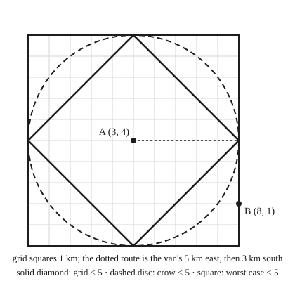

# The distance menu: straight-line, taxicab, worst-case, and distance between whole shapes

[Syllabus](../../../SYLLABUS.md) → [Topology](../README.md) → [Metric Spaces](../README.md#s01) → The distance menu

---

## General Overview

A delivery van leaves its depot on a town grid measured in kilometres. Drop A is at (3, 4): 3 km east, 4 km north. Drop B is at (8, 1). From A to B is 5 km east and 3 km south.

How far apart are A and B? Three people give three honest answers:

- **The van driver** follows the streets: 5 + 3 = **8 km**. This is the grid distance, also called the taxicab distance.
- **The drone pilot** flies straight: $`\sqrt{5^2 + 3^2} = \sqrt{34} =`$ **5.83 km**. This is the straight-line distance from [Distance and midpoint](../../05-Geometry%20and%20trig/04-Coordinates%20and%20Curves/01-distance-and-midpoint.md).
- **The warehouse robot** has one motor for east-west and one for north-south, and runs both at once. It finishes when the longer move finishes: **5 km**. This is the worst-case distance.

Each answer is a **metric**: a distance rule obeying the three rules on [Metric space](01-metric-spaces.md) (zero only from a point to itself, the same both ways, no short cut through a third point). The menu goes beyond points. How far is the van's real route from the planned one? How far is the set of drops from the set of parcel lockers? How far apart are two corners when a street is closed?

This card puts seven rules on the menu: three for points, two for routes, one for sets and one for street maps. It asks one question about them: **when do two rules agree about nearness?** For the three rules on points, they always do. For routes, the worst detour and the average detour can disagree completely.

**Different distance rules give different numbers, but on finitely many coordinates the grid, straight-line and worst-case distances sandwich each other within a fixed factor, so they agree on which sets are open; on functions the worst-gap and average-gap distances have no such sandwich and disagree.**

**What kind of fact this is:** seven definitions (the grid, straight-line and worst-case metrics, the worst-gap and average-gap distances on functions, the Hausdorff distance between sets, and the street distance on a graph), with theorems proved on this card in Why it works: each one is a metric, the three point metrics give the same open sets, and the two function distances do not.

### The picture: three balls round drop A

<p align="center"></p>

Drawn to scale, 1 km per grid square. Each shape is every point closer than 5 km to A under one rule. The grid rule gives a diamond, the straight line a disc, the worst case a square. They nest inside each other. B is on the square's edge, at worst-case distance exactly 5, so it lies outside all three.

---

## The formula

Notation first, in words. A point is a list of n numbers, its **coordinates**: $`x = (x_1, \dots, x_n)`$. The small number written low says which coordinate. For the van, $`n = 2`$, A is $`x = (3, 4)`$ and B is $`y = (8, 1)`$. The bars $`\lvert \cdot \rvert`$ mean the size of a number with its sign dropped.

```math
d_1(x, y) = \sum_{i=1}^{n} \lvert x_i - y_i \rvert, \qquad d_2(x, y) = \sqrt{\sum_{i=1}^{n} (x_i - y_i)^2}, \qquad d_\infty(x, y) = \max_{i} \lvert x_i - y_i \rvert
```

**Read it aloud:** take the move along each coordinate; the grid distance adds their sizes, the straight-line distance squares, adds and takes the root, and the worst-case distance keeps the largest.

These are the p-sizes from [Lp spaces](../../10-Measure%20and%20integration/07-Sizes%20of%20Functions/01-lp-spaces.md) for p = 1, 2 and ∞, applied to the move $`x - y`$. A size of this kind is a **norm**, written $`\lVert h \rVert`$ for a move h. Each metric here is $`d(x, y) = \lVert x - y \rVert`$.

The three are tied together by one chain, the **sandwich**:

```math
d_\infty(x, y) \;\le\; d_2(x, y) \;\le\; d_1(x, y) \;\le\; n \, d_\infty(x, y)
```

**Read it aloud:** the worst case is never more than the straight line, the straight line never more than the grid route, and the grid route never more than n times the worst case. For A to B: 5 ≤ 5.83 ≤ 8 ≤ 10.

Two metrics on the same points are **equivalent** when they give the same open sets. An **open ball** $`B(x, r)`$ is every point closer than r to x. A set is **open** when each of its points has an open ball round it that stays inside the set ([Open balls, open sets and closed sets](03-open-and-closed-sets.md)). The sandwich makes the three point metrics equivalent.

For routes, a **function** f on [0, 1] gives one number $`f(t)`$ for each t from 0 to 1. Here t is the fraction of the leg driven and $`f(t)`$ is the van's sideways offset from the planned road, in km. $`C[0,1]`$ is the space of continuous functions on [0, 1]: those with no jumps.

```math
d_\infty(f, g) = \max_{0 \le t \le 1} \lvert f(t) - g(t) \rvert, \qquad d_1(f, g) = \int_0^1 \lvert f(t) - g(t) \rvert \, dt
```

**Read it aloud:** the worst-gap distance is the largest gap between the two routes; the average-gap distance is the area between them, which over a leg of length 1 is the average gap.

For two nonempty sets S and T of points, measured with a metric d, the **Hausdorff distance** is

```math
d_H(S, T) = \max\Big( \sup_{s \in S} \, \inf_{u \in T} d(s, u), \;\; \sup_{u \in T} \, \inf_{s \in S} d(s, u) \Big)
```

**Read it aloud:** find the point of S furthest from its nearest point of T, and the point of T furthest from its nearest point of S; the larger gap is the distance. Here inf picks the nearest point and sup the worst one. This is not a Hausdorff space, a separate idea on shelf 02.

Last, on a street map drawn as a graph (corners joined by one-block streets), the **street distance** $`d_G(u, v)`$ is the fewest blocks from corner u to corner v. On the van's town a block is 1 km. [Walks, paths and cycles](../../04-Combinatorics%20and%20graphs/09-Graphs%20-%20Dots%20and%20Lines/03-walks-paths-and-cycles.md) defines it and calls it the distance.

| Symbol | Plain meaning | In our example | Push it up and the answer… |
| --- | --- | --- | --- |
| $`x`$, $`y`$, $`x_i`$ | two points, each a list of coordinates; $`x_i`$ is coordinate number i | A (3, 4), B (8, 1) km; $`x_1 = 3`$ | — |
| $`n`$ | how many coordinates | 2 | the sandwich loosens: $`d_1 \le n\,d_\infty`$ |
| $`d_1`$ | grid distance: add the moves | 8 km | — |
| $`d_2`$ | straight-line distance: square, add, root | 5.8309518948 km | — |
| $`d_\infty`$ | worst-case distance: the largest move; on functions, the worst gap | 5 km; 1 km for a tent | — |
| $`B(x, r)`$, $`B_1`$, $`B_2`$, $`B_\infty`$, $`\varepsilon`$ | open ball: every point closer than radius r (or ε) to x, under the rule named low | radius 5 km round A | the ball grows |
| $`h`$, $`M`$, $`\lVert h \rVert`$ | the move $`x - y`$, its largest part, and its size under a norm | (−5, 3), 5 km | — |
| $`U`$, $`P`$ | an open set and a point in it | disc of radius 5 km round A; (6, 2) | — |
| $`f`$, $`g`$, $`t`$, $`C[0,1]`$ | two routes as offsets, the fraction of the leg, and the space of all continuous routes | road 0, tent detour | — |
| $`w`$ | width of a tent detour, as a fraction of the leg | 1/1000 | average gap $`w/2`$ rises; worst gap stays 1 |
| $`S`$, $`T`$, $`V`$, $`d_H`$ | sets of points, and the Hausdorff distance between two of them; s, u, q, a, b are points and gaps in the proof | drops and lockers, 5 km | — |
| $`d_G(u, v)`$ | street distance: fewest blocks from corner u to corner v (z is a third corner) | 10 blocks with the rail line | — |

### When it holds

- **Finitely many coordinates.** The sandwich has the factor n. With infinitely many coordinates, n has no ceiling, and the rules can disagree, as the functions below show.
- **A norm underneath.** $`d(x, y) = \lVert x - y \rVert`$ is a metric because the size obeys the triangle rule ([Minkowski's inequality](../../10-Measure%20and%20integration/07-Sizes%20of%20Functions/03-minkowskis-inequality.md)). The squared straight line is not a size of this kind: A to B is 34, but A to the midpoint and on to B is 8.5 + 8.5 = 17.
- **Closed, bounded sets for Hausdorff.** A set is **bounded** when its largest internal distance, its **diameter**, is finite. Unbounded sets can sit an infinite distance apart. Two sets with the same closure, such as the open disc and the closed disc, sit at distance 0, so the rule is a metric only on closed sets.
- **A connected map for street distance.** Every corner must be reachable from every other, or two corners have no distance at all.

---

## Why it works

### Step 0: every rule measures the move

Each point rule gives the move from x to y a size. The metric rules follow from three facts about sizes: size 0 means no move, a move reversed keeps its size, and two moves end to end are no bigger than their sizes added. Comparing two rules is then comparing two sizes of one move, which is plain arithmetic.

### Step 1: a norm makes a metric

Write $`d(x, y) = \lVert x - y \rVert`$.

1. **Zero only at itself.** $`\lVert x - y \rVert = 0`$ only when $`x - y`$ is the zero list, so only when x = y.
2. **The same both ways.** $`y - x = -(x - y)`$, and dropping signs gives each coordinate the same size, so the norm is unchanged.
3. **No short cut.** $`x - z = (x - y) + (y - z)`$. Minkowski's inequality says the size of a sum is at most the sum of the sizes, so $`d(x, z) \le d(x, y) + d(y, z)`$.

So $`d_1`$, $`d_2`$ and $`d_\infty`$ are all metrics. The worst-gap and average-gap distances on $`C[0,1]`$ are metrics by the same three lines. The average gap needs continuity for rule 1: a continuous f with zero area under $`\lvert f \rvert`$ is zero everywhere. [Lp spaces](../../10-Measure%20and%20integration/07-Sizes%20of%20Functions/01-lp-spaces.md) handles functions with jumps by counting functions equal almost everywhere as one.

### Step 2: the sandwich

Let $`h = x - y`$ be the move, with largest part $`M = d_\infty(x, y)`$.

1. $`d_\infty \le d_2`$: the sum of squares contains the square $`M^2`$, so its root is at least M.
2. $`d_2 \le d_1`$: square the grid distance. $`(\sum \lvert h_i \rvert)^2`$ is the sum of squares plus cross terms $`2\lvert h_i \rvert \lvert h_j \rvert`$, none negative.
3. $`d_1 \le n \, d_\infty`$: each of the n parts is at most M, so their sum is at most nM.

The check tests all three on every whole-number move from −20 to 20 in each direction: 1,681 moves. The ends are tight. $`d_1 = 2 d_\infty`$ on the 81 diagonal moves, and $`d_2 = d_\infty`$ on the 81 moves along a single street.

### Step 3: the sandwich nests the balls, so the open sets agree

The sandwich turned into balls round any centre x reads:

```math
B_1(x, r) \subseteq B_2(x, r) \subseteq B_\infty(x, r) \subseteq B_1(x, n r)
```

A point closer than r on the grid is closer than r in a straight line, because $`d_2 \le d_1`$. The other two steps work the same way. Shrink the last step by n and every ball of one rule holds a ball of each other rule with the same centre, radius $`r / n`$.

Now take a set U that is open for one rule. Each point of U has a ball of that rule inside U. That ball holds a ball of any other rule, radius divided by n. So U is open for the other rule too.

Take U to be the straight-line disc of radius 5 km round A, and P = (6, 2) inside it.

- P is $`\sqrt{13} = 3.6055512755`$ km from A, leaving room of 1.3944487245 km.
- A worst-case square round P of half-width 1.3944487245 / 2 = 0.6972243623 km has its furthest corner 4.5765147487 km from A.
- That is under 5, so the square fits in U. The disc is open for the worst-case rule too.

Any two norms on finitely many coordinates are equivalent in the same way, with other constants. That theorem belongs to Equivalent norms (planned), in the functional-analysis wing.

### Step 4: on routes there is no sandwich

On [0, 1] one half of the sandwich still holds. The average of a gap is at most its largest value, so $`d_1(f, g) \le d_\infty(f, g)`$.

The other half fails. Take the planned road $`g = 0`$ and a **tent** detour: the van leaves the road, reaches 1 km off it at the middle of the leg, and returns, over a width w of the leg. The worst gap is 1 km for every width. The area is a triangle, $`\tfrac12 \times w \times 1 = w/2`$.

| Tent width w | Worst gap | Average gap | Ratio |
| --- | --- | --- | --- |
| 1 | 1 km | 0.5 km | 2 |
| 1/10 | 1 km | 0.05 km | 20 |
| 1/100 | 1 km | 0.005 km | 200 |
| 1/1000 | 1 km | 0.0005 km | 2000 |

The ratio is 2/w, with no ceiling. No constant c gives $`d_\infty \le c \, d_1`$.

Now the open sets. The worst-gap ball $`B_\infty(0, \tfrac12)`$ is open for its own rule. It is not open for the average-gap rule. Every average-gap ball round 0, however small its radius ε, contains a tent of width below 2ε. That tent's worst gap is 1, so it is outside $`B_\infty(0, \tfrac12)`$.

This is the worst gap from [Uniform convergence](../../06-Calculus%20and%20analysis/06-Series/07-uniform-convergence.md), made into a distance. Converging in $`d_\infty`$ is converging uniformly. The tents converge to the road in average gap and not uniformly.

### Step 5: the Hausdorff distance is a metric

Symmetry is built in, since the formula takes both directions. Distance zero forces equal sets only for closed sets. The triangle rule comes from stepping through a nearest point of the middle set.

<details>
<summary>Detailed proof: the triangle rule for the Hausdorff distance</summary>

Let S, T and V be nonempty, closed and bounded. Write $`a = d_H(S, T)`$ and $`b = d_H(T, V)`$. Fix ε > 0 and a point s of S.

Since the worst nearest gap from S to T is a, some u in T has $`d(s, u) < a + \varepsilon`$. Since the worst nearest gap from T to V is at most b, some q in V has $`d(u, q) < b + \varepsilon`$. The triangle rule for d gives

$`\displaystyle d(s, q) \le d(s, u) + d(u, q) < a + b + 2\varepsilon.`$

So every point of S is within $`a + b + 2\varepsilon`$ of V. The same argument from V to S gives the other direction. Hence $`d_H(S, V) \le a + b + 2\varepsilon`$ for every ε > 0, so

$`\displaystyle d_H(S, V) \le d_H(S, T) + d_H(T, V).`$

For zero: $`d_H(S, T) = 0`$ says every point of S has points of T arbitrarily close, so S is inside the closure of T. T is closed, so S ⊆ T. Likewise T ⊆ S.

</details>

### Step 6: the street distance is a metric

Zero: only an empty route stays at a corner. Same both ways: every street runs both ways, so a route reversed is a route. No short cut: a route from u to v followed by one from v to z is a walk from u to z, and a shortest route is never longer than any walk.

The check tests this directly on the 45 corners of a 9 by 5 grid: all 45³ = 91,125 triples. A finite space checked in full is a proof for that map. On the open grid, street distance equals $`d_1`$ for all 2,025 ordered pairs: each block changes the grid distance by 1, and a staircase route achieves it.

Then a rail line runs north-south between x = 5 and x = 6. It blocks every east-west street except a level crossing at the south edge, y = 0. Now A to B takes 4 blocks south, 5 east and 1 north: 10 blocks. Corners (5, 4) and (6, 4) face each other across the rail line, 1 block apart on the grid formula, and 9 blocks apart by street. The street distance is still a metric, but 576 of the 2,025 ordered pairs are now further apart than $`d_1`$ says.

---

## Worked numbers, by hand

Van grid in km. A = (3, 4), B = (8, 1). Lockers at (2, 2), (8, 2) and (5, 7).

| Step | Arithmetic | Value |
| --- | --- | --- |
| moves A to B | 8 − 3 and 1 − 4 | 5 east, 3 south |
| grid, $`d_1`$ | 5 + 3 | 8 km |
| straight line, $`d_2`$ | $`\sqrt{25 + 9} = \sqrt{34}`$ | 5.8309518948 km |
| worst case, $`d_\infty`$ | max(5, 3) | 5 km |
| sandwich, n = 2 | 5 ≤ 5.83 ≤ 8 ≤ 2 × 5 | 10 km ceiling |
| A to each locker, grid | 1 + 2, 5 + 2, 2 + 3 | 3, 7, 5: nearest 3 |
| B to each locker, grid | 6 + 1, 0 + 1, 3 + 6 | 7, 1, 9: nearest 1 |
| drops to lockers | max(3, 1) | 3 km |
| lockers to drops | (2, 2): 3; (8, 2): 1; (5, 7): 5 | 5 km |
| Hausdorff, grid | max(3, 5) | **5 km** |
| Hausdorff, straight line | (5, 7) to A: $`\sqrt{4 + 9}`$ | 3.6055512755 km |
| tent of width 1/1000, worst gap | peak height | 1 km |
| tent of width 1/1000, average gap | $`\tfrac12 \times \tfrac{1}{1000} \times 1`$ | 0.0005 km |
| street distance with the rail line | 4 south + 5 east + 1 north | 10 blocks |

Every drop has a locker within 3 km. But the locker at (5, 7) is at least 5 km from every drop, so the two sets are 5 km apart. Switch to the straight line and the same sets are 3.61 km apart: the Hausdorff distance depends on the metric underneath it.

### What breaks if you drop a piece

| Mistake | Comes out at | What went wrong |
| --- | --- | --- |
| Skip the root in the straight line | A to B 34, but via the midpoint 8.5 + 8.5 = 17 | the squared distance breaks the triangle rule |
| Use only one direction of Hausdorff | 3 km, against 5 km the other way | not symmetric; it misses the far locker |
| Use the closest pair as the set distance | 1 km; and 0 for the drops against the drops plus (5, 7) | two different sets at distance 0 |
| Treat worst gap and average gap as equivalent | width 1/1000: 0.0005 km against 1 km | no constant links them, and a thin tent shows a worst-gap ball holds no average-gap ball |
| Use the grid formula with a closed street | 8 blocks for A to B, really 10; 1 block across the rail line, really 9 | the map's shortest route is its own metric |

---

## Code, from first principles, and it actually runs

The code prints every number on the card and takes independent roads to the main results. The sandwich is tested on 1,681 moves and again as nested balls on 9,409 lattice points. Each tent's average gap is a sum over 200,000 slices, checked against the exact w/2. The grid Hausdorff distance comes from the formula and again by growing a radius until each set covers the other; the straight-line one comes from the formula and is checked against the hand value. Street distance comes from a breadth-first search (sweeping out one block at a time), with the metric rules tested on every pair and triple.

### Python

```python
# The distance menu -- the check behind the card.  Standard library only.
# Van grid in km: depot (0, 0), drops A (3, 4) and B (8, 1).  Every number on
# the card is printed here.  Squared distances stay whole numbers, tent
# integrals are checked against exact fractions, graph distances come from a
# breadth-first search written out below.
from fractions import Fraction
from math import sqrt, hypot

def d1(p, q): return sum(abs(a - b) for a, b in zip(p, q))          # grid
def d2sq(p, q): return sum((a - b) ** 2 for a, b in zip(p, q))     # crow, squared
def dinf(p, q): return max(abs(a - b) for a, b in zip(p, q))       # worst case

# ---- the van: three distances for one trip ----
A, B = (3, 4), (8, 1)
g, c2, w = d1(A, B), d2sq(A, B), dinf(A, B)
print(f"van A {A} to B {B}: moves 5 east, 3 south")
print(f"  grid d1 = {g} km, crow d2 = sqrt({c2}) = {sqrt(c2):.10f} km, worst-case dinf = {w} km")
assert g == 5 + 3 and c2 == 5 * 5 + 3 * 3 and w == max(5, 3)
assert abs(sqrt(c2) - hypot(5, 3)) < 1e-12           # second road for the root
print(f"  chain: {w} <= {sqrt(c2):.4f} <= {g} <= 2 x {w} = {2 * w}")

# ---- the chain dinf <= d2 <= d1 <= n*dinf, every move in a 41 x 41 box ----
cases = eq_d1 = eq_d2 = 0
for u in range(-20, 21):
    for v in range(-20, 21):
        p = (u, v)
        a, b2, c = dinf(p, (0, 0)), d2sq(p, (0, 0)), d1(p, (0, 0))
        assert a * a <= b2 <= c * c and c <= 2 * a
        cases += 1
        eq_d1 += (c == 2 * a)
        eq_d2 += (b2 == a * a)
print(f"chain checked on {cases} moves; d1 = 2 dinf on {eq_d1} (diagonals), d2 = dinf on {eq_d2} (along a street)")

# ---- nested open balls round A, radius 5 km, on a quarter-km lattice ----
pts = [(12 + i, 16 + j) for i in range(-48, 49) for j in range(-48, 49)]   # A = (12, 16) in quarter-km
A4 = (12, 16)
in1 = {p for p in pts if d1(p, A4) < 20}
in2 = {p for p in pts if d2sq(p, A4) < 400}
inf_ = {p for p in pts if dinf(p, A4) < 20}
assert in1 <= in2 <= inf_ <= {p for p in pts if d1(p, A4) < 40}
assert {p for p in pts if dinf(p, A4) < 10} <= in1                   # radius r/n inside
print(f"balls round A, radius 5 km, {len(pts)} lattice points: diamond {len(in1)}, disc {len(in2)}, square {len(inf_)}")
ex = (2 * 25, 3.14159265358979 * 25, 4 * 25)                        # 2r^2, pi r^2, 4r^2
print(f"  areas from the counts: {len(in1) / 16:.2f}, {len(in2) / 16:.2f}, {len(inf_) / 16:.2f} km^2 (exact {ex[0]}, {ex[1]:.2f}, {ex[2]})")
assert all(abs(len(b) / 16 - e) < 6 for b, e in zip((in1, in2, inf_), ex))

# ---- an open set: the crow's disc round A; a square fits round P ----
P = (6, 2)
dp = sqrt(d2sq(P, A)); room = 5 - dp; s = room / 2
far = max(sqrt((P[0] + x * s - A[0]) ** 2 + (P[1] + y * s - A[1]) ** 2) for x in (-1, 1) for y in (-1, 1))
print(f"P {P}: crow distance from A {dp:.10f}, room {room:.10f}, square half-width {s:.10f}, farthest corner {far:.10f}")
assert far < 5

# ---- worst detour: tent of height 1 km and width w against the planned road ----
N = 200000
print("tent detours, height 1 km (x = fraction of the leg):")
for m in (1, 10, 100, 1000):
    wd = 1 / m
    tent = lambda x: max(0.0, 1 - abs(x - 0.5) / (wd / 2))
    sup = max(tent(k / N) for k in range(N + 1))
    integ = sum(tent((k + 0.5) / N) for k in range(N)) / N
    exact = Fraction(1, 2 * m)
    assert sup == 1.0 and abs(integ - float(exact)) < 1e-6 and integ <= sup
    assert round(sup / integ) == 2 * m                               # ratio 2/w: no ceiling
    print(f"  width 1/{m}: worst detour {sup:.6f} km, average offset {integ:.6f} km (exact 1/{2 * m}), ratio {round(sup / float(exact))}")
m = 10000; wd = 1 / m; t = Fraction(1, 2 * m)
print(f"  try: width 1/{m}: average offset exact 1/{t.denominator} = {float(t):.6f} km, worst detour still {max(0.0, 1 - abs(0.5 - 0.5) / (wd / 2)):.0f} km")

# ---- Hausdorff distance between the drops and the lockers ----
D, L = [A, B], [(2, 2), (8, 2), (5, 7)]
def one_sided(S, T, d): return max(min(d(s, t) for t in T) for s in S)
def hausdorff(S, T, d): return max(one_sided(S, T, d), one_sided(T, S, d))
dl, ld = one_sided(D, L, d1), one_sided(L, D, d1)
r = 0                                                  # second road: grow r until each set is within r of the other
while not (all(any(d1(s, t) <= r for t in L) for s in D) and all(any(d1(t, s) <= r for s in D) for t in L)):
    r += 1
print(f"Hausdorff, grid: drops to lockers {dl}, lockers to drops {ld}, d_H = {hausdorff(D, L, d1)} km; smallest r covering both ways {r}")
assert (dl, ld) == (3, 5) and r == hausdorff(D, L, d1) == 5
hc = hausdorff(D, L, d2sq)
print(f"Hausdorff, crow: d_H = sqrt({hc}) = {sqrt(hc):.10f} km")
assert hc == 2 * 2 + 3 * 3
print(f"  try: without locker (5, 7): d_H = {hausdorff(D, L[:2], d1)} km")
close = min(d1(s, t) for s in D for t in L)
print(f"closest pair drops-lockers {close} km; closest pair D vs D+(5,7) {min(d1(s, t) for s in D for t in D + [(5, 7)])}, d_H {hausdorff(D, D + [(5, 7)], d1)}")

# ---- shortest-path metric on the street grid, 9 x 5 corners ----
nodes = [(x, y) for x in range(9) for y in range(5)]
def bfs(src, closed):
    dist, frontier = {src: 0}, [src]
    while frontier:
        nxt = []
        for (x, y) in frontier:
            for (a, b) in ((x + 1, y), (x - 1, y), (x, y + 1), (x, y - 1)):
                if not (0 <= a <= 8 and 0 <= b <= 4) or (a, b) in dist: continue
                if closed and {x, a} == {5, 6} and y >= 1: continue      # rail line, one crossing at y = 0
                dist[(a, b)] = dist[(x, y)] + 1; nxt.append((a, b))
        frontier = nxt
    return dist
for closed in (False, True):
    D_ = {u: bfs(u, closed) for u in nodes}
    assert all(D_[u][v] == D_[v][u] and (D_[u][v] == 0) == (u == v) and D_[u][v] >= d1(u, v) for u in nodes for v in nodes)
    tri = sum(1 for u in nodes for v in nodes for z in nodes if D_[u][z] <= D_[u][v] + D_[v][z])
    assert tri == 45 ** 3
    more = sum(1 for u in nodes for v in nodes if D_[u][v] > d1(u, v))
    print(f"streets {'with rail line' if closed else 'open'}: A to B {D_[A][B]} blocks; triangle checked on all {tri} triples; pairs longer than d1: {more} of {len(nodes) ** 2} ordered; worst excess {max(D_[u][v] - d1(u, v) for u in nodes for v in nodes)}")
assert D_[A][B] == 10 and D_[(5, 4)][(6, 4)] == 4 + 1 + 4
print(f"  across the rail line: (5, 4) to (6, 4) is {D_[(5, 4)][(6, 4)]} blocks by street, {d1((5, 4), (6, 4))} on the grid formula")

# ---- what breaks ----
M2 = (11, 5)                                                         # midpoint (5.5, 2.5), doubled
sq_am = d2sq((6, 8), M2) / 4; sq_mb = d2sq(M2, (16, 2)) / 4
print(f"squared crow: A to B {c2} > A to M {sq_am:.1f} + M to B {sq_mb:.1f} = {sq_am + sq_mb:.1f}")
assert c2 > sq_am + sq_mb
print("try: B at (8, 4): d1 = %d, d2 = %.1f, dinf = %d" % (d1(A, (8, 4)), sqrt(d2sq(A, (8, 4))), dinf(A, (8, 4))))
R = 5
print(f"figure, A {A}, B {B}, radius {R}: diamond {(A[0] + R, A[1])} {(A[0], A[1] + R)} {(A[0] - R, A[1])} {(A[0], A[1] - R)}; disc r {R}; square {(A[0] - R, A[1] - R)} to {(A[0] + R, A[1] + R)}")
print("ALL CHECKS PASS")
```

**Ran 2026-11-14 on macOS, Python 3.14.10, standard library only. All checks passed. Output, pasted from the run:**

```
van A (3, 4) to B (8, 1): moves 5 east, 3 south
  grid d1 = 8 km, crow d2 = sqrt(34) = 5.8309518948 km, worst-case dinf = 5 km
  chain: 5 <= 5.8310 <= 8 <= 2 x 5 = 10
chain checked on 1681 moves; d1 = 2 dinf on 81 (diagonals), d2 = dinf on 81 (along a street)
balls round A, radius 5 km, 9409 lattice points: diamond 761, disc 1245, square 1521
  areas from the counts: 47.56, 77.81, 95.06 km^2 (exact 50, 78.54, 100)
P (6, 2): crow distance from A 3.6055512755, room 1.3944487245, square half-width 0.6972243623, farthest corner 4.5765147487
tent detours, height 1 km (x = fraction of the leg):
  width 1/1: worst detour 1.000000 km, average offset 0.500000 km (exact 1/2), ratio 2
  width 1/10: worst detour 1.000000 km, average offset 0.050000 km (exact 1/20), ratio 20
  width 1/100: worst detour 1.000000 km, average offset 0.005000 km (exact 1/200), ratio 200
  width 1/1000: worst detour 1.000000 km, average offset 0.000500 km (exact 1/2000), ratio 2000
  try: width 1/10000: average offset exact 1/20000 = 0.000050 km, worst detour still 1 km
Hausdorff, grid: drops to lockers 3, lockers to drops 5, d_H = 5 km; smallest r covering both ways 5
Hausdorff, crow: d_H = sqrt(13) = 3.6055512755 km
  try: without locker (5, 7): d_H = 3 km
closest pair drops-lockers 1 km; closest pair D vs D+(5,7) 0, d_H 5
streets open: A to B 8 blocks; triangle checked on all 91125 triples; pairs longer than d1: 0 of 2025 ordered; worst excess 0
streets with rail line: A to B 10 blocks; triangle checked on all 91125 triples; pairs longer than d1: 576 of 2025 ordered; worst excess 8
  across the rail line: (5, 4) to (6, 4) is 9 blocks by street, 1 on the grid formula
squared crow: A to B 34 > A to M 8.5 + M to B 8.5 = 17.0
try: B at (8, 4): d1 = 5, d2 = 5.0, dinf = 5
figure, A (3, 4), B (8, 1), radius 5: diamond (8, 4) (3, 9) (-2, 4) (3, -1); disc r 5; square (-2, -1) to (8, 9)
ALL CHECKS PASS
```

### Rust

```rust
// The distance menu -- the check behind the card.  std only, no crates.
// Van grid in km: depot (0, 0), drops A (3, 4) and B (8, 1).  Every number on
// the card is printed here, line for line the same as the Python check.
use std::collections::{HashMap, HashSet};

type P = (i64, i64);
fn d1(p: P, q: P) -> i64 { (p.0 - q.0).abs() + (p.1 - q.1).abs() } // grid
fn d2sq(p: P, q: P) -> i64 { (p.0 - q.0).pow(2) + (p.1 - q.1).pow(2) } // crow, squared
fn dinf(p: P, q: P) -> i64 { (p.0 - q.0).abs().max((p.1 - q.1).abs()) } // worst case
fn tup(p: P) -> String { format!("({}, {})", p.0, p.1) }
fn one_sided(s: &[P], t: &[P], d: fn(P, P) -> i64) -> i64 {
    s.iter().map(|&a| t.iter().map(|&b| d(a, b)).min().unwrap()).max().unwrap()
}
fn hausdorff(s: &[P], t: &[P], d: fn(P, P) -> i64) -> i64 { one_sided(s, t, d).max(one_sided(t, s, d)) }
fn bfs(src: P, closed: bool) -> HashMap<P, i64> {
    let mut dist = HashMap::from([(src, 0)]);
    let mut frontier = vec![src];
    while !frontier.is_empty() {
        let mut nxt = vec![];
        for &(x, y) in &frontier {
            for (a, b) in [(x + 1, y), (x - 1, y), (x, y + 1), (x, y - 1)] {
                if !(0 <= a && a <= 8 && 0 <= b && b <= 4) || dist.contains_key(&(a, b)) { continue; }
                if closed && x.min(a) == 5 && x.max(a) == 6 && y >= 1 { continue; } // rail line, one crossing at y = 0
                let v = dist[&(x, y)] + 1;
                dist.insert((a, b), v);
                nxt.push((a, b));
            }
        }
        frontier = nxt;
    }
    dist
}

fn main() {
    // ---- the van: three distances for one trip ----
    let (a, b): (P, P) = ((3, 4), (8, 1));
    let (g, c2, w) = (d1(a, b), d2sq(a, b), dinf(a, b));
    println!("van A {} to B {}: moves 5 east, 3 south", tup(a), tup(b));
    println!("  grid d1 = {} km, crow d2 = sqrt({}) = {:.10} km, worst-case dinf = {} km", g, c2, (c2 as f64).sqrt(), w);
    assert!(g == 5 + 3 && c2 == 5 * 5 + 3 * 3 && w == 5i64.max(3));
    assert!(((c2 as f64).sqrt() - 5f64.hypot(3.0)).abs() < 1e-12);
    println!("  chain: {} <= {:.4} <= {} <= 2 x {} = {}", w, (c2 as f64).sqrt(), g, w, 2 * w);

    // ---- the chain dinf <= d2 <= d1 <= n*dinf, every move in a 41 x 41 box ----
    let (mut cases, mut eq_d1, mut eq_d2) = (0, 0, 0);
    for u in -20..=20 {
        for v in -20..=20 {
            let p = (u, v);
            let (x, y2, z) = (dinf(p, (0, 0)), d2sq(p, (0, 0)), d1(p, (0, 0)));
            assert!(x * x <= y2 && y2 <= z * z && z <= 2 * x);
            cases += 1;
            if z == 2 * x { eq_d1 += 1; }
            if y2 == x * x { eq_d2 += 1; }
        }
    }
    println!("chain checked on {} moves; d1 = 2 dinf on {} (diagonals), d2 = dinf on {} (along a street)", cases, eq_d1, eq_d2);

    // ---- nested open balls round A, radius 5 km, on a quarter-km lattice ----
    let a4: P = (12, 16);
    let pts: Vec<P> = (-48..=48).flat_map(|i| (-48..=48).map(move |j| (12 + i, 16 + j))).collect();
    let ball = |f: fn(P, P) -> i64, r: i64| -> HashSet<P> { pts.iter().cloned().filter(|&p| f(p, a4) < r).collect() };
    let (in1, in2, inf_) = (ball(d1, 20), ball(d2sq, 400), ball(dinf, 20));
    assert!(in1.is_subset(&in2) && in2.is_subset(&inf_) && inf_.is_subset(&ball(d1, 40)));
    assert!(ball(dinf, 10).is_subset(&in1)); // radius r/n inside
    println!("balls round A, radius 5 km, {} lattice points: diamond {}, disc {}, square {}", pts.len(), in1.len(), in2.len(), inf_.len());
    let ex = [2.0 * 25.0, 3.14159265358979 * 25.0, 4.0 * 25.0]; // 2r^2, pi r^2, 4r^2
    let ar = [in1.len() as f64 / 16.0, in2.len() as f64 / 16.0, inf_.len() as f64 / 16.0];
    println!("  areas from the counts: {:.2}, {:.2}, {:.2} km^2 (exact {}, {:.2}, {})", ar[0], ar[1], ar[2], ex[0], ex[1], ex[2]);
    assert!((0..3).all(|i| (ar[i] - ex[i]).abs() < 6.0));

    // ---- an open set: the crow's disc round A; a square fits round P ----
    let p: P = (6, 2);
    let dp = (d2sq(p, a) as f64).sqrt();
    let room = 5.0 - dp;
    let s = room / 2.0;
    let mut far = 0.0f64;
    for x in [-1.0, 1.0] {
        for y in [-1.0, 1.0] {
            let (ex_, ey) = (p.0 as f64 + x * s - a.0 as f64, p.1 as f64 + y * s - a.1 as f64);
            far = far.max((ex_ * ex_ + ey * ey).sqrt());
        }
    }
    println!("P {}: crow distance from A {:.10}, room {:.10}, square half-width {:.10}, farthest corner {:.10}", tup(p), dp, room, s, far);
    assert!(far < 5.0);

    // ---- worst detour: tent of height 1 km and width w against the planned road ----
    let n = 200000;
    println!("tent detours, height 1 km (x = fraction of the leg):");
    for m in [1i64, 10, 100, 1000] {
        let wd = 1.0 / m as f64;
        let tent = |x: f64| 0.0f64.max(1.0 - (x - 0.5).abs() / (wd / 2.0));
        let sup = (0..=n).map(|k| tent(k as f64 / n as f64)).fold(f64::MIN, f64::max);
        let mut integ = 0.0;
        for k in 0..n { integ += tent((k as f64 + 0.5) / n as f64); }
        integ /= n as f64;
        let exact = 1.0 / (2 * m) as f64;
        assert!(sup == 1.0 && (integ - exact).abs() < 1e-6 && integ <= sup);
        assert!((sup / integ).round() as i64 == 2 * m); // ratio 2/w: no ceiling
        println!("  width 1/{}: worst detour {:.6} km, average offset {:.6} km (exact 1/{}), ratio {}", m, sup, integ, 2 * m, (sup / exact).round());
    }
    let m = 10000i64;
    let wd = 1.0 / m as f64;
    println!("  try: width 1/{}: average offset exact 1/{} = {:.6} km, worst detour still {:.0} km", m, 2 * m, 1.0 / (2 * m) as f64, 0.0f64.max(1.0 - (0.5f64 - 0.5).abs() / (wd / 2.0)));

    // ---- Hausdorff distance between the drops and the lockers ----
    let dd = [a, b];
    let ll = [(2, 2), (8, 2), (5, 7)];
    let (dl, ld) = (one_sided(&dd, &ll, d1), one_sided(&ll, &dd, d1));
    let mut r = 0; // second road: grow r until each set is within r of the other
    while !(dd.iter().all(|&s| ll.iter().any(|&t| d1(s, t) <= r)) && ll.iter().all(|&t| dd.iter().any(|&s| d1(t, s) <= r))) { r += 1; }
    println!("Hausdorff, grid: drops to lockers {}, lockers to drops {}, d_H = {} km; smallest r covering both ways {}", dl, ld, hausdorff(&dd, &ll, d1), r);
    assert!((dl, ld) == (3, 5) && r == hausdorff(&dd, &ll, d1) && r == 5);
    let hc = hausdorff(&dd, &ll, d2sq);
    println!("Hausdorff, crow: d_H = sqrt({}) = {:.10} km", hc, (hc as f64).sqrt());
    assert!(hc == 2 * 2 + 3 * 3);
    println!("  try: without locker (5, 7): d_H = {} km", hausdorff(&dd, &ll[..2], d1));
    let close = dd.iter().flat_map(|&s| ll.iter().map(move |&t| d1(s, t))).min().unwrap();
    let dplus = [a, b, (5, 7)];
    let close2 = dd.iter().flat_map(|&s| dplus.iter().map(move |&t| d1(s, t))).min().unwrap();
    println!("closest pair drops-lockers {} km; closest pair D vs D+(5,7) {}, d_H {}", close, close2, hausdorff(&dd, &dplus, d1));

    // ---- shortest-path metric on the street grid, 9 x 5 corners ----
    let nodes: Vec<P> = (0..9).flat_map(|x| (0..5).map(move |y| (x, y))).collect();
    let mut last = HashMap::new();
    for closed in [false, true] {
        let dm: HashMap<P, HashMap<P, i64>> = nodes.iter().map(|&u| (u, bfs(u, closed))).collect();
        let dd_ = |u: P, v: P| dm[&u][&v];
        assert!(nodes.iter().all(|&u| nodes.iter().all(|&v| dd_(u, v) == dd_(v, u) && (dd_(u, v) == 0) == (u == v) && dd_(u, v) >= d1(u, v))));
        let mut tri = 0;
        for &u in &nodes { for &v in &nodes { for &z in &nodes { if dd_(u, z) <= dd_(u, v) + dd_(v, z) { tri += 1; } } } }
        assert!(tri == 45 * 45 * 45);
        let mut more = 0;
        let mut worst = 0;
        for &u in &nodes { for &v in &nodes { if dd_(u, v) > d1(u, v) { more += 1; } worst = worst.max(dd_(u, v) - d1(u, v)); } }
        println!("streets {}: A to B {} blocks; triangle checked on all {} triples; pairs longer than d1: {} of {} ordered; worst excess {}",
                 if closed { "with rail line" } else { "open" }, dd_(a, b), tri, more, nodes.len() * nodes.len(), worst);
        last = dm;
    }
    assert!(last[&a][&b] == 10 && last[&(5, 4)][&(6, 4)] == 4 + 1 + 4);
    println!("  across the rail line: (5, 4) to (6, 4) is {} blocks by street, {} on the grid formula", last[&(5, 4)][&(6, 4)], d1((5, 4), (6, 4)));

    // ---- what breaks ----
    let m2: P = (11, 5); // midpoint (5.5, 2.5), doubled
    let (sq_am, sq_mb) = (d2sq((6, 8), m2) as f64 / 4.0, d2sq(m2, (16, 2)) as f64 / 4.0);
    println!("squared crow: A to B {} > A to M {:.1} + M to B {:.1} = {:.1}", c2, sq_am, sq_mb, sq_am + sq_mb);
    assert!(c2 as f64 > sq_am + sq_mb);
    println!("try: B at (8, 4): d1 = {}, d2 = {:.1}, dinf = {}", d1(a, (8, 4)), (d2sq(a, (8, 4)) as f64).sqrt(), dinf(a, (8, 4)));
    let rr = 5;
    println!("figure, A {}, B {}, radius {}: diamond {} {} {} {}; disc r {}; square {} to {}", tup(a), tup(b), rr,
             tup((a.0 + rr, a.1)), tup((a.0, a.1 + rr)), tup((a.0 - rr, a.1)), tup((a.0, a.1 - rr)), rr,
             tup((a.0 - rr, a.1 - rr)), tup((a.0 + rr, a.1 + rr)));
    println!("ALL CHECKS PASS");
}
```

**Ran 2026-11-14 on macOS, rustc 1.98.1, no crates. All checks passed. Output, pasted from the run:**

```
van A (3, 4) to B (8, 1): moves 5 east, 3 south
  grid d1 = 8 km, crow d2 = sqrt(34) = 5.8309518948 km, worst-case dinf = 5 km
  chain: 5 <= 5.8310 <= 8 <= 2 x 5 = 10
chain checked on 1681 moves; d1 = 2 dinf on 81 (diagonals), d2 = dinf on 81 (along a street)
balls round A, radius 5 km, 9409 lattice points: diamond 761, disc 1245, square 1521
  areas from the counts: 47.56, 77.81, 95.06 km^2 (exact 50, 78.54, 100)
P (6, 2): crow distance from A 3.6055512755, room 1.3944487245, square half-width 0.6972243623, farthest corner 4.5765147487
tent detours, height 1 km (x = fraction of the leg):
  width 1/1: worst detour 1.000000 km, average offset 0.500000 km (exact 1/2), ratio 2
  width 1/10: worst detour 1.000000 km, average offset 0.050000 km (exact 1/20), ratio 20
  width 1/100: worst detour 1.000000 km, average offset 0.005000 km (exact 1/200), ratio 200
  width 1/1000: worst detour 1.000000 km, average offset 0.000500 km (exact 1/2000), ratio 2000
  try: width 1/10000: average offset exact 1/20000 = 0.000050 km, worst detour still 1 km
Hausdorff, grid: drops to lockers 3, lockers to drops 5, d_H = 5 km; smallest r covering both ways 5
Hausdorff, crow: d_H = sqrt(13) = 3.6055512755 km
  try: without locker (5, 7): d_H = 3 km
closest pair drops-lockers 1 km; closest pair D vs D+(5,7) 0, d_H 5
streets open: A to B 8 blocks; triangle checked on all 91125 triples; pairs longer than d1: 0 of 2025 ordered; worst excess 0
streets with rail line: A to B 10 blocks; triangle checked on all 91125 triples; pairs longer than d1: 576 of 2025 ordered; worst excess 8
  across the rail line: (5, 4) to (6, 4) is 9 blocks by street, 1 on the grid formula
squared crow: A to B 34 > A to M 8.5 + M to B 8.5 = 17.0
try: B at (8, 4): d1 = 5, d2 = 5.0, dinf = 5
figure, A (3, 4), B (8, 1), radius 5: diamond (8, 4) (3, 9) (-2, 4) (3, -1); disc r 5; square (-2, -1) to (8, 9)
ALL CHECKS PASS
```

### Lean

Lean proves the sandwich and the shared open sets for every n, the failure on routes, and the worked numbers.

- Take two points x and y with n coordinates, for any n. Then $`d_\infty(x, y) \le d_2(x, y) \le d_1(x, y) \le n \, d_\infty(x, y)`$.
- Take any set U of points with n coordinates. Then U is open for the grid rule exactly when it is open for the worst-case rule. The same holds for the straight line.
- Take any constant c. Then some two routes f and g in $`C[0,1]`$ have $`d_\infty(f, g) > c \, d_1(f, g)`$.
- The worst-gap ball $`B_\infty(0, \tfrac12)`$ is open for the worst gap but not open for the average gap.
- For the van, A to B is 8 km on the grid and 5 km worst case. The straight line squared is 34.
- The sandwich for A to B reads $`5 \le \sqrt{34} \le 8 \le 2 \times 5`$.
- On the grid, drops to lockers is 3 km and lockers to drops is 5 km. So the Hausdorff distance is 5 km.
- The squared straight line breaks the triangle rule: 34 against 8.5 + 8.5 = 17 through the midpoint.
- A tent of width 1/1000 has average gap ½ × 1/1000 × 1 = 1/2000 km, so the ratio is 2000.

The metric rules, the street map, the ball counts and the tent sums are left to the Python and Rust checks.

```lean
-- The distance menu: on n coordinates the worst-case, straight-line and grid distances satisfy d_∞ ≤ d_2 ≤ d_1 ≤ n·d_∞ and so give the same open sets, while on continuous functions on [0, 1] the worst-gap and average-gap distances do not.
import Mathlib.Analysis.Normed.Lp.PiLp
import Mathlib.Analysis.InnerProductSpace.PiL2
import Mathlib.Topology.ContinuousMap.Compact
import Mathlib.MeasureTheory.Constructions.UnitInterval
import Mathlib.MeasureTheory.Integral.Bochner.Basic
import Mathlib.Analysis.SpecialFunctions.Integrals.Basic

open MeasureTheory unitInterval

theorem distances_integral_pow (k : ℕ) : ∫ t : I, |(t : ℝ) ^ k| = 1 / (k + 1) := by
  have h1 : ∫ t : I, |(t : ℝ) ^ k| = ∫ x in Set.Icc (0 : ℝ) 1, |x ^ k| :=
    integral_subtype_comap measurableSet_Icc (fun x : ℝ => |x ^ k|)
  rw [h1, integral_Icc_eq_integral_Ioc, ← intervalIntegral.integral_of_le zero_le_one]
  have h2 : ∫ x in (0 : ℝ)..1, |x ^ k| = ∫ x in (0 : ℝ)..1, x ^ k := by
    apply intervalIntegral.integral_congr
    intro x hx
    rw [Set.uIcc_of_le zero_le_one] at hx
    exact abs_of_nonneg (pow_nonneg hx.1 k)
  rw [h2, integral_pow]
  simp

#print axioms distances_integral_pow

theorem distances_norm_pow (k : ℕ) :
    1 ≤ ‖(⟨fun t : I => (t : ℝ) ^ k, by fun_prop⟩ : C(I, ℝ))‖ := by
  have := ContinuousMap.norm_coe_le_norm (⟨fun t : I => (t : ℝ) ^ k, by fun_prop⟩ : C(I, ℝ)) 1
  simpa using this

#print axioms distances_norm_pow

/-- The sandwich. For two points x and y with n coordinates, the worst-case distance
(`dist` on `Fin n → ℝ`, the largest coordinate gap) is at most the straight-line distance
(`PiLp 2`), which is at most the grid distance (`PiLp 1`), which is at most n times the
worst-case distance. -/
theorem worst_le_straight_le_grid_le_n_worst (n : ℕ) (x y : Fin n → ℝ) :
    dist x y ≤ dist (WithLp.toLp 2 x : PiLp 2 (fun _ : Fin n => ℝ)) (WithLp.toLp 2 y) ∧
    dist (WithLp.toLp 2 x : PiLp 2 (fun _ : Fin n => ℝ)) (WithLp.toLp 2 y) ≤
      dist (WithLp.toLp 1 x : PiLp 1 (fun _ : Fin n => ℝ)) (WithLp.toLp 1 y) ∧
    dist (WithLp.toLp 1 x : PiLp 1 (fun _ : Fin n => ℝ)) (WithLp.toLp 1 y) ≤ n * dist x y := by
  refine ⟨?_, ?_, ?_⟩
  · rw [dist_pi_le_iff dist_nonneg]
    intro i
    have := PiLp.dist_apply_le (WithLp.toLp 2 x : PiLp 2 (fun _ : Fin n => ℝ))
      (WithLp.toLp 2 y) i
    simpa using this
  · rw [PiLp.dist_eq_of_L2, PiLp.dist_eq_of_L1, Real.sqrt_le_left]
    · exact Finset.sum_sq_le_sq_sum_of_nonneg (fun _ _ => dist_nonneg)
    · exact Finset.sum_nonneg (fun _ _ => dist_nonneg)
  · rw [PiLp.dist_eq_of_L1]
    calc ∑ i, dist ((WithLp.toLp 1 x : PiLp 1 (fun _ : Fin n => ℝ)) i)
          ((WithLp.toLp 1 y : PiLp 1 (fun _ : Fin n => ℝ)) i)
        ≤ ∑ _i : Fin n, dist x y := by
          apply Finset.sum_le_sum
          intro i _
          simpa using dist_le_pi_dist x y i
      _ = n * dist x y := by simp

/-- Same open sets. On n coordinates, a set U is open for the grid distance (every point of U
has an open grid ball round it inside U) exactly when it is open for the worst-case distance,
and the same holds for the straight-line distance. -/
theorem grid_straight_worst_same_open_sets (n : ℕ) (U : Set (Fin n → ℝ)) :
    ((∀ x ∈ U, ∃ r > 0, ∀ y, dist (WithLp.toLp 1 x : PiLp 1 (fun _ : Fin n => ℝ))
        (WithLp.toLp 1 y) < r → y ∈ U) ↔
      (∀ x ∈ U, ∃ r > 0, ∀ y, dist x y < r → y ∈ U)) ∧
    ((∀ x ∈ U, ∃ r > 0, ∀ y, dist (WithLp.toLp 2 x : PiLp 2 (fun _ : Fin n => ℝ))
        (WithLp.toLp 2 y) < r → y ∈ U) ↔
      (∀ x ∈ U, ∃ r > 0, ∀ y, dist x y < r → y ∈ U)) := by
  have hn : (0 : ℝ) < n + 1 := by positivity
  refine ⟨⟨?_, ?_⟩, ⟨?_, ?_⟩⟩
  · intro h x hx
    obtain ⟨r, hr, hU⟩ := h x hx
    refine ⟨r / (n + 1), div_pos hr hn, fun y hy => hU y ?_⟩
    obtain ⟨-, -, h3⟩ := worst_le_straight_le_grid_le_n_worst n x y
    rw [lt_div_iff₀ hn] at hy
    nlinarith [dist_nonneg (x := x) (y := y)]
  · intro h x hx
    obtain ⟨r, hr, hU⟩ := h x hx
    refine ⟨r, hr, fun y hy => hU y ?_⟩
    obtain ⟨h1, h2, -⟩ := worst_le_straight_le_grid_le_n_worst n x y
    linarith
  · intro h x hx
    obtain ⟨r, hr, hU⟩ := h x hx
    refine ⟨r / (n + 1), div_pos hr hn, fun y hy => hU y ?_⟩
    obtain ⟨-, h2, h3⟩ := worst_le_straight_le_grid_le_n_worst n x y
    rw [lt_div_iff₀ hn] at hy
    nlinarith [dist_nonneg (x := x) (y := y)]
  · intro h x hx
    obtain ⟨r, hr, hU⟩ := h x hx
    refine ⟨r, hr, fun y hy => hU y ?_⟩
    obtain ⟨h1, -, -⟩ := worst_le_straight_le_grid_le_n_worst n x y
    linarith

/-- No sandwich on routes. On C[0, 1] (`C(I, ℝ)`, whose `dist` is the worst gap) no constant c
gives worst gap ≤ c · average gap (the average gap being ∫ |f - g| over [0, 1]); and the
worst-gap ball of radius 1/2 round the road 0 is open for the worst gap but not open for the
average gap. -/
theorem worst_gap_and_average_gap_not_equivalent :
    (¬ ∃ c : ℝ, ∀ f g : C(I, ℝ), dist f g ≤ c * ∫ t, |f t - g t|) ∧
    IsOpen (Metric.ball (0 : C(I, ℝ)) (1 / 2)) ∧
    ¬ (∀ f ∈ Metric.ball (0 : C(I, ℝ)) (1 / 2), ∃ ε > 0, ∀ g : C(I, ℝ),
        (∫ t, |f t - g t|) < ε → g ∈ Metric.ball (0 : C(I, ℝ)) (1 / 2)) := by
  refine ⟨?_, Metric.isOpen_ball, ?_⟩
  · rintro ⟨c, hc⟩
    obtain ⟨k, hk⟩ := exists_nat_gt c
    have h := hc (⟨fun t : I => (t : ℝ) ^ k, by fun_prop⟩ : C(I, ℝ)) 0
    have hi : ∫ t : I, |(⟨fun t : I => (t : ℝ) ^ k, by fun_prop⟩ : C(I, ℝ)) t -
        (0 : C(I, ℝ)) t| = 1 / (k + 1) := by
      simpa using distances_integral_pow k
    rw [hi, dist_zero_right] at h
    have hn := distances_norm_pow k
    have hk1 : (0 : ℝ) < k + 1 := by positivity
    have : c * (1 / (k + 1)) < 1 := by
      rw [mul_one_div, div_lt_one hk1]; linarith
    linarith
  · intro h
    obtain ⟨ε, hε, hg⟩ := h 0 (Metric.mem_ball_self (by norm_num))
    obtain ⟨k, hk⟩ := exists_nat_one_div_lt hε
    have hi : ∫ t : I, |(0 : C(I, ℝ)) t -
        (⟨fun t : I => (t : ℝ) ^ k, by fun_prop⟩ : C(I, ℝ)) t| = 1 / (k + 1) := by
      simpa using distances_integral_pow k
    have hmem := hg (⟨fun t : I => (t : ℝ) ^ k, by fun_prop⟩ : C(I, ℝ)) (by rw [hi]; exact hk)
    rw [Metric.mem_ball, dist_zero_right] at hmem
    have hn := distances_norm_pow k
    linarith

-- The van, A = (3, 4) to B = (8, 1): grid 8 km, worst case 5 km, straight line squared 34.
example : |(3 : ℤ) - 8| + |(4 : ℤ) - 1| = 8 := by norm_num
example : max |(3 : ℤ) - 8| |(4 : ℤ) - 1| = 5 := by norm_num
example : ((3 : ℤ) - 8) ^ 2 + (4 - 1) ^ 2 = 34 := by norm_num
-- The sandwich for A to B with n = 2: 5 ≤ √34 ≤ 8 ≤ 2 × 5.
example : (5 : ℝ) ≤ Real.sqrt 34 ∧ Real.sqrt 34 ≤ 8 ∧ (8 : ℝ) ≤ 2 * 5 := by
  refine ⟨?_, ?_, by norm_num⟩
  · rw [Real.le_sqrt (by norm_num) (by norm_num)]; norm_num
  · rw [Real.sqrt_le_left (by norm_num)]; norm_num

-- Hausdorff distance on the grid, drops {A, B} against lockers {(2,2), (8,2), (5,7)}:
-- drops to lockers is 3, lockers to drops is 5, so d_H = 5 km.
example :
    let d := fun p q : ℤ × ℤ => |p.1 - q.1| + |p.2 - q.2|
    let S : List (ℤ × ℤ) := [(3, 4), (8, 1)]
    let T : List (ℤ × ℤ) := [(2, 2), (8, 2), (5, 7)]
    ((∀ s ∈ S, ∃ u ∈ T, d s u ≤ 3) ∧ (∃ s ∈ S, ∀ u ∈ T, 3 ≤ d s u)) ∧
    ((∀ u ∈ T, ∃ s ∈ S, d s u ≤ 5) ∧ (∃ u ∈ T, ∀ s ∈ S, 5 ≤ d s u)) := by
  decide

-- What breaks: the squared straight line is not a metric. A to B is 34, but A to the
-- midpoint (11/2, 5/2) and on to B is 17/2 + 17/2 = 17.
example : ((3 : ℚ) - 8) ^ 2 + (4 - 1) ^ 2 >
    (((3 : ℚ) - 11 / 2) ^ 2 + (4 - 5 / 2) ^ 2) + ((11 / 2 - 8) ^ 2 + (5 / 2 - 1) ^ 2) := by
  norm_num

-- A tent of width 1/1000 and height 1: average gap 1/2 · 1/1000 · 1 = 1/2000, ratio 2000.
example : (1 : ℚ) / 2 * (1 / 1000) * 1 = 1 / 2000 ∧ (1 : ℚ) / (1 / 2000) = 2000 := by norm_num

#print axioms worst_le_straight_le_grid_le_n_worst
#print axioms grid_straight_worst_same_open_sets
#print axioms worst_gap_and_average_gap_not_equivalent
```

**Checked 2026-11-15 on macOS, Lean 4.36.0-rc2, Mathlib v4.36.0-rc2. Every proof is complete and uses only Lean's standard axioms. Output, pasted from the run:**

```
'distances_integral_pow' depends on axioms: [propext, Classical.choice, Quot.sound]
'distances_norm_pow' depends on axioms: [propext, Classical.choice, Quot.sound]
'worst_le_straight_le_grid_le_n_worst' depends on axioms: [propext, Classical.choice, Quot.sound]
'grid_straight_worst_same_open_sets' depends on axioms: [propext, Classical.choice, Quot.sound]
'worst_gap_and_average_gap_not_equivalent' depends on axioms: [propext, Classical.choice, Quot.sound]
```

> [!TIP]
> **Try changing**
> - Guess first: move B to (8, 4), straight east of A. Do the three point distances still differ? All three are 5 km, because the move has only one part.
> - Guess first: make the tent width 1/10000. The average gap falls to 0.00005 km. The worst detour is still 1 km.
> - Guess first: remove the locker at (5, 7). The Hausdorff distance drops from 5 km to 3 km.
> - Guess first: open the rail line to every street. A to B is 8 blocks again, and no pair is further than $`d_1`$ says.

---

## The usual mistake

> [!warning]
> **Thinking that equivalent metrics give the same distances.** They do not. A to B is 8, 5.83 or 5 km depending on the rule. Equivalent means only that the rules agree on which sets are open, so they agree on which sequences converge and which maps are continuous. For a van's fuel bill, the rule matters.
>
> Smaller traps:
> - **Carrying the sandwich over to functions.** On routes, a detour of 1 km over a thousandth of the leg has an average gap of 0.0005 km. A small average gap says nothing about the worst detour.
> - **Measuring sets by their closest pair.** The drops and lockers are then 1 km apart. Worse, the drops and the drops plus one extra locker come out 0 km apart.
> - **Taking one direction of the Hausdorff distance.** "Every drop is within 3 km of a locker" is true. The sets are still 5 km apart, because one locker is at least 5 km from every drop.
> - **Squaring the straight line to skip the root.** Squared distance is no metric: 34 against 8.5 + 8.5 = 17 through the midpoint.

---

## Where you meet it in real life

- **Warehouse robots and gantry cranes.** Separate motors move each axis at once, so travel time follows the worst-case distance.
- **Taxis and couriers.** On a square grid the fare follows the grid distance. With closed streets, routing software uses the street distance on the real map, found by Dijkstra's method.
- **Manufacturing tolerances.** A part passes when its worst deviation from the drawing is within tolerance. That is the worst-gap distance; an average deviation can hide a deep gouge.
- **Comparing shapes and tracks.** Image matching and GPS track checks use the Hausdorff distance: no point of one shape is far from the other.
- **Signal and data fitting.** Average-gap (and root-mean-square) errors measure a fit overall. They tolerate a short spike that the worst-gap error would flag.

> **Say it back**
> A metric is one rule for distance, and there are many good ones. On n coordinates the grid, straight-line and worst-case distances differ, but each is within a factor n of the others. That sandwich nests their balls, so they give the same open sets. On functions the worst gap and the average gap have no such factor, and thin tents show it. The Hausdorff distance measures sets by their worst nearest gap in both directions, and the street distance measures a map by its shortest routes.

---

## What this builds on

- [Metric space](01-metric-spaces.md): the three rules every distance on this card is checked against.
- [The dot product](../../03-Algebra/06-Dot%20Products%20and%20Best%20Fits/01-dot-product.md): the length of an arrow as the root of its dot product with itself, which is the straight-line distance $`d_2`$.
- [Lp spaces](../../10-Measure%20and%20integration/07-Sizes%20of%20Functions/01-lp-spaces.md): the p-sizes of lists and functions, including the worst-case size, which this card turns into distances.
- [Distance and midpoint](../../05-Geometry%20and%20trig/04-Coordinates%20and%20Curves/01-distance-and-midpoint.md): the same van grid, the straight line by Pythagoras, and the 8 km street route against the 5.83 km drone flight.
- [Minkowski's inequality](../../10-Measure%20and%20integration/07-Sizes%20of%20Functions/03-minkowskis-inequality.md): the triangle rule for every p-size, used in Step 1.
- [Walks, paths and cycles](../../04-Combinatorics%20and%20graphs/09-Graphs%20-%20Dots%20and%20Lines/03-walks-paths-and-cycles.md): distance on a graph as the fewest steps, with eccentricity and diameter.
- [Uniform convergence](../../06-Calculus%20and%20analysis/06-Series/07-uniform-convergence.md): the worst gap on an interval, which this card makes into the worst-gap distance.

## Where this goes next

- [Open balls, open sets and closed sets](03-open-and-closed-sets.md): the open sets that equivalent metrics share, built from balls in any metric space.
- [Limits and continuity with distances](04-convergence-and-continuity-in-metric-spaces.md): why equivalent metrics agree on limits and continuity.
- [Complete space](05-completeness-and-completion.md): lists whose terms bunch together (Cauchy lists), spaces where every such list lands on a point, and the completion that fills the gaps; the sandwich here gives the three point metrics the same bunched-up lists.
- Normed and Banach spaces (planned): the norm as its own object, and complete normed spaces.
- Function spaces C and Lp (planned): the worst-gap and average-gap distances as the spaces of continuous and of integrable functions, and why the worst gap makes the continuous functions complete while the average gap does not.
- Equivalent norms (planned): the proof that all norms on finitely many coordinates are equivalent.

The question this card leaves open: if the two distances on routes disagree about nearness, which one makes the space of routes complete, so that every bunched-up sequence of routes lands on a route?

---

## Sources

Verified 2026-11-14: every link below resolves to the publisher's page.

- Fréchet, Maurice. "Sur quelques points du calcul fonctionnel." *Rendiconti del Circolo Matematico di Palermo* 22 (1906): 1–72. [doi:10.1007/BF03018603](https://doi.org/10.1007/BF03018603). The first abstract metric spaces, with the worst-gap distance on continuous functions.
- Deza, Michel Marie, and Elena Deza. *Encyclopedia of Distances*, 4th ed. Springer, 2016. [doi:10.1007/978-3-662-52844-0](https://doi.org/10.1007/978-3-662-52844-0). Reference for every distance on this card, including the Hausdorff and graph distances.
- Huttenlocher, Daniel P., Gregory A. Klanderman, and William J. Rucklidge. "Comparing Images Using the Hausdorff Distance." *IEEE Transactions on Pattern Analysis and Machine Intelligence* 15, no. 9 (1993): 850–863. [doi:10.1109/34.232073](https://doi.org/10.1109/34.232073). The Hausdorff distance at work in shape matching.
- Dijkstra, Edsger W. "A Note on Two Problems in Connexion with Graphs." *Numerische Mathematik* 1 (1959): 269–271. [doi:10.1007/BF01386390](https://doi.org/10.1007/BF01386390). Shortest routes on a map, the street distance at scale.
