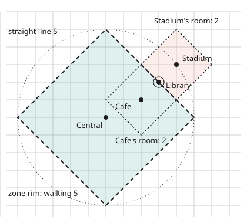

# Open balls, open sets and closed sets: the vocabulary a distance hands you

[Syllabus](../../../SYLLABUS.md) → [Topology](../README.md) → [Metric Spaces](../README.md#s01) → Open balls, open sets and closed sets

---

## General Overview

A city sells a Zone 1 bus pass. The pass covers every spot whose walking distance from Central Station is under 5 blocks. Walking distance on a street grid is blocks east–west plus blocks north–south.

Three places test the rule. The Café, 2 blocks east and 1 north, walks 3: it is inside. The Library, 3 east and 2 north, walks exactly 5: it is on the zone's edge, and "under 5" leaves it out. The Stadium, 4 east and 3 north, walks 7 but sits only 5 blocks away in a straight line: it is outside.

The difference that matters is room. From the Café a rider can wander any distance under 2 blocks and still be covered, because 3 plus anything under 2 is under 5. From the Stadium every spot within 2 blocks is still outside. At the Library there is no room at all: one step west is inside, one step east is outside. A phone that knows its position to within 1 block can settle the Café and the Stadium; no accuracy, however fine, settles the Library.

This card turns that room into a vocabulary. A set is **open** when every member has some room inside it, and **closed** when every non-member has some room outside it. A set can be one, the other, both or neither, and every open set is a union of round zones called balls.

**An open set is one where every member sits at the centre of some ball inside it, a closed set is one whose outside is open, and the two are not opposites: a set can be both, or neither.**

**What kind of fact this is:** open ball, open set and closed set are definitions; that balls are open, that closed balls are closed, and that the open sets are exactly the unions of balls are theorems, proved on this card in Why it works.

### The picture: one zone, three places

<p align="center"></p>

To scale: 30 pixels per block, Central at (180, 200). The Café sits at (240, 170), the Library at (270, 140), the Stadium at (300, 110). Walking balls are diamonds; this one's tips are at (330, 200) and (180, 50). The dashed rim is left out of "under 5". The small dotted diamonds are the Café's and the Stadium's rooms, 2 blocks each: both touch the rim, neither crosses it. The dotted circle is straight-line distance 5.

---

## The formula

Notation first, in words. A **metric space** $`(X, d)`$ is a set of points $`X`$ with a distance $`d`$ that obeys three rules: zero only from a point to itself, the same both ways, and no shortcut through a third point ([Metric space](01-metric-spaces.md)). Here $`X`$ is the city and $`d`$ is walking distance, written $`d_1`$; the straight line is $`d_2`$ ([The distance menu](02-distances-on-vectors-and-functions.md)).

The **open ball** of centre $`x`$ and radius $`r`$ is every point closer than $`r`$:

```math
B(x, r) = \{\, y \in X : d(x, y) < r \,\}
```

**Read it aloud:** the ball round x of radius r holds every point whose distance from x is less than r.

In the plane with straight-line distance, open discs and open sets are already met on [Limits and regions in the plane](../../07-Complex%20analysis/01-Complex%20Numbers%20and%20the%20Plane/06-complex-limits-series-and-regions.md); this card works with any distance. Zone 1 is $`B(\mathrm{Central}, 5)`$. The **closed ball** $`B[x, r]`$ uses "at most", $`d(x, y) \le r`$: a square bracket keeps the edge, as in an interval. A set $`U`$ is **open** when every member has a ball inside it:

```math
U \text{ is open} \iff \text{for every } x \in U \text{ there is an } r > 0 \text{ with } B(x, r) \subseteq U
```

**Read it aloud:** however you pick a member of U, some ball round it, perhaps a tiny one, lies wholly in U.

A set $`F`$ is **closed** when its **complement** $`X \setminus F`$ (every point of $`X`$ not in $`F`$, from [Set operations](../../01-Foundations/07-Sets/03-set-operations.md)) is open. Two facts turn these definitions into tools. The first gives the room inside a ball; the second builds every open set from balls:

```math
y \in B(c, r) \implies B\big(y,\ r - d(c, y)\big) \subseteq B(c, r), \qquad U \text{ open} \iff U = \bigcup_{x \in U} B(x, r_x)
```

**Read it aloud:** a point inside a ball has room equal to the radius minus its distance from the centre; and a set is open exactly when it is the union of one ball round each of its points, each ball inside the set.

For the Café: room $`5 - 3 = 2`$, so $`B(\mathrm{Café}, 2) \subseteq B(\mathrm{Central}, 5)`$.

| Symbol | Plain meaning | In our example | Push it up and the answer… |
| --- | --- | --- | --- |
| $`X`$ | the whole space: every point there is | every spot in the city | — |
| $`d`$, $`d_1`$, $`d_2`$ | a distance; walking; straight line | Stadium: walking 7, straight 5 | — |
| $`x`$, $`y`$, $`c`$ | points of $`X`$; $`c`$ a ball's centre | Café (2, 1); Central (0, 0) | — |
| $`r`$ | a ball's radius | 5 blocks for Zone 1 | the ball takes in more points |
| $`r_x`$, $`s`$, $`m`$ | the room at a point: a radius whose ball stays on $`x`$'s side | Café 2, Stadium 2, Library none | a cruder measurement still decides |
| $`p`$, $`q`$, $`z`$, $`k`$ | points in the proofs: a point tested, a grid centre, any nearby point; $`k`$ a stage number | (0.01, 0.01), first covered at stage 6 | — |
| $`B(x, r)`$ | open ball: distance less than $`r`$ | Zone 1, "under 5" | — |
| $`B[x, r]`$ | closed ball: distance at most $`r`$ | "at most 5", Library included | — |
| $`U`$ | a set being tested for open | Zone 1; Downtown | — |
| $`F`$, $`X \setminus F`$ | a set tested for closed; its complement | "at most 5"; everything walking over 5 | — |
| $`\bigcup`$ | union: in at least one of the sets | Downtown from 15 balls, then more | — |

### When it holds

- **The distance obeys the triangle rule.** The room formula needs "no shortcut through a third point". Squared distance on a line breaks it: in the zone of squared distance under 4 from 0, which is −2 to 2, the point 1 gets room 4 − 1 = 3, and that ball reaches 2.732, outside.
- **Open and closed are measured inside a named space.** The same rule "under 5 blocks" is open and not closed in the city, but open and closed among the four places alone. Change $`X`$ and the answer can change.
- **The room may depend on the point.** Room shrinks to nothing near the rim: at (2.999, 2) it is 0.001. One radius for the whole zone fails.
- **Finite intersections only.** Two open zones overlap in an open set. Infinitely many need not: every zone "under 5 + 1/n" holds the Library, and together they make the closed zone "at most 5".

---

## Why it works

### Step 0: room is inherited, because of the triangle rule

The Café walks 3 from Central. Any spot within 2 of the Café walks at most 3 + (under 2), so under 5, by the rule that a detour through the Café is never shorter than the direct walk. That is the whole reason an open ball is an open set.

In any metric space, if $`y`$ is in $`B(c, r)`$, its room is $`r - d(c, y)`$, a positive number. The code checks the Café on 113 grid points a quarter block apart within 2 of it: all walk between 1.25 and 4.75 from Central. Widen the radius to 2.25 and 9 grid points cross out.

Straight-line balls are circles, not diamonds, but every circle holds a smaller diamond and every diamond a smaller circle. So $`d_1`$ and $`d_2`$ make the same sets open: they are equivalent metrics ([The distance menu](02-distances-on-vectors-and-functions.md)).

<details>
<summary>Detailed proof: an open ball is open</summary>

Let $`y`$ be in $`B(c, r)`$ and set $`s = r - d(c, y)`$, which is positive. Take any $`z`$ with $`d(y, z) < s`$. The triangle rule gives

$`\displaystyle d(c, z) \le d(c, y) + d(y, z) < d(c, y) + s = r,`$

so $`z`$ is in $`B(c, r)`$. Every member $`y`$ has the ball $`B(y, s)`$ inside $`B(c, r)`$, which is the definition of open.

</details>

### Step 1: a closed ball is closed, by the same rule turned round

The Stadium walks 7, so it is 2 beyond the rim. Any spot within 2 of it walks more than 7 − 2 = 5 from Central: still outside "at most 5". Every point outside the closed ball has room in the outside, so the outside is open and $`B[c, r]`$ is closed.

The code checks the Stadium's 113 grid points: all walk between 5.25 and 8.75. At radius 2.25, 9 grid points walk exactly 5 or less.

<details>
<summary>Detailed proof: a closed ball is closed</summary>

Let $`y`$ be outside $`B[c, r]`$, so $`d(c, y) > r`$, and set $`s = d(c, y) - r > 0`$. For $`z`$ with $`d(y, z) < s`$, the triangle rule read the other way gives

$`\displaystyle d(c, z) \ge d(c, y) - d(y, z) > d(c, y) - s = r.`$

So $`B(y, s)`$ misses $`B[c, r]`$: the complement is open, and the closed ball is closed.

</details>

### Step 2: the rim is where both tests fail

The Library walks exactly 5. Take any radius, however small: half that radius west is inside the zone, half that radius east is outside.

| Radius round the Library | Spot west, walking | Spot east, walking |
| --- | --- | --- |
| 1 | 4.5 | 5.5 |
| 0.1 | 4.95 | 5.05 |
| 0.01 | 4.995 | 5.005 |
| 0.001 | 4.9995 | 5.0005 |

So "under 5" is not closed: the Library is outside it but has no room outside. And "at most 5" is not open: the Library is inside it but has no room inside. A rim point decides both questions at once. (The rim gets its formal name, the boundary, on [Closure, interior and boundary](../02-Topological%20Spaces/02-closure-interior-and-boundary.md).) A set is open when it holds none of its rim, and closed when it holds all of it.

### Step 3: both, and neither

Open and closed are two separate tests, not two ends of one switch. The code runs five fare rules through both tests, at nine probe points, by two roads: sampled balls, and the rim rule of Step 2, applied to the probe points at walking distance 5. The whole city and the empty zone have no rim at all; for them the code takes that from inspection, not from a computation.

| Fare rule | Open? | Closed? | Verdict |
| --- | --- | --- | --- |
| under 5 blocks | yes | no: the Library has no room outside | open |
| at most 5 blocks | no: the Library has no room inside | yes | closed |
| under 5, plus the Library | no: the Library | no: the spot (5, 0), on the rim and left out | neither |
| the whole city | yes: nothing can leave it | yes: its outside is empty | both |
| no zone at all | yes: no member needs room | yes: its outside is the city | both |

The empty zone is open because "every member has room" is true when there are no members.

The five rules are checked at nine probe points, which illustrates and does not prove. For the plane with walking distance, the whole city and the empty set are the only sets that are both. That needs the plane to be in one piece, proved on [Connected and path-connected](../02-Topological%20Spaces/07-connectedness-and-path-connectedness.md).

In a space with gaps, "both" is common. Keep only the four places as the space, with walking distance between them. The closest pairs, Café–Library and Library–Stadium, are 2 blocks apart, so the ball of radius 1 round each place is that place alone. Every set of places is then a union of such balls, so every one of the 16 sets is open, and every complement is too. The code checks all 16, which for a finite space is a proof.

### Step 4: unions and intersections

- **Any union of open sets is open.** A member of the union lies in one of the sets, and that set's ball round it lies in the union.
- **A finite intersection of open sets is open.** A member of all of them has a room in each; the smallest of finitely many positive rooms is still positive.
- **An infinite intersection can fail.** The Library walks 5, under 5 + 1/n for every n: the code checks n = 1 to 1000. The zones "under 5 + 1/n" are all open, yet together they make "at most 5", which is not.

Closed sets follow by complements, through De Morgan's law: the outside of a union is the intersection of the outsides ([Set operations](../../01-Foundations/07-Sets/03-set-operations.md)). So any intersection of closed sets is closed, and a finite union of closed sets is closed. The infinite union can fail: (2.999, 2) walks 4.999 and first enters "at most 5 − 1/n" at n = 1000, while the Library never enters. All those closed zones together make the open zone "under 5".

### Step 5: every open set is built from balls

If $`U`$ is open, pick for each member $`x`$ a ball $`B(x, r_x)`$ inside $`U`$. Each member lies in its own ball, and no ball leaves $`U`$, so their union is exactly $`U`$. In the other direction, a union of balls is a union of open sets (Step 0), so it is open (Step 4). That proves the second formula.

Downtown is the open rectangle more than 0 and less than 6 blocks east, more than 0 and less than 4 north. It is no ball: walking balls are diamonds. A point's room is its walking distance to the nearest edge. Build Downtown in stages: at stage $`k`$, put a ball of that room at every grid point $`1/2^k`$ of a block apart inside.

| Stage | Balls | Points first covered |
| --- | --- | --- |
| 0 | 15 | (3, 2), room 2; (0.01, 2), room 0.01 |
| 1 | 77 | (0.5, 0.5), room 0.5 |
| 2 | 345 | — |
| 3 | 1457 | — |
| 6 | — | (0.01, 0.01), room 0.01 |

No ball of stages 0 to 3 pokes outside. No stage covers everything: a point nearer the corner needs a finer stage. Every point is covered at some stage, though, so Downtown is the union of countably many balls (they can be listed one by one, stage by stage) with rational centres and radii.

<details>
<summary>Detailed proof: every point of Downtown is covered at some finite stage</summary>

Take $`p`$ in Downtown with room $`m > 0`$. Choose $`k`$ with $`2/2^k < m/2`$, and let $`q`$ be a stage-$`k`$ grid point with each coordinate at most $`1/2^k`$ from $`p`$'s. Then $`d_1(p, q) \le 2/2^k < m/2`$. Moving $`q`$ that little changes the distance to each edge by less than $`m/2`$, so

$`\displaystyle r_q > m - m/2 = m/2 > d_1(p, q),`$

and $`p`$ lies in the stage-$`k`$ ball round $`q`$.

</details>

On the real line the same building gives each open set as a countable union of open intervals with rational ends. That is proved on [Generated sigma-algebras and Borel sets](../../10-Measure%20and%20integration/01-Sets%20You%20Can%20Measure/03-generated-and-borel-sigma-algebras.md), where those sets generate the Borel sets.

---

## Worked numbers, by hand

| Step | Arithmetic | Value |
| --- | --- | --- |
| Café's walking distance | 2 + 1 | 3 blocks |
| Café's room in "under 5" | 5 − 3 | **2 blocks** |
| Stadium's walking distance | 4 + 3 | 7 blocks |
| Stadium's straight-line distance | square root of 16 + 9 | 5 blocks |
| Stadium's room outside "at most 5" | 7 − 5 | **2 blocks** |
| Library's walking distance | 3 + 2 | 5 blocks |
| Library's room, any radius r | (3 − r/2, 2) walks 5 − r/2; (3 + r/2, 2) walks 5 + r/2 | **none** |
| "under 5, plus the Library" | Library has no room in it; (5, 0) has none outside it | **neither** |
| four places as the whole space | closest pair 2 apart; ball of radius 1 is one place | **all 16 sets both** |

A phone whose fix is off by less than 2 blocks always sorts the Café and the Stadium correctly. The Library needs perfect accuracy, which no phone has: that is what having no room means.

### What breaks if you drop a piece

| Mistake | Comes out at | What went wrong |
| --- | --- | --- |
| Ball written with "at most" | Library inside, yet (3.0005, 2), within 0.001 of it, walks 5.0005 | A rim point has no room; the closed ball is not open |
| One room for the whole zone | Café's room 2 used at (2.999, 2): its ball holds (4.998, 2), walking 6.998 | Room is per point; at (2.999, 2) it is 0.001 |
| Infinite intersection taken as open | Library in all 1000 zones "under 5 + 1/n", not in "under 5" | Rooms shrink to nothing; the result is "at most 5" |
| Squared distance, no triangle rule | zone (−2, 2), point 1, room 3: ball reaches 2.732 | The room formula needs the triangle rule |

The code prints all four.

---

## Code, from first principles, and it actually runs

Both programs use exact arithmetic: fractions in Python, whole numbers of 1/32000ths of a block in Rust. Each answer comes by two roads. The room comes from the formula and from a search on a quarter-block grid. Each fare rule is classified by sampled balls and by the rim rule; for the whole city and the empty zone the rim is empty by inspection. Downtown is built from staged balls, with a check that none pokes out. The four-place space is checked over all 16 sets, by the definition and by unions of balls. The plane checks are finitely many cases and illustrate; the 16-set check is a proof.

### Python

```python
# Open and closed sets -- the check behind the card.  Standard library only.
# A city grid measured in blocks, Central Station at (0, 0).  Zone 1 is every
# spot whose walking distance from Central is under 5 blocks.  Arithmetic is
# exact (fractions); the straight line is compared through its square.
from fractions import Fraction as F
from itertools import combinations
import math

C, R = (0, 0), 5
PLACES = [("Central", (0, 0)), ("Cafe", (2, 1)), ("Library", (3, 2)), ("Stadium", (4, 3))]
LIB = (3, 2)

def walk(p, q):                       # d_1: blocks east-west plus blocks north-south
    return abs(p[0] - q[0]) + abs(p[1] - q[1])

def line_sq(p, q):                    # d_2 squared, kept exact
    return (p[0] - q[0]) ** 2 + (p[1] - q[1]) ** 2

def grid_ball(x, r, step=F(1, 4)):    # every quarter-block grid point within walking distance < r of x
    n = int(r / step) + 1
    pts = [(x[0] + i * step, x[1] + j * step) for i in range(-n, n + 1) for j in range(-n, n + 1)]
    return [p for p in pts if walk(x, p) < r]

def fmt(v):
    return str(v) if F(v).denominator == 1 else f"{float(v):g}"

print("place: walking blocks from Central, straight-line blocks")
for name, p in PLACES:
    print(f"  {name} {p}: walk {walk(C, p)}, straight {math.sqrt(line_sq(C, p)):.3f}")

# Road one to the room: the formula.  Road two: search the quarter-block grid.
cafe, stad = (2, 1), (4, 3)
for name, x, inside in (("Cafe", cafe, True), ("Stadium", stad, False)):
    room = R - walk(C, x) if inside else walk(C, x) - R
    ball = grid_ball(x, room)
    far = [walk(C, p) for p in ball]
    ok = all((d < R) if inside else (d > R) for d in far)
    wider = grid_ball(x, room + F(1, 4))
    bad = [p for p in wider if ((walk(C, p) >= R) if inside else (walk(C, p) <= R))]
    print(f"{name}: room {room} by formula; {len(ball)} grid points within {room} all on the same side: "
          f"{'yes' if ok else 'no'} (walking from Central {fmt(min(far))} to {fmt(max(far))}); "
          f"radius {fmt(room + F(1, 4))} crosses at {len(bad)} points")
    assert ok and bad and room == 2

print("Library on the rim: every ball holds a point inside and a point outside")
for r in (F(1), F(1, 10), F(1, 100), F(1, 1000)):
    a, b = (LIB[0] - r / 2, LIB[1]), (LIB[0] + r / 2, LIB[1])
    print(f"  r = {fmt(r)}: ({fmt(a[0])}, 2) walks {fmt(walk(C, a))}, ({fmt(b[0])}, 2) walks {fmt(walk(C, b))}")
    assert walk(LIB, a) < r and walk(LIB, b) < r and walk(C, a) < R < walk(C, b)

RULES = [("under 5 blocks", lambda p: walk(C, p) < R),
         ("at most 5 blocks", lambda p: walk(C, p) <= R),
         ("under 5, plus the Library", lambda p: walk(C, p) < R or p == LIB),
         ("the whole city", lambda p: True),
         ("no zone at all", lambda p: False)]
PROBES = [p for _, p in PLACES] + [(5, 0), (0, -5), (F(-5, 2), F(5, 2)), (1, -1), (-6, 0)]

def has_room(S, p, side):             # road one: does a sampled ball around p stay on p's side?
    for r in (F(1), F(1, 10), F(1, 100), F(1, 1000)):
        pts = [p] + [(p[0] + u * r / 2, p[1] + v * r / 2) for u, v in ((1, 0), (-1, 0), (0, 1), (0, -1))]
        if all(S(q) == side for q in pts):
            return True
    return False

def verdict(op, cl):
    return {(1, 0): "open", (0, 1): "closed", (1, 1): "both", (0, 0): "neither"}[(op, cl)]

print(f"five fare rules, {len(PROBES)} probe points, two roads")
for i, (name, S) in enumerate(RULES):
    op1 = all(has_room(S, p, True) for p in PROBES if S(p))
    cl1 = all(has_room(S, p, False) for p in PROBES if not S(p))
    rim = [p for p in PROBES if walk(C, p) == R] if i < 3 else []    # road two: the rim rule
    op2, cl2 = not any(S(p) for p in rim), all(S(p) for p in rim)
    print(f"  {name}: sampled balls {verdict(op1, cl1)}, rim rule {verdict(op2, cl2)}")
    assert (op1, cl1) == (op2, cl2) == [(1, 0), (0, 1), (0, 0), (1, 1), (1, 1)][i]

ins = all(walk(C, LIB) < R + F(1, n) for n in range(1, 1001))
first = next(n for n in range(1, 2001) if walk(C, (F(2999, 1000), 2)) <= R - F(1, n))
print(f"Library in every zone 'under 5 + 1/n', n = 1 to 1000: {'yes' if ins else 'no'}; in 'under 5': "
      f"{'yes' if walk(C, LIB) < R else 'no'}")
print(f"(2.999, 2) first inside 'at most 5 - 1/n' at n = {first}; the Library never")
assert ins and first == 1000

# Downtown: 0 < east < 6, 0 < north < 4.  Build it from balls centred on finer grids.
def room_dt(q):
    return min(q[0], 6 - q[0], q[1], 4 - q[1])

def centres(k):                       # stage k: grid points 1/2^k apart, strictly inside
    n = 2 ** k
    return [(F(i, n), F(j, n)) for i in range(1, 6 * n) for j in range(1, 4 * n)]

def first_stage(p):
    for k in range(9):
        s = F(1, 2 ** k)
        cs = [(p[0] // s * s + i * s, p[1] // s * s + j * s) for i in range(-3, 4) for j in range(-3, 4)]
        if any(room_dt(q) > 0 and walk(p, q) < room_dt(q) for q in cs):
            return k

counts = [len(centres(k)) for k in range(4)]
spill = [q for k in range(4) for q in centres(k)    # a ball's four tips must stay in the closed rectangle
         if not (0 <= q[0] - room_dt(q) and q[0] + room_dt(q) <= 6
                 and 0 <= q[1] - room_dt(q) and q[1] + room_dt(q) <= 4)]
print(f"Downtown: balls at stages 0 to 3: {counts}; balls poking out: {len(spill)}")
for p in ((3, 2), (F(1, 100), 2), (F(1, 2), F(1, 2)), (F(1, 100), F(1, 100))):
    print(f"  ({fmt(p[0])}, {fmt(p[1])}): room {fmt(room_dt(p))}, first covered at stage {first_stage(p)}")
assert not spill and first_stage((F(1, 100), F(1, 100))) == 6

stops = [p for _, p in PLACES]
gap = min(walk(p, q) for p, q in combinations(stops, 2))
subs = [set(c) for k in range(5) for c in combinations(stops, k)]
both = all(all({q for q in stops if walk(p, q) < gap / 2} <= A for p in A) and
           all({q for q in stops if walk(p, q) < gap / 2} <= set(stops) - A for p in set(stops) - A)
           for A in subs)
unions = all(A == set().union(*({q for q in stops if walk(p, q) < gap / 2} for p in A)) for A in subs)
print(f"four stops only: closest pair {gap} blocks apart; all {len(subs)} subsets open and closed: "
      f"{'yes' if both else 'no'}; each a union of one-stop balls: {'yes' if unions else 'no'}")
o5, o6, c5 = ([n for n, p in PLACES if test(walk(C, p))] for test in
              (lambda d: d < 5, lambda d: d < 6, lambda d: d <= 5))
print(f"  among stops: under 5 blocks {', '.join(o5)}; under 6 blocks {', '.join(o6)}; "
      f"at most 5 blocks {', '.join(c5)}")
assert both and unions and gap == 2 and len(subs) == 16 and o6 == c5 != o5
fine = [walk(C, p) for p in grid_ball(cafe, 2, F(1, 8))]
cross = sum(walk(C, p) >= R for p in grid_ball(cafe, F(9, 4), F(1, 8)))
print(f"try: step 1/8: {len(fine)} grid points within 2 of the Cafe, walking {fmt(min(fine))} to "
      f"{fmt(max(fine))}; radius 2.25 crosses at {cross} points")
print(f"try: Cafe at (2, 2): room {R - walk(C, (2, 2))}, {len(grid_ball((2, 2), R - walk(C, (2, 2))))} grid points; "
      f"(0.1, 0.1) first covered at stage {first_stage((F(1, 10), F(1, 10)))}")

far_pt = (F(2999, 1000) + F(1999, 1000), 2)
print(f"mistake, one room for the whole zone: the ball of radius 2 round (2.999, 2) holds "
      f"({fmt(far_pt[0])}, 2), which walks {fmt(walk(C, far_pt))} blocks")
s1 = 1 + math.sqrt(4 - 1)
print(f"mistake, squared distance on a line: zone (-2, 2), point 1, room 4 - 1 = 3, ball reaches {s1:.3f}")
px = [f"{n} ({180 + 30 * p[0]}, {200 - 30 * p[1]})" for n, p in PLACES + [("east tip", (5, 0)), ("north tip", (0, 5))]]
print("figure, 30 px per block: " + ", ".join(px))
print("ALL CHECKS PASS")
```

**Ran 2026-11-14 on macOS, Python 3.14.10, standard library only. All checks passed. Output, pasted from the run:**

```
place: walking blocks from Central, straight-line blocks
  Central (0, 0): walk 0, straight 0.000
  Cafe (2, 1): walk 3, straight 2.236
  Library (3, 2): walk 5, straight 3.606
  Stadium (4, 3): walk 7, straight 5.000
Cafe: room 2 by formula; 113 grid points within 2 all on the same side: yes (walking from Central 1.25 to 4.75); radius 2.25 crosses at 9 points
Stadium: room 2 by formula; 113 grid points within 2 all on the same side: yes (walking from Central 5.25 to 8.75); radius 2.25 crosses at 9 points
Library on the rim: every ball holds a point inside and a point outside
  r = 1: (2.5, 2) walks 4.5, (3.5, 2) walks 5.5
  r = 0.1: (2.95, 2) walks 4.95, (3.05, 2) walks 5.05
  r = 0.01: (2.995, 2) walks 4.995, (3.005, 2) walks 5.005
  r = 0.001: (2.9995, 2) walks 4.9995, (3.0005, 2) walks 5.0005
five fare rules, 9 probe points, two roads
  under 5 blocks: sampled balls open, rim rule open
  at most 5 blocks: sampled balls closed, rim rule closed
  under 5, plus the Library: sampled balls neither, rim rule neither
  the whole city: sampled balls both, rim rule both
  no zone at all: sampled balls both, rim rule both
Library in every zone 'under 5 + 1/n', n = 1 to 1000: yes; in 'under 5': no
(2.999, 2) first inside 'at most 5 - 1/n' at n = 1000; the Library never
Downtown: balls at stages 0 to 3: [15, 77, 345, 1457]; balls poking out: 0
  (3, 2): room 2, first covered at stage 0
  (0.01, 2): room 0.01, first covered at stage 0
  (0.5, 0.5): room 0.5, first covered at stage 1
  (0.01, 0.01): room 0.01, first covered at stage 6
four stops only: closest pair 2 blocks apart; all 16 subsets open and closed: yes; each a union of one-stop balls: yes
  among stops: under 5 blocks Central, Cafe; under 6 blocks Central, Cafe, Library; at most 5 blocks Central, Cafe, Library
try: step 1/8: 481 grid points within 2 of the Cafe, walking 1.125 to 4.875; radius 2.25 crosses at 35 points
try: Cafe at (2, 2): room 1, 25 grid points; (0.1, 0.1) first covered at stage 3
mistake, one room for the whole zone: the ball of radius 2 round (2.999, 2) holds (4.998, 2), which walks 6.998 blocks
mistake, squared distance on a line: zone (-2, 2), point 1, room 4 - 1 = 3, ball reaches 2.732
figure, 30 px per block: Central (180, 200), Cafe (240, 170), Library (270, 140), Stadium (300, 110), east tip (330, 200), north tip (180, 50)
ALL CHECKS PASS
```

### Rust

Same numbers, same labels, built with `rustc --edition 2021 -O`.

```rust
// Open and closed sets -- the same check as the Python, in Rust.  No crates.
// A city grid measured in blocks, Central Station at (0, 0).  Zone 1 is every
// spot whose walking distance from Central is under 5 blocks.  Arithmetic is
// exact: every coordinate is a whole number of 1/32000ths of a block.
const U: i64 = 32000; // units per block
const R: i64 = 5 * U;
const C: (i64, i64) = (0, 0);
const LIB: (i64, i64) = (3 * U, 2 * U);
const PLACES: [(&str, (i64, i64)); 4] =
    [("Central", (0, 0)), ("Cafe", (2 * U, U)), ("Library", (3 * U, 2 * U)), ("Stadium", (4 * U, 3 * U))];

fn walk(p: (i64, i64), q: (i64, i64)) -> i64 { (p.0 - q.0).abs() + (p.1 - q.1).abs() } // d_1

fn line_sq(p: (i64, i64), q: (i64, i64)) -> i64 { // d_2 squared, in whole blocks squared
    let (a, b) = ((p.0 - q.0) / U, (p.1 - q.1) / U);
    a * a + b * b
}

fn grid_ball(x: (i64, i64), r: i64, step: i64) -> Vec<(i64, i64)> { // grid points within r of x
    let n = r / step + 1;
    let mut out = Vec::new();
    for i in -n..=n {
        for j in -n..=n {
            let p = (x.0 + i * step, x.1 + j * step);
            if walk(x, p) < r { out.push(p) }
        }
    }
    out
}

fn fmt(v: i64) -> String {
    if v % U == 0 { return format!("{}", v / U) }
    let s = format!("{:.6}", v as f64 / U as f64);
    s.trim_end_matches('0').trim_end_matches('.').to_string()
}

fn yn(b: bool) -> &'static str { if b { "yes" } else { "no" } }

fn rule(i: usize, p: (i64, i64)) -> bool {
    match i { 0 => walk(C, p) < R, 1 => walk(C, p) <= R, 2 => walk(C, p) < R || p == LIB, 3 => true, _ => false }
}

fn has_room(i: usize, p: (i64, i64), side: bool) -> bool { // road one: a sampled ball stays on p's side
    for r in [U, U / 10, U / 100, U / 1000] {
        let h = r / 2;
        let pts = [p, (p.0 + h, p.1), (p.0 - h, p.1), (p.0, p.1 + h), (p.0, p.1 - h)];
        if pts.iter().all(|&q| rule(i, q) == side) { return true }
    }
    false
}

fn verdict(op: bool, cl: bool) -> &'static str {
    match (op, cl) { (true, false) => "open", (false, true) => "closed", (true, true) => "both", _ => "neither" }
}

fn room_dt(q: (i64, i64)) -> i64 { q.0.min(6 * U - q.0).min(q.1).min(4 * U - q.1) }

fn centres(k: u32) -> Vec<(i64, i64)> { // stage k: grid points 1/2^k apart, strictly inside
    let (n, s) = (1i64 << k, U >> k);
    let mut out = Vec::new();
    for i in 1..6 * n { for j in 1..4 * n { out.push((i * s, j * s)) } }
    out
}

fn first_stage(p: (i64, i64)) -> u32 {
    for k in 0..9 {
        let s = U >> k;
        let base = (p.0.div_euclid(s) * s, p.1.div_euclid(s) * s);
        for i in -3..4 {
            for j in -3..4 {
                let q = (base.0 + i * s, base.1 + j * s);
                if room_dt(q) > 0 && walk(p, q) < room_dt(q) { return k }
            }
        }
    }
    99
}

fn main() {
    println!("place: walking blocks from Central, straight-line blocks");
    for (name, p) in PLACES {
        println!("  {} ({}, {}): walk {}, straight {:.3}", name, p.0 / U, p.1 / U, fmt(walk(C, p)),
                 (line_sq(C, p) as f64).sqrt());
    }
    for (name, x, inside) in [("Cafe", (2 * U, U), true), ("Stadium", (4 * U, 3 * U), false)] {
        let room = if inside { R - walk(C, x) } else { walk(C, x) - R };
        let ball = grid_ball(x, room, U / 4);
        let far: Vec<i64> = ball.iter().map(|&p| walk(C, p)).collect();
        let ok = far.iter().all(|&d| if inside { d < R } else { d > R });
        let wider = grid_ball(x, room + U / 4, U / 4);
        let bad = wider.iter().filter(|&&p| if inside { walk(C, p) >= R } else { walk(C, p) <= R }).count();
        println!("{}: room {} by formula; {} grid points within {} all on the same side: {} (walking from Central {} to {}); radius {} crosses at {} points",
                 name, fmt(room), ball.len(), fmt(room), yn(ok), fmt(*far.iter().min().unwrap()),
                 fmt(*far.iter().max().unwrap()), fmt(room + U / 4), bad);
        assert!(ok && bad > 0 && room == 2 * U);
    }
    println!("Library on the rim: every ball holds a point inside and a point outside");
    for r in [U, U / 10, U / 100, U / 1000] {
        let (a, b) = ((LIB.0 - r / 2, LIB.1), (LIB.0 + r / 2, LIB.1));
        println!("  r = {}: ({}, 2) walks {}, ({}, 2) walks {}", fmt(r), fmt(a.0), fmt(walk(C, a)), fmt(b.0), fmt(walk(C, b)));
        assert!(walk(LIB, a) < r && walk(LIB, b) < r && walk(C, a) < R && R < walk(C, b));
    }
    let names = ["under 5 blocks", "at most 5 blocks", "under 5, plus the Library", "the whole city", "no zone at all"];
    let mut probes: Vec<(i64, i64)> = PLACES.iter().map(|&(_, p)| p).collect();
    probes.extend([(5 * U, 0), (0, -5 * U), (-5 * U / 2, 5 * U / 2), (U, -U), (-6 * U, 0)]);
    let expect = [(true, false), (false, true), (false, false), (true, true), (true, true)];
    println!("five fare rules, {} probe points, two roads", probes.len());
    for i in 0..5 {
        let op1 = probes.iter().filter(|&&p| rule(i, p)).all(|&p| has_room(i, p, true));
        let cl1 = probes.iter().filter(|&&p| !rule(i, p)).all(|&p| has_room(i, p, false));
        let rim: Vec<(i64, i64)> = if i < 3 { probes.iter().copied().filter(|&p| walk(C, p) == R).collect() } else { vec![] };
        let (op2, cl2) = (!rim.iter().any(|&p| rule(i, p)), rim.iter().all(|&p| rule(i, p))); // road two
        println!("  {}: sampled balls {}, rim rule {}", names[i], verdict(op1, cl1), verdict(op2, cl2));
        assert!((op1, cl1) == (op2, cl2) && (op1, cl1) == expect[i]);
    }
    let wl = walk(C, LIB);
    let ins = (1..=1000i64).all(|n| n * wl < (5 * n + 1) * U);
    let p2999 = 2999 * U / 1000 + 2 * U;
    let first = (1..=2000i64).find(|&n| n * p2999 <= (5 * n - 1) * U).unwrap();
    println!("Library in every zone 'under 5 + 1/n', n = 1 to 1000: {}; in 'under 5': {}", yn(ins), yn(wl < R));
    println!("(2.999, 2) first inside 'at most 5 - 1/n' at n = {}; the Library never", first);
    assert!(ins && first == 1000);

    let counts: Vec<usize> = (0..4).map(|k| centres(k).len()).collect();
    let spill = (0..4).flat_map(centres).filter(|&q| {
        let r = room_dt(q);
        !(0 <= q.0 - r && q.0 + r <= 6 * U && 0 <= q.1 - r && q.1 + r <= 4 * U)
    }).count();
    println!("Downtown: balls at stages 0 to 3: {:?}; balls poking out: {}", counts, spill);
    for p in [(3 * U, 2 * U), (U / 100, 2 * U), (U / 2, U / 2), (U / 100, U / 100)] {
        println!("  ({}, {}): room {}, first covered at stage {}", fmt(p.0), fmt(p.1), fmt(room_dt(p)), first_stage(p));
    }
    assert!(spill == 0 && first_stage((U / 100, U / 100)) == 6);

    let stops: Vec<(i64, i64)> = PLACES.iter().map(|&(_, p)| p).collect();
    let mut gap = i64::MAX;
    for a in 0..4 { for b in a + 1..4 { gap = gap.min(walk(stops[a], stops[b])) } }
    let ball = |p: (i64, i64)| -> u32 { (0..4).filter(|&j| 2 * walk(p, stops[j]) < gap).map(|j| 1u32 << j).sum() };
    let (mut both, mut unions) = (true, true);
    for a in 0u32..16 {
        let mut built = 0u32;
        for j in 0..4 {
            let b = ball(stops[j]);
            if a >> j & 1 == 1 { both &= b & !a == 0; built |= b } else { both &= b & a == 0 }
        }
        unions &= built == a;
    }
    println!("four stops only: closest pair {} blocks apart; all {} subsets open and closed: {}; each a union of one-stop balls: {}",
             fmt(gap), 16, yn(both), yn(unions));
    let pick = |t: &dyn Fn(i64) -> bool| -> Vec<&str> { PLACES.iter().filter(|&&(_, p)| t(walk(C, p))).map(|&(n, _)| n).collect() };
    let (o5, o6, c5) = (pick(&|d| d < 5 * U), pick(&|d| d < 6 * U), pick(&|d| d <= 5 * U));
    println!("  among stops: under 5 blocks {}; under 6 blocks {}; at most 5 blocks {}", o5.join(", "), o6.join(", "), c5.join(", "));
    assert!(both && unions && gap == 2 * U && o6 == c5 && o6 != o5);
    let fine: Vec<i64> = grid_ball((2 * U, U), 2 * U, U / 8).iter().map(|&p| walk(C, p)).collect();
    let cross = grid_ball((2 * U, U), 9 * U / 4, U / 8).iter().filter(|&&p| walk(C, p) >= R).count();
    println!("try: step 1/8: {} grid points within 2 of the Cafe, walking {} to {}; radius 2.25 crosses at {} points",
             fine.len(), fmt(*fine.iter().min().unwrap()), fmt(*fine.iter().max().unwrap()), cross);
    let room22 = R - walk(C, (2 * U, 2 * U));
    println!("try: Cafe at (2, 2): room {}, {} grid points; (0.1, 0.1) first covered at stage {}",
             fmt(room22), grid_ball((2 * U, 2 * U), room22, U / 4).len(), first_stage((U / 10, U / 10)));

    let far_pt = (2999 * U / 1000 + 1999 * U / 1000, 2 * U);
    println!("mistake, one room for the whole zone: the ball of radius 2 round (2.999, 2) holds ({}, 2), which walks {} blocks",
             fmt(far_pt.0), fmt(walk(C, far_pt)));
    println!("mistake, squared distance on a line: zone (-2, 2), point 1, room 4 - 1 = 3, ball reaches {:.3}", 1.0 + 3f64.sqrt());
    let mut px: Vec<String> = PLACES.iter().map(|&(n, p)| format!("{} ({}, {})", n, 180 + 30 * p.0 / U, 200 - 30 * p.1 / U)).collect();
    px.extend(["east tip (330, 200)".to_string(), format!("north tip ({}, {})", 180, 200 - 30 * 5)]);
    println!("figure, 30 px per block: {}", px.join(", "));
    println!("ALL CHECKS PASS");
}
```

**Ran 2026-11-14 on macOS, rustc 1.98.1, no crates. All checks passed. Output, pasted from the run:**

```
place: walking blocks from Central, straight-line blocks
  Central (0, 0): walk 0, straight 0.000
  Cafe (2, 1): walk 3, straight 2.236
  Library (3, 2): walk 5, straight 3.606
  Stadium (4, 3): walk 7, straight 5.000
Cafe: room 2 by formula; 113 grid points within 2 all on the same side: yes (walking from Central 1.25 to 4.75); radius 2.25 crosses at 9 points
Stadium: room 2 by formula; 113 grid points within 2 all on the same side: yes (walking from Central 5.25 to 8.75); radius 2.25 crosses at 9 points
Library on the rim: every ball holds a point inside and a point outside
  r = 1: (2.5, 2) walks 4.5, (3.5, 2) walks 5.5
  r = 0.1: (2.95, 2) walks 4.95, (3.05, 2) walks 5.05
  r = 0.01: (2.995, 2) walks 4.995, (3.005, 2) walks 5.005
  r = 0.001: (2.9995, 2) walks 4.9995, (3.0005, 2) walks 5.0005
five fare rules, 9 probe points, two roads
  under 5 blocks: sampled balls open, rim rule open
  at most 5 blocks: sampled balls closed, rim rule closed
  under 5, plus the Library: sampled balls neither, rim rule neither
  the whole city: sampled balls both, rim rule both
  no zone at all: sampled balls both, rim rule both
Library in every zone 'under 5 + 1/n', n = 1 to 1000: yes; in 'under 5': no
(2.999, 2) first inside 'at most 5 - 1/n' at n = 1000; the Library never
Downtown: balls at stages 0 to 3: [15, 77, 345, 1457]; balls poking out: 0
  (3, 2): room 2, first covered at stage 0
  (0.01, 2): room 0.01, first covered at stage 0
  (0.5, 0.5): room 0.5, first covered at stage 1
  (0.01, 0.01): room 0.01, first covered at stage 6
four stops only: closest pair 2 blocks apart; all 16 subsets open and closed: yes; each a union of one-stop balls: yes
  among stops: under 5 blocks Central, Cafe; under 6 blocks Central, Cafe, Library; at most 5 blocks Central, Cafe, Library
try: step 1/8: 481 grid points within 2 of the Cafe, walking 1.125 to 4.875; radius 2.25 crosses at 35 points
try: Cafe at (2, 2): room 1, 25 grid points; (0.1, 0.1) first covered at stage 3
mistake, one room for the whole zone: the ball of radius 2 round (2.999, 2) holds (4.998, 2), which walks 6.998 blocks
mistake, squared distance on a line: zone (-2, 2), point 1, room 4 - 1 = 3, ball reaches 2.732
figure, 30 px per block: Central (180, 200), Cafe (240, 170), Library (270, 140), Stadium (300, 110), east tip (330, 200), north tip (180, 50)
ALL CHECKS PASS
```

The two outputs match line for line.

### Lean

Lean proves the card's three ball facts in every metric space, and checks its worked numbers on the street grid.

- Take $`y`$ in the open ball $`B(c, r)`$. Then its room $`r - d(c, y)`$ is positive, and $`B(y, r - d(c, y)) \subseteq B(c, r)`$.
- Take any centre $`c`$ and radius $`r`$. Then the closed ball $`B[c, r]`$ is closed.
- Take any set $`U`$. Then $`U`$ is open exactly when each member $`x`$ has a ball $`B(x, r_x)`$ inside $`U`$ with $`r_x > 0`$. These balls, one round each member, then make up $`U`$ exactly.
- The Café walks 2 + 1 = 3 blocks, so its room in "under 5" is 5 − 3 = 2.
- The Library walks 3 + 2 = 5 blocks, exactly on the rim.
- The Stadium walks 4 + 3 = 7 blocks, and $`4^2 + 3^2 = 5^2`$ puts it 5 away in a straight line. Its room outside "at most 5" is 7 − 5 = 2.
- Café to Library and Library to Stadium each walk 2 blocks. The four places have $`2^4 = 16`$ sets.
- Downtown's grids at stages 0 to 3 hold 15, 77, 345 and 1457 points, one ball each.

The grid searches, the five fare rules, the 1000 shrinking zones, Downtown's covering and the 16-set check stay with the Python and Rust checks.

```lean
-- Open balls, open sets and closed sets: in any metric space an open ball is open, a closed ball is closed, and a set is open exactly when it is the union of one ball inside it round each of its points.
import Mathlib.Topology.MetricSpace.Defs
import Mathlib.Topology.MetricSpace.Pseudo.Lemmas
import Mathlib.Tactic.NormNum

open Metric

/-- Every open set is built from balls. In a metric space, a set U is open exactly when there is
a radius r x > 0 for each member x such that the ball B(x, r x) lies inside U and the union of all
these balls, one round each member, is U itself. -/
theorem open_iff_union_of_balls {X : Type*} [MetricSpace X] (U : Set X) :
    IsOpen U ↔ ∃ r : X → ℝ, (∀ x ∈ U, 0 < r x ∧ ball x (r x) ⊆ U) ∧
      U = ⋃ x ∈ U, ball x (r x) := by
  classical
  constructor
  · intro hU
    rw [Metric.isOpen_iff] at hU
    refine ⟨fun x => if h : x ∈ U then Classical.choose (hU x h) else 1, ?_, ?_⟩
    · intro x hx
      simp only [hx, ↓reduceDIte]
      exact Classical.choose_spec (hU x hx)
    · apply Set.Subset.antisymm
      · intro x hx
        refine Set.mem_iUnion₂.mpr ⟨x, hx, ?_⟩
        simp only [hx, ↓reduceDIte]
        exact Metric.mem_ball_self (Classical.choose_spec (hU x hx)).1
      · refine Set.iUnion₂_subset fun x hx => ?_
        simp only [hx, ↓reduceDIte]
        exact (Classical.choose_spec (hU x hx)).2
  · rintro ⟨r, hr, -⟩
    rw [Metric.isOpen_iff]
    intro x hx
    exact ⟨r x, (hr x hx).1, (hr x hx).2⟩

/-- An open ball is open, with its room given exactly. If y is in the ball B(c, r), then its room
r - d(c, y) is positive and the ball round y of that radius lies inside B(c, r). -/
theorem open_ball_room {X : Type*} [MetricSpace X] (c y : X) (r : ℝ) (hy : y ∈ ball c r) :
    0 < r - dist c y ∧ ball y (r - dist c y) ⊆ ball c r := by
  have h : dist y c < r := hy
  refine ⟨by rw [dist_comm]; linarith, ?_⟩
  intro z hz
  have hz' : dist z y < r - dist c y := hz
  show dist z c < r
  calc dist z c ≤ dist z y + dist y c := dist_triangle z y c
    _ < r := by rw [dist_comm y c]; linarith

/-- A closed ball is closed. In a metric space the closed ball B[c, r], every point at distance
at most r from c, has an open outside. -/
theorem closed_ball_is_closed {X : Type*} [MetricSpace X] (c : X) (r : ℝ) :
    IsClosed (closedBall c r) := by
  exact Metric.isClosed_closedBall

-- The card's worked numbers on the street grid, Central Station at (0, 0), in whole blocks.
-- Café (2, 1): walks 3, room 5 - 3 = 2 inside "under 5".
example : |(2 : ℤ) - 0| + |(1 : ℤ) - 0| = 3 := by norm_num
example : (5 : ℤ) - 3 = 2 := by norm_num
-- Library (3, 2): walks exactly 5, on the rim.
example : |(3 : ℤ) - 0| + |(2 : ℤ) - 0| = 5 := by norm_num
-- Stadium (4, 3): walks 7, straight line 5 (4² + 3² = 5²), room 7 - 5 = 2 outside "at most 5".
example : |(4 : ℤ) - 0| + |(3 : ℤ) - 0| = 7 := by norm_num
example : (4 : ℤ) ^ 2 + 3 ^ 2 = 5 ^ 2 := by norm_num
example : (7 : ℤ) - 5 = 2 := by norm_num
-- Four places alone: Café–Library and Library–Stadium are 2 blocks apart; 2^4 = 16 sets of places.
example : |(3 : ℤ) - 2| + |(2 : ℤ) - 1| = 2 := by norm_num
example : |(4 : ℤ) - 3| + |(3 : ℤ) - 2| = 2 := by norm_num
example : 2 ^ 4 = 16 := by decide
-- Downtown, stage k: grid points 1/2^k apart strictly inside the 6 by 4 rectangle,
-- (6·2^k - 1)(4·2^k - 1) balls: 15, 77, 345, 1457 at stages 0 to 3.
example : (6 * 2 ^ 0 - 1) * (4 * 2 ^ 0 - 1) = 15 := by decide
example : (6 * 2 ^ 1 - 1) * (4 * 2 ^ 1 - 1) = 77 := by decide
example : (6 * 2 ^ 2 - 1) * (4 * 2 ^ 2 - 1) = 345 := by decide
example : (6 * 2 ^ 3 - 1) * (4 * 2 ^ 3 - 1) = 1457 := by decide

#print axioms open_iff_union_of_balls
#print axioms open_ball_room
#print axioms closed_ball_is_closed
```

**Checked 2026-11-14 on macOS, Lean 4.36.0-rc2, Mathlib v4.36.0-rc2. Every proof is complete and uses only Lean's standard axioms. Output, pasted from the run:**

```
'open_iff_union_of_balls' depends on axioms: [propext, Classical.choice, Quot.sound]
'open_ball_room' depends on axioms: [propext, Classical.choice, Quot.sound]
'closed_ball_is_closed' depends on axioms: [propext, Classical.choice, Quot.sound]
```

> [!TIP]
> **Try changing**
> Guess first, then run it. Some asserts are pinned to the card's numbers, so expect one to stop the program.
> - **A finer grid.** In `grid_ball` set `step=F(1, 8)`. Guess: does the room change? It stays 2. Now 481 grid points lie within 2 of the Café, walking 1.125 to 4.875, and 35 cross out at 2.25.
> - **Move the Café.** Set `cafe` to `(2, 2)`. Guess the room first: it walks 4, so the room is 1, with 25 grid points inside it. The assert pinned to room 2 stops the run.
> - **Add a lone point outside.** In the third fare rule replace `LIB` with `(4, 3)`, the Stadium. Sampled balls still say neither, but the rim rule now says open, and the assert stops it. The Stadium is a new rim point of that set, and the rim rule only looked at walking distance 5.
> - **A point farther from the corner.** Add `(F(1, 10), F(1, 10))` to the Downtown points. Guess the stage: it is first covered at stage 3, sooner than (0.01, 0.01) at stage 6.

---

## The usual mistake

> [!warning]
> **Treating closed as "not open".** A door is open or closed; a set is not a door. "Under 5, plus the Library" is neither: the Library has no room inside it, and the rim spot (5, 0) has no room outside it. The whole city is both, and among the four places alone all 16 sets are both. Check the two tests separately.
>
> - **Writing "at most" for "under".** Writing the zone as "at most 5" lets the Library in, and (3.0005, 2), within 0.001 of it, walks 5.0005: no room.
> - **One room for the whole set.** The Café's room of 2 used at (2.999, 2) reaches (4.998, 2), which walks 6.998 blocks.
> - **Forgetting which space.** Among the four places, "under 6" and "at most 5" are the same set: Central, Café and Library. A closed ball can also be open there, since no place walks between 5 and 7.
> - **Trusting infinitely many intersections.** The zones "under 5 + 1/n" are all open; their common part, "at most 5", is not.

---

## Where you meet it in real life

- **Geofences and fare zones.** A phone decides "inside the zone" from a fix with an error. A spot whose room exceeds the error is decided; a spot on the rim never is. Open sets are the conditions a finite-precision measurement can confirm.
- **Tolerances and specifications.** "At most 0.5 mm off" is a closed condition, so the limit of parts that pass also passes. "Strictly under 0.5 mm" is open, so a part that passes still passes after a small enough rounding error.
- **Optimisation.** Constraints written with "at most" on continuous functions give closed feasible sets. A sequence of feasible designs then has feasible limits, which is half of why a best design exists ([Compactness three ways](06-compactness-in-metric-spaces.md)).
- **Probability and measure.** The open sets generate the Borel sets, the events a probability model can assign a chance to ([Generated sigma-algebras and Borel sets](../../10-Measure%20and%20integration/01-Sets%20You%20Can%20Measure/03-generated-and-borel-sigma-algebras.md)).

> **Say it back**
> An open ball is every point closer than a fixed radius to a centre. A set is open when every member has some ball inside it, and closed when its outside is open. By the triangle rule, a point inside a ball has room equal to the radius minus its distance from the centre, so open balls are open and closed balls are closed. A rim point has no room on either side; holding none of the rim makes a set open, holding all of it makes it closed, and a set can be both or neither. Every open set is the union of one ball round each of its points.

---

## What this builds on

- [Metric space](01-metric-spaces.md): the three distance rules, and the triangle rule that gives every point its room.
- [Set operations](../../01-Foundations/07-Sets/03-set-operations.md): complement, union, intersection and De Morgan's law, which turn facts about open sets into facts about closed ones.
- [Limits and regions in the plane](../../07-Complex%20analysis/01-Complex%20Numbers%20and%20the%20Plane/06-complex-limits-series-and-regions.md): the open disc, open set and boundary in the plane, the familiar case of this card with straight-line distance.
- [Generated sigma-algebras and Borel sets](../../10-Measure%20and%20integration/01-Sets%20You%20Can%20Measure/03-generated-and-borel-sigma-algebras.md): open sets on the line as countable unions of open intervals with rational ends, the one-dimensional case of Step 5.

## Where this goes next

- [Limits and continuity with distances](04-convergence-and-continuity-in-metric-spaces.md): convergence and continuity with a distance in place of the gap between two numbers, by the epsilon-delta and sequence tests, and closed sets as the sets that keep the limits of their sequences.
- [Baire category theorem](10-baire-category-theorem.md): dense open sets and their countable intersections in a complete space.
- [Topological space](../02-Topological%20Spaces/01-topological-spaces-and-bases.md): drop the distance, keep the open sets and the rules of Step 4, and the balls become a basis.

Left open: the rim was found by hand here. How does one name the rim, the inside and the closure of any set, with no picture to look at?

---

## Sources

Verified 2026-11-14: every link below resolves to the publisher's page.

- Fréchet, Maurice. "Sur quelques points du calcul fonctionnel." *Rendiconti del Circolo Matematico di Palermo* 22, no. 1 (1906): 1–72. [doi:10.1007/BF03018603](https://doi.org/10.1007/BF03018603). The paper that introduced abstract distance spaces, the setting of this card.
- Lebl, Jiří. *Basic Analysis I: Introduction to Real Analysis*, section 7.2, "Open and closed sets". [Free text](https://www.jirka.org/ra/html/sec_mettop.html). Open and closed balls, open balls are open, unions and finite intersections, with proofs.
- Colding, Tobias Holck. *18.100B Real Analysis*, Spring 2025. MIT OpenCourseWare. [Course page](https://ocw.mit.edu/courses/18-100b-real-analysis-spring-2025/). A free course that moves from the real line to metric spaces, where open and closed sets are defined.
