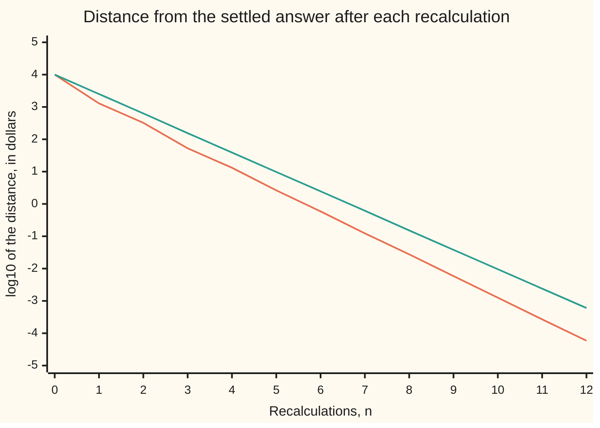

# Limits and continuity with distances: epsilon and delta in any metric space

[Syllabus](../../../SYLLABUS.md) → [Topology](../README.md) → [Metric Spaces](../README.md#s01) → Limits and continuity with distances

---

## General Overview

A small firm makes a profit of $43,000 before two items. Its spreadsheet has a bonus cell and a tax cell, and each one needs the other. The bonus is 10% of the profit left after bonus and tax. The tax is 25% of the profit left after the bonus.

That is a circular reference: a cell whose formula depends, through other cells, on itself. A spreadsheet with iterative calculation turned on does not refuse it. It starts from blank cells and recalculates again and again. Here each pass computes both cells from the readings of the pass before. A real spreadsheet usually recalculates one cell after the other, so the second cell already sees the first cell's new value. That changes the readings, which then depend on the cell order, but not the pair they settle on: only one pair satisfies both formulas. From blank, the first pass gives a bonus of $4,300 and a tax of $10,750. The second pass gives $2,795 and $9,675. The third gives $3,053 and $10,051.25. The readings swing, but the swings shrink.

Two questions decide whether the final screen can be trusted. Do the readings really settle, and on what? And is the value they settle on a real answer, one that satisfies both formulas? The first question is about **convergence**: a list of points closing in on one point. The second is about **continuity**: a rule that sends nearby inputs to nearby outputs.

[Limits](../../06-Calculus%20and%20analysis/01-Limits%20and%20Continuity/01-limits.md) and [Sequences](../../06-Calculus%20and%20analysis/01-Limits%20and%20Continuity/03-sequences-and-limits.md) answer both questions for single numbers. Here each reading is a pair of numbers. This card makes one change: wherever the real line measured nearness by $`\lvert x - a\rvert`$, it now uses a distance $`d(x, a)`$ between points of any kind. The epsilon-delta promises stay word for word.

**In any space with a distance, a list of points converges when, for every tolerance, all points past some cutoff sit within that tolerance of the limit; a map is continuous when it sends every convergent list to a convergent list with the matching limit, which is the same as the epsilon-delta promise.**

**What kind of fact this is:** two definitions (convergence and continuity in a metric space) and three theorems (a limit is unique; the epsilon-delta test and the sequence test agree; a set is closed exactly when it keeps the limits of its lists), all proved on this card in Why it works. The claim that the two cells settle on a bonus of $3,000 and a tax of $10,000 is also proved there.

### The picture: how far the readings are from the answer



The first line (orange) is the true distance from the settled answer: the larger of the two cells' misses. The second line (green) is the proved ceiling, $10,000 divided by 4 for every recalculation. The scale is log10, so each step down by 1 means the distance shrinks tenfold. The true distance stays under the ceiling at every step, as Step 2 below proves it must.

---

## The formula

A reminder from [Metric space](01-metric-spaces.md): a **metric** $`d`$ on a set gives every two points a distance. It obeys three rules: the distance is zero only from a point to itself, it is the same in both directions, and a detour is never shorter (the triangle inequality, $`d(x, z) \le d(x, y) + d(y, z)`$). A set with a metric is a **metric space**.

[The distance menu](02-distances-on-vectors-and-functions.md) offers several metrics on pairs of numbers. Two are used here. $`d_\infty`$ is the largest change in any one cell. $`d_1`$ is the total change over the cells.

A list of points, one for each count $`n`$ = 0, 1, 2 and on, is a **sequence**, written $`x_n`$ ("x sub n"). It **converges** to $`x^*`$ when:

```math
\text{for every } \varepsilon > 0 \text{ there is an } N \text{ such that } n > N \implies d(x_n, x^*) < \varepsilon
```

**Read it aloud:** name any tolerance; past some cutoff, every point of the list is closer than that tolerance to the limit.

A map $`f`$ from one metric space $`X`$ to another $`Y`$ is **continuous at** a point $`a`$ when:

```math
\text{for every } \varepsilon > 0 \text{ there is a } \delta > 0 \text{ such that } d_X(x, a) < \delta \implies d_Y\bigl(f(x), f(a)\bigr) < \varepsilon
```

**Read it aloud:** name any output tolerance; some input window around $`a`$ sends every input inside it to within that tolerance of $`f(a)`$.

The **sequence test** says the same thing with lists:

```math
f \text{ is continuous at } a \iff \bigl(x_n \to a \implies f(x_n) \to f(a)\bigr) \text{ for every sequence } x_n
```

**Read it aloud:** $`f`$ is continuous at $`a`$ exactly when every list closing in on $`a`$ is sent to a list closing in on $`f(a)`$.

For the spreadsheet, $`F`$ is one recalculation, and $`x_{n+1} = F(x_n)`$:

```math
F(B, T) = \left( \frac{P - B - T}{10},\; \frac{P - B}{4} \right), \qquad d_\infty\bigl(F(x), F(y)\bigr) \le \tfrac{1}{4}\, d_\infty(x, y)
```

**Read it aloud:** one recalculation sets the bonus to a tenth of what is left after both items, and the tax to a quarter of what is left after the bonus; it shrinks every distance between two pairs of readings to at most a quarter.

| Symbol | Plain meaning | In our example | Push it up and the answer… |
| --- | --- | --- | --- |
| $`X`$, $`Y`$, $`S`$ | the sets of points, the spaces; $`S`$ a set of points tested for closed in Step 6 | pairs (bonus, tax) in dollars; $`S`$: tax under $10,000 | — |
| $`d`$, $`d_X`$, $`d_Y`$ | a metric: the distance between two points | here $`d_\infty`$ on both sides | a different metric can change which lists converge |
| $`d_\infty`$, $`d_1`$ | largest change in one cell; total change over the cells | $`d_\infty((0, 0), x^*)`$ = 10,000 | $`d_1`$ is at most twice $`d_\infty`$ on two cells |
| $`B`$, $`T`$, $`P`$ | the bonus cell, the tax cell, the profit before both | 3,000, 10,000, 43,000 dollars | a larger $`P`$ scales the answer up |
| $`x_n`$, $`n`$ | the reading after $`n`$ recalculations | $`x_1`$ = (4,300, 10,750) | larger $`n`$, closer to $`x^*`$ |
| $`x^*`$, $`L`$ | the limit, the point the readings settle on; $`L`$ is any such limit in Steps 5 and 6 | (3,000, 10,000) | — |
| $`\varepsilon`$ | the tolerance, epsilon | $0.001 | a looser tolerance needs an earlier cutoff |
| $`N`$ | the cutoff in the convergence promise | 10: every reading from $`n`$ = 11 on is within $0.001 | grows as $`\varepsilon`$ shrinks |
| $`F`$, $`f`$, $`g`$ | a map: one recalculation, any map, the IF cell | $`F(0, 0)`$ = (4,300, 10,750) | — |
| $`a`$ | the point where continuity is tested | $`x^*`$ | — |
| $`\delta`$ | the input window, delta | $4 for $`\varepsilon`$ = $1 | a wider window lets worse outputs in |
| $`K`$, $`m`$ | the stretch factor: the most $`F`$ can stretch a distance; $`m`$ is the largest move of an input cell in Step 2 | 1/4; $`m`$ = 4 moves the output by at most 1 | at 1 or more, the shrinking proof fails |

### When it holds

- **The metric is fixed before the question.** Convergence is a claim about one metric. Under the discrete metric (distance 1 between any two different points) the readings never converge: their distance to $`x^*`$ is 1 at every step.
- **Distance zero means the same point.** Uniqueness of the limit uses this rule. A "distance" that watches only the bonus cell breaks it, and the readings then close in on (3,000, 10,000) and on (3,000, 0) at once.
- **The map is continuous at the limit.** Then the limit is sure to satisfy the formulas; without it, nothing guarantees that. The IF cell in Step 5 settles on 0, but its formula gives 1 there.
- **The tolerance comes first.** The cutoff $`N`$ may depend on $`\varepsilon`$, and the window $`\delta`$ on $`\varepsilon`$ and on the point $`a`$. One cutoff for every tolerance would force the readings to equal $`x^*`$, which they never do. One window for every point at once is a stronger promise, [Uniform continuity](07-uniform-continuity-and-heine-cantor.md).

---

## Why it works

### Step 0: the proofs on the real line used three facts about distance

Every real-line proof of a limit fact used the gap $`\lvert x - y\rvert`$ in three ways. It is zero only when x = y. It is symmetric. It obeys the triangle inequality. Those are exactly the three metric rules.

So any real-line proof that uses only those three facts carries over to a metric space word for word: replace $`\lvert x - y\rvert`$ by $`d(x, y)`$. Three kinds of argument do not carry over. Arguments from order ("bigger than"), such as monotone convergence: pairs of readings have no single order. Arguments from arithmetic, such as the limit of a sum or a product: a general metric space has no addition. And arguments from the completeness of the real line, the subject of [Complete space](05-completeness-and-completion.md). This card avoids all three.

### Step 1: the resting point, found two ways

Road one recalculates and watches. Road two asks which pair the formulas leave unchanged. Clearing fractions gives two equations: $`11B + T = P`$ and $`B + 4T = P`$. Cramer's rule gives each unknown as a ratio of two determinants, with denominator 11 × 4 − 1 × 1 = 43:

```math
B = \frac{4P - P}{43} = 3000, \qquad T = \frac{11P - P}{43} = 10000
```

**Read it aloud:** the bonus is three forty-thirds of the profit, $3,000, and the tax ten forty-thirds, $10,000.

Check by substitution: $`(43000 - 3000 - 10000) / 10 = 3000`$ and $`(43000 - 3000) / 4 = 10000`$. So $`F(x^*) = x^*`$: the pair $`x^*`$ is a **fixed point** of $`F`$, a point the map leaves unchanged.

### Step 2: proving the readings converge, in the metric $`d_\infty`$

Move the input by at most $`m`$ dollars in each cell. The new bonus moves by a tenth of the two moves added, so at most $`2m/10 = m/5`$. The new tax moves by a quarter of the bonus move, so at most $`m/4`$. The larger of the two is at most $`m/4`$: that is $`K = 1/4`$.

Apply it to a reading and the fixed point. Since $`F(x^*) = x^*`$:

```math
d_\infty(x_{n+1}, x^*) = d_\infty\bigl(F(x_n), F(x^*)\bigr) \le \tfrac{1}{4}\, d_\infty(x_n, x^*)
```

**Read it aloud:** each recalculation cuts the distance to the answer to at most a quarter.

Start from $`d_\infty(x_0, x^*)`$ = 10,000 and repeat: $`d_\infty(x_n, x^*) \le 10000 / 4^n`$. Now answer any tolerance. For $`\varepsilon`$ = 0.001 the bound needs $`4^n`$ above $`10^7`$. Since $`4^{11}`$ = 4,194,304 and $`4^{12}`$ = 16,777,216, every reading from $`n`$ = 12 on is within $0.001.

The same move works for any $`\varepsilon`$: pick $`N`$ with $`10000/4^N < \varepsilon`$. That is the convergence promise, so it is a proof. The real readings do better than the ceiling: they are all within $0.001 from $`n`$ = 11.

### Step 3: change the metric, and the answer may change

On two cells, $`d_\infty \le d_1 \le 2\,d_\infty`$: the total change is at least the largest change and at most twice it. So any tolerance met in $`d_\infty`$ with $`\varepsilon/2`$ is met in $`d_1`$ with $`\varepsilon`$. The readings converge under both. On the run, $`d_1 / d_\infty`$ stays between 1.3 and 1.967.

[The distance menu](02-distances-on-vectors-and-functions.md) calls two such metrics equivalent: they give the same open sets. In a metric space that means the same convergent sequences and the same continuous maps, so they behave alike for every question on this card.

The discrete metric is not equivalent. It puts every two different points 1 apart. No reading ever equals $`x^*`$ exactly. The new misses are minus a tenth of the two old misses added, and minus a quarter of the old bonus miss; both are zero only when both old misses are zero. So the distance stays 1, and for $`\varepsilon`$ = 1/2 no cutoff exists. Same readings, different metric, no limit.

### Step 4: a limit is unique

Suppose the readings converge to $`x^*`$ and to $`y`$. The triangle inequality gives $`d(x^*, y) \le d(x^*, x_n) + d(x_n, y)`$. Both terms on the right shrink below any tolerance, so $`d(x^*, y)`$ is below every positive number. It is therefore 0, and the first metric rule makes $`y = x^*`$.

The last step needs that rule. A "distance" that watches only the bonus cell gives (3,000, 10,000) and (3,000, 0) distance 0 apart. At $`n`$ = 12 the reading is $0.000051 from each, so the readings "converge" to both.

### Step 5: the two continuity tests agree

The recalculation $`F`$ passes the epsilon-delta test at every point $`a`$: for tolerance $`\varepsilon`$, take $`\delta = 4\varepsilon`$. For $`\varepsilon`$ = $1, inputs within $4 of $`x^*`$ in every cell give outputs within $1. The edge case shows the window is the widest: an input $4 off in the bonus cell moves the tax output by exactly $1.

The sequence test turns this into the payoff. If the readings settle on some point $`L`$ and $`F`$ is continuous there, then:

```math
F(L) = \lim F(x_n) = \lim x_{n+1} = L
```

**Read it aloud:** the map's value at the limit is the limit of the next readings, which is the limit itself; so whatever a continuous recalculation settles on satisfies the formulas.

Now a cell that fails. The formula IF(x > 0, x/2, 1) halves a positive reading and gives 1 otherwise. Call it $`g`$. From 8 the readings are 4, 2, 1, 0.5 and on; after 14 steps the reading is 0.000488. They converge to 0. But $`g(0)`$ = 1, not 0. In fact no number satisfies $`x = g(x)`$. The spreadsheet would still stop and show a number near 0.

The sequence test pins the fault. The inputs $`x_n`$ head for 0, the outputs $`g(x_n)`$ head for 0, but $`g(0)`$ = 1. The epsilon-delta test fails too. Take $`\varepsilon`$ = 1/2. For any window $`\delta`$ up to 2, the input $`\delta/2`$ lands $`1 - \delta/4`$ from $`g(0)`$, which is at least 1/2. A wider window contains the window of width 2, so it fails too.

<details>
<summary>Detailed proof: the epsilon-delta test and the sequence test say the same thing</summary>

**Epsilon-delta gives the sequence test.** Let $`f`$ pass the epsilon-delta test at $`a`$, and let $`x_n \to a`$. Name $`\varepsilon > 0`$ and take the window $`\delta`$ it gives. The list $`x_n`$ converges, so past some cutoff $`N`$ every $`x_n`$ has $`d_X(x_n, a) < \delta`$. Then $`d_Y(f(x_n), f(a)) < \varepsilon`$ past the same cutoff. So $`f(x_n) \to f(a)`$.

**The sequence test gives epsilon-delta.** Suppose the epsilon-delta test fails at $`a`$. Then some $`\varepsilon > 0`$ defeats every window. In particular, for each $`n`$ = 1, 2, 3 and on, the window $`1/n`$ fails: there is an input $`x_n`$ with these two properties.

$`\displaystyle d_X(x_n, a) < \frac{1}{n} \quad \text{and} \quad d_Y\bigl(f(x_n), f(a)\bigr) \ge \varepsilon`$

The first says $`x_n \to a`$. The second says $`f(x_n)`$ never comes within $`\varepsilon`$ of $`f(a)`$. So the sequence test fails too. Each test failing forces the other to fail, so they agree.

**Where metric spaces matter.** The second half needs the windows $`1/n`$: one list of balls that shrinks to $`a`$. Every point of a metric space has such a list. In spaces with no distance, a point can lack one, and sequences can then miss a discontinuity; those spaces need open sets, met on shelf 02 of this wing.

</details>

### Step 6: a closed set keeps the limits of its lists

A set $`S`$ of points is **closed** when the points outside it form an open set ([Open balls, open sets and closed sets](03-open-and-closed-sets.md)). Lists give a second test for the same thing: $`S`$ is closed exactly when every convergent list drawn from $`S`$ has its limit in $`S`$.

- **Closed keeps limits.** Let every $`x_n`$ lie in $`S`$, with $`x_n \to L`$ and $`L`$ outside $`S`$. The outside is open, so some ball round $`L`$ misses $`S`$. Past some cutoff every $`x_n`$ is inside that ball, so outside $`S`$, which is impossible.
- **Keeping limits makes closed.** Suppose $`S`$ is not closed. Then some point $`L`$ outside $`S`$ has no ball round it that misses $`S`$. For each $`n`$ pick $`x_n`$ in $`S`$ closer than $`1/n`$ to $`L`$. That list is drawn from $`S`$ and converges to $`L`$, which is not in $`S`$.

The spreadsheet shows a set that fails the test. Two recalculations turn a bonus miss of 1 into misses of 7/200 in the bonus and 1/40 in the tax, and a tax miss of 1 into 1/100 and 1/40. Each recalculation only adds and scales the misses, so after every two passes each new miss is a mix of the two old misses with positive weights. Both misses start negative, at −3,000 and −10,000, so they stay negative at every even step. The readings $`x_0, x_2, x_4`$ and on therefore all have a tax under $10,000. They converge to $`x^*`$, since every other term of a convergent list closes in on the same limit. But $`x^*`$ has a tax of exactly $10,000. So the set "tax under $10,000" is not closed. The set "tax at most $10,000" is closed, and it does hold $`x^*`$.

---

## Worked numbers, by hand

| Step | Arithmetic | Value |
| --- | --- | --- |
| first pass from blank | 43,000 ÷ 10 and 43,000 ÷ 4 | (4,300, 10,750) |
| second pass | (43,000 − 4,300 − 10,750) ÷ 10 and (43,000 − 4,300) ÷ 4 | (2,795, 9,675) |
| third pass | (43,000 − 2,795 − 9,675) ÷ 10 and (43,000 − 2,795) ÷ 4 | (3,053, 10,051.25) |
| distances from (3,000, 10,000) | larger of the two cells' misses | 10,000; 1,300; 325; 53 |
| proved ceiling | 10,000 ÷ 4, three times | 2,500; 625; 156.25 |
| cutoff for $0.001 | $`4^{12}`$ = 16,777,216 is the first power past $`10^7`$ | from $`n`$ = 12 |
| continuity window | $`\delta = 4\varepsilon`$ at $`\varepsilon`$ = $1 | **$4** |
| the settled value | $`F(3000, 10000)`$ | **(3,000, 10,000)** |

The readings provably settle on a $3,000 bonus and a $10,000 tax, and because each recalculation is continuous, that pair satisfies both formulas.

### What breaks if you drop a piece

| Mistake | Comes out at | What went wrong |
| --- | --- | --- |
| Use the discrete metric | distance 1 at every step, 0 to 12 | a different metric, different convergent lists |
| Measure only the bonus cell | $0.000051 from (3,000, 10,000) and from (3,000, 0) | distance 0 between different points; the limit is not unique |
| Trust a discontinuous cell | settles at 0, yet $`g(0)`$ = 1 | the limit fails the formula |
| Stop when the steps get small | 1/n under 0.001 at n = 1,001, total 7.4865; total 14.3927 at n = 1,000,000 | small steps do not mean a limit |

The code prints all four.

---

## Code, from first principles, and it actually runs

The code keeps every reading as an exact fraction, so no rounding hides a miss. It takes three roads to the settled answer. Road one recalculates sixteen times. Road two solves the two equations by Cramer's rule. Road three is the proved ceiling of 10,000 ÷ 4 per step, which must stay above road one. It then checks the stretch factor 1/4 by running $`F`$ on every whole-dollar offset from $`x^*`$ up to $200 in each cell: 160,800 cases, which illustrate the proof but do not replace it. It checks Step 6 two ways: by running two recalculations on a miss of 1 in each cell, and by testing the even readings directly. It also prints each row of the What breaks table.

### Python

```python
# Limits and continuity with distances -- the check behind the card.  Standard
# library only.  Two spreadsheet cells refer to each other: bonus B = (P - B - T)/10
# and tax T = (P - B)/4, with profit P = 43000 dollars.  Recalculating from blank
# cells gives readings x_n, kept as exact fractions.  Road one iterates; road two
# solves the two equations by Cramer's rule; road three is the proved bound
# 10000/4^n.  Floats appear only in the log10 chart points and the running total.
from fractions import Fraction as Fr
import math

P = Fr(43000)
def F(x): return ((P - x[0] - x[1]) / 10, (P - x[0]) / 4)   # one recalculation
def dinf(x, y): return max(abs(x[0] - y[0]), abs(x[1] - y[1]))  # largest change in any cell
def d1(x, y): return abs(x[0] - y[0]) + abs(x[1] - y[1])        # total change over the cells
def ddisc(x, y): return 0 if x == y else 1                       # the discrete metric
def dbonus(x, y): return abs(x[0] - y[0])                        # watches the bonus cell only
def g(x): return x / 2 if x > 0 else Fr(1)                       # IF(x > 0, x/2, 1)
def show(q, k=4):                       # exact fraction to k decimals, half away from zero
    s, m = 10 ** k, (abs(q.numerator) * 10 ** k * 2 + q.denominator) // (2 * q.denominator)
    return f"{'-' if q < 0 and m else ''}{m // s}.{m % s:0{k}d}"

det = 11 * 4 - 1 * 1                       # 11B + T = P and B + 4T = P
star = ((4 * P - P) / det, (11 * P - P) / det)
print(f"road two, Cramer's rule on 11B + T = P, B + 4T = P: B = {show(star[0])}, T = {show(star[1])}")
xs = [(Fr(0), Fr(0))]
for n in range(16):
    xs.append(F(xs[-1]))
err = [dinf(x, star) for x in xs]
bound = [Fr(10000, 4 ** n) for n in range(17)]
step = [None] + [dinf(xs[n], xs[n - 1]) for n in range(1, 17)]
print("n | bonus B | tax T | max change from limit | proved bound | step change")
for n in range(13):
    st = show(step[n]) if n else "-"
    print(f"{n} | {show(xs[n][0])} | {show(xs[n][1])} | {show(err[n])} | {show(bound[n])} | {st}")
eps = Fr(1, 1000)
def cutoffs(e):                            # first n with every later reading under e; first n with the bound under e
    return (next(n for n in range(17) if all(x < e for x in err[n:])), next(n for n in range(17) if bound[n] < e))
first_err, first_bound = cutoffs(eps)
m = next(n for n in range(1, 17) if step[n] < eps)
print(f"powers of 4 either side of 10^7: 4^11 = {4 ** 11}, 4^12 = {4 ** 12}")
print(f"tolerance {float(eps):g}: every reading within it from n = {first_err}; the bound promises n = {first_bound}")
print(f"try: tolerance 0.01: every reading within it from n = {cutoffs(Fr(1, 100))[0]}; "
      f"the bound promises n = {cutoffs(Fr(1, 100))[1]}")
print(f"step change first under {float(eps):g} at n = {m}: step {show(step[m], 6)}, true miss {show(err[m], 6)}, "
      f"at most step/3 = {show(step[m] / 3, 6)}")
r = [d1(x, star) / dinf(x, star) for x in xs[:13]]
print(f"total change / max change, n = 0 to 12: lowest {show(min(r))}, highest {show(max(r))}")
print(f"discrete metric, distance to the limit for n = 0 to 12: {[ddisc(x, star) for x in xs[:13]]}")
fake = (Fr(3000), Fr(0))
print(f"bonus-only distance at n = 12: to (3000, 10000) {show(dbonus(xs[12], star), 6)}, to (3000, 0) "
      f"{show(dbonus(xs[12], fake), 6)}; the two points are {dbonus(star, fake)} apart")
print(f"F(limit) = ({show(F(star)[0])}, {show(F(star)[1])}); sequence test: d(F(x_5), F(limit)) = "
      f"d(x_6, limit) = {show(dinf(F(xs[5]), F(star)))}")
best, cases = (Fr(0), None), 0             # exhaustive: every whole-dollar offset up to 200
for e1 in range(-200, 201):
    for e2 in range(-200, 201):
        if e1 or e2:
            cases += 1
            p = (star[0] + e1, star[1] + e2)       # run F itself on the offset point
            q = dinf(F(p), F(star)) / dinf(p, star)
            if q > best[0]:
                best = (q, (e1, e2))
print(f"largest output change / input change over {cases} offsets: {best[0]} at offset {best[1]}")
a_off = (star[0] + 4, star[1])
print(f"epsilon 1 dollar, delta 4 dollars: offset (4, 0) moves the output {show(dinf(F(a_off), star))}")
ys = [Fr(8)]
for n in range(14):
    ys.append(g(ys[-1]))
print(f"IF cell from 8: x_14 = {show(ys[14], 6)}, g(x_14) = {show(g(ys[14]), 6)}, g(0) = {g(Fr(0))}")
for dl in (Fr(1), Fr(1, 10), Fr(1, 1000)):
    print(f"epsilon 1/2, delta {show(dl, 3)}: input {show(dl / 2, 4)} lands {show(1 - g(dl / 2), 5)} from g(0)")
two = [tuple(c - t for c, t in zip(F(F((star[0] + u, star[1] + v))), star)) for u, v in ((1, 0), (0, 1))]
even = all(x[1] < star[1] for x in xs[::2])                # Step 6: the even readings, n = 0, 2, ..., 16
print(f"two recalculations send miss (1, 0) to ({two[0][0]}, {two[0][1]}) and (0, 1) to ({two[1][0]}, "
      f"{two[1][1]}); tax under 10000 at every even n to 16: {'yes' if even else 'no'}")
s, n = 0.0, 0
while True:
    n += 1
    s += 1 / n
    if 1 / n < 0.001:
        break
s_at, nstop = s, n
while n < 1000000:
    n += 1
    s += 1 / n
    if n == 500000:
        s_half = s
print(f"running total of 1/n: step first under 0.001 at n = {nstop}, total {s_at:.4f}; at n = {n}, {s:.4f}; "
      f"minus the total at n = 500000, {s - s_half:.4f}")
print("chart, log10 of max change from limit:", ", ".join(f"{math.log10(e):.2f}" for e in err[:13]))
print("chart, log10 of proved bound:", ", ".join(f"{math.log10(b):.2f}" for b in bound[:13]))
assert star == F(star) and star == (Fr(3000), Fr(10000))           # road two is road one's resting point
assert all(err[n] <= bound[n] for n in range(17)) and err[16] > 0     # road three bounds road one, never exact
assert first_err <= first_bound == 12 and err[m] <= step[m] / 3       # proved cutoffs hold
assert best[0] == Fr(1, 4) and all(1 <= q <= 2 for q in r)            # Lipschitz 1/4; d1, dinf equivalent
assert g(ys[14]) < Fr(1, 1000) and g(Fr(0)) == 1                      # the IF cell fails the sequence test
assert dbonus(xs[12], fake) < Fr(1, 10000) and dinf(xs[12], fake) > 9999  # bonus-only: near a far point too
assert s > 14 and s - s_half > 0.5                                    # steps shrink, totals stay apart
assert even and min(two[0] + two[1]) > 0                              # Step 6: two passes mix misses positively
print("ALL CHECKS PASS")
```

**Ran 2026-11-14 on macOS, Python 3.14.10, standard library only. All checks passed. Output, pasted from the run:**

```
road two, Cramer's rule on 11B + T = P, B + 4T = P: B = 3000.0000, T = 10000.0000
n | bonus B | tax T | max change from limit | proved bound | step change
0 | 0.0000 | 0.0000 | 10000.0000 | 10000.0000 | -
1 | 4300.0000 | 10750.0000 | 1300.0000 | 2500.0000 | 10750.0000
2 | 2795.0000 | 9675.0000 | 325.0000 | 625.0000 | 1505.0000
3 | 3053.0000 | 10051.2500 | 53.0000 | 156.2500 | 376.2500
4 | 2989.5750 | 9986.7500 | 13.2500 | 39.0625 | 64.5000
5 | 3002.3675 | 10002.6063 | 2.6063 | 9.7656 | 15.8563
6 | 2999.5026 | 9999.4081 | 0.5919 | 2.4414 | 3.1981
7 | 3000.1089 | 10000.1243 | 0.1243 | 0.6104 | 0.7162
8 | 2999.9767 | 9999.9728 | 0.0272 | 0.1526 | 0.1516
9 | 3000.0051 | 10000.0058 | 0.0058 | 0.0381 | 0.0331
10 | 2999.9989 | 9999.9987 | 0.0013 | 0.0095 | 0.0071
11 | 3000.0002 | 10000.0003 | 0.0003 | 0.0024 | 0.0015
12 | 2999.9999 | 9999.9999 | 0.0001 | 0.0006 | 0.0003
powers of 4 either side of 10^7: 4^11 = 4194304, 4^12 = 16777216
tolerance 0.001: every reading within it from n = 11; the bound promises n = 12
try: tolerance 0.01: every reading within it from n = 9; the bound promises n = 10
step change first under 0.001 at n = 12: step 0.000331, true miss 0.000059, at most step/3 = 0.000110
total change / max change, n = 0 to 12: lowest 1.3000, highest 1.9670
discrete metric, distance to the limit for n = 0 to 12: [1, 1, 1, 1, 1, 1, 1, 1, 1, 1, 1, 1, 1]
bonus-only distance at n = 12: to (3000, 10000) 0.000051, to (3000, 0) 0.000051; the two points are 0 apart
F(limit) = (3000.0000, 10000.0000); sequence test: d(F(x_5), F(limit)) = d(x_6, limit) = 0.5919
largest output change / input change over 160800 offsets: 1/4 at offset (-200, -200)
epsilon 1 dollar, delta 4 dollars: offset (4, 0) moves the output 1.0000
IF cell from 8: x_14 = 0.000488, g(x_14) = 0.000244, g(0) = 1
epsilon 1/2, delta 1.000: input 0.5000 lands 0.75000 from g(0)
epsilon 1/2, delta 0.100: input 0.0500 lands 0.97500 from g(0)
epsilon 1/2, delta 0.001: input 0.0005 lands 0.99975 from g(0)
two recalculations send miss (1, 0) to (7/200, 1/40) and (0, 1) to (1/100, 1/40); tax under 10000 at every even n to 16: yes
running total of 1/n: step first under 0.001 at n = 1001, total 7.4865; at n = 1000000, 14.3927; minus the total at n = 500000, 0.6931
chart, log10 of max change from limit: 4.00, 3.11, 2.51, 1.72, 1.12, 0.42, -0.23, -0.91, -1.56, -2.23, -2.90, -3.57, -4.23
chart, log10 of proved bound: 4.00, 3.40, 2.80, 2.19, 1.59, 0.99, 0.39, -0.21, -0.82, -1.42, -2.02, -2.62, -3.22
ALL CHECKS PASS
```

### Rust

Same numbers, same labels, built with `rustc --edition 2021 -O`. Fractions are pairs of checked i128 integers, so an overflow stops the run instead of giving a wrong number.

```rust
// Limits and continuity with distances -- the same check as the Python, in Rust.
// No crates.  Two spreadsheet cells refer to each other: bonus B = (P - B - T)/10
// and tax T = (P - B)/4, with profit P = 43000 dollars.  Recalculating from blank
// cells gives readings x_n, kept as exact fractions of checked i128 integers.
// Road one iterates; road two solves the two equations by Cramer's rule; road
// three is the proved bound 10000/4^n.  Floats appear only in the log10 chart
// points and the running total.
#[derive(Clone, Copy, PartialEq, Debug)]
struct Q { n: i128, d: i128 }                       // n/d in lowest terms, d > 0

fn gcd(a: i128, b: i128) -> i128 { if b == 0 { a.abs() } else { gcd(b, a % b) } }
fn q(n: i128, d: i128) -> Q {
    let g = gcd(n, d).max(1) * d.signum();
    Q { n: n / g, d: d / g }
}
fn add(a: Q, b: Q) -> Q {                           // over the least common denominator
    let l = (a.d / gcd(a.d, b.d)).checked_mul(b.d).unwrap();
    q(a.n.checked_mul(l / a.d).unwrap().checked_add(b.n.checked_mul(l / b.d).unwrap()).unwrap(), l)
}
fn sub(a: Q, b: Q) -> Q { add(a, Q { n: -b.n, d: b.d }) }
fn mul(a: Q, b: Q) -> Q { q(a.n.checked_mul(b.n).unwrap(), a.d.checked_mul(b.d).unwrap()) }
fn abs(a: Q) -> Q { Q { n: a.n.abs(), d: a.d } }
fn lt(a: Q, b: Q) -> bool { sub(a, b).n < 0 }
fn max(a: Q, b: Q) -> Q { if lt(a, b) { b } else { a } }
fn f64q(a: Q) -> f64 { a.n as f64 / a.d as f64 }

type V = (Q, Q);
const P: Q = Q { n: 43000, d: 1 };
fn big_f(x: V) -> V { (mul(sub(sub(P, x.0), x.1), q(1, 10)), mul(sub(P, x.0), q(1, 4))) }
fn dinf(x: V, y: V) -> Q { max(abs(sub(x.0, y.0)), abs(sub(x.1, y.1))) }
fn d1(x: V, y: V) -> Q { add(abs(sub(x.0, y.0)), abs(sub(x.1, y.1))) }
fn ddisc(x: V, y: V) -> i32 { if x == y { 0 } else { 1 } }
fn dbonus(x: V, y: V) -> Q { abs(sub(x.0, y.0)) }
fn g(x: Q) -> Q { if x.n > 0 { mul(x, q(1, 2)) } else { q(1, 1) } }   // IF(x > 0, x/2, 1)
fn show(a: Q, k: u32) -> String {                   // exact fraction to k decimals, half away from zero
    let s = 10i128.pow(k);
    let m = (a.n.abs().checked_mul(s * 2).unwrap() + a.d) / (2 * a.d);
    format!("{}{}.{:0w$}", if a.n < 0 && m != 0 { "-" } else { "" }, m / s, m % s, w = k as usize)
}

fn main() {
    let det = 11 * 4 - 1 * 1;                       // 11B + T = P and B + 4T = P
    let star: V = (mul(sub(mul(q(4, 1), P), P), q(1, det)), mul(sub(mul(q(11, 1), P), P), q(1, det)));
    println!("road two, Cramer's rule on 11B + T = P, B + 4T = P: B = {}, T = {}", show(star.0, 4), show(star.1, 4));
    let mut xs: Vec<V> = vec![(q(0, 1), q(0, 1))];
    for _ in 0..16 { let x = big_f(*xs.last().unwrap()); xs.push(x) }
    let err: Vec<Q> = xs.iter().map(|&x| dinf(x, star)).collect();
    let bound: Vec<Q> = (0..17).map(|n| q(10000, 4i128.pow(n))).collect();
    let step: Vec<Q> = (0..17).map(|n| if n == 0 { q(0, 1) } else { dinf(xs[n], xs[n - 1]) }).collect();
    println!("n | bonus B | tax T | max change from limit | proved bound | step change");
    for n in 0..13 {
        let st = if n > 0 { show(step[n], 4) } else { "-".to_string() };
        println!("{} | {} | {} | {} | {} | {}", n, show(xs[n].0, 4), show(xs[n].1, 4), show(err[n], 4), show(bound[n], 4), st);
    }
    let eps = q(1, 1000);
    let cutoffs = |e: Q| ((0..17).find(|&n| err[n..].iter().all(|&x| lt(x, e))).unwrap(), (0..17).find(|&n| lt(bound[n], e)).unwrap());
    let (first_err, first_bound) = cutoffs(eps);
    let m = (1..17).find(|&n| lt(step[n], eps)).unwrap();
    println!("powers of 4 either side of 10^7: 4^11 = {}, 4^12 = {}", 4i128.pow(11), 4i128.pow(12));
    println!("tolerance {}: every reading within it from n = {}; the bound promises n = {}", f64q(eps), first_err, first_bound);
    let (try_err, try_bound) = cutoffs(q(1, 100));
    println!("try: tolerance 0.01: every reading within it from n = {}; the bound promises n = {}", try_err, try_bound);
    println!("step change first under {} at n = {}: step {}, true miss {}, at most step/3 = {}",
             f64q(eps), m, show(step[m], 6), show(err[m], 6), show(mul(step[m], q(1, 3)), 6));
    let r: Vec<Q> = xs[..13].iter().map(|&x| mul(d1(x, star), q(dinf(x, star).d, dinf(x, star).n))).collect();
    let (lo, hi) = (r.iter().fold(r[0], |a, &b| if lt(b, a) { b } else { a }), r.iter().fold(r[0], |a, &b| max(a, b)));
    println!("total change / max change, n = 0 to 12: lowest {}, highest {}", show(lo, 4), show(hi, 4));
    let disc: Vec<i32> = xs[..13].iter().map(|&x| ddisc(x, star)).collect();
    println!("discrete metric, distance to the limit for n = 0 to 12: {:?}", disc);
    let fake: V = (q(3000, 1), q(0, 1));
    println!("bonus-only distance at n = 12: to (3000, 10000) {}, to (3000, 0) {}; the two points are {} apart",
             show(dbonus(xs[12], star), 6), show(dbonus(xs[12], fake), 6), dbonus(star, fake).n);
    let fs = big_f(star);
    println!("F(limit) = ({}, {}); sequence test: d(F(x_5), F(limit)) = d(x_6, limit) = {}",
             show(fs.0, 4), show(fs.1, 4), show(dinf(big_f(xs[5]), fs), 4));
    let (mut best, mut at, mut cases) = (q(0, 1), (0i128, 0i128), 0);  // every whole-dollar offset up to 200
    for e1 in -200i128..=200 {
        for e2 in -200i128..=200 {
            if e1 != 0 || e2 != 0 {
                cases += 1;
                let p: V = (add(star.0, q(e1, 1)), add(star.1, q(e2, 1)));  // run F itself on the offset point
                let ratio = mul(dinf(big_f(p), fs), q(1, dinf(p, star).n));
                if lt(best, ratio) { best = ratio; at = (e1, e2) }
            }
        }
    }
    println!("largest output change / input change over {} offsets: {}/{} at offset ({}, {})", cases, best.n, best.d, at.0, at.1);
    let a_off: V = (add(star.0, q(4, 1)), star.1);
    println!("epsilon 1 dollar, delta 4 dollars: offset (4, 0) moves the output {}", show(dinf(big_f(a_off), star), 4));
    let mut ys = vec![q(8, 1)];
    for _ in 0..14 { let y = g(*ys.last().unwrap()); ys.push(y) }
    println!("IF cell from 8: x_14 = {}, g(x_14) = {}, g(0) = {}", show(ys[14], 6), show(g(ys[14]), 6), g(q(0, 1)).n);
    for dl in [q(1, 1), q(1, 10), q(1, 1000)] {
        let x = mul(dl, q(1, 2));
        println!("epsilon 1/2, delta {}: input {} lands {} from g(0)", show(dl, 3), show(x, 4), show(sub(q(1, 1), g(x)), 5));
    }
    let two: Vec<V> = [(1, 0), (0, 1)].iter().map(|&(u, v)| big_f(big_f((add(star.0, q(u, 1)), add(star.1, q(v, 1))))))
        .map(|y| (sub(y.0, star.0), sub(y.1, star.1))).collect();
    let even = xs.iter().step_by(2).all(|x| lt(x.1, star.1)); // Step 6: the even readings, n = 0, 2, ..., 16
    let fr = |a: Q| format!("{}/{}", a.n, a.d);
    println!("two recalculations send miss (1, 0) to ({}, {}) and (0, 1) to ({}, {}); tax under 10000 at every even n to 16: {}",
             fr(two[0].0), fr(two[0].1), fr(two[1].0), fr(two[1].1), if even { "yes" } else { "no" });
    let (mut s, mut n) = (0.0f64, 0u64);
    loop {
        n += 1;
        s += 1.0 / n as f64;
        if 1.0 / (n as f64) < 0.001 { break }
    }
    let (s_at, nstop) = (s, n);
    let mut s_half = 0.0;
    while n < 1000000 { n += 1; s += 1.0 / n as f64; if n == 500000 { s_half = s } }
    println!("running total of 1/n: step first under 0.001 at n = {}, total {:.4}; at n = {}, {:.4}; minus the total at n = 500000, {:.4}",
             nstop, s_at, n, s, s - s_half);
    let le: Vec<String> = err[..13].iter().map(|&e| format!("{:.2}", f64q(e).log10())).collect();
    let lb: Vec<String> = bound[..13].iter().map(|&b| format!("{:.2}", f64q(b).log10())).collect();
    println!("chart, log10 of max change from limit: {}", le.join(", "));
    println!("chart, log10 of proved bound: {}", lb.join(", "));
    assert!(big_f(star) == star && star == (q(3000, 1), q(10000, 1)));       // road two is road one's resting point
    assert!((0..17).all(|n| !lt(bound[n], err[n])) && err[16].n > 0);        // road three bounds road one, never exact
    assert!(first_err <= first_bound && first_bound == 12 && !lt(mul(step[m], q(1, 3)), err[m]));
    assert!(best == q(1, 4) && r.iter().all(|&x| !lt(x, q(1, 1)) && !lt(q(2, 1), x)));  // Lipschitz 1/4; d1, dinf
    assert!(lt(g(ys[14]), q(1, 1000)) && g(q(0, 1)) == q(1, 1));             // the IF cell fails the sequence test
    assert!(lt(dbonus(xs[12], fake), q(1, 10000)) && lt(q(9999, 1), dinf(xs[12], fake))); // bonus-only: near a far point too
    assert!(s > 14.0 && s - s_half > 0.5);                                   // steps shrink, totals stay apart
    assert!(even && two.iter().all(|y| y.0.n > 0 && y.1.n > 0));             // Step 6: two passes mix misses positively
    println!("ALL CHECKS PASS");
}
```

**Ran 2026-11-14 on macOS, rustc 1.98.1, no crates. All checks passed. Output, pasted from the run:**

```
road two, Cramer's rule on 11B + T = P, B + 4T = P: B = 3000.0000, T = 10000.0000
n | bonus B | tax T | max change from limit | proved bound | step change
0 | 0.0000 | 0.0000 | 10000.0000 | 10000.0000 | -
1 | 4300.0000 | 10750.0000 | 1300.0000 | 2500.0000 | 10750.0000
2 | 2795.0000 | 9675.0000 | 325.0000 | 625.0000 | 1505.0000
3 | 3053.0000 | 10051.2500 | 53.0000 | 156.2500 | 376.2500
4 | 2989.5750 | 9986.7500 | 13.2500 | 39.0625 | 64.5000
5 | 3002.3675 | 10002.6063 | 2.6063 | 9.7656 | 15.8563
6 | 2999.5026 | 9999.4081 | 0.5919 | 2.4414 | 3.1981
7 | 3000.1089 | 10000.1243 | 0.1243 | 0.6104 | 0.7162
8 | 2999.9767 | 9999.9728 | 0.0272 | 0.1526 | 0.1516
9 | 3000.0051 | 10000.0058 | 0.0058 | 0.0381 | 0.0331
10 | 2999.9989 | 9999.9987 | 0.0013 | 0.0095 | 0.0071
11 | 3000.0002 | 10000.0003 | 0.0003 | 0.0024 | 0.0015
12 | 2999.9999 | 9999.9999 | 0.0001 | 0.0006 | 0.0003
powers of 4 either side of 10^7: 4^11 = 4194304, 4^12 = 16777216
tolerance 0.001: every reading within it from n = 11; the bound promises n = 12
try: tolerance 0.01: every reading within it from n = 9; the bound promises n = 10
step change first under 0.001 at n = 12: step 0.000331, true miss 0.000059, at most step/3 = 0.000110
total change / max change, n = 0 to 12: lowest 1.3000, highest 1.9670
discrete metric, distance to the limit for n = 0 to 12: [1, 1, 1, 1, 1, 1, 1, 1, 1, 1, 1, 1, 1]
bonus-only distance at n = 12: to (3000, 10000) 0.000051, to (3000, 0) 0.000051; the two points are 0 apart
F(limit) = (3000.0000, 10000.0000); sequence test: d(F(x_5), F(limit)) = d(x_6, limit) = 0.5919
largest output change / input change over 160800 offsets: 1/4 at offset (-200, -200)
epsilon 1 dollar, delta 4 dollars: offset (4, 0) moves the output 1.0000
IF cell from 8: x_14 = 0.000488, g(x_14) = 0.000244, g(0) = 1
epsilon 1/2, delta 1.000: input 0.5000 lands 0.75000 from g(0)
epsilon 1/2, delta 0.100: input 0.0500 lands 0.97500 from g(0)
epsilon 1/2, delta 0.001: input 0.0005 lands 0.99975 from g(0)
two recalculations send miss (1, 0) to (7/200, 1/40) and (0, 1) to (1/100, 1/40); tax under 10000 at every even n to 16: yes
running total of 1/n: step first under 0.001 at n = 1001, total 7.4865; at n = 1000000, 14.3927; minus the total at n = 500000, 0.6931
chart, log10 of max change from limit: 4.00, 3.11, 2.51, 1.72, 1.12, 0.42, -0.23, -0.91, -1.56, -2.23, -2.90, -3.57, -4.23
chart, log10 of proved bound: 4.00, 3.40, 2.80, 2.19, 1.59, 0.99, 0.39, -0.21, -0.82, -1.42, -2.02, -2.62, -3.22
ALL CHECKS PASS
```

The two outputs match line for line.

### Lean

Lean proves the three theorems for every metric space, and checks the firm's worked numbers exactly.

- Suppose $`f`$ maps one metric space to another. Then $`f`$ passes the epsilon-delta test at $`a`$ exactly when it passes the sequence test there.
- Suppose a list converges to two points of a metric space. Then the two points are the same.
- Take any set $`S`$ of points in a metric space. Then $`S`$ is closed exactly when every convergent list drawn from $`S`$ has its limit in $`S`$.
- Take blank cells. Then three recalculations give (4,300, 10,750), (2,795, 9,675) and (3,053, 10,051.25).
- Take the pair (3,000, 10,000). Then one recalculation leaves it unchanged, and Cramer's rule gives it with denominator 43.
- Take the metric $`d_\infty`$. Then the first three readings are 1,300, 325 and 53 from (3,000, 10,000).
- Take the proved ceiling of 10,000 ÷ 4 per step. Then it reads 2,500, 625 and 156.25 after three steps.
- Take the tolerance $0.001. Then $`4^{11}`$ = 4,194,304 falls short of $`10^7`$, and $`4^{12}`$ = 16,777,216 passes it.
- Take a miss of 1 in one cell. Then two recalculations turn a bonus miss into (7/200, 1/40), and a tax miss into (1/100, 1/40).

The stretch factor 1/4, the IF cell, the even readings and the What breaks rows stay with the Python and Rust checks.

```lean
-- Limits and continuity with distances: in any metric space a map passes the epsilon-delta test at a point exactly when it passes the sequence test there, a limit is unique, and a set is closed exactly when it keeps the limits of its convergent lists.
import Mathlib.Topology.MetricSpace.Basic
import Mathlib.Topology.Sequences
import Mathlib.Data.Rat.Defs
import Mathlib.Tactic.NormNum

/-- The sequence test. A map `f` from one metric space to another passes the epsilon-delta test
at `a` (for every tolerance `ε > 0` there is a window `δ > 0` such that `d(x, a) < δ` forces
`d(f x, f a) < ε`) exactly when it sends every list converging to `a` (for every `ε > 0` there
is a cutoff `N` with `d(x_n, a) < ε` for all `n > N`) to a list converging to `f a`. -/
theorem continuous_at_iff_sequence_test {X Y : Type*} [MetricSpace X] [MetricSpace Y]
    (f : X → Y) (a : X) :
    (∀ ε > 0, ∃ δ > 0, ∀ x : X, dist x a < δ → dist (f x) (f a) < ε) ↔
      (∀ x : ℕ → X, (∀ ε > 0, ∃ N : ℕ, ∀ n > N, dist (x n) a < ε) →
        ∀ ε > 0, ∃ N : ℕ, ∀ n > N, dist (f (x n)) (f a) < ε) := by
  have h1 : (∀ ε > 0, ∃ δ > 0, ∀ x : X, dist x a < δ → dist (f x) (f a) < ε) ↔
      ContinuousAt f a := by
    rw [Metric.continuousAt_iff]
  rw [h1, ContinuousAt, tendsto_nhds_iff_seq_tendsto]
  simp only [Metric.tendsto_atTop', Function.comp_apply]

/-- A limit is unique. In a metric space (distance zero only from a point to itself), a list
that converges to `p` and also converges to `q` has `p = q`. -/
theorem limit_unique {X : Type*} [MetricSpace X] (x : ℕ → X) (p q : X)
    (hp : ∀ ε > 0, ∃ N : ℕ, ∀ n > N, dist (x n) p < ε)
    (hq : ∀ ε > 0, ∃ N : ℕ, ∀ n > N, dist (x n) q < ε) :
    p = q := by
  exact tendsto_nhds_unique (Metric.tendsto_atTop'.mpr hp) (Metric.tendsto_atTop'.mpr hq)

/-- A closed set keeps the limits of its lists. In a metric space, a set `S` is closed (the
points outside it form an open set) exactly when every list drawn from `S` that converges to a
point `L` has `L` in `S`. -/
theorem closed_iff_keeps_limits {X : Type*} [MetricSpace X] (S : Set X) :
    IsClosed S ↔
      ∀ (x : ℕ → X) (L : X), (∀ n, x n ∈ S) →
        (∀ ε > 0, ∃ N : ℕ, ∀ n > N, dist (x n) L < ε) → L ∈ S := by
  rw [← isSeqClosed_iff_isClosed]
  constructor
  · intro h x L hx hL
    exact h hx (Metric.tendsto_atTop'.mpr hL)
  · intro h x L hx hL
    exact h x L hx (Metric.tendsto_atTop'.mp hL)

/-- One spreadsheet recalculation with profit 43,000 dollars: the bonus becomes a tenth of what
is left after both items, the tax a quarter of what is left after the bonus. -/
def recalc (r : ℚ × ℚ) : ℚ × ℚ := ((43000 - r.1 - r.2) / 10, (43000 - r.1) / 4)

-- The first three passes from blank cells: (4300, 10750), (2795, 9675), (3053, 10051.25).
example : recalc (0, 0) = (4300, 10750) := by norm_num [recalc]
example : recalc (4300, 10750) = (2795, 9675) := by norm_num [recalc]
example : recalc (2795, 9675) = (3053, 40205 / 4) := by norm_num [recalc]

-- The resting point (3000, 10000) satisfies both formulas: it is a fixed point.
example : recalc (3000, 10000) = (3000, 10000) := by norm_num [recalc]

-- Cramer's rule on 11B + T = P, B + 4T = P: denominator 43, B = 3P/43, T = 10P/43.
example : 11 * 4 - 1 * 1 = 43 ∧ 3 * 43000 / 43 = 3000 ∧ 10 * 43000 / 43 = 10000 := by decide

-- Distances from (3000, 10000) in the largest-change metric: 1300, 325, 53.
example : max |(4300 : ℚ) - 3000| |10750 - 10000| = 1300 := by norm_num
example : max |(2795 : ℚ) - 3000| |9675 - 10000| = 325 := by norm_num
example : max |(3053 : ℚ) - 3000| |40205 / 4 - 10000| = 53 := by norm_num

-- Proved ceiling 10000 / 4^n for n = 1, 2, 3: 2500, 625, 625/4.
example : (10000 : ℚ) / 4 = 2500 ∧ (10000 : ℚ) / 4 ^ 2 = 625 ∧ (10000 : ℚ) / 4 ^ 3 = 625 / 4 := by
  norm_num

-- Cutoff for a tolerance of 1/1000: 4^11 = 4194304 < 10^7 < 16777216 = 4^12.
example : 4 ^ 11 = 4194304 ∧ 4 ^ 12 = 16777216 ∧ 4 ^ 11 < 10 ^ 7 ∧ 10 ^ 7 < 4 ^ 12 := by decide

-- Two passes on the misses alone (no profit term): a bonus miss of 1 becomes (7/200, 1/40),
-- a tax miss of 1 becomes (1/100, 1/40).
example : let m : ℚ × ℚ → ℚ × ℚ := fun r => ((-r.1 - r.2) / 10, -r.1 / 4)
    m (m (1, 0)) = (7 / 200, 1 / 40) ∧ m (m (0, 1)) = (1 / 100, 1 / 40) := by
  norm_num

#print axioms continuous_at_iff_sequence_test
#print axioms limit_unique
#print axioms closed_iff_keeps_limits
```

**Checked 2026-11-14 on macOS, Lean 4.36.0-rc2, Mathlib v4.36.0-rc2. Every proof is complete and uses only Lean's standard axioms. Output, pasted from the run:**

```
'continuous_at_iff_sequence_test' depends on axioms: [propext, Classical.choice, Quot.sound]
'limit_unique' depends on axioms: [propext, Classical.choice, Quot.sound]
'closed_iff_keeps_limits' depends on axioms: [propext, Classical.choice, Quot.sound]
```

> [!TIP]
> **Try changing**
> Guess first, then run the Python. The asserts are pinned to this firm's numbers, so expect a change to stop the run.
> - **A bigger bonus.** Change `/ 10` in `F` to `/ 2`. Guess: do the readings still settle on $3,000? The stretch factor becomes 1, so the proof in Step 2 no longer applies. The readings drift towards a new resting point, never within $0.001 of the old one, and the cutoff search stops the run with an error.
> - **A looser tolerance.** Set `eps = Fr(1, 100)`. Guess the new cutoffs. The readings are all within a cent from $`n`$ = 9, the ceiling promises $`n`$ = 10, and the third assert stops the run because it expects 12.
> - **Mend the IF cell.** Change `else Fr(1)` to `else Fr(0)`. Guess: does the limit now satisfy the formula? Yes: $`g(0)`$ = 0, the cell is now continuous at 0, and the fifth assert stops the run because it expects the failure.

---

## The usual mistake

> [!warning]
> **Reading "the steps got small" as "the readings converged".** A spreadsheet's iteration setting stops when no cell changes by more than a set amount, often 0.001. That is a test on the step $`d(x_{n+1}, x_n)`$, not on the distance to a limit. A running total that adds 1/n has steps under 0.001 from n = 1,001, when it reads 7.4865, yet it reads 14.3927 at n = 1,000,000 and never settles. For the firm's cells the stop is safe only because Step 2 proved a stretch factor of 1/4: at $`n`$ = 12 the step is $0.000331 and the true miss $0.000059, under the step divided by 3. That divisor comes from the stretch factor: 1/4 ÷ (1 − 1/4) = 1/3, the error estimate of [Banach's fixed point theorem](08-banach-fixed-point-in-metric-spaces.md).
>
> - **Swapping the order of the promise.** The cutoff $`N`$ is chosen after the tolerance. One cutoff for every tolerance would force the readings to equal the limit; in fact they never do, since the miss is never exactly 0.
> - **Forgetting which metric.** "The readings converge" means nothing until the metric is named. Under the discrete metric the distance stays 1 at every step.
> - **Checking continuity at one point only.** The IF cell is continuous at every positive input. It fails only at 0, which is exactly where the readings go.
> - **Calling a settled value a solution.** That needs continuity at the limit. The IF cell settles on 0 while its formula gives 1.

---

## Where you meet it in real life

- **Spreadsheets with circular references.** Bonus, tax, interest on a loan that funds its own interest: each is a recalculation map. Step 5 says its settled value is a true answer when the map is continuous, and Step 2 says when the settling is guaranteed.
- **Iterative solvers in engineering.** Electricity-grid load-flow studies and large equation solvers repeat one update until the change is small. They report convergence in a stated metric, usually the largest change in any component, which is $`d_\infty`$.
- **Approximating functions.** A list of functions closing in on one under the sup metric (the largest gap anywhere) is [Uniform convergence](../../06-Calculus%20and%20analysis/06-Series/07-uniform-convergence.md). Its key result, that a uniform limit of continuous functions is continuous, is proved there by the same tolerance-and-triangle reasoning, used three times.
- **Rounding and thresholds.** A flat-rate threshold, a benefit cliff, a rounding rule or an IF cell is discontinuous at its edge. Near the edge, a tiny change in input can make a large jump in output, so iterations that pass through it can settle on a non-answer.

> **Say it back**
> A metric gives every two points a distance, and the real-line definitions carry over by writing that distance in place of the gap between numbers. A sequence converges when, for every tolerance, all its points past some cutoff are within it of the limit; the limit is unique because distance zero means the same point. A map is continuous at a point when some input window answers every output tolerance, which is the same as sending every convergent list to a list converging to the right value. The firm's two cells settle on a $3,000 bonus and a $10,000 tax, because each recalculation shrinks distances to a quarter. Continuity is what makes that settled pair satisfy the formulas.

---

## What this builds on

- [Open balls, open sets and closed sets](03-open-and-closed-sets.md): the open ball, all points closer than a radius to a centre; the window $`\delta`$ here is the open ball of radius $`\delta`$ around $`a`$.
- [Limits](../../06-Calculus%20and%20analysis/01-Limits%20and%20Continuity/01-limits.md): the epsilon-delta promise on the real line, which this card copies with $`d(x, a)`$ in place of $`\lvert x - a\rvert`$.
- [Continuity](../../06-Calculus%20and%20analysis/01-Limits%20and%20Continuity/05-continuity.md): continuity on the line, and the sequence test stated there in one line.
- [Sequences](../../06-Calculus%20and%20analysis/01-Limits%20and%20Continuity/03-sequences-and-limits.md): the cutoff-and-tolerance definition and limit laws for lists of numbers.

## Where this goes next

- [Complete space](05-completeness-and-completion.md): when lists whose terms all crowd together, not just neighbours, must converge. The running total of 1/n is not such a list: the n terms from 1/(n + 1) to 1/(2n) are each at least 1/(2n), so the totals at n and 2n stay at least 1/2 apart. At 500,000 and 1,000,000 they differ by 0.6931.

Elsewhere on this shelf:

- [Uniform continuity](07-uniform-continuity-and-heine-cantor.md): one window $`\delta`$ that serves every point at once.
- [Banach's fixed point theorem](08-banach-fixed-point-in-metric-spaces.md): any map with stretch factor under 1 on a complete space settles on exactly one fixed point, the general form of Step 2.
- [Compactness three ways](06-compactness-in-metric-spaces.md): spaces in which every list has a part that converges.
- [Nets and filters](../02-Topological%20Spaces/11-nets-and-filters.md): when sequences are too short to find every limit.

This card proved the firm's readings converge by knowing the answer first; how to prove a list converges without knowing its limit is the question it leaves open.

---

## Sources

Verified 2026-11-14: every link below resolves to the publisher's page.

- Lebl, Jiří. *Basic Analysis I: Introduction to Real Analysis*, free online text. [Section 7.3, Sequences and convergence](https://www.jirka.org/ra/html/sec_metseqs.html), and [Section 7.5, Continuous functions](https://www.jirka.org/ra/html/sec_metcont.html). Convergence in a metric space, uniqueness of limits, and the proof that the epsilon-delta and sequence tests agree.
- Bartle, Robert G., and Donald R. Sherbert. *Introduction to Real Analysis*, 4th ed. Wiley. [Publisher page](https://www.wiley.com/en-us/Introduction+to+Real+Analysis%2C+4th+Edition-p-9780471433316). The real-line originals: the sequential criterion for continuity.
- Fréchet, Maurice. "Sur quelques points du calcul fonctionnel." *Rendiconti del Circolo Matematico di Palermo* 22 (1906). [doi:10.1007/BF03018603](https://doi.org/10.1007/BF03018603). The paper that introduced abstract spaces with a distance, and convergence in them.
