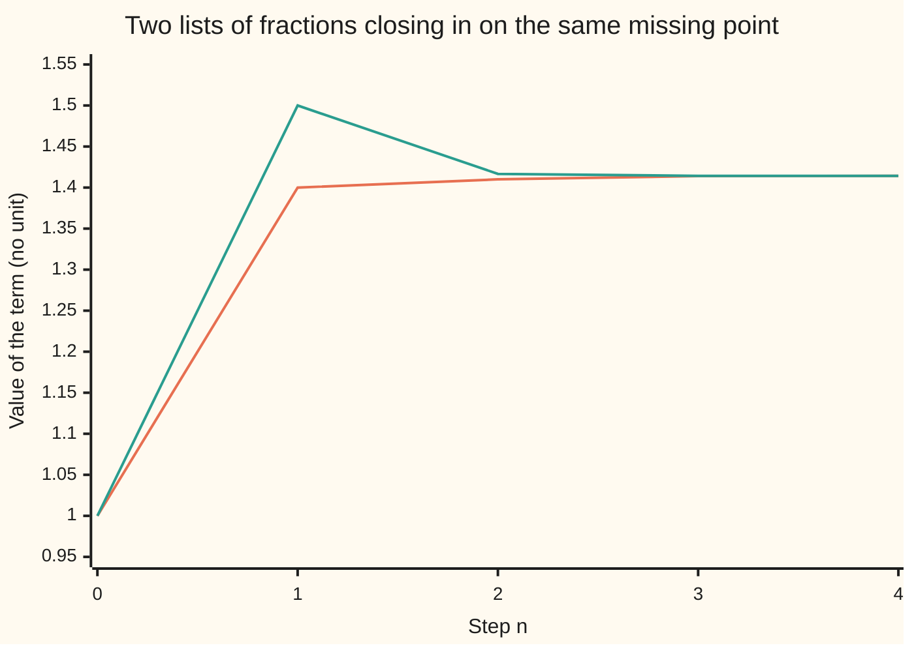

# Complete space: bunched-up sequences land somewhere, and how to fill in the gaps

[Syllabus](../../../SYLLABUS.md) → [Topology](../README.md) → [Metric Spaces](../README.md#s01) → Complete space

---

## General Overview

Write root 2 as decimals and stop after each place: 1, 1.4, 1.41, 1.414, 1.4142. Every one of those is a fraction, so the whole list lives inside the rational numbers (the fractions). The terms bunch together: from 1.414 on, no two differ by 0.001 or more.

Bunching together looks like arriving somewhere. Among the fractions it is not. The list closes in on root 2, and no fraction squares to 2. [The real numbers have no gaps](../../01-Foundations/02-The%20Number%20Line/04-real-numbers-no-gaps.md) showed this squeeze. This card asks the general question: in any space with a distance, when does a bunched-up list have a point to land on?

A space where every bunched-up list lands is **complete**. The fractions are not complete. The real numbers are. The second half of the card turns this round: given a space with holes, it builds the smallest complete space around it, called its **completion**. Applied to the fractions, that construction produces the real numbers.

Completeness is the hypothesis behind several later theorems on this shelf. A shrinking map has a fixed point, and a complete space is never a countable union of thin sets (sets whose closure, the set together with every limit of its lists, contains no ball). Both proofs build a bunched-up list and need it to land.

**A space is complete when every sequence whose terms bunch together converges to a point of the space; any metric space with holes can be completed by declaring each bunched-up sequence to be a point.**

**What kind of fact this is:** two definitions (a Cauchy sequence, a complete space) and four theorems. The fractions are incomplete, closed parts of complete spaces are complete, Cantor's nested sets meet in one point, and every metric space has a completion. All four are proved on this card in Why it works; the completion's uniqueness is stated with its key step.

### The picture: two lists of fractions, one hole



The orange line is the decimal list, cut off at n places. The green line is Newton's list 1, 3/2, 17/12, 577/408, 665857/470832, defined in Why it works. Both bunch toward 1.41421356..., which is not a fraction. The completion makes that shared target a single new point.

---

## The formula

This card uses the distance language of [Metric space](01-metric-spaces.md): a set $`X`$ with a distance $`d(x, y)`$ that is never negative, is zero only from a point to itself, is the same both ways, and obeys the triangle inequality. A sequence $`x_1, x_2, x_3, \dots`$ is written $`(x_n)`$.

The test for "bunching together" uses only distances between terms:

```math
(x_n) \text{ is Cauchy} \iff \text{for every } \varepsilon > 0 \text{ there is an } N \text{ with } d(x_m, x_n) < \varepsilon \text{ whenever } m, n > N
```

**Read it aloud:** pick any tolerance, however small; past some term, every two terms lie within that tolerance of each other.

The name honours Augustin-Louis Cauchy. [Sequences](../../06-Calculus%20and%20analysis/01-Limits%20and%20Continuity/03-sequences-and-limits.md) defined it on the number line. Here the gap $`|a - b|`$ becomes any distance $`d`$.

```math
X \text{ is complete} \iff \text{every Cauchy sequence in } X \text{ converges to a point of } X
```

**Read it aloud:** in a complete space, every list that bunches up has somewhere inside the space to land.

The completion measures the distance between two bunched-up lists as the limit of their term-by-term distances:

```math
\hat d\big((x_n), (y_n)\big) = \lim_{n \to \infty} d(x_n, y_n)
```

**Read it aloud:** to measure between two new points, walk both lists forward and watch the gap between matching terms settle.

On the example, the decimal list $`(a_n)`$ and Newton's list $`(b_n)`$ have term gaps 0.1, 0.00666666, 0.00021568, 0.00001356, heading to 0. So they are the same new point: root 2.

| Symbol | Plain meaning | In our example | Push it up and the answer… |
| --- | --- | --- | --- |
| $`X`$, $`Y`$; $`f`$ | a space: a set with a distance; $`f`$ is a map from one space to another | $`X`$ is the fractions $`\mathbb{Q}`$; $`f(x) = x/(1+x)`$ maps $`[0, \infty)`$ onto $`[0, 1)`$ | — |
| $`d(x, y)`$ | the distance from $`x`$ to $`y`$ | $`\lvert x - y\rvert`$ | — |
| $`(x_n)`$, $`(y_n)`$; $`m`$, $`n`$, $`k`$ | a sequence: one point per whole number $`n`$; $`m`$, $`n`$ and $`k`$ are positions in it | the decimals of root 2 | — |
| $`L`$ | a limit: the point a sequence converges to | root 2, which is not in $`\mathbb{Q}`$ | — |
| $`\varepsilon`$ | a tolerance, read "epsilon" | $`10^{-3}`$ | $`N`$ can be smaller |
| $`N`$ | the cutoff past which all terms are within $`\varepsilon`$ | 2 for $`\varepsilon = 10^{-3}`$: every term from $`a_3 = 1.414`$ on; any larger $`N`$ works too | — |
| $`a_n`$ | root 2 cut off at $`n`$ decimal places | $`a_3 = 1.414`$ | closer to root 2 |
| $`b_n`$ | Newton's list: $`b_{n+1} = (b_n + 2/b_n)/2`$ | $`b_2 = 17/12`$ | closer to root 2, much faster |
| $`\mathbb{Q}`$, $`\mathbb{R}`$ | the fractions; the real numbers | $`\mathbb{R}`$ is the completion of $`\mathbb{Q}`$ | — |
| $`\hat X`$, $`\hat d`$; $`P`$, $`P_k`$ | the completion of $`X`$ and its distance; $`P`$ and $`P_k`$ are its points | $`\hat d(a, 3/2) = 0.0857864...`$ | — |
| $`F_n`$ | the $`n`$-th set in a nest of closed sets | $`[a_n, a_n + 10^{-n}]`$ | smaller sets |
| $`\mathrm{diam}\, F`$ | diameter: the largest distance inside $`F`$ | $`10^{-n}`$ | the nest pins its point less tightly |

### When it holds

- **The distance is fixed.** Completeness belongs to a space with its distance, not to the shape. The map $`f(x) = x/(1+x)`$ reshapes $`[0, \infty)`$ onto $`[0, 1)`$ without tearing. The whole numbers 1, 2, 3, ... are not Cauchy before the map, and their images are Cauchy after it, with no landing point in $`[0, 1)`$.
- **Every Cauchy sequence must land, not just some.** In the fractions, 1, 1, 1, ... lands. One list that fails, the decimals of root 2, is enough to make the space incomplete.
- **The landing point must be in the space.** The list 1/2, 1/3, 1/4, ... in $`(0, 1]`$ heads to 0, which is outside. A space is judged by its own points.
- **Cantor's nest needs closed sets whose diameters shrink to 0.** The closed sets $`[n, \infty)`$ are nested and non-empty, but they never shrink, and nothing lies in all of them.

---

## Why it works

### Step 0: bunching can be seen from inside; landing needs a point

To say a list converges you must name its limit. To say it is Cauchy you need only the distances between its own terms. So the Cauchy test can be run from inside a space, even when the target is missing.

That gap between the two tests is the whole subject. A complete space is one where the inside test always finds a real target.

### Step 1: every convergent sequence is Cauchy

If $`x_n \to L`$, take a tolerance $`\varepsilon`$. Past some cutoff, every term is within $`\varepsilon/2`$ of $`L`$. The triangle inequality then puts any two such terms within $`\varepsilon/2 + \varepsilon/2 = \varepsilon`$ of each other.

So the Cauchy test never rejects a list that really converges. Completeness asks for the reverse direction. [Sequences](../../06-Calculus%20and%20analysis/01-Limits%20and%20Continuity/03-sequences-and-limits.md) proved it for the real line, so $`\mathbb{R}`$ with $`\lvert x - y\rvert`$ is the first complete metric space. That proof rests on the least-upper-bound promise of [No gaps](../../06-Calculus%20and%20analysis/01-Limits%20and%20Continuity/02-supremum-and-completeness.md), the one-dimensional form of this card's idea.

### Step 2: the fractions are not complete

Cut root 2 off at $`n`$ places to get $`a_n`$. Two such cut-offs agree in their first $`n`$ places, so $`\lvert a_m - a_n\rvert < 10^{-n}`$ whenever $`m > n`$. Given $`\varepsilon`$, choose $`N`$ with $`10^{-N} \le \varepsilon`$: the list is Cauchy. The checks confirm the bound on all 78 pairs with $`n < m \le 12`$.

It has no fractional limit. The squares $`a_n^2`$ creep up to 2: the gap $`2 - a_n^2`$ is 1, 0.04, 0.0119, 0.000604, 0.00003836, and so on. A fractional limit $`L`$ would have $`L^2 = 2`$, and [Irrational numbers](../../01-Foundations/02-The%20Number%20Line/03-irrational-numbers.md) proved no fraction does.

<details>
<summary>Detailed proof: the decimals of root 2 are Cauchy with no limit in the fractions</summary>

Let $`a_n`$ be the largest fraction with $`n`$ decimal places whose square is at most 2. Then $`a_n^2 \le 2 < (a_n + 10^{-n})^2`$.

Each $`a_{n+1}`$ starts with the digits of $`a_n`$, so for $`m > n`$ we have $`a_n \le a_m < a_n + 10^{-n}`$. That gives $`\lvert a_m - a_n\rvert < 10^{-n}`$: Cauchy.

Expanding the right-hand inequality and using $`a_n < 1.5`$:

$`\displaystyle 0 \le 2 - a_n^2 < 2 a_n 10^{-n} + 10^{-2n} < 4 \times 10^{-n}.`$

Suppose $`a_n \to L`$ with $`L`$ a fraction. Products of convergent lists converge to the product of the limits, so $`a_n^2 \to L^2`$. The bound forces $`a_n^2 \to 2`$, so $`L^2 = 2`$. No fraction has square 2 (write $`L = p/q`$ in lowest terms; $`p^2 = 2q^2`$ makes $`p`$ even, then $`q`$ even, a contradiction). So the list has no limit in $`\mathbb{Q}`$.

</details>

### Step 3: testing a space for completeness

Three tests settle most spaces met in practice.

1. **Closed inside complete is complete.** A set $`F`$ is closed when the points outside it form an open set ([Open balls, open sets and closed sets](03-open-and-closed-sets.md)). So $`F`$ keeps the limit of every convergent list drawn from it: if $`x_n \to L`$ with every $`x_n`$ in $`F`$ and $`L`$ outside, the outside holds a ball around $`L`$, and late terms enter that ball, which is impossible. A Cauchy list in a closed part $`F`$ of a complete $`X`$ converges in $`X`$, and closedness keeps the limit in $`F`$. So $`[0, 1]`$ is complete; $`(0, 1]`$ is not, since 1/n heads to the missing 0.
2. **Points kept apart make a complete space.** On a street grid, two different corners are at least one block apart. A Cauchy list with $`\varepsilon = 1/2`$ must therefore stop moving after its cutoff, and a list that stops has landed. So the grid corners are complete, under walking distance or straight-line distance.
3. **Distances squeezed between constant multiples give the same Cauchy lists.** From corner (0, 0) to corner (3, 4) is 7 blocks on foot and 5 in a straight line. In general the straight-line distance $`d_2`$ and the walking distance $`d_1`$ obey $`d_2 \le d_1 \le \sqrt{2}\, d_2`$. Here $`5^2 = 25 \le 7^2 = 49 \le 2 \times 5^2 = 50`$. A list Cauchy for one distance is Cauchy for the other, so both make the plane complete ([The distance menu](02-distances-on-vectors-and-functions.md) compares these distances).

A reshaping that is continuous both ways, but squeezes far-apart points close together, can destroy completeness. The When it holds example shows this: 10 and 100 sit 90 apart, while their images under $`x/(1+x)`$ sit $`90/1111 = 0.0810081`$ apart.

### Step 4: Cantor's intersection theorem

Completeness has a second face, in terms of shrinking sets instead of lists.

**Cantor's intersection theorem.** In a complete space, let $`F_1 \supseteq F_2 \supseteq F_3 \supseteq \dots`$ be non-empty closed sets with $`\mathrm{diam}\, F_n \to 0`$. Then exactly one point lies in every $`F_n`$.

The idea: pick a point from each set. The sets shrink, so the picks bunch together and land; closedness keeps the landing point in every set.

In the fractions it fails. Take $`F_n`$ to be the fractions between $`a_n`$ and $`a_n + 10^{-n}`$: closed in $`\mathbb{Q}`$, nested, with diameters $`10^{-n}`$. Every fraction is eventually thrown out. The checks test all 3045 fractions in [1, 2] with denominator at most 100. The last to go is 99/70, which survives stages 0 to 4 and leaves at stage 5.

<details>
<summary>Detailed proof: nested closed sets with shrinking diameters meet in one point</summary>

Pick $`x_n`$ in $`F_n`$. For $`m > n`$ both $`x_m`$ and $`x_n`$ lie in $`F_n`$, so $`d(x_m, x_n) \le \mathrm{diam}\, F_n`$. The diameters go to 0, so $`(x_n)`$ is Cauchy, and completeness gives a limit $`x`$.

Fix $`k`$. Every term from $`x_k`$ onward lies in $`F_k`$, and $`F_k`$ is closed, so $`x`$ lies in $`F_k`$ (Step 3, test 1). This holds for every $`k`$.

If $`y`$ also lies in every $`F_k`$, then $`d(x, y) \le \mathrm{diam}\, F_k`$ for every $`k`$, so $`d(x, y) = 0`$ and $`y = x`$.

The converse holds too. Given a Cauchy list, let $`F_n`$ be the closure of its tail from term $`n`$ on: the tail together with every limit of lists drawn from it. The common point is the list's limit. So "nests meet" and "Cauchy lists land" are two ways to say complete.

</details>

### Step 5: building the completion

Here is the construction that fills every hole at once. Georg Cantor used a version of it in 1872 to build the real numbers from the fractions.

1. **New points.** Each Cauchy sequence in $`X`$ is a candidate point: the place it is heading.
2. **Glue lists with the same target.** Two Cauchy lists name the same point when $`d(x_n, y_n) \to 0`$. The decimals $`(a_n)`$ and Newton's $`(b_n)`$ are glued: their term gaps fall to 0.00001356 by step 4.
3. **Measure.** Set $`\hat d`$ to the limit of the term gaps. The limit exists because the term gaps themselves form a Cauchy list of real numbers.
4. **Keep the old space.** A point $`x`$ of $`X`$ becomes the constant list $`x, x, x, \dots`$, with the same distances as before.

The result $`\hat X`$ is a complete metric space. It contains $`X`$ as a **dense** part: every new point has old points as close as you like. Its distances agree with $`X`$'s. Any two complete spaces with these properties match point for point with the same distances, so "the completion" is well defined. For $`X = \mathbb{Q}`$, $`\hat X`$ is $`\mathbb{R}`$.

One caution about the fractions. The measuring rule takes limits of real numbers, so as written it needs $`\mathbb{R}`$, and its completeness, to exist already. To build $`\mathbb{R}`$ from nothing, Cantor glued two lists of fractions when, for every fractional tolerance, their matching late terms lie within that tolerance of each other. He then defined order, sums and products term by term, with no real-valued distance. Once $`\mathbb{R}`$ exists, the construction above completes any metric space, and the completion of $`\mathbb{Q}`$ is $`\mathbb{R}`$.

A distance from a new point to an old one: $`\hat d(\sqrt 2, 3/2)`$ is the limit of $`\lvert a_n - 3/2\rvert`$. The decimal list gives 0.08578700 at $`n = 6`$. Newton's list gives 0.08578643 at step 4. The two roads agree to within $`10^{-6}`$.

<details>
<summary>Detailed proof: the completion is a complete metric space with the old space dense inside it</summary>

**The limit exists.** By the triangle inequality, twice,

$`\displaystyle \lvert d(x_m, y_m) - d(x_n, y_n)\rvert \le d(x_m, x_n) + d(y_m, y_n).`$

Both terms on the right are small past a cutoff, so the numbers $`d(x_n, y_n)`$ form a Cauchy list of reals. The reals are complete, so it has a limit.

**It is a distance.** Never negative, symmetric and the triangle inequality all survive limits. Zero distance means the lists are glued, so it holds only from a point to itself. The same inequality shows that swapping a list for one glued to it does not change $`\hat d`$.

**The old space sits inside, densely.** Constant lists keep their distances. Given a new point $`(x_n)`$ and $`\varepsilon`$, pick $`N`$ from the Cauchy test; the constant list $`x_N`$ is within $`\varepsilon`$ of it.

**It is complete.** Let $`P_1, P_2, \dots`$ be a Cauchy list of new points. By density, pick old points $`x_k`$ with $`\hat d(x_k, P_k) < 1/k`$. The triangle inequality makes $`(x_k)`$ Cauchy in $`X`$, so it is itself a new point $`P`$. Then $`\hat d(P_k, P) \le 1/k + \hat d(x_k, P) \to 0`$.

**Uniqueness (key step only).** If $`Y`$ is another complete space containing $`X`$ densely with the same distances, send each new point $`(x_n)`$ to the limit of $`x_n`$ in $`Y`$. This map keeps distances and is onto, so it is a match. Details: Ó Searcóid, Chapter 10.

</details>

---

## Worked numbers, by hand

The space is $`\mathbb{Q}`$ with $`d(x, y) = \lvert x - y\rvert`$.

| Step | Arithmetic | Value |
| --- | --- | --- |
| decimals of root 2 | cut off at 0 to 4 places | 1, 1.4, 1.41, 1.414, 1.4142 |
| how far each square falls short of 2 | $`2 - a_n^2`$ | 1, 0.04, 0.0119, 0.000604, 0.00003836 |
| Cauchy test | $`\lvert a_m - a_n\rvert < 10^{-n}`$ on 78 pairs | holds |
| no fractional limit | $`p^2 = 2q^2`$ with $`q \le 2000`$ | 0 solutions |
| Newton's list | $`b_{n+1} = (b_n + 2/b_n)/2`$ from 1 | 3/2, 17/12, 577/408, 665857/470832 |
| same new point | $`\lvert a_n - b_n\rvert`$ at steps 1 to 4 | 0.1, 0.00666666, 0.00021568, 0.00001356 |
| distance to 3/2 | $`\lvert a_6 - 3/2\rvert`$; $`\lvert b_4 - 3/2\rvert`$ | 0.08578700; **0.08578643** |
| Cantor nest in $`\mathbb{Q}`$ | 3045 fractions tested | all thrown out; 99/70 last, at stage 5 |

The decimal list and Newton's list are two names for one point of the completion, and that point sits 0.0857864... from 3/2. The fractions themselves contain no such point.

### What breaks if you drop a piece

| Mistake | Comes out at | What went wrong |
| --- | --- | --- |
| Testing only neighbours: steps 1/(n+1) shrink, so the partial sums of 1 + 1/2 + 1/3 + ... look Cauchy | $`1/101 + \dots + 1/200 = 0.690653`$, at least 0.5 | Far-apart terms stay apart; the sums grow without bound |
| Judging $`(0, 1]`$ by its looks | 1/n is Cauchy, $`d(1/10, 1/1000) = 0.099`$, and its limit 0 is missing | The space is not closed inside $`\mathbb{R}`$ |
| Nesting closed sets that never shrink | $`[n, \infty)`$: 7.5 leaves at $`n = 8`$; no common point | Cantor needs diameters going to 0 |
| Treating completeness as a property of the shape | $`d(10, 100) = 90`$, but $`d(f(10), f(100)) = 90/1111 = 0.0810081`$ under $`f(x) = x/(1+x)`$ | The reshaping is continuous both ways but squeezes distances, so Cauchy lists change |

---

## Code, from first principles, and it actually runs

The code holds every fraction exactly, as a pair of whole numbers, so no rounding can hide a hole. It takes two independent roads to the decimals of root 2: halving an interval of whole numbers, and choosing digits one at a time. It takes two roads to the distance from root 2 to 3/2, through the decimal list and through Newton's list. It then checks Cauchy's bound on a finite set of pairs, finds the smallest cutoff for the tolerance 0.001, searches for a fractional square root, runs Cantor's nest over 3045 fractions two ways (by comparing with the interval ends, and by truncating each fraction's decimals) and prints every number in the What breaks table. A finite run illustrates the theorems; the proofs are in Why it works.

### Python

```python
# Complete space and completion -- the check behind the card.  Nothing is
# imported.  The space is the rationals with d(x, y) = |x - y|.  Every
# rational is held exactly as a pair of integers (numerator, denominator).
# Decimals of root 2 are built two ways, a second Cauchy sequence (Newton's)
# is checked to sit at the same gap, and the "what breaks" numbers follow.
def isqrt(n):                            # road one: largest r with r*r <= n, by halving
    lo, hi = 0, 1
    while hi * hi <= n:                  # first find a power of 2 past the root
        hi *= 2
    while hi - lo > 1:
        mid = (lo + hi) // 2
        lo, hi = (mid, hi) if mid * mid <= n else (lo, mid)
    return lo

def digit_search(k):                     # road two: pick each decimal digit greedily
    a = 1
    for place in range(1, k + 1):
        a = a * 10 + max(d for d in range(10) if (a * 10 + d) ** 2 <= 2 * 100 ** place)
    return a

def gcd(a, b):                           # Euclid, so each fraction is counted once
    while b:
        a, b = b, a % b
    return a

def dec(p, q, k):                        # p/q >= 0, cut off (not rounded) to k places
    s = str(p * 10 ** k // q).rjust(k + 1, "0")
    return s[:-k] + "." + s[-k:] if k else s

def exact(p, k):                         # p / 10^k written out exactly, zeros trimmed
    return dec(p, 10 ** k, k).rstrip("0").rstrip(".") if k else str(p)

A = [isqrt(2 * 100 ** n) for n in range(13)]           # a_n = A[n] / 10^n
print("a_n = root 2 cut off at n decimal places; every a_n is a fraction")
for n in range(7):
    print(f"a_{n} = {exact(A[n], n):<9} 2 - a_{n}^2 = {exact(2 * 100 ** n - A[n] ** 2, 2 * n)}")
pairs = [(n, m) for n in range(13) for m in range(n + 1, 13)]
cauchy = all(abs(A[m] - A[n] * 10 ** (m - n)) < 10 ** (m - n) for n, m in pairs)
print(f"Cauchy test |a_m - a_n| < 10^-n: {'holds' if cauchy else 'FAILS'} on the {len(pairs)} pairs n < m <= 12")
cut = next(N for N in range(13) if all(abs(A[m] * 10 ** (12 - m) - A[n] * 10 ** (12 - n)) < 10 ** 9 for n, m in pairs if n > N))
print(f"smallest N with |a_m - a_n| < 10^-3 for all m, n > N (to 12): {cut}, so from a_{cut + 1} = {exact(A[cut + 1], cut + 1)} on")
hits = [(p, q) for q in range(1, 2001) for p in (isqrt(2 * q * q), isqrt(2 * q * q) + 1) if p * p == 2 * q * q]
print(f"fractions p/q with q <= 2000 and p^2 = 2 q^2: {len(hits)}")

B = [(1, 1)]                                           # Newton: b -> (b + 2/b) / 2
for _ in range(4):
    p, q = B[-1]
    B.append((p * p + 2 * q * q, 2 * p * q))
for k, (p, q) in enumerate(B):
    gap = abs(A[k] * q - p * 10 ** k)
    print(f"b_{k} = {p}/{q} = {dec(p, q, 8)}   |a_{k} - b_{k}| = {dec(gap, q * 10 ** k, 8)}")
print("chart, decimals:", ", ".join(dec(A[k], 10 ** k, 6) for k in range(5)))
print("chart, Newton:  ", ", ".join(dec(p, q, 6) for p, q in B))
far_a = 3 * 10 ** 6 - 2 * A[6]                          # |a_6 - 3/2| = far_a / (2 * 10^6)
p4, q4 = B[4]
far_b = 3 * q4 - 2 * p4                                # |b_4 - 3/2| = far_b / (2 * q4)
print(f"distance from the new point to 3/2: via a_6 {dec(far_a, 2 * 10 ** 6, 8)}, via b_4 {dec(far_b, 2 * q4, 8)}")

stage = {}                                             # Cantor: nest [a_n, a_n + 10^-n]
for q in range(1, 101):
    for p in [p for p in range(q, 2 * q + 1) if gcd(p, q) == 1]:
        stage[(p, q)] = next((n for n in range(13) if p * 10 ** n < A[n] * q
                              or p * 10 ** n > (A[n] + 1) * q), None)
(lp, lq), last = max(stage.items(), key=lambda kv: (kv[1], -kv[0][1]))
print(f"Cantor nest in the rationals: {len(stage)} fractions in [1, 2] with q <= 100, "
      f"all thrown out by stage 12; the last, {lp}/{lq}, at stage {last}")
gx, gy = 3, 4                                          # street grid: corner (0, 0) to corner (3, 4)
walk, line2 = gx + gy, gx * gx + gy * gy               # walking distance, and straight distance squared
print(f"street grid, corner ({gx}, {gy}): walk {walk} blocks, straight {isqrt(line2)}; "
      f"{isqrt(line2)}^2 = {line2} <= {walk}^2 = {walk * walk} <= 2 x {isqrt(line2)}^2 = {2 * line2}")
print("mistake 1, neighbours close but not Cauchy: 1/101 + ... + 1/200 =",
      f"{sum(1.0 / k for k in range(101, 201)):.6f}, at least 100 x 1/200 = 0.5")
p2 = 1000 - 10                                         # 1/10 - 1/1000 = (1000 - 10) / (10 x 1000) = p2 / 10^4
print(f"mistake 2, 1/n in (0, 1]: d(1/10, 1/1000) = {exact(p2, 4)}; the limit 0 is not in (0, 1]")
leave = next(n for n in range(100) if n > 7.5)          # first [n, inf) without 7.5
print(f"mistake 3, closed sets [n, inf) never shrink in width: x = 7.5 leaves at n = {leave}, so none is common")
lo, hi = 10, 100
hp, hq = hi * (1 + lo) - lo * (1 + hi), (1 + lo) * (1 + hi)   # f(x) = x/(1+x): f(100) - f(10)
print(f"mistake 4, f(x) = x/(1+x): d({lo}, {hi}) = {hi - lo}, d(f({lo}), f({hi})) = {hp}/{hq} = {dec(hp, hq, 7)}")

assert all(digit_search(n) == A[n] for n in range(13))          # two roads to the decimals
assert cauchy and hits == []                                    # Cauchy, and no square root in reach
assert all(p * p - 2 * q * q == 1 for p, q in B[1:])            # Newton's squares land 1/q^2 above 2
assert all(abs(A[k] * q - p * 10 ** k) * 10 ** (k - 1) <= q * 10 ** k for k, (p, q) in enumerate(B) if k)
assert abs(far_a * q4 - far_b * 10 ** 6) * 10 ** 6 < 2 * 10 ** 6 * q4   # one distance, two roads
assert None not in stage.values()                               # every fraction leaves the nest
def inside(p, q, n):                     # nest test two: truncate p/q to n places
    k = p * 10 ** n // q
    return k == A[n] or (k == A[n] + 1 and k * q == p * 10 ** n)
assert all(s == next((n for n in range(13) if not inside(p, q, n)), None) for (p, q), s in stage.items())
print("ALL CHECKS PASS")
```

**Ran 2026-11-14 on macOS, Python 3.14.10, standard library only. All checks passed. Output, pasted from the run:**

```
a_n = root 2 cut off at n decimal places; every a_n is a fraction
a_0 = 1         2 - a_0^2 = 1
a_1 = 1.4       2 - a_1^2 = 0.04
a_2 = 1.41      2 - a_2^2 = 0.0119
a_3 = 1.414     2 - a_3^2 = 0.000604
a_4 = 1.4142    2 - a_4^2 = 0.00003836
a_5 = 1.41421   2 - a_5^2 = 0.0000100759
a_6 = 1.414213  2 - a_6^2 = 0.000001590631
Cauchy test |a_m - a_n| < 10^-n: holds on the 78 pairs n < m <= 12
smallest N with |a_m - a_n| < 10^-3 for all m, n > N (to 12): 2, so from a_3 = 1.414 on
fractions p/q with q <= 2000 and p^2 = 2 q^2: 0
b_0 = 1/1 = 1.00000000   |a_0 - b_0| = 0.00000000
b_1 = 3/2 = 1.50000000   |a_1 - b_1| = 0.10000000
b_2 = 17/12 = 1.41666666   |a_2 - b_2| = 0.00666666
b_3 = 577/408 = 1.41421568   |a_3 - b_3| = 0.00021568
b_4 = 665857/470832 = 1.41421356   |a_4 - b_4| = 0.00001356
chart, decimals: 1.000000, 1.400000, 1.410000, 1.414000, 1.414200
chart, Newton:   1.000000, 1.500000, 1.416666, 1.414215, 1.414213
distance from the new point to 3/2: via a_6 0.08578700, via b_4 0.08578643
Cantor nest in the rationals: 3045 fractions in [1, 2] with q <= 100, all thrown out by stage 12; the last, 99/70, at stage 5
street grid, corner (3, 4): walk 7 blocks, straight 5; 5^2 = 25 <= 7^2 = 49 <= 2 x 5^2 = 50
mistake 1, neighbours close but not Cauchy: 1/101 + ... + 1/200 = 0.690653, at least 100 x 1/200 = 0.5
mistake 2, 1/n in (0, 1]: d(1/10, 1/1000) = 0.099; the limit 0 is not in (0, 1]
mistake 3, closed sets [n, inf) never shrink in width: x = 7.5 leaves at n = 8, so none is common
mistake 4, f(x) = x/(1+x): d(10, 100) = 90, d(f(10), f(100)) = 90/1111 = 0.0810081
ALL CHECKS PASS
```

### Rust

Same numbers, same labels, built with `rustc --edition 2021 -O`. Every fraction is a pair of `i128` integers.

```rust
// Complete space and completion -- the same check as the Python, in Rust.  No
// crates.  The space is the rationals with d(x, y) = |x - y|.  Every
// rational is held exactly as a pair of i128 integers (numerator, denominator).
// Decimals of root 2 are built two ways, a second Cauchy sequence (Newton's)
// is checked to sit at the same gap, and the "what breaks" numbers follow.
fn isqrt(n: i128) -> i128 {              // road one: largest r with r*r <= n, by halving
    let (mut lo, mut hi) = (0i128, 1i128);
    while hi * hi <= n { hi *= 2 }      // first find a power of 2 past the root
    while hi - lo > 1 {
        let mid = (lo + hi) / 2;
        if mid * mid <= n { lo = mid } else { hi = mid }
    }
    lo
}

fn digit_search(k: u32) -> i128 {        // road two: pick each decimal digit greedily
    let mut a: i128 = 1;
    for place in 1..=k {
        let d = (0..10).filter(|d| (a * 10 + d).pow(2) <= 2 * 100i128.pow(place)).max().unwrap();
        a = a * 10 + d;
    }
    a
}

fn gcd(mut a: i128, mut b: i128) -> i128 { // Euclid, so each fraction is counted once
    while b != 0 { (a, b) = (b, a % b) }
    a
}

fn dec(p: i128, q: i128, k: u32) -> String { // p/q >= 0, cut off (not rounded) to k places
    let s = format!("{:0>w$}", p * 10i128.pow(k) / q, w = k as usize + 1);
    if k == 0 { return s }
    let cut = s.len() - k as usize;
    format!("{}.{}", &s[..cut], &s[cut..])
}

fn exact(p: i128, k: u32) -> String {    // p / 10^k written out exactly, zeros trimmed
    if k == 0 { return p.to_string() }
    dec(p, 10i128.pow(k), k).trim_end_matches('0').trim_end_matches('.').to_string()
}

fn main() {
    let t = |k: u32| 10i128.pow(k);
    let a: Vec<i128> = (0..13).map(|n| isqrt(2 * 100i128.pow(n))).collect(); // a_n = a[n] / 10^n
    println!("a_n = root 2 cut off at n decimal places; every a_n is a fraction");
    for n in 0..7u32 {
        let an = a[n as usize];
        println!("a_{} = {:<9} 2 - a_{}^2 = {}", n, exact(an, n), n, exact(2 * 100i128.pow(n) - an * an, 2 * n));
    }
    let mut pairs = 0;
    let mut cauchy = true;
    for n in 0..13u32 {
        for m in n + 1..13u32 {
            pairs += 1;
            cauchy &= (a[m as usize] - a[n as usize] * t(m - n)).abs() < t(m - n);
        }
    }
    println!("Cauchy test |a_m - a_n| < 10^-n: {} on the {} pairs n < m <= 12", if cauchy { "holds" } else { "FAILS" }, pairs);
    let cut = (0..13usize).find(|&nn| (nn + 1..13).all(|n| (n + 1..13).all(|m|
        (a[m] * t(12 - m as u32) - a[n] * t(12 - n as u32)).abs() < t(9)))).unwrap();
    println!("smallest N with |a_m - a_n| < 10^-3 for all m, n > N (to 12): {}, so from a_{} = {} on",
             cut, cut + 1, exact(a[cut + 1], cut as u32 + 1));
    let mut hits = 0;
    for q in 1..=2000i128 {
        let r = isqrt(2 * q * q);
        for p in [r, r + 1] { if p * p == 2 * q * q { hits += 1 } }
    }
    println!("fractions p/q with q <= 2000 and p^2 = 2 q^2: {}", hits);

    let mut b: Vec<(i128, i128)> = vec![(1, 1)];        // Newton: b -> (b + 2/b) / 2
    for _ in 0..4 {
        let (p, q) = *b.last().unwrap();
        b.push((p * p + 2 * q * q, 2 * p * q));
    }
    for (k, &(p, q)) in b.iter().enumerate() {
        let gap = (a[k] * q - p * t(k as u32)).abs();
        println!("b_{} = {}/{} = {}   |a_{} - b_{}| = {}", k, p, q, dec(p, q, 8), k, k, dec(gap, q * t(k as u32), 8));
    }
    let cd: Vec<String> = (0..5).map(|k| dec(a[k], t(k as u32), 6)).collect();
    let cn: Vec<String> = b.iter().map(|&(p, q)| dec(p, q, 6)).collect();
    println!("chart, decimals: {}", cd.join(", "));
    println!("chart, Newton:   {}", cn.join(", "));
    let far_a = 3 * t(6) - 2 * a[6];                    // |a_6 - 3/2| = far_a / (2 * 10^6)
    let (p4, q4) = b[4];
    let far_b = 3 * q4 - 2 * p4;                        // |b_4 - 3/2| = far_b / (2 * q4)
    println!("distance from the new point to 3/2: via a_6 {}, via b_4 {}", dec(far_a, 2 * t(6), 8), dec(far_b, 2 * q4, 8));

    let mut stage: Vec<((i128, i128), Option<u32>)> = Vec::new(); // Cantor: nest [a_n, a_n + 10^-n]
    for q in 1..=100i128 {
        for p in q..=2 * q {
            if gcd(p, q) != 1 { continue }
            let s = (0..13u32).find(|&n| p * t(n) < a[n as usize] * q || p * t(n) > (a[n as usize] + 1) * q);
            stage.push(((p, q), s));
        }
    }
    let mut best = stage[0];
    for &e in &stage {
        if e.1 > best.1 || (e.1 == best.1 && e.0 .1 < best.0 .1) { best = e }
    }
    let ((lp, lq), last) = best;
    println!("Cantor nest in the rationals: {} fractions in [1, 2] with q <= 100, all thrown out by stage 12; the last, {}/{}, at stage {}",
             stage.len(), lp, lq, last.unwrap());
    let (gx, gy) = (3i128, 4i128);                      // street grid: corner (0, 0) to corner (3, 4)
    let (walk, line2) = (gx + gy, gx * gx + gy * gy);   // walking distance, and straight distance squared
    let st = isqrt(line2);
    println!("street grid, corner ({}, {}): walk {} blocks, straight {}; {}^2 = {} <= {}^2 = {} <= 2 x {}^2 = {}",
             gx, gy, walk, st, st, line2, walk, walk * walk, st, 2 * line2);
    let harmonic: f64 = (101..201).map(|k| 1.0 / k as f64).sum();
    println!("mistake 1, neighbours close but not Cauchy: 1/101 + ... + 1/200 = {:.6}, at least 100 x 1/200 = 0.5", harmonic);
    let p2 = 1000 - 10;                                 // 1/10 - 1/1000 = (1000 - 10) / (10 x 1000) = p2 / 10^4
    println!("mistake 2, 1/n in (0, 1]: d(1/10, 1/1000) = {}; the limit 0 is not in (0, 1]", exact(p2, 4));
    let leave = (0..100).find(|&n| n as f64 > 7.5).unwrap(); // first [n, inf) without 7.5
    println!("mistake 3, closed sets [n, inf) never shrink in width: x = 7.5 leaves at n = {}, so none is common", leave);
    let (lo, hi) = (10i128, 100i128);
    let (hp, hq) = (hi * (1 + lo) - lo * (1 + hi), (1 + lo) * (1 + hi)); // f(x) = x/(1+x): f(100) - f(10)
    println!("mistake 4, f(x) = x/(1+x): d({}, {}) = {}, d(f({}), f({})) = {}/{} = {}", lo, hi, hi - lo, lo, hi, hp, hq, dec(hp, hq, 7));

    assert!((0..13u32).all(|n| digit_search(n) == a[n as usize]));          // two roads to the decimals
    assert!(cauchy && hits == 0);                                         // Cauchy, and no square root in reach
    assert!(b[1..].iter().all(|&(p, q)| p * p - 2 * q * q == 1));        // Newton's squares land 1/q^2 above 2
    assert!(b.iter().enumerate().skip(1).all(|(k, &(p, q))|
        (a[k] * q - p * t(k as u32)).abs() * t(k as u32 - 1) <= q * t(k as u32)));
    assert!((far_a * q4 - far_b * t(6)).abs() * t(6) < 2 * t(6) * q4);   // one distance, two roads
    assert!(stage.iter().all(|e| e.1.is_some()));                      // every fraction leaves the nest
    let inside = |p: i128, q: i128, n: u32| {                          // nest test two: truncate p/q to n places
        let k = p * t(n) / q;
        k == a[n as usize] || (k == a[n as usize] + 1 && k * q == p * t(n))
    };
    assert!(stage.iter().all(|&((p, q), s)| s == (0..13u32).find(|&n| !inside(p, q, n))));
    println!("ALL CHECKS PASS");
}
```

**Ran 2026-11-14 on macOS, rustc 1.98.1, no crates. All checks passed. Output, pasted from the run:**

```
a_n = root 2 cut off at n decimal places; every a_n is a fraction
a_0 = 1         2 - a_0^2 = 1
a_1 = 1.4       2 - a_1^2 = 0.04
a_2 = 1.41      2 - a_2^2 = 0.0119
a_3 = 1.414     2 - a_3^2 = 0.000604
a_4 = 1.4142    2 - a_4^2 = 0.00003836
a_5 = 1.41421   2 - a_5^2 = 0.0000100759
a_6 = 1.414213  2 - a_6^2 = 0.000001590631
Cauchy test |a_m - a_n| < 10^-n: holds on the 78 pairs n < m <= 12
smallest N with |a_m - a_n| < 10^-3 for all m, n > N (to 12): 2, so from a_3 = 1.414 on
fractions p/q with q <= 2000 and p^2 = 2 q^2: 0
b_0 = 1/1 = 1.00000000   |a_0 - b_0| = 0.00000000
b_1 = 3/2 = 1.50000000   |a_1 - b_1| = 0.10000000
b_2 = 17/12 = 1.41666666   |a_2 - b_2| = 0.00666666
b_3 = 577/408 = 1.41421568   |a_3 - b_3| = 0.00021568
b_4 = 665857/470832 = 1.41421356   |a_4 - b_4| = 0.00001356
chart, decimals: 1.000000, 1.400000, 1.410000, 1.414000, 1.414200
chart, Newton:   1.000000, 1.500000, 1.416666, 1.414215, 1.414213
distance from the new point to 3/2: via a_6 0.08578700, via b_4 0.08578643
Cantor nest in the rationals: 3045 fractions in [1, 2] with q <= 100, all thrown out by stage 12; the last, 99/70, at stage 5
street grid, corner (3, 4): walk 7 blocks, straight 5; 5^2 = 25 <= 7^2 = 49 <= 2 x 5^2 = 50
mistake 1, neighbours close but not Cauchy: 1/101 + ... + 1/200 = 0.690653, at least 100 x 1/200 = 0.5
mistake 2, 1/n in (0, 1]: d(1/10, 1/1000) = 0.099; the limit 0 is not in (0, 1]
mistake 3, closed sets [n, inf) never shrink in width: x = 7.5 leaves at n = 8, so none is common
mistake 4, f(x) = x/(1+x): d(10, 100) = 90, d(f(10), f(100)) = 90/1111 = 0.0810081
ALL CHECKS PASS
```

The two outputs match line for line.

### Lean

Lean proves three of the card's four theorems in general, and checks the worked numbers.

- Take any metric space $`X`$. Then $`X`$ has a completion: a complete space holding a copy of $`X`$, with distances unchanged. Every new point has old points within any tolerance $`\varepsilon`$.
- Take the fractions $`\mathbb{Q}`$ with $`d(x, y) = \lvert x - y\rvert`$. Then some Cauchy sequence has no limit in $`\mathbb{Q}`$, so $`\mathbb{Q}`$ is not complete.
- Suppose $`X`$ is complete and $`F_1 \supseteq F_2 \supseteq \dots`$ are non-empty closed sets with $`\mathrm{diam}\, F_n \to 0`$. Then exactly one point lies in every $`F_n`$.
- Take the decimals 1, 1.4, 1.41, 1.414, 1.4142. Then each is the largest with that many places whose square is at most 2.
- Their squares fall short of 2 by 1, 0.04, 0.0119, 0.000604 and 0.00003836.
- Newton's list from 1 runs 3/2, 17/12, 577/408, 665857/470832.
- Take corner (3, 4): 7 blocks on foot, 5 in a straight line. Then $`5^2 = 25 \le 7^2 = 49 \le 2 \times 5^2 = 50`$.
- Take $`f(x) = x/(1+x)`$. Then $`d(f(10), f(100)) = 90/1111`$.
- Take 1/10 and 1/1000 in $`(0, 1]`$. Then they sit 0.099 apart.
- Take 99/70. Then its decimals are 1.4142 to 4 places and 1.41428 to 5 places.

The 78 Cauchy pairs, the search for p/q, the 3045-fraction nest and the What breaks sum stay with the Python and Rust checks.

```lean
-- Complete space: every metric space has a completion (a complete metric space holding it densely with the same distances), the fractions are not complete, and nested closed sets with shrinking diameters in a complete space meet in exactly one point.
import Mathlib.Topology.MetricSpace.Completion
import Mathlib.Topology.MetricSpace.Bounded
import Mathlib.Topology.Instances.Rat
import Mathlib.Tactic.NormNum
import Mathlib.NumberTheory.Real.Irrational
import Mathlib.Topology.Instances.ENNReal.Lemmas

open Filter Topology

universe u

/-- Every metric space `X` has a completion: a complete metric space `Y` and a map `X → Y`
that keeps every distance, whose image is dense in `Y` (every point of `Y` has points of
`X` as close as you like). -/
theorem every_metric_space_has_a_completion (X : Type u) [MetricSpace X] :
    ∃ (Y : Type u) (_ : MetricSpace Y) (ι : X → Y),
      CompleteSpace Y ∧ Isometry ι ∧ DenseRange ι := by
  exact ⟨UniformSpace.Completion X, inferInstance, (↑), inferInstance,
    UniformSpace.Completion.coe_isometry, UniformSpace.Completion.denseRange_coe⟩

/-- The fractions, with the distance `|x - y|`, are not complete: some Cauchy sequence of
fractions (the decimals of root 2) has no limit among the fractions. -/
theorem rationals_not_complete : ¬ CompleteSpace ℚ := by
  intro hQ
  have hcl : IsClosed (Set.range ((↑) : ℚ → ℝ)) :=
    Rat.isUniformEmbedding_coe_real.isUniformInducing.isComplete_range.isClosed
  have huniv : Set.range ((↑) : ℚ → ℝ) = Set.univ := by
    rw [← Rat.denseRange_cast.closure_range, hcl.closure_eq]
  have hmem : Real.sqrt 2 ∈ Set.range ((↑) : ℚ → ℝ) := by
    rw [huniv]; exact Set.mem_univ _
  exact irrational_sqrt_two hmem

/-- Cantor's intersection theorem: in a complete metric space, non-empty closed sets
`F 0 ⊇ F 1 ⊇ F 2 ⊇ ...` whose diameters shrink to 0 have exactly one point in common.
The diameter is measured in `[0, ∞]`, so an unbounded set such as `[n, ∞)` has
infinite diameter. -/
theorem cantor_intersection_unique {X : Type u} [MetricSpace X] [CompleteSpace X]
    (F : ℕ → Set X) (hclosed : ∀ n, IsClosed (F n)) (hne : ∀ n, (F n).Nonempty)
    (hnest : ∀ n, F (n + 1) ⊆ F n)
    (hdiam : Tendsto (fun n => Metric.ediam (F n)) atTop (𝓝 0)) :
    ∃! x, ∀ n, x ∈ F n := by
  have hanti : Antitone F := antitone_nat_of_succ_le hnest
  -- eventually the diameters are finite
  obtain ⟨N, hN⟩ : ∃ N, ∀ n ≥ N, Metric.ediam (F n) < 1 :=
    eventually_atTop.1 (hdiam.eventually (gt_mem_nhds (by norm_num)))
  set G : ℕ → Set X := fun n => F (n + N) with hG
  have hGb : ∀ n, Bornology.IsBounded (G n) := fun n =>
    Metric.isBounded_iff_ediam_ne_top.2 (ne_top_of_lt ((hN (n + N) (by omega)).trans ENNReal.one_lt_top))
  have hGd : Tendsto (fun n => Metric.diam (G n)) atTop (𝓝 0) := by
    have h1 : Tendsto (fun n => Metric.ediam (G n)) atTop (𝓝 0) :=
      hdiam.comp (tendsto_add_atTop_nat N)
    have h2 := (ENNReal.tendsto_toReal ENNReal.zero_ne_top).comp h1
    simpa [Metric.diam, Function.comp_def] using h2
  have hGi : ∀ M, (⋂ n ≤ M, G n).Nonempty := by
    intro M
    obtain ⟨x, hx⟩ := hne (M + N)
    refine ⟨x, Set.mem_iInter₂.2 fun n hn => ?_⟩
    exact hanti (by omega : n + N ≤ M + N) hx
  obtain ⟨x, hx⟩ := Metric.nonempty_iInter_of_nonempty_biInter
    (fun n => hclosed (n + N)) hGb hGi hGd
  have hxF : ∀ n, x ∈ F n := fun n =>
    hanti (by omega : n ≤ n + N) (Set.mem_iInter.1 hx n)
  refine ⟨x, hxF, fun y hy => ?_⟩
  have hle : edist y x ≤ 0 :=
    ge_of_tendsto' hdiam fun n => Metric.edist_le_ediam_of_mem (hy n) (hxF n)
  exact edist_le_zero.1 hle

-- Decimals of root 2, as whole numbers: a_n * 10^-n with a_n^2 ≤ 2 * 10^(2n) < (a_n + 1)^2.
example : 1 ^ 2 ≤ 2 ∧ 2 < 2 ^ 2 := by decide
example : 14 ^ 2 ≤ 2 * 10 ^ 2 ∧ 2 * 10 ^ 2 < 15 ^ 2 := by decide
example : 141 ^ 2 ≤ 2 * 10 ^ 4 ∧ 2 * 10 ^ 4 < 142 ^ 2 := by norm_num
example : 1414 ^ 2 ≤ 2 * 10 ^ 6 ∧ 2 * 10 ^ 6 < 1415 ^ 2 := by norm_num
example : 14142 ^ 2 ≤ 2 * 10 ^ 8 ∧ 2 * 10 ^ 8 < 14143 ^ 2 := by norm_num

-- How far each square falls short of 2: 1, 0.04, 0.0119, 0.000604, 0.00003836.
example : (2 : ℚ) - 1 ^ 2 = 1 := by norm_num
example : (2 : ℚ) - (14 / 10) ^ 2 = 4 / 100 := by norm_num
example : (2 : ℚ) - (141 / 100) ^ 2 = 119 / 10000 := by norm_num
example : (2 : ℚ) - (1414 / 1000) ^ 2 = 604 / 10 ^ 6 := by norm_num
example : (2 : ℚ) - (14142 / 10000) ^ 2 = 3836 / 10 ^ 8 := by norm_num

-- Newton's list b_{n+1} = (b_n + 2 / b_n) / 2 from 1: 3/2, 17/12, 577/408, 665857/470832.
example : ((1 : ℚ) + 2 / 1) / 2 = 3 / 2 := by norm_num
example : ((3 / 2 : ℚ) + 2 / (3 / 2)) / 2 = 17 / 12 := by norm_num
example : ((17 / 12 : ℚ) + 2 / (17 / 12)) / 2 = 577 / 408 := by norm_num
example : ((577 / 408 : ℚ) + 2 / (577 / 408)) / 2 = 665857 / 470832 := by norm_num

-- Street grid, corner (3, 4): walk 7 blocks, straight 5; 5^2 = 25 ≤ 7^2 = 49 ≤ 2 × 5^2 = 50.
example : 3 + 4 = 7 ∧ 3 ^ 2 + 4 ^ 2 = 5 ^ 2 := by decide
example : 5 ^ 2 = 25 ∧ 7 ^ 2 = 49 ∧ 5 ^ 2 ≤ 7 ^ 2 ∧ 7 ^ 2 ≤ 2 * 5 ^ 2 := by decide

-- What breaks: f(x) = x/(1+x) squeezes d(10, 100) = 90 down to 90/1111.
example : |(100 : ℚ) / (1 + 100) - 10 / (1 + 10)| = 90 / 1111 := by norm_num [abs_of_pos]

-- What breaks: d(1/10, 1/1000) = 0.099 on (0, 1].
example : |(1 : ℚ) / 10 - 1 / 1000| = 99 / 1000 := by norm_num [abs_of_pos]

-- Cantor nest in the fractions: 99/70 matches the digits of root 2 to 4 places, not to 5.
example : 99 * 10 ^ 4 / 70 = 14142 ∧ 99 * 10 ^ 5 / 70 = 141428 ∧ 141428 ≠ 141421 := by decide

#print axioms every_metric_space_has_a_completion
#print axioms rationals_not_complete
#print axioms cantor_intersection_unique
```

**Checked 2026-11-14 on macOS, Lean 4.36.0-rc2, Mathlib v4.36.0-rc2. Every proof is complete and uses only Lean's standard axioms. Output, pasted from the run:**

```
'every_metric_space_has_a_completion' depends on axioms: [propext, Classical.choice, Quot.sound]
'rationals_not_complete' depends on axioms: [propext, Classical.choice, Quot.sound]
'cantor_intersection_unique' depends on axioms: [propext, Classical.choice, Quot.sound]
```

> [!TIP]
> **Try changing**
> Guess first, then run the Python.
> - **Halve the tolerance.** In the `cauchy` line, change `10 ** (m - n)` to `10 ** (m - n) // 2`. Does the decimal list still pass? It fails at $`n = 6`$: 1.414213 to 1.4142135 is exactly half of $`10^{-6}`$, not less. The list is still Cauchy; this bound was just too tight.
> - **Test more fractions against Cantor's nest.** Change `range(1, 101)` to `range(1, 1001)`. Every fraction is still thrown out by stage 12. The last to go is now 1393/985, at stage 7. (The printed label still says 100.)
> - **Start Newton at 2.** Change `B = [(1, 1)]` to `B = [(2, 1)]`. From step 1 the values are the same, 1.5, 1.41666666, ..., but the fractions arrive unreduced, as 6/4 and 68/48. The assert that each $`p^2 - 2q^2`$ equals 1 stops the program: 6/4 gives 4.

---

## The usual mistake

> [!warning]
> **Thinking that "the terms get close to each other" means "the steps get small".** Cauchy asks every two late terms to be close, however far apart they are in the list. The partial sums of 1 + 1/2 + 1/3 + ... take ever smaller steps, yet the hundred terms from 1/101 to 1/200 add 0.690653, never less than 0.5. Those sums are not Cauchy and do not converge.
>
> - **Calling a list convergent because it is Cauchy, in the wrong space.** In $`\mathbb{Q}`$ the decimals of root 2 are Cauchy, and 0 of the fractions $`p/q`$ with $`q \le 2000`$ square to 2. Cauchy promises a landing point only in a complete space.
> - **Treating completeness as a shape property.** Under $`x/(1+x)`$, 10 and 100 move from 90 apart to 0.0810081 apart. The same set can be complete under one distance and incomplete under another.
> - **Forgetting that Cantor's sets must shrink.** The sets $`[n, \infty)`$ are closed, nested and non-empty, and 7.5 is gone by $`n = 8`$. Nothing survives every stage.
> - **Thinking the completion adds only one point.** Filling root 2 is not enough: the completion of $`\mathbb{Q}`$ adds a point for every gap, uncountably many.

---

## Where you meet it in real life

- **Floating-point and exact arithmetic.** A computer stores fractions with finitely many digits, so every computed square root is a term of a Cauchy list like $`(a_n)`$. Analysis works in $`\mathbb{R}`$, the completion, so that "the answer the digits are heading to" exists.
- **Solving equations by iteration.** Newton's method, root finding and fixed-point solvers produce Cauchy lists. Completeness turns "the steps settle" into "there is an answer". [Banach's fixed point theorem](08-banach-fixed-point-in-metric-spaces.md) rests on exactly this.
- **Signals and functions.** Spaces of functions under an average distance are completed to get the spaces used in signal processing and probability, where a limit of nice functions must still be a function.
- **Street grids and pixel grids.** Grid points sit at least one step apart, so they form a complete space under walking distance: a list that settles to within half a step stops moving. Algorithms that work only on grid points never meet a missing limit.

> **Say it back**
> A Cauchy sequence is a list whose late terms all lie close together, tested using only distances inside the space. A space is complete when every such list converges to a point of the space. The fractions fail: the decimals of root 2 bunch up around a point that is not a fraction. Cantor's theorem says the same thing with shrinking closed sets. Any metric space can be completed by taking its Cauchy lists as new points, gluing lists with the same target; the fractions complete to the real numbers.

---

## What this builds on

- [Limits and continuity with distances](04-convergence-and-continuity-in-metric-spaces.md): convergence in a metric space, the notion this card tests every Cauchy list against.
- [The real numbers have no gaps](../../01-Foundations/02-The%20Number%20Line/04-real-numbers-no-gaps.md): the decimal squeeze on root 2, which this card turns into a Cauchy list of fractions.
- [No gaps](../../06-Calculus%20and%20analysis/01-Limits%20and%20Continuity/02-supremum-and-completeness.md): least-upper-bound completeness, the one-dimensional case of this card's definition.
- [Sequences](../../06-Calculus%20and%20analysis/01-Limits%20and%20Continuity/03-sequences-and-limits.md): the Cauchy test on the line and the proof that every Cauchy list of reals converges.

## Where this goes next

- [Compactness three ways](06-compactness-in-metric-spaces.md): complete plus totally bounded equals compact, so every list has a landing subsequence.
- [Banach's fixed point theorem](08-banach-fixed-point-in-metric-spaces.md): a shrinking map's iterates form a Cauchy list, and completeness supplies the fixed point.
- [Baire category theorem](10-baire-category-theorem.md): uses Cantor's nest to show a complete space is not a countable union of thin sets.
- [Normed and Banach spaces](../../18-Functional%20analysis/01-Normed%20and%20Banach%20Spaces/01-normed-spaces-and-banach-spaces.md): complete spaces of vectors and functions.
- [Three Banach theorems](../../18-Functional%20analysis/01-Normed%20and%20Banach%20Spaces/08-open-mapping-closed-graph-and-uniform-boundedness.md): the big results that need completeness of a function space.
- [The p-adic numbers](../../21-Algebraic%20and%20analytic%20number%20theory/06-Algebraic%20Numbers/10-p-adic-numbers-and-hensels-lemma.md): a different distance on the fractions, and a completely different completion.
- [Hopf-Rinow](../../23-Differential%20geometry%20and%20Lie%20groups/05-Riemannian%20Geometry/10-hopf-rinow-and-completeness.md): on a curved surface, completeness guarantees that shortest paths always exist.
- [Local fields](../../21-Algebraic%20and%20analytic%20number%20theory/09-Local%20Fields%20and%20Class%20Field%20Theory/03-local-fields-and-the-different.md): completing a number field at one prime, and the different that measures ramification.

The completion of the fractions depended on the distance $`\lvert x - y\rvert`$; which other distances on the fractions are possible, and what do their completions look like?

---

## Sources

Verified 2026-11-14: every link below resolves to the publisher's page.

- Ó Searcóid, Mícheál. *Metric Spaces*. Springer Undergraduate Mathematics Series, Springer, 2007. [DOI 10.1007/978-1-84628-627-8](https://doi.org/10.1007/978-1-84628-627-8). Chapter 10: Cauchy sequences, complete spaces, Cantor's intersection theorem and the completion.
- Cantor, Georg. "Ueber die Ausdehnung eines Satzes aus der Theorie der trigonometrischen Reihen." *Mathematische Annalen* 5 (1872). [DOI 10.1007/BF01446327](https://doi.org/10.1007/BF01446327). Builds the real numbers from Cauchy sequences of fractions.
- Fréchet, Maurice. "Sur quelques points du calcul fonctionnel." *Rendiconti del Circolo Matematico di Palermo* 22 (1906). [DOI 10.1007/BF03018603](https://doi.org/10.1007/BF03018603). The thesis that introduced abstract metric spaces.
- Abbott, Stephen. *Understanding Analysis*, 2nd ed. Springer, 2015. [DOI 10.1007/978-1-4939-2712-8](https://doi.org/10.1007/978-1-4939-2712-8). Cauchy sequences on the line and why they converge.
