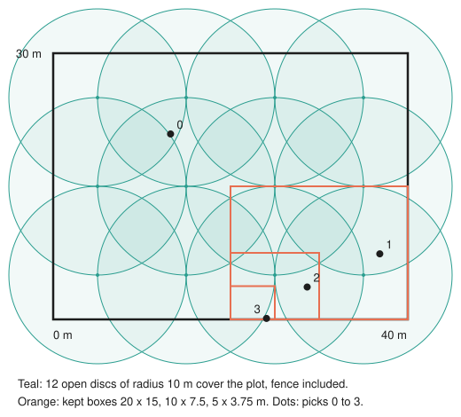

# Compactness three ways: finite covers, convergent subsequences, closed and bounded

[Syllabus](../../../SYLLABUS.md) → [Topology](../README.md) → [Metric Spaces](../README.md#s01) → Compactness three ways

---

## General Overview

A city plot measures 40 metres by 30 metres, and the fence is part of the plot. Corner to corner it is 70 m to walk along the fence and 50 m in a straight line. A surveyor plants a stake somewhere on it every day, forever.

Two questions sound unrelated. Can finitely many round patches of any fixed size cover the plot? Twelve discs of radius 10 m do it. And must the stakes crowd together somewhere? Yes: some endless selection of them closes in on one point of the plot.

Now take one 40 m side of the fence and pull out its two end posts, keeping only the open stretch between them. Stakes at 20 m, 10 m, 5 m, 2.5 m from a corner close in on that corner, whose post is gone. The crowding point has gone missing.

A set is **compact** when nothing can escape it in this way. This card shows three ways to say that, and why they agree:

- **covers:** every way of covering the set with open patches has a finite selection that still covers it;
- **sequences:** every endless list of points in the set has an endless selection that settles at a point of the set;
- **closed and bounded:** in coordinate space, the set keeps its edge and fits inside some box.

**In any metric space, a set passes the cover test exactly when it passes the sequence test, exactly when it is complete and can be covered by finitely many balls at every radius; in coordinate space that last pair is just closed and bounded.**

**What kind of fact this is:** a theorem, proved on this card in Why it works; "closed and bounded" is a test that works in coordinate space, not the definition, and in other metric spaces it can fail.

### The picture: twelve discs, and boxes closing in

<p align="center"></p>

Drawn to scale, 10 pixels to the metre. The teal discs are one finite cover. The orange boxes are the first steps of the quartering search in Why it works, and the dots are the stakes it picks.

---

## The formula

Notation first. A **metric space** $`(X, d)`$ is a set $`X`$ with a distance $`d`$ that obeys the three rules ([Metric space](01-metric-spaces.md)). Here $`X`$ is the plane and $`d`$ is straight-line distance in metres.

- $`B(x, r)`$ is the **open ball**: the points closer than $`r`$ to $`x`$, edge left out ([Open balls, open sets and closed sets](03-open-and-closed-sets.md)).
- An **open cover** of a set $`K`$ is a family of open sets $`U_i`$ whose union contains $`K`$. The family may be infinite. A **finite subcover** is a finite selection from that family that still covers $`K`$.
- A **subsequence** of a list $`x_1, x_2, \ldots`$ keeps infinitely many terms in order. Its j-th kept term is $`x_{k_j}`$, where $`k_j`$ is that term's position in the original list ([Extreme value theorem](../../06-Calculus%20and%20analysis/01-Limits%20and%20Continuity/07-extreme-value-theorem.md)).
- $`K`$ is **totally bounded** when, for every radius $`\varepsilon > 0`$, finitely many balls of radius $`\varepsilon`$ cover it. Their count is $`N(\varepsilon)`$.
- $`K`$ is **complete** when every Cauchy list in it, one whose terms end up all close to each other, has its limit in $`K`$ ([Complete space](05-completeness-and-completion.md)).

Total boundedness, as one line:

```math
K \subseteq B(c_1, \varepsilon) \cup B(c_2, \varepsilon) \cup \cdots \cup B(c_{N(\varepsilon)}, \varepsilon) \quad \text{for every } \varepsilon > 0
```

**Read it aloud:** at every radius, however small, some finite number of balls of that radius covers the whole set.

The theorem, for a set $`K`$ in a metric space:

```math
\text{every open cover has a finite subcover} \iff \text{every sequence has a subsequence converging in } K \iff K \text{ is complete and totally bounded}
```

**Read it aloud:** the cover test, the sequence test and the pair "complete and totally bounded" all hold together or all fail together.

The arrow $`\iff`$ reads "holds exactly when". A set passing any one test is called **compact**. A set passing the sequence test is also called **sequentially compact**.

In coordinate space $`\mathbb{R}^n`$, the points with $`n`$ real coordinates, the Heine–Borel theorem adds a fourth form:

```math
K \subseteq \mathbb{R}^n: \qquad K \text{ compact} \iff K \text{ closed and bounded}
```

**Read it aloud:** a set of points with n coordinates is compact exactly when it keeps its edge and fits inside some ball.

| Symbol | Plain meaning | In our example | Push it up and the answer… |
| --- | --- | --- | --- |
| $`X`$, $`d`$ | the space and its distance | the plane, straight-line metres | — |
| $`K`$ | the set being tested | the plot, 40 m by 30 m, fence included | a bigger plot needs more balls |
| $`U_i`$, $`i`$ | one open set of a cover, and its label | twelve open discs of radius 10 m | — |
| $`B(x, r)`$ | open ball: points closer than $`r`$ to $`x`$ | the disc of radius 10 m round (5, 5) | covers more |
| $`\varepsilon`$ | the radius of the balls in a net | 10 m, 5 m, 1 m | fewer balls |
| $`c_1, \ldots, c_{N(\varepsilon)}`$ | the centres of a finite net | (5, 5) to (35, 25), every 10 m | — |
| $`N(\varepsilon)`$ | how many balls of radius $`\varepsilon`$ the net uses | 12, 48, 1200 | falls as $`\varepsilon`$ rises |
| $`x_k`$, $`k`$ | the k-th stake and its position in the list | stake #5 at (36.84, 7.39) m | — |
| $`x_{k_j}`$, $`k_j`$, $`j`$ | the j-th kept stake, its old position, the new count | picks #0, #5, #15, #147 | — |
| $`p`$ | the point a subsequence settles at | the run's level-6 box: 23.75..24.375 by 0.46875..0.9375 m | — |
| $`\lambda`$ | Lebesgue number: any ball this small fits inside one cover set | any radius below 2.9289 m, for the twelve discs | — |
| $`n`$, $`\mathbb{R}^n`$, $`R`$ | number of coordinates, the space of such points, and the half-side of a box $`[-R, R]^n`$ holding the set | 2, the plane, 40 m | $`2^n`$ pieces per halving |

### When it holds

- **Open sets in the cover.** With closed sets the cover test fails for every infinite set: one-point sets cover the plot, and its whole-centimetre points alone need 12,007,001 of them.
- **Every cover, not some cover.** Any set is covered by one open set, itself. The test is that every cover, however wasteful, has a finite selection.
- **A limit inside the set.** The open fence line (0, 40) holds stakes at 40/2^k m that settle at 0, outside it. The cover $`U_m = (40/2^m, 40)`$ then has no finite subcover.
- **Coordinate space for "closed and bounded".** In a general metric space bounded is weaker than totally bounded. A hub with spokes of 100 m stays within 100 m of the hub, yet n spokes need n balls of radius 100 m.

---

## Why it works

### Step 0: the idea, finitely many checks at every scale and no hole

Compactness has two ingredients. One is total boundedness: at every scale, finitely many balls cover the set. The other is completeness: lists that bunch up land on a point that is really there.

Each of the three versions packages these two ingredients differently. The steps below pass from each version to the next and back.

### Step 1: Heine–Borel in n dimensions, closed and bounded gives the sequence test

On a line, cutting an interval in half again and again finds a settling subsequence. This is the Bolzano–Weierstrass theorem, proved on the [Extreme value theorem](../../06-Calculus%20and%20analysis/01-Limits%20and%20Continuity/07-extreme-value-theorem.md) card. In n dimensions, cut a box into $`2^n`$ smaller boxes by halving every side.

On the plot, $`n = 2`$, so each cut gives four quarters. At least one quarter holds stakes at infinitely many positions, since four finite piles cannot hold an endless list. Keep that quarter and pick a stake in it that comes later in the list than the last pick.

Each box has half the diagonal of the one before: 50 m, 25 m, 12.5 m, and so on. The boxes nest, so the picks bunch up, and by the line case, side by side, they settle at one point $`p`$. The plot keeps its fence, so $`p`$ is in the plot.

A bounded set fits in one big box, and a closed set keeps the limits of its own lists. Closed means the points outside form an open set ([Open balls, open sets and closed sets](03-open-and-closed-sets.md)). If a list in the set headed for a point outside, the outside would hold a ball round that point, and late terms would enter it, which is impossible. So every closed bounded set in $`\mathbb{R}^n`$ passes the sequence test.

### Step 2: the sequence test gives complete and totally bounded

Suppose that at some radius $`\varepsilon`$ no finite net exists. Then pick points greedily: each new point lies at least $`\varepsilon`$ from all earlier ones, which is always possible because the earlier balls never cover everything. That list has no settling subsequence, since every two of its terms are at least $`\varepsilon`$ apart.

Completeness comes free. A Cauchy list with a settling subsequence settles too, at the same point, because its later terms all stay close to the kept ones.

### Step 3: complete and totally bounded gives the sequence test

This is Step 1 with no coordinates. Cover the set with finitely many balls of radius 1/2. One ball holds the list at infinitely many positions; keep those terms. Cover again with balls of radius 1/4, keep a ball, and so on.

Pick one term from each stage, each later than the last. Terms picked from stage j onward all lie in one ball of radius $`1/2^j`$, so the picks form a Cauchy list. Completeness gives its limit inside the set.

The picks form one queue, a first, a second, a third, as a [Countable sets](../../01-Foundations/09-Sizes%20of%20Infinity/02-countable-sets.md) list. In the same way, the centres of all the nets at radii 1, 1/2, 1/4 together form a countable set that comes within any distance of every point.

### Step 4: the sequence test gives the cover test

Take any open cover. First find a radius $`\lambda`$, the **Lebesgue number**: every ball of radius $`\lambda`$ lies inside a single cover set. If no such radius existed, there would be balls of radius 1, 1/2, 1/3 each sticking out of every cover set. Their centres would have a subsequence settling at some $`p`$. That point sits inside some open $`U_i`$ with room to spare. Late balls in the subsequence are small and close to $`p`$, so they fit inside that $`U_i`$, a contradiction.

Now take a finite net of radius $`\lambda`$, from Step 2. Each of its balls lies inside one cover set. Those finitely many cover sets cover everything.

For the twelve discs, no plot point is farther than 7.07 m from its own square's centre. So every ball of radius below 2.9289 m, centred in the plot, fits inside that square's disc of radius 10 m.

### Step 5: the cover test gives the sequence test

Suppose a list had no subsequence settling at any point of the set. Then each point has an open ball around it that holds the list at only finitely many positions. Otherwise a subsequence could be picked inside smaller and smaller balls round that point, settling there.

Those balls form an open cover. A finite subcover would hold the list at only finitely many positions, but the list has infinitely many. So no such list exists.

<details>
<summary>Detailed proof: the three versions agree in any metric space</summary>

Write (C) for the cover test, (S) for the sequence test, and (T) for complete and totally bounded.

**(S) gives (T).** If for some $`\varepsilon > 0`$ no finite family of $`\varepsilon`$-balls covers $`K`$, choose $`x_1`$ in $`K`$ and, given $`x_1, \ldots, x_k`$, choose $`x_{k+1}`$ outside their $`\varepsilon`$-balls. Then the distance $`d(x_k, x_l)`$ is at least $`\varepsilon`$ for $`k \ne l`$, so no subsequence is Cauchy and none converges. For completeness, let $`(x_k)`$ be Cauchy in $`K`$ with a subsequence converging to $`p`$ in $`K`$. Given $`\varepsilon`$, take $`N`$ with $`d(x_k, x_l) < \varepsilon/2`$ for $`k, l \ge N`$ and $`j`$ with $`k_j \ge N`$ and $`d(x_{k_j}, p) < \varepsilon/2`$:

$`\displaystyle d(x_k, p) \le d(x_k, x_{k_j}) + d(x_{k_j}, p) < \varepsilon \quad \text{for every } k \ge N.`$

**(T) gives (S).** Let $`(x_k)`$ be a list in $`K`$. Cover $`K`$ by finitely many balls of radius 1/2; one holds $`x_k`$ for infinitely many $`k`$; call that set of positions $`I_1`$. Among the positions in $`I_1`$, finitely many balls of radius 1/4 cover the terms, and one holds infinitely many; call those positions $`I_2`$. Continue, so $`I_1 \supseteq I_2 \supseteq \cdots`$ are infinite. Choose $`k_1 < k_2 < \cdots`$ with $`k_j`$ in $`I_j`$. For $`i, l \ge j`$ both terms lie in one ball of radius $`1/2^j`$:

$`\displaystyle d(x_{k_i}, x_{k_l}) < 2 \cdot 2^{-j}.`$

So the subsequence is Cauchy, and completeness gives a limit in $`K`$.

**(S) gives (C).** Let $`\{U_i\}`$ be an open cover. *Lebesgue number.* If for each m some ball $`B(y_m, 1/m)`$ with $`y_m`$ in $`K`$ lies in no single $`U_i`$, pass to a subsequence $`y_{m_j}`$ converging to $`p`$ in $`K`$. Some $`U_i`$ contains $`p`$, and being open it contains $`B(p, r)`$ for some $`r > 0`$. Take $`j`$ with $`d(y_{m_j}, p) < r/2`$ and $`1/m_j < r/2`$; then $`B(y_{m_j}, 1/m_j) \subseteq B(p, r) \subseteq U_i`$, a contradiction. So some $`\lambda > 0`$ works. *Finish.* By (S) gives (T), finitely many balls $`B(c_1, \lambda), \ldots, B(c_N, \lambda)`$ cover $`K`$; each lies in some $`U_{i_t}`$, and $`U_{i_1}, \ldots, U_{i_N}`$ cover $`K`$.

**(C) gives (S).** If $`(x_k)`$ has no subsequence converging in $`K`$, then each $`y`$ in $`K`$ has an $`r_y > 0`$ with $`x_k`$ in $`B(y, r_y)`$ for only finitely many $`k`$. If not, pick $`k_1 < k_2 < \cdots`$ with $`d(x_{k_j}, y) < 1/j`$, a subsequence converging to $`y`$. The balls $`B(y, r_y)`$ cover $`K`$; a finite subcover contains $`x_k`$ for only finitely many $`k`$, yet it contains every term. Contradiction.

**Heine–Borel in $`\mathbb{R}^n`$.** If $`K`$ is closed and bounded, it lies in a box $`[-R, R]^n`$. Halving every side gives $`2^n`$ closed boxes; one holds the list at infinitely many positions. Repeating gives nested boxes whose diagonals $`2R\sqrt{n}/2^j`$ shrink to 0, and picks $`x_{k_j}`$ in the j-th box form a Cauchy list. $`\mathbb{R}^n`$ is complete, so the picks converge, and $`K`$ is closed, so the limit is in $`K`$ (Step 1). That is (S). Conversely, a compact set in any metric space is bounded (finitely many balls of radius 1 cover it) and closed: if a point outside $`K`$ had points of $`K`$ in every ball round it, those points would form a list in $`K`$ converging to it, and by (S) a subsequence would converge in $`K`$, to that same outside point, which is impossible. So the outside is open.

</details>

### Step 6: why closed and bounded fails outside coordinate space

In $`\mathbb{R}^n`$, bounded already gives totally bounded: a box splits into finitely many small boxes, each inside a small ball. And $`\mathbb{R}^n`$ is complete, so a closed set inside it is complete too. So in coordinate space, closed and bounded is Step 3's pair.

Elsewhere, bounded only says one big ball covers the set. Picture a hub, a central square with straight streets of 100 m running out from it. A trip between two streets must pass through the hub, so two street ends are 100 + 100 = 200 m apart.

With infinitely many streets, the whole network sits within 100 m of the hub, and it is closed. But an open ball of radius 100 m holds at most one street end. So no finite number of such balls covers the ends, and the list of ends has no settling subsequence. Closed and bounded, yet not compact.

Compactness does not depend on which of the three plane distances from [The distance menu](02-distances-on-vectors-and-functions.md) is used. Walking, straight and worst-case distance each stay within a factor of 2 of the others, so a list settles under one exactly when it settles under all three.

---

## Worked numbers, by hand

The plot's diagonal is 50 m, since 30² + 40² = 50². The quartering search runs on 50,000 stakes from a fixed pseudo-random generator, standing in for the endless list.

| Step | Arithmetic | Value |
| --- | --- | --- |
| Net, radius 10 m | 40/10 × 30/10 squares of 10 m; half-diagonal 7.07 m < 10 m | 12 balls |
| Net, radius 5 m | 40/5 × 30/5; half-diagonal 3.54 m < 5 m | 48 balls |
| Net, radius 1 m | 40 × 30; half-diagonal 0.71 m < 1 m | 1200 balls |
| Pigeonhole | 49 stakes in 48 squares of 5 m: two share one | two within 7.07 m |
| Level 1 quarter | keep x 20..40, y 0..15, the quarter with most later stakes | diagonal 25 m |
| Level 3 box | x 20..25, y 0..3.75 | diagonal 6.25 m |
| Level 6 box | x 23.75..24.375, y 0.46875..0.9375 | **diagonal 0.78125 m** |
| Picks kept | positions #0, #5, #15, #147, #152, #484, #3626 | each later pick inside every earlier box |

Every pick from level 6 on lies within 0.78125 m of every other, so the kept stakes are closing in on one point of the plot. Code on 50,000 stakes illustrates this; the proof in Step 1 covers the endless list.

### What breaks if you drop a piece

| Mistake | Comes out at | What went wrong |
| --- | --- | --- |
| Drop the fence: the open line (0, 40) | U_1 to U_10 reach down only to 5/128 m; the stake at 5/256 m is outside, for all 1023 finite subfamilies | the stakes settle at 0, which the set lacks |
| Drop "bounded": an endless road | stakes every 40 m: every two at least 40 m apart | no subsequence can settle |
| Use "closed and bounded" off coordinate space | hub with 48 streets: all within 100 m, ends 200 m apart, 48 balls needed | bounded is not totally bounded |
| Cover with closed sets | one-point sets: 12,007,001 for the whole-centimetre points alone | the cover test needs open sets |

The code prints all four.

---

## Code, from first principles, and it actually runs

The code takes two independent roads to a finite net of radius 5 m. One road is the square grid of 48 balls, checked point by point on 19,481 test points. The other is a greedy net built from those same points: 59 balls that cover every test point, held between an area floor of 16 and a packing ceiling of 80.

It then runs the quartering search of Step 1 on 50,000 stakes from SplitMix64, a small pseudo-random generator written out in both languages. It checks, with integer distances, that each later pick lies within each earlier box's diagonal. It also checks every one of the 1023 finite subfamilies of the open-fence cover exhaustively, and counts the balls the hub needs by brute force.

### Python

```python
# Compactness three ways -- the check behind the card.  Standard library only.
# The plot is 40 m by 30 m, fence included, held in whole centimetres so the
# distances compare as integers.  Finite runs illustrate; only the exhaustive
# check of the 1023 finite subfamilies is a proof, of that finite claim.
from fractions import Fraction as F
from math import gcd, isqrt, pi, sqrt

W, H, DIAG = 4000, 3000, 5000            # the plot and its diagonal, in cm


def cm(v):                               # whole centimetres printed as metres
    return f"{v // 100}.{v % 100:02d}"

def m(v):                                # an exact metre value, zeros trimmed
    return f"{v:.5f}".rstrip("0").rstrip(".")

def frac(n, d):                          # a fraction, reduced
    g = gcd(n, d)
    return f"{n // g}/{d // g}"

def sq(p, q):                            # squared straight-line distance, cm^2
    return (p[0] - q[0]) ** 2 + (p[1] - q[1]) ** 2


# ---- the plot's three distances, corner to corner ----
print(f"corner to corner: walk {cm(W + H)} m, straight {cm(isqrt(W * W + H * H))} m, "
      f"worst-case {cm(max(W, H))} m")

# ---- road one to total boundedness: squares, each inside one open ball ----
test = [(x, y) for x in range(0, W + 1, 25) for y in range(0, H + 1, 25)]
for eps in (1000, 500, 100):
    nx, ny = -(-W // eps), -(-H // eps)
    worst = 0
    for (x, y) in test:                  # the centre of the square holding (x, y)
        c = (min(x // eps, nx - 1) * eps + eps // 2, min(y // eps, ny - 1) * eps + eps // 2)
        worst = max(worst, sq((x, y), c))
    print(f"net, radius {cm(eps)} m: {nx} x {ny} = {nx * ny} balls; farthest test point "
          f"{sqrt(worst) / 100:.2f} m from its centre")
    assert worst < eps * eps             # strictly inside: open balls cover
    if eps == 1000:                      # room left inside a disc: a Lebesgue number
        print(f"any ball of radius below {10 - sqrt(worst) / 100:.4f} m lies inside one of the 12 discs")
print(f"test points: every 0.25 m, {len(test)} of them, fence included")

# ---- road two: a greedy net, built from the test points themselves ----
eps = 500
greedy = []
for p in test:
    if all(sq(p, c) >= eps * eps for c in greedy):
        greedy.append(p)
ceiling = int((W + eps) * (H + eps) / (pi * eps * eps / 4))
floor = -(-(W * H) // int(pi * eps * eps))   # the plot's area over one disc's area
print(f"greedy net, radius {cm(eps)} m: {len(greedy)} balls; centres pairwise at least {eps // 100} m apart; "
      f"area floor {floor}, packing ceiling {ceiling}")
assert all(any(sq(p, c) < eps * eps for c in greedy) for p in test)
assert floor <= len(greedy) <= ceiling

# ---- a wandering list of stakes, and a settling subsequence by quartering ----
def splitmix(seed):                      # SplitMix64, written out
    s = seed
    while True:
        s = (s + 0x9E3779B97F4A7C15) & (2 ** 64 - 1)
        z = s
        z = ((z ^ (z >> 30)) * 0xBF58476D1CE4E5B9) & (2 ** 64 - 1)
        z = ((z ^ (z >> 27)) * 0x94D049BB133111EB) & (2 ** 64 - 1)
        yield z ^ (z >> 31)


gen = splitmix(2026)
stakes = []
for _ in range(50000):
    r = next(gen)
    stakes.append(((r & 0xFFFFFFFF) % (W + 1), (r >> 32) % (H + 1)))

def cell(p, j):                          # which of the 2^j by 2^j boxes holds p
    return (min(p[0] * 2 ** j // W, 2 ** j - 1), min(p[1] * 2 ** j // H, 2 ** j - 1))

alive, picks, box, boxes = list(range(len(stakes))), [], (0, 0), []
for j in range(7):
    if j > 0:                            # keep the quarter with the most later stakes
        kids = [(2 * box[0] + a, 2 * box[1] + b) for b in (0, 1) for a in (0, 1)]
        counts = [sum(1 for i in alive if i > picks[-1] and cell(stakes[i], j) == k) for k in kids]
        box = kids[counts.index(max(counts))]
        alive = [i for i in alive if cell(stakes[i], j) == box]
    later = [i for i in alive if not picks or i > picks[-1]]
    picks.append(later[0])
    d = 100 * 2 ** j                      # cm per metre, times the halvings
    boxes.append((m(box[0] * W / d), m(box[1] * H / d), m(W / d), m(H / d)))
    p = stakes[later[0]]
    print(f"level {j}: box x {m(box[0] * W / d)}..{m((box[0] + 1) * W / d)}, y {m(box[1] * H / d)}.."
          f"{m((box[1] + 1) * H / d)} m, diagonal {m(DIAG / d)} m; {len(later)} later stakes; "
          f"pick #{later[0]} at ({cm(p[0])}, {cm(p[1])})")
for j in range(len(picks)):              # each later pick sits in every earlier box
    for k in range(j + 1, len(picks)):
        assert sq(stakes[picks[j]], stakes[picks[k]]) * 4 ** j <= DIAG * DIAG
assert picks == sorted(set(picks))
gap = sqrt(sq(stakes[picks[5]], stakes[picks[6]])) / 100
print(f"picks 5 and 6 are {gap:.2f} m apart, inside the level-5 diagonal {m(DIAG / 3200)} m")
close = min(sq(stakes[a], stakes[b]) for a in range(49) for b in range(a))
print(f"pigeonhole: of the first 49 stakes, the closest two are {sqrt(close) / 100:.2f} m apart "
      f"(at most {sqrt(2 * 500 * 500) / 100:.2f} m guaranteed)")
assert close <= 2 * 500 * 500

# ---- what breaks 1: the fence line without its end posts, (0, 40) ----
# Stake k sits at 40/2^k m; cover set U_m is the open stretch (40/2^m, 40).
uncovered = 0
for mask in range(1, 2 ** 10):          # every finite subfamily of U_1 .. U_10
    chosen = [m for m in range(1, 11) if mask >> (m - 1) & 1]
    if any(all(not (F(40, 2 ** m) < F(40, 2 ** k) < 40) for m in chosen) for k in range(1, 12)):
        uncovered += 1                   # some stake k lies in none of the chosen sets
print(f"open fence (0, 40): U_1..U_10 reach down to {frac(40, 2 ** 10)} m; stake 11 at "
      f"{frac(40, 2 ** 11)} m is outside; subfamilies leaving a stake out: {uncovered} of 1023")
assert uncovered == 2 ** 10 - 1
print(f"stakes 10 and 11 differ by {frac(40, 2 ** 11)} m; the list heads for 0, not in (0, 40)")

# ---- what breaks 2: a road with no end, stakes every 40 m ----
road = [40 * k for k in range(100)]
print(f"endless road: closest two of 100 stakes {min(b - a for a, b in zip(road, road[1:]))} m apart")
assert min(abs(a - b) for a in road for b in road if a != b) == 40

# ---- what breaks 3: a hub with n streets, each 100 m; d = s + t across streets ----
def hub(p, q):
    return abs(p[1] - q[1]) if p[0] == q[0] or 0 in (p[1], q[1]) else p[1] + q[1]

for n in (3, 12, 48):
    ends = [(i, 100) for i in range(n)]
    centres = [(i, t) for i in range(n) for t in range(101)]
    most = max(sum(1 for e in ends if hub(c, e) < 100) for c in centres)
    far = min(hub(a, b) for a in ends for b in ends if a != b)
    print(f"hub, {n} streets: all within 100 m of the hub; ends {far} m apart; "
          f"one open 100 m ball holds at most {most} end, so {n} balls needed")
    assert most == 1 and far == 200

# ---- what breaks 4: covering by single points, which are closed, not open ----
print(f"one-point cover: whole-centimetre points alone need {(W + 1) * (H + 1)} sets")
print("figure, plot 0 0 40 30; net centres x 5 15 25 35, y 5 15 25, radius 10; boxes x y w h "
      + "; ".join(" ".join(b) for b in boxes[:4]) + "; picks "
      + "; ".join(f"{cm(stakes[i][0])} {cm(stakes[i][1])}" for i in picks[:4]))
print("ALL CHECKS PASS")
```

**Ran 2026-11-14 on macOS, Python 3.14.10, standard library only. All checks passed. Output, pasted from the run:**

```
corner to corner: walk 70.00 m, straight 50.00 m, worst-case 40.00 m
net, radius 10.00 m: 4 x 3 = 12 balls; farthest test point 7.07 m from its centre
any ball of radius below 2.9289 m lies inside one of the 12 discs
net, radius 5.00 m: 8 x 6 = 48 balls; farthest test point 3.54 m from its centre
net, radius 1.00 m: 40 x 30 = 1200 balls; farthest test point 0.71 m from its centre
test points: every 0.25 m, 19481 of them, fence included
greedy net, radius 5.00 m: 59 balls; centres pairwise at least 5 m apart; area floor 16, packing ceiling 80
level 0: box x 0..40, y 0..30 m, diagonal 50 m; 50000 later stakes; pick #0 at (13.24, 20.90)
level 1: box x 20..40, y 0..15 m, diagonal 25 m; 12562 later stakes; pick #5 at (36.84, 7.39)
level 2: box x 20..30, y 0..7.5 m, diagonal 12.5 m; 3192 later stakes; pick #15 at (28.65, 3.65)
level 3: box x 20..25, y 0..3.75 m, diagonal 6.25 m; 825 later stakes; pick #147 at (24.06, 0.11)
level 4: box x 22.5..25, y 0..1.875 m, diagonal 3.125 m; 216 later stakes; pick #152 at (24.34, 0.42)
level 5: box x 23.75..25, y 0..0.9375 m, diagonal 1.5625 m; 57 later stakes; pick #484 at (24.11, 0.42)
level 6: box x 23.75..24.375, y 0.46875..0.9375 m, diagonal 0.78125 m; 16 later stakes; pick #3626 at (24.10, 0.75)
picks 5 and 6 are 0.33 m apart, inside the level-5 diagonal 1.5625 m
pigeonhole: of the first 49 stakes, the closest two are 0.77 m apart (at most 7.07 m guaranteed)
open fence (0, 40): U_1..U_10 reach down to 5/128 m; stake 11 at 5/256 m is outside; subfamilies leaving a stake out: 1023 of 1023
stakes 10 and 11 differ by 5/256 m; the list heads for 0, not in (0, 40)
endless road: closest two of 100 stakes 40 m apart
hub, 3 streets: all within 100 m of the hub; ends 200 m apart; one open 100 m ball holds at most 1 end, so 3 balls needed
hub, 12 streets: all within 100 m of the hub; ends 200 m apart; one open 100 m ball holds at most 1 end, so 12 balls needed
hub, 48 streets: all within 100 m of the hub; ends 200 m apart; one open 100 m ball holds at most 1 end, so 48 balls needed
one-point cover: whole-centimetre points alone need 12007001 sets
figure, plot 0 0 40 30; net centres x 5 15 25 35, y 5 15 25, radius 10; boxes x y w h 0 0 40 30; 20 0 20 15; 20 0 10 7.5; 20 0 5 3.75; picks 13.24 20.90; 36.84 7.39; 28.65 3.65; 24.06 0.11
ALL CHECKS PASS
```

### Rust

Same numbers, same labels, built with `rustc --edition 2021 -O`.

```rust
// Compactness three ways -- the same check as the Python, in Rust.  No crates.
// The plot is 40 m by 30 m, fence included, held in whole centimetres so the
// distances compare as integers.  Finite runs illustrate; only the exhaustive
// check of the 1023 finite subfamilies is a proof, of that finite claim.
use std::f64::consts::PI;

const W: i64 = 4000;
const H: i64 = 3000;
const DIAG: i64 = 5000; // the plot and its diagonal, in cm

fn cm(v: i64) -> String { format!("{}.{:02}", v / 100, v % 100) } // whole cm as metres

fn m(v: f64) -> String { // an exact metre value, zeros trimmed
    let s = format!("{:.5}", v);
    s.trim_end_matches('0').trim_end_matches('.').to_string()
}

fn gcd(a: i64, b: i64) -> i64 { if b == 0 { a } else { gcd(b, a % b) } }

fn frac(n: i64, d: i64) -> String { let g = gcd(n, d); format!("{}/{}", n / g, d / g) }

fn sq(p: (i64, i64), q: (i64, i64)) -> i64 { (p.0 - q.0).pow(2) + (p.1 - q.1).pow(2) }

fn isqrt(n: i64) -> i64 { let mut r = (n as f64).sqrt() as i64; while r * r > n { r -= 1 } while (r + 1) * (r + 1) <= n { r += 1 } r }

struct SplitMix(u64);
impl SplitMix { // SplitMix64, written out
    fn next(&mut self) -> u64 {
        self.0 = self.0.wrapping_add(0x9E3779B97F4A7C15);
        let mut z = self.0;
        z = (z ^ (z >> 30)).wrapping_mul(0xBF58476D1CE4E5B9);
        z = (z ^ (z >> 27)).wrapping_mul(0x94D049BB133111EB);
        z ^ (z >> 31)
    }
}

fn cell(p: (i64, i64), j: u32) -> (i64, i64) { // which of the 2^j by 2^j boxes holds p
    let n = 1i64 << j;
    ((p.0 * n / W).min(n - 1), (p.1 * n / H).min(n - 1))
}

// a hub with streets of 100 m: (street, metres out); across streets d = s + t
fn hub(p: (i64, i64), q: (i64, i64)) -> i64 {
    if p.0 == q.0 || p.1 == 0 || q.1 == 0 { (p.1 - q.1).abs() } else { p.1 + q.1 }
}

fn main() {
    // ---- the plot's three distances, corner to corner ----
    println!("corner to corner: walk {} m, straight {} m, worst-case {} m",
             cm(W + H), cm(isqrt(W * W + H * H)), cm(W.max(H)));

    // ---- road one to total boundedness: squares, each inside one open ball ----
    let mut test: Vec<(i64, i64)> = Vec::new();
    for x in (0..=W).step_by(25) { for y in (0..=H).step_by(25) { test.push((x, y)) } }
    for eps in [1000i64, 500, 100] {
        let (nx, ny) = ((W + eps - 1) / eps, (H + eps - 1) / eps);
        let mut worst = 0;
        for &(x, y) in &test { // the centre of the square holding (x, y)
            let c = ((x / eps).min(nx - 1) * eps + eps / 2, (y / eps).min(ny - 1) * eps + eps / 2);
            worst = worst.max(sq((x, y), c));
        }
        println!("net, radius {} m: {} x {} = {} balls; farthest test point {:.2} m from its centre",
                 cm(eps), nx, ny, nx * ny, (worst as f64).sqrt() / 100.0);
        assert!(worst < eps * eps); // strictly inside: open balls cover
        if eps == 1000 { // room left inside a disc: a Lebesgue number
            println!("any ball of radius below {:.4} m lies inside one of the 12 discs", 10.0 - (worst as f64).sqrt() / 100.0);
        }
    }
    println!("test points: every 0.25 m, {} of them, fence included", test.len());

    // ---- road two: a greedy net, built from the test points themselves ----
    let eps = 500i64;
    let mut greedy: Vec<(i64, i64)> = Vec::new();
    for &p in &test {
        if greedy.iter().all(|&c| sq(p, c) >= eps * eps) { greedy.push(p) }
    }
    let ceiling = (((W + eps) * (H + eps)) as f64 / (PI * eps as f64 * eps as f64 / 4.0)) as usize;
    let floor_area = (PI * eps as f64 * eps as f64) as i64;
    let floor = ((W * H + floor_area - 1) / floor_area) as usize; // the plot's area over one disc's area
    println!("greedy net, radius {} m: {} balls; centres pairwise at least {} m apart; area floor {}, packing ceiling {}",
             cm(eps), greedy.len(), eps / 100, floor, ceiling);
    assert!(test.iter().all(|&p| greedy.iter().any(|&c| sq(p, c) < eps * eps)));
    assert!(floor <= greedy.len() && greedy.len() <= ceiling);

    // ---- a wandering list of stakes, and a settling subsequence by quartering ----
    let mut gen = SplitMix(2026);
    let stakes: Vec<(i64, i64)> = (0..50000).map(|_| {
        let r = gen.next();
        (((r & 0xFFFFFFFF) % (W as u64 + 1)) as i64, ((r >> 32) % (H as u64 + 1)) as i64)
    }).collect();
    let (mut alive, mut picks, mut bx): (Vec<usize>, Vec<usize>, (i64, i64)) = ((0..stakes.len()).collect(), vec![], (0, 0));
    let mut boxes: Vec<String> = Vec::new();
    for j in 0..7u32 {
        if j > 0 { // keep the quarter with the most later stakes
            let last = *picks.last().unwrap();
            let kids: Vec<(i64, i64)> = [(0, 0), (1, 0), (0, 1), (1, 1)].iter().map(|&(a, b)| (2 * bx.0 + a, 2 * bx.1 + b)).collect();
            let counts: Vec<usize> = kids.iter().map(|&k| alive.iter().filter(|&&i| i > last && cell(stakes[i], j) == k).count()).collect();
            let best = *counts.iter().max().unwrap();
            bx = kids[counts.iter().position(|&c| c == best).unwrap()];
            alive.retain(|&i| cell(stakes[i], j) == bx);
        }
        let later: Vec<usize> = alive.iter().copied().filter(|&i| picks.is_empty() || i > *picks.last().unwrap()).collect();
        picks.push(later[0]);
        let d = (100i64 << j) as f64; // cm per metre, times the halvings
        boxes.push(format!("{} {} {} {}", m((bx.0 * W) as f64 / d), m((bx.1 * H) as f64 / d), m(W as f64 / d), m(H as f64 / d)));
        let p = stakes[later[0]];
        println!("level {}: box x {}..{}, y {}..{} m, diagonal {} m; {} later stakes; pick #{} at ({}, {})",
                 j, m((bx.0 * W) as f64 / d), m(((bx.0 + 1) * W) as f64 / d), m((bx.1 * H) as f64 / d),
                 m(((bx.1 + 1) * H) as f64 / d), m(DIAG as f64 / d), later.len(), later[0], cm(p.0), cm(p.1));
    }
    for j in 0..picks.len() { // each later pick sits in every earlier box
        for k in j + 1..picks.len() {
            assert!(sq(stakes[picks[j]], stakes[picks[k]]) * (1i64 << (2 * j)) <= DIAG * DIAG);
        }
    }
    assert!(picks.windows(2).all(|w| w[0] < w[1]));
    let gap = (sq(stakes[picks[5]], stakes[picks[6]]) as f64).sqrt() / 100.0;
    println!("picks 5 and 6 are {:.2} m apart, inside the level-5 diagonal {} m", gap, m(DIAG as f64 / 3200.0));
    let mut close = i64::MAX;
    for a in 0..49 { for b in 0..a { close = close.min(sq(stakes[a], stakes[b])) } }
    println!("pigeonhole: of the first 49 stakes, the closest two are {:.2} m apart (at most {:.2} m guaranteed)",
             (close as f64).sqrt() / 100.0, ((2 * 500 * 500) as f64).sqrt() / 100.0);
    assert!(close <= 2 * 500 * 500);

    // ---- what breaks 1: the fence line without its end posts, (0, 40) ----
    // Stake k sits at 40/2^k m; cover set U_m is the open stretch (40/2^m, 40).
    // Compare 40/2^m < 40/2^k exactly, as 2^k < 2^m.
    let mut uncovered = 0;
    for mask in 1u32..1 << 10 { // every finite subfamily of U_1 .. U_10
        let chosen: Vec<u32> = (1..=10).filter(|mm| mask >> (mm - 1) & 1 == 1).collect();
        if (1..12u32).any(|k| chosen.iter().all(|&mm| !((1u64 << k) < (1u64 << mm)))) {
            uncovered += 1; // some stake k lies in none of the chosen sets
        }
    }
    println!("open fence (0, 40): U_1..U_10 reach down to {} m; stake 11 at {} m is outside; subfamilies leaving a stake out: {} of 1023",
             frac(40, 1 << 10), frac(40, 1 << 11), uncovered);
    assert!(uncovered == (1 << 10) - 1);
    println!("stakes 10 and 11 differ by {} m; the list heads for 0, not in (0, 40)", frac(40, 1 << 11));

    // ---- what breaks 2: a road with no end, stakes every 40 m ----
    let road: Vec<i64> = (0..100).map(|k| 40 * k).collect();
    println!("endless road: closest two of 100 stakes {} m apart", road.windows(2).map(|w| w[1] - w[0]).min().unwrap());
    let mut far_road = i64::MAX;
    for &a in &road { for &b in &road { if a != b { far_road = far_road.min((a - b).abs()) } } }
    assert!(far_road == 40);

    // ---- what breaks 3: a hub with n streets, each 100 m ----
    for n in [3i64, 12, 48] {
        let ends: Vec<(i64, i64)> = (0..n).map(|i| (i, 100)).collect();
        let mut most = 0;
        for i in 0..n { for t in 0..=100 {
            most = most.max(ends.iter().filter(|&&e| hub((i, t), e) < 100).count());
        } }
        let mut far = i64::MAX;
        for &a in &ends { for &b in &ends { if a != b { far = far.min(hub(a, b)) } } }
        println!("hub, {} streets: all within 100 m of the hub; ends {} m apart; one open 100 m ball holds at most {} end, so {} balls needed",
                 n, far, most, n);
        assert!(most == 1 && far == 200);
    }

    // ---- what breaks 4: covering by single points, which are closed, not open ----
    println!("one-point cover: whole-centimetre points alone need {} sets", (W + 1) * (H + 1));
    let pk: Vec<String> = picks[..4].iter().map(|&i| format!("{} {}", cm(stakes[i].0), cm(stakes[i].1))).collect();
    println!("figure, plot 0 0 40 30; net centres x 5 15 25 35, y 5 15 25, radius 10; boxes x y w h {}; picks {}",
             boxes[..4].join("; "), pk.join("; "));
    println!("ALL CHECKS PASS");
}
```

**Ran 2026-11-14 on macOS, rustc 1.98.1, no crates. All checks passed. Output, pasted from the run:**

```
corner to corner: walk 70.00 m, straight 50.00 m, worst-case 40.00 m
net, radius 10.00 m: 4 x 3 = 12 balls; farthest test point 7.07 m from its centre
any ball of radius below 2.9289 m lies inside one of the 12 discs
net, radius 5.00 m: 8 x 6 = 48 balls; farthest test point 3.54 m from its centre
net, radius 1.00 m: 40 x 30 = 1200 balls; farthest test point 0.71 m from its centre
test points: every 0.25 m, 19481 of them, fence included
greedy net, radius 5.00 m: 59 balls; centres pairwise at least 5 m apart; area floor 16, packing ceiling 80
level 0: box x 0..40, y 0..30 m, diagonal 50 m; 50000 later stakes; pick #0 at (13.24, 20.90)
level 1: box x 20..40, y 0..15 m, diagonal 25 m; 12562 later stakes; pick #5 at (36.84, 7.39)
level 2: box x 20..30, y 0..7.5 m, diagonal 12.5 m; 3192 later stakes; pick #15 at (28.65, 3.65)
level 3: box x 20..25, y 0..3.75 m, diagonal 6.25 m; 825 later stakes; pick #147 at (24.06, 0.11)
level 4: box x 22.5..25, y 0..1.875 m, diagonal 3.125 m; 216 later stakes; pick #152 at (24.34, 0.42)
level 5: box x 23.75..25, y 0..0.9375 m, diagonal 1.5625 m; 57 later stakes; pick #484 at (24.11, 0.42)
level 6: box x 23.75..24.375, y 0.46875..0.9375 m, diagonal 0.78125 m; 16 later stakes; pick #3626 at (24.10, 0.75)
picks 5 and 6 are 0.33 m apart, inside the level-5 diagonal 1.5625 m
pigeonhole: of the first 49 stakes, the closest two are 0.77 m apart (at most 7.07 m guaranteed)
open fence (0, 40): U_1..U_10 reach down to 5/128 m; stake 11 at 5/256 m is outside; subfamilies leaving a stake out: 1023 of 1023
stakes 10 and 11 differ by 5/256 m; the list heads for 0, not in (0, 40)
endless road: closest two of 100 stakes 40 m apart
hub, 3 streets: all within 100 m of the hub; ends 200 m apart; one open 100 m ball holds at most 1 end, so 3 balls needed
hub, 12 streets: all within 100 m of the hub; ends 200 m apart; one open 100 m ball holds at most 1 end, so 12 balls needed
hub, 48 streets: all within 100 m of the hub; ends 200 m apart; one open 100 m ball holds at most 1 end, so 48 balls needed
one-point cover: whole-centimetre points alone need 12007001 sets
figure, plot 0 0 40 30; net centres x 5 15 25 35, y 5 15 25, radius 10; boxes x y w h 0 0 40 30; 20 0 20 15; 20 0 10 7.5; 20 0 5 3.75; picks 13.24 20.90; 36.84 7.39; 28.65 3.65; 24.06 0.11
ALL CHECKS PASS
```

The two outputs match line for line.

### Lean

Lean proves that the three tests agree in every metric space, Heine–Borel in n dimensions, and that closed and bounded can fail elsewhere.

- In any metric space, a set passes the cover test, for open covers of any size, exactly when it passes the sequence test.
- In any metric space, a set passes the sequence test exactly when it is complete and totally bounded.
- Take a set $`K`$ in $`\mathbb{R}^n`$ under straight-line distance. Then $`K`$ is compact exactly when it is closed and bounded.
- Some metric space holds a set that is closed and bounded but not compact. Lean's example is the open stretch $`(0, 1)`$ as a space of its own, like the open fence line.
- Lean also checks the hand arithmetic. This covers the 50 m diagonal, the nets of 12, 48 and 1200 balls, and the 1023 subfamilies.

The quartering search, the greedy net, the subfamilies themselves and the hub are left to the Python and Rust checks.

```lean
-- Compactness three ways: in a metric space the cover test, the sequence test, and "complete and totally bounded" agree, and in ℝⁿ they mean closed and bounded.
import Mathlib.Topology.Compactness.Compact
import Mathlib.Topology.Sequences
import Mathlib.Topology.MetricSpace.Bounded
import Mathlib.Topology.MetricSpace.ProperSpace
import Mathlib.Analysis.InnerProductSpace.PiL2
import Mathlib.Tactic.NormNum

open Filter Topology Metric

universe u

/-- In any metric space, a set `K` passes the cover test (every open cover, by a family of
any size, has a finite subcover) exactly when it passes the sequence test (every list in `K`
has a subsequence converging to a point of `K`), and the sequence test holds exactly when `K`
is complete (every Cauchy list in `K` converges to a point of `K`) and totally bounded (for
every radius `ε > 0`, finitely many balls of radius `ε` cover `K`). -/
theorem compact_cover_iff_seq_iff_complete_totally_bounded
    {X : Type u} [MetricSpace X] (K : Set X) :
    ((∀ (ι : Type u) (U : ι → Set X), (∀ i, IsOpen (U i)) → K ⊆ ⋃ i, U i →
        ∃ t : Finset ι, K ⊆ ⋃ i ∈ t, U i) ↔
      (∀ x : ℕ → X, (∀ k, x k ∈ K) →
        ∃ p ∈ K, ∃ φ : ℕ → ℕ, StrictMono φ ∧ Tendsto (x ∘ φ) atTop (𝓝 p))) ∧
    ((∀ x : ℕ → X, (∀ k, x k ∈ K) →
        ∃ p ∈ K, ∃ φ : ℕ → ℕ, StrictMono φ ∧ Tendsto (x ∘ φ) atTop (𝓝 p)) ↔
      ((∀ x : ℕ → X, (∀ k, x k ∈ K) → CauchySeq x → ∃ p ∈ K, Tendsto x atTop (𝓝 p)) ∧
        (∀ ε > 0, ∃ c : Finset X, K ⊆ ⋃ y ∈ c, ball y ε))) := by
  have hcov : IsCompact K ↔ (∀ (ι : Type u) (U : ι → Set X), (∀ i, IsOpen (U i)) →
      K ⊆ ⋃ i, U i → ∃ t : Finset ι, K ⊆ ⋃ i ∈ t, U i) := by
    rw [isCompact_iff_finite_subcover]
  have hsc : IsSeqCompact K ↔ (∀ x : ℕ → X, (∀ k, x k ∈ K) →
      ∃ p ∈ K, ∃ φ : ℕ → ℕ, StrictMono φ ∧ Tendsto (x ∘ φ) atTop (𝓝 p)) :=
    ⟨fun h x hx => h hx, fun h x hx => h x hx⟩
  have htb : TotallyBounded K ↔ (∀ ε > 0, ∃ c : Finset X, K ⊆ ⋃ y ∈ c, ball y ε) := by
    rw [Metric.totallyBounded_iff]
    constructor
    · intro h ε hε
      obtain ⟨t, ht, hK⟩ := h ε hε
      refine ⟨ht.toFinset, ?_⟩
      simpa using hK
    · intro h ε hε
      obtain ⟨c, hc⟩ := h ε hε
      exact ⟨c, c.finite_toSet, by simpa using hc⟩
  have hcomp : IsComplete K ↔
      (∀ x : ℕ → X, (∀ k, x k ∈ K) → CauchySeq x → ∃ p ∈ K, Tendsto x atTop (𝓝 p)) := by
    constructor
    · intro h x hx hc
      have hle : map x atTop ≤ 𝓟 K := by
        rw [le_principal_iff]
        exact Filter.mem_map.2 (Filter.Eventually.of_forall (f := atTop) hx)
      obtain ⟨p, hp, hlim⟩ := h _ hc hle
      exact ⟨p, hp, hlim⟩
    · intro h
      rw [← completeSpace_coe_iff_isComplete]
      apply UniformSpace.complete_of_cauchySeq_tendsto
      intro u hu
      have hu' : CauchySeq (fun n => (u n : X)) :=
        uniformContinuous_subtype_val.comp_cauchySeq hu
      obtain ⟨p, hp, hlim⟩ := h _ (fun k => (u k).2) hu'
      refine ⟨⟨p, hp⟩, ?_⟩
      rw [tendsto_subtype_rng]
      exact hlim
  rw [← hcov, ← hsc, ← hcomp, ← htb, ← isCompact_iff_isSeqCompact,
    isCompact_iff_totallyBounded_isComplete]
  exact ⟨Iff.rfl, and_comm⟩

/-- Heine–Borel in `n` dimensions: a set of points with `n` real coordinates, under
straight-line distance, is compact exactly when it is closed and bounded. -/
theorem heine_borel_closed_and_bounded (n : ℕ) (K : Set (EuclideanSpace ℝ (Fin n))) :
    IsCompact K ↔ IsClosed K ∧ Bornology.IsBounded K := by
  exact Metric.isCompact_iff_isClosed_bounded

/-- Outside coordinate space, closed and bounded is not enough: some metric space holds a
set that is closed and bounded but not compact. -/
theorem closed_bounded_not_compact_somewhere :
    ∃ (X : Type) (_ : MetricSpace X) (K : Set X),
      IsClosed K ∧ Bornology.IsBounded K ∧ ¬ IsCompact K := by
  refine ⟨{x : ℝ // x ∈ Set.Ioo (0 : ℝ) 1}, inferInstance, Set.univ, isClosed_univ, ?_, ?_⟩
  · refine Metric.isBounded_iff.2 ⟨1, fun x _ y _ => ?_⟩
    rw [Subtype.dist_eq, Real.dist_eq, abs_le]
    obtain ⟨hx0, hx1⟩ := x.2
    obtain ⟨hy0, hy1⟩ := y.2
    constructor <;> linarith
  · intro hK
    have h1 : IsCompact (Subtype.val '' (Set.univ : Set {x : ℝ // x ∈ Set.Ioo (0 : ℝ) 1})) :=
      hK.image continuous_subtype_val
    rw [Set.image_univ, Subtype.range_coe] at h1
    have h2 := h1.isClosed.closure_eq
    rw [closure_Ioo (zero_ne_one)] at h2
    have h3 : (1 : ℝ) ∈ Set.Icc (0 : ℝ) 1 := ⟨zero_le_one, le_refl 1⟩
    rw [h2] at h3
    exact lt_irrefl _ h3.2

-- The plot: 40 m by 30 m, diagonal 50 m; 70 m to walk corner to corner.
example : (30 : ℕ) ^ 2 + 40 ^ 2 = 50 ^ 2 := by norm_num
example : (40 : ℕ) + 30 = 70 := by norm_num
-- Square nets of radius 10 m, 5 m and 1 m: 12, 48 and 1200 balls.
example : (40 / 10 : ℕ) * (30 / 10) = 12 := by norm_num
example : (40 / 5 : ℕ) * (30 / 5) = 48 := by norm_num
example : (40 : ℕ) * 30 = 1200 := by norm_num
-- Pigeonhole: 49 stakes in 48 squares, so two share one.
example : (48 : ℕ) < 49 := by norm_num
-- Test points every 0.25 m, fence included: 161 by 121.
example : (4000 / 25 + 1 : ℕ) * (3000 / 25 + 1) = 19481 := by norm_num
-- Quartering in the plane: 2^n = 4 pieces per cut; level-6 diagonal 50/2^6 = 25/32 m.
example : (2 : ℕ) ^ 2 = 4 := by norm_num
example : (50 : ℚ) / 2 ^ 6 = 25 / 32 := by norm_num
-- Open fence (0, 40): U_10 reaches down to 40/2^10 = 5/128 m; stake 11 sits at 5/256 m.
example : (40 : ℚ) / 2 ^ 10 = 5 / 128 := by norm_num
example : (40 : ℚ) / 2 ^ 11 = 5 / 256 := by norm_num
example : (5 : ℚ) / 256 < 5 / 128 := by norm_num
-- Nonempty subfamilies of U_1, ..., U_10: 2^10 - 1 = 1023.
example : (2 : ℕ) ^ 10 - 1 = 1023 := by norm_num
-- Hub: two street ends are 100 + 100 = 200 m apart.
example : (100 : ℕ) + 100 = 200 := by norm_num
-- One-point cover of the whole-centimetre points: 4001 by 3001.
example : (4000 + 1 : ℕ) * (3000 + 1) = 12007001 := by norm_num

#print axioms compact_cover_iff_seq_iff_complete_totally_bounded
#print axioms heine_borel_closed_and_bounded
#print axioms closed_bounded_not_compact_somewhere
```

**Checked 2026-11-14 on macOS, Lean 4.36.0-rc2, Mathlib v4.36.0-rc2. Every proof is complete and uses only Lean's standard axioms. Output, pasted from the run:**

```
'compact_cover_iff_seq_iff_complete_totally_bounded' depends on axioms: [propext, Classical.choice, Quot.sound]
'heine_borel_closed_and_bounded' depends on axioms: [propext, Classical.choice, Quot.sound]
'closed_bounded_not_compact_somewhere' depends on axioms: [propext, Classical.choice, Quot.sound]
```

> [!TIP]
> **Try changing**
> - **A finer net.** Guess first: how many balls of radius 3 m? Add `300` to the radii. The run prints 14 × 10 = 140 balls, farthest test point 2.12 m from its centre.
> - **A coarser greedy net.** Guess first: more or fewer than the 12 grid balls? Set the greedy `eps = 1000`. Greedy uses 18 balls, under its packing ceiling of 25: a net need not be the smallest one.
> - **A shorter list.** Guess first: does quartering still work? Change `range(50000)` to `range(2000)`. The level-6 box holds just 1 later stake, so one more level would run dry. Only an endless list promises a pick at every level.
> - **Closed balls at the hub.** Guess first: what changes? Change `hub(c, e) < 100` to `<= 100`. The closed ball round the hub holds all 3 street ends and the assert stops the run. One radius working is boundedness; total boundedness needs every radius, and at 99 m the count is back to one ball per street.

---

## The usual mistake

> [!warning]
> **Taking "closed and bounded" as the meaning of compact.** It is a test that works in $`\mathbb{R}^n`$ only, because there a bounded set is automatically totally bounded. In the hub with 48 streets, every point is within 100 m of the hub and the set is closed, yet it needs 48 balls of radius 100 m; with infinitely many streets, no finite number works.
>
> Smaller traps:
>
> - **Some cover instead of every cover.** The open fence line (0, 40) is covered by one open set, itself. The cover $`U_m = (40/2^m, 40)`$ is the one with no finite subcover: all 1023 finite selections from its first ten sets miss a stake.
> - **The whole list instead of a subsequence.** The kept picks settle; the full list of 50,000 stakes wanders the whole plot. The test asks for a settling selection, not a settling list.
> - **A limit outside the set.** The stakes 40/2^k m on the open fence line settle, at 0. That limit is not in (0, 40), so the sequence test still fails.
> - **Closed sets in a cover.** One-point sets cover the plot, and the whole-centimetre points alone need 12,007,001 of them. The cover test only counts open covers.

---

## Where you meet it in real life

- **Optimisation.** A continuous cost on a compact set, such as a plot's best mast position, is guaranteed a lowest value. This is the [Extreme value theorem](../../06-Calculus%20and%20analysis/01-Limits%20and%20Continuity/07-extreme-value-theorem.md) on any compact set.
- **Grid search with a guarantee.** If a cost changes by at most L per metre, checking the 48 centres of the 5 m net misses the true minimum by at most 5L. A finite net turns an infinite search into a finite one.
- **Machine learning theory.** Covering numbers, the counts $`N(\varepsilon)`$ for sets of models, bound how far error on training data can sit from error on new data.
- **Differential equations.** Existence theorems pick a settling subsequence from a family of approximate solutions; [Arzela-Ascoli](09-arzela-ascoli.md) says when such a family is compact.

> **Say it back**
> A set is compact when every open cover has a finite selection that still covers it. In a metric space that is the same as every list having a subsequence that settles inside the set, and the same as being complete and coverable by finitely many balls at every radius. In coordinate space, quartering boxes shows that closed and bounded is enough. Elsewhere, bounded only means one big ball works, which is weaker: a hub of 100 m streets is closed and bounded but not compact. The open fence line fails because its stakes settle at a corner post that is missing.

---

## What this builds on

- [Complete space](05-completeness-and-completion.md): Cauchy lists land inside the set, one of the two ingredients.
- [Sequences](../../06-Calculus%20and%20analysis/01-Limits%20and%20Continuity/03-sequences-and-limits.md): limits of lists, with a tolerance and a cutoff.
- [Countable sets](../../01-Foundations/09-Sizes%20of%20Infinity/02-countable-sets.md): the picks, and the centres of all the nets, form one queue.
- [Extreme value theorem](../../06-Calculus%20and%20analysis/01-Limits%20and%20Continuity/07-extreme-value-theorem.md): Bolzano–Weierstrass on a closed interval by halving, which Step 1 runs in n dimensions.
- [Outer measure](../../10-Measure%20and%20integration/02-Length%20Done%20Properly/01-lebesgue-outer-measure.md): proves in a fold that any open cover of a closed interval $`[a, b]`$ has a finite subcover, Heine–Borel on the line.

## Where this goes next

- [Uniform continuity](07-uniform-continuity-and-heine-cantor.md): the Lebesgue number of Step 4 makes every continuous map on a compact set uniformly continuous.
- [Arzela-Ascoli](09-arzela-ascoli.md): total boundedness for a family of functions under the sup distance.
- [Infinite dimensions](../../18-Functional%20analysis/01-Normed%20and%20Banach%20Spaces/05-why-infinite-dimensions-are-different.md): why the closed unit ball of an infinite-dimensional space is never compact.
- [Compact operators](../../18-Functional%20analysis/03-Bounded%20Operators/05-compact-operators.md): linear maps that send bounded sets into compact ones.
- [Boundary values and compactness](../../18-Functional%20analysis/04-Distributions%20and%20Sobolev%20Spaces/10-trace-and-rellich-kondrachov-in-outline.md): compactness as the route to solutions of boundary value problems.
- [Schauder](../../18-Functional%20analysis/06-Banach%20Algebras%20and%20Fixed%20Points/05-schauder-fixed-point-theorem.md): a fixed point for continuous maps of a compact convex set into itself.

Compactness here is tested with distances and lists; what it means in a space with open sets but no distance is the open question this card leaves.

---

## Sources

Verified 2026-11-14: every link below resolves to the publisher's page.

- Lebl, Jiří. *Basic Analysis I: Introduction to Real Analysis*. [Author's publication page and free text](https://www.jirka.org/ra/). Chapter 7 covers metric spaces, compactness and Heine–Borel in n dimensions.
- Borel, Émile. "Sur quelques points de la théorie des fonctions." *Annales scientifiques de l'École normale supérieure* 12 (1895). [doi:10.24033/asens.406](https://doi.org/10.24033/asens.406). The finite-subcover argument for an interval.
- Fréchet, Maurice. "Sur quelques points du calcul fonctionnel." *Rendiconti del Circolo Matematico di Palermo* 22 (1906). [doi:10.1007/BF03018603](https://doi.org/10.1007/BF03018603). Introduces abstract metric spaces and the word "compact", defined by sequences.
