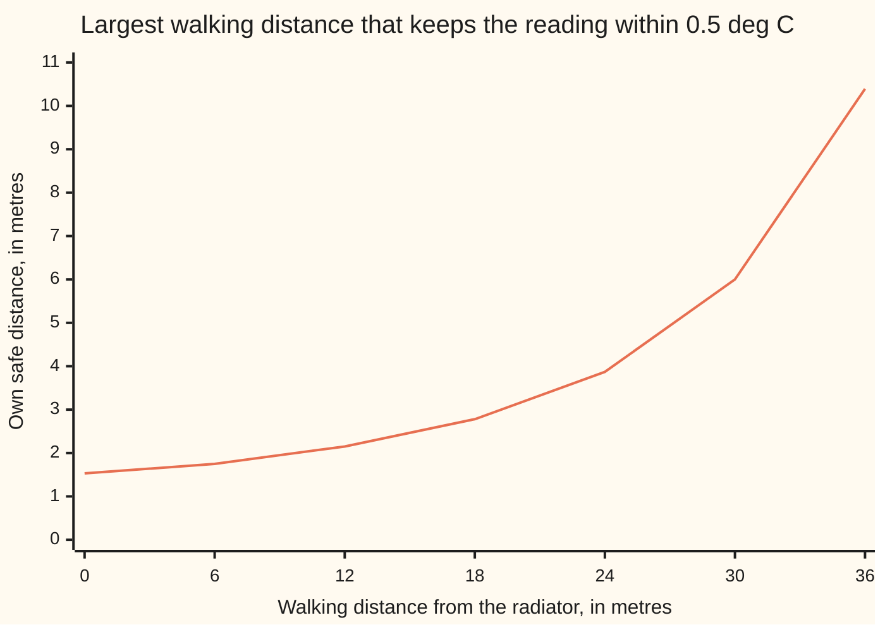

# Uniform continuity: one tolerance for the whole space, and free on a compact set

[Syllabus](../../../SYLLABUS.md) → [Topology](../README.md) → [Metric Spaces](../README.md#s01) → Uniform continuity

---

## General Overview

An open-plan office floor is 24 m by 12 m. The desks stand in rows, so people walk along the aisles: east-west, then north-south. The distance that matters is that walking distance, the same rule as walking a city grid. A radiator sits in the south-west corner. It holds that corner at 22 °C, and the far corner sits at 16 °C.

Facilities wants one rule for the whole floor: a thermometer reading is trusted for every desk within some walking distance of it, to 0.5 °C. Each spot has its own safe distance. By the radiator, where the temperature falls fast, it is 1.532624 m. Halfway across it is 2.784610 m. At the far corner it is 10.392305 m.

One distance that works everywhere exists: the smallest of these, 1.532624 m. A function with one such distance for the whole space, for every tolerance asked of it, is **uniformly continuous**. The question is when the smallest safe distance is above zero. For any temperature that changes without jumps, it always is on this floor, because the floor is compact: closed, bounded, and missing no points.

The temperature also changes at most 1/3 °C per metre walked. Dividing 0.5 °C by that gives a safe distance of 1.5 m in one line. That steepness cap is a Lipschitz constant.

**Uniform continuity asks that, for every tolerance asked of it, the smallest of all the pointwise safe distances is still above zero; on a compact space every continuous function passes, and a Lipschitz constant K hands over the distance as the tolerance divided by K.**

**What kind of fact this is:** a theorem (Heine–Cantor), proved on this card in Why it works, with the Lebesgue number lemma it rests on; uniform continuity and the Lipschitz constant are definitions.

### The picture: each desk's own safe distance



The line is each desk's own safe distance, for desks on the diagonal from the radiator to the far corner. Its lowest point, 1.53 m at the radiator, is the best single distance for the whole floor.

---

## The formula

The calculus card [Uniform continuity](../../06-Calculus%20and%20analysis/01-Limits%20and%20Continuity/08-uniform-continuity-and-lipschitz.md) already tells pointwise from uniform continuity, proves Heine–Cantor on a closed interval $`[a, b]`$ and divides by a Lipschitz constant. This card does the same for any distance, with compactness in place of "closed and bounded".

A **metric space** $`(X, d)`$ is a set $`X`$ with a distance $`d`$ obeying three rules: zero only from a point to itself, the same both ways, and no shortcut through a third point ([Metric space](01-metric-spaces.md)). Here $`X`$ is the floor, and $`d`$ is walking distance, with $`x_p`$ and $`y_p`$ the east and north positions of $`p`$ in metres from the south-west corner:

```math
d(p, q) = \lvert x_p - x_q\rvert + \lvert y_p - y_q\rvert .
```

A function $`f`$ from $`X`$ to the real numbers is **uniformly continuous** when, for every output tolerance $`\varepsilon`$ (epsilon) above zero, one input tolerance $`\delta`$ (delta) above zero works at every point:

```math
d(p, q) < \delta \;\Longrightarrow\; \lvert f(p) - f(q)\rvert < \varepsilon \quad \text{for every } p, q \text{ in } X .
```

**Read it aloud:** whatever accuracy is asked for, one distance can be named first, and any two points that close have values that close, wherever they sit.

Plain continuity at each point only promises some tolerance for each point $`p`$ ([Limits and continuity with distances](04-convergence-and-continuity-in-metric-spaces.md)). Call the largest one that works at $`p`$ its **own tolerance** $`\delta_p`$. One $`\delta`$ works everywhere exactly when it is no bigger than every $`\delta_p`$. So the best single tolerance is the **infimum**, the greatest number at or below them all:

```math
\delta_{\text{best}} = \inf_{p \text{ in } X} \delta_p .
```

**Read it aloud:** the best one-size tolerance is the smallest own tolerance, and uniform continuity means that smallest value is not zero.

Two ways to get it:

- **Lipschitz constant $`K`$.** If $`\lvert f(p) - f(q)\rvert \le K\, d(p, q)`$ for all $`p, q`$, then $`\delta = \varepsilon / K`$ works. For the floor, $`K = 1/3`$ °C per metre, so $`\delta`$ = 0.5 / (1/3) = 1.5 m.
- **Heine–Cantor.** If $`X`$ is compact and $`f`$ is continuous at every point, then $`f`$ is uniformly continuous. It proves some $`\delta`$ exists, without naming one.

As a model field, invented for this example (real heat does not spread along the aisles), take a temperature that depends only on $`s = d(p, r)`$, the walking distance from the radiator corner $`r`$:

```math
T(p) = 16 + 6\left(1 - \frac{s}{36}\right)^2 \text{ degrees C}, \qquad 0 \le s \le 36 .
```

| Symbol | Plain meaning | In our example | Push it up and the answer… |
| --- | --- | --- | --- |
| $`X`$ | the metric space: the set of points | the 24 m by 12 m floor | bigger floor, more places for a steep spot |
| $`d(p, q)`$ | the distance between two points | walking distance along the aisles | — |
| $`f`$, $`T`$, $`\theta`$ | a function on $`X`$; $`T`$ is the temperature; $`\theta`$ is the angle from east in Step 5's torn test field | 22 °C at the radiator to 16 °C at the far corner | — |
| $`p`$, $`q`$, $`c`$; $`x_p`$, $`y_p`$ | points of $`X`$; $`x_p`$ and $`y_p`$ are $`p`$'s east and north positions; $`p_n`$ is a sequence, one point per whole number $`n`$, and $`p_{n_j}`$ a subsequence in the proof | desks | — |
| $`r`$, $`s`$, $`u`$ | the radiator corner; a desk's walking distance from it; $`u = 1 - s/36`$ | $`s`$ from 0 to 36 m, $`u`$ from 1 to 0 | $`s`$ up: own tolerance grows |
| $`\varepsilon`$ | output tolerance | 0.5 °C | every tolerance grows with it |
| $`\delta`$, $`\delta_{\text{best}}`$, $`\inf`$ | one input tolerance for the whole space; the largest such, the infimum (inf) of the own tolerances | 1.532624 m at best | — |
| $`\delta_p`$ | the own tolerance: the largest that works at one point $`p`$ | 1.532624 m to 10.392305 m | — |
| $`K`$ | Lipschitz constant: cap on change per unit distance | 1/3 °C per metre walked | $`\varepsilon / K`$ shrinks |
| $`B(p, \rho)`$, $`\rho_c`$ | open ball: points closer than $`\rho`$ to $`p`$; $`\rho_c`$ is the ball radius continuity gives at $`c`$ | all desks within $`\rho`$ metres' walk | — |
| $`U_1, \dots, U_m`$ | an open cover: open sets that together contain $`X`$ | three heating zones | more overlap, bigger $`\lambda`$ |
| $`\lambda`$ | Lebesgue number: every ball of radius $`\lambda`$ fits inside one $`U_i`$ | 1.00 m | — |

### When it holds

- **Compact, not merely closed and bounded.** Take the floor with one point removed. As a space on its own it is still closed and bounded, yet a field that tears at the missing point has no single tolerance: desks 0.002 m apart, one each side, differ by 4 °C.
- **Continuous at every point.** A glass wall with a cold store behind it makes the temperature jump at the wall line. Desks either side, however close, differ by the whole jump, so no tolerance works.
- **One fixed distance.** The tolerance belongs to the metric. The 1.5 m found for walking distance fails as a tape-measure distance: 1.5 m diagonally from the radiator is a 2.121320 m walk, and the gap is 0.686273 °C.
- **A tolerance, not a constant.** Heine–Cantor gives a $`\delta`$ but no $`K`$. The square root on $`[0, 1]`$ is uniformly continuous with no $`K`$, as the calculus card shows.

---

## Why it works

### Step 0: the infinite minimum is the whole difficulty

Each point has its own tolerance, and each one is above zero. Among finitely many points the smallest is then above zero too. Among infinitely many, the own tolerances can creep down towards zero, and their infimum can be zero.

Compactness is what turns "infinitely many" into "finitely many". It lets finitely many balls do the work of all of them. The Lebesgue number lemma packages that, and Heine–Cantor follows in three lines.

### Step 1: a Lipschitz constant gives the distance outright

The temperature depends on $`s`$ only. Write $`u = 1 - s/36`$, which runs from 1 at the radiator to 0 at the far corner. For two desks, factor the difference of squares:

```math
\lvert T(p) - T(q)\rvert = 6\,\lvert u_p - u_q\rvert\,(u_p + u_q) \le 6 \cdot \frac{\lvert s_p - s_q\rvert}{36} \cdot 2 = \frac{\lvert s_p - s_q\rvert}{3} .
```

The distance-from-the-radiator part needs no geometry, only the no-shortcut rule. Since $`d(p, r) \le d(p, q) + d(q, r)`$, and the same with $`p`$ and $`q`$ swapped,

```math
\lvert d(p, r) - d(q, r)\rvert \le d(p, q) .
```

This holds in every metric space: distance to a fixed point is Lipschitz with constant 1. So $`\lvert T(p) - T(q)\rvert \le d(p, q)/3`$, and $`K = 1/3`$ °C per metre walked. The tolerance is 0.5 / (1/3) = 1.5 m.

At the radiator, a desk 1.5 m away reads 47/96 = 0.489583 °C cooler: inside 0.5 °C, with almost nothing to spare.

### Step 2: each desk's own tolerance, and the smallest of them

From a desk at walking distance $`s`$, a walk of $`\delta`$ reaches every walking distance from $`s - \delta`$ to $`s + \delta`$. The temperature is steeper towards the radiator, so that direction sets the limit. Solving $`T(s - \delta) - T(s) = 0.5`$:

```math
\delta_p = 36\left(\sqrt{u^2 + \tfrac{1}{12}} - u\right).
```

Halfway, $`s = 18`$ and $`u = 1/2`$, so $`\delta_p = 36(\sqrt{1/3} - 1/2)`$ = 2.784610 m. At the far corner, $`u = 0`$, so $`\delta_p = 36\sqrt{1/12}`$ = 10.392305 m.

Within 1.532624 m of the radiator the inward walk runs out of floor, and the outward walk sets the limit: $`\delta_p = 36(u - \sqrt{u^2 - 1/12})`$. At the radiator itself this is $`36(1 - \sqrt{11/12})`$ = 1.532624 m, the smallest own tolerance on the floor. It is the best single tolerance, and the Lipschitz 1.5 m sits just below it.

### Step 3: the Lebesgue number lemma

Split the floor into three heating zones, as full-depth strips: west from 0 up to 9 m, middle strictly between 7 m and 17 m, east from 15 m to 24 m. They overlap by 2 m twice. Every ball of radius 1 m fits inside one zone, and no larger radius does: around the desk at 8 m, a ball of radius just over 1 m pokes out of both the west and the middle zone. So the cover's **Lebesgue number** is 1.00 m.

**The lemma:** in a compact metric space, every open cover has a Lebesgue number $`\lambda`$ above zero. Every ball $`B(p, \lambda)`$ lies inside one set of the cover.

Here **compact** means every sequence of points has a subsequence that settles on a point of $`X`$; in a metric space this agrees with the finite-cover version ([Compactness three ways](06-compactness-in-metric-spaces.md)). The proof runs by contradiction: if no $`\lambda`$ worked, there would be balls of radius 1, 1/2, 1/3 and on, each fitting in no set. Their centres settle on a point. That point sits inside one open set with room to spare, and the late small balls fit in it.

<details>
<summary>Detailed proof: the Lebesgue number lemma</summary>

Let $`U_1, \dots, U_m`$ (or any collection of open sets) cover the compact metric space $`X`$. Suppose no $`\lambda`$ above zero works.

Then for each whole number $`n`$, the radius $`1/n`$ fails: some point $`p_n`$ has a ball $`B(p_n, 1/n)`$ lying in no single cover set.

By compactness, a subsequence $`p_{n_j}`$ converges to a point $`c`$ of $`X`$. The point $`c`$ lies in some cover set $`U`$. That set is open, so some ball $`B(c, \rho)`$ lies inside $`U`$.

Pick $`j`$ so large that $`d(p_{n_j}, c) < \rho/2`$ and $`1/n_j < \rho/2`$. For any $`q`$ in $`B(p_{n_j}, 1/n_j)`$, the no-shortcut rule gives

$`\displaystyle d(q, c) \le d(q, p_{n_j}) + d(p_{n_j}, c) < \frac{\rho}{2} + \frac{\rho}{2} = \rho .`$

So $`B(p_{n_j}, 1/n_j)`$ lies inside $`B(c, \rho)`$, which lies inside $`U`$. That contradicts the choice of $`p_{n_j}`$. So some $`\lambda`$ above zero works.

</details>

### Step 4: Heine–Cantor from the lemma

Fix $`\varepsilon`$. Continuity at each point $`c`$ gives a radius $`\rho_c`$: every point within $`\rho_c`$ of $`c`$ has a value within $`\varepsilon/2`$ of $`f(c)`$. The balls $`B(c, \rho_c)`$, one around each point, cover $`X`$.

Take a Lebesgue number $`\lambda`$ of that cover. If $`d(p, q) < \lambda`$, then $`q`$ lies in $`B(p, \lambda)`$, and that ball lies inside one $`B(c, \rho_c)`$. Both $`p`$ and $`q`$ are within $`\rho_c`$ of $`c`$, so

```math
\lvert f(p) - f(q)\rvert \le \lvert f(p) - f(c)\rvert + \lvert f(c) - f(q)\rvert < \frac{\varepsilon}{2} + \frac{\varepsilon}{2} = \varepsilon .
```

So $`\delta = \lambda`$ works at every point. Compactness was spent once, inside the lemma. The calculus card's proof by sequences also carries over word for word, with $`d`$ in place of $`\lvert x - y\rvert`$.

### Step 5: where the proof breaks without compactness

Remove one point, $`(12, 6)`$, from the floor. As a test field built to tear there, let the temperature depend only on the direction from that point: 22 °C due east of it, 18 °C due west, and $`20 + 2\cos\theta`$ in between, with $`\theta`$ the angle from east. Every remaining point has an own tolerance, so the field is continuous.

A desk 1.000 m east of the gap has own tolerance 0.881917 m. At 0.100 m it is 0.088192 m, and at 0.010 m it is 0.008819 m. The own tolerances shrink in step with the distance to the gap, so their infimum is zero. Desks 0.001 m either side of the gap are a 0.002 m walk apart and differ by 4 °C.

In the lemma's proof, the bad points $`p_n`$ settle on $`(12, 6)`$, which is not in the space. The removed floor is closed and bounded as a space of its own, since every space is closed in itself. It is not compact, and that is the only hypothesis that failed.

---

## Worked numbers, by hand

| Step | Arithmetic | Value |
| --- | --- | --- |
| output tolerance | from the brief to facilities | 0.5 °C |
| Lipschitz constant | 6 × 2 / 36 | K = 1/3 °C per metre walked |
| Lipschitz tolerance | 0.5 / (1/3) | 1.5 m |
| radiator against 1.5 m away | 6 × (1 − (34.5/36)²) | 47/96 = 0.489583 °C, inside 0.5 |
| own tolerance halfway | 36 × (√(1/3) − 1/2) | 2.784610 m |
| own tolerance, far corner | 36 × √(1/12) | 10.392305 m |
| best single tolerance | 36 × (1 − √(11/12)) | **1.532624 m** |

A reading is good to 0.5 °C for every desk within a 1.53 m walk, anywhere on the floor; the 1.5 m from $`K`$ is the safe round figure.

### What breaks if you drop a piece

| Mistake | Comes out at | What went wrong |
| --- | --- | --- |
| Halfway tolerance 2.784610 m used at the radiator | gap 0.892305 °C | a pointwise tolerance, not a uniform one |
| Far-corner tolerance 10.392305 m used at the radiator | gap 2.964102 °C | the same, worse |
| 1.5 m measured by tape, diagonally from the radiator | 2.121320 m walk, gap 0.686273 °C | wrong metric for that $`K`$ |
| Floor with the point (12, 6) removed, tearing field | 0.002 m walk, gap 4 °C | not compact |

The code prints all four.

---

## Code, from first principles, and it actually runs

The code reaches the best tolerance by two independent roads, and adds a Lipschitz bound below it and a brute-force Lebesgue number. It finds each desk's own tolerance by bisection: it halves a search interval sixty times, testing 545 sampled desks inside the walking ball each time, and takes no roots. It compares that with the formula of Step 2 and takes the smallest over 91 desks on a 2 m grid. It checks $`K = 1/3`$ against every pair on a 1 m grid, and finds the zones' Lebesgue number by brute force over every centimetre. Sampling illustrates; the proofs are in Why it works.

### Python

```python
# Uniform continuity and Heine-Cantor -- the check behind the card.  Only
# math.sqrt and Fraction are imported.  Example: an office floor 24 m by 12 m,
# distance = walking distance along the aisles, |dx| + |dy|.  A radiator in the
# corner (0, 0); temperature T = 16 + 6 u^2 deg C, u = 1 - s/36, s = x + y.
from math import sqrt
from fractions import Fraction as F
W, H, S, EPS = 24.0, 12.0, 36.0, 0.5

def temp(x, y, amp=6.0):
    u = 1 - (x + y) / S
    return 16 + amp * u * u

def vent(x, y):                            # test field: depends on direction from (12, 6)
    return 20 + 2 * (x - 12) / sqrt((x - 12) ** 2 + (y - 6) ** 2)

def walk(p, q): return abs(p[0] - q[0]) + abs(p[1] - q[1])
def line(p, q): return sqrt((p[0] - q[0]) ** 2 + (p[1] - q[1]) ** 2)

def ok(f, x, y, d, n=16):                  # every sampled desk within walking d of (x, y)
    t = f(x, y)
    for i in range(-n, n + 1):
        for j in range(abs(i) - n, n - abs(i) + 1):
            qx, qy = x + d * i / n, y + d * j / n
            if 0 <= qx <= W and 0 <= qy <= H and (qx, qy) != (12.0, 6.0):
                if abs(f(qx, qy) - t) > EPS + 1e-12:
                    return False
    return True

def tol(f, x, y):                          # bisection: the largest d that passes, no roots
    lo, hi = 0.0, 40.0
    for _ in range(60):
        mid = (lo + hi) / 2
        lo, hi = (mid, hi) if ok(f, x, y, mid) else (lo, mid)
    return lo

def tol_formula(s):                        # same tolerance from the algebra, c = EPS / 6
    u, c = 1 - s / S, EPS / 6
    toward = S * (sqrt(u * u + c) - u)
    return toward if s >= toward else S * (u - sqrt(u * u - c))

# Road 1: the Lipschitz constant.  |T(p) - T(q)| <= d(p, q) / 3, proved on the card.
K = 12 / S
g = [(x, y) for x in range(25) for y in range(13)]
steep = max(abs(temp(*p) - temp(*q)) / walk(p, q) for i, p in enumerate(g) for q in g[i + 1:])
steep2 = max(abs(temp(*p) - temp(*q)) / line(p, q) for i, p in enumerate(g) for q in g[i + 1:])
print(f"K = 12/36 = {K:.6f} deg C per metre walked; steepest on the 1 m grid: {steep:.6f}")
print(f"steepest per straight-line metre on the grid: {steep2:.6f}")
print(f"temperatures: radiator {temp(0, 0):.6f}, halfway {temp(12, 6):.6f}, far corner {temp(24, 12):.6f}; test field {vent(13, 6):.6f} east, {vent(11, 6):.6f} west")
lip = EPS / K
worst = 6 * (1 - (1 - F(3, 2) / 36) ** 2)
print(f"Lipschitz tolerance 0.5 / K: {lip:.6f} m; radiator to 1.5 m away: {worst} = {float(worst):.6f} deg C")
# Road 2: each desk's own tolerance, by formula and by bisection, along the diagonal.
ss = [0, 6, 12, 18, 24, 30, 36]
pts = [tol(temp, 2 * s / 3, s / 3) for s in ss]
for s, p in zip(ss, pts):
    assert abs(p - tol_formula(s)) < 1e-9                    # bisection against the algebra
best = S * (1 - sqrt(1 - EPS / 6))
print(f"own tolerance at the radiator {pts[0]:.6f} m, halfway (s = 18) {pts[3]:.6f} m, far corner {pts[-1]:.6f} m")
grid_min = min(tol(temp, x, y) for x in range(0, 25, 2) for y in range(0, 13, 2))
assert abs(grid_min - best) < 1e-9                           # smallest own tolerance = formula
print(f"best single tolerance: formula 36(1 - sqrt(11/12)) = {best:.6f} m; smallest of 91 desks' own: {grid_min:.6f} m")
for name, d in (("halfway", pts[3]), ("far corner", pts[-1])):
    print(f"{name} tolerance {d:.6f} m used at the radiator: gap {temp(0, 0) - temp(d, 0):.6f} deg C")
t = lip / sqrt(2)                                            # 1.5 m by tape measure, diagonally
print(f"1.5 m by tape from the radiator to ({t:.4f}, {t:.4f}): walk {2 * t:.6f} m, gap {temp(0, 0) - temp(t, t):.6f} deg C")
# Road 3: the Lebesgue number of three heating zones, by brute force over desks.
zones = [(0, 900), (700, 1700), (1500, 2400)]               # in centimetres: [0, 9), (7, 17), (15, 24]
def exit_cm(x, a, b):                                        # walk needed to leave the zone
    if not ((a == 0 or a < x) and (b == 2400 or x < b)):
        return 0
    return min([x - a] * (a > 0) + [b - x] * (b < 2400))
lam = min(max(exit_cm(x, a, b) for a, b in zones) for x in range(2401))
half = min(zones[i][1] - zones[i + 1][0] for i in range(2)) / 2
assert lam == half                                           # brute force against half the overlap
print(f"zones [0, 9) (7, 17) (15, 24]: Lebesgue number {lam / 100:.2f} m by brute force, half the overlap {half / 100:.2f} m")
# What breaks: the floor with one point (12, 6) missing, and a field that tears there.
for r in (1.0, 0.1, 0.01, 0.001):
    gap = vent(12 + r, 6) - vent(12 - r, 6)
    print(f"missing point, desks {r:.3f} m either side: walk {2 * r:.3f} m, gap {gap:.6f} deg C")
    assert abs(gap - 4) < 1e-9
own = [tol(vent, 12 + r, 6) for r in (1.0, 0.1, 0.01)]
tan0 = sqrt(1 - 0.75 ** 2) / 0.75                            # cos = 0.75 is 21.5 deg C
for r, d in zip((1.0, 0.1, 0.01), own):
    assert abs(d - r * tan0) < 1e-9                         # bisection against the geometry
    print(f"missing point, own tolerance at {r:.3f} m from it: {d:.6f} m (geometry {r * tan0:.6f})")
print(f"try: EPS 0.25 gives {0.25 / K:.6f} m Lipschitz, {S * (1 - sqrt(1 - 0.25 / 6)):.6f} m best;"
      f" amp 12 gives K {24 / S:.6f}, {EPS / (24 / S):.6f} m")
print("figure, s m:", " ".join(f"{s}" for s in ss))
print("figure, own tolerance m:", " ".join(f"{p:.2f}" for p in pts))
assert 0 <= K - steep < 0.005 and steep2 > K                # grid chords against K = 1/3
print("ALL CHECKS PASS")
```

**Ran 2026-11-14 on macOS, Python 3.14.10, standard library only. All checks passed. Output, pasted from the run:**

```
K = 12/36 = 0.333333 deg C per metre walked; steepest on the 1 m grid: 0.328704
steepest per straight-line metre on the grid: 0.458310
temperatures: radiator 22.000000, halfway 17.500000, far corner 16.000000; test field 22.000000 east, 18.000000 west
Lipschitz tolerance 0.5 / K: 1.500000 m; radiator to 1.5 m away: 47/96 = 0.489583 deg C
own tolerance at the radiator 1.532624 m, halfway (s = 18) 2.784610 m, far corner 10.392305 m
best single tolerance: formula 36(1 - sqrt(11/12)) = 1.532624 m; smallest of 91 desks' own: 1.532624 m
halfway tolerance 2.784610 m used at the radiator: gap 0.892305 deg C
far corner tolerance 10.392305 m used at the radiator: gap 2.964102 deg C
1.5 m by tape from the radiator to (1.0607, 1.0607): walk 2.121320 m, gap 0.686273 deg C
zones [0, 9) (7, 17) (15, 24]: Lebesgue number 1.00 m by brute force, half the overlap 1.00 m
missing point, desks 1.000 m either side: walk 2.000 m, gap 4.000000 deg C
missing point, desks 0.100 m either side: walk 0.200 m, gap 4.000000 deg C
missing point, desks 0.010 m either side: walk 0.020 m, gap 4.000000 deg C
missing point, desks 0.001 m either side: walk 0.002 m, gap 4.000000 deg C
missing point, own tolerance at 1.000 m from it: 0.881917 m (geometry 0.881917)
missing point, own tolerance at 0.100 m from it: 0.088192 m (geometry 0.088192)
missing point, own tolerance at 0.010 m from it: 0.008819 m (geometry 0.008819)
try: EPS 0.25 gives 0.750000 m Lipschitz, 0.757980 m best; amp 12 gives K 0.666667, 0.750000 m
figure, s m: 0 6 12 18 24 30 36
figure, own tolerance m: 1.53 1.75 2.15 2.78 3.87 6.00 10.39
ALL CHECKS PASS
```

### Rust

```rust
// Uniform continuity and Heine-Cantor -- the check behind the card.  std only.
// Example: an office floor 24 m by 12 m, distance = walking distance along the
// aisles, |dx| + |dy|.  A radiator in the corner (0, 0); temperature
// T = 16 + 6 u^2 deg C, u = 1 - s/36, s = x + y.
const W: f64 = 24.0;
const H: f64 = 12.0;
const S: f64 = 36.0;
const EPS: f64 = 0.5;

fn temp(x: f64, y: f64) -> f64 { let u = 1.0 - (x + y) / S; 16.0 + 6.0 * u * u }

fn vent(x: f64, y: f64) -> f64 { // test field: depends on direction from (12, 6)
    20.0 + 2.0 * (x - 12.0) / ((x - 12.0).powi(2) + (y - 6.0).powi(2)).sqrt()
}

fn walk(p: (f64, f64), q: (f64, f64)) -> f64 { (p.0 - q.0).abs() + (p.1 - q.1).abs() }
fn line(p: (f64, f64), q: (f64, f64)) -> f64 { ((p.0 - q.0).powi(2) + (p.1 - q.1).powi(2)).sqrt() }

fn ok(f: fn(f64, f64) -> f64, x: f64, y: f64, d: f64) -> bool { // every sampled desk within walking d
    let n = 16i32;
    let t = f(x, y);
    for i in -n..=n {
        for j in (i.abs() - n)..=(n - i.abs()) {
            let (qx, qy) = (x + d * i as f64 / n as f64, y + d * j as f64 / n as f64);
            if 0.0 <= qx && qx <= W && 0.0 <= qy && qy <= H && (qx, qy) != (12.0, 6.0) {
                if (f(qx, qy) - t).abs() > EPS + 1e-12 { return false; }
            }
        }
    }
    true
}

fn tol(f: fn(f64, f64) -> f64, x: f64, y: f64) -> f64 { // bisection: the largest d that passes, no roots
    let (mut lo, mut hi) = (0.0, 40.0);
    for _ in 0..60 {
        let mid = (lo + hi) / 2.0;
        if ok(f, x, y, mid) { lo = mid } else { hi = mid }
    }
    lo
}

fn tol_formula(s: f64) -> f64 { // same tolerance from the algebra, c = EPS / 6
    let (u, c) = (1.0 - s / S, EPS / 6.0);
    let toward = S * ((u * u + c).sqrt() - u);
    if s >= toward { toward } else { S * (u - (u * u - c).sqrt()) }
}

fn gcd(a: i64, b: i64) -> i64 { if b == 0 { a } else { gcd(b, a % b) } }

fn exit_cm(x: i64, a: i64, b: i64) -> i64 { // walk needed to leave the zone
    if !((a == 0 || a < x) && (b == 2400 || x < b)) { return 0; }
    let mut m = i64::MAX;
    if a > 0 { m = m.min(x - a) }
    if b < 2400 { m = m.min(b - x) }
    m
}

fn main() {
    // Road 1: the Lipschitz constant.  |T(p) - T(q)| <= d(p, q) / 3, proved on the card.
    let k = 12.0 / S;
    let mut g = Vec::new();
    for x in 0..25 { for y in 0..13 { g.push((x as f64, y as f64)); } }
    let (mut steep, mut steep2) = (0.0f64, 0.0f64);
    for i in 0..g.len() {
        for j in i + 1..g.len() {
            let gap = (temp(g[i].0, g[i].1) - temp(g[j].0, g[j].1)).abs();
            steep = steep.max(gap / walk(g[i], g[j]));
            steep2 = steep2.max(gap / line(g[i], g[j]));
        }
    }
    println!("K = 12/36 = {:.6} deg C per metre walked; steepest on the 1 m grid: {:.6}", k, steep);
    println!("steepest per straight-line metre on the grid: {:.6}", steep2);
    println!("temperatures: radiator {:.6}, halfway {:.6}, far corner {:.6}; test field {:.6} east, {:.6} west",
        temp(0.0, 0.0), temp(12.0, 6.0), temp(24.0, 12.0), vent(13.0, 6.0), vent(11.0, 6.0));
    let lip = EPS / k;
    let (num, den) = (6 * (72 * 72 - 69 * 69), 72 * 72i64); // 6 (1 - (34.5/36)^2) as a fraction
    let c = gcd(num, den);
    println!("Lipschitz tolerance 0.5 / K: {:.6} m; radiator to 1.5 m away: {}/{} = {:.6} deg C",
        lip, num / c, den / c, num as f64 / den as f64);
    // Road 2: each desk's own tolerance, by formula and by bisection, along the diagonal.
    let ss = [0, 6, 12, 18, 24, 30, 36];
    let pts: Vec<f64> = ss.iter().map(|&s| tol(temp, 2.0 * s as f64 / 3.0, s as f64 / 3.0)).collect();
    for (s, p) in ss.iter().zip(&pts) {
        assert!((p - tol_formula(*s as f64)).abs() < 1e-9); // bisection against the algebra
    }
    let best = S * (1.0 - (1.0 - EPS / 6.0).sqrt());
    println!("own tolerance at the radiator {:.6} m, halfway (s = 18) {:.6} m, far corner {:.6} m", pts[0], pts[3], pts[6]);
    let mut grid_min = f64::MAX;
    for x in (0..25).step_by(2) { for y in (0..13).step_by(2) { grid_min = grid_min.min(tol(temp, x as f64, y as f64)); } }
    assert!((grid_min - best).abs() < 1e-9); // smallest own tolerance = formula
    println!("best single tolerance: formula 36(1 - sqrt(11/12)) = {:.6} m; smallest of 91 desks' own: {:.6} m", best, grid_min);
    for (name, d) in [("halfway", pts[3]), ("far corner", pts[6])] {
        println!("{} tolerance {:.6} m used at the radiator: gap {:.6} deg C", name, d, temp(0.0, 0.0) - temp(d, 0.0));
    }
    let t = lip / 2f64.sqrt(); // 1.5 m by tape measure, diagonally
    println!("1.5 m by tape from the radiator to ({:.4}, {:.4}): walk {:.6} m, gap {:.6} deg C", t, t, 2.0 * t, temp(0.0, 0.0) - temp(t, t));
    // Road 3: the Lebesgue number of three heating zones, by brute force over desks.
    let zones = [(0i64, 900i64), (700, 1700), (1500, 2400)]; // in centimetres: [0, 9), (7, 17), (15, 24]
    let lam = (0..=2400i64).map(|x| zones.iter().map(|&(a, b)| exit_cm(x, a, b)).max().unwrap()).min().unwrap();
    let half = (zones[0].1 - zones[1].0).min(zones[1].1 - zones[2].0) as f64 / 2.0;
    assert!(lam as f64 == half); // brute force against half the overlap
    println!("zones [0, 9) (7, 17) (15, 24]: Lebesgue number {:.2} m by brute force, half the overlap {:.2} m", lam as f64 / 100.0, half / 100.0);
    // What breaks: the floor with one point (12, 6) missing, and a field that tears there.
    for r in [1.0f64, 0.1, 0.01, 0.001] {
        let gap = vent(12.0 + r, 6.0) - vent(12.0 - r, 6.0);
        println!("missing point, desks {:.3} m either side: walk {:.3} m, gap {:.6} deg C", r, 2.0 * r, gap);
        assert!((gap - 4.0).abs() < 1e-9);
    }
    let tan0 = (1.0f64 - 0.75 * 0.75).sqrt() / 0.75; // cos = 0.75 is 21.5 deg C
    for r in [1.0f64, 0.1, 0.01] {
        let d = tol(vent, 12.0 + r, 6.0);
        assert!((d - r * tan0).abs() < 1e-9); // bisection against the geometry
        println!("missing point, own tolerance at {:.3} m from it: {:.6} m (geometry {:.6})", r, d, r * tan0);
    }
    println!("try: EPS 0.25 gives {:.6} m Lipschitz, {:.6} m best; amp 12 gives K {:.6}, {:.6} m",
        0.25 / k, S * (1.0 - (1.0f64 - 0.25 / 6.0).sqrt()), 24.0 / S, EPS / (24.0 / S));
    let sv: Vec<String> = ss.iter().map(|s| s.to_string()).collect();
    let pv: Vec<String> = pts.iter().map(|p| format!("{:.2}", p)).collect();
    println!("figure, s m: {}", sv.join(" "));
    println!("figure, own tolerance m: {}", pv.join(" "));
    assert!(k - steep >= 0.0 && k - steep < 0.005 && steep2 > k); // grid chords against K = 1/3
    println!("ALL CHECKS PASS");
}
```

**Ran 2026-11-14 on macOS, rustc 1.98.1, no crates. All checks passed. Output, pasted from the run:**

```
K = 12/36 = 0.333333 deg C per metre walked; steepest on the 1 m grid: 0.328704
steepest per straight-line metre on the grid: 0.458310
temperatures: radiator 22.000000, halfway 17.500000, far corner 16.000000; test field 22.000000 east, 18.000000 west
Lipschitz tolerance 0.5 / K: 1.500000 m; radiator to 1.5 m away: 47/96 = 0.489583 deg C
own tolerance at the radiator 1.532624 m, halfway (s = 18) 2.784610 m, far corner 10.392305 m
best single tolerance: formula 36(1 - sqrt(11/12)) = 1.532624 m; smallest of 91 desks' own: 1.532624 m
halfway tolerance 2.784610 m used at the radiator: gap 0.892305 deg C
far corner tolerance 10.392305 m used at the radiator: gap 2.964102 deg C
1.5 m by tape from the radiator to (1.0607, 1.0607): walk 2.121320 m, gap 0.686273 deg C
zones [0, 9) (7, 17) (15, 24]: Lebesgue number 1.00 m by brute force, half the overlap 1.00 m
missing point, desks 1.000 m either side: walk 2.000 m, gap 4.000000 deg C
missing point, desks 0.100 m either side: walk 0.200 m, gap 4.000000 deg C
missing point, desks 0.010 m either side: walk 0.020 m, gap 4.000000 deg C
missing point, desks 0.001 m either side: walk 0.002 m, gap 4.000000 deg C
missing point, own tolerance at 1.000 m from it: 0.881917 m (geometry 0.881917)
missing point, own tolerance at 0.100 m from it: 0.088192 m (geometry 0.088192)
missing point, own tolerance at 0.010 m from it: 0.008819 m (geometry 0.008819)
try: EPS 0.25 gives 0.750000 m Lipschitz, 0.757980 m best; amp 12 gives K 0.666667, 0.750000 m
figure, s m: 0 6 12 18 24 30 36
figure, own tolerance m: 1.53 1.75 2.15 2.78 3.87 6.00 10.39
ALL CHECKS PASS
```

The two outputs agree line for line.

### Lean

Lean proves Heine–Cantor and the lemma on every compact metric space, the Lipschitz division on every metric space, and the worked numbers.

- Take a compact metric space $`X`$ and a real function $`f`$ continuous at every point. Then $`f`$ is uniformly continuous.
- Take a compact metric space and any cover of it by open sets. Then the cover has a Lebesgue number $`\lambda`$ above zero.
- Suppose $`\lvert f(p) - f(q)\rvert \le K\, d(p, q)`$ for all $`p, q`$, with $`K`$ above zero. Then $`\delta = \varepsilon / K`$ works for every $`\varepsilon`$ above zero.
- Take the floor's field. Then K = 6 × 2 / 36 = 1/3 °C per metre walked, and the tolerance is 0.5 / (1/3) = 1.5 m.
- Take the radiator and a desk 1.5 m away. Then the gap is 47/96 °C, inside 0.5 °C.
- Take the best tolerance, 36 × (1 − √(11/12)). Then it is above 1.5 m, since 11/12 is below (23/24)².
- The three heating zones overlap by 2 m twice, so their Lebesgue number is half an overlap: 1 m.
- The torn test field jumps by 22 − 18 = 4 °C across the gap.

The own tolerances, the bisection, the grid search, the sampled pairs and the decimals are left to the Python and Rust checks.

```lean
-- Uniform continuity: on a compact metric space every continuous real function has one input tolerance that works at every point, resting on the Lebesgue number lemma, and a Lipschitz constant K hands over that tolerance as the output tolerance divided by K.
import Mathlib.Topology.MetricSpace.Pseudo.Lemmas
import Mathlib.Topology.UniformSpace.HeineCantor
import Mathlib.Topology.Instances.Real.Lemmas
import Mathlib.Tactic.NormNum

/-- Heine–Cantor. If the metric space X is compact and f, from X to the real numbers, is
continuous at every point, then f is uniformly continuous: for every output tolerance ε above
zero, one input tolerance δ above zero works at every point, so any two points closer than δ
have values closer than ε. -/
theorem heine_cantor_compact_continuous_is_uniformly_continuous
    {X : Type*} [MetricSpace X] [CompactSpace X] (f : X → ℝ)
    (hf : ∀ p, ContinuousAt f p) :
    ∀ ε > 0, ∃ δ > 0, ∀ p q : X, dist p q < δ → |f p - f q| < ε := by
  have hu := CompactSpace.uniformContinuous_of_continuous (continuous_iff_continuousAt.mpr hf)
  intro ε hε
  obtain ⟨δ, hδ, h⟩ := Metric.uniformContinuous_iff.mp hu ε hε
  exact ⟨δ, hδ, fun p q hpq => by simpa [Real.dist_eq] using h hpq⟩

/-- The Lebesgue number lemma. In a compact metric space, every cover by open sets has a
Lebesgue number: one radius above zero such that every ball of that radius lies inside a single
set of the cover. -/
theorem lebesgue_number_lemma_compact_metric
    {X : Type*} [MetricSpace X] [CompactSpace X] {ι : Type*} (U : ι → Set X)
    (hU : ∀ i, IsOpen (U i)) (hcover : ⋃ i, U i = Set.univ) :
    ∃ lam > 0, ∀ p : X, ∃ i, Metric.ball p lam ⊆ U i := by
  obtain ⟨δ, hδ, h⟩ := lebesgue_number_lemma_of_metric (s := Set.univ) isCompact_univ hU
    (by rw [hcover])
  exact ⟨δ, hδ, fun p => h p (Set.mem_univ p)⟩

/-- A Lipschitz constant gives the tolerance outright. If |f(p) − f(q)| ≤ K d(p, q) for all
p and q, with K above zero, then δ = ε / K works for every output tolerance ε above zero. -/
theorem lipschitz_constant_gives_tolerance
    {X : Type*} [MetricSpace X] (f : X → ℝ) (K : ℝ) (hK : 0 < K)
    (hf : ∀ p q : X, |f p - f q| ≤ K * dist p q) :
    ∀ ε > 0, ∀ p q : X, dist p q < ε / K → |f p - f q| < ε := by
  intro ε hε p q hpq
  calc |f p - f q| ≤ K * dist p q := hf p q
    _ < K * (ε / K) := by gcongr
    _ = ε := by field_simp

-- The floor's Lipschitz constant: 6 × 2 / 36 = 1/3 degree C per metre walked.
example : (6 : ℚ) * 2 / 36 = 1 / 3 := by norm_num
-- Lipschitz tolerance: 0.5 / (1/3) = 1.5 m.
example : (1 / 2 : ℚ) / (1 / 3) = 3 / 2 := by norm_num
-- Radiator against a desk 1.5 m away: 6 × (1 − (34.5/36)²) = 47/96 degree C, inside 0.5.
example : (6 : ℚ) * (1 - (69 / 72) ^ 2) = 47 / 96 ∧ (47 / 96 : ℚ) < 1 / 2 := by norm_num
-- The best tolerance 36(1 − √(11/12)) is above 1.5 m, since √(11/12) < 23/24: 11/12 < (23/24)².
example : (11 / 12 : ℚ) < (23 / 24) ^ 2 := by norm_num
-- Three heating zones in centimetres, [0, 900), (700, 1700), (1500, 2400]: overlaps of 200 cm,
-- so the Lebesgue number is half an overlap, 100 cm.
example : min (900 - 700) (1700 - 1500) / 2 = (100 : ℕ) := by decide
-- The torn test field: 22 degrees C east of the gap against 18 west, a 4 degree C jump.
example : (22 : ℤ) - 18 = 4 := by decide

#print axioms heine_cantor_compact_continuous_is_uniformly_continuous
#print axioms lebesgue_number_lemma_compact_metric
#print axioms lipschitz_constant_gives_tolerance
```

**Checked 2026-11-14 on macOS, Lean 4.36.0-rc2, Mathlib v4.36.0-rc2. Every proof is complete and uses only Lean's standard axioms. Output, pasted from the run:**

```
'heine_cantor_compact_continuous_is_uniformly_continuous' depends on axioms: [propext, Classical.choice, Quot.sound]
'lebesgue_number_lemma_compact_metric' depends on axioms: [propext, Classical.choice, Quot.sound]
'lipschitz_constant_gives_tolerance' depends on axioms: [propext, Classical.choice, Quot.sound]
```

> [!TIP]
> **Try changing**
> Guess first, then run the Python. Some asserts are pinned to the card's numbers, so expect a few runs to stop.
> - **Guess first:** a tighter tolerance, `EPS = 0.25`. The Lipschitz tolerance halves to 0.75 m; the best one drops to 0.757980 m, a little more than half. Both lines print, then the missing-point assert stops the run, since its 21.5 °C threshold belongs to 0.5 °C.
> - **Guess first:** a radiator twice as strong, `amp=12.0` in `temp`. The steepest grid chord doubles to 0.657407 °C per metre. The `K` line still prints 0.333333, because `K = 12 / S` is typed in; the true K doubles to 0.666667 and the tolerance halves to 0.75 m, as the unchanged run's `try` line prints. Then the first assert stops the run, since the formula of Step 2 is written for amplitude 6.
> - **Guess first:** zones overlapping by 4 m on the west side, `(0, 1000)` and `(600, 1700)`. The Lebesgue number stays 1.00 m, since the narrow 2 m overlap on the east side still decides it.
> - **Guess first:** add `0.001` to the two `(1.0, 0.1, 0.01)` tuples, the one in `own = [...]` and the one in `zip(...)`. The own tolerance falls tenfold again, to 0.000882 m.

---

## The usual mistake

> [!warning]
> **Checking every point and calling it uniform.** Every desk has a tolerance, from 1.532624 m to 10.392305 m, but that is plain continuity. Uniform continuity needs the smallest of them to stay above zero. Near the missing point it does not, though every desk still has its own.
>
> - **"Closed and bounded" in a general space.** The floor minus one point is closed and bounded as a space of its own; desks a 0.002 m walk apart still differ by 4 °C. Compactness is the hypothesis.
> - **Mixing metrics.** The 1.5 m from walking distance, used as a tape-measure distance, lets a 0.686273 °C gap through.
> - **Sampled pairs as proof of K.** The steepest pair on the 1 m grid changes by 0.328704 °C per metre; sampling can refute a K, never prove one. Step 1 proves 1/3.

---

## Where you meet it in real life

- **Sensor placement.** A building, a field or a reservoir is a compact region. Heine–Cantor guarantees one sensor spacing that serves it all, and a Lipschitz bound on the measured quantity turns the spacing into a division.
- **Numerical methods on a region.** A computer evaluates a function on a grid. Uniform continuity is why refining the grid makes the error small everywhere at once, not just at each point.
- **Neural networks and control.** A Lipschitz bound on a network or a controller caps how far its output can move when the input is nudged, in whatever distance the inputs are measured.
- **Equicontinuity.** Applied to a whole family of functions at once, "one tolerance for all" is the hypothesis of Arzela-Ascoli.

> **Say it back**
> Each point of a continuous function has its own safe distance. Uniform continuity asks for one distance that serves every point, and the best one is the smallest of the own distances. On a compact space that smallest value is above zero: the Lebesgue number lemma finds one radius that fits every point's ball, and Heine–Cantor follows. A Lipschitz constant K gives the distance as the tolerance divided by K: 1.5 m for the office floor, with 1.532624 m the best possible.

---

## What this builds on

- [Compactness three ways](06-compactness-in-metric-spaces.md): sequences settling on a point of the space, the fact the Lebesgue number lemma spends.
- [Uniform continuity](../../06-Calculus%20and%20analysis/01-Limits%20and%20Continuity/08-uniform-continuity-and-lipschitz.md): pointwise against uniform, Heine–Cantor on $`[a, b]`$ and the Lipschitz division, all on the real line.

## Where this goes next

- [Banach's fixed point theorem](08-banach-fixed-point-in-metric-spaces.md): a map with Lipschitz constant below 1 on a complete space has exactly one fixed point.
- [Arzela-Ascoli](09-arzela-ascoli.md): one tolerance shared by a whole family of functions, equicontinuity, is what lets a sequence of functions have a convergent subsequence.
- [Covering dimension](../04-Homotopy/09-lebesgue-covering-dimension.md): count how many pieces of a fine cover must overlap at one point.

The question this card leaves open: when do many functions share one tolerance, so that a limit of them stays continuous?

---

## Sources

Verified 2026-11-14: every link below resolves to the publisher's page.

- Lebl, Jiří. *Basic Analysis I & II*, §7.4 "Completeness and compactness". [Section page](https://www.jirka.org/ra/html/sec_metcompact.html). Free; Lemma 7.4.10 is the Lebesgue covering lemma, proved by sequences as here.
- Lebl, Jiří. *Basic Analysis I & II*, §7.5 "Continuous functions". [Section page](https://www.jirka.org/ra/html/sec_metcont.html). Theorem 7.5.11, continuous on a compact metric space gives uniformly continuous, and Lipschitz maps in Example 7.5.13.
- Munkres, James R. *Topology*, 2nd ed., Classic Version. Pearson. [Publisher page](https://www.pearson.com/en-us/subject-catalog/p/topology-classic-version/P200000006236/9780134689517). Section 27: the Lebesgue number lemma and the uniform continuity theorem.
