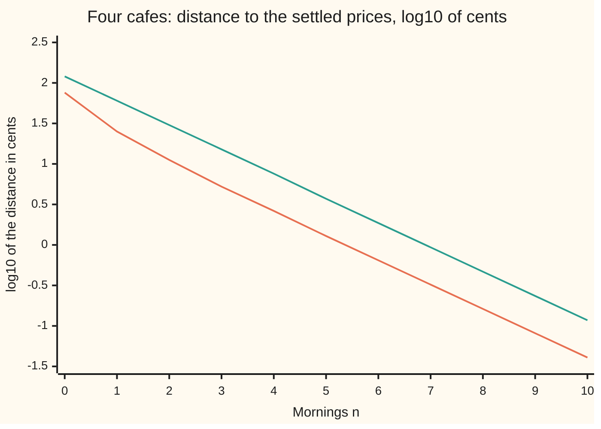

# Banach's fixed point theorem: a shrinking map on a complete space has one fixed point

[Syllabus](../../../SYLLABUS.md) → [Topology](../README.md) → [Metric Spaces](../README.md#s01) → Banach's fixed point theorem

---

## General Overview

Four cafés stand on one avenue of a city grid. Each has a **target price** for a coffee: what it would charge with no rivals. The targets are $2.80, $3.15, $3.50 and $4.20. Today all four charge $3.00.

Every morning each café resets its price by one rule: halfway between its own target and the average of the other three cafés' prices yesterday. On the first morning the café with the $4.20 target moves to halfway between $4.20 and $3.00, which is $3.60. Morning by morning the four prices shift, and nobody knows in advance where they will stop.

Three questions matter to the owners. Do the prices settle? Where? And after how many mornings is the street within one cent of the settled prices? One theorem answers all three before the first morning. The prices settle at $3.15, $3.30, $3.45 and $3.75, and they are within one cent by morning 7 at the latest.

The trick is to treat the whole price list as one point, and to measure how far apart two price lists are. Take the **worst-case distance**: the largest gap between any café's price in one list and its price in the other. The morning rule halves that distance, or better, for every pair of lists. A rule that shrinks every distance by a fixed factor below 1 is a **contraction**.

A set with a distance like this is a **metric space**. It is **complete** when it has no holes: every sequence whose terms bunch up lands on a point of the set. Lists of real prices are complete.

**On a complete metric space, a contraction has exactly one fixed point; repeating the map from any start reaches it, and the error after n steps is bounded before the first step.**

**What kind of fact this is:** a theorem, Banach's fixed point theorem, proved on this card in Why it works. The step that needs completeness, and the completeness of continuous functions under the worst-gap distance, are proved in folds.

### The picture: the true error and the promise, morning by morning



The lower line (orange) is the true worst-case distance from the settled prices. The upper line (green) is the theorem's promise, 120 ÷ 2^n cents, written down before any morning ran. A drop of one unit on the axis is a factor of 10. The promise always sits above the truth, and both fall at the same slope: the distance halves each morning. The truth drops below 0 on the axis, which is 1 cent, at morning 6; the promise does so at morning 7.

---

## The formula

Notation first, in words. A **metric space** is a set $`X`$ with a distance $`d`$ that obeys three rules: zero only from a point to itself, the same both ways, and no shortcut through a third point ([Metric space](01-metric-spaces.md)). A **map** $`T`$ takes each point of $`X`$ to a point of $`X`$. Starting from $`x_0`$, the **iterates** are $`x_1 = T(x_0)`$, $`x_2 = T(x_1)`$ and so on. A **fixed point** $`x^*`$ (say "x star") is a point the map leaves alone: $`T(x^*) = x^*`$.

A **complete** metric space is one where every sequence that bunches up (a Cauchy sequence: its terms end up closer together than any tolerance) converges to a point of the space ([Complete space](05-completeness-and-completion.md)).

The contraction condition, and the theorem:

```math
d\big(T(x), T(y)\big) \le q\, d(x, y) \quad \text{for all } x, y \text{ in } X, \qquad 0 \le q < 1
```

```math
d(x_n, x^*) \le \frac{q^n}{1 - q}\, d(x_1, x_0) \qquad\qquad d(x_n, x^*) \le \frac{q}{1 - q}\, d(x_n, x_{n-1})
```

**Read it aloud:** if one pass multiplies every distance by at most q, a number below 1, then exactly one point is left alone by the map; after n passes the distance to it is at most q to the n, over one minus q, times the first step.

The **first-step bound** budgets the work before it starts; the **last-step bound** says when to stop.

For the cafés, $`X`$ is the set of price lists $`x = \big(x(1), x(2), x(3), x(4)\big)`$ in cents, with café number $`i`$ running from 1 to 4. The distance is the worst-case distance $`d(x, y) = \max_i |x(i) - y(i)|`$, the largest single gap ([The distance menu](02-distances-on-vectors-and-functions.md)). The morning rule is

```math
T(x)(i) = \tfrac12\, c_i + \tfrac12 \cdot \tfrac13 \sum_{j \ne i} x(j)
```

**Read it aloud:** café i's new price is half its target, plus half the average of the other three cafés' prices.

A price list is a function from café numbers to prices, written $`x(i)`$, just as a curve is a function from times to values. The subscript in $`x_n`$ counts mornings, never cafés.

| Symbol | Plain meaning | In our example | Push it up and the answer… |
| --- | --- | --- | --- |
| $`X`$ | the space: every possible point | all lists of four prices | — |
| $`d`$ | distance between two points | largest gap between two price lists, cents | — |
| $`T`$ | the map, one pass | one morning's repricing | — |
| $`q`$ | contraction constant: worst shrink ratio over all pairs | 1/2 | bounds grow, more mornings needed |
| $`x_0`$; $`x_n`$, $`x_m`$ | the start; the point after n or m passes | 300 cents each; prices after morning n | a start further off gives larger bounds |
| $`n`$, $`m`$ | passes so far | mornings | bounds halve with each one |
| $`x^*`$ | the fixed point | 315, 330, 345, 375 cents | — |
| $`x(i)`$; $`i`$, $`j`$ | café i's price in the list $`x`$; café numbers, 1 to 4 | 300 at the start | — |
| $`c_i`$ | café i's target price | 280, 315, 350, 420 cents | its own settled price rises most; its rivals' rise less |
| $`S`$ | the sum of the four settled prices | 1365 cents | — |
| $`C[a, b]`$; $`y`$, $`z`$; $`t`$; $`f`$ | continuous curves on the times a to b; two such curves (or two points); time; a rate law | 0 to 1/2; Picard's guesses; $`f(t, y) = y`$ | a longer window weakens the shrink |
| $`L`$, $`\varepsilon`$, $`\delta`$, $`N`$ | in the folds: the first step's length, a tolerance, a time tolerance, a pass count | $`L`$ = 60 cents | — |

### When it holds

- **The space is complete.** On the fractions alone, the rule x/2 + 1/x halves every gap on 1 to 2, yet its passes from 1 head for the square root of 2, which is not a fraction. Nothing in the space is fixed.
- **One factor q below 1 serves every pair.** The rule "match the rivals' average, plus 10 cents" has q = 1. From $3.00 its prices reach $4.00 after 10 mornings and keep climbing: no fixed point.
- **The map stays inside the space.** If a pass can leave $`X`$, the next pass is undefined. Shrink $`X`$ to a closed piece the map sends into itself; a closed piece of a complete space is complete.
- **q and completeness use the same distance.** The continuous curves are complete under the worst-gap distance but not under the average-gap distance, the area between them, so the shrinking must be shown in the largest gap, as Picard's map is.

---

## Why it works

### Step 0: each pass shrinks the next step, and completeness supplies the landing point

The distance to $`x^*`$ is unknown, but the steps between passes are known. Each step is at most q times the one before, so the total travel is finite and the iterates bunch up. A complete space guarantees a point they bunch up to. The map then leaves that point alone.

### Step 1: the interval proof carries over, except at one step

[Fixed points](../../06-Calculus%20and%20analysis/03-What%20Derivatives%20Tell%20You/07-fixed-point-iteration-and-the-contraction-principle.md) proves the theorem on a closed interval of the real line, with the cos x = x iteration. Four of its five steps use only the three distance rules, so they carry over word for word, with $`d(x, y)`$ in place of $`|x - y|`$:

1. **The steps shrink geometrically:** $`d(x_{n+1}, x_n) \le q^n\, d(x_1, x_0)`$.
2. **The triangle rule adds them up.** From pass n on, the iterates stay within $`\frac{q^n}{1-q}\, d(x_1, x_0)`$ of each other, so they form a Cauchy sequence.
3. **A limit exists.** This is the one step that needs more than the distance rules: completeness, Step 2 below.
4. **The limit is fixed, and it is the only one.** A contraction is uniformly continuous ([Uniform continuity](07-uniform-continuity-and-heine-cantor.md)), so it carries the limit through the map. A second fixed point would sit at most q times its own distance from the first, so that distance is zero.
5. **The two stopping rules.** Letting the later pass run on gives the first-step bound; restarting the clock at pass n − 1 gives the last-step bound.

For the cafés the first step is 60 cents (the $4.20 café moving from 300 to 360), so the first-step bound is 120 ÷ 2^n cents.

### Step 2: completeness gives a limit

A Cauchy sequence in a complete space converges, so the iterates head for some point $`x^*`$ of $`X`$. This is the only use of completeness, and without it the proof stops here.

The cafés' space is complete because each café's prices form a Cauchy sequence of real numbers, and the real numbers are complete. On the fractions alone the step fails. The rule x/2 + 1/x sends 1 to 3/2, 17/12, 577/408 and 665857/470832. The squares of these miss 2 by less each time, by 1/221682772224 at the fourth pass, but never reach it, because no fraction squares to 2.

<details>
<summary>Detailed proof: Banach's theorem on any complete metric space</summary>

Let $`(X, d)`$ be a complete metric space, not empty, and $`T`$ a map of $`X`$ into itself with $`d(T(x), T(y)) \le q\, d(x, y)`$ for all $`x, y`$, where $`0 \le q < 1`$. Pick any $`x_0`$, set $`x_{n+1} = T(x_n)`$, and let $`L = d(x_1, x_0)`$.

*Steps.* By induction, $`d(x_{k+1}, x_k) \le q^k L`$.

*Cauchy.* For $`m > n`$, the triangle inequality and the geometric sum give

$`\displaystyle d(x_m, x_n) \le \sum_{k=n}^{m-1} q^k L < \frac{q^n}{1-q} L.`$

Given a tolerance $`\varepsilon > 0`$, pick $`N`$ with $`q^N L/(1-q) < \varepsilon`$. Then $`d(x_m, x_n) < \varepsilon`$ for all $`m > n \ge N`$.

*Limit.* $`X`$ is complete, so $`x_n`$ converges to some $`x^*`$ in $`X`$.

*Fixed.* By the triangle inequality and the contraction,

$`\displaystyle d(T(x^*), x^*) \le d(T(x^*), x_{n+1}) + d(x_{n+1}, x^*) \le q\, d(x^*, x_n) + d(x_{n+1}, x^*),`$

and the right side heads for 0. So $`d(T(x^*), x^*) = 0`$ and $`T(x^*) = x^*`$.

*Unique.* If $`T(y) = y`$, then $`(1 - q)\, d(x^*, y) \le 0`$, so $`y = x^*`$.

*Bounds.* In the Cauchy estimate let $`m`$ head for infinity; distance is continuous, so $`d(x^*, x_n) \le q^n L/(1-q)`$. Apply this from the start $`x_{n-1}`$ with one pass for the last-step bound.

</details>

### Step 3: checking the cafés' contraction constant

Take two price lists $`x`$ and $`y`$, with largest gap $`d(x, y)`$. The targets cancel in the difference, so café i's two new prices differ by half the average of the other three cafés' gaps:

```math
\big|T(x)(i) - T(y)(i)\big| = \tfrac12 \left| \tfrac13 \sum_{j \ne i} \big(x(j) - y(j)\big) \right| \le \tfrac12\, d(x, y)
```

An average of three gaps is never larger than the largest gap. So $`q = 1/2`$ works. Nothing smaller works: raise every price in a list by 10 cents, and every new price rises by exactly 5 cents. An even shift is a worst pair.

The check also tries 1,000 random pairs of price lists between $2.00 and $5.00. The worst ratio it finds is 0.491453, just under 1/2, as it must be.

### Step 4: the same theorem on curves, and the step the Picard card skipped

[Picard iteration](../../08-Differential%20equations%20and%20dynamics/02-Existence%2C%20Uniqueness%20and%20Sensitivity/01-picard-iteration.md) turns a rate law $`y' = f(t, y)`$ into a map on curves: the **Picard map** takes a guessed curve $`y`$ to its start value plus the integral of the rate along the guess. [The Picard-Lindelof theorem](../../08-Differential%20equations%20and%20dynamics/02-Existence%2C%20Uniqueness%20and%20Sensitivity/02-lipschitz-and-the-picard-lindelof-theorem.md) shows that this map shrinks the largest gap between two curves, then says the rounds "close in on one limit". That is Step 2, and it needs the space to be complete.

The space is $`C[a, b]`$: the continuous curves on the time window from $`a`$ to $`b`$, with the **worst-gap distance** $`d(y, z) = \sup_t |y(t) - z(t)|`$. Here sup, the supremum, is the least number at or above every gap. It is complete:

1. **Each moment converges.** A Cauchy sequence of curves is Cauchy at each fixed time $`t`$, so its values there converge, because the real numbers are complete. Call the limit $`y(t)`$.
2. **The convergence is uniform**, one tolerance for every moment at once. The tolerance that holds between later curves also holds between each curve and the limit.
3. **The limit is continuous.** A curve close to $`y`$ everywhere, and continuous, pins $`y`$ down near each moment, so $`y`$ has no jumps.

<details>
<summary>Detailed proof: the continuous curves are complete under the largest gap</summary>

Let $`y_n`$ be Cauchy in $`C[a, b]`$ under $`d(y, z) = \sup_t |y(t) - z(t)|`$. Given $`\varepsilon > 0`$, pick $`N`$ with $`d(y_m, y_n) < \varepsilon/3`$ for all $`m, n \ge N`$.

*Pointwise limit.* For each $`t`$, $`|y_m(t) - y_n(t)| \le d(y_m, y_n)`$, so $`y_n(t)`$ is a Cauchy sequence of reals and has a limit $`y(t)`$.

*Uniform.* Let $`m`$ head for infinity in $`|y_m(t) - y_n(t)| < \varepsilon/3`$: then $`|y(t) - y_n(t)| \le \varepsilon/3`$ for every $`t`$ and every $`n \ge N`$.

*Continuous.* $`y_N`$ is continuous at $`s`$, so some $`\delta > 0`$ gives $`|y_N(t) - y_N(s)| < \varepsilon/3`$ when $`|t - s| < \delta`$. Then

$`\displaystyle |y(t) - y(s)| \le |y(t) - y_N(t)| + |y_N(t) - y_N(s)| + |y_N(s) - y(s)| < \varepsilon.`$

So $`y`$ is in $`C[a, b]`$, and $`d(y_n, y) \le \varepsilon/3`$ for $`n \ge N`$: the sequence converges in the space.

</details>

A worked case. Take the yeast law $`y' = y`$, $`y(0) = 1`$, on the window from 0 to 1/2. The rate's Lipschitz constant is 1 and the window is 1/2 long, so the Picard map halves the largest gap: $`q = 1/2`$. The first two guesses are 1 and 1 + t, with largest gap 1/2, so the first-step bound is $`(1/2)^n`$. The true largest gap to $`e^t`$ sits at $`t = 1/2`$:

| Pass n | True largest gap | First-step bound |
| --- | --- | --- |
| 1 | 0.14872127 | 0.50000000 |
| 2 | 0.02372127 | 0.25000000 |
| 3 | 0.00288794 | 0.12500000 |
| 6 | 0.00000165 | 0.01562500 |

Every guess is a polynomial, yet the limit $`e^t`$ is not. So the polynomials alone are not complete under the largest gap, and the proof needs the bigger space of all continuous curves.

---

## Worked numbers, by hand

The four cafés, targets 280, 315, 350 and 420 cents, all starting at 300.

| Step | Arithmetic | Value |
| --- | --- | --- |
| contraction constant | half of an average of three gaps, at most half the largest | $`q = 1/2`$ |
| morning 1 | half the target, plus half of 300 | 290, 307.50, 325, 360 cents |
| first step | largest gap from 300: the $4.20 café, 360 − 300 | 60 cents |
| first-step bound | $`(1/2)^n \div (1/2) \times 60`$ | 120 ÷ 2^n cents |
| mornings promised for 1 cent | first n with 120 ÷ 2^n ≤ 1: 2^7 = 128 | 7 |
| settled prices | $`x^*(i) = (3c_i + 1365)/7`$ | 315, 330, 345, 375 cents |
| check café 1 | 280/2 + (330 + 345 + 375)/6 = 140 + 175 | 315 cents |
| true error after morning 7 | largest gap to the settled prices | **0.3224 cents** |

The settled prices come from the fixed-point equation. Write $`S`$ for the sum of the four settled prices. Multiply $`x^*(i) = c_i/2 + (S - x^*(i))/6`$ by 6 and collect: $`7x^*(i) = 3c_i + S`$. Add the four equations: $`7S = 3 \times 1365 + 4S`$, so $`S = 1365`$, the sum of the targets.

So before the first morning the owners know that the street will be within one cent of $3.15, $3.30, $3.45 and $3.75 by morning 7. In fact it is within a third of a cent by then.

### What breaks if you drop a piece

| Mistake | Comes out at | What went wrong |
| --- | --- | --- |
| Work in the fractions only: x/2 + 1/x from 1 | 665857/470832 after 4 passes; its square misses 2 by 1/221682772224; no fixed point | the space has a hole at the square root of 2: not complete |
| Price at the rivals' average plus 10 cents | 400, 400, 400, 400 cents after 10 mornings, still climbing | q = 1: an even shift is not shrunk at all |
| Take q from one pair, (310, 290, 300, 300) against 300s | ratio 1/6; "bound" at morning 5 is 0.0093 cents, true error 1.2924 cents | q is the worst ratio over all pairs; the even shift gives 1/2 |
| Allow only polynomial curves in Picard's map | gaps halve, but the limit $`e^t`$ is not a polynomial | polynomials are not complete under the largest gap |

---

## Code, from first principles, and it actually runs

The code takes three roads to the settled prices and the errors. Road one runs the mornings exactly: prices times 6^n are whole numbers, so nothing is rounded. Road two is the closed form $`(3c_i + 1365)/7`$, checked to be left alone by the rule. Road three predicts every error from the rule's two shrink rates: the even part of the error halves, and the rest is multiplied by −1/6. Asserts confirm both bounds at every morning to 20, q on 1,000 random pairs, the climb of x + 1/x, and the Picard errors against their bound. The first-step bound is computed from the measured first step, not typed in. The pairs come from SplitMix64, a small generator written out in both languages, seed 2026. They illustrate q; Step 3 proves it for every pair.

### Python

```python
# Banach's fixed point theorem -- the check behind the card.  Standard library only.
# Four cafes reset their coffee prices each morning: half their own target price,
# plus half the average of the other three cafes' prices.  Prices are in cents.
# Road one runs the passes exactly (prices times 6^n are whole numbers).  Road two
# solves for the settled prices by hand's closed form.  Road three predicts every
# error from the rule's two shrink rates, 1/2 and -1/6.  The theorem's bound is
# then set beside the true error.  Exact numbers print by integer rounding.
import math

TGT = [280, 315, 350, 420]     # each cafe's target price, cents
P0 = [300, 300, 300, 300]      # today's prices, cents

def fmt(num, den, k):          # num/den to k decimals, half rounded up
    s = '-' if num < 0 else ''
    v = (abs(num) * 10 ** k * 2 + den) // (2 * den)
    return s + (f"{v // 10 ** k}.{v % 10 ** k:0{k}d}" if k else str(v))

def step(P, D):                # one pass on prices P/D; returns new P, new D = 6D
    s = sum(P)
    return [3 * t * D + s - x for t, x in zip(TGT, P)], 6 * D

def dist(a, b):                # worst-case distance d_inf between two lists
    return max(abs(x - y) for x, y in zip(a, b))

# ---- road two: the settled prices, (3 c_i + sum of targets) / 7 ----
for t in TGT:
    assert (3 * t + sum(TGT)) % 7 == 0
PS = [(3 * t + sum(TGT)) // 7 for t in TGT]
assert step(PS, 1)[0] == [6 * x for x in PS]       # the rule leaves them unchanged
print(f"settled prices (3 c + {sum(TGT)}) / 7, cents:", ", ".join(map(str, PS)))

# ---- the contraction constant: a formula, 1000 random pairs, one bad pair ----
st = 2026
def rnd():                     # SplitMix64
    global st
    st = (st + 0x9E3779B97F4A7C15) % 2 ** 64
    z = st
    z = ((z ^ (z >> 30)) * 0xBF58476D1CE4E5B9) % 2 ** 64
    z = ((z ^ (z >> 27)) * 0x94D049BB133111EB) % 2 ** 64
    return z ^ (z >> 31)
def ratio(p, r):               # d(Tp, Tr) / d(p, r) as (num, den)
    return dist(step(p, 1)[0], step(r, 1)[0]), 6 * dist(p, r)
bn, bd = 0, 1
for _ in range(1000):
    p = [200 + rnd() % 301 for _ in range(4)]
    r = [200 + rnd() % 301 for _ in range(4)]
    if p != r:
        n, d = ratio(p, r)
        if n * bd > bn * d:
            bn, bd = n, d
assert 2 * bn <= bd                                 # no pair shrinks by less than half
sn, sd = ratio([x + 10 for x in P0], P0)
assert 2 * sn == sd                                 # an even shift shrinks by exactly half
on, od = ratio([310, 290, 300, 300], P0)
print(f"q by formula: 1/2 x (3 x 1/3) = 1/2; worst of 1000 random pairs: {fmt(bn, bd, 6)}")
print(f"even 10-cent shift: ratio {fmt(sn, sd, 6)}; pair (310, 290, 300, 300): ratio {fmt(on, od, 6)}")

# ---- the passes, the true error, and the theorem's two bounds ----
P, D, prev = P0[:], 1, None
d01 = dist(step(P0, 1)[0], [6 * x for x in P0])     # first step, times 6
print(f"first step d(p1, p0) = {fmt(d01, 6, 2)} cents; first-step bound = {fmt(d01, 3, 0)} / 2^n cents")
print("n, p_n (cents), true error, first-step bound, last-step bound")
need = {}
logs_e, logs_b = [], []
for n in range(21):
    E = [x - s * D for x, s in zip(P, PS)]
    e0 = [x - s for x, s in zip(P0, PS)]
    for e, z in zip(E, e0):                         # road three: 1/2 and -1/6 rates
        assert 4 * e == -165 * 3 ** n + (-1) ** n * (4 * z + 165)
    err = max(abs(e) for e in E)
    assert err * 3 * 2 ** n <= d01 * D              # first-step bound holds
    last = dist(P, [6 * x for x in prev]) if prev else None
    if last is not None:
        assert err <= last                          # last-step bound holds (q/(1-q) = 1)
    for key, ok in [("first", d01 <= 3 * 2 ** n), ("last", last is not None and last <= D),
                    ("true", err <= D)]:
        if ok and key not in need:
            need[key] = n
    if n == 5:
        e5 = fmt(err, D, 4)
    if n <= 10:
        print(n, " ".join(fmt(x, D, 2) for x in P), fmt(err, D, 4), fmt(d01, 3 * 2 ** n, 4),
              fmt(last, D, 4) if last is not None else "-", sep=", ")
        logs_e.append(f"{math.log10(err / D):.2f}")
        logs_b.append(f"{math.log10(d01 / 3 / 2 ** n):.2f}")
    prev, (P, D) = P, step(P, D)
print(f"within 1 cent: promised by first-step bound at n = {need['first']}, "
      f"by last-step bound at n = {need['last']}, true at n = {need['true']}")
print("chart, log10 true error:", ", ".join(logs_e))
print("chart, log10 first-step bound:", ", ".join(logs_b))

# ---- what breaks ----
q6 = fmt(d01, 5 * 6 ** 5, 4)                        # (1/6)^5 / (5/6) x first step
print(f"trusting the one pair, q = 1/6: 'bound' at n = 5 is {q6} cents; true error {e5}")
m = P0[:]
for _ in range(10):
    m = [(sum(m) - x) // 3 + 10 for x in m]         # match the rivals' average, plus 10
assert m == [400] * 4
print("rivals' average plus 10 cents, q = 1: after 10 passes", ", ".join(map(str, m)), "and climbing")
a, b, gaps = 1, 1, []
for _ in range(4):                                  # x/2 + 1/x on the fractions in [1, 2]
    a2, b2 = a * a + 2 * b * b, 2 * a * b
    g = math.gcd(a2, b2)
    a2, b2 = a2 // g, b2 // g
    gaps.append((abs(a2 * b - a * b2), b * b2))
    a, b = a2, b2
for (g1, h1), (g2, h2) in zip(gaps, gaps[1:]):
    assert 2 * g2 * h1 <= g1 * h2                   # each gap at most half the last
print(f"fractions only: x4 = {a}/{b}, x4^2 - 2 = {a * a - 2 * b * b}/{b * b}; the limit is sqrt 2, not a fraction")
w = 1.0
for _ in range(1000):
    w += 1 / w                                      # x + 1/x on [1, infinity): every gap shrinks
assert w * w >= 2001                                # x_n^2 >= 1 + 2n: it never settles
print(f"x + 1/x from 1: x_1000 = {w:.4f}, still climbing; gap 100 to 101 shrinks to {(101 + 1 / 101) - (100 + 1 / 100):.6f}")

# ---- curves: Picard's map for y' = y on [0, 1/2] halves the largest gap ----
ex = math.exp(0.5)
s, term = 0.0, 1.0
for k in range(1, 30):
    s, term = s + term, term * 0.5 / k
assert abs(s - ex) < 1e-15                          # e^(1/2) two ways
row = []
for n in range(1, 7):
    num = sum(2 ** (n - k) * math.factorial(n) // math.factorial(k) for k in range(n + 1))
    err = ex - num / (2 ** n * math.factorial(n))   # largest gap sits at t = 1/2
    assert 0 < err <= 0.5 ** n                      # bound: q^n / (1 - q) x d(y1, y0)
    row.append(f"{err:.8f} <= {0.5 ** n:.8f}")
print(f"e^(1/2) = {ex:.10f}; Picard error, bound, n = 1..6:")
print("; ".join(row[:3]))
print("; ".join(row[3:]))
print("ALL CHECKS PASS")
```

**Ran 2026-11-14 on macOS, Python 3.14.10, standard library only. All checks passed. Output, pasted from the run:**

```
settled prices (3 c + 1365) / 7, cents: 315, 330, 345, 375
q by formula: 1/2 x (3 x 1/3) = 1/2; worst of 1000 random pairs: 0.491453
even 10-cent shift: ratio 0.500000; pair (310, 290, 300, 300): ratio 0.166667
first step d(p1, p0) = 60.00 cents; first-step bound = 120 / 2^n cents
n, p_n (cents), true error, first-step bound, last-step bound
0, 300.00 300.00 300.00 300.00, 75.0000, 120.0000, -
1, 290.00 307.50 325.00 360.00, 25.0000, 60.0000, 60.0000
2, 305.42 320.00 334.58 363.75, 11.2500, 30.0000, 15.4167
3, 309.72 324.79 339.86 370.00, 5.2778, 15.0000, 6.2500
4, 312.44 327.43 342.42 372.40, 2.6042, 7.5000, 2.7199
5, 313.71 328.71 343.71 373.72, 1.2924, 3.7500, 1.3194
6, 314.36 329.36 344.36 374.35, 0.6453, 1.8750, 0.6485
7, 314.68 329.68 344.68 374.68, 0.3224, 0.9375, 0.3231
8, 314.84 329.84 344.84 374.84, 0.1612, 0.4688, 0.1612
9, 314.92 329.92 344.92 374.92, 0.0806, 0.2344, 0.0806
10, 314.96 329.96 344.96 374.96, 0.0403, 0.1172, 0.0403
within 1 cent: promised by first-step bound at n = 7, by last-step bound at n = 6, true at n = 6
chart, log10 true error: 1.88, 1.40, 1.05, 0.72, 0.42, 0.11, -0.19, -0.49, -0.79, -1.09, -1.39
chart, log10 first-step bound: 2.08, 1.78, 1.48, 1.18, 0.88, 0.57, 0.27, -0.03, -0.33, -0.63, -0.93
trusting the one pair, q = 1/6: 'bound' at n = 5 is 0.0093 cents; true error 1.2924
rivals' average plus 10 cents, q = 1: after 10 passes 400, 400, 400, 400 and climbing
fractions only: x4 = 665857/470832, x4^2 - 2 = 1/221682772224; the limit is sqrt 2, not a fraction
x + 1/x from 1: x_1000 = 44.7792, still climbing; gap 100 to 101 shrinks to 0.999901
e^(1/2) = 1.6487212707; Picard error, bound, n = 1..6:
0.14872127 <= 0.50000000; 0.02372127 <= 0.25000000; 0.00288794 <= 0.12500000
0.00028377 <= 0.06250000; 0.00002335 <= 0.03125000; 0.00000165 <= 0.01562500
ALL CHECKS PASS
```

### Rust

```rust
// Banach's fixed point theorem -- the same check as the Python, in Rust.  No crates.
// Four cafes reset their coffee prices each morning: half their own target price,
// plus half the average of the other three cafes' prices.  Prices are in cents.
// Road one runs the passes exactly (prices times 6^n are whole numbers).  Road two
// solves for the settled prices by the closed form.  Road three predicts every
// error from the rule's two shrink rates, 1/2 and -1/6.  The theorem's bound is
// then set beside the true error.  Exact numbers print by integer rounding.
const TGT: [i128; 4] = [280, 315, 350, 420]; // each cafe's target price, cents
const P0: [i128; 4] = [300, 300, 300, 300]; // today's prices, cents

fn fmt(num: i128, den: i128, k: u32) -> String {
    // num/den to k decimals, half rounded up
    let s = if num < 0 { "-" } else { "" };
    let t = 10i128.pow(k);
    let v = (num.abs() * t * 2 + den) / (2 * den);
    if k == 0 { format!("{}{}", s, v) } else { format!("{}{}.{:0w$}", s, v / t, v % t, w = k as usize) }
}

fn step(p: &[i128; 4], d: i128) -> ([i128; 4], i128) {
    // one pass on prices p/d; returns new p, new d = 6d
    let s: i128 = p.iter().sum();
    let mut out = [0i128; 4];
    for i in 0..4 { out[i] = 3 * TGT[i] * d + s - p[i]; }
    (out, 6 * d)
}

fn dist(a: &[i128; 4], b: &[i128; 4]) -> i128 {
    // worst-case distance d_inf between two lists
    (0..4).map(|i| (a[i] - b[i]).abs()).max().unwrap()
}

fn times(p: &[i128; 4], k: i128) -> [i128; 4] { [p[0] * k, p[1] * k, p[2] * k, p[3] * k] }

fn rnd(st: &mut u64) -> u64 {
    // SplitMix64
    *st = st.wrapping_add(0x9E3779B97F4A7C15);
    let mut z = *st;
    z = (z ^ (z >> 30)).wrapping_mul(0xBF58476D1CE4E5B9);
    z = (z ^ (z >> 27)).wrapping_mul(0x94D049BB133111EB);
    z ^ (z >> 31)
}

fn ratio(p: &[i128; 4], r: &[i128; 4]) -> (i128, i128) {
    // d(Tp, Tr) / d(p, r) as (num, den)
    (dist(&step(p, 1).0, &step(r, 1).0), 6 * dist(p, r))
}

fn gcd(a: i128, b: i128) -> i128 { if b == 0 { a } else { gcd(b, a % b) } }

fn main() {
    // ---- road two: the settled prices, (3 c_i + sum of targets) / 7 ----
    let st_sum: i128 = TGT.iter().sum();
    for t in TGT { assert!((3 * t + st_sum) % 7 == 0); }
    let ps: [i128; 4] = [0, 1, 2, 3].map(|i| (3 * TGT[i] + st_sum) / 7);
    assert!(step(&ps, 1).0 == times(&ps, 6)); // the rule leaves them unchanged
    println!("settled prices (3 c + {}) / 7, cents: {}, {}, {}, {}", st_sum, ps[0], ps[1], ps[2], ps[3]);

    // ---- the contraction constant: a formula, 1000 random pairs, one bad pair ----
    let mut st: u64 = 2026;
    let (mut bn, mut bd) = (0i128, 1i128);
    for _ in 0..1000 {
        let p = [0; 4].map(|_: i128| 200 + (rnd(&mut st) % 301) as i128);
        let r = [0; 4].map(|_: i128| 200 + (rnd(&mut st) % 301) as i128);
        if p != r {
            let (n, d) = ratio(&p, &r);
            if n * bd > bn * d { bn = n; bd = d; }
        }
    }
    assert!(2 * bn <= bd); // no pair shrinks by less than half
    let (sn, sd) = ratio(&P0.map(|x| x + 10), &P0);
    assert!(2 * sn == sd); // an even shift shrinks by exactly half
    let (on, od) = ratio(&[310, 290, 300, 300], &P0);
    println!("q by formula: 1/2 x (3 x 1/3) = 1/2; worst of 1000 random pairs: {}", fmt(bn, bd, 6));
    println!("even 10-cent shift: ratio {}; pair (310, 290, 300, 300): ratio {}", fmt(sn, sd, 6), fmt(on, od, 6));

    // ---- the passes, the true error, and the theorem's two bounds ----
    let (mut p, mut d) = (P0, 1i128);
    let mut prev: Option<[i128; 4]> = None;
    let d01 = dist(&step(&P0, 1).0, &times(&P0, 6)); // first step, times 6
    println!("first step d(p1, p0) = {} cents; first-step bound = {} / 2^n cents", fmt(d01, 6, 2), fmt(d01, 3, 0));
    println!("n, p_n (cents), true error, first-step bound, last-step bound");
    let (mut nf, mut nl, mut nt) = (None, None, None);
    let (mut le, mut lb, mut e5) = (vec![], vec![], String::new());
    for n in 0..21u32 {
        let e: [i128; 4] = [0, 1, 2, 3].map(|i| p[i] - ps[i] * d);
        for i in 0..4 {
            // road three: 1/2 and -1/6 rates
            let z = P0[i] - ps[i];
            let sg = if n % 2 == 0 { 1 } else { -1 };
            assert!(4 * e[i] == -165 * 3i128.pow(n) + sg * (4 * z + 165));
        }
        let err = e.iter().map(|x| x.abs()).max().unwrap();
        assert!(err * 3 * 2i128.pow(n) <= d01 * d); // first-step bound holds
        let last = prev.map(|q| dist(&p, &times(&q, 6)));
        if let Some(l) = last { assert!(err <= l); } // last-step bound holds (q/(1-q) = 1)
        if nf.is_none() && d01 <= 3 * 2i128.pow(n) { nf = Some(n); }
        if nl.is_none() && last.map_or(false, |l| l <= d) { nl = Some(n); }
        if nt.is_none() && err <= d { nt = Some(n); }
        if n == 5 { e5 = fmt(err, d, 4); }
        if n <= 10 {
            let ls = match last { Some(l) => fmt(l, d, 4), None => "-".to_string() };
            let pr: Vec<String> = p.iter().map(|&x| fmt(x, d, 2)).collect();
            println!("{}, {}, {}, {}, {}", n, pr.join(" "), fmt(err, d, 4), fmt(d01, 3 * 2i128.pow(n), 4), ls);
            le.push(format!("{:.2}", (err as f64 / d as f64).log10()));
            lb.push(format!("{:.2}", (d01 as f64 / 3.0 / 2f64.powi(n as i32)).log10()));
        }
        let nx = step(&p, d);
        prev = Some(p);
        p = nx.0;
        d = nx.1;
    }
    println!("within 1 cent: promised by first-step bound at n = {}, by last-step bound at n = {}, true at n = {}",
             nf.unwrap(), nl.unwrap(), nt.unwrap());
    println!("chart, log10 true error: {}", le.join(", "));
    println!("chart, log10 first-step bound: {}", lb.join(", "));

    // ---- what breaks ----
    let q6 = fmt(d01, 5 * 6i128.pow(5), 4); // (1/6)^5 / (5/6) x first step
    println!("trusting the one pair, q = 1/6: 'bound' at n = 5 is {} cents; true error {}", q6, e5);
    let mut m = P0;
    for _ in 0..10 {
        let s: i128 = m.iter().sum();
        m = m.map(|x| (s - x) / 3 + 10); // match the rivals' average, plus 10
    }
    assert!(m == [400; 4]);
    println!("rivals' average plus 10 cents, q = 1: after 10 passes {}, {}, {}, {} and climbing", m[0], m[1], m[2], m[3]);
    let (mut a, mut b) = (1i128, 1i128);
    let mut gaps = vec![];
    for _ in 0..4 {
        // x/2 + 1/x on the fractions in [1, 2]
        let (mut a2, mut b2) = (a * a + 2 * b * b, 2 * a * b);
        let g = gcd(a2, b2);
        a2 /= g;
        b2 /= g;
        gaps.push(((a2 * b - a * b2).abs(), b * b2));
        a = a2;
        b = b2;
    }
    for w in gaps.windows(2) { assert!(2 * w[1].0 * w[0].1 <= w[0].0 * w[1].1); } // each gap at most half the last
    println!("fractions only: x4 = {}/{}, x4^2 - 2 = {}/{}; the limit is sqrt 2, not a fraction", a, b, a * a - 2 * b * b, b * b);
    let mut w = 1.0f64;
    for _ in 0..1000 { w += 1.0 / w; } // x + 1/x on [1, infinity): every gap shrinks
    assert!(w * w >= 2001.0); // x_n^2 >= 1 + 2n: it never settles
    println!("x + 1/x from 1: x_1000 = {:.4}, still climbing; gap 100 to 101 shrinks to {:.6}", w, (101.0 + 1.0 / 101.0) - (100.0 + 1.0 / 100.0));

    // ---- curves: Picard's map for y' = y on [0, 1/2] halves the largest gap ----
    let ex = 0.5f64.exp();
    let (mut s, mut term) = (0.0f64, 1.0f64);
    for k in 1..30 { s += term; term = term * 0.5 / k as f64; }
    assert!((s - ex).abs() < 1e-15); // e^(1/2) two ways
    let fact = |n: i128| (1..=n).product::<i128>();
    let mut row = vec![];
    for n in 1..7i128 {
        let num: i128 = (0..=n).map(|k| 2i128.pow((n - k) as u32) * fact(n) / fact(k)).sum();
        let err = ex - num as f64 / (2i128.pow(n as u32) * fact(n)) as f64; // largest gap sits at t = 1/2
        let bound = 0.5f64.powi(n as i32);
        assert!(0.0 < err && err <= bound); // bound: q^n / (1 - q) x d(y1, y0)
        row.push(format!("{:.8} <= {:.8}", err, bound));
    }
    println!("e^(1/2) = {:.10}; Picard error, bound, n = 1..6:", ex);
    println!("{}", row[..3].join("; "));
    println!("{}", row[3..].join("; "));
    println!("ALL CHECKS PASS");
}
```

**Ran 2026-11-14 on macOS, rustc 1.98.1, no crates. All checks passed. Output, pasted from the run:**

```
settled prices (3 c + 1365) / 7, cents: 315, 330, 345, 375
q by formula: 1/2 x (3 x 1/3) = 1/2; worst of 1000 random pairs: 0.491453
even 10-cent shift: ratio 0.500000; pair (310, 290, 300, 300): ratio 0.166667
first step d(p1, p0) = 60.00 cents; first-step bound = 120 / 2^n cents
n, p_n (cents), true error, first-step bound, last-step bound
0, 300.00 300.00 300.00 300.00, 75.0000, 120.0000, -
1, 290.00 307.50 325.00 360.00, 25.0000, 60.0000, 60.0000
2, 305.42 320.00 334.58 363.75, 11.2500, 30.0000, 15.4167
3, 309.72 324.79 339.86 370.00, 5.2778, 15.0000, 6.2500
4, 312.44 327.43 342.42 372.40, 2.6042, 7.5000, 2.7199
5, 313.71 328.71 343.71 373.72, 1.2924, 3.7500, 1.3194
6, 314.36 329.36 344.36 374.35, 0.6453, 1.8750, 0.6485
7, 314.68 329.68 344.68 374.68, 0.3224, 0.9375, 0.3231
8, 314.84 329.84 344.84 374.84, 0.1612, 0.4688, 0.1612
9, 314.92 329.92 344.92 374.92, 0.0806, 0.2344, 0.0806
10, 314.96 329.96 344.96 374.96, 0.0403, 0.1172, 0.0403
within 1 cent: promised by first-step bound at n = 7, by last-step bound at n = 6, true at n = 6
chart, log10 true error: 1.88, 1.40, 1.05, 0.72, 0.42, 0.11, -0.19, -0.49, -0.79, -1.09, -1.39
chart, log10 first-step bound: 2.08, 1.78, 1.48, 1.18, 0.88, 0.57, 0.27, -0.03, -0.33, -0.63, -0.93
trusting the one pair, q = 1/6: 'bound' at n = 5 is 0.0093 cents; true error 1.2924
rivals' average plus 10 cents, q = 1: after 10 passes 400, 400, 400, 400 and climbing
fractions only: x4 = 665857/470832, x4^2 - 2 = 1/221682772224; the limit is sqrt 2, not a fraction
x + 1/x from 1: x_1000 = 44.7792, still climbing; gap 100 to 101 shrinks to 0.999901
e^(1/2) = 1.6487212707; Picard error, bound, n = 1..6:
0.14872127 <= 0.50000000; 0.02372127 <= 0.25000000; 0.00288794 <= 0.12500000
0.00028377 <= 0.06250000; 0.00002335 <= 0.03125000; 0.00000165 <= 0.01562500
ALL CHECKS PASS
```

The two outputs match line for line.

### Lean

Lean proves Banach's theorem on every complete metric space, both stopping rules, and the completeness of the continuous curves, then checks the cafés' numbers.

- Take a complete metric space and a contraction $`T`$ with $`0 \le q < 1`$. Then from any start the iterates reach one fixed point, and no other point is fixed.
- Take the same space and map. Then after n passes, the distance to the fixed point is at most the first-step bound.
- Take the same space and map, and a fixed point $`x^*`$. Then after any pass from the first on, the last-step bound holds.
- Take a Cauchy sequence of curves in $`C[a, b]`$ under the worst-gap distance. Then it converges, in that distance, to a continuous curve.
- The targets sum to 1365 cents, and the settled prices are 315, 330, 345 and 375 cents. The morning rule leaves them alone.
- Morning 1 from 300 cents gives 290, 307.50, 325 and 360 cents, so the first step is 60 cents.
- The first-step bound, 120 ÷ 2^n cents, is at most 1 cent at morning 7 but not at morning 6.
- An even 10-cent shift moves every new price by exactly 5 cents.
- On the fractions, x/2 + 1/x from 1 gives 3/2, 17/12, 577/408 and 665857/470832. The last one's square misses 2 by 1/221682772224.

The cafés' value of q, the true errors, the rules that never settle and the Picard numbers are left to the Python and Rust checks.

```lean
-- Banach's fixed point theorem: a contraction on a complete metric space has exactly one fixed point, its iterates from any start reach it within the first-step and last-step bounds, and the continuous curves on [a, b] are complete under the worst-gap distance.
import Mathlib.Topology.MetricSpace.Contracting
import Mathlib.Topology.ContinuousMap.Compact

open Filter Topology

/-- Banach's fixed point theorem. Let `X` be a complete metric space and `T` a map of `X` into
itself that shrinks every distance by one factor `q` with `0 ≤ q < 1`:
`d(T x, T y) ≤ q · d(x, y)` for all `x, y`. Then, starting the passes from any point `x₀`,
there is a fixed point `x*` (`T x* = x*`), it is the only fixed point, the iterates
`x_n = Tⁿ x₀` converge to it, and after `n` passes the error is at most the first-step bound
`d(x_n, x*) ≤ qⁿ / (1 - q) · d(x₁, x₀)`. -/
theorem contraction_has_unique_fixed_point_reached_by_iteration
    {X : Type*} [MetricSpace X] [CompleteSpace X]
    (T : X → X) (q : ℝ) (hq0 : 0 ≤ q) (hq1 : q < 1)
    (hT : ∀ x y : X, dist (T x) (T y) ≤ q * dist x y) (x₀ : X) :
    ∃ xstar : X, T xstar = xstar ∧ (∀ y : X, T y = y → y = xstar) ∧
      Tendsto (fun n : ℕ => T^[n] x₀) atTop (𝓝 xstar) ∧
      ∀ n : ℕ, dist (T^[n] x₀) xstar ≤ q ^ n / (1 - q) * dist (T x₀) x₀ := by
  let K : NNReal := ⟨q, hq0⟩
  have hKq : (K : ℝ) = q := rfl
  have hK : ContractingWith K T :=
    ⟨by rw [← NNReal.coe_lt_coe, hKq, NNReal.coe_one]; exact hq1,
     LipschitzWith.of_dist_le_mul fun x y => by rw [hKq]; exact hT x y⟩
  have : Nonempty X := ⟨x₀⟩
  refine ⟨ContractingWith.fixedPoint T hK, hK.fixedPoint_isFixedPt,
    fun y hy => hK.fixedPoint_unique hy, hK.tendsto_iterate_fixedPoint x₀, fun n => ?_⟩
  have h := hK.apriori_dist_iterate_fixedPoint_le x₀ n
  rw [hKq] at h
  calc dist (T^[n] x₀) (ContractingWith.fixedPoint T hK) ≤ dist x₀ (T x₀) * q ^ n / (1 - q) := h
    _ = q ^ n / (1 - q) * dist (T x₀) x₀ := by rw [dist_comm]; ring

/-- The last-step bound, the card's stopping rule. Under the same hypotheses, if `x*` is the
fixed point of `T`, then after any pass `n ≥ 1` the distance to `x*` is at most `q / (1 - q)`
times the length of the last step: `d(x_n, x*) ≤ q / (1 - q) · d(x_n, x_{n-1})`. -/
theorem contraction_last_step_bound
    {X : Type*} [MetricSpace X] [CompleteSpace X]
    (T : X → X) (q : ℝ) (hq0 : 0 ≤ q) (hq1 : q < 1)
    (hT : ∀ x y : X, dist (T x) (T y) ≤ q * dist x y) (x₀ xstar : X) (hfix : T xstar = xstar)
    (n : ℕ) (hn : 1 ≤ n) :
    dist (T^[n] x₀) xstar ≤ q / (1 - q) * dist (T^[n] x₀) (T^[n - 1] x₀) := by
  obtain ⟨m, rfl⟩ : ∃ m, n = m + 1 := ⟨n - 1, by omega⟩
  simp only [Nat.add_sub_cancel]
  have h1q : 0 < 1 - q := by linarith
  set z := T^[m] x₀ with hz
  have hsucc : T^[m + 1] x₀ = T z := by rw [Function.iterate_succ_apply']
  rw [hsucc]
  -- d(z, x*) ≤ d(z, T z) + d(T z, x*) ≤ d(z, T z) + q d(z, x*)
  have h1 : dist (T z) xstar ≤ q * dist z xstar := by
    simpa [hfix] using hT z xstar
  have h2 : dist z xstar ≤ dist z (T z) + dist (T z) xstar := dist_triangle _ _ _
  have h3 : (1 - q) * dist z xstar ≤ dist (T z) z := by
    rw [dist_comm z (T z)] at h2; nlinarith
  rw [div_mul_eq_mul_div, le_div_iff₀ h1q]
  calc dist (T z) xstar * (1 - q) ≤ q * dist z xstar * (1 - q) :=
        mul_le_mul_of_nonneg_right h1 h1q.le
    _ = q * ((1 - q) * dist z xstar) := by ring
    _ ≤ q * dist (T z) z := mul_le_mul_of_nonneg_left h3 hq0

/-- The continuous curves on the time window `[a, b]` are complete under the worst-gap distance:
if a sequence of continuous curves `y n` is Cauchy in the largest gap (for every tolerance
`ε > 0`, from some pass on any two curves differ by less than `ε` at every time), then there is
a continuous curve `y∞` that the sequence approaches in the largest gap (for every `ε > 0`,
from some pass on each curve is within `ε` of `y∞` at every time). -/
theorem continuous_curves_complete_under_worst_gap (a b : ℝ)
    (y : ℕ → C(Set.Icc a b, ℝ))
    (hy : ∀ ε > 0, ∃ N : ℕ, ∀ m ≥ N, ∀ n ≥ N, ∀ t, |y m t - y n t| < ε) :
    ∃ ylim : C(Set.Icc a b, ℝ), ∀ ε > 0, ∃ N : ℕ, ∀ n ≥ N, ∀ t, |y n t - ylim t| ≤ ε := by
  have hc : CauchySeq y := by
    rw [Metric.cauchySeq_iff]
    intro ε hε
    obtain ⟨N, hN⟩ := hy (ε / 2) (by positivity)
    refine ⟨N, fun m hm n hn => ?_⟩
    calc dist (y m) (y n) ≤ ε / 2 :=
          (ContinuousMap.dist_le (by positivity)).2 fun t => by
            rw [Real.dist_eq]; exact (hN m hm n hn t).le
      _ < ε := by linarith
  obtain ⟨ylim, hlim⟩ := cauchySeq_tendsto_of_complete hc
  refine ⟨ylim, fun ε hε => ?_⟩
  obtain ⟨N, hN⟩ := (Metric.tendsto_atTop.1 hlim) ε hε
  refine ⟨N, fun n hn t => ?_⟩
  have := ContinuousMap.dist_apply_le_dist (f := y n) (g := ylim) t
  rw [Real.dist_eq] at this
  exact this.trans (hN n hn).le

-- The four cafés: targets 280, 315, 350, 420 cents sum to 1365.
example : (280 : ℤ) + 315 + 350 + 420 = 1365 := by norm_num
-- The settled prices are (3 c + 1365) / 7: 315, 330, 345, 375 cents.
example : ((3 * 280 + 1365) / 7 : ℚ) = 315 ∧ ((3 * 315 + 1365) / 7 : ℚ) = 330 ∧
    ((3 * 350 + 1365) / 7 : ℚ) = 345 ∧ ((3 * 420 + 1365) / 7 : ℚ) = 375 := by norm_num
-- The morning rule (half the target plus half the rivals' average) leaves each settled price alone.
example : (280 : ℚ) / 2 + (330 + 345 + 375) / 6 = 315 ∧ (315 : ℚ) / 2 + (315 + 345 + 375) / 6 = 330 ∧
    (350 : ℚ) / 2 + (315 + 330 + 375) / 6 = 345 ∧ (420 : ℚ) / 2 + (315 + 330 + 345) / 6 = 375 := by
  norm_num
-- Morning 1 from 300 cents each: 290, 615/2, 325, 360; the first step is 360 - 300 = 60 cents.
example : (280 : ℚ) / 2 + 300 / 2 = 290 ∧ (315 : ℚ) / 2 + 300 / 2 = 615 / 2 ∧
    (350 : ℚ) / 2 + 300 / 2 = 325 ∧ (420 : ℚ) / 2 + 300 / 2 = 360 := by norm_num
-- First-step bound 60 / (1 - 1/2) / 2^n = 120 / 2^n cents: within 1 cent first at morning 7.
example : (1 / 2 : ℚ) ^ 7 / (1 - 1 / 2) * 60 ≤ 1 ∧ ¬ ((1 / 2 : ℚ) ^ 6 / (1 - 1 / 2) * 60 ≤ 1) := by
  norm_num
-- An even 10-cent shift: every new price moves by exactly 5 cents, ratio 1/2.
example : (1 / 2 : ℚ) * ((10 + 10 + 10) / 3) = 5 := by norm_num
-- Fractions only: x/2 + 1/x from 1 gives 3/2, 17/12, 577/408, 665857/470832.
example : (1 : ℚ) / 2 + 1 / 1 = 3 / 2 ∧ (3 / 2 : ℚ) / 2 + 1 / (3 / 2) = 17 / 12 ∧
    (17 / 12 : ℚ) / 2 + 1 / (17 / 12) = 577 / 408 ∧
    (577 / 408 : ℚ) / 2 + 1 / (577 / 408) = 665857 / 470832 := by norm_num
-- Its square misses 2 by 1/221682772224.
example : (665857 / 470832 : ℚ) ^ 2 - 2 = 1 / 221682772224 := by norm_num

#print axioms contraction_has_unique_fixed_point_reached_by_iteration
#print axioms contraction_last_step_bound
#print axioms continuous_curves_complete_under_worst_gap
```

**Checked 2026-11-15 on macOS, Lean 4.36.0-rc2, Mathlib v4.36.0-rc2. Every proof is complete and uses only Lean's standard axioms. Output, pasted from the run:**

```
'contraction_has_unique_fixed_point_reached_by_iteration' depends on axioms: [propext, Classical.choice, Quot.sound]
'contraction_last_step_bound' depends on axioms: [propext, Classical.choice, Quot.sound]
'continuous_curves_complete_under_worst_gap' depends on axioms: [propext, Classical.choice, Quot.sound]
```

> [!TIP]
> **Try changing**
> Guess first, then run it. An assert is a line that stops the program when a number comes out wrong.
> - **Start every café at $5.00.** Set `P0` to 500s. Guess: do the settled prices move? They do not: the line still reads 315, 330, 345, 375. The first-step bound follows the new first step, but the road-three assert then stops the run, because its constant 165 is pinned to the 300-cent start.
> - **Try more random pairs.** Change `range(1000)` to `range(100000)`. The worst ratio creeps toward 0.5 but never passes it, because Step 3 proves 1/2 for every pair.
> - **Break the targets.** Set the last target to 421. The divisibility assert stops the run: a fixed point still exists, but it is no longer a whole number of cents.
> - **Change the seed.** Set `st = 2026` to another number. The worst random ratio changes, but every seed stays at or below 0.5, the value an even shift reaches.

---

## The usual mistake

> [!warning]
> **Measuring q on the pairs you happen to try.** The contraction constant is the worst shrink ratio over every pair of points, not a typical one. The pair (310, 290, 300, 300) against all 300s shrinks to 1/6 of its gap, because its gaps cancel in the average. Trust that and the "bound" at morning 5 reads 0.0093 cents, while the true error is 1.2924 cents. The even shift shows the real q, 1/2.
>
> - **Thinking each pass cuts the error by exactly q.** It cuts it by at most q. The cafés' error falls from 75 to 25 cents on the first morning, a factor of 1/3, then settles to halving.
> - **Using the first-step bound to stop.** It says 7 mornings for one cent. The last-step bound, with $`q/(1-q) = 1`$ here, stops at morning 6, which is when the truth arrives.
> - **"Every pair moves closer" is not enough.** x + 1/x on the numbers from 1 up does that: it shrinks the gap from 100 to 101 to 0.999901. Yet from 1 it reaches 44.7792 after 1,000 passes and keeps climbing, with no fixed point ([Fixed points](../../06-Calculus%20and%20analysis/03-What%20Derivatives%20Tell%20You/07-fixed-point-iteration-and-the-contraction-principle.md)).
> - **Forgetting the space.** On the fractions alone, x/2 + 1/x halves every gap, yet after 4 passes from 1 it sits at 665857/470832, whose square misses 2 by 1/221682772224, and no fraction is ever fixed. Completeness is a hypothesis, not a formality.

---

## Where you meet it in real life

- **Economics and dynamic pricing.** Best-response rules like the cafés' settle on one equilibrium when each seller's reactions to all rivals together add up to less than one-for-one. The contraction constant then says how fast the market settles.
- **Value iteration in planning.** A value function lists what each state is worth. The Bellman update, today's reward plus the discounted value of tomorrow, shrinks the largest gap between two value functions by the discount factor. With a discount of 0.95 the largest error shrinks by at least 5% a pass.
- **Search-engine ranking.** PageRank repeats one map on the list of page scores. Its damping factor 0.85 makes the map a contraction with q = 0.85, measured by the total difference between the two score lists, so the scores settle on one list.
- **Differential equations.** [The Picard-Lindelof theorem](../../08-Differential%20equations%20and%20dynamics/02-Existence%2C%20Uniqueness%20and%20Sensitivity/02-lipschitz-and-the-picard-lindelof-theorem.md) is this theorem on $`C[a, b]`$. It is why a rate law with a speed limit has exactly one solution.
- **Fractals.** A few shrinking maps of the plane, applied together to whole shapes, form a contraction under the Hausdorff distance between shapes. Its fixed point is the fractal, such as a fern or the Sierpinski triangle.

> **Say it back**
> Treat a whole price list, or a whole curve, as one point, and measure distance between such points. A map that shrinks every distance by a fixed factor q below 1 makes its steps shrink geometrically, so its iterates bunch up. In a complete space they bunch up to a point, and the map leaves that point alone; no second point can survive the shrinking. The error after n passes is at most q to the n, over one minus q, times the first step. The four cafés settle at $3.15, $3.30, $3.45 and $3.75, guaranteed within a cent by morning 7.

---

## What this builds on

- [Complete space](05-completeness-and-completion.md): what "complete" means, and the only step of the proof that uses it.
- [Uniform continuity](07-uniform-continuity-and-heine-cantor.md): a contraction is uniformly continuous, which carries the limit through the map.
- [Fixed points](../../06-Calculus%20and%20analysis/03-What%20Derivatives%20Tell%20You/07-fixed-point-iteration-and-the-contraction-principle.md): the same theorem on a closed interval, with the cos x = x iteration; this card generalises it.
- [Picard iteration](../../08-Differential%20equations%20and%20dynamics/02-Existence%2C%20Uniqueness%20and%20Sensitivity/01-picard-iteration.md): the map on curves that this theorem is most used for.
- [The Picard-Lindelof theorem](../../08-Differential%20equations%20and%20dynamics/02-Existence%2C%20Uniqueness%20and%20Sensitivity/02-lipschitz-and-the-picard-lindelof-theorem.md): the contraction argument on curves, completed here by the completeness of $`C[a, b]`$.

Also used from this shelf: [Metric space](01-metric-spaces.md) (the three distance rules), [The distance menu](02-distances-on-vectors-and-functions.md) (worst-case and worst-gap distances), [Open balls, open sets and closed sets](03-open-and-closed-sets.md) (closed pieces), [Limits and continuity with distances](04-convergence-and-continuity-in-metric-spaces.md) (limits of sequences). Beside it: [Compactness three ways](06-compactness-in-metric-spaces.md).

## Where this goes next

- [Arzela-Ascoli](09-arzela-ascoli.md): when a family of curves has a convergent subsequence, the tool for fixed points when no contraction is available.
- [Baire category theorem](10-baire-category-theorem.md): the second big theorem that needs completeness.
- [Neumann series](../../18-Functional%20analysis/03-Bounded%20Operators/06-neumann-series-and-inverting-close-to-the-identity.md): the theorem for linear maps, inverting "one minus a small map" by a geometric series.
- [Schauder](../../18-Functional%20analysis/06-Banach%20Algebras%20and%20Fixed%20Points/05-schauder-fixed-point-theorem.md): a fixed point from compactness and convexity alone, with no shrinking, and no promise of only one.

Left open: a map that does not shrink distances, such as a rotation of a disc, still has a fixed point; what guarantees one when no contraction constant exists?

---

## Sources

Verified 2026-11-14: every link below resolves to the publisher's page.

- Banach, Stefan. "Sur les opérations dans les ensembles abstraits et leur application aux équations intégrales." *Fundamenta Mathematicae* 3 (1922): 133–181. [doi:10.4064/fm-3-1-133-181](https://doi.org/10.4064/fm-3-1-133-181). The original paper: the contraction theorem, proved to solve integral equations.
- Granas, Andrzej, and James Dugundji. *Fixed Point Theory*. Springer Monographs in Mathematics, Springer, 2003. [doi:10.1007/978-0-387-21593-8](https://doi.org/10.1007/978-0-387-21593-8). The standard reference: the theorem, its error bounds, and Schauder's theorem beside it.
- Palais, Richard S. "A simple proof of the Banach contraction principle." *Journal of Fixed Point Theory and Applications* 2, no. 2 (2007): 221–223. [doi:10.1007/s11784-007-0041-6](https://doi.org/10.1007/s11784-007-0041-6). A short proof that reaches the error bound directly from the triangle inequality.
