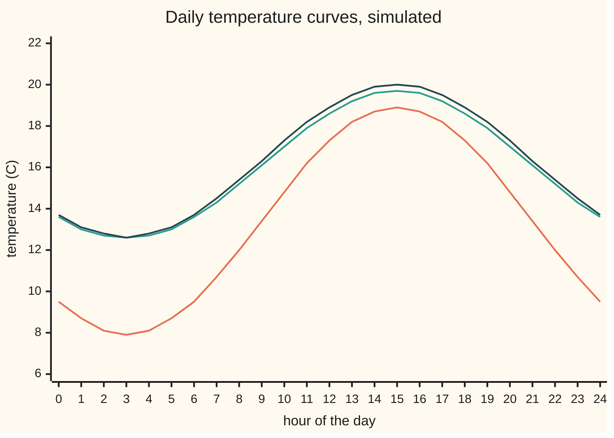

# Arzela-Ascoli: when a whole family of functions has a convergent subsequence

[Syllabus](../../../SYLLABUS.md) → [Topology](../README.md) → [Metric Spaces](../README.md#s01) → Arzela-Ascoli

---

## General Overview

A hundred weather stations each send one temperature curve a day: the temperature at every moment from midnight to midnight. After 200 days the archive holds 20,000 curves. On this card the archive is simulated, and says so: daily means run from 12 to 18 °C, and each day swings 3 to 6 °C above and below its mean, peaking at 15:00.

The question is whether some endless run of days, taken in archive order, settles onto one limiting curve. Settling must happen at every moment of the day at once, not just at noon. For plain numbers the answer is always yes: any bounded sequence has a convergent subsequence. For curves, bounded is not enough. A faulty sensor that swings faster each day stays between 10 and 20 °C, yet no two of its first 20 days come within 8.796 °C of each other.

The missing piece is a shared speed limit. Real air cannot warm or cool arbitrarily fast. In this archive no curve changes faster than 1.5708 °C per hour. With values bounded and that one limit shared by every curve, a run that settles always exists. The code finds one: days #1, #6, #27, #61, #184, #650, …, closing in on a curve within 0.0991 °C of the day that reads $`16.3227 + 3.6783\cos(\pi(t-15)/12)`$ °C at hour $`t`$.

**A sequence of functions on a closed interval that is bounded at each point and equicontinuous, meaning one closeness rule serves every function at once, has a subsequence that converges uniformly, and its limit is continuous.**

**What kind of fact this is:** a theorem, proved on this card in Why it works. The code shows the first six stages of the proof's construction on 20,000 simulated curves; that illustrates the proof and does not replace it.

### The picture: one dropped day, one picked day, and the limit



Orange: curve #2, which the extraction drops. Teal: curve #27, the third pick. Dark blue: curve #2014, which the limit stays within 0.0991 °C of. The picked curve already sits within 0.328 °C of the dark blue one at every hour; later picks sit closer.

---

## The formula

Reminders. $`C[a,b]`$ is the set of continuous functions on the closed interval from $`a`$ to $`b`$. Its sup distance $`d_\infty(\varphi,\psi)`$ is the worst gap between two functions $`\varphi`$ and $`\psi`$ over the whole interval ([The distance menu](02-distances-on-vectors-and-functions.md)). A sequence converges uniformly when that worst gap to the limit heads for 0 ([Uniform convergence](../../06-Calculus%20and%20analysis/06-Series/07-uniform-convergence.md)).

This card introduces one word. A sequence of functions $`f_1, f_2, \ldots`$ is **equicontinuous** when every tolerance $`\varepsilon`$ has one time window $`\delta`$ that works for every function at once:

```math
\lvert u - t\rvert < \delta \;\Longrightarrow\; \lvert f_k(u) - f_k(t)\rvert < \varepsilon \quad \text{for every } k.
```

**Read it aloud:** times $`u`$ and $`t`$ closer than delta give temperatures closer than epsilon, and the same delta serves the whole sequence.

The theorem:

```math
\sup_k \lvert f_k(t)\rvert < \infty \text{ for each } t, \;\; \text{equicontinuous} \;\Longrightarrow\; f_{k_j} \to g \text{ uniformly, for some } k_1 < k_2 < \cdots \text{ and some } g \in C[a,b].
```

**Read it aloud:** if the curves are bounded at each moment and share one closeness rule, some run of them, kept in order, settles uniformly onto a continuous curve.

The working tool inside the proof turns finitely many readings into a bound for the whole day. If two curves $`\varphi`$ and $`\psi`$ both obey the slope bound $`K`$ and the readings $`t_i`$ are spaced $`h`$ apart, then

```math
d_\infty(\varphi,\psi) \;\le\; \max_i \lvert \varphi(t_i) - \psi(t_i)\rvert \;+\; K h.
```

**Read it aloud:** the worst gap over the day is at most the worst gap at the readings, plus the slope bound times the spacing.

| Symbol | Plain meaning | In our example | Push it up and the answer… |
| --- | --- | --- | --- |
| $`t`$, $`u`$ | times of day, in hours | 0 to 24 | — |
| $`f_k`$, $`k`$ | curve number $`k`$ in the archive | $`f_k(t) = m_k + a_k\cos(\pi(t-15)/12)`$ | — |
| $`m_k`$, $`a_k`$ | that day's mean; half its daily swing | 12 to 18 °C; 3 to 6 °C | wider spread, more stages needed |
| $`\varepsilon`$, $`\delta`$ | a tolerance in °C; a time window that meets it | 1 °C; 38.2 minutes | larger ε allows a larger δ |
| $`K`$ | shared slope bound: no curve changes faster | $`\pi/2`$ = 1.5708 °C per hour | larger K needs denser readings |
| $`d_\infty(\varphi,\psi)`$; $`\varphi`$, $`\psi`$ | worst gap between two curves over the day; any two curves | #27 to #2014: 0.328 °C | — |
| $`t_i`$, $`h`$ | reading times; the spacing between them | every 60 minutes at stage 1 | larger h, weaker guarantee |
| $`r`$ | ball radius: allowed gap to the stage's centre curve at the readings | 1.6 °C, halving to 0.05 °C | bigger balls, more curves kept |
| $`s`$, $`S_s`$ | stage number; the curves kept at stage s | stages 1 to 6; 5,656 kept at stage 1 | more stages, tighter limit |
| $`k_j`$ | the picked curve numbers, increasing; j counts the picks | #1, #6, #27, #61, #184, #650 | — |
| $`g`$ | the limit curve | within 0.0991 °C of curve #2014 | — |
| $`B`$; $`p_i`$ | in the fold: a bound on every curve at the checkpoints; checkpoints, every time within δ of one | 24 °C serves; hourly checkpoints serve | — |

### When it holds

- **Bounded at each moment.** Drop it and a sensor drifting up 0.5 °C a day keeps every two days at least 0.5 °C apart; by day 200 it reads 99.5 °C high, and no run settles.
- **Equicontinuous, not merely continuous.** Each curve $`15 + 5\sin(2\pi k t/24)`$ is continuous, but the window for 1 °C shrinks from 45.8 minutes at k = 1 to 2.3 minutes at k = 20. Its first 20 days stay at least 8.796 °C apart.
- **A closed, bounded interval.** On the whole real line, one fixed bump sliding right forever is bounded and equicontinuous, yet any two of its positions stay a full bump-height apart.
- **The theorem promises a run, not the whole sequence.** Consecutive curves #19999 and #20000 are 5.466 °C apart. Only a chosen subsequence settles, and a different choice can settle onto a different limit.

---

## Why it works

### Step 0: a speed limit turns a whole day into finitely many readings

A curve has infinitely many moments, and that is why "bounded" alone fails. The speed limit fixes this. If no curve moves faster than $`K`$, two curves that agree at readings spaced $`h`$ apart cannot drift far apart between them. So finitely many readings decide the whole day, up to $`K h`$.

Finitely many bounded readings leave finitely many "kinds of day", to any tolerance. Infinitely many days must pile up in one kind. Repeat with a finer tolerance, pick one day per stage, and the picks settle.

### Step 1: readings decide the whole day (three pieces)

Take any moment $`t`$ and the nearest reading $`t_i`$, at most $`h/2`$ away. Split the gap between curves $`\varphi`$ and $`\psi`$ into three pieces:

1. $`\varphi(t)`$ to $`\varphi(t_i)`$: at most $`K h/2`$, by the slope bound.
2. $`\varphi(t_i)`$ to $`\psi(t_i)`$: the gap at a reading.
3. $`\psi(t_i)`$ to $`\psi(t)`$: at most $`K h/2`$ again.

The pieces add to the working formula. Pieces 1 and 3 use one shared $`K`$ for both curves. This is the three-thirds argument from [Uniform convergence](../../06-Calculus%20and%20analysis/06-Series/07-uniform-convergence.md), with readings in place of stages.

In the archive, $`K = \pi/2`$ because the steepest possible slope is the largest half-swing, 6 °C, times $`\pi/12`$. The code measures the steepest one-minute step on the first 500 curves as 1.5701 °C per hour, under 1.5708.

In this archive the gap between two curves peaks at 03:00 or 15:00 (see Worked numbers), so readings on the hour catch it exactly. Move the readings half an hour off, to 00:30, 01:30 and so on, and they fall short: from pick #1 to curve #2014 they read 1.1740 °C against a true 1.1788 °C. Adding $`K h`$ restores the guarantee: 1.1740 + 1.5708 = 2.7448 °C. The code checks the shortfall on this pair, and the cover for every pick at its stage's spacing.

### Step 2: finitely many readings, bounded values, so one ball holds a crowd

At stage 1 the readings fall every 60 minutes, 25 of them, and every value lies between 6.009 and 23.952 °C. Balls of radius $`r = 1.6`$ °C around chosen curves, measured at those 25 readings, can cover all possible days with finitely many balls. An endless archive must put endlessly many curves into one ball. This is the pigeonhole principle. It is the curve version of "totally bounded" from [Compactness three ways](06-compactness-in-metric-spaces.md): finitely many small balls cover everything.

The code tries balls around 30 curves and keeps the fullest: around curve #6, holding 5,656 of the 20,000. Any two curves inside are within $`2r`$ at the readings, so by Step 1 within $`2r + Kh`$ = 4.771 °C all day.

### Step 3: halve the tolerance, double the readings, repeat inside

Each stage searches only inside the previous ball. The radius halves, and the readings double in density, so $`K h`$ stays below $`r`$.

| Stage | Radius r (°C) | Readings every | Curves kept | Widest pair (°C) | Guarantee 2r + Kh (°C) |
| --- | --- | --- | --- | --- | --- |
| 1 | 1.60 | 60 min | 5,656 | 3.200 | 4.771 |
| 2 | 0.80 | 30 min | 1,414 | 1.599 | 2.385 |
| 3 | 0.40 | 15 min | 363 | 0.796 | 1.193 |
| 4 | 0.20 | 7.5 min | 94 | 0.397 | 0.596 |
| 5 | 0.10 | 3.75 min | 29 | 0.194 | 0.298 |
| 6 | 0.05 | 1.875 min | 15 | 0.096 | 0.149 |

The widest pair is the exact worst gap inside the ball, found two ways: a closed form and a one-minute grid. It always sits under the guarantee.

The guarantee is loose here for a plain reason. Every day in this archive has one shape, so two numbers fix it: its mean and its half-swing. The gap between two days peaks at 03:00 or 15:00, and every stage reads both hours. So the readings give the exact all-day gap, the widest pair never passes $`2r`$, and the slope term $`K h`$ is never used. On this archive the extraction is Bolzano–Weierstrass on the pairs (mean, half-swing). The theorem needs $`K h`$ for curves of different shapes; Step 1 shows it covering readings moved off the peaks.

### Step 4: the diagonal pick

From stage 1 pick the earliest kept curve: #1. From stage 2 pick the earliest kept curve later than #1: #6. Continue: #27, #61, #184, #650. Each pick comes later in the archive than the last, so the picks form a subsequence. This "one from each stage" choice is the **diagonal argument**: list the stages as rows, and the picks run down the diagonal.

Every pick from stage $`s`$ onward lies inside ball $`s`$. So any two later picks are within that stage's guarantee of each other. The guarantees shrink to 0, so the picks are uniformly Cauchy: bunched together over the whole day at once.

### Step 5: name the limit

At each moment the picked values form a Cauchy sequence of numbers, so they converge; call the limit $`g(t)`$. The bunching was uniform, so the convergence is uniform. A uniform limit of continuous functions is continuous ([Uniform convergence](../../06-Calculus%20and%20analysis/06-Series/07-uniform-convergence.md)), so $`g`$ is in $`C[a,b]`$. Put another way, $`C[a,b]`$ with the sup distance is complete: [Complete space](05-completeness-and-completion.md) says what that means, and [Banach's fixed point theorem](08-banach-fixed-point-in-metric-spaces.md) proves it in its Step 4.

The limit keeps both hypotheses. Passing to the limit in $`\lvert f_k(u) - f_k(t)\rvert \le K\lvert u - t\rvert`$ gives the same bound for $`g`$, and $`g`$ stays inside the same temperature range.

Where is it? All later picks stay within 0.05 °C of centre #2014 at the stage-6 readings, so $`g`$ does too. By Step 1, $`g`$ is within $`0.05 + K/32`$ = 0.0991 °C of curve #2014 at every moment:

```math
g(t) \approx 16.3227 + 3.6783\cos\!\left(\frac{\pi(t-15)}{12}\right), \quad \text{to within 0.0991 degrees}.
```

<details>
<summary>Detailed proof: bounded and equicontinuous on a closed interval gives a uniformly convergent subsequence</summary>

Let $`f_1, f_2, \ldots`$ be functions on $`[a,b]`$, bounded at each point and equicontinuous.

**Uniform bound.** Take δ for ε = 1. Finitely many points $`p_1, \ldots, p_n`$ have every $`t`$ within δ of one of them. Let $`B`$ bound all $`\lvert f_k(p_i)\rvert`$. Then every $`\lvert f_k(t)\rvert`$ is below $`B + 1`$.

**One stage.** Fix $`r > 0`$. Take δ for ε = r, and readings $`t_1, \ldots, t_n`$ with every $`t`$ within δ of one. Each curve gives a point $`(f_k(t_1), \ldots, f_k(t_n))`$ in a cube of side $`2(B+1)`$. Cut the cube into finitely many boxes of side $`r`$. Infinitely many curves share one box. For two of them, $`\varphi`$ and $`\psi`$, and any $`t`$ with nearest reading $`t_i`$:

$`\displaystyle \lvert \varphi(t) - \psi(t)\rvert \le \lvert \varphi(t) - \varphi(t_i)\rvert + \lvert \varphi(t_i) - \psi(t_i)\rvert + \lvert \psi(t_i) - \psi(t)\rvert < 3r.`$

**Nested stages.** Apply this with $`r = 2^{-s}`$ inside the infinite set from stage $`s - 1`$. This gives infinite sets $`S_1 \supseteq S_2 \supseteq \cdots`$, with any two curves in $`S_s`$ less than $`3 \cdot 2^{-s}`$ apart.

**Diagonal.** Choose $`k_1 < k_2 < \cdots`$ with $`k_s`$ in $`S_s`$; this is possible because each $`S_s`$ is infinite. For $`j \ge s`$ both $`k_j`$ and $`k_s`$ lie in $`S_s`$, so

$`\displaystyle d_\infty(f_{k_j}, f_{k_s}) < 3 \cdot 2^{-s}.`$

**Limit.** For each $`t`$ the numbers $`f_{k_j}(t)`$ form a Cauchy sequence, so they converge to some $`g(t)`$. Let $`j \to \infty`$ in the last inequality: $`\lvert g(t) - f_{k_s}(t)\rvert \le 3 \cdot 2^{-s}`$ for every $`t`$. So $`d_\infty(f_{k_s}, g) \to 0`$, which is uniform convergence, and $`g`$ is continuous as a uniform limit of continuous functions.

**The converse.** If a sequence in $`C[a,b]`$ is not equicontinuous, there are ε > 0, curves $`f_{k_j}`$ with increasing $`k_j`$, and pairs of points ever closer together where each curve jumps by at least ε. A uniform limit of a further subsequence would be continuous on $`[a,b]`$, hence uniformly continuous, and close to those curves, a contradiction. So for sets in $`C[a,b]`$, "every sequence has a uniformly convergent subsequence" holds exactly when the set is bounded and equicontinuous.

</details>

### Which changes keep the property

Changing units keeps both hypotheses. In Fahrenheit, $`F = 1.8C + 32`$, the ceiling 24 °C becomes 75.2 °F and the slope bound becomes 2.8274 °F per hour. Any fixed change of scale with a finite stretch factor works the same way: it stretches $`K`$ by that factor and moves the ceiling with it.

---

## Worked numbers, by hand

| Step | Arithmetic | Value |
| --- | --- | --- |
| slope bound | largest half-swing times the cosine's rate: 6 × π/12 | K = 1.5708 °C/h |
| shared window for 1 °C | 1 ÷ 1.5708 hours | δ = 38.2 minutes |
| stage 1 readings | K × h = 1.5708 × 1 | 1.571, under r = 1.6 |
| stage 1 guarantee | 2 × 1.6 + 1.571 | 4.771 °C |
| stage 6 guarantee | 2 × 0.05 + 1.5708 ÷ 32 | 0.149 °C |
| gap, pick #27 to #2014 | $`\lvert 16.122 - 16.3227\rvert + \lvert 3.551 - 3.6783\rvert`$ | 0.328 °C, under 1.193 |
| limit to curve #2014 | 0.05 + 1.5708 ÷ 32 | **0.0991 °C** |

The gap between two curves of this shape is the gap in means plus the gap in half-swings, because the difference of the two curves peaks at 15:00 or 03:00, where the cosine is 1 or −1.

So the limit of the picked days is a day with mean about 16.32 °C and half-swing about 3.68 °C, known to within a tenth of a degree at every moment.

### What breaks if you drop a piece

| Mistake | Comes out at | What went wrong |
| --- | --- | --- |
| Bounded, not equicontinuous: $`15 + 5\sin(2\pi k t/24)`$ | closest of 20 days at least 8.796 °C apart; slope 26.18 °C/h at k = 20 | no shared speed limit, so no run can bunch up |
| Readings only, no slope bound: k = 144 | 0.000000 off 15 °C at every 10-minute reading; 5.000000 off at 00:02:30 | readings decide the day only with a shared slope bound |
| Equicontinuity fails at one end: $`x^n`$ on [0, 1] | at n = 1000, inputs 0.000693 apart give values 0.500000 apart | each limit of a run is the jump at 1, which is not continuous |
| Not bounded: drift of 0.5 °C a day | any two days at least 0.5 °C apart; day 200 reads 99.5 °C high | values escape, as for numbers |
| Taking the ball centres as the run | #6, #95, #61, #1116, #3844, #2014 | not in archive order, so not a subsequence |

The code prints every row.

---

## Code, from first principles, and it actually runs

The code builds the 20,000 curves, checks both hypotheses, runs six stages of nested balls, makes the diagonal picks and names the limit. The widest pair in each ball is found two ways: the closed form (gap in means plus gap in half-swings) and a one-minute grid. Each pick's distance to the limit's centre is found three ways: those two, and the working formula on readings moved half a step off the peak hours, which must fall short of the true gap by no more than $`K h`$. The slopes are measured on the first 500 curves. For the fast sensor, an exact mean squared gap of 25 is a second road to its 5 °C floor. Checked on 20,000 curves and six stages.

### Python

```python
# Arzela-Ascoli -- the check behind the card.  Simulated archive: 100 weather
# stations x 200 days = 20,000 daily temperature curves, t in hours 0 to 24:
#     f_k(t) = m_k + a_k cos(pi (t - 15) / 12),   peak at 15:00,
# mean m_k from 12 to 18 C and half-swing a_k from 3 to 6 C, stepped by two
# irrational numbers, so the whole sequence never settles.  The code checks
# the two hypotheses, extracts a subsequence by nested balls, and names its
# limit.  Roads to each distance: the closed form |dm| + |da|, a one-minute
# grid, and readings half a step off the peak hours plus the slope term K h.
from math import sqrt, cos, sin, pi, floor

N, K = 20000, pi / 2                      # curves; shared slope bound, C per hour
AL, BE = (sqrt(5) - 1) / 2, sqrt(2) - 1   # the two irrational steps

def params(k):                            # (mean m_k, half-swing a_k), in C
    x, y = k * AL, k * BE
    return 12 + 6 * (x - floor(x)), 3 + 3 * (y - floor(y))

P = [None] + [params(k) for k in range(1, N + 1)]

def temp(k, t):
    return P[k][0] + P[k][1] * cos(pi * (t - 15) / 12)

def formula_dist(j, k):                   # exact sup distance of two curves
    return abs(P[j][0] - P[k][0]) + abs(P[j][1] - P[k][1])

MINUTE = [i / 60 for i in range(1441)]

def grid_dist(j, k):                      # sup distance on a one-minute grid
    return max(abs(temp(j, t) - temp(k, t)) for t in MINUTE)

def offpeak(j, k, h):                     # largest gap at readings half a step off 03:00 and 15:00
    return max(abs(temp(j, t) - temp(k, t)) for t in [h / 2 + i * h for i in range(round(24 / h))])

for k in (2, 27):
    print(f"chart #{k}:", " ".join(f"{temp(k, h):.1f}" for h in range(25)))

# Hypothesis 1, pointwise bounded; hypothesis 2, equicontinuous (one slope bound K)
top = max(m + a for m, a in P[1:])
bottom = min(m - a for m, a in P[1:])
grid_top = max(temp(k, t) for k in range(1, 501) for t in MINUTE)
assert abs(grid_top - max(m + a for m, a in P[1:501])) < 1e-12
assert top < 24
steep = max(abs(temp(k, t + 1 / 60) - temp(k, t)) * 60 for k in range(1, 501) for t in MINUTE[:-1])
steep_formula = max(a * pi / 12 for m, a in P[1:501])
assert 0 <= steep_formula - steep < 1e-4
assert steep_formula < K
print(f"bounded: every curve between {bottom:.3f} and {top:.3f} C; minute grid, first 500: top {grid_top:.3f}")
print(f"equicontinuous, first 500: steepest minute step {steep:.4f} C/h; formula a*pi/12 {steep_formula:.4f}; shared K = {K:.4f}")
print(f"  so one delta serves every curve: for 1 C, delta = 1/K = {60 / K:.1f} minutes")
print(f"  in Fahrenheit (F = 1.8 C + 32): ceiling {1.8 * 24 + 32:.1f} F, K = {1.8 * K:.4f} F/h")

# Extraction: stage s keeps the fullest ball of radius r around one of the
# first 30 kept curves, measured at readings every h hours, with K h <= r.
pool, picks, centres, rows = list(range(1, N + 1)), [], [], []
for s in range(6):
    r, h = 1.6 / 2 ** s, 1 / 2 ** s
    ts = [i * h for i in range(round(24 / h) + 1)]
    vals = {k: [temp(k, t) for t in ts] for k in pool}
    best = None
    for c in pool[:30]:
        ball = [k for k in pool if all(abs(x - y) <= r for x, y in zip(vals[k], vals[c]))]
        if best is None or len(ball) > len(best[1]):
            best = (c, ball)
    c, pool = best
    pick = next(k for k in pool if k > (picks[-1] if picks else 0))
    picks.append(pick)
    centres.append(c)
    hi, lo = [m + a for m, a in (P[k] for k in pool)], [m - a for m, a in (P[k] for k in pool)]
    diam = max(max(hi) - min(hi), max(lo) - min(lo))          # closed form
    band = max(max(temp(k, t) for k in pool) - min(temp(k, t) for k in pool) for t in MINUTE)
    bound = 2 * r + K * h                                    # three pieces
    assert abs(diam - band) < 1e-9 and diam <= bound
    rows.append((r, h, bound))
    print(f"stage {s + 1}: r {r:.2f} C, readings every {60 * h:g} min, centre #{c}, kept {len(pool)},"
          f" pick #{pick}, widest pair {diam:.3f} <= {bound:.3f}")
g = centres[-1]
named = rows[-1][0] + K * rows[-1][1]
print(f"limit: within {named:.4f} C everywhere of curve #{g}:"
      f" {P[g][0]:.4f} + {P[g][1]:.4f} cos(pi (t - 15) / 12)")
for s, k in enumerate(picks):
    d, off = formula_dist(k, g), offpeak(k, g, rows[s][1])
    assert abs(d - grid_dist(k, g)) < 1e-9 and off <= d <= off + K * rows[s][1] and d <= rows[s][2]
    print(f"  pick #{k}: mean {P[k][0]:.3f}, half-swing {P[k][1]:.3f}, distance to #{g} {d:.3f} (allowed {rows[s][2]:.3f})")
o1, d1 = offpeak(picks[0], g, 1), formula_dist(picks[0], g)
assert o1 < d1 <= o1 + K                  # the readings alone fall short; K h covers it
print(f"readings moved half an hour off the peaks: #{picks[0]} to #{g} reads {o1:.4f}, true {d1:.4f} <= {o1:.4f} + K = {o1 + K:.4f}")
print(f"chart limit #{g}:", " ".join(f"{temp(g, h):.1f}" for h in range(25)))
print(f"centres in order: {centres} (not increasing: not a subsequence)")
print(f"whole sequence: #{N - 1} to #{N} distance {formula_dist(N - 1, N):.3f} C")

# What breaks
for n in (10, 100, 1000):
    x = 2 ** (-1 / n)
    print(f"x^n, n={n}: inputs {1 - x:.6f} apart, values {1 - x ** n:.6f} apart")
fast = lambda k, t: 15 + 5 * sin(2 * pi * k * t / 24)
pair = []
for j in range(1, 21):
    for k in range(j + 1, 21):
        diffs = [fast(j, t) - fast(k, t) for t in MINUTE[:-1]]
        assert abs(sum(d * d for d in diffs) / 1440 - 25) < 1e-9  # mean square 25
        pair.append(max(abs(d) for d in diffs))
assert min(pair) >= 5
print(f"fast sensor 15 + 5 sin(2 pi k t / 24), k = 1..20: closest pair at least {min(pair):.3f} C apart")
print(f"  delta for 1 C: k=1 {60 * 24 / (10 * pi):.1f} min, k=20 {60 * 24 / (200 * pi):.1f} min; slope at k=20 {10 * pi * 20 / 24:.2f} C/h")
at_read = max(abs(fast(144, i / 6) - 15) for i in range(145))
print(f"k=144: off 15 C by {at_read:.6f} at every 10-min reading, by {abs(fast(144, 1 / 24) - 15):.6f} at 00:02:30")
print(f"drift 0.5 C a day: any two days at least 0.5 C apart; day 200 reads {0.5 * 199:.1f} C high")
print("ALL CHECKS PASS")
```

**Ran 2026-11-14 on macOS, Python 3.14.10, standard library only. All checks passed. Output, pasted from the run:**

```
chart #2: 9.5 8.7 8.1 7.9 8.1 8.7 9.5 10.7 12.0 13.4 14.8 16.2 17.3 18.2 18.7 18.9 18.7 18.2 17.3 16.2 14.8 13.4 12.0 10.7 9.5
chart #27: 13.6 13.0 12.7 12.6 12.7 13.0 13.6 14.3 15.2 16.1 17.0 17.9 18.6 19.2 19.6 19.7 19.6 19.2 18.6 17.9 17.0 16.1 15.2 14.3 13.6
bounded: every curve between 6.009 and 23.952 C; minute grid, first 500: top 23.811
equicontinuous, first 500: steepest minute step 1.5701 C/h; formula a*pi/12 1.5701; shared K = 1.5708
  so one delta serves every curve: for 1 C, delta = 1/K = 38.2 minutes
  in Fahrenheit (F = 1.8 C + 32): ceiling 75.2 F, K = 2.8274 F/h
stage 1: r 1.60 C, readings every 60 min, centre #6, kept 5656, pick #1, widest pair 3.200 <= 4.771
stage 2: r 0.80 C, readings every 30 min, centre #95, kept 1414, pick #6, widest pair 1.599 <= 2.385
stage 3: r 0.40 C, readings every 15 min, centre #61, kept 363, pick #27, widest pair 0.796 <= 1.193
stage 4: r 0.20 C, readings every 7.5 min, centre #1116, kept 94, pick #61, widest pair 0.397 <= 0.596
stage 5: r 0.10 C, readings every 3.75 min, centre #3844, kept 29, pick #184, widest pair 0.194 <= 0.298
stage 6: r 0.05 C, readings every 1.875 min, centre #2014, kept 15, pick #650, widest pair 0.096 <= 0.149
limit: within 0.0991 C everywhere of curve #2014: 16.3227 + 3.6783 cos(pi (t - 15) / 12)
  pick #1: mean 15.708, half-swing 4.243, distance to #2014 1.179 (allowed 4.771)
  pick #6: mean 16.249, half-swing 4.456, distance to #2014 0.851 (allowed 2.385)
  pick #27: mean 16.122, half-swing 3.551, distance to #2014 0.328 (allowed 1.193)
  pick #61: mean 16.200, half-swing 3.801, distance to #2014 0.245 (allowed 0.596)
  pick #184: mean 16.310, half-swing 3.646, distance to #2014 0.046 (allowed 0.298)
  pick #650: mean 16.333, half-swing 3.716, distance to #2014 0.048 (allowed 0.149)
readings moved half an hour off the peaks: #1 to #2014 reads 1.1740, true 1.1788 <= 1.1740 + K = 2.7448
chart limit #2014: 13.7 13.1 12.8 12.6 12.8 13.1 13.7 14.5 15.4 16.3 17.3 18.2 18.9 19.5 19.9 20.0 19.9 19.5 18.9 18.2 17.3 16.3 15.4 14.5 13.7
centres in order: [6, 95, 61, 1116, 3844, 2014] (not increasing: not a subsequence)
whole sequence: #19999 to #20000 distance 5.466 C
x^n, n=10: inputs 0.066967 apart, values 0.500000 apart
x^n, n=100: inputs 0.006908 apart, values 0.500000 apart
x^n, n=1000: inputs 0.000693 apart, values 0.500000 apart
fast sensor 15 + 5 sin(2 pi k t / 24), k = 1..20: closest pair at least 8.796 C apart
  delta for 1 C: k=1 45.8 min, k=20 2.3 min; slope at k=20 26.18 C/h
k=144: off 15 C by 0.000000 at every 10-min reading, by 5.000000 at 00:02:30
drift 0.5 C a day: any two days at least 0.5 C apart; day 200 reads 99.5 C high
ALL CHECKS PASS
```

### Rust

Same numbers, same labels, built with `rustc --edition 2021 -O`.

```rust
// Arzela-Ascoli -- the same check as the Python, in Rust.  No crates.
// Simulated archive: 100 weather stations x 200 days = 20,000 daily
// temperature curves f_k(t) = m_k + a_k cos(pi (t - 15) / 12), t in hours,
// mean m_k from 12 to 18 C, half-swing a_k from 3 to 6 C, stepped by two
// irrational numbers.  Check the two hypotheses, extract a subsequence by
// nested balls, name its limit; closed form, minute grid and off-peak readings agree.
use std::f64::consts::PI;

const N: usize = 20000;
const K: f64 = PI / 2.0; // shared slope bound, C per hour

fn frac(x: f64) -> f64 { x - x.floor() }

fn temp(p: &[(f64, f64)], k: usize, t: f64) -> f64 {
    p[k].0 + p[k].1 * (PI * (t - 15.0) / 12.0).cos()
}

fn formula_dist(p: &[(f64, f64)], j: usize, k: usize) -> f64 { // exact sup distance
    (p[j].0 - p[k].0).abs() + (p[j].1 - p[k].1).abs()
}

fn minute() -> Vec<f64> { (0..1441).map(|i| i as f64 / 60.0).collect() }

fn grid_dist(p: &[(f64, f64)], j: usize, k: usize) -> f64 { // one-minute grid
    minute().iter().map(|&t| (temp(p, j, t) - temp(p, k, t)).abs()).fold(0.0, f64::max)
}

fn offpeak(p: &[(f64, f64)], j: usize, k: usize, h: f64) -> f64 { // readings half a step off 03:00 and 15:00
    (0..(24.0 / h).round() as usize).map(|i| h / 2.0 + i as f64 * h).map(|t| (temp(p, j, t) - temp(p, k, t)).abs()).fold(0.0, f64::max)
}

fn fast(k: f64, t: f64) -> f64 { 15.0 + 5.0 * (2.0 * PI * k * t / 24.0).sin() }

fn chart(p: &[(f64, f64)], k: usize) -> String {
    (0..25).map(|h| format!("{:.1}", temp(p, k, h as f64))).collect::<Vec<_>>().join(" ")
}

fn main() {
    let (al, be) = ((5f64.sqrt() - 1.0) / 2.0, 2f64.sqrt() - 1.0);
    let mut p = vec![(0.0, 0.0)];
    for k in 1..=N {
        let (x, y) = (k as f64 * al, k as f64 * be);
        p.push((12.0 + 6.0 * frac(x), 3.0 + 3.0 * frac(y)));
    }
    let mt = minute();
    for k in [2, 27] { println!("chart #{}: {}", k, chart(&p, k)); }

    // Hypothesis 1, pointwise bounded; hypothesis 2, equicontinuous
    let top = p[1..].iter().map(|q| q.0 + q.1).fold(f64::MIN, f64::max);
    let bottom = p[1..].iter().map(|q| q.0 - q.1).fold(f64::MAX, f64::min);
    let mut grid_top = f64::MIN;
    let mut steep: f64 = 0.0;
    for k in 1..=500 {
        for (i, &t) in mt.iter().enumerate() {
            grid_top = grid_top.max(temp(&p, k, t));
            if i < 1440 { steep = steep.max((temp(&p, k, t + 1.0 / 60.0) - temp(&p, k, t)).abs() * 60.0); }
        }
    }
    let top500 = p[1..501].iter().map(|q| q.0 + q.1).fold(f64::MIN, f64::max);
    assert!((grid_top - top500).abs() < 1e-12);
    assert!(top < 24.0);
    let steep_formula = p[1..501].iter().map(|q| q.1 * PI / 12.0).fold(0.0, f64::max);
    assert!(steep_formula - steep >= 0.0 && steep_formula - steep < 1e-4);
    assert!(steep_formula < K);
    println!("bounded: every curve between {:.3} and {:.3} C; minute grid, first 500: top {:.3}", bottom, top, grid_top);
    println!("equicontinuous, first 500: steepest minute step {:.4} C/h; formula a*pi/12 {:.4}; shared K = {:.4}", steep, steep_formula, K);
    println!("  so one delta serves every curve: for 1 C, delta = 1/K = {:.1} minutes", 60.0 / K);
    println!("  in Fahrenheit (F = 1.8 C + 32): ceiling {:.1} F, K = {:.4} F/h", 1.8 * 24.0 + 32.0, 1.8 * K);

    // Extraction: stage s keeps the fullest ball of radius r around one of the
    // first 30 kept curves, measured at readings every h hours, with K h <= r.
    let mut pool: Vec<usize> = (1..=N).collect();
    let (mut picks, mut centres, mut rows): (Vec<usize>, Vec<usize>, Vec<(f64, f64, f64)>) = (vec![], vec![], vec![]);
    for s in 0..6 {
        let (r, h) = (1.6 / 2f64.powi(s), 1.0 / 2f64.powi(s));
        let ts: Vec<f64> = (0..=(24.0 / h).round() as usize).map(|i| i as f64 * h).collect();
        let vals: Vec<Vec<f64>> = pool.iter().map(|&k| ts.iter().map(|&t| temp(&p, k, t)).collect()).collect();
        let mut best: (usize, Vec<usize>) = (0, vec![]);
        for ci in 0..30.min(pool.len()) {
            let ball: Vec<usize> = (0..pool.len())
                .filter(|&i| vals[i].iter().zip(&vals[ci]).all(|(x, y)| (x - y).abs() <= r))
                .map(|i| pool[i]).collect();
            if best.1.is_empty() || ball.len() > best.1.len() { best = (pool[ci], ball); }
        }
        let c = best.0;
        pool = best.1;
        let last = *picks.last().unwrap_or(&0);
        let pick = *pool.iter().find(|&&k| k > last).unwrap();
        picks.push(pick);
        centres.push(c);
        let hi: Vec<f64> = pool.iter().map(|&k| p[k].0 + p[k].1).collect();
        let lo: Vec<f64> = pool.iter().map(|&k| p[k].0 - p[k].1).collect();
        let range = |v: &Vec<f64>| v.iter().cloned().fold(f64::MIN, f64::max) - v.iter().cloned().fold(f64::MAX, f64::min);
        let diam = range(&hi).max(range(&lo)); // closed form
        let band = mt.iter().map(|&t| {
            let v: Vec<f64> = pool.iter().map(|&k| temp(&p, k, t)).collect();
            range(&v)
        }).fold(0.0, f64::max);
        let bound = 2.0 * r + K * h; // three pieces
        assert!((diam - band).abs() < 1e-9 && diam <= bound);
        rows.push((r, h, bound));
        println!("stage {}: r {:.2} C, readings every {} min, centre #{}, kept {}, pick #{}, widest pair {:.3} <= {:.3}",
            s + 1, r, 60.0 * h, c, pool.len(), pick, diam, bound);
    }
    let g = *centres.last().unwrap();
    let named = rows[5].0 + K * rows[5].1;
    println!("limit: within {:.4} C everywhere of curve #{}: {:.4} + {:.4} cos(pi (t - 15) / 12)", named, g, p[g].0, p[g].1);
    for (s, &k) in picks.iter().enumerate() {
        let (d, off) = (formula_dist(&p, k, g), offpeak(&p, k, g, rows[s].1));
        assert!((d - grid_dist(&p, k, g)).abs() < 1e-9 && off <= d && d <= off + K * rows[s].1 && d <= rows[s].2);
        println!("  pick #{}: mean {:.3}, half-swing {:.3}, distance to #{} {:.3} (allowed {:.3})", k, p[k].0, p[k].1, g, d, rows[s].2);
    }
    let (o1, d1) = (offpeak(&p, picks[0], g, 1.0), formula_dist(&p, picks[0], g));
    assert!(o1 < d1 && d1 <= o1 + K); // the readings alone fall short; K h covers it
    println!("readings moved half an hour off the peaks: #{} to #{} reads {:.4}, true {:.4} <= {:.4} + K = {:.4}",
        picks[0], g, o1, d1, o1, o1 + K);
    println!("chart limit #{}: {}", g, chart(&p, g));
    println!("centres in order: {:?} (not increasing: not a subsequence)", centres);
    println!("whole sequence: #{} to #{} distance {:.3} C", N - 1, N, formula_dist(&p, N - 1, N));

    // What breaks
    for n in [10, 100, 1000] {
        let x = 2f64.powf(-1.0 / n as f64);
        println!("x^n, n={}: inputs {:.6} apart, values {:.6} apart", n, 1.0 - x, 1.0 - x.powi(n));
    }
    let mut closest = f64::MAX;
    for j in 1..=20 {
        for k in j + 1..=20 {
            let diffs: Vec<f64> = mt[..1440].iter().map(|&t| fast(j as f64, t) - fast(k as f64, t)).collect();
            assert!((diffs.iter().map(|d| d * d).sum::<f64>() / 1440.0 - 25.0).abs() < 1e-9); // mean square 25
            closest = closest.min(diffs.iter().map(|d| d.abs()).fold(0.0, f64::max));
        }
    }
    assert!(closest >= 5.0);
    println!("fast sensor 15 + 5 sin(2 pi k t / 24), k = 1..20: closest pair at least {:.3} C apart", closest);
    println!("  delta for 1 C: k=1 {:.1} min, k=20 {:.1} min; slope at k=20 {:.2} C/h",
        60.0 * 24.0 / (10.0 * PI), 60.0 * 24.0 / (200.0 * PI), 10.0 * PI * 20.0 / 24.0);
    let at_read = (0..145).map(|i| (fast(144.0, i as f64 / 6.0) - 15.0).abs()).fold(0.0, f64::max);
    println!("k=144: off 15 C by {:.6} at every 10-min reading, by {:.6} at 00:02:30", at_read, (fast(144.0, 1.0 / 24.0) - 15.0).abs());
    println!("drift 0.5 C a day: any two days at least 0.5 C apart; day 200 reads {:.1} C high", 0.5 * 199.0);
    println!("ALL CHECKS PASS");
}
```

**Ran 2026-11-14 on macOS, rustc 1.98.1, no crates. All checks passed. Output, pasted from the run:**

```
chart #2: 9.5 8.7 8.1 7.9 8.1 8.7 9.5 10.7 12.0 13.4 14.8 16.2 17.3 18.2 18.7 18.9 18.7 18.2 17.3 16.2 14.8 13.4 12.0 10.7 9.5
chart #27: 13.6 13.0 12.7 12.6 12.7 13.0 13.6 14.3 15.2 16.1 17.0 17.9 18.6 19.2 19.6 19.7 19.6 19.2 18.6 17.9 17.0 16.1 15.2 14.3 13.6
bounded: every curve between 6.009 and 23.952 C; minute grid, first 500: top 23.811
equicontinuous, first 500: steepest minute step 1.5701 C/h; formula a*pi/12 1.5701; shared K = 1.5708
  so one delta serves every curve: for 1 C, delta = 1/K = 38.2 minutes
  in Fahrenheit (F = 1.8 C + 32): ceiling 75.2 F, K = 2.8274 F/h
stage 1: r 1.60 C, readings every 60 min, centre #6, kept 5656, pick #1, widest pair 3.200 <= 4.771
stage 2: r 0.80 C, readings every 30 min, centre #95, kept 1414, pick #6, widest pair 1.599 <= 2.385
stage 3: r 0.40 C, readings every 15 min, centre #61, kept 363, pick #27, widest pair 0.796 <= 1.193
stage 4: r 0.20 C, readings every 7.5 min, centre #1116, kept 94, pick #61, widest pair 0.397 <= 0.596
stage 5: r 0.10 C, readings every 3.75 min, centre #3844, kept 29, pick #184, widest pair 0.194 <= 0.298
stage 6: r 0.05 C, readings every 1.875 min, centre #2014, kept 15, pick #650, widest pair 0.096 <= 0.149
limit: within 0.0991 C everywhere of curve #2014: 16.3227 + 3.6783 cos(pi (t - 15) / 12)
  pick #1: mean 15.708, half-swing 4.243, distance to #2014 1.179 (allowed 4.771)
  pick #6: mean 16.249, half-swing 4.456, distance to #2014 0.851 (allowed 2.385)
  pick #27: mean 16.122, half-swing 3.551, distance to #2014 0.328 (allowed 1.193)
  pick #61: mean 16.200, half-swing 3.801, distance to #2014 0.245 (allowed 0.596)
  pick #184: mean 16.310, half-swing 3.646, distance to #2014 0.046 (allowed 0.298)
  pick #650: mean 16.333, half-swing 3.716, distance to #2014 0.048 (allowed 0.149)
readings moved half an hour off the peaks: #1 to #2014 reads 1.1740, true 1.1788 <= 1.1740 + K = 2.7448
chart limit #2014: 13.7 13.1 12.8 12.6 12.8 13.1 13.7 14.5 15.4 16.3 17.3 18.2 18.9 19.5 19.9 20.0 19.9 19.5 18.9 18.2 17.3 16.3 15.4 14.5 13.7
centres in order: [6, 95, 61, 1116, 3844, 2014] (not increasing: not a subsequence)
whole sequence: #19999 to #20000 distance 5.466 C
x^n, n=10: inputs 0.066967 apart, values 0.500000 apart
x^n, n=100: inputs 0.006908 apart, values 0.500000 apart
x^n, n=1000: inputs 0.000693 apart, values 0.500000 apart
fast sensor 15 + 5 sin(2 pi k t / 24), k = 1..20: closest pair at least 8.796 C apart
  delta for 1 C: k=1 45.8 min, k=20 2.3 min; slope at k=20 26.18 C/h
k=144: off 15 C by 0.000000 at every 10-min reading, by 5.000000 at 00:02:30
drift 0.5 C a day: any two days at least 0.5 C apart; day 200 reads 99.5 C high
ALL CHECKS PASS
```

The two outputs are identical.

### Lean

Lean proves the theorem, the working tool and the converse on every closed interval $`[a,b]`$, plus the card's whole-number counts.

- Suppose $`f_1, f_2, \ldots`$ on $`[a,b]`$ are bounded at each moment and equicontinuous. Then some subsequence converges uniformly to a limit $`g`$ that is continuous on $`[a,b]`$.
- Suppose curves $`\varphi`$ and $`\psi`$ share the slope bound $`K`$, and every moment lies within $`h/2`$ of one of finitely many readings. Then $`d_\infty(\varphi,\psi)`$ is at most the worst gap at the readings, plus $`K h`$.
- Take a set of functions in $`C[a,b]`$. Then every sequence from it has a uniformly convergent subsequence exactly when the set is bounded at each moment and equicontinuous.
- The counts check out: 20,000 curves, 25 and 769 readings, picks in archive order, centres out of order, and shrinking kept counts.
- The k = 144 sensor makes exactly one cycle between 10-minute readings, since 144 × 10 minutes is one day.

The simulated archive, its decimal distances, the six stages and the failing examples are left to the Python and Rust checks.

```lean
-- Arzela-Ascoli: a sequence of functions on a closed interval that is bounded at each point and equicontinuous has a subsequence converging uniformly to a continuous limit, and for sets of continuous functions these two conditions are exactly what is needed.
import Mathlib.Topology.ContinuousMap.Bounded.ArzelaAscoli
import Mathlib.Topology.UniformSpace.HeineCantor
import Mathlib.Topology.UniformSpace.UniformConvergence
import Mathlib.Topology.Sequences
import Mathlib.Topology.Instances.Real.Lemmas
import Mathlib.Topology.Order.Compact
import Mathlib.Tactic.NormNum
import Mathlib.Topology.UniformSpace.Ascoli

/-- Arzelà–Ascoli. Let f₁, f₂, … be functions on the closed interval [a, b]. Suppose they are
bounded at each point (for every t in [a, b], one number M bounds every |f_k(t)|) and
equicontinuous (every tolerance ε above zero has one window δ above zero such that times u and t
of [a, b] closer than δ give |f_k(u) − f_k(t)| < ε for every k at once). Then some subsequence
f_{k₁}, f_{k₂}, … with k₁ < k₂ < ⋯ converges uniformly on [a, b] to a function g that is
continuous on [a, b]. -/
theorem bounded_equicontinuous_has_uniformly_convergent_subsequence
    (a b : ℝ) (f : ℕ → ℝ → ℝ)
    (hbdd : ∀ t ∈ Set.Icc a b, ∃ M : ℝ, ∀ k, |f k t| ≤ M)
    (hequi : ∀ ε > 0, ∃ δ > 0, ∀ k, ∀ u ∈ Set.Icc a b, ∀ t ∈ Set.Icc a b,
      |u - t| < δ → |f k u - f k t| < ε) :
    ∃ φ : ℕ → ℕ, StrictMono φ ∧ ∃ g : ℝ → ℝ, ContinuousOn g (Set.Icc a b) ∧
      TendstoUniformlyOn (fun j => f (φ j)) g Filter.atTop (Set.Icc a b) := by
  classical
  let K : Set ℝ := Set.Icc a b
  let 𝔖 : Set (Set ℝ) := {K}
  have : (uniformity (UniformOnFun ℝ ℝ 𝔖)).IsCountablyGenerated :=
    UniformOnFun.isCountablyGenerated_uniformity (𝔖 := 𝔖) (t := fun _ => K) (fun _ => rfl)
      (fun _ _ _ => le_rfl) (fun s hs => ⟨0, by rw [Set.mem_singleton_iff.mp hs]⟩)
  let F : UniformOnFun ℝ ℝ 𝔖 → ℝ → ℝ := UniformOnFun.toFun 𝔖
  let s : Set (UniformOnFun ℝ ℝ 𝔖) := Set.range (fun k => UniformOnFun.ofFun 𝔖 (f k))
  have hcpt : IsCompact (closure s) := by
    refine ArzelaAscoli.isCompact_closure_of_isClosedEmbedding (F := F) (𝔖 := 𝔖) ?_ ?_ ?_ ?_
    · intro K' hK'
      rw [Set.mem_singleton_iff.mp hK']
      exact isCompact_Icc
    · exact Topology.IsClosedEmbedding.id
    · intro K' hK' x₀ hx₀
      rw [Set.mem_singleton_iff.mp hK'] at hx₀ ⊢
      intro U hU
      obtain ⟨ε, hε, hεU⟩ := Metric.mem_uniformity_dist.mp hU
      obtain ⟨δ, hδ, hδ'⟩ := hequi ε hε
      filter_upwards [inter_mem_nhdsWithin K (Metric.ball_mem_nhds x₀ hδ)] with x hx
      rintro ⟨_, k, rfl⟩
      apply hεU
      have hx1 : |x - x₀| < δ := by
        have := hx.2
        rwa [Metric.mem_ball, Real.dist_eq] at this
      have := hδ' k x₀ hx₀ x hx.1 (by rw [abs_sub_comm]; exact hx1)
      rw [Real.dist_eq]
      exact this
    · intro K' hK' x hx
      rw [Set.mem_singleton_iff.mp hK'] at hx
      obtain ⟨M, hM⟩ := hbdd x hx
      refine ⟨Metric.closedBall 0 M, isCompact_closedBall 0 M, ?_⟩
      rintro _ ⟨k, rfl⟩
      rw [Metric.mem_closedBall, Real.dist_eq, sub_zero]
      exact hM k
  obtain ⟨G, -, φ, hφ, hG⟩ := hcpt.tendsto_subseq
    (x := fun k => UniformOnFun.ofFun 𝔖 (f k)) (fun k => subset_closure ⟨k, rfl⟩)
  have hU : TendstoUniformlyOn (fun j => f (φ j)) (UniformOnFun.toFun 𝔖 G) Filter.atTop K :=
    (UniformOnFun.tendsto_iff_tendstoUniformlyOn.mp hG) K rfl
  refine ⟨φ, hφ, UniformOnFun.toFun 𝔖 G, ?_, hU⟩
  have hc : ∀ k, ContinuousOn (f k) K := by
    intro k
    rw [Metric.continuousOn_iff]
    intro t ht ε hε
    obtain ⟨δ, hδ, hδ'⟩ := hequi ε hε
    refine ⟨δ, hδ, fun u hu hut => ?_⟩
    rw [Real.dist_eq] at hut ⊢
    exact hδ' k u hu t ht hut
  exact hU.continuousOn (Filter.Frequently.of_forall fun j => hc (φ j))

/-- The working tool: readings decide the whole day. Let φ and ψ be two functions on [a, b]
that share the slope bound K ≥ 0 (|φ(u) − φ(t)| ≤ K |u − t|, and the same for ψ). Let the
readings be a finite set of times in [a, b] spaced so that every time in [a, b] lies within
h/2 of some reading. If φ and ψ differ by at most D at every reading, then they differ by at
most D + K h at every time in [a, b]: the worst gap over the day is at most the worst gap at
the readings plus the slope bound times the spacing. -/
theorem sup_gap_le_reading_gap_add_slope_mul_spacing
    (a b K h D : ℝ) (hK : 0 ≤ K) (φ ψ : ℝ → ℝ)
    (hφ : ∀ u ∈ Set.Icc a b, ∀ t ∈ Set.Icc a b, |φ u - φ t| ≤ K * |u - t|)
    (hψ : ∀ u ∈ Set.Icc a b, ∀ t ∈ Set.Icc a b, |ψ u - ψ t| ≤ K * |u - t|)
    (R : Finset ℝ) (hR : ∀ s ∈ R, s ∈ Set.Icc a b)
    (hcover : ∀ t ∈ Set.Icc a b, ∃ s ∈ R, |t - s| ≤ h / 2)
    (hD : ∀ s ∈ R, |φ s - ψ s| ≤ D) :
    ∀ t ∈ Set.Icc a b, |φ t - ψ t| ≤ D + K * h := by
  intro t ht
  obtain ⟨s, hs, hts⟩ := hcover t ht
  have h1 := hφ t ht s (hR s hs)
  have h2 := hψ s (hR s hs) t ht
  have h3 := hD s hs
  have h4 : K * |t - s| ≤ K * (h / 2) := mul_le_mul_of_nonneg_left hts hK
  rw [abs_sub_comm s t] at h2
  calc |φ t - ψ t| = |(φ t - φ s) + (φ s - ψ s) + (ψ s - ψ t)| := by ring_nf
    _ ≤ |φ t - φ s| + |φ s - ψ s| + |ψ s - ψ t| := abs_add_three _ _ _
    _ ≤ D + K * h := by linarith

/-- The two hypotheses are exactly right. For a set A of functions continuous on [a, b],
every sequence drawn from A has a subsequence converging uniformly on [a, b] exactly when A is
bounded at each point of [a, b] and equicontinuous on [a, b]. -/
theorem every_sequence_has_uniform_subsequence_iff_bounded_equicontinuous
    (a b : ℝ) (A : Set (ℝ → ℝ)) (hcont : ∀ f ∈ A, ContinuousOn f (Set.Icc a b)) :
    (∀ u : ℕ → ℝ → ℝ, (∀ n, u n ∈ A) →
      ∃ φ : ℕ → ℕ, StrictMono φ ∧ ∃ g : ℝ → ℝ,
        TendstoUniformlyOn (fun j => u (φ j)) g Filter.atTop (Set.Icc a b)) ↔
    ((∀ t ∈ Set.Icc a b, ∃ M : ℝ, ∀ f ∈ A, |f t| ≤ M) ∧
      ∀ ε > 0, ∃ δ > 0, ∀ f ∈ A, ∀ u ∈ Set.Icc a b, ∀ t ∈ Set.Icc a b,
        |u - t| < δ → |f u - f t| < ε) := by
  constructor
  · intro H
    constructor
    · intro t ht
      by_contra hne
      push Not at hne
      choose u huA hu using fun n : ℕ => hne n
      obtain ⟨φ, hφ, g, hg⟩ := H u huA
      rw [Metric.tendstoUniformlyOn_iff] at hg
      obtain ⟨N, hN⟩ := Filter.eventually_atTop.mp (hg 1 one_pos)
      let j := N + ⌈|g t|⌉₊ + 1
      have hj := hN j (by omega) t ht
      rw [Real.dist_eq] at hj
      have hφj : (j : ℝ) ≤ (φ j : ℝ) := by exact_mod_cast hφ.id_le j
      have hjg : |g t| + 1 ≤ (j : ℝ) := by
        have := Nat.le_ceil (|g t|)
        simp only [j]
        push_cast
        linarith [(Nat.cast_nonneg N : (0 : ℝ) ≤ N)]
      have h5 := hu (φ j)
      have h6 : |u (φ j) t| ≤ |g t| + |g t - u (φ j) t| := by
        have := abs_sub_abs_le_abs_sub (u (φ j) t) (g t)
        rw [abs_sub_comm (u (φ j) t) (g t)] at this
        linarith
      linarith
    · intro ε hε
      by_contra hne
      push Not at hne
      choose u huA x hx y hy hxy hfxy using
        fun n : ℕ => hne (1 / ((n : ℝ) + 1)) (by positivity)
      obtain ⟨φ, hφ, g, hg⟩ := H u huA
      have hgc : ContinuousOn g (Set.Icc a b) :=
        hg.continuousOn (Filter.Frequently.of_forall fun j => hcont _ (huA _))
      have hgu := isCompact_Icc.uniformContinuousOn_of_continuous hgc
      rw [Metric.uniformContinuousOn_iff] at hgu
      obtain ⟨δ, hδ, hgδ⟩ := hgu (ε / 3) (by positivity)
      rw [Metric.tendstoUniformlyOn_iff] at hg
      obtain ⟨N, hN⟩ := Filter.eventually_atTop.mp (hg (ε / 3) (by positivity))
      obtain ⟨m, hm⟩ := exists_nat_one_div_lt hδ
      let j := N + m
      have hj1 := hN j (Nat.le_add_right N m)
      have hφj : m ≤ φ j := le_trans (Nat.le_add_left m N) (hφ.id_le j)
      have hle : 1 / ((φ j : ℝ) + 1) ≤ 1 / ((m : ℝ) + 1) :=
        one_div_le_one_div_of_le (by positivity) (by exact_mod_cast Nat.add_le_add_right hφj 1)
      have hd : dist (x (φ j)) (y (φ j)) < δ := by
        rw [Real.dist_eq]
        linarith [hxy (φ j)]
      have h1 := hgδ _ (hx _) _ (hy _) hd
      have h2 := hj1 _ (hx (φ j))
      have h3 := hj1 _ (hy (φ j))
      rw [Real.dist_eq] at h1 h2 h3
      have h4 := hfxy (φ j)
      rw [abs_lt] at h1 h2 h3
      rcases abs_cases (u (φ j) (x (φ j)) - u (φ j) (y (φ j))) with ⟨h5, _⟩ | ⟨h5, _⟩ <;>
        linarith
  · rintro ⟨hb, he⟩ u hu
    obtain ⟨φ, hφ, g, -, hg⟩ := bounded_equicontinuous_has_uniformly_convergent_subsequence a b u
      (fun t ht => let ⟨M, hM⟩ := hb t ht; ⟨M, fun k => hM _ (hu k)⟩)
      (fun ε hε => let ⟨δ, hδ, h⟩ := he ε hε; ⟨δ, hδ, fun k => h _ (hu k)⟩)
    exact ⟨φ, hφ, g, hg⟩

-- The archive: 100 weather stations times 200 days is 20,000 curves.
example : 100 * 200 = 20000 := by decide
-- Stage 1 reads every 60 minutes over 24 hours: 25 readings; stage 6 reads every 60/32 minutes:
-- 24 × 32 + 1 = 769 readings.
example : 24 * 1 + 1 = 25 ∧ 24 * 2 ^ 5 + 1 = 769 := by decide
-- The diagonal picks #1, #6, #27, #61, #184, #650 increase, so they form a subsequence.
example : 1 < 6 ∧ 6 < 27 ∧ 27 < 61 ∧ 61 < 184 ∧ 184 < 650 := by decide
-- The ball centres #6, #95, #61, #1116, #3844, #2014 go back (95 to 61, 3844 to 2014): not a run.
example : ¬ (95 < 61) ∧ ¬ (3844 < 2014) := by decide
-- Curves kept at stages 1 to 6 shrink: 5,656, 1,414, 363, 94, 29, 15.
example : 15 < 29 ∧ 29 < 94 ∧ 94 < 363 ∧ 363 < 1414 ∧ 1414 < 5656 := by decide
-- The k = 144 sensor 15 + 5 sin(2π · 144 t / 24): every 10-minute reading is a whole number of
-- cycles (144 × 10 = 1,440 minutes per day), so it reads exactly 15 °C there; at 00:02:30
-- (150 seconds) it is a quarter cycle in (144 × 150 × 4 = 86,400 seconds per day), 5 °C off.
example : 144 * 10 = 24 * 60 ∧ 144 * 150 * 4 = 24 * 60 * 60 := by decide

#print axioms bounded_equicontinuous_has_uniformly_convergent_subsequence
#print axioms sup_gap_le_reading_gap_add_slope_mul_spacing
#print axioms every_sequence_has_uniform_subsequence_iff_bounded_equicontinuous
```

**Checked 2026-11-15 on macOS, Lean 4.36.0-rc2, Mathlib v4.36.0-rc2. Every proof is complete and uses only Lean's standard axioms. Output, pasted from the run:**

```
'bounded_equicontinuous_has_uniformly_convergent_subsequence' depends on axioms: [propext, Classical.choice, Quot.sound]
'sup_gap_le_reading_gap_add_slope_mul_spacing' depends on axioms: [propext, Classical.choice, Quot.sound]
'every_sequence_has_uniform_subsequence_iff_bounded_equicontinuous' depends on axioms: [propext, Classical.choice, Quot.sound]
```

> [!TIP]
> **Try changing**
> - **Guess first:** what does a tighter start do? Change `1.6 / 2 ** s` to `0.8 / 2 ** s`. Stage 6 keeps only 5 curves, and the limit moves to within 0.0741 °C of curve #6978. A finite archive runs short of curves; the theorem's endless archive never does.
> - **Guess first:** what happens without denser readings? Change `1 / 2 ** s` to `1.0` in the same line, so readings stay hourly. The guarantee $`2r + Kh`$ never drops below 1.571 °C: at stage 6 it is 1.671 °C, and the limit is pinned only to within 1.6208 °C.
> - **Guess first:** does a steeper archive break the theorem? Change the half-swing `3 + 3 * (y` to `3 + 9 * (y`. An assert stops the program: the hottest days now pass the 24 °C ceiling, and the slopes pass K. The theorem still holds with a larger ceiling and a larger K.
> - **Guess first:** which day is first in the run? Change `pool[:30]` to `pool[:5]`. Fewer candidate centres choose different balls. The picks become #1, #6, #35, #310, #467, #1831, and the limit moves to within 0.0991 °C of $`15.7214 + 4.2751\cos(\pi(t-15)/12)`$.

---

## The usual mistake

> [!warning]
> **Believing that bounded curves, like bounded numbers, always have a convergent run.** Numbers have one value to pin down; a curve has infinitely many moments. The fast sensor $`15 + 5\sin(2\pi k t/24)`$ stays between 10 and 20 °C, yet its first 20 days are all at least 8.796 °C apart.
>
> - **Checking only the readings.** The k = 144 sensor reads exactly 15 °C at every 10-minute reading, 0.000000 off, but is 5.000000 off at 00:02:30. Readings decide the day only with a shared slope bound.
> - **Confusing equicontinuous with "each curve continuous".** Each fast-sensor curve is continuous, but its 1 °C window shrinks from 45.8 minutes to 2.3 minutes. Equicontinuity needs one window for all.
> - **Expecting the whole sequence to converge.** Consecutive curves #19999 and #20000 are 5.466 °C apart. The theorem gives a subsequence, and another extraction can give another limit.
> - **Taking the ball centres as the run.** The centres #6, #95, #61, #1116, #3844, #2014 go back and forth in the archive. A subsequence must keep archive order, which is why the picks are the earliest curves past the previous pick.

---

## Where you meet it in real life

- **Analog weather forecasting.** A forecaster matches today against past days whose curves were close. Bounded, speed-limited curves fall into finitely many kinds of day at any tolerance, so a finite catalogue of past days covers every new one.
- **Existence of solutions to differential equations.** Peano's existence theorem builds broken-line approximations to a solution. They share a speed limit, so a subsequence converges uniformly to a true solution, even when the solution is not unique.
- **Shortest and cheapest paths.** A robot arm or a vehicle with a top speed has equicontinuous paths. A run of ever-cheaper paths has a uniformly convergent subsequence. For a cost such as length, which cannot jump up in a uniform limit, the limit path is the best path.
- **Machine learning.** A closed class of functions with a shared value bound and a shared slope bound is compact in the sup distance. So a best fit within the class exists.
- **Complex analysis.** Montel's theorem is this result for families of holomorphic (complex-differentiable) functions. It drives the proof of the Riemann mapping theorem, which maps any hole-free region of the plane, other than the whole plane, onto a disc.

> **Say it back**
> A bounded sequence of numbers has a convergent subsequence, but bounded curves need more: a shared closeness rule, equicontinuity. With it, finitely many readings decide each curve to within $`K h`$, and finitely many bounded readings force endlessly many curves into one small ball. Shrinking the ball stage by stage and picking one curve per stage in order gives a subsequence that bunches up uniformly. Its limit is continuous and obeys the same bounds; in the archive it lies within 0.0991 °C of curve #2014.

---

## What this builds on

- [Compactness three ways](06-compactness-in-metric-spaces.md): totally bounded plus complete equals compact. This card identifies the totally bounded sets of curves.
- [Uniform continuity](07-uniform-continuity-and-heine-cantor.md): one window for every point of one function. Equicontinuity asks one window for every point and every function.
- [Uniform convergence](../../06-Calculus%20and%20analysis/06-Series/07-uniform-convergence.md): uniform against pointwise convergence, and continuity surviving a uniform limit.
- [Extreme value theorem](../../06-Calculus%20and%20analysis/01-Limits%20and%20Continuity/07-extreme-value-theorem.md): Bolzano–Weierstrass, the one-number version of this card, proved by keeping halves and picking one term per half.
- [The distance menu](02-distances-on-vectors-and-functions.md) and [Complete space](05-completeness-and-completion.md): the sup distance on $`C[a,b]`$, and what complete means.
- [Banach's fixed point theorem](08-banach-fixed-point-in-metric-spaces.md): its Step 4 proves that $`C[a,b]`$ is complete under the sup distance, so Cauchy sequences of curves land somewhere. Beside this card, it is the shrinking-map route to existence, which also gives uniqueness, where Arzela-Ascoli gives existence only.

## Where this goes next

- [Schauder](../../18-Functional%20analysis/06-Banach%20Algebras%20and%20Fixed%20Points/05-schauder-fixed-point-theorem.md): a continuous map that sends a closed convex set into a compact part of itself has a fixed point. This card supplies the compact sets of functions, and Peano's theorem follows.
- [Baire category theorem](10-baire-category-theorem.md): another theorem that needs completeness, about how large a complete space must be.
- [Compactness in Lp](../../18-Functional%20analysis/02-Hilbert%20Spaces/10-compactness-in-lp-kolmogorov-riesz-and-dunford-pettis.md): small shifts must change a family only a little, and in L1 no mass may pile up.

Left open: the theorem finds a settling run but says nothing about how fast it settles or whether its limit is unique, so can such bare existence still prove that an equation has a solution?

---

## Sources

Verified 2026-11-14: every link below resolves to the publisher's page.

- Lebl, Jiří. *Basic Analysis I & II*, §11.6 "Equicontinuity and the Arzelà–Ascoli theorem". [Online text](https://www.jirka.org/ra/html/sec_arzelaascoli.html). Uniform equicontinuity, the diagonal argument on a countable dense set, the theorem, and Peano's existence theorem as an exercise.
- Jost, Jürgen. "Uniform Convergence. Interchangeability of Limiting Processes. Examples of Banach Spaces. The Theorem of Arzela-Ascoli." In *Postmodern Analysis*, Springer, 2003, pp. 47–60. [doi:10.1007/978-3-662-05306-5_6](https://doi.org/10.1007/978-3-662-05306-5_6). The theorem in the setting of complete function spaces.
- Hartman, Philip. *Ordinary Differential Equations*, 2nd ed. SIAM Classics in Applied Mathematics, 2002. [doi:10.1137/1.9780898719222](https://doi.org/10.1137/1.9780898719222). Peano's existence theorem by way of Arzelà–Ascoli.
