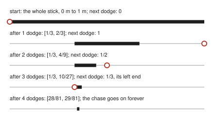

# Baire category theorem: a complete space is never a countable pile of thin sets

[Syllabus](../../../SYLLABUS.md) → [Topology](../README.md) → [Metric Spaces](../README.md#s01) → Baire category theorem

---

## General Overview

Take a metre stick and put a tick at every fraction of a metre: at 1/2, at 1/3 and 2/3, at 1/4 and 3/4, and so on for every denominator. The ticks fit in one queue: 0, 1, 1/2, 1/3, 2/3, 1/4, 3/4, 1/5, and on ([Countable sets](../../01-Foundations/09-Sizes%20of%20Infinity/02-countable-sets.md)). The first 33 places in the queue hold every fraction with denominator up to 10.

Every stretch of the stick, however short, holds ticks. Yet each tick on its own is thin: a single point, with room all around it. So ask: can a list of thin pieces, one after another, cover the whole stick?

Baire's theorem says no, and the proof is a chase. Keep a closed third of the stick that misses the first tick, then a closed third of that which misses the second, and so on. After six dodges the chase holds an interval 1/729 m long, about 1.372 mm, clear of the first six ticks. Continued forever, it closes on a point that no tick covers.

A countable pile of thin sets is called **meagre**. The fractions are meagre. The stick is not, because it has no gaps: it is complete. The same holds on the whole number line: its fractions also fit in one queue, so they are meagre in the line, and the chase runs inside any stretch of the line, so the line is not meagre.

**A complete space is never a countable union of nowhere dense sets: dodge the pieces one at a time inside shrinking closed balls, and completeness hands you a point that every piece missed.**

**What kind of fact this is:** two definitions (nowhere dense, meagre) and a theorem, proved on this card in Why it works, with every step in the Detailed proof fold.

### The picture: the chase on the metre stick

<p align="center"></p>

Drawn to scale, 400 units to the metre. The thick bar is the kept closed interval; the ring is the next fraction to dodge. After three dodges the next fraction, 1/3, sits on the bar's left end. An end point belongs to a closed interval, so it must be dodged too.

---

## The formula

Notation first, in words. A **metric space** is a set $`X`$ with a distance $`d(x, y)`$ that obeys three rules ([Metric space](01-metric-spaces.md)). Here $`X`$ is the stick $`[0, 1]`$, and $`d(x, y) = \lvert x - y \rvert`$ in metres. The **open ball** $`B(x, r)`$ is every point closer than $`r`$ to $`x`$ ([Open balls, open sets and closed sets](03-open-and-closed-sets.md)).

Three words describe how a set $`A`$ sits inside $`X`$. Each gets one metric-space sentence here; the next shelf treats them in general ([Closure, interior and boundary](../02-Topological%20Spaces/02-closure-interior-and-boundary.md)).

- The **closure** $`\overline{A}`$ is $`A`$ plus every limit of a sequence of points of $`A`$. The closure of the fractions is the whole stick, since every point is a limit of fractions.
- The **interior** $`\mathrm{int}\, A`$ is the set of points with a whole ball inside $`A`$. The interior of $`[1/3, 2/3]`$ is everything strictly between 1/3 and 2/3.
- $`A`$ is **dense** when its closure is the whole space. The fractions are dense in the stick.

```math
A \text{ is nowhere dense in } X \iff \mathrm{int}\, \overline{A} = \varnothing
```

**Read it aloud:** a set is nowhere dense when its closure contains no ball at all.

```math
\text{a set is meagre in } X \iff \text{it lies inside } A_1 \cup A_2 \cup A_3 \cup \cdots \text{ with every } A_n \text{ nowhere dense}
```

**Read it aloud:** a meagre set fits inside a countable pile of nowhere dense sets.

The theorem:

```math
X \text{ complete},\ A_1, A_2, A_3, \ldots \text{ nowhere dense} \;\Longrightarrow\; \text{every ball } B(x, r) \text{ holds a point outside } A_1 \cup A_2 \cup A_3 \cup \cdots
```

**Read it aloud:** in a complete space, a countable pile of nowhere dense sets leaves a free point in every ball, so it never covers the space.

On the stick: each tick $`\{q_n\}`$ is its own closure and holds no ball, so it is nowhere dense. The fractions, $`\{q_1\} \cup \{q_2\} \cup \cdots`$, are meagre. The complete stick is not.

| Symbol | Plain meaning | In our example | Push it up and the answer… |
| --- | --- | --- | --- |
| $`X`$ | the space the pieces live in | the stick $`[0, 1]`$ | — |
| $`d(x, y)`$ | the distance between two points | $`\lvert x - y \rvert`$ metres | — |
| $`B(x, r)`$ | open ball: points closer than $`r`$ to $`x`$ | the points strictly between 1/3 and 2/3 | — |
| $`\overline{A}`$ | the closure: $`A`$ plus all its limits | the closure of the fractions is the whole stick | — |
| $`\mathrm{int}\, A`$ | the interior: points with a whole ball inside $`A`$ | the interior of one tick is empty | — |
| $`\varnothing`$ | the empty set: no points | $`\mathrm{int}\, \overline{\{q_n\}} = \varnothing`$ | — |
| $`A`$, $`A_n`$ | a set; the $`n`$-th piece of the pile | the single tick $`\{q_n\}`$ | more pieces, still countably many: still no cover |
| $`q_n`$; $`p_n`$ | the $`n`$-th fraction in the queue; the $`n`$-th point of any list (Step 5) | $`q_1 = 0`$, $`q_3 = 1/2`$, $`q_6 = 1/4`$ | — |
| $`\cup`$, $`\cap`$ | union: in at least one piece; intersection: in every piece | $`\{q_1\} \cup \{q_2\} = \{0, 1\}`$ | — |
| $`U_n`$ | the open set left when $`\overline{A_n}`$ is removed | the stick with $`q_n`$ taken out | — |
| $`x_n`$, $`r_n`$, $`D(x, r)`$ | centre and radius of the $`n`$-th kept closed ball; the closed ball, points at distance at most $`r`$ | after 6 dodges, the interval $`[28/81, 253/729]`$ | radii must shrink to 0 for the chase to close |
| $`\varepsilon`$ | a small positive length, chosen at will | used in Step 6 only | — |

### When it holds

- **The space is complete.** Drop it and the fractions alone, as a space, are meagre in themselves. The chase closes on a point that is not a fraction.
- **The pile is countable.** The stick is the union of its own points, each nowhere dense, but that pile is uncountable.
- **Each piece is nowhere dense, closure included.** The fractions hold no interval, yet their closure is the whole stick. Two pieces, the fractions and the rest, cover the stick.
- **Completeness may come from an equivalent distance.** The open interval $`(0, 1)`$ is not complete with $`\lvert x - y \rvert`$, yet it is not meagre. A distance with the same open sets makes it complete, and that is enough.

---

## Why it works

### Step 0: the idea, a chase with a trap at the end

A nowhere dense set always leaves room: inside any ball sits a smaller ball that misses it. So dodge the pieces one at a time, each inside the last, with closed balls whose radii shrink to zero. Their centres bunch up, and completeness says bunched-up sequences land somewhere ([Complete space](05-completeness-and-completion.md)). The landing point lies in every ball, so it misses every piece.

[Banach's fixed point theorem](08-banach-fixed-point-in-metric-spaces.md) makes the same move: build a Cauchy sequence (terms that end up as close together as you like), then let completeness supply its limit.

### Step 1: one dodge

Take an open ball $`B`$ and a nowhere dense piece $`A`$. $`\overline{A}`$ holds no ball, so some point of $`B`$ lies outside $`\overline{A}`$. The outside of a closed set is open, so a small closed ball around that point misses $`\overline{A}`$ and fits inside $`B`$.

On the stick, that closed ball is a closed third. One point lies in at most two of the three thirds, at a shared end, so one third always misses it.

### Step 2: chain the dodges

Dodge $`A_1`$ with a closed ball of radius at most 1/2, then $`A_2`$ inside it with radius at most 1/4, and so on: the $`n`$-th ball has centre $`x_n`$ and radius $`r_n \le 1/2^n`$. Each ball sits inside the one before, so from step $`n`$ on every centre lies within $`2 r_n`$ of every other. The centres form a Cauchy sequence.

### Step 3: completeness closes the trap

The space is complete, so the centres converge to a point $`x`$. Each closed ball holds all later centres and keeps its limits, so $`x`$ lies in every ball of the chain. The $`n`$-th ball misses $`A_n`$, so $`x`$ is in no piece. And $`x`$ lies in the first ball, which could be any ball.

<details>
<summary>Detailed proof: every ball of a complete space holds a point outside a countable pile of nowhere dense sets</summary>

Let $`X`$ be complete, let $`A_1, A_2, \ldots`$ be nowhere dense, and let $`B(x_0, r_0)`$ be any open ball. Write $`D(x, r)`$ for the closed ball, the points at distance at most $`r`$ from $`x`$. It is a closed set.

**Choosing the balls.** Suppose the open ball $`B(x_{n-1}, r_{n-1})`$ is chosen. The set $`\overline{A_n}`$ has empty interior, so this ball is not inside it: some point $`x_n`$ of the ball lies outside $`\overline{A_n}`$. The complement of $`\overline{A_n}`$ is open, so some ball around $`x_n`$ misses $`\overline{A_n}`$. Also $`B(x_{n-1}, r_{n-1})`$ is open, so some ball around $`x_n`$ lies inside it. Take $`r_n`$ at most half the smaller of those two radii, and at most $`1/2^n`$. Then the closed ball $`D(x_n, r_n)`$ lies inside $`B(x_{n-1}, r_{n-1})`$ and misses $`\overline{A_n}`$, hence misses $`A_n`$.

**The centres are Cauchy.** For $`m \ge n`$, the ball $`D(x_m, r_m)`$ lies inside $`D(x_n, r_n)`$, so

$`\displaystyle d(x_m, x_n) \le r_n \le \frac{1}{2^n}.`$

That bound falls to zero as $`n`$ grows, which is the Cauchy condition.

**The limit is in every ball.** By completeness $`x_m \to x`$ for some $`x`$ in $`X`$. For each fixed $`n`$, the tail $`x_n, x_{n+1}, \ldots`$ lies in the closed set $`D(x_n, r_n)`$, so its limit $`x`$ does too.

**Conclusion.** Since $`x \in D(x_n, r_n)`$ and $`D(x_n, r_n)`$ misses $`A_n`$, the point $`x`$ is in no $`A_n`$. Since $`D(x_1, r_1)`$ lies inside $`B(x_0, r_0)`$, the point $`x`$ is in the starting ball. As $`X`$ is not empty, it has a ball, so $`X`$ is not $`A_1 \cup A_2 \cup \cdots`$. ∎

</details>

### Step 4: the same theorem, said with open dense sets

Let $`U_n`$ be $`X`$ with $`\overline{A_n}`$ removed. It is open, and dense because $`\overline{A_n}`$ holds no ball. The proof found a point of $`U_1 \cap U_2 \cap \cdots`$ in every ball.

Every open dense set arises this way. If $`U`$ is open and dense, what it leaves out, $`X`$ with $`U`$ removed, is closed, so it is its own closure. It holds no ball, because every ball meets the dense set $`U`$. So it is nowhere dense, and removing it from $`X`$ gives back $`U`$. So:

```math
X \text{ complete},\ U_1, U_2, \ldots \text{ open and dense} \;\Longrightarrow\; U_1 \cap U_2 \cap \cdots \text{ is dense}
```

**Read it aloud:** in a complete space, countably many open dense sets still meet, and their common part comes close to every point.

A set that holds such an intersection is called **comeagre**: its leftovers are meagre. Comeagre is the topologist's "almost every point".

### Step 5: one countable decomposition ruled out

The stick is not $`\{p_1\} \cup \{p_2\} \cup \{p_3\} \cup \cdots`$ for any list of points $`p_1, p_2, \ldots`$. Each point is nowhere dense, and the stick is complete. So no list holds every point of the stick.

That is a second proof that the reals cannot be listed. [Cantor's diagonal](../../01-Foundations/09-Sizes%20of%20Infinity/03-cantors-diagonal-argument.md) proves it with digits; this proof uses only completeness. It also shows the irrationals are not meagre: otherwise the stick would be two meagre sets, the irrationals and the fractions, and so meagre itself.

### Step 6: thin is not the same as short

[Null sets and almost everywhere](../../10-Measure%20and%20integration/01-Sets%20You%20Can%20Measure/07-null-sets-and-almost-everywhere.md) shows that the fractions have total length zero. That is a different kind of smallness: Baire's kind asks whether a set leaves room, length asks how much it weighs. The fractions are small both ways, but the two kinds can split apart.

**Thin but long: fat Cantor dust.** Start with the stick. At stage $`n`$, cut an open gap of length $`1/4^n`$ m from the middle of every piece. Stage 1 cuts 1/4 m, stage 2 cuts two gaps of 1/16 m, and so on.

```
stage   length left (m)              longest piece (m)
   0    ████████████████████  1      ████████████████████  1
   1    ███████████████       3/4    ███████▌              3/8
   2    ████████████▌         5/8    ███                   5/32
   3    ███████████▎          9/16   █▍                    9/128
   4    ██████████▋           17/32  ▋                     17/512
  10    ██████████            1025/2048                    1025/2097152
```

What survives every stage is the dust. The cuts are 1/4 m, then 1/8 m, then 1/16 m, adding up to 1/2 m, so the dust keeps 1/2 m. Yet its longest piece shrinks to nothing, 0.000489 m by stage 10, so no interval fits inside it. The dust is closed, so it is nowhere dense, and it weighs half the stick.

**Short but not thin.** Pick a small length $`\varepsilon`$. Cover the first fraction in the queue by an open interval of length $`\varepsilon/2`$, the second by $`\varepsilon/4`$, the third by $`\varepsilon/8`$, and so on. The cover is open and dense, and its total length is at most $`\varepsilon`$. Intersect the covers for $`\varepsilon = 1, 1/2, 1/3`$ and onward. Step 4 says the result is comeagre, yet it has length zero. Its leftovers are meagre, yet they have the stick's full length of 1 m.

---

## Worked numbers, by hand

The chase on the stick, dodging the queue $`q_1 = 0`$, $`q_2 = 1`$, $`q_3 = 1/2`$, $`q_4 = 1/3`$, $`q_5 = 2/3`$, $`q_6 = 1/4`$. The rule: split the kept closed interval into three closed thirds, and keep the first third, from the left, that misses the fraction.

| Step | Arithmetic | Value |
| --- | --- | --- |
| 1: dodge 0 | thirds of $`[0, 1]`$; 0 is in the first, the middle misses it | $`[1/3, 2/3]`$ |
| 2: dodge 1 | thirds of $`[1/3, 2/3]`$ are 1/9 m long; 1 is in none, keep the first | $`[1/3, 4/9]`$ |
| 3: dodge 1/2 | thirds 1/27 m long; 1/2 is past 4/9, so in none, keep the first | $`[1/3, 10/27]`$ |
| 4: dodge 1/3 | thirds 1/81 m long; 1/3 is the left end, in the first third only, keep the middle | $`[28/81, 29/81]`$ |
| 5: dodge 2/3 | thirds 1/243 m long; 2/3 is far to the right, keep the first | $`[28/81, 85/243]`$ |
| 6: dodge 1/4 | thirds 1/729 m long; 1/4 is to the left, keep the first | $`[28/81, 253/729]`$ |
| width | $`253/729 - 28/81 = 253/729 - 252/729`$ | **1/729 m = 0.001372 m** |

After six dodges the chase keeps about 1.372 mm of stick, clear of the first six fractions. It still holds other fractions, the simplest being 9/26: the fractions are dense, so a finite chase never clears them all. The check runs 20 dodges, down to 1/3486784401 m. A finite run illustrates the proof; only the infinite chase, closed by completeness, proves it.

### What breaks if you drop a piece

| Mistake | Comes out at | What went wrong |
| --- | --- | --- |
| Drop completeness: the fractions alone are the space | the space is the pile $`\{q_1\} \cup \{q_2\} \cup \cdots`$; the chase reaches 1/3486784401 m after 20 dodges and closes on no fraction | the chase's limit is missing from the space |
| Skip the closure: thin means "holds no interval" | two pieces, the fractions and the irrationals, cover the stick; the 1/729 m interval still holds 9/26 | the fractions' closure is the whole stick |
| Keep open intervals in the chase | $`(0, 1/3), (0, 1/9), \ldots, (0, 1/3486784401)`$ nest and shrink, yet share no point | the edge point 0 escapes |
| Measure thinness by length | fat Cantor dust is nowhere dense, yet keeps 1025/2048 m at stage 10 | nowhere dense is about room, not length |

---

## Code, from first principles, and it actually runs

The code uses exact fractions. It takes four independent roads, checked on finitely many cases: 20 dodges and 10 stages.

1. The queue's length is checked against a count from Euler's totient (for each denominator, how many numerators up to it share no factor with it), worked from prime factors.
2. Every dodged fraction is tested against the kept interval by integer cross-multiplication, not by the comparisons the chase used, and each width against $`1/3^n`$.
3. A search by denominators finds the simplest fraction left inside. A second search lists every fraction with a denominator up to that one, compares each with the interval's ends as fractions, and finds only 9/26 inside.
4. The dust is built piece by piece and checked against closed forms for its length and longest piece.

### Python

```python
# Baire category theorem -- the check behind the card.  Standard library only.
# Every number on the card is printed here.  Exact arithmetic with Fraction and integers.
# Space: the metre stick [0, 1], distance |x - y| in metres.
from fractions import Fraction as F
from math import gcd

def queue(count):
    # the rationals in [0, 1] in one queue: by denominator, then numerator, lowest terms only
    out, q = [], 1
    while len(out) < count:
        for p in range(q + 1):
            if gcd(p, q) == 1 and len(out) < count:
                out.append(F(p, q))
        q += 1
    return out

def phi(n):
    # Euler's totient from the prime factors, no gcd: how many p in 1..n share no factor with n
    r, m, p = n, n, 2
    while p * p <= m:
        if m % p == 0:
            while m % p == 0:
                m //= p
            r -= r // p
        p += 1
    return r - r // m if m > 1 else r

def chase(qs, last=False):
    # Baire's proof, run: keep a closed third of the interval that misses the next rational
    a, b, rows = F(0), F(1), []
    for x in qs:
        w = (b - a) / 3
        thirds = [(a, a + w), (a + w, a + 2 * w), (a + 2 * w, b)]
        if last:
            thirds.reverse()
        a, b = next(t for t in thirds if not t[0] <= x <= t[1])
        rows.append((x, a, b))
    return rows

def inside(x, a, b):
    # membership by integer cross-multiplication, not by Fraction comparison
    p, q = x.numerator, x.denominator
    return a.numerator * q <= p * a.denominator and p * b.denominator <= b.numerator * q

def simplest(a, b):
    # the fraction with the smallest denominator in [a, b], by brute force over denominators
    q = 1
    while True:
        p = -((-a.numerator * q) // a.denominator)
        if p * b.denominator <= b.numerator * q:
            return F(p, q)
        q += 1

def dec(x, k):
    s = str(x.numerator * 10 ** k // x.denominator).zfill(k + 1)
    return s[:-k] + "." + s[-k:]

def dust(stages, cut):
    # Cantor dust: at stage n cut a middle gap of length cut(n, piece) out of every piece
    pieces, rows = [(F(0), F(1))], []
    for n in range(1, stages + 1):
        new = []
        for a, b in pieces:
            m, g = (a + b) / 2, cut(n, b - a)
            new += [(a, m - g / 2), (m + g / 2, b)]
        pieces = new
        rows.append((n, sum(b - a for a, b in pieces), max(b - a for a, b in pieces)))
    return rows

def rnd(x, k):
    return dec(x + F(1, 2 * 10 ** k), k)

qs = queue(20)
print("queue, first 12:", " ".join(str(x) for x in qs[:12]))
K = 1 + sum(phi(q) for q in range(1, 11))
print(f"queue, denominators up to 10: {K} by totients; entry {K} is {queue(K)[-1]}, entry {K + 1} is {queue(K + 1)[-1]}")
assert queue(K)[-1].denominator == 10 and queue(K + 1)[-1].denominator == 11, "count by gcd scan vs totients"

rows = chase(qs)
print("chase, step  dodge  kept interval (m)   width (m)")
for n, (x, a, b) in enumerate(rows[:6], 1):
    print(f"chase, {n:>4}  {str(x):>5}  {f'[{a}, {b}]':<18}  {b - a}")
for n, (x, a, b) in enumerate(rows, 1):
    assert b - a == F(1, 3 ** n), "width after n dodges is 1/3^n"
    assert not any(inside(y, a, b) for y in qs[:n]), "kept interval holds none of the dodged rationals"
a6, b6 = rows[5][1:]
s6 = simplest(a6, b6)
assert inside(s6, a6, b6) and s6 not in qs[:6], "simplest fraction is inside and was not dodged"
assert {F(p, q) for q in range(1, s6.denominator + 1) for p in range(q + 1) if a6 <= F(p, q) <= b6} == {s6}, "second search"
print(f"chase, after 6 steps: width {b6 - a6} m = {rnd(b6 - a6, 6)} m; simplest fraction still inside: {s6}")
a20, b20 = rows[19][1:]
print(f"chase, after 20 steps: width {b20 - a20} m; dodged rationals inside: {sum(inside(y, a20, b20) for y in qs)}")
last = chase(qs, last=True)[5]
print(f"chase, last-third rule after 6 steps: [{last[1]}, {last[2]}]")

print("dust, stage  length left (m)  longest piece (m)")
fat = lambda n, piece: F(1, 4 ** n)
for n, total, longest in dust(10, fat):
    assert total == F(1, 2) + F(1, 2 ** (n + 1)), "length left vs 1/2 + 1/2^(n+1)"
    assert longest == F(1, 2 ** (n + 1)) + F(1, 2 ** (2 * n + 1)), "longest piece vs closed form"
    if n in (1, 2, 3, 4, 10):
        print(f"dust, {n:>5}  {str(total):>15}  {str(longest):>17}  = {rnd(total, 6)}, {rnd(longest, 6)}")
thin = dust(10, lambda n, piece: piece / 3)[-1][1]
assert thin == F(2, 3) ** 10, "ordinary Cantor dust keeps 2/3 of its length each stage"
print(f"dust, ordinary middle thirds, stage 10: {thin} m = {rnd(thin, 6)} m")
half = dust(10, lambda n, piece: F(1, 2 * 4 ** n))[-1][1]
assert half == F(3, 4) + F(1, 4 * 2 ** 10), "half-size gaps leave 3/4 + 1/2^12"
print(f"dust, half-size gaps, stage 10: {half} m = {rnd(half, 6)} m")

print(f"breaks, open intervals (0, 1/3^n): the 20th is (0, {F(1, 3 ** 20)}); all of them miss 0")
for n in range(0, 5):
    a, b = (F(0), F(1)) if n == 0 else rows[n - 1][1:]
    dodge = f"next dodge {qs[n]} at {rnd(20 + 400 * qs[n], 1)}" if n < 4 else "end"
    print(f"figure, step {n}: kept {rnd(20 + 400 * a, 1)} to {rnd(20 + 400 * b, 1)} px; {dodge}")
print("ALL CHECKS PASS")
```

**Ran 2026-11-14 on macOS, Python 3.14.10, standard library only. All checks passed. Output, pasted from the run:**

```
queue, first 12: 0 1 1/2 1/3 2/3 1/4 3/4 1/5 2/5 3/5 4/5 1/6
queue, denominators up to 10: 33 by totients; entry 33 is 9/10, entry 34 is 1/11
chase, step  dodge  kept interval (m)   width (m)
chase,    1      0  [1/3, 2/3]          1/3
chase,    2      1  [1/3, 4/9]          1/9
chase,    3    1/2  [1/3, 10/27]        1/27
chase,    4    1/3  [28/81, 29/81]      1/81
chase,    5    2/3  [28/81, 85/243]     1/243
chase,    6    1/4  [28/81, 253/729]    1/729
chase, after 6 steps: width 1/729 m = 0.001372 m; simplest fraction still inside: 9/26
chase, after 20 steps: width 1/3486784401 m; dodged rationals inside: 0
chase, last-third rule after 6 steps: [647/729, 8/9]
dust, stage  length left (m)  longest piece (m)
dust,     1              3/4                3/8  = 0.750000, 0.375000
dust,     2              5/8               5/32  = 0.625000, 0.156250
dust,     3             9/16              9/128  = 0.562500, 0.070313
dust,     4            17/32             17/512  = 0.531250, 0.033203
dust,    10        1025/2048       1025/2097152  = 0.500488, 0.000489
dust, ordinary middle thirds, stage 10: 1024/59049 m = 0.017342 m
dust, half-size gaps, stage 10: 3073/4096 m = 0.750244 m
breaks, open intervals (0, 1/3^n): the 20th is (0, 1/3486784401); all of them miss 0
figure, step 0: kept 20.0 to 420.0 px; next dodge 0 at 20.0
figure, step 1: kept 153.3 to 286.7 px; next dodge 1 at 420.0
figure, step 2: kept 153.3 to 197.8 px; next dodge 1/2 at 220.0
figure, step 3: kept 153.3 to 168.1 px; next dodge 1/3 at 153.3
figure, step 4: kept 158.3 to 163.2 px; end
ALL CHECKS PASS
```

### Rust

Same checks, same inputs. Rust has no fraction type, so the code writes one on `i128` and keeps it in lowest terms.

```rust
// Baire category theorem -- the same check as baire_category_theorem_check.py, in Rust.
// Standard library only, no crates.  Exact fractions on i128, kept in lowest terms.
// Space: the metre stick [0, 1], distance |x - y| in metres.
// Compile: rustc --edition 2021 -O baire_category_theorem_check.rs -o /tmp/baire_check
use std::cmp::Ordering;
use std::fmt;

fn gcd(a: i128, b: i128) -> i128 { if b == 0 { a.abs() } else { gcd(b, a % b) } }

#[derive(Clone, Copy, PartialEq, Eq, Debug)]
struct Q { n: i128, d: i128 }
fn q(n: i128, d: i128) -> Q { let g = gcd(n, d).max(1); let s = if d < 0 { -1 } else { 1 }; Q { n: s * n / g, d: s * d / g } }
impl std::ops::Add for Q { type Output = Q; fn add(self, o: Q) -> Q { q(self.n * o.d + o.n * self.d, self.d * o.d) } }
impl std::ops::Sub for Q { type Output = Q; fn sub(self, o: Q) -> Q { q(self.n * o.d - o.n * self.d, self.d * o.d) } }
impl std::ops::Mul for Q { type Output = Q; fn mul(self, o: Q) -> Q { q(self.n * o.n, self.d * o.d) } }
impl std::ops::Div for Q { type Output = Q; fn div(self, o: Q) -> Q { q(self.n * o.d, self.d * o.n) } }
impl PartialOrd for Q { fn partial_cmp(&self, o: &Q) -> Option<Ordering> { Some(self.cmp(o)) } }
impl Ord for Q { fn cmp(&self, o: &Q) -> Ordering { (self.n * o.d).cmp(&(o.n * self.d)) } }
impl fmt::Display for Q {
    fn fmt(&self, f: &mut fmt::Formatter) -> fmt::Result {
        let s = if self.d == 1 { format!("{}", self.n) } else { format!("{}/{}", self.n, self.d) };
        f.pad(&s)
    }
}

// the rationals in [0, 1] in one queue: by denominator, then numerator, lowest terms only
fn queue(count: usize) -> Vec<Q> {
    let (mut out, mut d) = (Vec::new(), 1i128);
    while out.len() < count {
        for p in 0..=d { if gcd(p, d) == 1 && out.len() < count { out.push(q(p, d)); } }
        d += 1;
    }
    out
}

// Euler's totient from the prime factors, no gcd
fn phi(n: i128) -> i128 {
    let (mut r, mut m, mut p) = (n, n, 2i128);
    while p * p <= m {
        if m % p == 0 { while m % p == 0 { m /= p; } r -= r / p; }
        p += 1;
    }
    if m > 1 { r - r / m } else { r }
}

// Baire's proof, run: keep a closed third of the interval that misses the next rational
fn chase(qs: &[Q], last: bool) -> Vec<(Q, Q, Q)> {
    let (mut a, mut b, mut rows) = (q(0, 1), q(1, 1), Vec::new());
    for &x in qs {
        let w = (b - a) / q(3, 1);
        let mut thirds = vec![(a, a + w), (a + w, a + w + w), (a + w + w, b)];
        if last { thirds.reverse(); }
        let t = *thirds.iter().find(|t| !(t.0 <= x && x <= t.1)).unwrap();
        a = t.0; b = t.1;
        rows.push((x, a, b));
    }
    rows
}

// membership by integer cross-multiplication, not by the fraction ordering
fn inside(x: Q, a: Q, b: Q) -> bool { a.n * x.d <= x.n * a.d && x.n * b.d <= b.n * x.d }

// the fraction with the smallest denominator in [a, b], by brute force over denominators
fn simplest(a: Q, b: Q) -> Q {
    let mut d = 1i128;
    loop {
        let p = -((-a.n * d).div_euclid(a.d));
        if p * b.d <= b.n * d { return q(p, d); }
        d += 1;
    }
}

fn dec(x: Q, k: u32) -> String {
    let s = format!("{:0>w$}", x.n * 10i128.pow(k) / x.d, w = k as usize + 1);
    format!("{}.{}", &s[..s.len() - k as usize], &s[s.len() - k as usize..])
}
fn rnd(x: Q, k: u32) -> String { dec(x + q(1, 2 * 10i128.pow(k)), k) }

// Cantor dust: at stage n cut a middle gap of length cut(n, piece) out of every piece
fn dust(stages: u32, cut: &dyn Fn(u32, Q) -> Q) -> Vec<(u32, Q, Q)> {
    let (mut pieces, mut rows) = (vec![(q(0, 1), q(1, 1))], Vec::new());
    for n in 1..=stages {
        let mut new = Vec::new();
        for &(a, b) in &pieces {
            let (m, g) = ((a + b) / q(2, 1), cut(n, b - a));
            new.push((a, m - g / q(2, 1)));
            new.push((m + g / q(2, 1), b));
        }
        pieces = new;
        let total = pieces.iter().fold(q(0, 1), |s, &(a, b)| s + (b - a));
        let longest = pieces.iter().map(|&(a, b)| b - a).max().unwrap();
        rows.push((n, total, longest));
    }
    rows
}

fn main() {
    let qs = queue(20);
    let first: Vec<String> = qs[..12].iter().map(|x| x.to_string()).collect();
    println!("queue, first 12: {}", first.join(" "));
    let k = 1 + (1..=10).map(phi).sum::<i128>() as usize;
    let (ek, ek1) = (*queue(k).last().unwrap(), *queue(k + 1).last().unwrap());
    println!("queue, denominators up to 10: {} by totients; entry {} is {}, entry {} is {}", k, k, ek, k + 1, ek1);
    assert!(ek.d == 10 && ek1.d == 11, "count by gcd scan vs totients");

    let rows = chase(&qs, false);
    println!("chase, step  dodge  kept interval (m)   width (m)");
    for (i, &(x, a, b)) in rows[..6].iter().enumerate() {
        println!("chase, {:>4}  {:>5}  {:<18}  {}", i + 1, x, format!("[{}, {}]", a, b), b - a);
    }
    for (i, &(_, a, b)) in rows.iter().enumerate() {
        assert!(b - a == q(1, 3i128.pow(i as u32 + 1)), "width after n dodges is 1/3^n");
        assert!(!qs[..=i].iter().any(|&y| inside(y, a, b)), "kept interval holds none of the dodged rationals");
    }
    let (a6, b6) = (rows[5].1, rows[5].2);
    let s6 = simplest(a6, b6);
    assert!(inside(s6, a6, b6) && !qs[..6].contains(&s6), "simplest fraction is inside and was not dodged");
    let found: Vec<Q> = (1..=s6.d).flat_map(|d| (0..=d).map(move |p| q(p, d))).filter(|&x| a6 <= x && x <= b6).collect();
    assert!(!found.is_empty() && found.iter().all(|&x| x == s6), "second search");
    println!("chase, after 6 steps: width {} m = {} m; simplest fraction still inside: {}", b6 - a6, rnd(b6 - a6, 6), s6);
    let (a20, b20) = (rows[19].1, rows[19].2);
    let hits = qs.iter().filter(|&&y| inside(y, a20, b20)).count();
    println!("chase, after 20 steps: width {} m; dodged rationals inside: {}", b20 - a20, hits);
    let lt = chase(&qs, true)[5];
    println!("chase, last-third rule after 6 steps: [{}, {}]", lt.1, lt.2);

    println!("dust, stage  length left (m)  longest piece (m)");
    for (n, total, longest) in dust(10, &|n, _| q(1, 4i128.pow(n))) {
        assert!(total == q(1, 2) + q(1, 2i128.pow(n + 1)), "length left vs 1/2 + 1/2^(n+1)");
        assert!(longest == q(1, 2i128.pow(n + 1)) + q(1, 2i128.pow(2 * n + 1)), "longest piece vs closed form");
        if [1, 2, 3, 4, 10].contains(&n) {
            println!("dust, {:>5}  {:>15}  {:>17}  = {}, {}", n, total, longest, rnd(total, 6), rnd(longest, 6));
        }
    }
    let thin = dust(10, &|_, piece| piece / q(3, 1))[9].1;
    assert!(thin == q(1024, 59049), "ordinary Cantor dust keeps 2/3 of its length each stage");
    println!("dust, ordinary middle thirds, stage 10: {} m = {} m", thin, rnd(thin, 6));
    let half = dust(10, &|n, _| q(1, 2 * 4i128.pow(n)))[9].1;
    assert!(half == q(3, 4) + q(1, 4 * 2i128.pow(10)), "half-size gaps leave 3/4 + 1/2^12");
    println!("dust, half-size gaps, stage 10: {} m = {} m", half, rnd(half, 6));

    println!("breaks, open intervals (0, 1/3^n): the 20th is (0, {}); all of them miss 0", q(1, 3i128.pow(20)));
    for n in 0..5usize {
        let (a, b) = if n == 0 { (q(0, 1), q(1, 1)) } else { (rows[n - 1].1, rows[n - 1].2) };
        let px = |x: Q| rnd(q(20, 1) + q(400, 1) * x, 1);
        let dodge = if n < 4 { format!("next dodge {} at {}", qs[n], px(qs[n])) } else { "end".to_string() };
        println!("figure, step {}: kept {} to {} px; {}", n, px(a), px(b), dodge);
    }
    println!("ALL CHECKS PASS");
}
```

**Ran 2026-11-14 on macOS, rustc 1.98.1, no crates. All checks passed. Output, pasted from the run:**

```
queue, first 12: 0 1 1/2 1/3 2/3 1/4 3/4 1/5 2/5 3/5 4/5 1/6
queue, denominators up to 10: 33 by totients; entry 33 is 9/10, entry 34 is 1/11
chase, step  dodge  kept interval (m)   width (m)
chase,    1      0  [1/3, 2/3]          1/3
chase,    2      1  [1/3, 4/9]          1/9
chase,    3    1/2  [1/3, 10/27]        1/27
chase,    4    1/3  [28/81, 29/81]      1/81
chase,    5    2/3  [28/81, 85/243]     1/243
chase,    6    1/4  [28/81, 253/729]    1/729
chase, after 6 steps: width 1/729 m = 0.001372 m; simplest fraction still inside: 9/26
chase, after 20 steps: width 1/3486784401 m; dodged rationals inside: 0
chase, last-third rule after 6 steps: [647/729, 8/9]
dust, stage  length left (m)  longest piece (m)
dust,     1              3/4                3/8  = 0.750000, 0.375000
dust,     2              5/8               5/32  = 0.625000, 0.156250
dust,     3             9/16              9/128  = 0.562500, 0.070313
dust,     4            17/32             17/512  = 0.531250, 0.033203
dust,    10        1025/2048       1025/2097152  = 0.500488, 0.000489
dust, ordinary middle thirds, stage 10: 1024/59049 m = 0.017342 m
dust, half-size gaps, stage 10: 3073/4096 m = 0.750244 m
breaks, open intervals (0, 1/3^n): the 20th is (0, 1/3486784401); all of them miss 0
figure, step 0: kept 20.0 to 420.0 px; next dodge 0 at 20.0
figure, step 1: kept 153.3 to 286.7 px; next dodge 1 at 420.0
figure, step 2: kept 153.3 to 197.8 px; next dodge 1/2 at 220.0
figure, step 3: kept 153.3 to 168.1 px; next dodge 1/3 at 153.3
figure, step 4: kept 158.3 to 163.2 px; end
ALL CHECKS PASS
```

The two outputs are identical line for line. The `figure,` lines are the coordinates of the picture in General Overview.

### Lean

Lean proves the theorem in general, its two results on the stick and the line, and the card's worked numbers exactly.

- Suppose $`X`$ is complete, or complete under an equivalent distance, and $`A_1, A_2, \ldots`$ are nowhere dense. Then every ball $`B(x, r)`$ holds a point outside $`A_1 \cup A_2 \cup \cdots`$.
- Take any list of points $`p_1, p_2, \ldots`$. Then the stick $`[0, 1]`$ is not $`\{p_1\} \cup \{p_2\} \cup \cdots`$.
- A single point of the line is nowhere dense.
- The fractions are meagre in the line, and the line is not meagre.
- One plus the totients of 1 to 10 is 33, the queue's count up to denominator 10.
- The six kept intervals in Worked numbers have widths 1/3, 1/9, 1/27, 1/81, 1/243 and 1/729 m.
- Step 4 keeps the middle third, which starts at 28/81 m, that is 1/3 plus 1/81.
- Take the interval $`[28/81, 253/729]`$. Then it misses 0, 1, 1/2, 1/3, 2/3 and 1/4, yet holds 9/26.
- Twenty dodges leave a width of 1/3486784401 m, since $`3^{20} = 3486784401`$.
- Fat Cantor dust keeps 3/4, 5/8, 9/16, 17/32 and 1025/2048 m at stages 1 to 4 and 10.
- At those stages its longest piece is 3/8, 5/32, 9/128, 17/512 and 1025/2097152 m.
- Take the dust's cuts through stage 10. Then they add up to $`1/2 - 1/2^{11}`$ m.
- At stage 10, ordinary middle thirds keep 1024/59049 m, and half-size gaps keep 3073/4096 m.

The queue itself, the chase's choices, the dust built piece by piece and the figure stay with the Python and Rust checks.

```lean
-- Baire category theorem: in a complete metric space every ball holds a point outside any countable pile of nowhere dense sets, so no list of points fills the metre stick, and the rationals are meagre in the line while the line is not.
import Mathlib.Topology.Baire.CompleteMetrizable
import Mathlib.Topology.Baire.Lemmas
import Mathlib.Topology.GDelta.Basic
import Mathlib.Topology.MetricSpace.Pseudo.Defs
import Mathlib.Topology.Instances.Real.Lemmas
import Mathlib.Data.Nat.Totient
import Mathlib.Tactic.NormNum

open Set Metric

/-- Helper: a single point of the line is nowhere dense. -/
theorem baire_helper_singleton_isNowhereDense (a : ℝ) : IsNowhereDense ({a} : Set ℝ) := by
  rw [isClosed_singleton.isNowhereDense_iff]
  exact interior_singleton a

#print axioms baire_helper_singleton_isNowhereDense

/-- Baire's theorem, as the card states it. Let `X` be a complete metric space (or one whose
distance can be swapped for an equivalent complete distance, one with the same open sets), and let
`A 1, A 2, A 3, ...` be a countable pile of nowhere dense sets: the closure of each one contains
no ball. Then every open ball `B(x, r)` holds a point that lies in none of the pieces. -/
theorem complete_space_ball_has_point_outside_countable_nowhere_dense_pile
    {X : Type*} [MetricSpace X] [TopologicalSpace.IsCompletelyMetrizableSpace X]
    (A : ℕ → Set X) (hA : ∀ n, IsNowhereDense (A n))
    (x : X) (r : ℝ) (hr : 0 < r) :
    ∃ y ∈ ball x r, y ∉ ⋃ n, A n := by
  by_contra h
  push Not at h
  have hsub : ball x r ⊆ ⋃ n, A n := fun y hy => h y hy
  have hm : IsMeagre (⋃ n, A n) := isMeagre_iUnion fun n => (hA n).isMeagre
  exact not_isMeagre_of_isOpen isOpen_ball (nonempty_ball.2 hr) (hm.mono hsub)

/-- Step 5: one countable decomposition ruled out. The metre stick `[0, 1]` is not
`{p 1} ∪ {p 2} ∪ {p 3} ∪ ...` for any list of points `p`: no list holds every point of the
stick. -/
theorem metre_stick_is_not_a_list_of_points (p : ℕ → ℝ) :
    ¬ Icc (0 : ℝ) 1 ⊆ ⋃ n, {p n} := by
  intro h
  obtain ⟨y, hy, hy'⟩ := complete_space_ball_has_point_outside_countable_nowhere_dense_pile
    (fun n => ({p n} : Set ℝ)) (fun n => baire_helper_singleton_isNowhereDense (p n))
    (1 / 2) (1 / 2) (by norm_num)
  apply hy'
  apply h
  rw [Real.ball_eq_Ioo] at hy
  obtain ⟨h1, h2⟩ := hy
  constructor <;> linarith

/-- The card's example: the rationals are meagre in the line (they fit inside a countable pile
of nowhere dense sets), and the line itself is not meagre. -/
theorem rationals_meagre_in_line_and_line_not_meagre :
    IsMeagre (range ((↑) : ℚ → ℝ)) ∧ ¬ IsMeagre (univ : Set ℝ) := by
  constructor
  · have : range ((↑) : ℚ → ℝ) = ⋃ q : ℚ, ({(q : ℝ)} : Set ℝ) := by
      ext y; simp [eq_comm]
    rw [this]
    exact isMeagre_iUnion fun q => (baire_helper_singleton_isNowhereDense (q : ℝ)).isMeagre
  · exact not_isMeagre_of_isOpen isOpen_univ univ_nonempty

-- The queue: 1 + (totients of 1 to 10) = 33 fractions in [0, 1] with denominator up to 10.
example : 1 + ∑ q ∈ Finset.Icc 1 10, Nat.totient q = 33 := by decide
-- The chase by hand: each kept third is a third as long as the one before.
example : (2 : ℚ) / 3 - 1 / 3 = 1 / 3 := by norm_num
example : (4 : ℚ) / 9 - 1 / 3 = 1 / 9 := by norm_num
example : (10 : ℚ) / 27 - 1 / 3 = 1 / 27 := by norm_num
example : (29 : ℚ) / 81 - 28 / 81 = 1 / 81 := by norm_num
example : (85 : ℚ) / 243 - 28 / 81 = 1 / 243 := by norm_num
example : (253 : ℚ) / 729 - 28 / 81 = 1 / 729 := by norm_num
-- Step 4: 1/3 is the left end of [1/3, 10/27], so the chase keeps the middle third, starting at 28/81.
example : (28 : ℚ) / 81 = 1 / 3 + 1 / 81 := by norm_num
-- The six dodged fractions 0, 1, 1/2, 1/3, 2/3, 1/4 all lie outside [28/81, 253/729].
example : ((0 : ℚ) < 28 / 81) ∧ ((1 : ℚ) / 4 < 28 / 81) ∧ ((1 : ℚ) / 3 < 28 / 81) ∧
    ((253 : ℚ) / 729 < 1 / 2) ∧ ((253 : ℚ) / 729 < 2 / 3) ∧ ((253 : ℚ) / 729 < 1) := by norm_num
-- 9/26 is still inside the 1/729 m interval.
example : (28 : ℚ) / 81 ≤ 9 / 26 ∧ (9 : ℚ) / 26 ≤ 253 / 729 := by norm_num
-- Twenty dodges: width 1/3^20 = 1/3486784401 m.
example : (3 : ℕ) ^ 20 = 3486784401 := by norm_num
-- Fat Cantor dust: length left 1/2 + 1/2^(n+1), longest piece 1/2^(n+1) + 1/2^(2n+1).
example : (1 : ℚ) / 2 + 1 / 2 ^ 2 = 3 / 4 ∧ (1 : ℚ) / 2 ^ 2 + 1 / 2 ^ 3 = 3 / 8 := by norm_num
example : (1 : ℚ) / 2 + 1 / 2 ^ 3 = 5 / 8 ∧ (1 : ℚ) / 2 ^ 3 + 1 / 2 ^ 5 = 5 / 32 := by norm_num
example : (1 : ℚ) / 2 + 1 / 2 ^ 4 = 9 / 16 ∧ (1 : ℚ) / 2 ^ 4 + 1 / 2 ^ 7 = 9 / 128 := by norm_num
example : (1 : ℚ) / 2 + 1 / 2 ^ 5 = 17 / 32 ∧ (1 : ℚ) / 2 ^ 5 + 1 / 2 ^ 9 = 17 / 512 := by norm_num
example : (1 : ℚ) / 2 + 1 / 2 ^ 11 = 1025 / 2048 ∧
    (1 : ℚ) / 2 ^ 11 + 1 / 2 ^ 21 = 1025 / 2097152 := by norm_num
-- The gaps cut add up to 1/2: 1/4 + 2/16 + 4/64 + ... through stage 10 leaves 1/2 - 1/2^11.
example : ∑ n ∈ Finset.Icc 1 10, (2 : ℚ) ^ (n - 1) / 4 ^ n = 1 / 2 - 1 / 2 ^ 11 := by
  norm_num [Finset.sum_Icc_succ_top]
-- Ordinary middle thirds keep (2/3)^10 = 1024/59049; half-size gaps keep 3/4 + 1/2^12 = 3073/4096.
example : ((2 : ℚ) / 3) ^ 10 = 1024 / 59049 := by norm_num
example : (3 : ℚ) / 4 + 1 / (4 * 2 ^ 10) = 3073 / 4096 := by norm_num

#print axioms complete_space_ball_has_point_outside_countable_nowhere_dense_pile
#print axioms metre_stick_is_not_a_list_of_points
#print axioms rationals_meagre_in_line_and_line_not_meagre
```

**Checked 2026-11-15 on macOS, Lean 4.36.0-rc2, Mathlib v4.36.0-rc2. Every proof is complete and uses only Lean's standard axioms. Output, pasted from the run:**

```
'baire_helper_singleton_isNowhereDense' depends on axioms: [propext, Classical.choice, Quot.sound]
'complete_space_ball_has_point_outside_countable_nowhere_dense_pile' depends on axioms: [propext, Classical.choice, Quot.sound]
'metre_stick_is_not_a_list_of_points' depends on axioms: [propext, Classical.choice, Quot.sound]
'rationals_meagre_in_line_and_line_not_meagre' depends on axioms: [propext, Classical.choice, Quot.sound]
```

> [!TIP]
> **Try changing**
> Guess first, then run it. An assert is a line that stops the program when a number comes out wrong.
> - **Keep the last third.** Guess where the chase goes. With `last=True`, after 6 dodges it holds $`[647/729, 8/9]`$, near the right end. Every rule works; each lands on its own point.
> - **Cut the middle third of every piece.** Guess the length left. This ordinary Cantor set, `dust(10, lambda n, piece: piece / 3)`, keeps 1024/59049 m, about 0.017342 m, heading to zero: thin and short.
> - **Halve every gap.** Guess the limit. Gaps of $`1/(2 \cdot 4^n)`$ keep 3073/4096 m, about 0.750244 m, at stage 10, heading to 3/4 m. Still nowhere dense.
> - **Dodge with open thirds.** In `chase`, change `not t[0] <= x <= t[1]` to `not t[0] < x < t[1]`. Guess which dodge fails. The first: 0 sits on the end of the first third, the chase keeps it, and an assert stops the program.

---

## The usual mistake

> [!warning]
> **Reading "meagre" as "zero length".** The fractions are both, so the ideas look alike. They are not. Fat Cantor dust is meagre, yet it keeps 1025/2048 m at stage 10, heading to 1/2 m. And a comeagre set can have length zero.
>
> - **Skipping the closure.** "Holds no interval" is not "nowhere dense". Read that way, two pieces cover the 1 m stick: the fractions and the irrationals.
> - **Forgetting completeness.** The fractions alone are meagre in themselves: the chase shrinks to 1/3486784401 m after 20 dodges, but its limit is not a fraction.
> - **Using open intervals in the chase.** $`(0, 1/3), (0, 1/9), \ldots`$ shrink and nest, yet no point lies in all of them.
> - **Reading "dense" as "big".** After 6 dodges the 1/729 m interval still holds 9/26. The fractions are dense and meagre at once.

---

## Where you meet it in real life

- **Strange functions that are typical.** Most continuous functions on $`[0, 1]`$ have a derivative nowhere. Banach proved it in 1931 with this theorem: in the complete space of continuous functions, those with a derivative somewhere form a meagre set.
- **Functional analysis.** The uniform boundedness, open mapping and closed graph theorems all rest on Baire. One payoff: a continuous function whose Fourier series fails to converge at a point.
- **"Typical" in two senses.** In dynamics and number theory, a property can hold on a comeagre set of length zero. The Liouville numbers are such a set. Papers must say which sense of "typical" they mean.
- **Uncountability without digits.** Step 5's proof works in any complete space with no isolated points (points that are a ball on their own), such as the space of infinite coin-toss sequences.

> **Say it back**
> A set is nowhere dense when its closure holds no ball, and meagre when it fits in a countable pile of nowhere dense sets. In a complete space, dodge the pieces one at a time inside shrinking closed balls; completeness gives a point inside them all, and that point misses every piece. So a complete space is never meagre, and the fractions cannot be the whole stick; nor can any list of points. Thin is about room, not length: fat Cantor dust is thin and weighs 1/2 m.

---

## What this builds on

- [Complete space](05-completeness-and-completion.md): Cauchy sequences converge. Step 3 of the proof is this property and nothing more.
- [Open balls, open sets and closed sets](03-open-and-closed-sets.md): balls, open sets and closed sets, the language of every step.
- [Countable sets](../../01-Foundations/09-Sizes%20of%20Infinity/02-countable-sets.md): the queue of fractions, and what "countable pile" means.
- [Null sets and almost everywhere](../../10-Measure%20and%20integration/01-Sets%20You%20Can%20Measure/07-null-sets-and-almost-everywhere.md): the other kind of smallness, length zero, which this card sets beside meagre.
- [Cantor's diagonal](../../01-Foundations/09-Sizes%20of%20Infinity/03-cantors-diagonal-argument.md): the first proof that the reals cannot be listed; Step 5 gives a second.
- [No gaps](../../06-Calculus%20and%20analysis/01-Limits%20and%20Continuity/02-supremum-and-completeness.md): completeness of the line. Baire's chase is the nested-interval form of it, generalised to any complete metric space.

## Where this goes next

- [Three Banach theorems](../../18-Functional%20analysis/01-Normed%20and%20Banach%20Spaces/08-open-mapping-closed-graph-and-uniform-boundedness.md): uniform boundedness, open mapping and closed graph, each proved by finding a ball that a meagre pile cannot fill.
- [Locally convex and Frechet spaces](../../18-Functional%20analysis/01-Normed%20and%20Banach%20Spaces/11-locally-convex-and-frechet-spaces.md): a whole family of size checks instead of one norm.

The question this card leaves open: when a property holds for a comeagre set of points and fails for a set of full length, which kind of "almost every" should decide what is typical?

---

## Sources

Verified 2026-11-14: every link below resolves to the publisher's page.

- Baire, René. "Sur les fonctions de variables réelles." *Annali di Matematica Pura ed Applicata* 3 (1899): 1–123. [doi:10.1007/BF02419243](https://doi.org/10.1007/BF02419243). The original: sets of first and second category, and the theorem for the reals.
- Banach, Stefan. "Über die Baire'sche Kategorie gewisser Funktionenmengen." *Studia Mathematica* 3 (1931): 174–179. [doi:10.4064/sm-3-1-174-179](https://doi.org/10.4064/sm-3-1-174-179). Most continuous functions have a derivative nowhere, proved by category.
- Smith, H. J. S. "On the Integration of Discontinuous Functions." *Proceedings of the London Mathematical Society* s1-6 (1874): 140–153. [doi:10.1112/plms/s1-6.1.140](https://doi.org/10.1112/plms/s1-6.1.140). An early nowhere dense set of positive length, the ancestor of the fat Cantor dust in Step 6.
- Oxtoby, John C. *Measure and Category*, 2nd ed. Springer, 1980. [doi:10.1007/978-1-4684-9339-9](https://doi.org/10.1007/978-1-4684-9339-9). The standard comparison of meagre and null, including the split of the line into a meagre set and a set of length zero.
