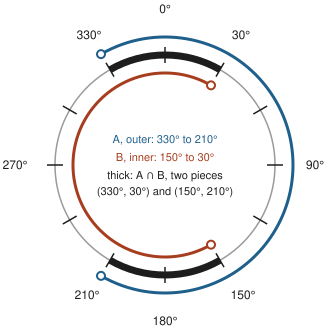

# Topological space: you name the open sets, and a basis generates them

[Syllabus](../../../SYLLABUS.md) → [Topology](../README.md) → [Topological Spaces](../README.md#s02) → Topological space

---

## General Overview

A wind vane reads headings in degrees, measured clockwise from north. A heading of 330° and a heading of 30° are close: the vane swings 60° across north to go from one to the other. A ruler laid along 0 to 360 would put them 300 apart. The circle of headings has its own idea of "close", and it wraps round.

This card's house example is the circle itself. The shelf meets it three ways: as a subspace of the plane, as the interval with its ends glued, and as one factor of the torus S¹ × S¹. Here it is the circle of headings, and its basic pieces are **open arcs**: all headings strictly between two given ones, going clockwise. "Wind from between 330° and 30°" is one open arc. It contains north and leaves out both ends.

Topology keeps "close" and throws away the distances. It picks out the **open sets**: the sets in which every point has some room round it inside the set. Two rules about open sets do most of the work. A union of open sets is open. Where two open sets overlap, the overlap is open.

Writing down every open set is hopeless, so a few simple sets are named instead. Every open set is then a union of them. That small family is a **basis**. On the circle, the open arcs are the basis. One question decides whether a family can be a basis. When two members overlap, does the overlap break up into members again?

On the circle the answer is yes, with a twist. The arc from 330° to 210° and the arc from 150° to 30° overlap in two separate pieces, one round north and one round south. Each piece is again an arc, so nothing breaks.

**A topological space is a set together with a chosen family of open sets that contains the empty set and the whole set and keeps every union and every overlap of two; a basis is a smaller family whose unions give all the open sets, and it works exactly when its members cover the set and every point of an overlap of two members sits in a third member inside that overlap.**

**What kind of fact this is:** a definition (topology, basis, finer), plus a theorem, proved on this card in Why it works: the unions of a family's members form a topology exactly when the family passes the two basis tests. On the 90° and 45° marked dials below, the code checks the three axioms on every pair of open sets, which is a proof for those two finite families.

<p align="center"></p>

The open dots are arc ends, which the arcs leave out. The figure is drawn to scale. The thick pieces are the overlap $`A \cap B`$: two arcs of 60° each.

---

## The formula

Notation first, in words. The set of points is $`X`$. A **topology** on $`X`$ is a family of subsets of $`X`$, written $`\tau`$ (the Greek letter tau). Its members are called the open sets. A **basis** is a family $`\mathcal{B}`$ (a curly B) of open sets. The circle is written $`S^1`$, read "S one". An arc $`(a, b)`$ means the headings strictly between $`a`$ and $`b`$, going clockwise. It is not an interval of the line and not an ordered pair.

The three rules that make $`\tau`$ a topology:

```math
\varnothing \in \tau,\quad X \in \tau; \qquad U_i \in \tau \text{ for every } i \;\Rightarrow\; \bigcup_i U_i \in \tau; \qquad U, V \in \tau \;\Rightarrow\; U \cap V \in \tau
```

**Read it aloud:** the empty set and the whole set are open; any union of open sets, even infinitely many, is open; the overlap of two open sets is open.

The overlap rule for two sets gives it for any finite number, one at a time. It says nothing about infinitely many.

A family $`\mathcal{B}`$ is a basis when it passes two tests. **B1:** every point lies in some member. **B2:** if a point $`x`$ lies in two members $`B_1`$ and $`B_2`$, a third member $`B_3`$ holds $`x`$ and sits inside both. The topology that $`\mathcal{B}`$ generates is

```math
\tau_{\mathcal{B}} = \{\, U \subseteq X : \text{for every } x \in U \text{ there is } B \in \mathcal{B} \text{ with } x \in B \subseteq U \,\}
```

**Read it aloud:** a set is open when each of its points has a basis member round it that stays inside the set.

The same family is all unions of basis members, the empty union included. Step 4 proves the two descriptions agree.

**Comparing two topologies.** If every open set of $`\tau`$ is also open in $`\tau'`$, write $`\tau \subseteq \tau'`$ and say $`\tau'`$ is **finer** and $`\tau`$ is **coarser**. A finer topology can tell apart more sets.

| Symbol | Plain meaning | In our example | Push it up and the answer… |
| --- | --- | --- | --- |
| $`X`$, $`S^1`$ | the set of points; $`S^1`$ is the circle | every heading on the circle | — |
| $`\tau`$ | the topology: the family of open sets | all unions of arcs | more sets: finer |
| $`U`$, $`V`$, $`U_i`$ | open sets, members of $`\tau`$; $`U_i`$ is one of a family numbered by $`i`$ | $`(330, 210)`$ and $`(150, 30)`$ | — |
| $`\varnothing`$ | the empty set, with no points | no heading at all | — |
| $`\mathcal{B}`$, $`\mathcal{B}'`$ | a basis: the named pieces; $`\mathcal{B}'`$ is a second basis, for $`\tau'`$ | the open arcs | more arcs: finer topology |
| $`B`$, $`B_1`$, $`B_2`$, $`B_3`$, $`B_x`$, $`B'`$ | members of the basis; $`B_x`$ is one round the point $`x`$, $`B'`$ a member of $`\mathcal{B}'`$ | $`(330, 30)`$ | — |
| $`x`$ | one point | the heading 0°, north | — |
| $`(a, b)`$; $`A`$, $`B`$ | open arc: headings strictly between $`a`$ and $`b`$, clockwise; $`A`$ and $`B`$ are the figure's two arcs | $`(330, 30)`$, 60° wide, holds north; $`A = (330, 210)`$, $`B = (150, 30)`$ | longer arc, bigger set |
| $`\tau_{\mathcal{B}}`$ | the topology the basis generates | 103,682 open sets on the dial marked every 30° | — |
| $`N`$ | how many marks a dial has | 4, 6, 8, 12 or 24 | more marks: more open sets |
| $`M`$ | the 2-by-2 counting table for the marked dials | `[[1, 1], [1, 2]]` | — |
| $`\tau \subseteq \tau'`$ | $`\tau'`$ is a second topology on $`X`$, and it is finer: every set open in $`\tau`$ is open in $`\tau'`$ | 90° dial inside 30° dial | — |

### When it holds

- **Unions of any size, overlaps of finitely many.** Ever-shorter arcs centred on north overlap only in north itself. A single point has no room round it, so it is not open. Allow infinite overlaps and that point would have to be open.
- **B2 must hold, not only B1.** The 12 half-circles that start at 0°, 30°, 60° and so on cover the circle, so B1 holds. Two of them overlap in a quarter circle that holds no half-circle. Their unions break the overlap rule (What breaks, below).
- **Open arcs, not closed ones.** A closed arc keeps its ends. Two closed arcs $`[0, 90]`$ and $`[90, 180]`$ meet only at 90°, and no arc fits inside one point.
- **The same set of points.** "Finer" compares two topologies on one set $`X`$. Topologies on different sets are compared by maps, on [Continuity by pre-images, and homeomorphism](03-continuity-and-homeomorphism.md).

---

## Why it works

### Step 0: open means "room round every point"

A metric space already has open sets: a set is open when each point has a small ball inside it ([Open balls, open sets and closed sets](../01-Metric%20Spaces/03-open-and-closed-sets.md)). A topological space keeps only that idea. The balls are replaced by whatever basis members are named. Each axiom then follows from one fact about "room round a point".

### Step 1: the empty set and the whole set are open

The empty set has no points, so no point lacks room. That is true with nothing to check. The whole set $`X`$ is open because of B1: every point sits in some member, and every member lies inside $`X`$.

### Step 2: any union is open

Take a point in a union of open sets. It lies in one of them, $`U_i`$. That $`U_i`$ gives the point a basis member $`B`$ with $`x \in B \subseteq U_i`$. The union contains $`U_i`$, so it contains $`B`$ too. The number of sets in the union never mattered.

### Step 3: the overlap of two open sets is open

Here B2 does the work. Take $`x`$ in $`U \cap V`$. Room in $`U`$ gives a member $`B_1`$ with $`x \in B_1 \subseteq U`$. Room in $`V`$ gives $`B_2`$ with $`x \in B_2 \subseteq V`$. B2 gives $`B_3`$ with $`x \in B_3 \subseteq B_1 \cap B_2`$. That $`B_3`$ lies inside both $`U`$ and $`V`$: room for $`x`$ in the overlap.

On the circle, B2 holds. Two open arcs overlap in nothing, in one arc, or in two arcs. The two-arc case happens when each arc runs past both ends of the other, so together they cover the circle, as $`A`$ and $`B`$ do in the figure. Either way every point of the overlap sits in an arc inside it.

<details>
<summary>Detailed proof: two open arcs overlap in at most two arcs</summary>

Cut the circle at a point $`p`$ outside $`A`$. Then $`A`$ becomes an open interval of the line, $`(s, t)`$, where positions run from 0 to 360 clockwise from $`p`$.

Cutting at $`p`$ breaks $`B`$ into at most two open intervals: one if $`p`$ is outside $`B`$, two if $`p`$ is inside it.

An open interval meets an open interval in an open interval or in nothing, since the overlap of $`(s, t)`$ and $`(u, v)`$ is

$`\displaystyle (\max(s, u),\ \min(t, v)),`$

empty when the left end is not below the right end. So $`A \cap B`$ is at most two open intervals. None of them contains $`p`$, so each is an open arc of the circle.

</details>

### Step 4: "unions of basis members" and "room round every point" are the same family

Any union of basis members passes the room test: a point in the union lies in one member, and that member is its room. Going the other way, take a set $`U`$ that passes the room test. For each point, pick its member $`B_x`$ with $`x \in B_x \subseteq U`$. The union of all the $`B_x`$ contains every point of $`U`$ and nothing outside it. So it equals $`U`$.

The two tests are also needed. If the unions of a family's members form a topology, then $`X`$ is one of those unions, so the members cover $`X`$: B1. And $`B_1 \cap B_2`$ is open, so it is a union of members, and each of its points sits in a member inside it: B2.

### Step 5: compare topologies through their bases

Checking $`\tau \subseteq \tau'`$ set by set means listing every open set. The basis test is shorter: $`\tau'`$ is finer than $`\tau`$ exactly when, for every member $`B`$ of $`\mathcal{B}`$ and every point $`x`$ in it, some member $`B'`$ of $`\mathcal{B}'`$ has $`x \in B' \subseteq B`$.

Why: if that holds, each $`B`$ passes the room test for $`\tau'`$, so it is open in $`\tau'`$. Unions of open sets stay open, so all of $`\tau`$ is. Conversely, if $`\tau \subseteq \tau'`$, each $`B`$ is open in $`\tau'`$, and room in $`\tau'`$ is exactly such a $`B'`$.

### Step 6: the circle's arcs give its usual topology

The arcs are the open balls of the circle as a metric space, measuring distance along the circle: a ball of radius $`r`$ below 180° round a heading is the arc of width $`2r`$ centred on it. The metric's open sets are the unions of balls, so they are the unions of arcs. Open discs of the plane cut out of the circle an arc, the whole circle or nothing, which gives the subspace topology of [Subspace, product and quotient](04-subspace-product-and-quotient-topologies.md). Both routes give the same open sets.

### Marked dials: finite topologies the code can check completely

A computer cannot list the open sets of the real circle. It can list them for a **dial**: keep only the arcs whose ends sit on $`N`$ evenly spaced marks. The dial marked every 30° has 12 marks and $`12 \times 11 = 132`$ arcs, one for each start mark and each length from 30° to 330°.

Each such open set is made of whole marks and whole gaps between marks. An arc that holds a mark also holds the gaps on both sides of it. So a set is open exactly when every mark in it has both neighbouring gaps in it too.

That rule gives a count. Walk round the $`N`$ gaps, keeping each one or not. A mark between two kept gaps may be kept or left out, which doubles the count. The total is the trace (the sum of the two diagonal entries) of $`M^N`$, the table multiplied by itself $`N`$ times, where $`M`$ is the 2-by-2 table `[[1, 1], [1, 2]]`. Its rows and columns say whether one gap and the next are kept, and its 2 is the doubling. That trace is a Lucas number. The Lucas sequence starts 2, 1 and makes each later term the sum of the two before it. The dial with $`N`$ marks gets term $`2N`$, counting the first term as term 0.

These dial topologies are coarser than the real circle's: they cannot tell apart two headings in the same gap. Every one of them is a genuine topology on the circle, by Steps 1 to 4: a dial's arcs cover the circle, and two dial arcs overlap in dial arcs, because each piece of the overlap ends where one of the two arcs ends. The code checks the three axioms on every pair of open sets for the 90° and 45° dials, and B1 and B2 on every pair of arcs for the 30° dial. The 15° count comes from the Lucas formula alone.

---

## Worked numbers, by hand

Take the dial marked every 90°: north, east, south and west. Its 4 gaps are the four quarter-circles between them. Count its open sets by the gap rule.

| Step | Arithmetic | Value |
| --- | --- | --- |
| no gap kept | 1 way, no mark can be kept | 1 |
| one gap kept | 4 ways, no mark between two kept gaps | 4 |
| two gaps kept, side by side | 4 ways × 2 for the mark between them | 8 |
| two gaps kept, opposite | 2 ways, no mark between kept gaps | 2 |
| three gaps kept | 4 ways × 2 × 2 for the two inner marks | 16 |
| all four gaps kept | 1 way × 2 × 2 × 2 × 2 for the four marks | 16 |
| **open sets on the 90° dial** | $`1 + 4 + 8 + 2 + 16 + 16`$ | **47** |

The table road agrees: $`M^4`$ = `[[13, 21], [21, 34]]`, and its trace is $`13 + 34 = 47`$. So north, east, south and west, used as the only arc ends, already make 47 different open sets, from the empty set to the whole circle.

The same rule on the busier dials:

| Dial | Marks $`N`$ | Basis arcs | Open sets |
| --- | ---: | ---: | ---: |
| every 90° | 4 | 12 | 47 |
| every 60° | 6 | 30 | 322 |
| every 45° | 8 | 56 | 2,207 |
| every 30° | 12 | 132 | 103,682 |
| every 15° | 24 | 552 | 10,749,957,122 |

**Overlap of the figure's arcs.** $`A = (330, 210)`$ and $`B = (150, 30)`$ are each 240° long. $`A`$ runs 330° → 0° → 90° → 210°. $`B`$ runs 150° → 180° → 270° → 30°. They share $`(330, 30)`$ and $`(150, 210)`$: two arcs of 60°. Of the $`132 \times 132 = 17{,}424`$ ordered pairs of arcs on the 30° dial, 1,980 overlap in two pieces like this. All 17,424 overlaps are unions of arcs, so B2 holds.

**Fineness.** Every arc of the 90° dial is an arc of the 30° dial, so the 30° dial is finer. The 45° and 30° dials are not comparable: $`(0, 45)`$ is open only on the first, $`(0, 30)`$ only on the second. The open sets they share are exactly the 90° dial's 47. The 15° dial is finer than both.

### What breaks if you drop a piece

| Mistake | Comes out at | What went wrong |
| --- | --- | --- |
| Use only the 12 half-circles as a basis | 92 unions; 5,250 ordered pairs of them whose overlap is not among the 92 | B2 fails: $`(0, 180) \cap (90, 270) = (90, 180)`$, and no half-circle fits in a quarter |
| Use closed arcs $`[0, 90]`$ and $`[90, 180]`$ | overlap is 1 piece: the single heading 90° | a point has no room round it; closed arcs fail B2 |
| Call the topology with more open sets finer | 103,682 sets beat 2,207, yet $`(0, 45)`$ is not open on the 30° dial | finer means "contains", not "has more" |

---

## Code, from first principles, and it actually runs

The code cuts the circle into 48 pieces: 24 marks every 15° and the 24 open gaps between them. Every set on these dials is a union of pieces, so a set is a 48-bit whole number and every count is exact. It reaches the number of open sets by **three independent roads**: generating every union of arcs, the Lucas count from the gap rule, and testing every set of a dial's pieces against the room definition. All three run on the 90°, 60° and 45° dials, the first two on the 30° dial, and the Lucas count alone on the 15° dial. It then checks the three axioms on every pair of open sets for two dials, B2 on every pair of arcs, fineness both by set inclusion and by the basis test, and each "What breaks" number. Exhaustive checks on these finite dials are proofs for them; the real circle rests on the written proof above.

### Python

```python
# Topological spaces and bases -- the check behind the card.  Standard library only.
# The circle of compass headings is cut into 48 pieces: 24 marks, one every 15 degrees
# (piece 2k is the heading 15k), and the 24 open gaps between them (piece 2k + 1).
# A set of pieces is a 48-bit integer, so every count below is exact.
from math import sin, cos, radians

FULL = (1 << 48) - 1

def arc(a, b):  # open arc: the headings strictly between a and b, going clockwise
    s, n, m = a // 15, ((b - a) % 360) // 15, 0
    for i in range(n):
        m |= 1 << ((2 * (s + i) + 1) % 48)        # a gap
        if i:
            m |= 1 << ((2 * (s + i)) % 48)        # a mark inside the arc
    return m

def mark(h): return 1 << ((2 * (h // 15)) % 48)
def closed(a, b): return arc(a, b) | mark(a) | mark(b)

def basis(step, length=0):  # every open arc whose ends sit on the dial's marks
    lengths = [length] if length else range(step, 360, step)
    return sorted({arc(a, a + L) for a in range(0, 360, step) for L in lengths})

def generate(B):  # road 1: every union of basis arcs, the empty union included
    opens, todo = {0}, [0]
    while todo:
        u = todo.pop()
        for b in B:
            if u | b not in opens:
                opens.add(u | b)
                todo.append(u | b)
    return opens

def lucas(n):  # road 2: walk round the n gaps; a mark between two kept gaps is kept or not
    a, b, c, d = 1, 0, 0, 1                         # M^n with M = [[1, 1], [1, 2]]
    for _ in range(n):
        a, b, c, d = a + b, a + 2 * b, c + d, c + 2 * d
    return a + d

def by_definition(step):  # road 3: test every set of the dial's own pieces, one by one
    B, n = basis(step), 360 // step
    pieces = [mark(step * j) for j in range(n)] + [arc(step * j, step * (j + 1)) for j in range(n)]
    count = 0
    for pick in range(1 << (2 * n)):
        chosen = [p for i, p in enumerate(pieces) if pick >> i & 1]
        U = 0
        for p in chosen:
            U |= p
        # U is open when every piece in it has a basis arc round it lying inside U
        if all(any(p & b and b & ~U == 0 for b in B) for p in chosen):
            count += 1
    return count

def axioms(T, whole):  # empty set and whole set in; unions and intersections of pairs stay in
    return 0 in T and whole in T and all(u | v in T and u & v in T for u in T for v in T)

def pieces_of(m):  # how many separate arcs a set of pieces falls into
    return sum(1 for i in range(48) if m >> i & 1 and not m >> ((i - 1) % 48) & 1)

def finer(Bf, Bc):  # basis test: round every point of every coarse arc, a fine arc inside it
    return all(any(b >> i & 1 and b & ~c == 0 for b in Bf) for c in Bc for i in range(48) if c >> i & 1)

B90, B60, B45, B30, B15 = basis(90), basis(60), basis(45), basis(30), basis(15)
T90, T60, T45, T30 = generate(B90), generate(B60), generate(B45), generate(B30)
print(f"wrap: 330 and 30 are {min((30 - 330) % 360, (330 - 30) % 360)} apart round the circle, {330 - 30} along a ruler")
print("dial      marks  basis arcs  by generation  by Lucas count  by definition")
for name, B, T, d in (("90 deg", B90, T90, by_definition(90)), ("60 deg", B60, T60, by_definition(60)),
                      ("45 deg", B45, T45, by_definition(45)),
                      ("30 deg", B30, T30, "-")):
    n = 360 // int(name[:2])
    print(f"{name:<9} {n:>5}  {len(B):>10}  {len(T):>13}  {lucas(n):>14}  {d:>13}")
    assert len(T) == lucas(n) and d in ("-", len(T))
print(f"15 deg       24  {len(B15):>10}  {'-':>13}  {lucas(24):>14}  {'-':>13}")
by_hand = {}  # 90 deg dial by hand: keep some of the 4 gaps; each mark between two kept gaps doubles
for g in range(16):
    key = (bin(g).count("1"), 2 ** sum(g >> i & 1 and g >> (i + 1) % 4 & 1 for i in range(4)))
    by_hand[key] = by_hand.get(key, 0) + 1
print("by hand, kept gaps: " + "; ".join(f"{k} kept {n} way(s) x {w}" for (k, w), n in sorted(by_hand.items())))
m, M = [[1, 0], [0, 1]], [[1, 1], [1, 2]]
for _ in range(4):
    m = [[sum(m[i][k] * M[k][j] for k in range(2)) for j in range(2)] for i in range(2)]
print(f"M^4 = {m[0][0]} {m[0][1]} / {m[1][0]} {m[1][1]}, trace {m[0][0] + m[1][1]}")
assert sum(n * w for (k, w), n in by_hand.items()) == m[0][0] + m[1][1] == len(T90)

ax90, ax45 = axioms(T90, FULL), axioms(T45, FULL)
print(f"axioms on every pair: 90 deg dial {ax90} ({len(T90) ** 2} pairs), 45 deg dial {ax45} ({len(T45) ** 2} pairs)")
assert ax90 and ax45

pairs = [(b, c) for b in B30 for c in B30]
def inside(m, B):  # the union of every basis arc lying inside m
    u = 0
    for x in B:
        if x & ~m == 0:
            u |= x
    return u

unions_ok = sum(1 for b, c in pairs if inside(b & c, B30) == b & c)
cover = 0
for b in B30:
    cover |= b
two = sum(1 for b, c in pairs if pieces_of(b & c) == 2)
print(f"30 deg basis: covers circle {cover == FULL}, pairs {len(pairs)}, overlap a union of arcs {unions_ok}, two-piece overlaps {two}")
assert cover == FULL and unions_ok == len(pairs)

A, B = arc(330, 210), arc(150, 30)
print(f"example: A=(330,210) B=(150,30) lengths {(210 - 330) % 360} {(30 - 150) % 360}, overlap pieces {pieces_of(A & B)} of 60 and 60, equals (330,30)+(150,210) {A & B == arc(330, 30) | arc(150, 210)}")
assert A & B == arc(330, 30) | arc(150, 210) and pieces_of(A & B) == 2

c90_30, c45_30, c30_45 = T90 <= T30, T45 <= T30, T30 <= T45
print(f"fineness by sets: 90 in 30 {c90_30}, 45 in 30 {c45_30}, 30 in 45 {c30_45}; shared by 45 and 30 {len(T45 & T30)}, all of the 90-dial {T45 & T30 == T90}")
assert T45 & T30 == T90
print(f"fineness by basis test: 30 finer than 90 {finer(B30, B90)}, 30 finer than 45 {finer(B30, B45)}, "
      f"45 finer than 30 {finer(B45, B30)}, 15 finer than both {finer(B15, B45) and finer(B15, B30)}")
assert (c90_30, c45_30, c30_45) == (finer(B30, B90), finer(B30, B45), finer(B45, B30)) == (True, False, False)
print(f"witnesses: (0,45) in 45-dial not 30-dial {arc(0, 45) not in T30}, (0,30) in 30-dial not 45-dial {arc(0, 30) not in T45}")

H = basis(30, 180)
TH = generate(H)
bad = sum(1 for u in TH for v in TH if u & v not in TH)
print(f"wrong: half-circles only: {len(H)} arcs, {len(TH)} unions, axioms {axioms(TH, FULL)}, failing pairs {bad}; "
      f"(0,180)&(90,270) is (90,180) {arc(0, 180) & arc(90, 270) == arc(90, 180)}, in family {arc(90, 180) in TH}")
assert bad > 0 and arc(90, 180) not in TH
P = closed(0, 90) & closed(90, 180)
print(f"wrong: closed arcs [0,90]&[90,180]: pieces {bin(P).count('1')}, just the mark at 90 {P == mark(90)}")
assert P == mark(90)
print(f"wrong: count as fineness: 30 deg has {len(T30)} sets, 45 deg {len(T45)}, yet 45 in 30 is {c45_30}")
pts = " ".join(f"{h}:{150 + 110 * sin(radians(h)):.2f},{150 - 110 * cos(radians(h)):.2f}" for h in (330, 30, 150, 210))
print(f"figure,centre 150,150 radius 110 {pts}")
end = lambda r, h: f"{150 + r * sin(radians(h)):.2f},{150 - r * cos(radians(h)):.2f}"
print(f"figure,A radius 128 from {end(128, 330)} to {end(128, 210)}; B radius 92 from {end(92, 150)} to {end(92, 30)}")
print("ALL CHECKS PASS")
```

**Ran 2026-11-14 on macOS, Python 3.14.10, standard library only. All checks passed. Output, pasted from the run:**

```
wrap: 330 and 30 are 60 apart round the circle, 300 along a ruler
dial      marks  basis arcs  by generation  by Lucas count  by definition
90 deg        4          12             47              47             47
60 deg        6          30            322             322            322
45 deg        8          56           2207            2207           2207
30 deg       12         132         103682          103682              -
15 deg       24         552              -     10749957122              -
by hand, kept gaps: 0 kept 1 way(s) x 1; 1 kept 4 way(s) x 1; 2 kept 2 way(s) x 1; 2 kept 4 way(s) x 2; 3 kept 4 way(s) x 4; 4 kept 1 way(s) x 16
M^4 = 13 21 / 21 34, trace 47
axioms on every pair: 90 deg dial True (2209 pairs), 45 deg dial True (4870849 pairs)
30 deg basis: covers circle True, pairs 17424, overlap a union of arcs 17424, two-piece overlaps 1980
example: A=(330,210) B=(150,30) lengths 240 240, overlap pieces 2 of 60 and 60, equals (330,30)+(150,210) True
fineness by sets: 90 in 30 True, 45 in 30 False, 30 in 45 False; shared by 45 and 30 47, all of the 90-dial True
fineness by basis test: 30 finer than 90 True, 30 finer than 45 False, 45 finer than 30 False, 15 finer than both True
witnesses: (0,45) in 45-dial not 30-dial True, (0,30) in 30-dial not 45-dial True
wrong: half-circles only: 12 arcs, 92 unions, axioms False, failing pairs 5250; (0,180)&(90,270) is (90,180) True, in family False
wrong: closed arcs [0,90]&[90,180]: pieces 1, just the mark at 90 True
wrong: count as fineness: 30 deg has 103682 sets, 45 deg 2207, yet 45 in 30 is False
figure,centre 150,150 radius 110 330:95.00,54.74 30:205.00,54.74 150:205.00,245.26 210:95.00,245.26
figure,A radius 128 from 86.00,39.15 to 86.00,260.85; B radius 92 from 196.00,229.67 to 196.00,70.33
ALL CHECKS PASS
```

### Rust

```rust
// Topological spaces and bases -- the check behind the card.  Rust std only.
// The circle of compass headings is cut into 48 pieces: 24 marks, one every 15 degrees
// (piece 2k is the heading 15k), and the 24 open gaps between them (piece 2k + 1).
// A set of pieces is a 48-bit integer, so every count below is exact.
use std::collections::{BTreeSet, HashSet};

const FULL: u64 = (1u64 << 48) - 1;

fn arc(a: i64, b: i64) -> u64 { // open arc: the headings strictly between a and b, going clockwise
    let (s, n) = (a.rem_euclid(360) / 15, (b - a).rem_euclid(360) / 15);
    let mut m = 0u64;
    for i in 0..n {
        m |= 1u64 << ((2 * (s + i) + 1) % 48); // a gap
        if i > 0 { m |= 1u64 << ((2 * (s + i)) % 48); } // a mark inside the arc
    }
    m
}
fn mark(h: i64) -> u64 { 1u64 << ((2 * (h / 15)) % 48) }
fn closed(a: i64, b: i64) -> u64 { arc(a, b) | mark(a) | mark(b) }

fn basis(step: i64, length: i64) -> Vec<u64> { // every open arc whose ends sit on the dial's marks
    let lengths: Vec<i64> = if length > 0 { vec![length] } else { (step..360).step_by(step as usize).collect() };
    let mut s = BTreeSet::new();
    for a in (0..360).step_by(step as usize) { for &l in &lengths { s.insert(arc(a, a + l)); } }
    s.into_iter().collect()
}
fn generate(b: &[u64]) -> HashSet<u64> { // road 1: every union of basis arcs, the empty union included
    let (mut opens, mut todo) = (HashSet::from([0u64]), vec![0u64]);
    while let Some(u) = todo.pop() {
        for &x in b { if opens.insert(u | x) { todo.push(u | x); } }
    }
    opens
}
fn lucas(n: u32) -> u64 { // road 2: walk round the n gaps; a mark between two kept gaps is kept or not
    let (mut a, mut b, mut c, mut d) = (1u64, 0u64, 0u64, 1u64); // M^n with M = [[1, 1], [1, 2]]
    for _ in 0..n { (a, b, c, d) = (a + b, a + 2 * b, c + d, c + 2 * d); }
    a + d
}
fn by_definition(step: i64) -> usize { // road 3: test every set of the dial's own pieces, one by one
    let (b, n) = (basis(step, 0), 360 / step);
    let mut pieces: Vec<u64> = (0..n).map(|j| mark(step * j)).collect();
    pieces.extend((0..n).map(|j| arc(step * j, step * (j + 1))));
    let mut count = 0;
    for pick in 0u64..(1u64 << (2 * n)) {
        let chosen: Vec<u64> = pieces.iter().enumerate().filter(|(i, _)| pick >> i & 1 == 1).map(|(_, &p)| p).collect();
        let u = chosen.iter().fold(0u64, |acc, &p| acc | p);
        // U is open when every piece in it has a basis arc round it lying inside U
        if chosen.iter().all(|&p| b.iter().any(|&x| p & x != 0 && x & !u == 0)) { count += 1; }
    }
    count
}
fn axioms(t: &HashSet<u64>, whole: u64) -> bool { // empty and whole set in; pairs' unions and intersections stay in
    t.contains(&0) && t.contains(&whole) && t.iter().all(|&u| t.iter().all(|&v| t.contains(&(u | v)) && t.contains(&(u & v))))
}
fn pieces_of(m: u64) -> usize { // how many separate arcs a set of pieces falls into
    (0..48).filter(|&i| m >> i & 1 == 1 && m >> ((i + 47) % 48) & 1 == 0).count()
}
fn finer(bf: &[u64], bc: &[u64]) -> bool { // basis test: round every point of every coarse arc, a fine arc inside it
    bc.iter().all(|&c| (0..48).filter(|&i| c >> i & 1 == 1).all(|i| bf.iter().any(|&b| b >> i & 1 == 1 && b & !c == 0)))
}
fn inside(m: u64, b: &[u64]) -> u64 { b.iter().filter(|&&x| x & !m == 0).fold(0, |u, &x| u | x) } // union of arcs inside m
fn py(b: bool) -> &'static str { if b { "True" } else { "False" } }

fn main() {
    let (b90, b60, b45, b30, b15) = (basis(90, 0), basis(60, 0), basis(45, 0), basis(30, 0), basis(15, 0));
    let (t90, t60, t45, t30) = (generate(&b90), generate(&b60), generate(&b45), generate(&b30));
    println!("wrap: 330 and 30 are {} apart round the circle, {} along a ruler", (30 - 330i64).rem_euclid(360).min((330 - 30i64).rem_euclid(360)), 330 - 30);
    println!("dial      marks  basis arcs  by generation  by Lucas count  by definition");
    for (name, b, t, d) in [("90 deg", &b90, &t90, by_definition(90).to_string()), ("60 deg", &b60, &t60, by_definition(60).to_string()),
                            ("45 deg", &b45, &t45, by_definition(45).to_string()),
                            ("30 deg", &b30, &t30, "-".to_string())] {
        let n = 360 / name[..2].parse::<u32>().unwrap();
        println!("{:<9} {:>5}  {:>10}  {:>13}  {:>14}  {:>13}", name, n, b.len(), t.len(), lucas(n), d);
        assert!(t.len() as u64 == lucas(n) && (d == "-" || d == t.len().to_string()));
    }
    println!("15 deg       24  {:>10}  {:>13}  {:>14}  {:>13}", b15.len(), "-", lucas(24), "-");
    let mut by_hand = std::collections::BTreeMap::new(); // 90 deg dial by hand: each mark between two kept gaps doubles
    for g in 0u32..16 {
        let adj = (0..4).filter(|&i| g >> i & 1 == 1 && g >> ((i + 1) % 4) & 1 == 1).count() as u32;
        *by_hand.entry((g.count_ones(), 2u64.pow(adj))).or_insert(0u64) += 1;
    }
    let parts: Vec<String> = by_hand.iter().map(|(&(k, w), &n)| format!("{} kept {} way(s) x {}", k, n, w)).collect();
    println!("by hand, kept gaps: {}", parts.join("; "));
    let (mut m, mm) = ([[1u64, 0], [0, 1]], [[1u64, 1], [1, 2]]);
    for _ in 0..4 { m = [[m[0][0] * mm[0][0] + m[0][1] * mm[1][0], m[0][0] * mm[0][1] + m[0][1] * mm[1][1]],
                         [m[1][0] * mm[0][0] + m[1][1] * mm[1][0], m[1][0] * mm[0][1] + m[1][1] * mm[1][1]]]; }
    println!("M^4 = {} {} / {} {}, trace {}", m[0][0], m[0][1], m[1][0], m[1][1], m[0][0] + m[1][1]);
    let hand: u64 = by_hand.iter().map(|(&(_, w), &n)| n * w).sum();
    assert!(hand == m[0][0] + m[1][1] && hand == t90.len() as u64);

    let (ax90, ax45) = (axioms(&t90, FULL), axioms(&t45, FULL));
    println!("axioms on every pair: 90 deg dial {} ({} pairs), 45 deg dial {} ({} pairs)", py(ax90), t90.len().pow(2), py(ax45), t45.len().pow(2));
    assert!(ax90 && ax45);

    let pairs: Vec<(u64, u64)> = b30.iter().flat_map(|&b| b30.iter().map(move |&c| (b, c))).collect();
    let unions_ok = pairs.iter().filter(|&&(b, c)| inside(b & c, &b30) == b & c).count();
    let cover = b30.iter().fold(0u64, |u, &b| u | b);
    let two = pairs.iter().filter(|&&(b, c)| pieces_of(b & c) == 2).count();
    println!("30 deg basis: covers circle {}, pairs {}, overlap a union of arcs {}, two-piece overlaps {}", py(cover == FULL), pairs.len(), unions_ok, two);
    assert!(cover == FULL && unions_ok == pairs.len());

    let (a, b) = (arc(330, 210), arc(150, 30));
    println!("example: A=(330,210) B=(150,30) lengths {} {}, overlap pieces {} of 60 and 60, equals (330,30)+(150,210) {}", (210 - 330i64).rem_euclid(360), (30 - 150i64).rem_euclid(360), pieces_of(a & b), py(a & b == arc(330, 30) | arc(150, 210)));
    assert!(a & b == arc(330, 30) | arc(150, 210) && pieces_of(a & b) == 2);

    let (c90_30, c45_30, c30_45) = (t90.is_subset(&t30), t45.is_subset(&t30), t30.is_subset(&t45));
    let shared: HashSet<u64> = t45.intersection(&t30).copied().collect();
    println!("fineness by sets: 90 in 30 {}, 45 in 30 {}, 30 in 45 {}; shared by 45 and 30 {}, all of the 90-dial {}", py(c90_30), py(c45_30), py(c30_45), shared.len(), py(shared == t90));
    assert!(shared == t90);
    println!("fineness by basis test: 30 finer than 90 {}, 30 finer than 45 {}, 45 finer than 30 {}, 15 finer than both {}",
             py(finer(&b30, &b90)), py(finer(&b30, &b45)), py(finer(&b45, &b30)), py(finer(&b15, &b45) && finer(&b15, &b30)));
    assert!((c90_30, c45_30, c30_45) == (finer(&b30, &b90), finer(&b30, &b45), finer(&b45, &b30)) && (c90_30, c45_30, c30_45) == (true, false, false));
    println!("witnesses: (0,45) in 45-dial not 30-dial {}, (0,30) in 30-dial not 45-dial {}", py(!t30.contains(&arc(0, 45))), py(!t45.contains(&arc(0, 30))));

    let h = basis(30, 180);
    let th = generate(&h);
    let bad = th.iter().map(|&u| th.iter().filter(|&&v| !th.contains(&(u & v))).count()).sum::<usize>();
    println!("wrong: half-circles only: {} arcs, {} unions, axioms {}, failing pairs {}; (0,180)&(90,270) is (90,180) {}, in family {}",
             h.len(), th.len(), py(axioms(&th, FULL)), bad, py(arc(0, 180) & arc(90, 270) == arc(90, 180)), py(th.contains(&arc(90, 180))));
    assert!(bad > 0 && !th.contains(&arc(90, 180)));
    let p = closed(0, 90) & closed(90, 180);
    println!("wrong: closed arcs [0,90]&[90,180]: pieces {}, just the mark at 90 {}", p.count_ones(), py(p == mark(90)));
    assert!(p == mark(90));
    println!("wrong: count as fineness: 30 deg has {} sets, 45 deg {}, yet 45 in 30 is {}", t30.len(), t45.len(), py(c45_30));
    let pts: Vec<String> = [330.0f64, 30.0, 150.0, 210.0].iter()
        .map(|&h| format!("{}:{:.2},{:.2}", h as i64, 150.0 + 110.0 * h.to_radians().sin(), 150.0 - 110.0 * h.to_radians().cos())).collect();
    println!("figure,centre 150,150 radius 110 {}", pts.join(" "));
    let end = |r: f64, h: f64| format!("{:.2},{:.2}", 150.0 + r * h.to_radians().sin(), 150.0 - r * h.to_radians().cos());
    println!("figure,A radius 128 from {} to {}; B radius 92 from {} to {}", end(128.0, 330.0), end(128.0, 210.0), end(92.0, 150.0), end(92.0, 30.0));
    println!("ALL CHECKS PASS");
}
```

**Ran 2026-11-14 on macOS, rustc 1.98.1, no crates. All checks passed. Output, pasted from the run:**

```
wrap: 330 and 30 are 60 apart round the circle, 300 along a ruler
dial      marks  basis arcs  by generation  by Lucas count  by definition
90 deg        4          12             47              47             47
60 deg        6          30            322             322            322
45 deg        8          56           2207            2207           2207
30 deg       12         132         103682          103682              -
15 deg       24         552              -     10749957122              -
by hand, kept gaps: 0 kept 1 way(s) x 1; 1 kept 4 way(s) x 1; 2 kept 2 way(s) x 1; 2 kept 4 way(s) x 2; 3 kept 4 way(s) x 4; 4 kept 1 way(s) x 16
M^4 = 13 21 / 21 34, trace 47
axioms on every pair: 90 deg dial True (2209 pairs), 45 deg dial True (4870849 pairs)
30 deg basis: covers circle True, pairs 17424, overlap a union of arcs 17424, two-piece overlaps 1980
example: A=(330,210) B=(150,30) lengths 240 240, overlap pieces 2 of 60 and 60, equals (330,30)+(150,210) True
fineness by sets: 90 in 30 True, 45 in 30 False, 30 in 45 False; shared by 45 and 30 47, all of the 90-dial True
fineness by basis test: 30 finer than 90 True, 30 finer than 45 False, 45 finer than 30 False, 15 finer than both True
witnesses: (0,45) in 45-dial not 30-dial True, (0,30) in 30-dial not 45-dial True
wrong: half-circles only: 12 arcs, 92 unions, axioms False, failing pairs 5250; (0,180)&(90,270) is (90,180) True, in family False
wrong: closed arcs [0,90]&[90,180]: pieces 1, just the mark at 90 True
wrong: count as fineness: 30 deg has 103682 sets, 45 deg 2207, yet 45 in 30 is False
figure,centre 150,150 radius 110 330:95.00,54.74 30:205.00,54.74 150:205.00,245.26 210:95.00,245.26
figure,A radius 128 from 86.00,39.15 to 86.00,260.85; B radius 92 from 196.00,229.67 to 196.00,70.33
ALL CHECKS PASS
```

### Lean

Lean proves the card's theorem and Steps 4 and 5 for any set, and checks the worked numbers.

- The unions of a family's members form a topology exactly when the family passes B1 and B2.
- A set is a union of basis members exactly when each of its points has a member round it inside the set.
- Take a basis $`\mathcal{B}`$ of $`\tau`$ and a basis $`\mathcal{B}'`$ of $`\tau'`$. Then $`\tau'`$ is finer than $`\tau`$ exactly when the basis test of Step 5 passes.
- By hand, the 90° dial gives $`1 + 4 + 8 + 2 + 16 + 16 = 47`$ open sets. The table $`M`$ gives $`M^4`$ = `[[13, 21], [21, 34]]`, with trace 47.
- Take dials with $`N`$ = 4, 6, 8, 12 and 24 marks. Then the trace of $`M^N`$ is 47, 322, 2,207, 103,682 and 10,749,957,122. Each is Lucas term $`2N`$.
- The products $`N(N - 1)`$ give 12, 30, 56, 132 and 552 basis arcs. On the 30° dial, $`132 \times 132 = 17{,}424`$ ordered pairs.

The real circle, every check that runs over a whole dial, and the What breaks numbers are left to the Python and Rust checks.

```lean
-- Topological space: the unions of a family's members form a topology exactly when the family covers the set and passes the overlap test, and bases decide which topology is finer.
import Mathlib.Topology.Bases
import Mathlib.LinearAlgebra.Matrix.Trace
import Mathlib.Data.Nat.Fib.Basic
import Mathlib.Tactic.NormNum.NatFib

open Set TopologicalSpace Topology

/-- The unions of a family's members form a topology exactly when the family passes the two
basis tests: B1, its members cover the set, and B2, every point of an overlap of two members
sits in a third member inside that overlap. -/
theorem unions_form_topology_iff_basis_tests {X : Type*} (B : Set (Set X)) :
    (∃ t : TopologicalSpace X, ∀ U : Set X, IsOpen[t] U ↔ ∃ S ⊆ B, ⋃₀ S = U) ↔
      (⋃₀ B = univ ∧
        ∀ B₁ ∈ B, ∀ B₂ ∈ B, ∀ x ∈ B₁ ∩ B₂, ∃ B₃ ∈ B, x ∈ B₃ ∧ B₃ ⊆ B₁ ∩ B₂) := by
  constructor
  · rintro ⟨t, ht⟩
    have hopen : ∀ b ∈ B, IsOpen[t] b := fun b hb =>
      (ht b).2 ⟨{b}, singleton_subset_iff.2 hb, sUnion_singleton b⟩
    constructor
    · obtain ⟨S, hSB, hS⟩ := (ht univ).1 (@isOpen_univ X t)
      exact eq_univ_of_univ_subset (hS ▸ sUnion_mono hSB)
    · intro B₁ h1 B₂ h2 x hx
      obtain ⟨S, hSB, hS⟩ := (ht _).1 (@IsOpen.inter X t _ _ (hopen _ h1) (hopen _ h2))
      rw [← hS] at hx
      obtain ⟨B₃, h3, hx3⟩ := hx
      exact ⟨B₃, hSB h3, hx3, hS ▸ subset_sUnion_of_mem h3⟩
  · rintro ⟨h1, h2⟩
    let t : TopologicalSpace X := generateFrom B
    refine ⟨t, fun U => ?_⟩
    have hb : IsTopologicalBasis B := ⟨h2, h1, rfl⟩
    rw [hb.open_iff_eq_sUnion]
    exact exists_congr fun S => and_congr_right' eq_comm

/-- "Unions of basis members" and "room round every point" are the same family: a set is a
union of members exactly when each of its points has a member round it that stays inside the set. -/
theorem unions_of_members_iff_room_round_every_point {X : Type*} (B : Set (Set X)) (U : Set X) :
    (∃ S ⊆ B, ⋃₀ S = U) ↔ ∀ x ∈ U, ∃ b ∈ B, x ∈ b ∧ b ⊆ U := by
  constructor
  · rintro ⟨S, hSB, rfl⟩ x ⟨b, hbS, hxb⟩
    exact ⟨b, hSB hbS, hxb, subset_sUnion_of_mem hbS⟩
  · intro h
    refine ⟨{b | b ∈ B ∧ b ⊆ U}, fun b hb => hb.1, ?_⟩
    apply Subset.antisymm
    · rintro x ⟨b, ⟨_, hbU⟩, hxb⟩
      exact hbU hxb
    · intro x hx
      obtain ⟨b, hb, hxb, hbU⟩ := h x hx
      exact ⟨b, ⟨hb, hbU⟩, hxb⟩

/-- The basis test for fineness: when `B` is a basis of `t` and `B'` a basis of `t'`, the topology
`t'` is finer than `t` (every set open in `t` is open in `t'`) exactly when every point of every
member of `B` has a member of `B'` round it that lies inside that member. -/
theorem finer_iff_basis_test {X : Type*} {t t' : TopologicalSpace X} {B B' : Set (Set X)}
    (hB : @IsTopologicalBasis X t B) (hB' : @IsTopologicalBasis X t' B') :
    (∀ U : Set X, IsOpen[t] U → IsOpen[t'] U) ↔
      ∀ b ∈ B, ∀ x ∈ b, ∃ b' ∈ B', x ∈ b' ∧ b' ⊆ b := by
  constructor
  · intro h b hb x hx
    exact @IsTopologicalBasis.exists_subset_of_mem_open X t' B' hB' x b hx
      (h b (@IsTopologicalBasis.isOpen X t _ _ hB hb))
  · intro h U hU
    rw [@IsTopologicalBasis.isOpen_iff X t' U B' hB']
    intro x hx
    obtain ⟨b, hb, hxb, hbU⟩ := @IsTopologicalBasis.exists_subset_of_mem_open X t B hB x U hx hU
    obtain ⟨b', hb', hxb', hb'b⟩ := h b hb x hxb
    exact ⟨b', hb', hxb', hb'b.trans hbU⟩

-- The 90° dial by hand: 1 + 4 + 8 + 2 + 16 + 16 open sets.
example : 1 + 4 + 8 + 2 + 16 + 16 = 47 := by norm_num

-- The counting table M = [[1, 1], [1, 2]]: M^4 = [[13, 21], [21, 34]], trace 13 + 34 = 47.
example : (!![1, 1; 1, 2] : Matrix (Fin 2) (Fin 2) ℕ) ^ 4 = !![13, 21; 21, 34] := by decide

-- Open sets on the dials with N = 4, 6, 8, 12 and 24 marks: the trace of M^N.
example : Matrix.trace ((!![1, 1; 1, 2] : Matrix (Fin 2) (Fin 2) ℕ) ^ 4) = 47 := by decide
example : Matrix.trace ((!![1, 1; 1, 2] : Matrix (Fin 2) (Fin 2) ℕ) ^ 6) = 322 := by decide
example : Matrix.trace ((!![1, 1; 1, 2] : Matrix (Fin 2) (Fin 2) ℕ) ^ 8) = 2207 := by decide
example : Matrix.trace ((!![1, 1; 1, 2] : Matrix (Fin 2) (Fin 2) ℕ) ^ 12) = 103682 := by decide
example : Matrix.trace ((!![1, 1; 1, 2] : Matrix (Fin 2) (Fin 2) ℕ) ^ 24) = 10749957122 := by decide

-- The same counts as Lucas term 2N, where Lucas term n is fib (n - 1) + fib (n + 1).
example : Nat.fib 7 + Nat.fib 9 = 47 := by norm_num
example : Nat.fib 11 + Nat.fib 13 = 322 := by norm_num
example : Nat.fib 15 + Nat.fib 17 = 2207 := by norm_num
example : Nat.fib 23 + Nat.fib 25 = 103682 := by norm_num
example : Nat.fib 47 + Nat.fib 49 = 10749957122 := by norm_num

-- Basis arcs: N × (N - 1) per dial; ordered pairs of arcs on the 30° dial.
example : 4 * 3 = 12 ∧ 6 * 5 = 30 ∧ 8 * 7 = 56 ∧ 12 * 11 = 132 ∧ 24 * 23 = 552 := by norm_num
example : 132 * 132 = 17424 := by norm_num

#print axioms unions_form_topology_iff_basis_tests
#print axioms unions_of_members_iff_room_round_every_point
#print axioms finer_iff_basis_test
```

**Checked 2026-11-15 on macOS, Lean 4.36.0-rc2, Mathlib v4.36.0-rc2. Every proof is complete and uses only Lean's standard axioms. Output, pasted from the run:**

```
'unions_form_topology_iff_basis_tests' depends on axioms: [propext, Classical.choice, Quot.sound]
'unions_of_members_iff_room_round_every_point' depends on axioms: [propext, Classical.choice, Quot.sound]
'finer_iff_basis_test' depends on axioms: [propext, Classical.choice, Quot.sound]
```

> [!TIP]
> **Try changing**
> Guess first, then run it.
> - **Move one arc.** In the line `A, B = arc(330, 210), arc(150, 30)`, change `arc(150, 30)` to `arc(150, 330)`. Guess first: how many pieces is the overlap now? One, $`(150, 210)`$: $`B`$ no longer reaches round past north, and the example's assert stops the run.
> - **Quarter-circles only.** Change `basis(30, 180)` to `basis(30, 90)`. Guess first: do quarter-circles fail B2 as half-circles do? They do: the run prints 853 unions, axioms False and 556882 failing pairs. Then an assert stops it, because $`(90, 180)`$ is now itself a member.
> - **Drop the doubling.** In `lucas`, change `a + 2 * b` and `c + 2 * d` to `a + b` and `c + d`. Guess first: what does the 90° dial count become? 16, as if no mark could ever be kept, and the first assert stops the run.

---

## The usual mistake

> [!warning]
> **Believing a basis must already be a topology.** The arcs are not closed under overlap: $`(330, 210) \cap (150, 30)`$ is two arcs, not one. A basis only needs every overlap to be a union of members. Its unions, not its members, form the topology.
>
> - **Checking B1 and forgetting B2.** The 12 half-circles cover the circle, yet their 92 unions fail the overlap rule on 5,250 ordered pairs.
> - **Ranking topologies by size.** The 30° dial has 103,682 open sets and the 45° dial 2,207, but neither is finer: $`(0, 45)`$ is open only on the 45° dial.
> - **Allowing infinite overlaps.** Shrinking arcs round north overlap only in north, and a single point is not open on the circle.
> - **Treating an arc like an interval of numbers.** $`(330, 30)`$ holds north. Read as numbers from 330 up to 30, it would be empty.

---

## Where you meet it in real life

- **Wind and compass headings.** A test "wind within 30° of north" is the arc $`(330, 30)`$. Code that checks "above 330 and below 30" accepts nothing, because no number is both.
- **Maps that cross the date line.** Longitude wraps round where east meets west. A search area that crosses that line is one arc, but no single range of numbers holds it, so it is stored as two ranges. It is the same trap as reading the arc $`(330, 30)`$ as the numbers from 330 up to 30.
- **Digital images.** Digital-geometry researchers built finite topologies on pixel grids, with closed points and open gaps much like the dial's marks and gaps. They let image software say when a set of pixels is connected and when a curve encloses a region.
- **Algebraic geometry.** Open sets can be named with no distances at all: the Zariski topology declares a set closed when it is the solution set of polynomial equations.

> **Say it back**
> A topology on a set is a family of open sets that holds the empty set and the whole set, and keeps any union and the overlap of any two. A basis is a smaller family whose unions give every open set. It works when its members cover the set and every point of an overlap of two members sits in a third member inside that overlap. The circle's open arcs pass that test, even though two arcs can overlap in two pieces. A topology is finer than another when it contains it, which the basis test checks without listing every open set.

---

## What this builds on

- [Open balls, open sets and closed sets](../01-Metric%20Spaces/03-open-and-closed-sets.md): open sets from distances, the model the axioms copy.
- [Set operations](../../01-Foundations/07-Sets/03-set-operations.md): union and intersection, the two moves the axioms constrain.
- [Subsets and the power set](../../01-Foundations/07-Sets/02-subsets-and-power-set.md): a topology is a chosen part of the power set, the family of all subsets.

## Where this goes next

- [Closure, interior and boundary](02-closure-interior-and-boundary.md): the closed sets and edges that the open sets determine.
- The Zariski topology (planned): open sets named by polynomials, with no distances anywhere.
- [Continuity by pre-images, and homeomorphism](03-continuity-and-homeomorphism.md): maps that respect open sets, and when two spaces are the same.
- [Subspace, product and quotient](04-subspace-product-and-quotient-topologies.md): the circle in the plane, glued from an interval, and as a factor of the torus.
- [The test spaces](09-standard-examples-and-counterexamples.md): the coarsest and finest topologies, and what each one breaks.

The open sets are now named, but nothing yet says which points of a set lie on its edge: that question opens [Closure, interior and boundary](02-closure-interior-and-boundary.md).

---

## Sources

Verified 2026-11-14: every link below resolves to the publisher's page.

- Willard, Stephen. *General Topology*. Dover. [Publisher page](https://store.doverpublications.com/products/9780486434797). The axioms, bases and subbases, and comparing topologies, at this card's level.
- Steen, Lynn Arthur, and J. Arthur Seebach Jr. *Counterexamples in Topology*. Dover. [Publisher page](https://store.doverpublications.com/products/9780486687353). Many small topologies, including finite ones, and what each one fails.
- Khalimsky, Efim, Ralph Kopperman and Paul R. Meyer. "Computer graphics and connected topologies on finite ordered sets." *Topology and its Applications* 36 (1990), 1–17. [DOI 10.1016/0166-8641(90)90031-V](https://doi.org/10.1016/0166-8641(90)90031-V). Finite topologies on pixel grids.
- Kong, T. Yung, Ralph Kopperman and Paul R. Meyer. "A topological approach to digital topology." *The American Mathematical Monthly* 98 (1991), 901–917. [DOI 10.1080/00029890.1991.12000810](https://doi.org/10.1080/00029890.1991.12000810). Why image processing wants a topology, not only adjacency.
