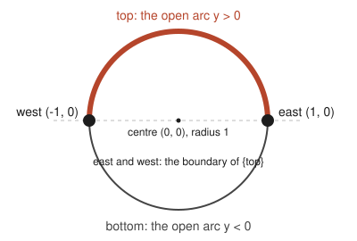

# Closure, interior and boundary: the solid inside, the edge, and everything a set touches

[Syllabus](../../../SYLLABUS.md) → [Topology](../README.md) → [Topological Spaces](../README.md#s02) → Closure, interior and boundary

---

## General Overview

The diagonal of a square floor tile 1 metre on a side is root 2 metres, 1.41421356... A tape measure, a calculator and a computer all report it as a fraction: 1.414 is 1414/1000. No fraction is exactly root 2 ([Irrational numbers](../../01-Foundations/02-The%20Number%20Line/03-irrational-numbers.md)).

Two facts make that workable and keep it imperfect. Take the band of lengths from 1.414 to 1.415 metres. It holds a fraction, 58/41 = 1.41463... Shrink it to a band a millionth of a millionth of a metre wide, and it still holds one, 2273378/1607521. Every band holds a fraction, however thin. But no band, however thick, holds only fractions: the 1.414 band also holds root 2 and 1.4147071..., which are not fractions.

Topology has a name for each fact. The fractions are **dense** in the line: they touch every point. They have **empty interior**: no stretch of the line is solid fractions. And their **boundary**, the edge between them and everything else, is the whole line.

This card defines those three words, **closure** (everything a set touches), **interior** (its solid inside) and **boundary** (its edge), using open sets only. No distance is needed. That matters because many spaces have open sets and no sensible distance, and the same three words still work there.

**The closure of a set is every point whose every surrounding open set meets the set; the interior is the union of the open sets inside it; the boundary is the closure minus the interior.**

**What kind of fact this is:** three definitions, and theorems about them, proved on this card in Why it works: the definitions agree with each other, and the fractions are dense in the line with empty interior.

### The picture: the circle cut into four pieces

<p align="center"></p>

The shelf's house example is the circle. Cut it into four pieces: the open top arc (points with height above 0), the open bottom arc (height below 0), and the two points where they meet, east at (1, 0) and west at (-1, 0). Treat each piece as one point, and call a group of pieces open when the circle points in it form an open set. This is the **four-point circle**. It has no distances, only seven open sets: a group holding east must also hold the circle points just above and just below east, so it must hold both arcs, and the same goes for west. The construction is a quotient, taught in [Subspace, product and quotient](04-subspace-product-and-quotient-topologies.md).

The top arc's closure adds east and west; its boundary is those two points. The drawing is to scale; the four-point space is what the drawing becomes when each piece is squeezed to one point.

---

## The formula

[Topological space](01-topological-spaces-and-bases.md) gives the setting: a set $`X`$ with a chosen family $`\tau`$ of **open sets**, closed under any unions and under overlaps of two. A set is **closed** when everything outside it, $`X \setminus A`$, is open.

```math
\begin{aligned}
\mathrm{int}\,A &= \text{the union of every open } U \text{ with } U \subseteq A \\
\overline{A} &= \{\, x \in X : \text{every open } U \text{ containing } x \text{ meets } A \,\} \\
\partial A &= \overline{A} \setminus \mathrm{int}\,A
\end{aligned}
```

**Read it aloud:** the interior is all the open sets that fit inside A, put together; the closure is every point that cannot be fenced off from A by an open set; the boundary is what the closure has and the interior lacks.

Here a set **meets** $`A`$ when it shares at least one point with $`A`$. Two more words follow straight from these.

- $`A`$ is **dense** in $`X`$ when $`\overline{A} = X`$: every non-empty open set meets $`A`$.
- A point $`x`$ is a **limit point** of $`A`$ when every open set containing $`x`$ meets $`A`$ at some point other than $`x`$. The set of limit points is $`A'`$.

On the four-point circle, with $`A = \{\text{top}\}`$: the only open set inside $`A`$ is $`\{\text{top}\}`$, so $`\mathrm{int}\,A = \{\text{top}\}`$. Every open set containing east also contains top, so east is in $`\overline{A}`$, and so is west. Bottom has the open set $`\{\text{bottom}\}`$, which misses top. So $`\overline{A} = \{\text{top, east, west}\}`$ and $`\partial A = \{\text{east, west}\}`$.

| Symbol | Plain meaning | In our example | Push it up and the answer… |
| --- | --- | --- | --- |
| $`X`$, $`x`$ | the whole space; one point of it | the four-point circle, or the line $`\mathbb{R}`$; east | — |
| $`\tau`$ | the open sets of $`X`$ | 7 sets, from $`\{\}`$ to all four points | more open sets: smaller closures, bigger interiors |
| $`U`$, $`V`$; $`C`$ | open sets ($`V`$ one in the target of a map $`f`$); a closed set, whose outside is open | $`\{\text{top, bottom, east}\}`$; $`\{\text{east, west}\}`$ | — |
| $`A`$ | the set being studied | $`\{\text{top}\}`$; or the fractions | bigger $`A`$: bigger closure and interior |
| $`f`$, $`f(A)`$ | a continuous map; the image of $`A`$, every point that $`f`$ sends a point of $`A`$ to | the squeeze from the circle to the four-point circle; it sends the open top arc to $`\{\text{top}\}`$ | — |
| $`X \setminus A`$ | everything outside $`A`$ | bottom, east, west | — |
| $`\mathrm{int}\,A`$ | the interior: the solid inside | $`\{\text{top}\}`$; for the fractions, empty | — |
| $`\overline{A}`$ | the closure: everything $`A`$ touches | $`\{\text{top, east, west}\}`$; for the fractions, all of $`\mathbb{R}`$ | — |
| $`\partial A`$ | the boundary: the edge | $`\{\text{east, west}\}`$; for the fractions, all of $`\mathbb{R}`$ | — |
| $`A'`$ | the limit points of $`A`$ | $`\{\text{east, west}\}`$ | — |
| $`\mathbb{Q}`$, $`\mathbb{R}`$ | the fractions (rational numbers) and the real numbers | 58/41 and root 2 | — |
| $`s`$, $`t`$, $`n`$, $`m`$ | a band from $`s`$ to $`t`$; whole numbers in the proof | 1.414, 1.415, 1001, 1416 | thinner band: bigger $`n`$ |

### When it holds

- **The open sets must be named.** Closure depends on $`\tau`$, not on the set alone. With only $`\{\}`$ and $`X`$ open (the indiscrete topology), $`\{\text{top}\}`$ is dense; with every set open (the discrete topology), its closure is itself.
- **The surrounding space must be named.** The circle inside the plane has empty interior: every disc around a circle point holds points off the circle. The circle as a space of its own has interior the whole circle.
- **Sequences are not enough without a distance.** In a metric space a point is in the closure exactly when a sequence from $`A`$ converges to it. In general spaces that can fail. On the line with the cocountable topology (open means the complement is countable), no sequence from $`[0, 1]`$ converges to 2, yet 2 is in the closure. Open sets always decide.
- **Density of the fractions uses the Archimedean property.** Some whole number $`n`$ exceeds any given real. The reals have it ([The real numbers have no gaps](../../01-Foundations/02-The%20Number%20Line/04-real-numbers-no-gaps.md)); ordered systems without it can have bands with no fraction.

---

## Why it works

### Step 0: nearness is a test by open sets

With a distance, "x is near A" means some point of A is within any tolerance of x. With no distance, open sets play the tolerance. A point is near A when no open set can fence it off from A.

[Baire category theorem](../01-Metric%20Spaces/10-baire-category-theorem.md) gives closure, interior and dense one metric sentence each, with sequences and balls. Open balls are open sets, and in a metric space the sequence test agrees with the open-set test, so those sentences are this card's definitions read with a distance.

### Step 1: the interior is the largest open set inside A

A union of open sets is open, so $`\mathrm{int}\,A`$ is open. It sits inside $`A`$, and it contains every open set that does. So it is the largest open set inside $`A`$. A set is open exactly when it equals its interior.

### Step 2: the closure is the smallest closed set holding A

The closure has a second description: the overlap of every closed set that contains $`A`$. The two agree because a point outside one closed set holding $`A`$ sits in an open set (that set's outside) that misses $`A`$, and the reverse.

<details>
<summary>Detailed proof: the two closures, and the swap with the outside</summary>

Suppose $`x`$ has an open set $`U`$ around it that misses $`A`$. Then $`X \setminus U`$ is closed, contains $`A`$, and leaves out $`x`$. So $`x`$ is not in the overlap of the closed sets holding $`A`$.

Suppose instead $`x`$ is outside some closed set $`C`$ that holds $`A`$. Then $`X \setminus C`$ is open, contains $`x`$, and misses $`A`$. So $`x`$ fails the open-set test.

The two descriptions exclude the same points, so they are equal. The overlap of closed sets is closed, so the closure is closed, and it is the smallest closed set holding $`A`$.

The same argument read through the outside gives the swap rule:

$`\displaystyle X \setminus \overline{A} = \mathrm{int}\,(X \setminus A)`$

A point is outside the closure exactly when some open set around it misses $`A`$, that is, sits inside $`X \setminus A`$.

</details>

So the closure can be reached three ways: the open-set test, the overlap of closed sets, and the swap rule. The code runs all three on every subset of the four-point circle.

### Step 3: the boundary is shared with the outside

By the swap rule, removing the interior of $`A`$ is the same as keeping the closure of the outside. So

```math
\partial A = \overline{A} \cap \overline{X \setminus A}
```

A boundary point is touched by $`A`$ and by everything else. The formula is symmetric, so $`A`$ and its outside have the same boundary. The boundary is always closed, as an overlap of two closed sets.

### Step 4: the closure is A plus its limit points

A point of $`\overline{A}`$ is either in $`A`$, or every open set around it meets $`A`$ somewhere else, since it cannot meet $`A`$ at the point itself. So $`\overline{A} = A \cup A'`$.

On the four-point circle, east is a limit point of $`\{\text{top}\}`$. The sequence top, top, top, ... converges to top, to east and to west: each open set around any of the three contains top. Limits need not be unique without a distance; when they are is [Hausdorff and its ladder](05-separation-axioms-and-hausdorff.md).

### Step 5: every band holds a fraction, so the fractions are dense

Take a band from $`s`$ to $`t`$ with $`s < t`$. Pick a whole number $`n`$ larger than $`1/(t - s)`$; the Archimedean property supplies one. Steps of size $`1/n`$ are shorter than the band.

Let $`m`$ be the whole number just past $`ns`$: the largest whole number at most $`ns`$, plus 1. Then $`m/n`$ is above $`s`$, and it overshoots $`s`$ by at most $`1/n`$, which is less than $`t - s`$. So $`m/n`$ lands inside the band.

Every non-empty open set of the line contains a band, so every one meets $`\mathbb{Q}`$, and $`\overline{\mathbb{Q}} = \mathbb{R}`$.

The number-line card shows by halving that a fraction sits between any two fractions ([The number line and inequalities](../../01-Foundations/02-The%20Number%20Line/02-number-line-and-inequalities.md)). This step goes further: between any two reals, fractions or not.

### Step 6: every band holds a non-fraction, so the interior is empty

First get a band with fraction ends: by Step 5, pick fractions $`s`$ and $`t`$ inside any given band. Then $`s + (t - s)/\sqrt{2}`$ lies strictly between them, because $`1/\sqrt{2}`$ is between 0 and 1. It is not a fraction: if it were, solving for $`\sqrt{2}`$ would write root 2 as a fraction.

So no band is solid fractions, and no non-empty open set fits inside $`\mathbb{Q}`$: $`\mathrm{int}\,\mathbb{Q} = \{\}`$. Then $`\partial\mathbb{Q} = \mathbb{R} \setminus \{\} = \mathbb{R}`$: every real is an edge point of the fractions.

### Step 7: which maps keep these

A continuous map $`f`$ pushes closures into closures: $`f(\overline{A}) \subseteq \overline{f(A)}`$. If $`f(x)`$ sits in an open set $`V`$, the pre-image of $`V`$ is open around $`x`$, meets $`A`$, and so $`V`$ meets $`f(A)`$. A homeomorphism, a continuous map with a continuous inverse, carries closure, interior and boundary across exactly. Both maps are the subject of [Continuity by pre-images, and homeomorphism](03-continuity-and-homeomorphism.md).

The squeeze from the circle to the four-point circle is continuous. It sends the closed top half-circle, the closure of the open top arc, to $`\{\text{top, east, west}\}`$, the closure of $`\{\text{top}\}`$.

---

## Worked numbers, by hand

The band from 1.414 to 1.415 metres, around the tile's diagonal.

| Step | Arithmetic | Value |
| --- | --- | --- |
| root 2 is in the band | 1.414 × 1.414 = 1.999396 < 2 < 2.002225 = 1.415 × 1.415 | yes |
| band width | 1.415 − 1.414 | 0.001 |
| $`n`$ larger than 1/width | 1/0.001 = 1000, so take 1001 | 1001 |
| $`m`$ just past $`ns`$ | 1001 × 1.414 = 1415.414; whole part 1415, plus 1 | 1416 |
| the fraction | 1416/1001 | **1.41458...**, inside |
| the simplest fraction | smallest bottom number that fits: 58/41 | 1.41463..., inside |
| a non-fraction | 1.414 + 0.001/root 2 | 1.4147071..., inside |

Every band of lengths around root 2 contains a measurement a tape can show and a length it cannot. A tape reading can be as close to the diagonal as wanted, and is never the diagonal.

On the four-point circle, by hand, for $`A = \{\text{top}\}`$:

| Step | Arithmetic | Value |
| --- | --- | --- |
| open sets inside $`A`$ | $`\{\}`$ and $`\{\text{top}\}`$ | interior **{top}** |
| open sets around east | $`\{\text{top, bottom, east}\}`$ and all four: both contain top | east in the closure |
| open sets around bottom | $`\{\text{bottom}\}`$ misses top | bottom not in the closure |
| closure minus interior | $`\{\text{top, east, west}\}`$ minus $`\{\text{top}\}`$ | boundary **{east, west}** |

The open top arc's edge is its two endpoints, found with no distances at all.

### What breaks if you drop a piece

| Mistake | Comes out at | What went wrong |
| --- | --- | --- |
| Boundary as $`A`$ minus its interior | $`\{\}`$ for $`\{\text{top}\}`$, not $`\{\text{east, west}\}`$; for $`\mathbb{Q}`$ it gives $`\mathbb{Q}`$, not $`\mathbb{R}`$ | the edge can lie outside $`A`$ |
| Closure and interior taken in either order | $`A = \{\text{top, east}\}`$: closure of interior $`\{\text{top, east, west}\}`$, interior of closure $`\{\text{top}\}`$ | the two operations do not commute |
| Forgetting which sets are open | closure of $`\{\text{top}\}`$: all four points (indiscrete), $`\{\text{top}\}`$ (discrete) | closure depends on $`\tau`$ |
| Interior of the circle taken in the plane | $`(3/5, 4/5)`$ pushed out by 1/2000 has $`x^2 + y^2 = 4004001/4000000 = 1.00100025`$ | a disc of radius 1/1000 leaves the circle |

The code prints all four.

---

## Code, from first principles, and it actually runs

Part 1 first checks the seven open sets against the gluing rule, east or west only together with top and bottom. It then tests all 16 subsets of the four-point circle, so its identities are proved for that space, not sampled. It reaches each closure three independent ways: the open-set test, the overlap of closed sets, and the swap rule. Part 2 finds a fraction in four bands around root 2 two ways, by Step 5's formula and by a Stern–Brocot search (repeated mediants, which finds the fraction with the smallest bottom number), and a brute-force search confirms the smallest bottom for the widest band. That part is checked on 4 cases; the proof is Step 5. Arithmetic is exact: fractions, and whole numbers in Rust.

### Python

```python
# Closure, interior and boundary -- the check behind the card.  Standard library
# only.  Part 1 has no distances: the circle squeezed to four points, top,
# bottom, east and west, with seven open sets.  All 16 subsets are tested, so
# every identity printed there is proved for that space.  Part 2 finds fractions
# in shrinking bands around root 2, exactly, two ways; it illustrates the proof.
from fractions import Fraction as F
from itertools import combinations

X = ("top", "bottom", "east", "west")
OPEN = [frozenset(s) for s in ([], ["top"], ["bottom"], ["top", "bottom"],
        ["top", "bottom", "east"], ["top", "bottom", "west"], list(X))]
ALL = [frozenset(c) for r in range(5) for c in combinations(X, r)]
EVERY = frozenset(X)
GLUED = [a for a in ALL if not a & {"east", "west"} or {"top", "bottom"} <= a]  # quotient rule

def show(s):
    return "{" + ", ".join(p for p in X if p in s) + "}"

def yn(claim):
    return "yes" if claim else "no"

def dec(n, k):                             # the whole number n / 10^k, exactly
    return f"{n // 10 ** k}.{n % 10 ** k:0{k}d}"

def interior(a, opens):                    # union of the open sets inside a
    return frozenset().union(*[u for u in opens if u <= a])

def closure_closed(a, opens):              # road 1: meet of closed sets holding a
    return EVERY.intersection(*[EVERY - u for u in opens if a <= EVERY - u])

def closure_touch(a, opens):               # road 2: every open set round x meets a
    return frozenset(x for x in X if all(u & a for u in opens if x in u))

def closure_swap(a, opens):                # road 3: the rest of the rest's interior
    return EVERY - interior(EVERY - a, opens)

def limit_points(a, opens):                # meets a somewhere other than x itself
    return frozenset(x for x in X if all((u & a) - {x} for u in opens if x in u))

def boundary(a, opens):
    return closure_touch(a, opens) - interior(a, opens)

unions = all(frozenset().union(*f) in OPEN
             for r in range(8) for f in combinations(OPEN, r))
overlaps = all(u & v in OPEN for u in OPEN for v in OPEN)
top = frozenset(["top"])
print("Part 1: the circle squeezed to four points: top, bottom, east, west")
print("open sets:", ", ".join(show(u) for u in OPEN))
print(f"open sets by the gluing rule, east or west only with top and bottom: {len(GLUED)}; "
      f"same family: {yn(set(GLUED) == set(OPEN))}")
print(f"every union and every overlap of open sets is open: {yn(unions and overlaps)}")
print("A = {top}, the open upper arc")
print(f"  interior {show(interior(top, OPEN))}; closure {show(closure_touch(top, OPEN))}; "
      f"boundary {show(boundary(top, OPEN))}; limit points {show(limit_points(top, OPEN))}")
seq_limits = frozenset(x for x in X if all("top" in u for u in OPEN if x in u))
print(f"  the sequence top, top, top, ... converges to {show(seq_limits)}")
three = all(closure_closed(a, OPEN) == closure_touch(a, OPEN) == closure_swap(a, OPEN) for a in ALL)
plus = all(closure_touch(a, OPEN) == a | limit_points(a, OPEN) for a in ALL)
edge = all(boundary(a, OPEN) == closure_touch(a, OPEN) & closure_touch(EVERY - a, OPEN) for a in ALL)
dense = [a for a in ALL if closure_touch(a, OPEN) == EVERY]
print(f"all {len(ALL)} subsets: the three roads to the closure agree: {yn(three)}")
print(f"all {len(ALL)} subsets: closure = the set plus its limit points: {yn(plus)}")
print(f"all {len(ALL)} subsets: boundary = closure of the set, met with closure of the rest: {yn(edge)}")
print(f"dense subsets: {len(dense)} of {len(ALL)}: " + ", ".join(show(a) for a in dense))
te = frozenset(["top", "east"])
indiscrete, discrete = [frozenset(), EVERY], ALL
print(f"mistake 1, boundary of {{top}} as the set minus its interior: {show(top - interior(top, OPEN))}")
print(f"mistake 2, A = {{top, east}}: closure of the interior {show(closure_touch(interior(te, OPEN), OPEN))}, "
      f"interior of the closure {show(interior(closure_touch(te, OPEN), OPEN))}")
print(f"mistake 3, closure of {{top}}: indiscrete {show(closure_touch(top, indiscrete))}, "
      f"discrete {show(closure_touch(top, discrete))}")
px, py, push = F(3, 5), F(4, 5), F(2001, 2000)
r2 = (px * push) ** 2 + (py * push) ** 2
print(f"mistake 4, the circle inside the plane: (3/5, 4/5) pushed out by 1/2000 "
      f"has x^2 + y^2 = {r2} = {dec(int(r2 * 10 ** 8), 8)}, off the circle")

def isqrt(n):                              # largest whole r with r * r <= n
    lo, hi = 0, n + 1
    while hi - lo > 1:
        mid = (lo + hi) // 2
        lo, hi = (mid, hi) if mid * mid <= n else (lo, mid)
    return lo

def archimedes(s, t):                      # n past 1/(t - s), then step past s
    n = int(1 / (t - s)) + 1
    return F(int(n * s) + 1, n), n

def simplest(s, t):                        # Stern-Brocot: mediants, smallest bottom
    (p1, q1), (p2, q2) = (0, 1), (1, 0)
    while True:
        p, q = p1 + p2, q1 + q2
        if F(p, q) <= s:
            p1, q1 = p, q
        elif F(p, q) >= t:
            p2, q2 = p, q
        else:
            return F(p, q)

print("Part 2: bands around root 2, the diagonal of a 1-metre tile, in metres")
for k in (3, 6, 9, 12):
    lo = isqrt(2 * 10 ** (2 * k))
    s = F(lo, 10 ** k)
    t = s + F(1, 10 ** k)
    a, n = archimedes(s, t)
    b = simplest(s, t)
    print(f"width 10^-{k}: ({dec(lo, k)}, {dec(lo + 1, k)}); root 2 inside: {yn(s * s < 2 < t * t)}; "
          f"Archimedes {a}; simplest {b}")
    assert s < a < t and s < b < t and s * s < 2 < t * t                 # in the band
    assert b.denominator <= n                                             # simplest is smallest
    if k == 3:
        none = all(not (s < F(p, q) < t) for q in range(1, b.denominator) for p in range(2 * q + 1))
        print(f"  checked: no fraction with bottom below {b.denominator} lies in this band: {yn(none)}")
        assert none                                                       # brute force agrees
        print(f"  a non-fraction in it: 1.414 + 0.001/root 2 = 1.414{isqrt(10 ** 8 // 2)}...")
assert set(GLUED) == set(OPEN) and unions and overlaps and three and plus and edge
assert closure_touch(top, OPEN) == {"top", "east", "west"} and interior(top, OPEN) == top
assert limit_points(top, OPEN) == {"east", "west"}                       # top is not its own limit
assert len(dense) == 4 and closure_touch(top, indiscrete) == EVERY and r2 != 1
print("figure, circle centre (0, 0) radius 1; east (1, 0); west (-1, 0); top arc y > 0; bottom arc y < 0")
print("ALL CHECKS PASS")
```

**Ran 2026-11-14 on macOS, Python 3.14.10, standard library only. All checks passed. Output, pasted from the run:**

```
Part 1: the circle squeezed to four points: top, bottom, east, west
open sets: {}, {top}, {bottom}, {top, bottom}, {top, bottom, east}, {top, bottom, west}, {top, bottom, east, west}
open sets by the gluing rule, east or west only with top and bottom: 7; same family: yes
every union and every overlap of open sets is open: yes
A = {top}, the open upper arc
  interior {top}; closure {top, east, west}; boundary {east, west}; limit points {east, west}
  the sequence top, top, top, ... converges to {top, east, west}
all 16 subsets: the three roads to the closure agree: yes
all 16 subsets: closure = the set plus its limit points: yes
all 16 subsets: boundary = closure of the set, met with closure of the rest: yes
dense subsets: 4 of 16: {top, bottom}, {top, bottom, east}, {top, bottom, west}, {top, bottom, east, west}
mistake 1, boundary of {top} as the set minus its interior: {}
mistake 2, A = {top, east}: closure of the interior {top, east, west}, interior of the closure {top}
mistake 3, closure of {top}: indiscrete {top, bottom, east, west}, discrete {top}
mistake 4, the circle inside the plane: (3/5, 4/5) pushed out by 1/2000 has x^2 + y^2 = 4004001/4000000 = 1.00100025, off the circle
Part 2: bands around root 2, the diagonal of a 1-metre tile, in metres
width 10^-3: (1.414, 1.415); root 2 inside: yes; Archimedes 1416/1001; simplest 58/41
  checked: no fraction with bottom below 41 lies in this band: yes
  a non-fraction in it: 1.414 + 0.001/root 2 = 1.4147071...
width 10^-6: (1.414213, 1.414214); root 2 inside: yes; Archimedes 1414215/1000001; simplest 1393/985
width 10^-9: (1.414213562, 1.414213563); root 2 inside: yes; Archimedes 1414213564/1000000001; simplest 47321/33461
width 10^-12: (1.414213562373, 1.414213562374); root 2 inside: yes; Archimedes 1414213562375/1000000000001; simplest 2273378/1607521
figure, circle centre (0, 0) radius 1; east (1, 0); west (-1, 0); top arc y > 0; bottom arc y < 0
ALL CHECKS PASS
```

### Rust

Same numbers, same labels, built with `rustc --edition 2021 -O`.

```rust
// Closure, interior and boundary -- the same check as the Python, in Rust.  No
// crates.  Part 1 has no distances: the circle squeezed to four points, top,
// bottom, east and west, with seven open sets.  All 16 subsets are tested, so
// every identity printed there is proved for that space.  Part 2 finds fractions
// in shrinking bands around root 2, exactly, two ways; it illustrates the proof.
// A set of points is a 4-bit mask: top 1, bottom 2, east 4, west 8.
const X: [&str; 4] = ["top", "bottom", "east", "west"];
const EVERY: u8 = 15;
const OPEN: [u8; 7] = [0, 1, 2, 3, 7, 11, 15];

fn show(s: u8) -> String {
    let names: Vec<&str> = (0..4).filter(|i| s & (1 << i) != 0).map(|i| X[i]).collect();
    format!("{{{}}}", names.join(", "))
}
fn yn(claim: bool) -> &'static str { if claim { "yes" } else { "no" } }
fn dec(n: i128, k: u32) -> String {                // the whole number n / 10^k, exactly
    let p = 10i128.pow(k);
    format!("{}.{:0w$}", n / p, n % p, w = k as usize)
}
fn interior(a: u8, opens: &[u8]) -> u8 {          // union of the open sets inside a
    opens.iter().filter(|&&u| u & !a == 0).fold(0, |acc, &u| acc | u)
}
fn closure_closed(a: u8, opens: &[u8]) -> u8 {    // road 1: meet of closed sets holding a
    opens.iter().map(|&u| EVERY & !u).filter(|&c| a & !c == 0).fold(EVERY, |acc, c| acc & c)
}
fn closure_touch(a: u8, opens: &[u8]) -> u8 {     // road 2: every open set round x meets a
    (0..4).filter(|&i| opens.iter().all(|&u| u & (1 << i) == 0 || u & a != 0)).fold(0, |acc, i| acc | (1 << i))
}
fn closure_swap(a: u8, opens: &[u8]) -> u8 {      // road 3: the rest of the rest's interior
    EVERY & !interior(EVERY & !a, opens)
}
fn limit_points(a: u8, opens: &[u8]) -> u8 {      // meets a somewhere other than x itself
    (0..4).filter(|&i| opens.iter().all(|&u| u & (1 << i) == 0 || u & a & !(1u8 << i) != 0))
        .fold(0, |acc, i| acc | (1 << i))
}
fn boundary(a: u8, opens: &[u8]) -> u8 { closure_touch(a, opens) & !interior(a, opens) }

fn gcd(a: i128, b: i128) -> i128 { if b == 0 { a.abs() } else { gcd(b, a % b) } }
fn frac(p: i128, q: i128) -> String { let g = gcd(p, q); format!("{}/{}", p / g, q / g) }
fn isqrt(n: i128) -> i128 {                        // largest whole r with r * r <= n
    let (mut lo, mut hi) = (0i128, (n + 1).min(1i128 << 62));      // keeps mid * mid in range
    while hi - lo > 1 {
        let mid = (lo + hi) / 2;
        if mid * mid <= n { lo = mid } else { hi = mid }
    }
    lo
}
// A band is (lo/d, (lo+1)/d) with d = 10^k.  p/q lies inside when lo*q < p*d < (lo+1)*q.
fn inside(p: i128, q: i128, lo: i128, d: i128) -> bool { lo * q < p * d && p * d < (lo + 1) * q }
fn archimedes(lo: i128, d: i128) -> (i128, i128) { // n past 1/(t - s), then step past s
    let n = d + 1;
    (n * lo / d + 1, n)
}
fn simplest(lo: i128, d: i128) -> (i128, i128) {   // Stern-Brocot: mediants, smallest bottom
    let (mut p1, mut q1, mut p2, mut q2) = (0i128, 1i128, 1i128, 0i128);
    loop {
        let (p, q) = (p1 + p2, q1 + q2);
        if p * d <= lo * q { p1 = p; q1 = q }
        else if p * d >= (lo + 1) * q { p2 = p; q2 = q }
        else { return (p, q) }
    }
}

fn main() {
    let all: Vec<u8> = {
        let mut v: Vec<u8> = (0..16).collect();
        v.sort_by_key(|&s| (s.count_ones(), (0..4).map(|i| 1 - (s >> i & 1)).collect::<Vec<u8>>()));
        v
    };
    let unions = (0..128u32).all(|f| OPEN.contains(&(0..7).filter(|j| f >> j & 1 == 1).fold(0, |acc, j| acc | OPEN[j])));
    let overlaps = OPEN.iter().all(|&u| OPEN.iter().all(|&v| OPEN.contains(&(u & v))));
    let top: u8 = 1;
    println!("Part 1: the circle squeezed to four points: top, bottom, east, west");
    println!("open sets: {}", OPEN.iter().map(|&u| show(u)).collect::<Vec<_>>().join(", "));
    let glued: Vec<u8> = (0..16u8).filter(|&a| a & 12 == 0 || a & 3 == 3).collect();   // quotient rule
    println!("open sets by the gluing rule, east or west only with top and bottom: {}; same family: {}", glued.len(), yn(glued == OPEN));
    println!("every union and every overlap of open sets is open: {}", yn(unions && overlaps));
    println!("A = {{top}}, the open upper arc");
    println!("  interior {}; closure {}; boundary {}; limit points {}", show(interior(top, &OPEN)),
             show(closure_touch(top, &OPEN)), show(boundary(top, &OPEN)), show(limit_points(top, &OPEN)));
    let seq_limits = (0..4).filter(|&i| OPEN.iter().all(|&u| u & (1 << i) == 0 || u & top != 0)).fold(0u8, |a, i| a | (1 << i));
    println!("  the sequence top, top, top, ... converges to {}", show(seq_limits));
    let three = all.iter().all(|&a| closure_closed(a, &OPEN) == closure_touch(a, &OPEN) && closure_touch(a, &OPEN) == closure_swap(a, &OPEN));
    let plus = all.iter().all(|&a| closure_touch(a, &OPEN) == a | limit_points(a, &OPEN));
    let edge = all.iter().all(|&a| boundary(a, &OPEN) == closure_touch(a, &OPEN) & closure_touch(EVERY & !a, &OPEN));
    let dense: Vec<u8> = all.iter().copied().filter(|&a| closure_touch(a, &OPEN) == EVERY).collect();
    println!("all {} subsets: the three roads to the closure agree: {}", all.len(), yn(three));
    println!("all {} subsets: closure = the set plus its limit points: {}", all.len(), yn(plus));
    println!("all {} subsets: boundary = closure of the set, met with closure of the rest: {}", all.len(), yn(edge));
    println!("dense subsets: {} of {}: {}", dense.len(), all.len(), dense.iter().map(|&a| show(a)).collect::<Vec<_>>().join(", "));
    let te: u8 = 5;
    let (indiscrete, discrete): ([u8; 2], Vec<u8>) = ([0, EVERY], (0..16).collect());
    println!("mistake 1, boundary of {{top}} as the set minus its interior: {}", show(top & !interior(top, &OPEN)));
    println!("mistake 2, A = {{top, east}}: closure of the interior {}, interior of the closure {}",
             show(closure_touch(interior(te, &OPEN), &OPEN)), show(interior(closure_touch(te, &OPEN), &OPEN)));
    println!("mistake 3, closure of {{top}}: indiscrete {}, discrete {}",
             show(closure_touch(top, &indiscrete)), show(closure_touch(top, &discrete)));
    // (3/5, 4/5) times 2001/2000: x^2 + y^2 = (9 + 16)/25 * 2001^2 / 2000^2
    let (num, den) = ((9 + 16) * 2001i128 * 2001, 25 * 2000i128 * 2000);
    println!("mistake 4, the circle inside the plane: (3/5, 4/5) pushed out by 1/2000 has x^2 + y^2 = {} = {}, off the circle",
             frac(num, den), dec(num * 100_000_000 / den, 8));
    println!("Part 2: bands around root 2, the diagonal of a 1-metre tile, in metres");
    for k in [3u32, 6, 9, 12] {
        let d = 10i128.pow(k);
        let lo = isqrt(2 * d * d);
        let (am, an) = archimedes(lo, d);
        let (bp, bq) = simplest(lo, d);
        let root_in = lo * lo < 2 * d * d && 2 * d * d < (lo + 1) * (lo + 1);
        println!("width 10^-{}: ({}, {}); root 2 inside: {}; Archimedes {}; simplest {}",
                 k, dec(lo, k), dec(lo + 1, k), yn(root_in), frac(am, an), frac(bp, bq));
        assert!(inside(am, an, lo, d) && inside(bp, bq, lo, d) && root_in);   // in the band
        assert!(bq <= an);                                                    // simplest is smallest
        if k == 3 {
            let none = (1..bq).all(|q| (0..=2 * q).all(|p| !inside(p, q, lo, d)));
            println!("  checked: no fraction with bottom below {} lies in this band: {}", bq, yn(none));
            assert!(none);                                                    // brute force agrees
            println!("  a non-fraction in it: 1.414 + 0.001/root 2 = 1.414{}...", isqrt(100_000_000 / 2));
        }
    }
    assert!(glued == OPEN && unions && overlaps && three && plus && edge);
    assert!(closure_touch(top, &OPEN) == 13 && interior(top, &OPEN) == top);
    assert!(limit_points(top, &OPEN) == 12);                             // top is not its own limit
    assert!(dense.len() == 4 && closure_touch(top, &indiscrete) == EVERY && num != den);
    println!("figure, circle centre (0, 0) radius 1; east (1, 0); west (-1, 0); top arc y > 0; bottom arc y < 0");
    println!("ALL CHECKS PASS");
}
```

**Ran 2026-11-14 on macOS, rustc 1.98.1, no crates. All checks passed. Output, pasted from the run:**

```
Part 1: the circle squeezed to four points: top, bottom, east, west
open sets: {}, {top}, {bottom}, {top, bottom}, {top, bottom, east}, {top, bottom, west}, {top, bottom, east, west}
open sets by the gluing rule, east or west only with top and bottom: 7; same family: yes
every union and every overlap of open sets is open: yes
A = {top}, the open upper arc
  interior {top}; closure {top, east, west}; boundary {east, west}; limit points {east, west}
  the sequence top, top, top, ... converges to {top, east, west}
all 16 subsets: the three roads to the closure agree: yes
all 16 subsets: closure = the set plus its limit points: yes
all 16 subsets: boundary = closure of the set, met with closure of the rest: yes
dense subsets: 4 of 16: {top, bottom}, {top, bottom, east}, {top, bottom, west}, {top, bottom, east, west}
mistake 1, boundary of {top} as the set minus its interior: {}
mistake 2, A = {top, east}: closure of the interior {top, east, west}, interior of the closure {top}
mistake 3, closure of {top}: indiscrete {top, bottom, east, west}, discrete {top}
mistake 4, the circle inside the plane: (3/5, 4/5) pushed out by 1/2000 has x^2 + y^2 = 4004001/4000000 = 1.00100025, off the circle
Part 2: bands around root 2, the diagonal of a 1-metre tile, in metres
width 10^-3: (1.414, 1.415); root 2 inside: yes; Archimedes 1416/1001; simplest 58/41
  checked: no fraction with bottom below 41 lies in this band: yes
  a non-fraction in it: 1.414 + 0.001/root 2 = 1.4147071...
width 10^-6: (1.414213, 1.414214); root 2 inside: yes; Archimedes 1414215/1000001; simplest 1393/985
width 10^-9: (1.414213562, 1.414213563); root 2 inside: yes; Archimedes 1414213564/1000000001; simplest 47321/33461
width 10^-12: (1.414213562373, 1.414213562374); root 2 inside: yes; Archimedes 1414213562375/1000000000001; simplest 2273378/1607521
figure, circle centre (0, 0) radius 1; east (1, 0); west (-1, 0); top arc y > 0; bottom arc y < 0
ALL CHECKS PASS
```

The two outputs match line for line.

### Lean

Lean proves the card's general facts for every space with open sets, the facts about fractions on the line, and the worked numbers.

- In any space, the interior of a set is the union of the open sets inside it.
- The closure is every point whose every surrounding open set meets the set. It is also the overlap of the closed sets holding the set.
- Take any set $`A`$ in a space $`X`$. Then $`X \setminus \overline{A} = \mathrm{int}\,(X \setminus A)`$, the swap rule.
- The boundary is the closure minus the interior. Take any set $`A`$. Then $`\partial A = \overline{A} \cap \overline{X \setminus A}`$.
- Take any set $`A`$. Then $`\overline{A} = A \cup A'`$: the closure is the set plus its limit points.
- A set is dense exactly when every non-empty open set meets it.
- Take a band from $`s`$ to $`t`$ with $`s < t`$. Then it holds a fraction and a non-fraction.
- The fractions are dense in the line, their interior is empty, and their boundary is the whole line.
- Root 2 lies in the band from 1.414 to 1.415, and so do 1416/1001 and 58/41.
- Step 5's arithmetic holds there: 1 over the width is 1000, and 1001 × 1.414 has whole part 1415.
- No fraction with bottom number below 41 lies in that band.
- The band a millionth of a millionth wide holds 2273378/1607521.
- The point (3/5, 4/5) pushed out by 1/2000 has squared distance 4004001/4000000 from the centre, not 1.

The four-point circle, its 16 subsets and the Stern–Brocot search are left to the Python and Rust checks.

```lean
-- Closure, interior and boundary: the open-set definitions of closure, interior and boundary agree with each other, and the rationals are dense in the real line with empty interior.
import Mathlib.Topology.Closure
import Mathlib.Topology.Instances.Irrational
import Mathlib.Tactic.NormNum

/-- In any topological space, the interior of `A` is the union of the open sets inside `A`;
the closure of `A` is the set of points every open set around which meets `A`, and it equals
the overlap of the closed sets holding `A` and the outside of the interior of the outside;
and the boundary is the closure minus the interior. -/
theorem closure_interior_boundary_from_open_sets {X : Type*} [TopologicalSpace X]
    (A : Set X) :
    interior A = ⋃₀ {U | IsOpen U ∧ U ⊆ A} ∧
    closure A = {x | ∀ U : Set X, IsOpen U → x ∈ U → (U ∩ A).Nonempty} ∧
    closure A = ⋂₀ {C | IsClosed C ∧ A ⊆ C} ∧
    (closure A)ᶜ = interior Aᶜ ∧
    frontier A = closure A \ interior A := by
  refine ⟨rfl, ?_, rfl, interior_compl.symm, rfl⟩
  ext x
  exact mem_closure_iff

/-- The boundary of `A` is the closure of `A` met with the closure of its outside; the closure
of `A` is `A` together with its limit points (points every open set around which meets `A`
somewhere other than the point itself); and `A` is dense exactly when every non-empty open
set meets it. -/
theorem boundary_limit_points_and_dense {X : Type*} [TopologicalSpace X] (A : Set X) :
    frontier A = closure A ∩ closure Aᶜ ∧
    closure A = A ∪ {x | ∀ U : Set X, IsOpen U → x ∈ U → (U ∩ (A \ {x})).Nonempty} ∧
    (Dense A ↔ ∀ U : Set X, IsOpen U → U.Nonempty → (U ∩ A).Nonempty) := by
  refine ⟨frontier_eq_closure_inter_closure, ?_, dense_iff_inter_open⟩
  ext x
  constructor
  · intro hx
    by_cases hxA : x ∈ A
    · exact Or.inl hxA
    · refine Or.inr fun U hU hxU => ?_
      obtain ⟨y, hyU, hyA⟩ := mem_closure_iff.mp hx U hU hxU
      refine ⟨y, hyU, hyA, ?_⟩
      rintro rfl
      exact hxA hyA
  · rintro (hxA | hx)
    · exact subset_closure hxA
    · refine mem_closure_iff.mpr fun U hU hxU => ?_
      obtain ⟨y, hyU, hyA, -⟩ := hx U hU hxU
      exact ⟨y, hyU, hyA⟩

/-- Every band of the real line from `s` to `t` holds a fraction and a non-fraction, so the
fractions are dense in the line, have empty interior, and have the whole line as boundary. -/
theorem rationals_dense_with_empty_interior :
    (∀ s t : ℝ, s < t →
      (∃ q : ℚ, s < (q : ℝ) ∧ (q : ℝ) < t) ∧ (∃ x : ℝ, Irrational x ∧ s < x ∧ x < t)) ∧
    Dense (Set.range ((↑) : ℚ → ℝ)) ∧
    interior (Set.range ((↑) : ℚ → ℝ)) = ∅ ∧
    frontier (Set.range ((↑) : ℚ → ℝ)) = Set.univ := by
  have hdense : Dense (Set.range ((↑) : ℚ → ℝ)) := Rat.denseRange_cast
  have hint : interior (Set.range ((↑) : ℚ → ℝ)) = ∅ := by
    rw [interior_eq_empty_iff_dense_compl]
    exact dense_irrational
  refine ⟨fun s t hst => ⟨exists_rat_btwn hst, exists_irrational_btwn hst⟩, hdense, hint, ?_⟩
  rw [frontier, hdense.closure_eq, hint, Set.sdiff_empty]

-- Root 2 lies in the band from 1414/1000 to 1415/1000 metres.
example : (1414 / 1000 : ℚ) ^ 2 = 1999396 / 1000000 ∧ (1415 / 1000 : ℚ) ^ 2 = 2002225 / 1000000 ∧
    (1414 / 1000 : ℚ) ^ 2 < 2 ∧ 2 < (1415 / 1000 : ℚ) ^ 2 := by norm_num

-- Step 5 on that band: n = 1001 exceeds 1/width = 1000; n * s = 1415414/1000, whole part 1415; m = 1416.
example : (1 : ℚ) / (1415 / 1000 - 1414 / 1000) = 1000 ∧ 1001 * 1414 = 1415414 ∧
    1415414 / 1000 = 1415 := by norm_num

-- Step 5's fraction 1416/1001 and the simplest fraction 58/41 both lie in the band.
example : (1414 / 1000 : ℚ) < 1416 / 1001 ∧ (1416 / 1001 : ℚ) < 1415 / 1000 ∧
    (1414 / 1000 : ℚ) < 58 / 41 ∧ (58 / 41 : ℚ) < 1415 / 1000 := by norm_num

-- No fraction p/q with bottom q below 41 lies strictly between 1414/1000 and 1415/1000.
example : ∀ q < 41, ∀ p < 2 * q + 1, ¬ (1414 * q < 1000 * p ∧ 1000 * p < 1415 * q) := by
  decide

-- The band a millionth of a millionth wide still holds a fraction, 2273378/1607521.
example : (1414213562373 / 1000000000000 : ℚ) < 2273378 / 1607521 ∧
    (2273378 / 1607521 : ℚ) < 1414213562374 / 1000000000000 := by norm_num

-- What breaks: (3/5, 4/5) pushed out by 1/2000 lands off the unit circle.
example : (3 / 5 * (2001 / 2000) : ℚ) ^ 2 + (4 / 5 * (2001 / 2000)) ^ 2 = 4004001 / 4000000 ∧
    (4004001 / 4000000 : ℚ) ≠ 1 := by norm_num

#print axioms closure_interior_boundary_from_open_sets
#print axioms boundary_limit_points_and_dense
#print axioms rationals_dense_with_empty_interior
```

**Checked 2026-11-15 on macOS, Lean 4.36.0-rc2, Mathlib v4.36.0-rc2. Every proof is complete and uses only Lean's standard axioms. Output, pasted from the run:**

```
'closure_interior_boundary_from_open_sets' depends on axioms: [propext, Classical.choice, Quot.sound]
'boundary_limit_points_and_dense' depends on axioms: [propext, Classical.choice, Quot.sound]
'rationals_dense_with_empty_interior' depends on axioms: [propext, Classical.choice, Quot.sound]
```

> [!TIP]
> **Try changing**
> - **Guess first: does Step 5 still work without the "plus 1"?** Change `int(n * s) + 1` to `int(n * s)`. For the 1.414 band the fraction becomes 1415/1001, just under 1.414 and outside the band, and the first band assert stops the run.
> - **Guess first: how big do the bottom numbers get?** Add `15` to the list of band widths. The simplest fraction has an eight-digit bottom number; Step 5's has sixteen digits. Both still land inside.
> - **Guess first: what happens if every set is open?** Add the line `OPEN = ALL` just after the line that defines `ALL`: the discrete topology. Every set becomes its own closure, so the closure of $`\{\text{top}\}`$ loses east and west. The gluing-rule assert stops the run: these open sets no longer come from the circle.
> - **Guess first: is $`\{\text{east, west}\}`$ closed?** Print `closure_touch(frozenset(["east", "west"]), OPEN)` and `interior(frozenset(["east", "west"]), OPEN)`. They come back as $`\{\text{east, west}\}`$ and $`\{\}`$: the set is closed, its outside $`\{\text{top, bottom}\}`$ being open, and it is all edge.

---

## The usual mistake

> [!warning]
> **Reading "dense" as "most of the space".** The fractions are dense in the line, yet they hold no band at all, and in length they take up nothing. Dense says every open set is touched, not that any open set is filled: the 1.414 band holds 58/41 and also root 2.
>
> - **Boundary as the part of $`A`$ outside its interior.** For $`\{\text{top}\}`$ that gives $`\{\}`$, not $`\{\text{east, west}\}`$: the edge often lies outside the set.
> - **Swapping closure and interior.** For $`\{\text{top, east}\}`$ the closure of the interior is $`\{\text{top, east, west}\}`$, and the interior of the closure is $`\{\text{top}\}`$.
> - **Dropping the topology.** The same set $`\{\text{top}\}`$ has closure all four points in the indiscrete topology and just itself in the discrete one.
> - **Dropping the surrounding space.** The circle has empty interior in the plane: the point $`(3/5, 4/5)`$ pushed out by 1/2000 lands at $`x^2 + y^2 = 1.00100025`$, off the circle.

---

## Where you meet it in real life

- **Floating-point arithmetic.** A computer stores numbers as fractions with a power of 2 below. All such fractions together are dense, so adding bits brings a stored value as close to any real as wanted. They have empty interior, so every band of reals, however many bits are used, holds values that must be rounded.
- **Maps and land records.** Geographic software decides whether two parcels "touch" by their interiors and boundaries: they share boundary points and no interior points. The open-set definitions are what make that test exact.
- **Defining a function by its values on fractions.** Two continuous functions that agree on a dense set agree everywhere, when the target space keeps limits unique. That is how 2 to the power root 2 gets a value: from the powers at fractions near root 2.
- **Image regions.** An image-processing step that peels the outer layer of pixels from a shape takes an interior; one that adds a layer takes a closure; their difference outlines the shape's boundary.

> **Say it back**
> The closure of a set is every point that no open set can fence off from it. The interior is the union of the open sets inside it, and the boundary is what the closure has and the interior lacks. All three need only open sets, no distance. On the circle cut into four pieces, the open top arc has closure top, east and west, and boundary east and west. The fractions touch every band of the line, so they are dense, yet fill none, so their interior is empty and their boundary is the whole line.

---

## What this builds on

- [Topological space](01-topological-spaces-and-bases.md): open sets with no distance, and the circle as a space; this card's definitions use nothing else.
- [The real numbers have no gaps](../../01-Foundations/02-The%20Number%20Line/04-real-numbers-no-gaps.md): the reals, and the Archimedean property behind Step 5.
- [The number line and inequalities](../../01-Foundations/02-The%20Number%20Line/02-number-line-and-inequalities.md): a fraction between any two fractions, by halving; Step 5 extends it to any two reals.

## Where this goes next

- [Continuity by pre-images, and homeomorphism](03-continuity-and-homeomorphism.md): continuous maps push closures into closures, and homeomorphisms keep all three.
- [Subspace, product and quotient](04-subspace-product-and-quotient-topologies.md): the four-point circle as a quotient, and why the circle's interior changes with the surrounding space.
- [Hausdorff and its ladder](05-separation-axioms-and-hausdorff.md): spaces where a sequence has at most one limit, unlike top, top, top, ...
- [The test spaces](09-standard-examples-and-counterexamples.md): the discrete, indiscrete and cofinite topologies, where these three words behave in extreme ways.

The question this card leaves open: when are two spaces, built on different sets with different open sets, really the same space, with closures, interiors and boundaries matching point for point?

---

## Sources

Verified 2026-11-14: every link below resolves to the publisher's page.

- Kuratowski, Casimir. "Sur l'opération Ā de l'Analysis Situs." *Fundamenta Mathematicae* 3 (1922): 182–199. [doi:10.4064/fm-3-1-182-199](https://doi.org/10.4064/fm-3-1-182-199). Builds topology from the closure operation alone.
- Munkres, James R. *Topology*, Classic Version, 2nd ed. Pearson. [Publisher page](https://www.pearson.com/en-us/subject-catalog/p/topology-classic-version/P200000006299/9780137848669). The standard course text on closure, interior, limit points and density.
- McCord, Michael C. "Singular homology groups and homotopy groups of finite topological spaces." *Duke Mathematical Journal* 33 (1966). [doi:10.1215/S0012-7094-66-03352-7](https://doi.org/10.1215/S0012-7094-66-03352-7). Finite spaces such as the four-point circle, and why they model the circle.
- Steen, Lynn Arthur, and J. Arthur Seebach. *Counterexamples in Topology*, 2nd ed. Springer, 1978. [doi:10.1007/978-1-4612-6290-9](https://doi.org/10.1007/978-1-4612-6290-9). The cocountable topology, where sequences fail to find the closure.
