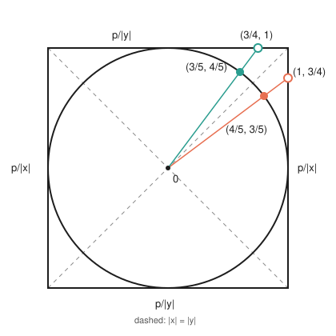

# Continuity by pre-images, and homeomorphism: when two shapes are the same for topology

[Syllabus](../../../SYLLABUS.md) → [Topology](../README.md) → [Topological Spaces](../README.md#s02) → Continuity by pre-images, and homeomorphism

---

## General Overview

A coffee mug has one hole, the one your finger goes through in the handle. A ring doughnut has one hole too. Make the mug from soft clay. Squash the cup down into the base, fatten the handle, and the mug becomes a doughnut. Nothing is torn and nothing is glued. Topology, the study of shape without distances, counts the two surfaces as the same space.

A smaller pair shows the idea in full. A rubber band stretches onto a square picture frame, each point of the band landing on exactly one point of the frame. A piece of string cannot become the band without gluing its ends. One cut tells them apart: cut the band anywhere and it stays in 1 piece; cut the string in the middle and you get 2 pieces.

This card makes "no tearing" and "no gluing" exact with open sets alone, so it works in any [Topological space](01-topological-spaces-and-bases.md). It proves a map continuous by pulling open sets back, glues continuous pieces into one map, and pairs the circle with the square by a map and its inverse, both continuous.

**A map is continuous when it pulls every open set back to an open set; two spaces are the same for topology, homeomorphic, when a continuous map pairs their points one for one and its inverse is continuous too, so the circle is the square but not the interval.**

**What kind of fact this is:** two definitions (continuity, homeomorphism) and six theorems proved on this card in Why it works: the open-set test agrees with the old one on distances; compositions and glued maps stay continuous; the circle is homeomorphic to the square, and a short open interval to the whole line; and the circle is not homeomorphic to the interval. The mug and the doughnut get key steps, the first checked in numbers, and a named source for the rest (end of Step 6).

### The picture: the circle pushed out onto the square

<p align="center"></p>

To scale: 150 drawing units a step, centre at (210, 210). A filled dot is a point of the circle. The open dot on the same ray is where the push $`s`$ sends it on the square. The dashed diagonals, where $`\lvert x \rvert = \lvert y \rvert`$, split the plane into the two closed pieces that $`s`$ is glued from: divide by $`\lvert x \rvert`$ left and right, by $`\lvert y \rvert`$ top and bottom.

---

## The formula

A reminder from [Topological space](01-topological-spaces-and-bases.md): a topological space is a set with a chosen family of subsets, its **open sets**. The family holds the empty set and the whole set, and it is closed under unions and under intersections of finitely many. A **closed set** is the complement of an open set.

A **map** $`f : X \to Y`$ is a function from the points of $`X`$ to the points of $`Y`$. One new mark, in words first: the **pre-image** of a set $`U`$, written $`f^{-1}(U)`$, is the set of all points of $`X`$ that $`f`$ sends into $`U`$. It exists for every map, whether or not $`f`$ has an inverse.

```math
f^{-1}(U) = \{\, x \in X : f(x) \in U \,\}
```

```math
f : X \to Y \text{ is continuous} \iff f^{-1}(U) \text{ is open in } X \text{ for every open set } U \text{ of } Y
```

**Read it aloud:** f is continuous when, for every open set of the target, the points that land inside it form an open set of the source.

The second new mark: $`X \cong Y`$, read "X is homeomorphic to Y", means there is a **homeomorphism** between them.

```math
X \cong Y \iff \text{some bijection } f : X \to Y \text{ has } f \text{ and } f^{-1} \text{ both continuous}
```

**Read it aloud:** two spaces are homeomorphic when a one-for-one pairing of their points is continuous in both directions.

The tool for building maps is the **pasting lemma**. Write $`f\vert_A`$ for $`f`$ used only on the points of $`A`$, called $`f`$ restricted to $`A`$.

```math
X = A \cup B,\ \ A, B \text{ closed},\ \ f\vert_A \text{ and } f\vert_B \text{ continuous} \implies f \text{ continuous}
```

**Read it aloud:** if two closed pieces cover the space, and the map is continuous on each piece, then it is continuous on the whole space. The two pieces must give the same value on their overlap $`A \cap B`$, or there is no single map to glue.

The worked pair is the **circle** $`S^1`$, all points $`(x, y)`$ of the plane with $`x^2 + y^2 = 1`$, and the square's outline with corners $`(\pm 1, \pm 1)`$, the points with $`\max(\lvert x \rvert, \lvert y \rvert) = 1`$:

```math
s(x, y) = \frac{(x, y)}{\max(\lvert x \rvert, \lvert y \rvert)}, \qquad r(x, y) = \frac{(x, y)}{\sqrt{x^2 + y^2}}
```

Here $`s`$ pushes a circle point straight out along its ray to the square, and $`r`$ pulls a square point back to the circle.

| Symbol | Plain meaning | In our example | Push it up and the answer… |
| --- | --- | --- | --- |
| $`X`$, $`Y`$ | topological spaces: sets with their open sets | the circle and the square | more open sets in $`X`$ make continuity easier to pass |
| $`f`$, $`g`$, $`g \circ f`$ | maps; $`g \circ f`$ means do $`f`$, then $`g`$ | $`f = s`$ | — |
| $`U`$, $`C`$ | an open set of the target; a closed set | the open arc from −30 to 30 degrees | a wider arc has a wider pre-image |
| $`f^{-1}(U)`$ | the pre-image: every point that $`f`$ sends into $`U`$ | $`[0, 0.523599) \cup (5.759587, 6.283185)`$ for the wrap | — |
| $`S^1`$ | the circle: points at distance 1 from $`(0, 0)`$ | contains $`(4/5, 3/5)`$ | — |
| $`w`$, $`t`$ | the wrap $`w(t) = (\cos t, \sin t)`$; $`t`$ is an angle in radians in $`[0, 2\pi)`$ | $`w(0) = (1, 0)`$ | — |
| $`s`$, $`r`$, $`p`$, $`q`$ | push a circle point $`p`$ out to the square; pull a square point $`q`$ back | $`s(4/5, 3/5) = (1, 3/4)`$ | — |
| $`A`$, $`B`$, $`f\vert_A`$ | two closed pieces of the space; $`f`$ used on $`A`$ only | $`\lvert x \rvert \ge \lvert y \rvert`$ and $`\lvert y \rvert \ge \lvert x \rvert`$ | — |
| $`\cong`$ | homeomorphic: the same space for topology | circle $`\cong`$ square | — |
| $`h`$ | the stretch $`h(x) = x / (1 - \lvert x \rvert)`$ from $`(-1, 1)`$ onto the whole line | $`h(9/10) = 9`$ | $`x`$ near 1 sends $`h(x)`$ off to infinity |
| $`\lvert x \rvert`$, $`\max`$, $`m`$, $`\cup`$, $`\cap`$, $`\setminus`$ | size of a number; the larger of two; $`m = \max(\lvert x \rvert, \lvert y \rvert)`$; union, overlap, and "remove" | $`m = 4/5`$ at $`(4/5, 3/5)`$; $`S^1 \setminus \{(1, 0)\}`$ is one arc | — |
| $`\varepsilon`$, $`\delta`$, $`\sqrt{\ }`$ | an output tolerance and an input distance, both above 0, as on [Continuity](../../06-Calculus%20and%20analysis/01-Limits%20and%20Continuity/05-continuity.md); square root | a point 0.001000 from $`(1, 0)`$ | a smaller $`\varepsilon`$ needs a smaller $`\delta`$ |

### When it holds

- **Pre-images, never images.** A continuous map can send an open set to one that is not open: the wrap sends $`[0, 0.523599)`$ to an arc that contains its end point $`(1, 0)`$, so it is not open in the circle.
- **Closed pieces.** Glue 0 on $`[0, 1)`$ to 1 on $`[1, 2]`$: the left piece is not closed, and the result jumps by 1 at the point 1.
- **The pieces agree on the overlap.** Glue $`x`$ on $`[0, 1]`$ to $`x + 1`$ on $`[1, 2]`$ and the point 1 gets two values, 1 and 2: no map at all.
- **The inverse is continuous too.** The wrap from $`[0, 2\pi)`$ is one for one onto the circle, but its inverse tears it open at $`(1, 0)`$ (What breaks, last row).
- **The right open sets.** $`[0, 0.523599)`$ is open in $`[0, 2\pi)`$ but not in the whole line. Continuity depends on which open sets each space carries.

---

## Why it works

### Step 0: near goes to near, said with open sets

Continuity has always meant "points near $`x`$ land near $`f(x)`$". Without distances, "near $`f(x)`$" means "inside some open set $`U`$ around $`f(x)`$". So the demand is: around each point $`x`$ that lands in $`U`$, there is an open set that lands in $`U`$ entirely.

Collect every point that lands in $`U`$. That collection is $`f^{-1}(U)`$. The demand says each of its points sits inside an open set that stays within it. A set like that is a union of open sets, so it is open. The definition is that demand, stated once for all points.

Pre-images are used because they keep the shape of set operations. The pre-image of a union is the union of the pre-images, and the same holds for intersections and complements. Images keep unions but not intersections or complements: a map can fold two points into one or squash a whole region onto a single point.

### Step 1: on distances, it is the old test

On the real line, [Continuity](../../06-Calculus%20and%20analysis/01-Limits%20and%20Continuity/05-continuity.md) asks for a limit to equal the value. In epsilon-delta form: for each tolerance $`\varepsilon > 0`$ in the output, some $`\delta > 0`$ in the input keeps $`f`$ within $`\varepsilon`$. The open-set test says the same thing whenever open sets come from a distance, as they do in a metric space.

<details>
<summary>Detailed proof: in a metric space, the pre-image test equals the epsilon-delta test</summary>

In a metric space, a set is open when each of its points has an open ball around it inside the set. The open ball of radius $`\delta`$ around $`a`$ is every point less than $`\delta`$ from $`a`$.

Epsilon-delta gives pre-images. Take an open $`U`$ and a point $`a`$ with $`f(a) \in U`$. Some ball of radius $`\varepsilon`$ around $`f(a)`$ lies in $`U`$. Epsilon-delta gives a ball of radius $`\delta`$ around $`a`$ that $`f`$ sends into that $`\varepsilon`$-ball, so into $`U`$. That $`\delta`$-ball lies in $`f^{-1}(U)`$, so $`f^{-1}(U)`$ is open.

Pre-images give epsilon-delta. Take $`a`$ and $`\varepsilon > 0`$. The ball of radius $`\varepsilon`$ around $`f(a)`$ is open, so its pre-image is open and contains $`a`$. An open set containing $`a`$ contains some ball of radius $`\delta`$ around it. Every point of that ball lands within $`\varepsilon`$ of $`f(a)`$.

</details>

### Step 2: proving the wrap continuous by pre-images

The wrap $`w(t) = (\cos t, \sin t)`$ sends each angle $`t`$ in $`[0, 2\pi)`$ to the point of the circle at that angle. The open sets of the circle are its open arcs and their unions; they are what the plane's open sets cut out of the circle, as [Subspace, product and quotient](04-subspace-product-and-quotient-topologies.md) sets out.

Take the open arc of angles from −30 to 30 degrees. It contains $`(1, 0)`$, where the angle restarts.

1. The angles in $`[0, 2\pi)`$ that land in the arc are those below $`\pi/6 = 0.523599`$ and those above $`11\pi/6 = 5.759587`$.
2. So the pre-image is $`[0, 0.523599) \cup (5.759587, 6.283185)`$.
3. The first part, $`[0, 0.523599)`$, includes its end 0, so it is not open on the whole line. But in $`[0, 2\pi)`$ it is open: it is the open interval $`(-1, 0.523599)`$ cut down to $`[0, 2\pi)`$. The second part is an open interval.
4. A union of two open sets is open, so the pre-image is open.

An arc that misses $`(1, 0)`$ pulls back to a single open interval of angles. Every open set of the circle is a union of open arcs, and the pre-image of a union is the union of the pre-images. So every pre-image is open, and $`w`$ is continuous.

### Step 3: compositions, and closed sets

Two short facts make most maps easy to check.

- **Compositions.** If $`f : X \to Y`$ and $`g : Y \to Z`$ are continuous, so is $`g \circ f`$. A point lands in $`W`$ after both steps exactly when $`f`$ sends it into $`g^{-1}(W)`$. So $`(g \circ f)^{-1}(W) = f^{-1}(g^{-1}(W))`$: an open set pulled back twice, open both times.
- **Closed sets.** A point lands outside $`C`$ exactly when it does not land in $`C`$. So $`f^{-1}(Y \setminus C) = X \setminus f^{-1}(C)`$. Pre-images of open sets are open exactly when pre-images of closed sets are closed. Either test defines continuity.

This is how $`r`$ is shown continuous. The length $`\sqrt{x^2 + y^2}`$ is continuous, and on the square it is never 0. Dividing each coordinate by it is continuous, and a map into the plane is continuous when both of its coordinates are.

### Step 4: gluing closed pieces

The pasting lemma is proved with the closed-set test from Step 3.

1. Take a closed set $`C`$ of $`Y`$.
2. The points of $`X`$ that land in $`C`$ are those of $`A`$ that land there plus those of $`B`$ that land there: $`f^{-1}(C) = (f\vert_A)^{-1}(C) \cup (f\vert_B)^{-1}(C)`$.
3. $`f\vert_A`$ is continuous, so $`(f\vert_A)^{-1}(C)`$ is closed inside $`A`$. A set closed inside a closed set $`A`$ is closed in $`X`$. The same holds for $`B`$.
4. A union of two closed sets is closed. So $`f^{-1}(C)`$ is closed, and $`f`$ is continuous.

Now apply the lemma to $`s`$. Let $`A`$ be the points of the circle with $`\lvert x \rvert \ge \lvert y \rvert`$, and $`B`$ those with $`\lvert y \rvert \ge \lvert x \rvert`$.

- **Closed:** $`A`$ is the pre-image of the closed set $`[0, \infty)`$ under the continuous map $`\lvert x \rvert - \lvert y \rvert`$. The same argument works for $`B`$.
- **Continuous on each piece:** on $`A`$, $`s(p) = p / \lvert x \rvert`$, and $`\lvert x \rvert`$ is never 0 there. On $`B`$, $`s(p) = p / \lvert y \rvert`$, and $`\lvert y \rvert`$ is never 0 there.
- **Agreeing on the overlap:** $`A \cap B`$ is the 4 points where $`\lvert x \rvert = \lvert y \rvert`$, so the two formulas divide by the same number.

So $`s`$ is continuous. Using one formula everywhere fails: $`p / \lvert x \rvert`$ sends $`(20/29, 21/29)`$ to $`(1, 21/20)`$, off the square.

### Step 5: the circle is the square

A homeomorphism needs a map, its inverse, and continuity both ways. Steps 3 and 4 gave continuity. What remains is that $`r`$ undoes $`s`$ and $`s`$ undoes $`r`$.

- **$`r(s(p)) = p`$.** Write $`m = \max(\lvert x \rvert, \lvert y \rvert)`$. On the circle, $`p`$ has length 1, so $`s(p) = p / m`$ has length $`1/m`$. Dividing by that length gives $`(p/m) / (1/m) = p`$.
- **$`s(r(q)) = q`$.** On the square, the larger coordinate of $`q`$ has size 1. Dividing by the length of $`q`$ divides that coordinate too, so the larger coordinate of $`r(q)`$ has size $`1 / \lvert q \rvert`$. Dividing by it restores $`q`$.

So $`s`$ is a bijection with continuous inverse $`r`$, and $`S^1 \cong`$ the square. Corners are not a topological feature.

The same steps give a second surprise. The stretch $`h(x) = x / (1 - \lvert x \rvert)`$ is glued from $`x / (1 - x)`$ on $`[0, 1)`$ and $`x / (1 + x)`$ on $`(-1, 0]`$. Both pieces are closed in $`(-1, 1)`$ and agree at 0. Its inverse is $`y / (1 + \lvert y \rvert)`$. So the short open interval $`(-1, 1)`$ is homeomorphic to the whole line: $`h(1/2) = 1`$, $`h(9/10) = 9`$, $`h(99/100) = 99`$. Length and boundedness are not topological features either.

### Step 6: the circle is not the interval

A **topological property** is one that every homeomorphism carries across: if $`X`$ has it and $`X \cong Y`$, then $`Y`$ has it. Being in one piece is one; so is the number of pieces left after removing a single point. Length, corners and boundedness are not, as Step 5 showed.

To prove two spaces different, find a topological property one has and the other lacks. To prove them the same, exhibit the map and its inverse. Agreeing on a property proves nothing.

**Claim:** no continuous bijection from $`S^1`$ onto $`[0, 1]`$ exists, so certainly no homeomorphism.

1. Suppose $`f : S^1 \to [0, 1]`$ is a continuous bijection, and let $`p`$ be the one point with $`f(p) = 1/2`$.
2. $`[0, 1/2)`$ and $`(1/2, 1]`$ are open in $`[0, 1]`$. Their pre-images are open in $`S^1`$, do not overlap, are not empty because $`f`$ is onto, and together cover $`S^1 \setminus \{p\}`$.
3. $`S^1 \setminus \{p\}`$ is a single arc. Turn the wrap so that it starts at $`p`$: it then sends the open interval of angles $`(0, 2\pi)`$ continuously onto that arc. Pulling the two pre-images back through it splits $`(0, 2\pi)`$ into two non-overlapping, non-empty open sets.
4. An interval cannot be split that way; this is the fact that it is connected, proved in [Connected and path-connected](07-connectedness-and-path-connectedness.md). Contradiction.

In plain words: the circle minus any point is 1 piece, while $`[0, 1]`$ minus $`1/2`$ is 2 pieces. The same argument, cutting at $`\pi`$, shows that $`[0, 2\pi)`$ is not the circle either.

The point-removal test has limits. The torus $`S^1 \times S^1`$, the doughnut's surface, also stays in 1 piece when any single point is removed. Cutting twice separates it from the circle, which then falls apart, but telling the torus from the sphere is left to later shelves, for example to the Euler characteristic or to homotopy.

**The mug and the doughnut, in key steps.** The spaces are the surfaces of a solid mug with thick walls and of a doughnut, the torus $`S^1 \times S^1`$.

1. **Flatten the cup.** The cup is 8 cm across and 9 cm deep; lay a flat disc 8 cm across over its rim. A point of the inside wall goes to the disc point at the same angle, at radius 4 cm minus 2/9 of its depth: depth 9/2 cm lands at radius 3 cm, and the wall's foot, at depth 9 cm, at radius 2 cm. A point of the floor goes to half its distance from the centre, so the floor's edge also lands at radius 2 cm. Wall and floor are closed pieces that agree where they meet, so the pasting lemma glues the map, and its inverse is glued the same way at radius 2 cm.
2. **Round off the can.** The body's skin is now a closed can. Divide each point of the sphere by the larger of its distance from the axis and its distance from the middle plane, and it lands on a can as tall as it is wide; a stretch gives any can that shape. That is $`s`$ in three dimensions, with the proof of Steps 4 and 5.
3. **Free the handle.** The handle's skin is a tube, a circle times an interval, joined to the body along two circles. The sphere with the two discs inside those circles cut out is a tube too.
4. **Close the ring.** Cut the doughnut's skin along two circles round its tube, and it falls into two tubes. Map the mug's two tubes onto them, agreeing on the end circles, and the pasting lemma glues one homeomorphism.

The code checks step 1. The real work hides in steps 3 and 4: moving the holes into place and matching the maps on the end circles. The classification of compact surfaces does it for every such surface at once, proved in chapter 6 of Lee's *Introduction to Topological Manifolds* (Sources) and reached on shelf 03 through [Topological manifold](../03-Surfaces%20and%20Manifolds/01-topological-manifolds.md). A homeomorphism is about the space alone, not how it sits in the room: a knotted loop of string is homeomorphic to a plain circle.

---

## Worked numbers, by hand

| Step | Arithmetic | Value |
| --- | --- | --- |
| wrap: angle where the arc starts | $`\pi / 6`$ | 0.523599 |
| wrap: angle where the arc resumes | $`2\pi - \pi/6 = 11\pi/6`$ | 5.759587 |
| pre-image of the arc | both ends of $`[0, 2\pi)`$ | $`[0, 0.523599) \cup (5.759587, 6.283185)`$ |
| share of 7200 sample angles inside | a sixth | 1200 |
| push $`(4/5, 3/5)`$ to the square | $`\lvert x \rvert = 4/5 \ge 3/5`$, divide by $`4/5`$ | $`(1, 3/4)`$ |
| length of $`(1, 3/4)`$ | $`\sqrt{1 + 9/16} = \sqrt{25/16}`$ | $`5/4`$ |
| pull back to the circle | $`(1, 3/4) \div 5/4`$ | $`(4/5, 3/5)`$ |
| push $`(3/5, 4/5)`$, other piece | $`\lvert y \rvert = 4/5`$ is larger, divide by it | $`(3/4, 1)`$ |
| stretch $`h(99/100)`$ | $`(99/100) / (1/100)`$ | 99 |
| circle minus a point; $`[0, 1]`$ minus $`1/2`$ | count the pieces | 1 against 2 |
| flatten the cup: wall at depth 9/2 cm | $`4 - (2/9) \times 9/2`$ | radius 3 cm |
| the wall's foot and the floor's edge | $`4 - (2/9) \times 9`$ and $`4/2`$ | both radius 2 cm: the pieces agree |
| **verdict** | **map and inverse; then an invariant** | **circle $`\cong`$ square, circle not $`\cong`$ interval** |

The circle and the square are one space drawn two ways. The interval is a different space, and one cut proves it.

### What breaks if you drop a piece

| Mistake | Comes out at | What went wrong |
| --- | --- | --- |
| Test images instead of pre-images | $`w([0, 0.523599))`$ holds $`(1, 0)`$ but no point at angle $`-1/k`$, for any whole number $`k`$ | Not open, though $`w`$ is continuous: images of open sets prove nothing |
| Glue along a piece that is not closed | $`f(1 - 1/k) = 0`$ for every $`k`$, $`f(1) = 1`$ | $`[0, 1)`$ is not closed; the pre-image of $`(1/2, 3/2)`$ is $`[1, 2]`$ |
| Glue pieces that disagree on the overlap | $`x`$ and $`x + 1`$ give 1 and 2 at the point 1 | Two values at one point: no map exists |
| Use one formula, $`p / \lvert x \rvert`$, everywhere | $`(20/29, 21/29)`$ goes to $`(1, 21/20)`$ | Off the square: the formula belongs to one closed piece only |
| Take a continuous bijection for a homeomorphism | a point 0.001000 from $`(1, 0)`$ goes back to 6.282185 | The wrap's inverse tears the circle open at $`(1, 0)`$ |

---

## Code, from first principles, and it actually runs

The code takes three roads. The wrap's pre-image comes from a scan of 7200 angles and from the formula, and they agree point by point. The circle-to-square homeomorphism is checked exactly with fractions on 252 rational points of the circle, such as $`(4/5, 3/5)`$, and again in floating point on 3600 points 0.1 degree apart. The stretch is checked exactly on 979 fractions and 1001 whole numbers, and the flattened cup on 131 points of its wall and floor and 401 radii of the disc. The point-removal counts run on graph models: 12 points in a ring for the circle, 12 in a row for the interval, a 36-point grid wrapped both ways for the torus. These are illustrations, checked on finitely many cases. The proofs are in Why it works.

### Python

```python
# Continuity and homeomorphism -- the check behind the card.  Standard library only.
# Three maps: the wrap w(t) = (cos t, sin t) from [0, 2pi) onto the circle; the
# radial maps s (circle to square, pasted from two pieces) and r (square to
# circle); and the stretch h(x) = x / (1 - |x|) from (-1, 1) onto the line.
from fractions import Fraction as F
from math import atan2, cos, isqrt, pi, sin

def rad(t): return f"{t:.6f}"
# 1. The wrap.  Pre-image of the open arc of angles (-30, 30) degrees, two roads.
N = 7200
ts = [2 * pi * (k + 0.5) / N for k in range(N)]       # sample points of [0, 2pi)
scan = [t for t in ts if abs(atan2(sin(t), cos(t))) < pi / 6]        # road 1
formula = [t for t in ts if t < pi / 6 or t > 11 * pi / 6]           # road 2
print(f"pre-image of the arc (-30, 30) degrees under w: [0, {rad(pi / 6)}) "
      f"and ({rad(11 * pi / 6)}, {rad(2 * pi)})")
print(f"  scan of {N} points of [0, 2pi): {len(scan)} inside, formula agrees: "
      f"{'yes' if scan == formula else 'NO'}")
winv = lambda p: atan2(p[1], p[0]) % (2 * pi)       # the inverse of w, as an angle
tears = []
for k in (10, 100, 1000):
    p = (cos(-1 / k), sin(-1 / k))                  # just below (1, 0) on the circle
    gap = ((p[0] - 1) ** 2 + p[1] ** 2) ** 0.5
    tears.append(winv(p))
    print(f"angle -1/{k}: {gap:.6f} from (1, 0), w-inverse {winv(p):.6f} "
          f"against 0 at (1, 0)")

# 2. Circle and square.  s is pasted: p/|x| where |x| >= |y|, p/|y| where |y| >= |x|.
def s(p):
    x, y = p
    m = abs(x) if abs(x) >= abs(y) else abs(y)
    return (x / m, y / m)
def fsqrt(q):                                       # exact root of a square Fraction
    a, b = isqrt(q.numerator), isqrt(q.denominator)
    assert a * a == q.numerator and b * b == q.denominator
    return F(a, b)
def r(q): n = fsqrt(q[0] ** 2 + q[1] ** 2); return (q[0] / n, q[1] / n)
pts = set()                                          # rational points on the circle
for b in range(1, 13):
    for a in range(0, b + 1):
        t = F(a, b); x, y = (1 - t * t) / (1 + t * t), 2 * t / (1 + t * t)
        for u, v in ((x, y), (y, x)):
            pts |= {(u, v), (-u, v), (u, -v), (-u, -v)}
on_circle = all(x * x + y * y == 1 for x, y in pts)
on_square = all(max(abs(c) for c in s(p)) == 1 for p in pts)
back = all(r(s(p)) == p for p in pts)                # road 1: exact round trips
fmt = lambda q: f"({q[0]}, {q[1]})"
for p in ((F(4, 5), F(3, 5)), (F(3, 5), F(4, 5))):
    print(f"s{fmt(p)} = {fmt(s(p))}, r{fmt(s(p))} = {fmt(r(s(p)))}")
print(f"{len(pts)} rational points of the circle: all land on the square "
      f"{'yes' if on_square else 'NO'}, r(s(p)) = p exactly {'yes' if back else 'NO'}")
rf = lambda q: (q[0] / (q[0] ** 2 + q[1] ** 2) ** 0.5, q[1] / (q[0] ** 2 + q[1] ** 2) ** 0.5)
circ = [(cos(2 * pi * k / 3600), sin(2 * pi * k / 3600)) for k in range(3600)]
err1 = max(max(abs(a - b) for a, b in zip(rf(s(p)), p)) for p in circ)  # road 2
sq = [s(p) for p in circ]
err2 = max(max(abs(a - b) for a, b in zip(s(rf(q)), q)) for q in sq)
step = max(max(abs(a - b) for a, b in zip(sq[k], sq[k - 1])) for k in range(3600))
print(f"3600 points 0.1 degree apart: r(s(p)) = p and s(r(q)) = q to 1e-12: "
      f"{'yes' if max(err1, err2) < 1e-12 else 'NO'}")
print(f"  neighbours {2 * sin(pi / 3600):.6f} apart land at most {step:.6f} apart")
seam = max(abs(abs(x) - abs(y)) for x, y in
           [(cos(a * pi / 4), sin(a * pi / 4)) for a in (1, 3, 5, 7)])
print(f"overlap |x| = |y|: the two pieces of s agree to 1e-12 at all 4 points: "
      f"{'yes' if seam < 1e-12 else 'NO'}")
bad = (F(20, 29), F(21, 29))
print(f"wrong: p/|x| on the whole circle sends {fmt(bad)} to "
      f"{fmt((bad[0] / bad[0], bad[1] / bad[0]))}, off the square")

# 3. The stretch h: (-1, 1) onto the line, pasted from x/(1 - x) and x/(1 + x).
h = lambda x: x / (1 - x) if x >= 0 else x / (1 + x)
hinv = lambda y: y / (1 + abs(y))
xs = {F(a, b) for b in range(1, 41) for a in range(-b + 1, b)}
print(f"h(1/2) = {h(F(1, 2))}, h(9/10) = {h(F(9, 10))}, h(99/100) = {h(F(99, 100))}, "
      f"h-inverse(99) = {hinv(F(99))}")
round_h = all(hinv(h(x)) == x for x in xs) and all(h(hinv(F(y))) == y for y in range(-500, 501))
print(f"{len(xs)} fractions in (-1, 1) and 1001 whole numbers: round trips exact "
      f"{'yes' if round_h else 'NO'}")

# 4. Pieces left after removing one point, on graph models (an illustration).
def pieces(nodes, edges, gone):
    left, seen, count = [v for v in nodes if v != gone], set(), 0
    for v in left:
        if v in seen: continue
        count += 1; stack = [v]; seen.add(v)
        while stack:
            u = stack.pop()
            for w2 in edges[u]:
                if w2 != gone and w2 not in seen: seen.add(w2); stack.append(w2)
    return count
n = 12
cyc = {i: [(i - 1) % n, (i + 1) % n] for i in range(n)}
path = {i: [j for j in (i - 1, i + 1) if 0 <= j < n] for i in range(n)}
tor = {(i, j): [((i + 1) % 6, j), ((i - 1) % 6, j), (i, (j + 1) % 6), (i, (j - 1) % 6)]
       for i in range(6) for j in range(6)}
cut = {name: sorted(pieces(list(g), g, v) for v in g)
       for name, g in (("circle", cyc), ("interval", path), ("torus", tor))}
for name, c in cut.items():
    print(f"{name} model, {len(c)} points: remove one, pieces "
          + ", ".join(f"{c.count(k)} times {k}" for k in sorted(set(c))))

# 5. Gluing that fails: 0 on [0, 1) and 1 on [1, 2]; the right piece is closed, the left is not.
step_f = lambda x: 0 if x < 1 else 1
jumps = [step_f(1 - F(1, k)) for k in range(1, 1001)]
grid = [F(i, 1000) for i in range(2001)]             # [0, 2] in steps of 1/1000
pre_step = [x for x in grid if F(1, 2) < step_f(x) < F(3, 2)]
print(f"wrong: 0 on [0, 1), 1 on [1, 2]: f(1) = {step_f(F(1))}, f(1 - 1/k) = "
      f"{max(jumps)} for k = 1..1000")
print(f"  pre-image of (1/2, 3/2): {len(pre_step)} of {len(grid)} grid points, "
      f"from {min(pre_step)} to {max(pre_step)}: [1, 2], not open")
lpiece, rpiece = (lambda x: x), (lambda x: x + 1)
print(f"wrong: x on [0, 1], x + 1 on [1, 2]: at 1 the pieces give {lpiece(1)} and {rpiece(1)}")
px = lambda q: f"({float(210 + 150 * q[0]):g}, {float(210 - 150 * q[1]):g})"
print("figure, 150 units a step, centre (210, 210): " + ", ".join(
    f"{fmt(q)} at {px(q)}" for p in ((F(4, 5), F(3, 5)), (F(3, 5), F(4, 5))) for q in (p, s(p))))

# 6. The mug's cup, 8 cm across and 9 cm deep, flattened onto a disc: a cup point is (radius, depth) in cm.
wall = lambda d: 4 - F(2, 9) * d                     # inside wall at depth d -> radius on the disc
floor = lambda rho: rho / 2                          # floor at radius rho -> radius on the disc
flat = lambda p: wall(p[1]) if p[0] == 4 else floor(p[0])
unflat = lambda x: (F(4), (4 - x) * F(9, 2)) if x >= 2 else (2 * x, F(9))   # pasted at radius 2
cup = {(F(4), F(k, 10)) for k in range(91)} | {(F(k, 10), F(9)) for k in range(41)}
disc = [F(k, 100) for k in range(401)]
cup_back = all(unflat(flat(p)) == p for p in cup) and all(flat(unflat(x)) == x for x in disc)
print("mug: cup 8 cm across, 9 cm deep; on the disc, wall depth d goes to radius 4 - (2/9) d, floor radius to half")
print(f"  wall depth 9/2 goes to radius {wall(F(9, 2))}, wall foot to {wall(F(9))}, floor edge to {floor(F(4))}")
print(f"  {len(cup)} points of wall and floor, {len(disc)} radii of the disc: round trips exact "
      f"{'yes' if cup_back else 'NO'}")

assert scan == formula and len(scan) == N // 6       # two roads to the pre-image
assert all(abs(t - (2 * pi - 1 / k)) < 1e-12 and t > 6 for t, k in zip(tears, (10, 100, 1000)))
assert on_circle and on_square and back and len(pts) == 252
assert err1 < 1e-12 and err2 < 1e-12 and seam < 1e-12 and step < 2.01 * 2 * sin(pi / 3600)
assert round_h and h(F(99, 100)) == 99 and hinv(F(99)) == F(99, 100)
assert cut["circle"] == [1] * 12 and cut["interval"] == [1, 1] + [2] * 10
assert cut["torus"] == [1] * 36 and max(jumps) == 0
assert min(pre_step) == 1 and max(pre_step) == 2 and len(pre_step) == 1001
assert cup_back and wall(F(9)) == floor(F(4)) and len(cup) == 131   # pieces agree at the seam
print("ALL CHECKS PASS")
```

**Ran 2026-11-14 on macOS, Python 3.14.10, standard library only. All checks passed. Output, pasted from the run:**

```
pre-image of the arc (-30, 30) degrees under w: [0, 0.523599) and (5.759587, 6.283185)
  scan of 7200 points of [0, 2pi): 1200 inside, formula agrees: yes
angle -1/10: 0.099958 from (1, 0), w-inverse 6.183185 against 0 at (1, 0)
angle -1/100: 0.010000 from (1, 0), w-inverse 6.273185 against 0 at (1, 0)
angle -1/1000: 0.001000 from (1, 0), w-inverse 6.282185 against 0 at (1, 0)
s(4/5, 3/5) = (1, 3/4), r(1, 3/4) = (4/5, 3/5)
s(3/5, 4/5) = (3/4, 1), r(3/4, 1) = (3/5, 4/5)
252 rational points of the circle: all land on the square yes, r(s(p)) = p exactly yes
3600 points 0.1 degree apart: r(s(p)) = p and s(r(q)) = q to 1e-12: yes
  neighbours 0.001745 apart land at most 0.003485 apart
overlap |x| = |y|: the two pieces of s agree to 1e-12 at all 4 points: yes
wrong: p/|x| on the whole circle sends (20/29, 21/29) to (1, 21/20), off the square
h(1/2) = 1, h(9/10) = 9, h(99/100) = 99, h-inverse(99) = 99/100
979 fractions in (-1, 1) and 1001 whole numbers: round trips exact yes
circle model, 12 points: remove one, pieces 12 times 1
interval model, 12 points: remove one, pieces 2 times 1, 10 times 2
torus model, 36 points: remove one, pieces 36 times 1
wrong: 0 on [0, 1), 1 on [1, 2]: f(1) = 1, f(1 - 1/k) = 0 for k = 1..1000
  pre-image of (1/2, 3/2): 1001 of 2001 grid points, from 1 to 2: [1, 2], not open
wrong: x on [0, 1], x + 1 on [1, 2]: at 1 the pieces give 1 and 2
figure, 150 units a step, centre (210, 210): (4/5, 3/5) at (330, 120), (1, 3/4) at (360, 97.5), (3/5, 4/5) at (300, 90), (3/4, 1) at (322.5, 60)
mug: cup 8 cm across, 9 cm deep; on the disc, wall depth d goes to radius 4 - (2/9) d, floor radius to half
  wall depth 9/2 goes to radius 3, wall foot to 2, floor edge to 2
  131 points of wall and floor, 401 radii of the disc: round trips exact yes
ALL CHECKS PASS
```

### Rust

The same checks in the same order, with the same printed lines. Fractions are pairs of whole numbers in lowest terms.

```rust
// Continuity and homeomorphism -- the same check as the Python file, in Rust, std only.
// Three maps: the wrap w(t) = (cos t, sin t) from [0, 2pi) onto the circle; the
// radial maps s (circle to square, pasted from two pieces) and r (square to
// circle); and the stretch h(x) = x / (1 - |x|) from (-1, 1) onto the line.
use std::collections::BTreeSet;
use std::f64::consts::PI;

// Exact fractions: numerator, denominator > 0, in lowest terms.
#[derive(Clone, Copy, PartialEq, Eq, Debug)]
struct Q(i128, i128);
impl Ord for Q { fn cmp(&self, o: &Q) -> std::cmp::Ordering { (self.0 * o.1).cmp(&(o.0 * self.1)) } }
impl PartialOrd for Q { fn partial_cmp(&self, o: &Q) -> Option<std::cmp::Ordering> { Some(self.cmp(o)) } }
fn gcd(a: i128, b: i128) -> i128 { if b == 0 { a.abs() } else { gcd(b, a % b) } }
fn q(n: i128, d: i128) -> Q { let g = gcd(n, d) * d.signum(); Q(n / g, d / g) }
fn add(a: Q, b: Q) -> Q { q(a.0 * b.1 + b.0 * a.1, a.1 * b.1) }
fn sub(a: Q, b: Q) -> Q { q(a.0 * b.1 - b.0 * a.1, a.1 * b.1) }
fn mul(a: Q, b: Q) -> Q { q(a.0 * b.0, a.1 * b.1) }
fn div(a: Q, b: Q) -> Q { q(a.0 * b.1, a.1 * b.0) }
fn qabs(a: Q) -> Q { Q(a.0.abs(), a.1) }
fn neg(a: Q) -> Q { Q(-a.0, a.1) }
fn show(a: Q) -> String { if a.1 == 1 { format!("{}", a.0) } else { format!("{}/{}", a.0, a.1) } }
fn fmt(p: (Q, Q)) -> String { format!("({}, {})", show(p.0), show(p.1)) }
fn isqrt(n: i128) -> i128 { let mut a = (n as f64).sqrt() as i128; while a * a > n { a -= 1; } while (a + 1) * (a + 1) <= n { a += 1; } a }
fn fsqrt(x: Q) -> Q { let (a, b) = (isqrt(x.0), isqrt(x.1)); assert!(a * a == x.0 && b * b == x.1); q(a, b) }
const ONE: Q = Q(1, 1);
// s is pasted: p/|x| where |x| >= |y|, p/|y| where |y| >= |x|.
fn s(p: (Q, Q)) -> (Q, Q) { let m = if qabs(p.0) >= qabs(p.1) { qabs(p.0) } else { qabs(p.1) }; (div(p.0, m), div(p.1, m)) }
fn r(p: (Q, Q)) -> (Q, Q) { let n = fsqrt(add(mul(p.0, p.0), mul(p.1, p.1))); (div(p.0, n), div(p.1, n)) }
fn sf(p: (f64, f64)) -> (f64, f64) { let m = if p.0.abs() >= p.1.abs() { p.0.abs() } else { p.1.abs() }; (p.0 / m, p.1 / m) }
fn rf(p: (f64, f64)) -> (f64, f64) { let n = (p.0 * p.0 + p.1 * p.1).sqrt(); (p.0 / n, p.1 / n) }
fn h(x: Q) -> Q { if x.0 >= 0 { div(x, sub(ONE, x)) } else { div(x, add(ONE, x)) } }
fn hinv(y: Q) -> Q { div(y, add(ONE, qabs(y))) }
fn yes(b: bool) -> &'static str { if b { "yes" } else { "NO" } }
fn pieces(adj: &Vec<Vec<usize>>, gone: usize) -> usize {
    let mut seen = vec![false; adj.len()];
    let mut count = 0;
    for v in 0..adj.len() {
        if v == gone || seen[v] { continue; }
        count += 1; seen[v] = true; let mut stack = vec![v];
        while let Some(u) = stack.pop() {
            for &w in &adj[u] { if w != gone && !seen[w] { seen[w] = true; stack.push(w); } }
        }
    }
    count
}

fn main() {
    // 1. The wrap.  Pre-image of the open arc of angles (-30, 30) degrees, two roads.
    let n = 7200;
    let ts: Vec<f64> = (0..n).map(|k| 2.0 * PI * (k as f64 + 0.5) / n as f64).collect();
    let scan: Vec<f64> = ts.iter().cloned().filter(|t| t.sin().atan2(t.cos()).abs() < PI / 6.0).collect();
    let formula: Vec<f64> = ts.iter().cloned().filter(|&t| t < PI / 6.0 || t > 11.0 * PI / 6.0).collect();
    println!("pre-image of the arc (-30, 30) degrees under w: [0, {:.6}) and ({:.6}, {:.6})", PI / 6.0, 11.0 * PI / 6.0, 2.0 * PI);
    println!("  scan of {} points of [0, 2pi): {} inside, formula agrees: {}", n, scan.len(), yes(scan == formula));
    let mut tears = vec![];
    for k in [10.0f64, 100.0, 1000.0] {
        let p = ((-1.0 / k).cos(), (-1.0 / k).sin());
        let gap = ((p.0 - 1.0).powi(2) + p.1.powi(2)).sqrt();
        let wi = p.1.atan2(p.0).rem_euclid(2.0 * PI);
        tears.push((wi, k));
        println!("angle -1/{}: {:.6} from (1, 0), w-inverse {:.6} against 0 at (1, 0)", k, gap, wi);
    }

    // 2. Circle and square.
    let mut pts = BTreeSet::new();
    for b in 1..13i128 {
        for a in 0..=b {
            let t = q(a, b); let tt = mul(t, t);
            let (x, y) = (div(sub(ONE, tt), add(ONE, tt)), div(mul(q(2, 1), t), add(ONE, tt)));
            for (u, v) in [(x, y), (y, x)] { for p in [(u, v), (neg(u), v), (u, neg(v)), (neg(u), neg(v))] { pts.insert(p); } }
        }
    }
    let on_circle = pts.iter().all(|&(x, y)| add(mul(x, x), mul(y, y)) == ONE);
    let on_square = pts.iter().all(|&p| { let t = s(p); std::cmp::max(qabs(t.0), qabs(t.1)) == ONE });
    let back = pts.iter().all(|&p| r(s(p)) == p);
    for p in [(q(4, 5), q(3, 5)), (q(3, 5), q(4, 5))] {
        println!("s{} = {}, r{} = {}", fmt(p), fmt(s(p)), fmt(s(p)), fmt(r(s(p))));
    }
    println!("{} rational points of the circle: all land on the square {}, r(s(p)) = p exactly {}", pts.len(), yes(on_square), yes(back));
    let circ: Vec<(f64, f64)> = (0..3600).map(|k| { let a = 2.0 * PI * k as f64 / 3600.0; (a.cos(), a.sin()) }).collect();
    let d = |a: (f64, f64), b: (f64, f64)| (a.0 - b.0).abs().max((a.1 - b.1).abs());
    let err1 = circ.iter().map(|&p| d(rf(sf(p)), p)).fold(0.0, f64::max);
    let sq: Vec<(f64, f64)> = circ.iter().map(|&p| sf(p)).collect();
    let err2 = sq.iter().map(|&p| d(sf(rf(p)), p)).fold(0.0, f64::max);
    let step = (0..3600).map(|k| d(sq[k], sq[(k + 3599) % 3600])).fold(0.0, f64::max);
    println!("3600 points 0.1 degree apart: r(s(p)) = p and s(r(q)) = q to 1e-12: {}", yes(err1.max(err2) < 1e-12));
    println!("  neighbours {:.6} apart land at most {:.6} apart", 2.0 * (PI / 3600.0).sin(), step);
    let seam = [1.0, 3.0, 5.0, 7.0].iter().map(|a: &f64| { let t = a * PI / 4.0; (t.cos().abs() - t.sin().abs()).abs() }).fold(0.0, f64::max);
    println!("overlap |x| = |y|: the two pieces of s agree to 1e-12 at all 4 points: {}", yes(seam < 1e-12));
    let bad = (q(20, 29), q(21, 29));
    println!("wrong: p/|x| on the whole circle sends {} to {}, off the square", fmt(bad), fmt((div(bad.0, bad.0), div(bad.1, bad.0))));

    // 3. The stretch h: (-1, 1) onto the line, pasted from x/(1 - x) and x/(1 + x).
    let mut xs = BTreeSet::new();
    for b in 1..41i128 { for a in (-b + 1)..b { xs.insert(q(a, b)); } }
    println!("h(1/2) = {}, h(9/10) = {}, h(99/100) = {}, h-inverse(99) = {}", show(h(q(1, 2))), show(h(q(9, 10))), show(h(q(99, 100))), show(hinv(q(99, 1))));
    let round_h = xs.iter().all(|&x| hinv(h(x)) == x) && (-500..501i128).all(|y| h(hinv(q(y, 1))) == q(y, 1));
    println!("{} fractions in (-1, 1) and 1001 whole numbers: round trips exact {}", xs.len(), yes(round_h));

    // 4. Pieces left after removing one point, on graph models (an illustration).
    let m = 12;
    let cyc: Vec<Vec<usize>> = (0..m).map(|i| vec![(i + m - 1) % m, (i + 1) % m]).collect();
    let path: Vec<Vec<usize>> = (0..m).map(|i| { let mut v = vec![]; if i > 0 { v.push(i - 1); } if i + 1 < m { v.push(i + 1); } v }).collect();
    let tor: Vec<Vec<usize>> = (0..36).map(|k| { let (i, j) = (k / 6, k % 6);
        vec![((i + 1) % 6) * 6 + j, ((i + 5) % 6) * 6 + j, i * 6 + (j + 1) % 6, i * 6 + (j + 5) % 6] }).collect();
    let mut cuts = vec![];
    for (name, g) in [("circle", &cyc), ("interval", &path), ("torus", &tor)] {
        let mut c: Vec<usize> = (0..g.len()).map(|v| pieces(g, v)).collect();
        c.sort();
        let kinds: BTreeSet<usize> = c.iter().cloned().collect();
        let parts: Vec<String> = kinds.iter().map(|k| format!("{} times {}", c.iter().filter(|x| *x == k).count(), k)).collect();
        println!("{} model, {} points: remove one, pieces {}", name, c.len(), parts.join(", "));
        cuts.push(c);
    }

    // 5. Gluing that fails: 0 on [0, 1) and 1 on [1, 2]; the right piece is closed, the left is not.
    let step_f = |x: Q| if x < ONE { 0 } else { 1 };
    let jumps = (1..1001i128).map(|k| step_f(sub(ONE, q(1, k)))).max().unwrap();
    let grid: Vec<Q> = (0..2001i128).map(|i| q(i, 1000)).collect();
    let pre_step: Vec<Q> = grid.iter().cloned().filter(|&x| { let v = q(step_f(x), 1); q(1, 2) < v && v < q(3, 2) }).collect();
    println!("wrong: 0 on [0, 1), 1 on [1, 2]: f(1) = {}, f(1 - 1/k) = {} for k = 1..1000", step_f(ONE), jumps);
    println!("  pre-image of (1/2, 3/2): {} of {} grid points, from {} to {}: [1, 2], not open",
             pre_step.len(), grid.len(), show(pre_step[0]), show(*pre_step.last().unwrap()));
    let (lpiece, rpiece) = (|x: i64| x, |x: i64| x + 1);
    println!("wrong: x on [0, 1], x + 1 on [1, 2]: at 1 the pieces give {} and {}", lpiece(1), rpiece(1));
    let px = |p: (Q, Q)| format!("({}, {})", 210.0 + 150.0 * p.0 .0 as f64 / p.0 .1 as f64, 210.0 - 150.0 * p.1 .0 as f64 / p.1 .1 as f64);
    let mut fig = vec![];
    for p in [(q(4, 5), q(3, 5)), (q(3, 5), q(4, 5))] { for t in [p, s(p)] { fig.push(format!("{} at {}", fmt(t), px(t))); } }
    println!("figure, 150 units a step, centre (210, 210): {}", fig.join(", "));

    // 6. The mug's cup, 8 cm across and 9 cm deep, flattened onto a disc: a cup point is (radius, depth) in cm.
    let four = q(4, 1);
    let wall = |d: Q| sub(four, mul(q(2, 9), d));              // inside wall at depth d -> radius on the disc
    let floor = |rho: Q| div(rho, q(2, 1));                     // floor at radius rho -> radius on the disc
    let flat = |p: (Q, Q)| if p.0 == four { wall(p.1) } else { floor(p.0) };
    let unflat = |x: Q| if x >= q(2, 1) { (four, mul(sub(four, x), q(9, 2))) } else { (mul(q(2, 1), x), q(9, 1)) };
    let mut cup = BTreeSet::new();
    for k in 0..91i128 { cup.insert((four, q(k, 10))); }
    for k in 0..41i128 { cup.insert((q(k, 10), q(9, 1))); }
    let disc: Vec<Q> = (0..401i128).map(|k| q(k, 100)).collect();
    let cup_back = cup.iter().all(|&p| unflat(flat(p)) == p) && disc.iter().all(|&x| flat(unflat(x)) == x);
    println!("mug: cup 8 cm across, 9 cm deep; on the disc, wall depth d goes to radius 4 - (2/9) d, floor radius to half");
    println!("  wall depth 9/2 goes to radius {}, wall foot to {}, floor edge to {}", show(wall(q(9, 2))), show(wall(q(9, 1))), show(floor(four)));
    println!("  {} points of wall and floor, {} radii of the disc: round trips exact {}", cup.len(), disc.len(), yes(cup_back));

    assert!(scan == formula && scan.len() == n / 6);
    assert!(tears.iter().all(|&(t, k)| (t - (2.0 * PI - 1.0 / k)).abs() < 1e-12 && t > 6.0));
    assert!(on_circle && on_square && back && pts.len() == 252);
    assert!(err1 < 1e-12 && err2 < 1e-12 && seam < 1e-12 && step < 2.01 * 2.0 * (PI / 3600.0).sin());
    assert!(round_h && h(q(99, 100)) == q(99, 1) && hinv(q(99, 1)) == q(99, 100));
    assert!(cuts[0] == vec![1; 12] && cuts[1] == [vec![1, 1], vec![2; 10]].concat());
    assert!(cuts[2] == vec![1; 36] && jumps == 0);
    assert!(pre_step[0] == ONE && *pre_step.last().unwrap() == q(2, 1) && pre_step.len() == 1001);
    assert!(cup_back && wall(q(9, 1)) == floor(four) && cup.len() == 131);   // pieces agree at the seam
    println!("ALL CHECKS PASS");
}
```

**Ran 2026-11-14 on macOS, rustc 1.98.1, no crates. All checks passed. Output, pasted from the run:**

```
pre-image of the arc (-30, 30) degrees under w: [0, 0.523599) and (5.759587, 6.283185)
  scan of 7200 points of [0, 2pi): 1200 inside, formula agrees: yes
angle -1/10: 0.099958 from (1, 0), w-inverse 6.183185 against 0 at (1, 0)
angle -1/100: 0.010000 from (1, 0), w-inverse 6.273185 against 0 at (1, 0)
angle -1/1000: 0.001000 from (1, 0), w-inverse 6.282185 against 0 at (1, 0)
s(4/5, 3/5) = (1, 3/4), r(1, 3/4) = (4/5, 3/5)
s(3/5, 4/5) = (3/4, 1), r(3/4, 1) = (3/5, 4/5)
252 rational points of the circle: all land on the square yes, r(s(p)) = p exactly yes
3600 points 0.1 degree apart: r(s(p)) = p and s(r(q)) = q to 1e-12: yes
  neighbours 0.001745 apart land at most 0.003485 apart
overlap |x| = |y|: the two pieces of s agree to 1e-12 at all 4 points: yes
wrong: p/|x| on the whole circle sends (20/29, 21/29) to (1, 21/20), off the square
h(1/2) = 1, h(9/10) = 9, h(99/100) = 99, h-inverse(99) = 99/100
979 fractions in (-1, 1) and 1001 whole numbers: round trips exact yes
circle model, 12 points: remove one, pieces 12 times 1
interval model, 12 points: remove one, pieces 2 times 1, 10 times 2
torus model, 36 points: remove one, pieces 36 times 1
wrong: 0 on [0, 1), 1 on [1, 2]: f(1) = 1, f(1 - 1/k) = 0 for k = 1..1000
  pre-image of (1/2, 3/2): 1001 of 2001 grid points, from 1 to 2: [1, 2], not open
wrong: x on [0, 1], x + 1 on [1, 2]: at 1 the pieces give 1 and 2
figure, 150 units a step, centre (210, 210): (4/5, 3/5) at (330, 120), (1, 3/4) at (360, 97.5), (3/5, 4/5) at (300, 90), (3/4, 1) at (322.5, 60)
mug: cup 8 cm across, 9 cm deep; on the disc, wall depth d goes to radius 4 - (2/9) d, floor radius to half
  wall depth 9/2 goes to radius 3, wall foot to 2, floor edge to 2
  131 points of wall and floor, 401 radii of the disc: round trips exact yes
ALL CHECKS PASS
```

### Lean

Lean proves three theorems for every case, the pasting lemma and both circle results, and checks the worked numbers.

- Suppose two closed pieces cover a space, a continuous map is given on each, and the maps agree on the overlap. Then they glue to one continuous map on the whole space.
- Take the push $`s`$ and the pull $`r`$ of the formula. Then $`r`$ undoes $`s`$, $`s`$ undoes $`r`$, and both are continuous, so the circle is homeomorphic to the square.
- Take any continuous map from the circle onto $`[0, 1]`$. Then it sends two points to the same place, so the circle is not homeomorphic to $`[0, 1]`$.
- Take the circle points $`(4/5, 3/5)`$ and $`(3/5, 4/5)`$. Then $`s`$ sends them to $`(1, 3/4)`$ and $`(3/4, 1)`$, and $`r`$ pulls $`(1, 3/4)`$ back.
- Take the circle point $`(20/29, 21/29)`$. Then one formula $`p / \lvert x \rvert`$ sends it to $`(1, 21/20)`$, off the square.
- The stretch gives $`h(1/2) = 1`$, $`h(9/10) = 9`$ and $`h(99/100) = 99`$, and its inverse sends 99 back to 99/100.
- The arc from −30 to 30 degrees holds 1200 of the 7200 sample angles, a sixth of the circle.
- Flattening the cup sends wall depth 9/2 cm to radius 3 cm. The wall's foot and the floor's edge both land at radius 2 cm.

The wrap's pre-image scan, the round trips on many points and the point-removal counts are left to the Python and Rust checks.

```lean
-- Continuity by pre-images, and homeomorphism: maps glued from two closed pieces that agree on the overlap are continuous, the circle is homeomorphic to the square through the push s and the pull r, and no continuous bijection takes the circle onto the interval [0, 1].
import Mathlib.Topology.Homeomorph.Defs
import Mathlib.Topology.Constructions
import Mathlib.Topology.Instances.Real.Lemmas
import Mathlib.Analysis.Real.Sqrt
import Mathlib.Tactic.NormNum
import Mathlib.Analysis.SpecialFunctions.Trigonometric.Basic
import Mathlib.Topology.Order.IntermediateValue

lemma max_abs_div_pos (a b t : ℝ) (ht : 0 < t) :
    max |a / t| |b / t| = max |a| |b| / t := by
  rw [abs_div, abs_div, abs_of_pos ht, max_div_div_right ht.le]

lemma sqrt_sq_add_sq_div (a b t : ℝ) (ht : 0 < t) :
    Real.sqrt ((a / t) ^ 2 + (b / t) ^ 2) = Real.sqrt (a ^ 2 + b ^ 2) / t := by
  rw [div_pow, div_pow, ← add_div, Real.sqrt_div' _ (by positivity), Real.sqrt_sq ht.le]

lemma max_abs_pos_of_circle (p : ℝ × ℝ) (hp : p.1 ^ 2 + p.2 ^ 2 = 1) :
    0 < max |p.1| |p.2| := by
  rcases eq_or_ne p.1 0 with h1 | h1
  · have h2 : p.2 ≠ 0 := by
      intro h2; rw [h1, h2] at hp; norm_num at hp
    exact lt_max_of_lt_right (abs_pos.mpr h2)
  · exact lt_max_of_lt_left (abs_pos.mpr h1)

lemma sum_sq_pos_of_square (q : ℝ × ℝ) (hq : max |q.1| |q.2| = 1) :
    0 < q.1 ^ 2 + q.2 ^ 2 := by
  rcases eq_or_ne q.1 0 with h1 | h1
  · have h2 : q.2 ≠ 0 := by
      intro h2; rw [h1, h2] at hq; norm_num at hq
    have := pow_pos (abs_pos.mpr h2) 2
    rw [sq_abs] at this
    positivity
  · have := pow_pos (abs_pos.mpr h1) 2
    rw [sq_abs] at this
    positivity

#print axioms max_abs_div_pos
#print axioms sqrt_sq_add_sq_div
#print axioms max_abs_pos_of_circle
#print axioms sum_sq_pos_of_square

/-- The pasting lemma. Let two closed pieces A and B cover the space X, and let a continuous map
be given on each piece. If the two maps give the same value at every point of the overlap A ∩ B,
then they glue to one continuous map f on all of X that equals the first map on A and the second
map on B. -/
theorem pasting_lemma {X Y : Type*} [TopologicalSpace X] [TopologicalSpace Y]
    (A B : Set X) (hA : IsClosed A) (hB : IsClosed B) (hcover : A ∪ B = Set.univ)
    (fA : A → Y) (fB : B → Y) (hfA : Continuous fA) (hfB : Continuous fB)
    (hagree : ∀ x (ha : x ∈ A) (hb : x ∈ B), fA ⟨x, ha⟩ = fB ⟨x, hb⟩) :
    ∃ f : X → Y, Continuous f ∧ (∀ x : A, f x = fA x) ∧ (∀ x : B, f x = fB x) := by
  classical
  have hmem : ∀ x, x ∉ A → x ∈ B := by
    intro x hx
    have : x ∈ A ∪ B := hcover ▸ Set.mem_univ x
    exact this.resolve_left hx
  let f : X → Y := fun x => if h : x ∈ A then fA ⟨x, h⟩ else fB ⟨x, hmem x h⟩
  have h1 : ∀ x : A, f x = fA x := by
    intro x
    simp [f, x.2]
  have h2 : ∀ x : B, f x = fB x := by
    intro x
    by_cases h : (x : X) ∈ A
    · simp only [f, h, dite_true]
      exact hagree x h x.2
    · simp [f, h]
  refine ⟨f, ?_, h1, h2⟩
  have cA : ContinuousOn f A := by
    rw [continuousOn_iff_continuous_domRestrict]
    have : A.domRestrict f = fA := funext h1
    rw [this]; exact hfA
  have cB : ContinuousOn f B := by
    rw [continuousOn_iff_continuous_domRestrict]
    have : B.domRestrict f = fB := funext h2
    rw [this]; exact hfB
  have := cA.union_of_isClosed cB hA hB
  rw [hcover] at this
  exact continuousOn_univ.mp this

/-- The circle is the square. The circle is every point (x, y) of the plane with x² + y² = 1, and
the square's outline is every point with max(|x|, |y|) = 1, each with the open sets it gets from
the plane. Some homeomorphism between them is the push s(x, y) = (x, y) / max(|x|, |y|), and its
inverse is the pull r(x, y) = (x, y) / √(x² + y²). -/
theorem circle_homeomorphic_to_square :
    ∃ e : {p : ℝ × ℝ | p.1 ^ 2 + p.2 ^ 2 = 1} ≃ₜ {p : ℝ × ℝ | max |p.1| |p.2| = 1},
      (∀ p, (e p : ℝ × ℝ) =
        ((p : ℝ × ℝ).1 / max |(p : ℝ × ℝ).1| |(p : ℝ × ℝ).2|,
         (p : ℝ × ℝ).2 / max |(p : ℝ × ℝ).1| |(p : ℝ × ℝ).2|)) ∧
      (∀ q, (e.symm q : ℝ × ℝ) =
        ((q : ℝ × ℝ).1 / Real.sqrt ((q : ℝ × ℝ).1 ^ 2 + (q : ℝ × ℝ).2 ^ 2),
         (q : ℝ × ℝ).2 / Real.sqrt ((q : ℝ × ℝ).1 ^ 2 + (q : ℝ × ℝ).2 ^ 2))) := by
  let s : {p : ℝ × ℝ | p.1 ^ 2 + p.2 ^ 2 = 1} → {p : ℝ × ℝ | max |p.1| |p.2| = 1} :=
    fun p => ⟨((p : ℝ × ℝ).1 / max |(p : ℝ × ℝ).1| |(p : ℝ × ℝ).2|,
         (p : ℝ × ℝ).2 / max |(p : ℝ × ℝ).1| |(p : ℝ × ℝ).2|), by
      have hm := max_abs_pos_of_circle p.1 p.2
      show max |_| |_| = 1
      rw [max_abs_div_pos _ _ _ hm, div_self hm.ne']⟩
  let r : {p : ℝ × ℝ | max |p.1| |p.2| = 1} → {p : ℝ × ℝ | p.1 ^ 2 + p.2 ^ 2 = 1} :=
    fun q => ⟨((q : ℝ × ℝ).1 / Real.sqrt ((q : ℝ × ℝ).1 ^ 2 + (q : ℝ × ℝ).2 ^ 2),
         (q : ℝ × ℝ).2 / Real.sqrt ((q : ℝ × ℝ).1 ^ 2 + (q : ℝ × ℝ).2 ^ 2)), by
      have hn := sum_sq_pos_of_square q.1 q.2
      show (_ : ℝ) ^ 2 + _ ^ 2 = 1
      rw [div_pow, div_pow, Real.sq_sqrt hn.le, ← add_div, div_self hn.ne']⟩
  have hl : Function.LeftInverse r s := by
    intro p
    have hm := max_abs_pos_of_circle p.1 p.2
    have hp : (p : ℝ × ℝ).1 ^ 2 + (p : ℝ × ℝ).2 ^ 2 = 1 := p.2
    apply Subtype.ext
    obtain ⟨⟨x, y⟩, hxy⟩ := p
    simp only [r, s] at hm hp ⊢
    rw [sqrt_sq_add_sq_div _ _ _ hm, hp, Real.sqrt_one]
    ext <;> simp only [] <;> field_simp
  have hrr : Function.RightInverse r s := by
    intro q
    have hn := sum_sq_pos_of_square q.1 q.2
    have hq : max |(q : ℝ × ℝ).1| |(q : ℝ × ℝ).2| = 1 := q.2
    have hsn : 0 < Real.sqrt ((q : ℝ × ℝ).1 ^ 2 + (q : ℝ × ℝ).2 ^ 2) := Real.sqrt_pos.mpr hn
    apply Subtype.ext
    obtain ⟨⟨x, y⟩, hxy⟩ := q
    simp only [r, s] at hn hq hsn ⊢
    rw [max_abs_div_pos _ _ _ hsn, hq]
    ext <;> simp only [] <;> field_simp
  have hcs : Continuous s := by
    apply Continuous.subtype_mk
    have hv : Continuous (fun p : {p : ℝ × ℝ | p.1 ^ 2 + p.2 ^ 2 = 1} => (p : ℝ × ℝ)) :=
      continuous_subtype_val
    have hm : Continuous (fun p : {p : ℝ × ℝ | p.1 ^ 2 + p.2 ^ 2 = 1} =>
        max |(p : ℝ × ℝ).1| |(p : ℝ × ℝ).2|) :=
      (continuous_fst.comp hv).abs.max (continuous_snd.comp hv).abs
    have hne : ∀ p : {p : ℝ × ℝ | p.1 ^ 2 + p.2 ^ 2 = 1},
        max |(p : ℝ × ℝ).1| |(p : ℝ × ℝ).2| ≠ 0 :=
      fun p => (max_abs_pos_of_circle p.1 p.2).ne'
    exact ((continuous_fst.comp hv).div hm hne).prodMk ((continuous_snd.comp hv).div hm hne)
  have hcr : Continuous r := by
    apply Continuous.subtype_mk
    have hv : Continuous (fun p : {p : ℝ × ℝ | max |p.1| |p.2| = 1} => (p : ℝ × ℝ)) :=
      continuous_subtype_val
    have hm : Continuous (fun q : {p : ℝ × ℝ | max |p.1| |p.2| = 1} =>
        Real.sqrt ((q : ℝ × ℝ).1 ^ 2 + (q : ℝ × ℝ).2 ^ 2)) :=
      (((continuous_fst.comp hv).pow 2).add ((continuous_snd.comp hv).pow 2)).sqrt
    have hne : ∀ q : {p : ℝ × ℝ | max |p.1| |p.2| = 1},
        Real.sqrt ((q : ℝ × ℝ).1 ^ 2 + (q : ℝ × ℝ).2 ^ 2) ≠ 0 :=
      fun q => (Real.sqrt_pos.mpr (sum_sq_pos_of_square q.1 q.2)).ne'
    exact ((continuous_fst.comp hv).div hm hne).prodMk ((continuous_snd.comp hv).div hm hne)
  exact ⟨⟨⟨s, r, hl, hrr⟩, hcs, hcr⟩, fun p => rfl, fun q => rfl⟩

/-- The circle is not the interval. No continuous map from the circle onto [0, 1] pairs their
points one for one, so certainly the circle and [0, 1] are not homeomorphic. -/
theorem no_continuous_bijection_circle_to_interval :
    ¬ ∃ f : {p : ℝ × ℝ | p.1 ^ 2 + p.2 ^ 2 = 1} → Set.Icc (0 : ℝ) 1,
      Continuous f ∧ Function.Bijective f := by
  rintro ⟨f, hf, hbij⟩
  let c : ℝ → {p : ℝ × ℝ | p.1 ^ 2 + p.2 ^ 2 = 1} := fun t =>
    ⟨(Real.cos t, Real.sin t), by simp [Real.cos_sq_add_sin_sq]⟩
  have hc : Continuous c := by
    apply Continuous.subtype_mk
    exact Real.continuous_cos.prodMk Real.continuous_sin
  let g : ℝ → ℝ := fun t => (f (c t) : ℝ)
  have hg : Continuous g := continuous_subtype_val.comp (hf.comp hc)
  let h : ℝ → ℝ := fun t => g t - g (t + Real.pi)
  have hh : Continuous h := hg.sub (hg.comp (continuous_id.add continuous_const))
  have h0 : h Real.pi = - h 0 := by
    have hc2 : c (Real.pi + Real.pi) = c 0 := by
      apply Subtype.ext
      have : Real.pi + Real.pi = 0 + 2 * Real.pi := by ring
      simp only [c, this, Real.cos_add_two_pi, Real.sin_add_two_pi]
    simp only [h, g, zero_add, hc2]
    ring
  have hz : (0 : ℝ) ∈ Set.uIcc (h 0) (h Real.pi) := by
    rw [h0, Set.mem_uIcc]
    rcases le_total 0 (h 0) with hle | hle
    · right; constructor <;> linarith
    · left; constructor <;> linarith
  obtain ⟨t, -, ht⟩ := intermediate_value_uIcc hh.continuousOn hz
  have heq : f (c t) = f (c (t + Real.pi)) := by
    apply Subtype.ext
    simp only [h, g] at ht
    linarith
  have := congrArg (fun p : {p : ℝ × ℝ | p.1 ^ 2 + p.2 ^ 2 = 1} => (p : ℝ × ℝ)) (hbij.1 heq)
  simp only [c, Real.cos_add_pi, Real.sin_add_pi, Prod.mk.injEq] at this
  obtain ⟨e1, e2⟩ := this
  have hcos : Real.cos t = 0 := by linarith
  have hsin : Real.sin t = 0 := by linarith
  have := Real.cos_sq_add_sin_sq t
  rw [hcos, hsin] at this
  norm_num at this

-- The wrap's arc from -30 to 30 degrees is a sixth of the circle: 1200 of 7200 sample angles.
example : 7200 / 6 = 1200 := by decide
-- (4/5, 3/5) is on the circle; s pushes it to (1, 3/4), which has length 5/4; r pulls it back.
example : (4 / 5 : ℚ) ^ 2 + (3 / 5) ^ 2 = 1 := by norm_num
example : (4 / 5 : ℚ) / max |(4 / 5 : ℚ)| |(3 / 5 : ℚ)| = 1 ∧
    (3 / 5 : ℚ) / max |(4 / 5 : ℚ)| |(3 / 5 : ℚ)| = 3 / 4 := by norm_num
example : (1 : ℚ) ^ 2 + (3 / 4) ^ 2 = (5 / 4) ^ 2 := by norm_num
example : (1 : ℚ) / (5 / 4) = 4 / 5 ∧ (3 / 4 : ℚ) / (5 / 4) = 3 / 5 := by norm_num
-- The other piece: s pushes (3/5, 4/5) to (3/4, 1).
example : (3 / 5 : ℚ) / max |(3 / 5 : ℚ)| |(4 / 5 : ℚ)| = 3 / 4 ∧
    (4 / 5 : ℚ) / max |(3 / 5 : ℚ)| |(4 / 5 : ℚ)| = 1 := by norm_num
-- One formula everywhere fails: p / |x| sends (20/29, 21/29), a circle point, to (1, 21/20), off the square.
example : (20 / 29 : ℚ) ^ 2 + (21 / 29) ^ 2 = 1 ∧ (21 / 29 : ℚ) / (20 / 29) = 21 / 20 ∧
    (1 : ℚ) < 21 / 20 := by norm_num
-- The stretch h(x) = x / (1 - |x|): h(1/2) = 1, h(9/10) = 9, h(99/100) = 99, and h-inverse(99) = 99/100.
example : (1 / 2 : ℚ) / (1 - |(1 / 2 : ℚ)|) = 1 ∧ (9 / 10 : ℚ) / (1 - |(9 / 10 : ℚ)|) = 9 ∧
    (99 / 100 : ℚ) / (1 - |(99 / 100 : ℚ)|) = 99 := by norm_num
example : (99 : ℚ) / (1 + |(99 : ℚ)|) = 99 / 100 := by norm_num
-- Flattening the cup: wall depth 9/2 lands at radius 3; the wall's foot and the floor's edge both land at radius 2.
example : (4 : ℚ) - 2 / 9 * (9 / 2) = 3 ∧ (4 : ℚ) - 2 / 9 * 9 = 2 ∧ (4 : ℚ) / 2 = 2 := by norm_num

#print axioms pasting_lemma
#print axioms circle_homeomorphic_to_square
#print axioms no_continuous_bijection_circle_to_interval
```

**Checked 2026-11-15 on macOS, Lean 4.36.0-rc2, Mathlib v4.36.0-rc2. Every proof is complete and uses only Lean's standard axioms. Output, pasted from the run:**

```
'max_abs_div_pos' depends on axioms: [propext, Classical.choice, Quot.sound]
'sqrt_sq_add_sq_div' depends on axioms: [propext, Classical.choice, Quot.sound]
'max_abs_pos_of_circle' depends on axioms: [propext, Classical.choice, Quot.sound]
'sum_sq_pos_of_square' depends on axioms: [propext, Classical.choice, Quot.sound]
'pasting_lemma' depends on axioms: [propext, Classical.choice, Quot.sound]
'circle_homeomorphic_to_square' depends on axioms: [propext, Classical.choice, Quot.sound]
'no_continuous_bijection_circle_to_interval' depends on axioms: [propext, Classical.choice, Quot.sound]
```

> [!TIP]
> **Try changing**
> Guess first, then run it. The asserts are pinned to the card's numbers, so expect one to stop the run.
> - **Guess first: what does a wider arc pull back to?** In both roads, change `pi / 6` to `pi / 3` and `11 * pi / 6` to `5 * pi / 3`. Scan and formula still agree, now on 2400 of the 7200 angles, and the count assert stops the run.
> - **Guess first: do more rational points ever break the round trip?** Change `range(1, 13)` to `range(1, 25)`. All 972 points still go out to the square and back exactly; only the pinned count of 252 stops the run.
> - **Guess first: does a finer ring change the cut test?** Set `n = 20`. The ring gives 1 piece for all 20 cuts; the row gives 1 piece for 2 end cuts and 2 pieces for the other 18.

---

## The usual mistake

> [!warning]
> **Taking a continuous bijection for a homeomorphism.** The wrap from $`[0, 2\pi)`$ is continuous and one for one, yet its inverse sends a point 0.001000 below $`(1, 0)`$ to 6.282185, while $`(1, 0)`$ itself goes to 0. Step 6 shows the two spaces really differ. Always check the inverse.
>
> - **Pushing open sets forward.** The wrap sends the open set $`[0, 0.523599)`$ to an arc that is not open. The test runs backwards, by pre-images.
> - **Gluing along an open edge.** 0 on $`[0, 1)`$ and 1 on $`[1, 2]`$ are each continuous, but the glued map jumps by 1. The pasting lemma needs closed pieces.
> - **Reading $`f^{-1}(U)`$ as an inverse.** The pre-image exists for every map. The glued step map has no inverse, yet the pre-image of $`(1/2, 3/2)`$ is $`[1, 2]`$.
> - **Treating a shared property as proof of sameness.** The circle model and the torus model both stay in 1 piece after any single cut, 12 of 12 and 36 of 36, yet they are different spaces.

---

## Where you meet it in real life

- **Robot arms.** A joint that turns all the way round has its angle on a circle; two such joints live on the torus $`S^1 \times S^1`$. A planner that stores the angle as one number sees "just under a full turn" and "just over zero" as far apart: the wrap's tear.
- **Machine learning on angles.** Wind direction and time of day are circles. Given the angle as one number, a model meets a tear at the restart; given $`(\cos t, \sin t)`$, it gets the continuous wrap. Rotations in space have the same problem in a harder form.
- **Texture maps in graphics.** An image wrapped round a doughnut-shaped mesh has its left edge glued to its right and its top to its bottom. The seam artists see is where that gluing happens.
- **World maps.** No flat map shows the whole globe without a cut, because the sphere is not homeomorphic to any piece of the plane. The proof needs later shelves.

> **Say it back**
> A map is continuous when the pre-image of every open set is open; on distances this is the old epsilon-delta test. Compositions of continuous maps are continuous, and maps glued from closed pieces that agree on the overlap are continuous. Two spaces are homeomorphic when a bijection between them is continuous both ways: the circle and the square are, through the push out and the pull back. A continuous bijection is not enough: the wrap from $`[0, 2\pi)`$ tears when undone. To prove spaces different, find a topological property that differs: the circle minus a point is 1 piece, the interval minus its middle is 2.

---

## What this builds on

- [Closure, interior and boundary](02-closure-interior-and-boundary.md): closed sets as complements of open sets, which the closed-set test and the pasting lemma rest on.
- [One-to-one and onto](../../01-Foundations/08-Relations%20and%20Functions/04-injective-surjective-bijective.md): a bijection pairs points one for one; a homeomorphism is a bijection that is continuous both ways.
- [Continuity](../../06-Calculus%20and%20analysis/01-Limits%20and%20Continuity/05-continuity.md): the limit test on the real line that the pre-image test generalises, and the rule that sums, products and compositions stay continuous; $`\cos`$, $`\sin`$ and the square root are taken as continuous.

## Where this goes next

- [Subspace, product and quotient](04-subspace-product-and-quotient-topologies.md): the circle as a piece of the plane, as an interval with its ends glued, and as one factor of the torus, each with its open sets; with the ends glued, the wrap becomes a homeomorphism.
- [Topological manifold](../03-Surfaces%20and%20Manifolds/01-topological-manifolds.md): a space in which every point has an open set around it homeomorphic to flat space, the setting for the mug and the doughnut.
- [Homotopy](../04-Homotopy/01-homotopy-and-homotopy-equivalence.md): deforming one continuous map into another, which yields invariants that can tell the torus from the sphere.
- [Sheaves](../../22-Algebraic%20geometry/05-Cohomology%20and%20the%20Hodge%20Conjecture/01-sheaves-in-outline.md): data attached to the open sets of a space, carried between spaces by pre-images under continuous maps.

The question this card leaves open: cutting out one point separates the circle from the interval, but not the torus from the sphere, so which invariant does?

---

## Sources

Verified 2026-11-14: every link below resolves to the publisher's page.

- Lee, John M. *Introduction to Topological Manifolds*, 2nd ed. Springer, 2011. [doi:10.1007/978-1-4419-7940-7](https://doi.org/10.1007/978-1-4419-7940-7). Continuity by pre-images, the gluing lemma for closed pieces, and homeomorphisms, at the level of this card.
- Armstrong, M. A. *Basic Topology*. Springer, 1983. [doi:10.1007/978-1-4757-1793-8](https://doi.org/10.1007/978-1-4757-1793-8). Homeomorphisms and topological invariants, including cutting out points to tell spaces apart.
- LaValle, Steven M. *Planning Algorithms*. Cambridge University Press, 2006. [doi:10.1017/CBO9780511546877](https://doi.org/10.1017/CBO9780511546877). Configuration spaces of robots: a turning joint as a circle, two joints as a torus, and homeomorphism as the test for sameness.
- Zhou, Yi, Connelly Barnes, Jingwan Lu, Jimei Yang, and Hao Li. "On the Continuity of Rotation Representations in Neural Networks." *2019 IEEE/CVF Conference on Computer Vision and Pattern Recognition* (2019): 5738–5746. [doi:10.1109/CVPR.2019.00589](https://doi.org/10.1109/CVPR.2019.00589). Why describing a rotation by a single angle, or by too few numbers in space, leaves a tear, and continuous alternatives.
