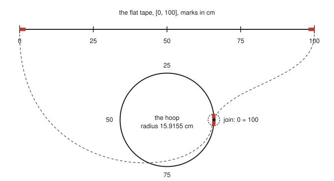

# Subspace, product and quotient: cutting a piece out, pairing up, gluing points together

[Syllabus](../../../SYLLABUS.md) → [Topology](../README.md) → [Topological Spaces](../README.md#s02) → Subspace, product and quotient

---

## General Overview

Take a steel tape measure 100 cm long. Bend it round and fix the 0 cm mark to the 100 cm mark. The tape is now a hoop of radius 15.9155 cm.

Look at the marks 1 cm and 99 cm. On the flat tape they are 98 cm apart. On the hoop they sit 2 cm apart, one on each side of the join. Gluing two points changed which points are near which. Nothing was stretched; only the rule for "near" moved.

Topology has three standard ways to build a new space from old ones, and the hoop needs all three.

- **Subspace: cutting a piece out.** The hoop is a circle drawn in the flat plane. Its open sets are what the plane's open sets cut out of it.
- **Quotient: gluing points together.** The hoop is the tape with its two ends made one point. Its open sets are the sets whose tape marks form an open set of the tape.
- **Product: pairing up.** An inner tube is a hoop of hoops: one position round the hole, one round the tube. Its open sets are built from pairs of open sets, one from each hoop.

Each construction answers one question: which subsets of the new set count as open? Each answer is the best fit for the obvious maps: the fewest or the most open sets that still keep them continuous. This card gives the three rules, proves that the glued tape and the circle in the plane are the same space, and builds the torus as the circle times the circle.

**Cutting out, pairing up and gluing each come with exactly one sensible family of open sets, and with those families the glued tape, the circle in the plane and one factor of the torus are three views of a single space.**

**What kind of fact this is:** three definitions, and theorems about them proved on this card in Why it works: each family really is a topology, maps in and out are tested one simple way, and the glued tape is homeomorphic to the circle. That the glued square is the torus is stated with key steps; its last step needs compactness, from a later card.

### The picture: one open set, seen on the tape and on the hoop

<p align="center"></p>

A disc of radius 2 cm round the join point cuts an open arc out of the hoop. That arc is every hoop point within 2.0013 cm of the join, measured along the hoop. On the flat tape the same points are two pieces: [0, 2.0013) at the left end and (97.9987, 100] at the right end. The drawing is to scale.

---

## The formula

The setting is a **topological space** ([Topological space](01-topological-spaces-and-bases.md)): a set $`X`$ with a chosen family $`\tau`$ of subsets called **open sets**. The family holds the empty set and $`X`$, any union of open sets, and the overlap of any two. A map is **continuous** when the pre-image $`f^{-1}(U)`$ of every open set $`U`$ is open, and a **homeomorphism**, written $`X \cong Y`$, is a continuous map with a continuous inverse ([Continuity by pre-images, and homeomorphism](03-continuity-and-homeomorphism.md)).

Three new pieces of notation, in words first.

- A **gluing rule** $`\sim`$ is a sameness rule on $`X`$: it cuts $`X`$ into blocks ([Equivalence relations and partitions](../../01-Foundations/08-Relations%20and%20Functions/06-equivalence-relations-and-partitions.md)). The block of $`t`$ is $`[t]`$, and the set of blocks is $`X/{\sim}`$, read "X glued by the rule".
- The **quotient map** $`q`$ sends each point to its block: $`q(t) = [t]`$.
- $`T^2`$, the **torus**, is the surface of an inner tube.

```math
\begin{aligned} \text{subspace:}\quad & V \text{ is open in } A \iff V = U \cap A \text{ for some } U \text{ open in } X \\ \text{product:}\quad & W \text{ is open in } X \times Y \iff W \text{ is a union of boxes } U \times V,\ U \text{ open in } X,\ V \text{ open in } Y \\ \text{quotient:}\quad & V \text{ is open in } X/{\sim} \iff q^{-1}(V) \text{ is open in } X \end{aligned}
```

**Read it aloud:** a piece's open sets are the big space's open sets trimmed to the piece; a product's open sets are unions of open boxes; a glued set's open sets are those whose points, unglued, form an open set.

The product $`X \times Y`$ is the set of ordered pairs ([Ordered pairs and the Cartesian product](../../01-Foundations/07-Sets/05-ordered-pairs-and-cartesian-product.md)). A **box** $`U \times V`$ is the pairs whose first entry is in $`U`$ and whose second is in $`V`$.

The house example's three views are then three statements.

```math
S^1 \subseteq \mathbb{R}^2, \qquad [0, L]/(0 \sim L) \;\cong\; S^1, \qquad T^2 = S^1 \times S^1
```

Here $`S^1`$ is the circle, $`\mathbb{R}^2`$ the flat plane, and $`(0 \sim L)`$ is the rule that glues the tape's two ends and nothing else. The homeomorphism comes from the **wrap map**, which sends the mark $`t`$ cm to the hoop point at angle $`2\pi t / L`$:

```math
w(t) = \bigl(R\cos(2\pi t/L),\; R\sin(2\pi t/L)\bigr), \qquad R = \frac{L}{2\pi}
```

On the tape, $`L = 100`$ cm and $`R = 15.9155`$ cm.

| Symbol | Plain meaning | In our example | Push it up and the answer… |
| --- | --- | --- | --- |
| $`X`$, $`Y`$, $`\tau`$ | spaces: sets with a chosen family $`\tau`$ of open sets | the plane; the tape; a hoop | more open sets in $`\tau`$: more maps out are continuous |
| $`A`$ | a subset given the subspace topology | the hoop inside the plane | — |
| $`U`$, $`V`$, $`W`$, $`O`$ | open sets ($`U_1`$, $`U_2`$ for two of them) | a 2 cm disc; the arc it cuts out | bigger $`U`$: bigger trace $`U \cap A`$ |
| $`U \times V`$ | a box: pairs with first entry in $`U`$, second in $`V`$ | an arc round the hole times an arc round the tube | — |
| $`\sim`$, $`[t]`$, $`X/{\sim}`$ | the gluing rule; the block of $`t`$; the glued space, one point per block | 0 glued to 100; $`[0] = \{0, 100\}`$; the hoop as glued tape | more gluing: fewer open sets |
| $`q`$, $`q^{-1}(V)`$ | the quotient map, point to block; every point it sends into $`V`$ | mark 100 goes to the join; [0, 2.0013) and (97.9987, 100] | — |
| $`f`$, $`g`$, $`h`$ | maps being tested for continuity ($`g_1`$, $`g_2`$: the two entries of $`g`$) | the inner-tube map; a map out of the glued tape | — |
| $`w`$, $`\bar{w}`$ | the wrap map, tape to plane; the same map read on the glued tape | marks 0 and 100 to $`(15.9155, 0)`$ | — |
| $`S^1`$, $`T^2`$, $`\mathbb{R}^2`$ | the circle; the torus $`S^1 \times S^1`$; the flat plane | the hoop; the inner tube; the sheet the hoop lies on | — |
| $`L`$, $`R`$ | a hoop's length and radius, in cm | 100 and 15.9155 | longer tape: wider hoop |
| $`r`$, $`a`$, $`b`$ | the tube's radius in cm; the angles round the hole and round the tube | $`r = 4.7746`$ cm from the tube's 30 cm | — |
| $`s`$, $`t`$, $`d`$, $`\varepsilon`$ | tape marks; a distance along the hoop; a small positive length | marks 1 and 99, 2 cm apart | — |

### When it holds

- **The subspace topology needs the surrounding space named.** The piece [0, 2.0013) is open in the tape but not in the number line: no interval round 0 fits inside it. Of the 13 open sets of the five-piece tape below, 8 hold an end mark.
- **The quotient needs the whole pre-image.** A set of glued points is open only if its full pre-image is open. Check half of it and the answer is wrong: [0, 2.0013) is open in the tape, but its image, a half-open arc ending at the join, is not open in the hoop.
- **The product needs unions of boxes, not only boxes.** In the four-point torus below there are 37 distinct boxes but 430 open sets.
- **The circle needs the ends glued, not merely laid side by side.** Wrapping $`[0, 100)`$ round without gluing gives a continuous one-to-one map onto the hoop whose inverse tears at the join.
- **Calling the glued square $`S^1 \times S^1`$ uses compactness.** For general spaces, gluing then pairing can give a different topology from pairing then gluing. For closed intervals the two agree, by the compactness argument of [Compactness with no distances, and Tychonoff](06-compactness-and-tychonoff.md).

---

## Why it works

### Step 0: each rule makes the obvious maps continuous, and nothing more

Each construction comes with maps that must be continuous. Placing the piece $`A`$ inside $`X`$ must be continuous. So must reading off the first or the second entry of a pair, called the **projections**. So must the glue $`q`$.

- The subspace and product rules take the **fewest** open sets that keep those maps continuous. Fewer open sets on the new space make maps *into* it easier to keep continuous, so these rules make such maps as easy as possible.
- The quotient rule takes the **most** open sets that keep $`q`$ continuous. More open sets on the glued space make maps *out of* it easier to keep continuous, so this rule makes such maps as easy as possible.

That is the whole design. Steps 1 to 3 check that each rule gives a topology, and turn the design into a test for continuity.

### Step 1: the subspace rule is a topology, and maps into A are tested in X

Trimming commutes with unions and overlaps: $`(U_1 \cup U_2) \cap A = (U_1 \cap A) \cup (U_2 \cap A)`$, and the same for overlaps. So the trimmed sets satisfy the rules for open sets.

A map $`g`$ into $`A`$ is continuous exactly when it is continuous as a map into $`X`$. The pre-image of a trimmed set $`U \cap A`$ under $`g`$ is the pre-image of $`U`$, because $`g`$ never leaves $`A`$.

On the hoop, a disc in the plane trims to an open arc, the whole hoop or nothing, and every open arc is such a trim. A 2 cm disc round the join trims to the hoop points within $`d`$ of the join, where the chord $`2R\sin(\pi d/L)`$ equals 2. That gives $`d = (L/\pi)\arcsin(1/R) = 2.0013`$ cm.

### Step 2: unions of boxes are a topology, and maps into a product are tested by coordinates

Two boxes overlap in a box: $`(U_1 \times V_1) \cap (U_2 \times V_2) = (U_1 \cap U_2) \times (V_1 \cap V_2)`$. So overlaps of unions of boxes are unions of boxes, and unions of unions are unions.

A map $`g(z) = (g_1(z), g_2(z))`$ into $`X \times Y`$ is continuous exactly when $`g_1`$ and $`g_2`$ are. The pre-image of a box is the overlap of the two coordinates' pre-images, and every open set is a union of boxes.

<details>
<summary>Detailed proof: the coordinate test for products</summary>

Suppose $`g_1`$ and $`g_2`$ are continuous. The pre-image of a box under $`g`$ is

$`\displaystyle g^{-1}(U \times V) = g_1^{-1}(U) \cap g_2^{-1}(V),`$

an overlap of two open sets, so open. Pre-images carry unions to unions, so the pre-image of every union of boxes is open, and $`g`$ is continuous.

Conversely, suppose $`g`$ is continuous. The first projection is continuous, since the pre-image of $`U`$ under it is the box $`U \times Y`$. So $`g_1`$, which is $`g`$ followed by the first projection, is continuous. The same holds for $`g_2`$.

</details>

So the inner-tube map that sends a pair of marks $`(s, t)`$ to a point in space is continuous because each of its three coordinates is a sum of products of sines and cosines.

### Step 3: the quotient rule is a topology, and maps out of a glued space are tested before gluing

Pre-images commute with unions and overlaps, so the sets with open pre-image satisfy the rules for open sets.

A map $`h`$ out of $`X/{\sim}`$ is continuous exactly when $`h \circ q`$ is continuous on $`X`$. The pre-image of an open set under $`h \circ q`$ is the pre-image under $`q`$ of its pre-image under $`h`$, and the quotient rule says that is open exactly when the pre-image under $`h`$ is.

The useful direction: a continuous map on $`X`$ that gives glued points the same value defines a continuous map on $`X/{\sim}`$. The wrap map gives $`w(0) = w(100) = (15.9155, 0)`$, so it defines a continuous map $`\bar{w}`$ from the glued tape onto the hoop.

### Step 4: the glued tape is the circle

$`\bar{w}`$ is continuous by Step 3. It is one-to-one: two marks in $`[0, 100)`$ go to different angles, and only 0 and 100 share a point, and they are glued. It is onto. What is left is that $`\bar{w}`$ sends open sets to open sets, so its inverse is continuous.

Take an open set of the glued tape. Its pre-image $`O`$ on the tape is open, and holds both ends or neither.

- **Neither end.** Then $`O`$ is a union of open intervals inside $`(0, 100)`$. The wrap map sends each one to an open arc that misses the join. An open arc is a disc's trim, so it is open in the hoop.
- **Both ends.** Then $`O`$ holds some $`[0, \varepsilon)`$ and some $`(100 - \varepsilon, 100]`$, with $`\varepsilon`$ a small positive length. Their images join into one open arc through the join point. The rest of $`O`$ is handled by the first case.

So $`\bar{w}`$ is a homeomorphism: $`[0, 100]/(0 \sim 100) \cong S^1`$. The disc picture shows one case: the disc's arc pulls back to [0, 2.0013) and (97.9987, 100], which holds both ends, as it must.

A shorter road exists. A continuous one-to-one map from a compact space onto a space where points have disjoint open neighbourhoods is a homeomorphism. Those two words are [Compactness with no distances, and Tychonoff](06-compactness-and-tychonoff.md) and [Hausdorff and its ladder](05-separation-axioms-and-hausdorff.md).

### Step 5: the torus three ways

The torus is the third view of the house example.

1. **As a product.** $`T^2 = S^1 \times S^1`$: a pair of hoop positions, the 100 cm hoop round the hole and a 30 cm hoop round the tube.
2. **As a glued square.** Take the rectangle $`[0, 100] \times [0, 30]`$ and glue $`(s, 0)`$ to $`(s, 30)`$ and $`(0, t)`$ to $`(100, t)`$. The four corners land on one point.
3. **As a subspace.** The inner tube in space, the points $`\bigl((R + r\cos b)\cos a,\ (R + r\cos b)\sin a,\ r\sin b\bigr)`$, with $`a = 2\pi s/100`$, $`b = 2\pi t/30`$, $`R = 15.9155`$ cm and tube radius $`r = 4.7746`$ cm.

Product to subspace: the map from pairs to points is continuous by Step 2. It is one-to-one because $`R > r`$: a point's distance from the centre line, $`R + r\cos b`$, is never 0, so its angle round the hole can be read off, and then its angle round the tube. Its inverse is continuous by the compact-to-Hausdorff road of Step 4. Glued square to product: the pair of wrap maps is continuous and respects the gluing, so by Step 3 it gives a continuous one-to-one map. Its inverse is continuous because the glued square is compact and the product is Hausdorff, the shorter road of Step 4. That last step is where this card leans on [Compactness with no distances, and Tychonoff](06-compactness-and-tychonoff.md).

### Step 6: which maps keep these constructions

Homeomorphisms carry each construction across. If $`f : X \to X'`$ is a homeomorphism, then $`A`$ is homeomorphic to its image $`f(A)`$ with the subspace topology. If also $`g : Y \to Y'`$ is one, then $`(x, y) \mapsto (f(x), g(y))`$ is a homeomorphism of products, by Step 2 in both directions. So "one factor of the torus is a circle" does not depend on which hoop is drawn.

---

## Worked numbers, by hand

The 100 cm tape, glued into a hoop.

| Step | Arithmetic | Value |
| --- | --- | --- |
| hoop radius | $`100 / (2\pi)`$ | 15.9155 cm |
| marks 1 and 99, flat | 99 − 1 | 98 cm |
| marks 1 and 99, round the hoop | 1 + (100 − 99) | 2 cm |
| marks 1 and 99, straight across | $`2 \times 15.9155 \times \sin(2\pi/100)`$ | 1.9987 cm |
| arc cut by a 2 cm disc at the join | $`(100/\pi) \times \arcsin(1/15.9155)`$ | 2.0013 cm each side |
| its pre-image on the tape | ends of length 2.0013 cm | **[0, 2.0013) and (97.9987, 100]** |

The disc's arc is one open set of the hoop. On the tape it is two pieces at the two ends, open in the tape, and it holds both glued ends.

The finite model, worked by hand. Squeeze the tape to five pieces: the mark 0, the open stretch $`(0, 1/2)`$, the mark 1/2, the stretch $`(1/2, 1)`$, the mark 1, with lengths as fractions of the tape. A set of pieces is open when every mark in it comes with the stretches beside it. Glue mark 0 to mark 1 and call the result east; the stretches become the top and bottom arcs, and the mark 1/2 becomes west.

| Step | Arithmetic | Value |
| --- | --- | --- |
| open sets of the five-piece tape | list the sets that pass the rule | 13 |
| is {east, top} open? | its pre-image {0, (0,1/2), 1} holds mark 1 without (1/2,1) | no |
| is {east, top, bottom} open? | its pre-image {0, (0,1/2), (1/2,1), 1} passes | yes |
| open sets of the glued four pieces | count the passes | **7** |

That is the four-point circle of [Closure, interior and boundary](02-closure-interior-and-boundary.md), with its 7 open sets, now built by gluing.

### What breaks if you drop a piece

| Mistake | Comes out at | What went wrong |
| --- | --- | --- |
| Wrap $`[0, 100)`$ without gluing | mark 99.99 lands 0.0100 cm from mark 0's point, but sits 99.99 cm from it on the tape | the inverse map tears at the join, so it is not a homeomorphism |
| Image of an open set taken as open | $`q`$ sends the open {0, (0,1/2)} to {east, top}, which is not open | quotient maps need not send open sets to open sets |
| Only boxes counted as open | 37 boxes against 430 open sets in the four-point torus | unions of boxes are open too |
| Open in the piece read as open in the space | 8 of the tape's 13 open sets hold an end mark, and none of those is open in the line | the subspace topology depends on the piece |

The code prints all four.

---

## Code, from first principles, and it actually runs

Part 1 works the tape and the inner tube in floating point, printed to 4 decimals. It reaches the arc's half-width two ways, by the arcsine formula and by halving an interval, and compares the plane's chord with the glued distance on 100 pairs of marks; that is checked on 100 cases, and Step 4 is the proof. Part 2 is exhaustive on finite spaces, so its claims are proved for those spaces. It finds the four-point circle's open sets three independent ways: by the quotient rule, by small discs in the plane (a small disc round each piece's point meets the circle in a short arc on each side), and by searching every one of the possible families on four points for the largest topology that keeps the glue continuous. It finds the four-point torus's open sets two ways: as unions of boxes, and by testing every subset of the 16 pieces against each piece's smallest open set.

### Python

```python
# Subspace, product and quotient topologies -- the check behind the card.
# Standard library only.  Part 1 bends a 100 cm tape into a hoop and a torus
# (lengths in cm).  Part 2 checks finite models exhaustively: the tape squeezed
# to 5 pieces, its ends glued into the four-point circle, and the four-point
# torus.  A set of pieces is a bitmask, so every count in part 2 is exact.
from math import pi, sin, cos, asin, hypot, radians

L, LT = 100, 30                      # the hoop's length and the tube's, cm
R, RT = L / (2 * pi), LT / (2 * pi)  # their radii, cm
f = lambda x: f"{x:.4f}"
yn = lambda c: "yes" if c else "no"

def hoop(t):                         # the wrap map w: tape mark t -> a point of the plane
    a = 2 * pi * t / L
    return (R * cos(a), R * sin(a))

def chord(s, t):                     # straight-line distance in the plane
    (x1, y1), (x2, y2) = hoop(s), hoop(t)
    return hypot(x1 - x2, y1 - y2)

def round_gap(s, t):                 # distance along the glued tape: the shorter way round
    d = abs(s - t) % L
    return min(d, L - d)

def tube(s, t):                      # the torus in space: s round the hole, t round the tube
    a, b = 2 * pi * s / L, 2 * pi * t / LT
    return ((R + RT * cos(b)) * cos(a), (R + RT * cos(b)) * sin(a), RT * sin(b))

print(f"hoop {L} cm round, radius {f(R)} cm; tube {LT} cm round, radius {f(RT)} cm")
print(f"marks 1 and 99: {f(98)} cm apart on the flat tape, {f(round_gap(1, 99))} cm "
      f"round the hoop, chord {f(chord(1, 99))} cm")
pairs = [(k, (37 * k + 11) % L) for k in range(L)]
err = max(abs(chord(s, t) - 2 * R * sin(pi * round_gap(s, t) / L)) for s, t in pairs)
print(f"chord against 2R sin(pi gap / L), checked on {len(pairs)} pairs: worst gap below 1e-9: {yn(err < 1e-9)}")
d_asin = (L / pi) * asin(1 / R)      # road 1: solve 2R sin(pi d / L) = 2
lo, hi = 0.0, L / 2                  # road 2: halve the interval 60 times
for _ in range(60):
    lo, hi = (lo, (lo + hi) / 2) if chord(0, (lo + hi) / 2) > 2 else ((lo + hi) / 2, hi)
print(f"disc of radius 2 cm round the join meets the hoop within {f(d_asin)} cm of mark 0 "
      f"(by asin); by halving {f(lo)}")
print(f"its pre-image on the tape: [0, {f(d_asin)}) and ({f(L - d_asin)}, 100]")
for h in (1, 0.1, 0.01):
    print(f"unglued: mark {f(L - h)} lands {f(chord(0, L - h))} cm from mark 0's point, "
          f"{f(L - h)} cm from it along the tape")
x0, y0 = hoop(d_asin)
print(f"figure, tape 0 to 100 at 6 px per cm; hoop radius {f(R)}; disc radius 2 at "
      f"({f(R)}, 0); arc ends ({f(x0)}, {f(y0)}) and ({f(x0)}, {f(-y0)})")
ends = [tube(0, 0), tube(L, 0), tube(0, LT), tube(L, LT)]
same = all(max(abs(a - b) for a, b in zip(p, ends[0])) < 1e-9 for p in ends)
grid = [tube(5 * i, 5 * j) for i in range(20) for j in range(6)]
res = max(abs((hypot(x, y) - R) ** 2 + z * z - RT * RT) for x, y, z in grid)
gap = min(hypot(*(a - b for a, b in zip(p, q))) for k, p in enumerate(grid) for q in grid[:k])
print(f"torus: the square's 4 corners land on one point: {yn(same)}")
print(f"torus: {len(grid)} grid points, all on the tube to within 1e-9: {yn(res < 1e-9)}; "
      f"closest two {f(gap)} cm apart")

# Part 2: finite models.  A space is a list of smallest open sets, one per piece;
# a set of pieces is open when it holds the smallest open set of each piece in it.
def opens_by_rule(U):
    n = len(U)
    return [S for S in range(1 << n) if all(U[x] & ~S == 0 for x in range(n) if S >> x & 1)]

def names(S, label):
    return "{" + ", ".join(label[i] for i in range(len(label)) if S >> i & 1) + "}"

TAPE = ["0", "(0,1/2)", "1/2", "(1/2,1)", "1"]
CIRC = ["east", "top", "west", "bottom"]
tape = set(opens_by_rule([0b00011, 0b00010, 0b01110, 0b01000, 0b11000]))
q = [0, 1, 2, 3, 0]                  # the glue: mark 0 and mark 1 both go to east
pre = lambda V: sum(1 << i for i in range(5) if V >> q[i] & 1)
quot = [V for V in range(16) if pre(V) in tape]           # road 1: the quotient rule

def piece(a):                        # road 2: a circle point at angle a, placed by its coordinates
    x, y = cos(radians(a)), sin(radians(a))
    return 1 if y > 1e-9 else 3 if y < -1e-9 else 0 if x > 0 else 2
near = [sum({1 << piece(a + da) for da in (-1, 0, 1)}) for a in (0, 90, 180, 270)]
plane = opens_by_rule(near)          # traces on the circle of small discs in the plane

def is_topology(fam):
    return all(a | b in fam and a & b in fam for a in fam for b in fam)
cands = []                           # road 3: every topology on 4 points that makes q continuous
for m in range(1 << 14):
    fam = {0, 15} | {v for v in range(1, 15) if m >> (v - 1) & 1}
    if all(pre(V) in tape for V in fam) and is_topology(fam):
        cands.append(fam)
big = max(cands, key=len)
print(f"tape in 5 pieces: {len(tape)} open sets; {sum(1 for S in tape if S & 0b10001)} of them hold an end mark")
print(f"glued, by the quotient rule: {len(quot)} open sets: " + " ".join(names(V, CIRC) for V in quot))
print(f"circle in the plane, by small discs: {len(plane)} open sets; same family: {yn(plane == quot)}")
print(f"topologies making the glue continuous: {len(cands)}; largest has {len(big)} sets, "
      f"holds every other: {yn(all(c <= big for c in cands))}; same family: {yn(sorted(big) == quot)}")
bad = 0b00011                        # the open set {0, (0,1/2)} of the tape
print(f"image of the open set {names(bad, TAPE)} is {names(1 | 2, CIRC)}: open? {yn((1 | 2) in quot)}")

box = lambda U, V: sum(1 << (4 * x + y) for x in range(4) for y in range(4) if U >> x & 1 and V >> y & 1)
boxes = {box(U, V) for U in quot for V in quot}
unions, todo = set(boxes), list(boxes)                    # road 1: every union of boxes
while todo:
    u = todo.pop()
    for b in boxes:
        if u | b not in unions:
            unions.add(u | b)
            todo.append(u | b)
rule = opens_by_rule([box(near[x], near[y]) for x in range(4) for y in range(4)])  # road 2
print(f"torus of 16 pieces: {len(boxes)} distinct boxes; {len(unions)} open sets as unions of boxes")
print(f"the same {len(rule)} open sets by the smallest-open-set rule: {yn(sorted(unions) == rule)}")
slices = []
for y in range(4):                   # the subspace circle x {y} inside the torus
    trace = sorted({sum(1 << x for x in range(4) if W >> (4 * x + y) & 1) for W in rule})
    slices.append(trace == quot)
print(f"each of the 4 slices circle x {{point}} carries the circle's 7 open sets: {yn(all(slices))}")

assert abs(d_asin - lo) < 1e-9 and err < 1e-9             # two roads to the arc; chord vs gap
assert plane == quot == sorted(big) and all(c <= big for c in cands)
assert len(quot) == 7 and len(tape) == 13 and (1 | 2) not in quot
assert sorted(unions) == rule and all(slices) and same and res < 1e-9 and gap > 0.1
print("ALL CHECKS PASS")
```

**Ran 2026-11-14 on macOS, Python 3.14.10, standard library only. All checks passed. Output, pasted from the run:**

```
hoop 100 cm round, radius 15.9155 cm; tube 30 cm round, radius 4.7746 cm
marks 1 and 99: 98.0000 cm apart on the flat tape, 2.0000 cm round the hoop, chord 1.9987 cm
chord against 2R sin(pi gap / L), checked on 100 pairs: worst gap below 1e-9: yes
disc of radius 2 cm round the join meets the hoop within 2.0013 cm of mark 0 (by asin); by halving 2.0013
its pre-image on the tape: [0, 2.0013) and (97.9987, 100]
unglued: mark 99.0000 lands 0.9998 cm from mark 0's point, 99.0000 cm from it along the tape
unglued: mark 99.9000 lands 0.1000 cm from mark 0's point, 99.9000 cm from it along the tape
unglued: mark 99.9900 lands 0.0100 cm from mark 0's point, 99.9900 cm from it along the tape
figure, tape 0 to 100 at 6 px per cm; hoop radius 15.9155; disc radius 2 at (15.9155, 0); arc ends (15.7898, 1.9960) and (15.7898, -1.9960)
torus: the square's 4 corners land on one point: yes
torus: 120 grid points, all on the tube to within 1e-9: yes; closest two 3.4856 cm apart
tape in 5 pieces: 13 open sets; 8 of them hold an end mark
glued, by the quotient rule: 7 open sets: {} {top} {bottom} {top, bottom} {east, top, bottom} {top, west, bottom} {east, top, west, bottom}
circle in the plane, by small discs: 7 open sets; same family: yes
topologies making the glue continuous: 25; largest has 7 sets, holds every other: yes; same family: yes
image of the open set {0, (0,1/2)} is {east, top}: open? no
torus of 16 pieces: 37 distinct boxes; 430 open sets as unions of boxes
the same 430 open sets by the smallest-open-set rule: yes
each of the 4 slices circle x {point} carries the circle's 7 open sets: yes
ALL CHECKS PASS
```

### Rust

Same numbers, same labels, built with `rustc --edition 2021 -O`.

```rust
// Subspace, product and quotient topologies -- the same check as the Python, in Rust.
// No crates.  Part 1 bends a 100 cm tape into a hoop and a torus (lengths in cm).
// Part 2 checks finite models exhaustively: the tape squeezed to 5 pieces, its ends
// glued into the four-point circle, and the four-point torus.  A set of pieces is a
// bitmask, so every count in part 2 is exact.
use std::collections::BTreeSet;
use std::f64::consts::PI;

const L: f64 = 100.0;
const LT: f64 = 30.0;
const R: f64 = L / (2.0 * PI);
const RT: f64 = LT / (2.0 * PI);

fn f(x: f64) -> String { format!("{:.4}", x) }
fn yn(c: bool) -> &'static str { if c { "yes" } else { "no" } }

fn hoop(t: f64) -> (f64, f64) {             // the wrap map w: tape mark t -> a point of the plane
    let a = 2.0 * PI * t / L;
    (R * a.cos(), R * a.sin())
}
fn chord(s: f64, t: f64) -> f64 {           // straight-line distance in the plane
    let ((x1, y1), (x2, y2)) = (hoop(s), hoop(t));
    (x1 - x2).hypot(y1 - y2)
}
fn round_gap(s: f64, t: f64) -> f64 {       // distance along the glued tape: the shorter way round
    let d = (s - t).abs() % L;
    d.min(L - d)
}
fn tube(s: f64, t: f64) -> [f64; 3] {       // the torus in space: s round the hole, t round the tube
    let (a, b) = (2.0 * PI * s / L, 2.0 * PI * t / LT);
    [(R + RT * b.cos()) * a.cos(), (R + RT * b.cos()) * a.sin(), RT * b.sin()]
}
fn dist(p: &[f64; 3], q: &[f64; 3]) -> f64 {
    ((p[0] - q[0]).powi(2) + (p[1] - q[1]).powi(2) + (p[2] - q[2]).powi(2)).sqrt()
}
// A space is a list of smallest open sets, one per piece; a set of pieces is open
// when it holds the smallest open set of each piece in it.
fn opens_by_rule(u: &[u32]) -> Vec<u32> {
    let n = u.len();
    (0..1u32 << n).filter(|&s| (0..n).all(|x| s >> x & 1 == 0 || u[x] & !s == 0)).collect()
}
fn names(s: u32, label: &[&str]) -> String {
    let v: Vec<&str> = (0..label.len()).filter(|&i| s >> i & 1 == 1).map(|i| label[i]).collect();
    format!("{{{}}}", v.join(", "))
}
fn piece(a: f64) -> u32 {                   // road 2: a circle point at angle a, placed by its coordinates
    let (x, y) = (a.to_radians().cos(), a.to_radians().sin());
    if y > 1e-9 { 1 } else if y < -1e-9 { 3 } else if x > 0.0 { 0 } else { 2 }
}
fn bx(u: u32, v: u32) -> u32 {
    let mut out = 0;
    for x in 0..4 { for y in 0..4 { if u >> x & 1 == 1 && v >> y & 1 == 1 { out |= 1 << (4 * x + y) } } }
    out
}

fn main() {
    println!("hoop {} cm round, radius {} cm; tube {} cm round, radius {} cm", L, f(R), LT, f(RT));
    println!("marks 1 and 99: {} cm apart on the flat tape, {} cm round the hoop, chord {} cm",
             f(98.0), f(round_gap(1.0, 99.0)), f(chord(1.0, 99.0)));
    let pairs: Vec<(f64, f64)> = (0..100).map(|k| (k as f64, ((37 * k + 11) % 100) as f64)).collect();
    let err = pairs.iter().map(|&(s, t)| (chord(s, t) - 2.0 * R * (PI * round_gap(s, t) / L).sin()).abs())
        .fold(0.0, f64::max);
    println!("chord against 2R sin(pi gap / L), checked on {} pairs: worst gap below 1e-9: {}", pairs.len(), yn(err < 1e-9));
    let d_asin = (L / PI) * (1.0 / R).asin();          // road 1: solve 2R sin(pi d / L) = 2
    let (mut lo, mut hi) = (0.0, L / 2.0);             // road 2: halve the interval 60 times
    for _ in 0..60 {
        let mid = (lo + hi) / 2.0;
        if chord(0.0, mid) > 2.0 { hi = mid } else { lo = mid }
    }
    println!("disc of radius 2 cm round the join meets the hoop within {} cm of mark 0 (by asin); by halving {}",
             f(d_asin), f(lo));
    println!("its pre-image on the tape: [0, {}) and ({}, 100]", f(d_asin), f(L - d_asin));
    for h in [1.0, 0.1, 0.01] {
        println!("unglued: mark {} lands {} cm from mark 0's point, {} cm from it along the tape",
                 f(L - h), f(chord(0.0, L - h)), f(L - h));
    }
    let (x0, y0) = hoop(d_asin);
    println!("figure, tape 0 to 100 at 6 px per cm; hoop radius {}; disc radius 2 at ({}, 0); arc ends ({}, {}) and ({}, {})",
             f(R), f(R), f(x0), f(y0), f(x0), f(-y0));
    let ends = [tube(0.0, 0.0), tube(L, 0.0), tube(0.0, LT), tube(L, LT)];
    let same = ends.iter().all(|p| (0..3).all(|i| (p[i] - ends[0][i]).abs() < 1e-9));
    let mut grid = Vec::new();
    for i in 0..20 { for j in 0..6 { grid.push(tube(5.0 * i as f64, 5.0 * j as f64)) } }
    let res = grid.iter().map(|p| ((p[0].hypot(p[1]) - R).powi(2) + p[2] * p[2] - RT * RT).abs()).fold(0.0, f64::max);
    let mut gap = f64::INFINITY;
    for k in 0..grid.len() { for m in 0..k { gap = gap.min(dist(&grid[k], &grid[m])) } }
    println!("torus: the square's 4 corners land on one point: {}", yn(same));
    println!("torus: {} grid points, all on the tube to within 1e-9: {}; closest two {} cm apart",
             grid.len(), yn(res < 1e-9), f(gap));

    let tape_l = ["0", "(0,1/2)", "1/2", "(1/2,1)", "1"];
    let circ = ["east", "top", "west", "bottom"];
    let tape: BTreeSet<u32> = opens_by_rule(&[0b00011, 0b00010, 0b01110, 0b01000, 0b11000]).into_iter().collect();
    let q = [0u32, 1, 2, 3, 0];                        // the glue: mark 0 and mark 1 both go to east
    let pre = |v: u32| -> u32 { (0..5).filter(|&i| v >> q[i] & 1 == 1).map(|i| 1u32 << i).sum() };
    let quot: Vec<u32> = (0..16).filter(|&v| tape.contains(&pre(v))).collect();     // road 1
    let near: Vec<u32> = [0.0, 90.0, 180.0, 270.0].iter()
        .map(|&a| [-1.0, 0.0, 1.0].iter().fold(0, |m, &da| m | 1 << piece(a + da))).collect();
    let plane = opens_by_rule(&near);                  // traces on the circle of small discs in the plane
    let mut cands: Vec<BTreeSet<u32>> = Vec::new();    // road 3: every topology making q continuous
    for m in 0..1u32 << 14 {
        let mut fam: BTreeSet<u32> = [0u32, 15].into_iter().collect();
        for v in 1..15u32 { if m >> (v - 1) & 1 == 1 { fam.insert(v); } }
        let cont = fam.iter().all(|&v| tape.contains(&pre(v)));
        if cont && fam.iter().all(|&a| fam.iter().all(|&b| fam.contains(&(a | b)) && fam.contains(&(a & b)))) {
            cands.push(fam);
        }
    }
    let big = cands.iter().max_by_key(|c| c.len()).unwrap().clone();
    let holds = cands.iter().all(|c| c.is_subset(&big));
    let bigv: Vec<u32> = big.iter().copied().collect();
    let ends_held = tape.iter().filter(|&&s| s & 0b10001 != 0).count();
    println!("tape in 5 pieces: {} open sets; {} of them hold an end mark", tape.len(), ends_held);
    let listed: Vec<String> = quot.iter().map(|&v| names(v, &circ)).collect();
    println!("glued, by the quotient rule: {} open sets: {}", quot.len(), listed.join(" "));
    println!("circle in the plane, by small discs: {} open sets; same family: {}", plane.len(), yn(plane == quot));
    println!("topologies making the glue continuous: {}; largest has {} sets, holds every other: {}; same family: {}",
             cands.len(), big.len(), yn(holds), yn(bigv == quot));
    let bad = 0b00011;                                 // the open set {0, (0,1/2)} of the tape
    println!("image of the open set {} is {}: open? {}", names(bad, &tape_l), names(1 | 2, &circ), yn(quot.contains(&(1 | 2))));

    let boxes: BTreeSet<u32> = quot.iter().flat_map(|&u| quot.iter().map(move |&v| bx(u, v))).collect();
    let mut unions = boxes.clone();                    // road 1: every union of boxes
    let mut todo: Vec<u32> = boxes.iter().copied().collect();
    while let Some(u) = todo.pop() {
        for &b in &boxes { if unions.insert(u | b) { todo.push(u | b) } }
    }
    let small: Vec<u32> = (0..16).map(|k| bx(near[k / 4], near[k % 4])).collect();
    let rule = opens_by_rule(&small);                  // road 2
    let unions_v: Vec<u32> = unions.iter().copied().collect();
    println!("torus of 16 pieces: {} distinct boxes; {} open sets as unions of boxes", boxes.len(), unions.len());
    println!("the same {} open sets by the smallest-open-set rule: {}", rule.len(), yn(unions_v == rule));
    let slices: Vec<bool> = (0..4).map(|y| {             // the subspace circle x {y} inside the torus
        let trace: BTreeSet<u32> = rule.iter()
            .map(|&w| (0..4).filter(|&x| w >> (4 * x + y) & 1 == 1).map(|x| 1u32 << x).sum()).collect();
        trace.into_iter().collect::<Vec<u32>>() == quot
    }).collect();
    println!("each of the 4 slices circle x {{point}} carries the circle's 7 open sets: {}", yn(slices.iter().all(|&b| b)));

    assert!((d_asin - lo).abs() < 1e-9 && err < 1e-9);  // two roads to the arc; chord vs gap
    assert!(plane == quot && bigv == quot && holds);
    assert!(quot.len() == 7 && tape.len() == 13 && !quot.contains(&(1 | 2)));
    assert!(unions_v == rule && slices.iter().all(|&b| b) && same && res < 1e-9 && gap > 0.1);
    println!("ALL CHECKS PASS");
}
```

**Ran 2026-11-14 on macOS, rustc 1.98.1, no crates. All checks passed. Output, pasted from the run:**

```
hoop 100 cm round, radius 15.9155 cm; tube 30 cm round, radius 4.7746 cm
marks 1 and 99: 98.0000 cm apart on the flat tape, 2.0000 cm round the hoop, chord 1.9987 cm
chord against 2R sin(pi gap / L), checked on 100 pairs: worst gap below 1e-9: yes
disc of radius 2 cm round the join meets the hoop within 2.0013 cm of mark 0 (by asin); by halving 2.0013
its pre-image on the tape: [0, 2.0013) and (97.9987, 100]
unglued: mark 99.0000 lands 0.9998 cm from mark 0's point, 99.0000 cm from it along the tape
unglued: mark 99.9000 lands 0.1000 cm from mark 0's point, 99.9000 cm from it along the tape
unglued: mark 99.9900 lands 0.0100 cm from mark 0's point, 99.9900 cm from it along the tape
figure, tape 0 to 100 at 6 px per cm; hoop radius 15.9155; disc radius 2 at (15.9155, 0); arc ends (15.7898, 1.9960) and (15.7898, -1.9960)
torus: the square's 4 corners land on one point: yes
torus: 120 grid points, all on the tube to within 1e-9: yes; closest two 3.4856 cm apart
tape in 5 pieces: 13 open sets; 8 of them hold an end mark
glued, by the quotient rule: 7 open sets: {} {top} {bottom} {top, bottom} {east, top, bottom} {top, west, bottom} {east, top, west, bottom}
circle in the plane, by small discs: 7 open sets; same family: yes
topologies making the glue continuous: 25; largest has 7 sets, holds every other: yes; same family: yes
image of the open set {0, (0,1/2)} is {east, top}: open? no
torus of 16 pieces: 37 distinct boxes; 430 open sets as unions of boxes
the same 430 open sets by the smallest-open-set rule: yes
each of the 4 slices circle x {point} carries the circle's 7 open sets: yes
ALL CHECKS PASS
```

The two outputs match line for line.

### Lean

Lean proves Steps 2, 3 and 4 for every tape length, and checks the finite models' counts exactly.

- Take any map $`g`$ into a product $`X \times Y`$. Then $`g`$ is continuous exactly when both its entries $`g_1`$ and $`g_2`$ are.
- Take a glued space $`X/{\sim}`$ and any map $`h`$ out of it. Then $`h`$ is continuous exactly when $`h \circ q`$ is continuous on $`X`$.
- Take a tape of length $`L > 0`$, and glue its two ends and nothing else. Then the wrap map gives a homeomorphism onto the circle of radius $`R = L/(2\pi)`$.
- The five-piece tape has 13 open sets, and 8 of them hold an end mark.
- Glued by the quotient rule, it has 7 open sets, the same family as the four-point circle.
- The set {east, top} is not open, though the open tape piece {0, (0,1/2)} goes to it.
- The four-point torus has 37 distinct boxes and 430 open sets.

The disc's arc, the 25 topologies keeping the glue continuous, and the inner tube are left to the Python and Rust checks.

```lean
-- Subspace, product and quotient: a tape of length L with its two ends glued is homeomorphic to the circle in the plane, by the wrap map, and maps into a product and out of a glued space are tested one simple way.
import Mathlib.Topology.Constructions
import Mathlib.Topology.Homeomorph.Defs
import Mathlib.Analysis.SpecialFunctions.Trigonometric.Basic
import Mathlib.Data.Nat.Bitwise
import Mathlib

open Real

/-- The glued tape is the circle. Take a tape [0, L] of length L > 0 and glue its two ends,
0 and L, and nothing else; give the glued set the quotient topology (a set is open when its
full pre-image on the tape is open). Take the circle of radius R = L / (2π) in the plane, with
the open sets the plane's open sets cut out of it. Then the wrap map, which sends the mark t
to the point (R cos(2πt/L), R sin(2πt/L)), gives a homeomorphism from the glued tape onto the
circle: [0, L]/(0 ∼ L) ≅ S¹. -/
theorem glued_tape_homeomorphic_to_circle (L : ℝ) (hL : 0 < L) :
    ∃ e : Quot (fun s t : Set.Icc (0 : ℝ) L => (s : ℝ) = 0 ∧ (t : ℝ) = L) ≃ₜ
        {p : ℝ × ℝ | p.1 ^ 2 + p.2 ^ 2 = (L / (2 * π)) ^ 2},
      ∀ t : Set.Icc (0 : ℝ) L,
        (e (Quot.mk _ t) : ℝ × ℝ) =
          (L / (2 * π) * cos (2 * π * t / L), L / (2 * π) * sin (2 * π * t / L)) := by
  classical
  set R : ℝ := L / (2 * π) with hRdef
  have hπ : 0 < π := Real.pi_pos
  have hR : 0 < R := by positivity
  let C := {p : ℝ × ℝ | p.1 ^ 2 + p.2 ^ 2 = R ^ 2}
  let wrap : Set.Icc (0 : ℝ) L → C := fun t =>
    ⟨(R * cos (2 * π * t / L), R * sin (2 * π * t / L)), by
      show (R * cos (2 * π * t / L)) ^ 2 + (R * sin (2 * π * t / L)) ^ 2 = R ^ 2
      linear_combination R ^ 2 * sin_sq_add_cos_sq (2 * π * (t : ℝ) / L)⟩
  have hwrap : Continuous wrap := by
    apply Continuous.subtype_mk
    fun_prop
  have hresp : ∀ s t : Set.Icc (0 : ℝ) L, ((s : ℝ) = 0 ∧ (t : ℝ) = L) → wrap s = wrap t := by
    rintro s t ⟨hs, ht⟩
    apply Subtype.ext
    simp only [wrap, hs, ht]
    have : 2 * π * L / L = 2 * π := by field_simp
    rw [this]
    simp
  let f : Quot (fun s t : Set.Icc (0 : ℝ) L => (s : ℝ) = 0 ∧ (t : ℝ) = L) → C :=
    Quot.lift wrap hresp
  have hf : Continuous f := continuous_quot_lift hresp hwrap
  have hinj : Function.Injective f := by
    intro x y hxy
    induction x using Quot.ind with
    | mk s =>
    induction y using Quot.ind with
    | mk t =>
    have h1 := congrArg (fun p : C => (p : ℝ × ℝ).1) hxy
    have h2 := congrArg (fun p : C => (p : ℝ × ℝ).2) hxy
    simp only [f, wrap] at h1 h2
    have hc : cos (2 * π * s / L) = cos (2 * π * t / L) :=
      mul_left_cancel₀ hR.ne' h1
    have hsn : sin (2 * π * s / L) = sin (2 * π * t / L) :=
      mul_left_cancel₀ hR.ne' h2
    have hcos1 : cos (2 * π * s / L - 2 * π * t / L) = 1 := by
      rw [cos_sub, hc, hsn]
      linear_combination sin_sq_add_cos_sq (2 * π * (t : ℝ) / L)
    obtain ⟨hs0, hsL⟩ := s.2
    obtain ⟨ht0, htL⟩ := t.2
    have hdiff : 2 * π * (s : ℝ) / L - 2 * π * t / L = (2 * π / L) * (s - t) := by ring
    have hk : 0 < 2 * π / L := by positivity
    by_cases hA : (s : ℝ) - t = L
    · have hsL' : (s : ℝ) = L := by linarith
      have ht0' : (t : ℝ) = 0 := by linarith
      exact (Quot.sound ⟨ht0', hsL'⟩).symm
    by_cases hB : (s : ℝ) - t = -L
    · have hs0' : (s : ℝ) = 0 := by linarith
      have htL' : (t : ℝ) = L := by linarith
      exact Quot.sound ⟨hs0', htL'⟩
    have hlt1 : (s : ℝ) - t < L := lt_of_le_of_ne (by linarith) hA
    have hlt2 : -L < (s : ℝ) - t := lt_of_le_of_ne (by linarith) (Ne.symm hB)
    have e1 : (2 * π / L) * L = 2 * π := by field_simp
    have hlo : -(2 * π) < 2 * π * (s : ℝ) / L - 2 * π * t / L := by
      rw [hdiff]
      have := mul_lt_mul_of_pos_left hlt2 hk
      linarith
    have hhi : 2 * π * (s : ℝ) / L - 2 * π * t / L < 2 * π := by
      rw [hdiff]
      have := mul_lt_mul_of_pos_left hlt1 hk
      linarith
    have h0 := (cos_eq_one_iff_of_lt_of_lt hlo hhi).mp hcos1
    rw [hdiff] at h0
    have : (s : ℝ) - t = 0 := by
      rcases mul_eq_zero.mp h0 with h | h
      · exact absurd h hk.ne'
      · exact h
    have hst : s = t := Subtype.ext (by linarith)
    rw [hst]
  have hsurj : Function.Surjective f := by
    rintro ⟨⟨x, y⟩, hp⟩
    have hp' : x ^ 2 + y ^ 2 = R ^ 2 := hp
    let z : ℂ := ⟨x, y⟩
    have hz : ‖z‖ = R := by
      rw [Complex.norm_def, Complex.normSq_apply]
      simp only [z]
      rw [show x * x + y * y = R ^ 2 by linarith [hp'], Real.sqrt_sq hR.le]
    have hcx : R * cos (Complex.arg z) = x := by
      rw [← hz]; exact Complex.norm_mul_cos_arg z
    have hsy : R * sin (Complex.arg z) = y := by
      rw [← hz]; exact Complex.norm_mul_sin_arg z
    have ha1 := Complex.neg_pi_lt_arg z
    have ha2 := Complex.arg_le_pi z
    obtain ⟨θ, hθ0, hθ1, hθc, hθs⟩ : ∃ θ : ℝ, 0 ≤ θ ∧ θ ≤ 2 * π ∧
        R * cos θ = x ∧ R * sin θ = y := by
      by_cases hneg : 0 ≤ Complex.arg z
      · exact ⟨Complex.arg z, hneg, by linarith, hcx, hsy⟩
      · refine ⟨Complex.arg z + 2 * π, by linarith, by linarith, ?_, ?_⟩
        · rw [cos_add_two_pi]; exact hcx
        · rw [sin_add_two_pi]; exact hsy
    refine ⟨Quot.mk _ ⟨θ * L / (2 * π), ?_, ?_⟩, ?_⟩
    · positivity
    · rw [div_le_iff₀ (by positivity)]
      nlinarith
    · apply Subtype.ext
      simp only [f, wrap]
      have : 2 * π * (θ * L / (2 * π)) / L = θ := by field_simp
      rw [this, hθc, hθs]
  refine ⟨hf.homeoOfEquivCompactToT2 (f := Equiv.ofBijective f ⟨hinj, hsurj⟩), ?_⟩
  intro t
  rfl

/-- Maps into a product are tested by coordinates. With the product topology (open sets are
unions of boxes U × V), a map g into X × Y is continuous exactly when its first entry and its
second entry are both continuous. -/
theorem continuous_into_product_iff_coordinates {Z X Y : Type*} [TopologicalSpace Z]
    [TopologicalSpace X] [TopologicalSpace Y] (g : Z → X × Y) :
    Continuous g ↔ Continuous (fun z => (g z).1) ∧ Continuous (fun z => (g z).2) := by
  exact ⟨fun h => ⟨continuous_fst.comp h, continuous_snd.comp h⟩,
    fun h => h.1.prodMk h.2⟩

/-- Maps out of a glued space are tested before gluing. Glue a space X by a sameness rule ∼
and give X/∼ the quotient topology, with q sending each point to its block. Then a map h out of
X/∼ is continuous exactly when h ∘ q is continuous on X. -/
theorem continuous_out_of_quotient_iff {X Y : Type*} [TopologicalSpace X] [TopologicalSpace Y]
    (s : Setoid X) (h : Quotient s → Y) :
    Continuous h ↔ Continuous (h ∘ Quotient.mk s) := by
  exact isQuotientMap_quotient_mk'.continuous_iff

/- Finite models, as in the card's code. A set of pieces is a bitmask; a space is the list of
each piece's smallest open set, and a set is open when it holds the smallest open set of each
piece in it. -/
def isOpenSet (u : List ℕ) (s : ℕ) : Bool :=
  (List.range u.length).all fun x => !s.testBit x || (u.getD x 0 &&& s == u.getD x 0)
def openSets (u : List ℕ) : List ℕ := (List.range (2 ^ u.length)).filter (isOpenSet u)
/-- The tape in 5 pieces: mark 0, (0, 1/2), mark 1/2, (1/2, 1), mark 1. -/
def tape : List ℕ := [0b00011, 0b00010, 0b01110, 0b01000, 0b11000]
/-- The four-point circle by small discs: east, top, west, bottom. -/
def circle4 : List ℕ := [0b1011, 0b0010, 0b1110, 0b1000]
/-- Pre-image on the tape of a set of glued points: marks 0 and 1 both go to east. -/
def preimage (v : ℕ) : ℕ :=
  ((List.range 5).filter fun i => v.testBit ([0, 1, 2, 3, 0].getD i 0)).foldl (· ||| 2 ^ ·) 0
/-- The glued tape's open sets, by the quotient rule. -/
def gluedOpens : List ℕ := (List.range 16).filter fun v => isOpenSet tape (preimage v)
/-- The box U × V in the four-point torus; the pair (x, y) is bit 4x + y. -/
def boxMask (a b : ℕ) : ℕ :=
  ((List.range 16).filter fun k => a.testBit (k / 4) && b.testBit (k % 4)).foldl (· ||| 2 ^ ·) 0
def torus16 : List ℕ :=
  (List.range 16).map fun k => boxMask (circle4.getD (k / 4) 0) (circle4.getD (k % 4) 0)

-- The five-piece tape has 13 open sets; 8 of them hold an end mark.
example : (openSets tape).length = 13 := by decide +kernel
example : ((openSets tape).filter fun s => s.testBit 0 || s.testBit 4).length = 8 := by
  decide +kernel
-- Glued by the quotient rule: 7 open sets, the same family as the circle by small discs.
example : gluedOpens.length = 7 ∧ gluedOpens = openSets circle4 := by decide +kernel
-- {east, top} is not open: its pre-image {0, (0,1/2), 1} is not open, though {0, (0,1/2)} is.
example : isOpenSet circle4 0b0011 = false ∧ preimage 0b0011 = 0b10011 ∧
    isOpenSet tape 0b10011 = false ∧ isOpenSet tape 0b00011 = true := by decide +kernel
-- The four-point torus: 37 distinct boxes, and 430 open sets as unions of boxes.
example : ((openSets circle4).flatMap fun a => (openSets circle4).map fun b => boxMask a b).dedup.length
    = 37 := by decide +kernel
example : (openSets torus16).length = 430 := by decide +kernel

#print axioms glued_tape_homeomorphic_to_circle
#print axioms continuous_into_product_iff_coordinates
#print axioms continuous_out_of_quotient_iff
```

**Checked 2026-11-15 on macOS, Lean 4.36.0-rc2, Mathlib v4.36.0-rc2. Every proof is complete and uses only Lean's standard axioms. Output, pasted from the run:**

```
'glued_tape_homeomorphic_to_circle' depends on axioms: [propext, Classical.choice, Quot.sound]
'continuous_into_product_iff_coordinates' depends on axioms: [propext, Classical.choice, Quot.sound]
'continuous_out_of_quotient_iff' depends on axioms: [propext, Classical.choice, Quot.sound]
```

> [!TIP]
> **Try changing**
> Guess first, then run it.
> - **Glue the wrong pair.** Set `q = [0, 1, 2, 3, 3]`, gluing mark 1 to the bottom stretch instead of to mark 0. Guess: the quotient rule now gives a different family from the circle in the plane, and the second assert stops the program.
> - **Forget the left side of a point.** In the Python, change `for da in (-1, 0, 1)` to `for da in (0, 1)`. Guess: the "small disc" road stops seeing the bottom arc from east, so it finds a different family, and the second assert stops it.
> - **Pair with "or" instead of "and".** In `box`, change `and` to `or`. Guess: the "boxes" become crosses, the unions no longer match the smallest-open-set rule, and the last assert stops it.
> - **A wider disc.** Change the `> 2` in the halving loop to `> 2.1`. Guess: halving finds the arc of a 2.1 cm disc, the arcsine still answers 2.0013, and the first assert stops it.

---

## The usual mistake

> [!warning]
> **Testing a glued set by its image, or by half its pre-image.** The quotient rule asks for the full pre-image to be open. The open tape piece {0, (0,1/2)} goes to {east, top}, which is not open in the four-point circle: its full pre-image also holds mark 1, without the stretch (1/2,1) beside it. On the hoop, [0, 2.0013) is open in the tape, yet the half-open arc it makes is not open; only with (97.9987, 100] does it form the disc's open arc.
>
> - **Wrapping without gluing.** Wrap $`[0, 100)`$ round the hoop: the map is continuous and one-to-one, yet mark 99.99 lands 0.0100 cm from mark 0's point, so the inverse tears. This is the wrap of [Continuity by pre-images, and homeomorphism](03-continuity-and-homeomorphism.md); only gluing the ends gives a homeomorphism.
> - **Taking only boxes.** The four-point torus has 37 boxes and 430 open sets. An L-shape made of two boxes is open and is no box.
> - **Forgetting the surrounding space.** [0, 2.0013) is open in the tape and not in the number line. 8 of the five-piece tape's 13 open sets hold an end mark.
> - **Swapping the order of gluing and pairing for general spaces.** For closed intervals they agree, by compactness; in general a product of quotient maps can fail to be a quotient map.

---

## Where you meet it in real life

- **Compass headings and clock times.** Due north is reached from either side of the dial, and midnight both starts and ends a day. Software that averages wind directions or arrival times must treat them as points on a glued interval; otherwise two headings just either side of north average to due south.
- **Robot arms.** An arm with two joints that each turn all the way round has a torus of positions: one circle per joint, paired up. Path planners search that product, not a square.
- **Simulations with wrap-around edges.** Physics and chemistry codes often let a particle leaving one face of a box come back through the opposite face. The box is then glued into a torus, which removes the false edge effects of a walled box.
- **Video games with wrap-around screens.** A ship leaving the right edge reappears on the left, and leaving the top brings it in at the bottom. The screen is a rectangle glued into a torus.
- **Maps and data on a sphere or a globe.** Every curved surface a computer draws is a subspace of space, given the trimmed open sets, so "near" on the surface means near in space.

> **Say it back**
> A piece of a space gets the big space's open sets trimmed to it. A product gets unions of open boxes. A glued space gets the sets whose unglued points form an open set. With these rules the 100 cm tape with its ends glued, the circle in the plane, and each factor of the inner tube are the same space, the circle. Gluing must be checked with full pre-images, and a one-to-one continuous map is not enough to prove two spaces the same.

---

## What this builds on

- [Continuity by pre-images, and homeomorphism](03-continuity-and-homeomorphism.md): continuity tested on pre-images, and homeomorphism as the test for "the same space"; every step here uses both.
- [Equivalence relations and partitions](../../01-Foundations/08-Relations%20and%20Functions/06-equivalence-relations-and-partitions.md): a sameness rule cuts a set into blocks; this card gives the set of blocks its open sets.
- [Ordered pairs and the Cartesian product](../../01-Foundations/07-Sets/05-ordered-pairs-and-cartesian-product.md): the set of pairs; this card gives it its open sets.

## Where this goes next

- [Hausdorff and its ladder](05-separation-axioms-and-hausdorff.md): squeezing pieces to points can destroy unique limits (in the four-point circle, the sequence top, top, top, ... tends to top, east and west); that card says when points can be kept apart.
- [Topological manifold](../03-Surfaces%20and%20Manifolds/01-topological-manifolds.md): spaces that look like the plane near every point, built by exactly these gluings.
- [Riemann surfaces](../../22-Algebraic%20geometry/03-Plane%20Curves/08-riemann-surfaces-and-the-weierstrass-p-function.md): surfaces built by gluing patches of the complex plane.
- Sphere, torus and projective plane (planned): more surfaces from a square with its edges glued in other patterns.

The siblings on this shelf use these constructions throughout: [Topological space](01-topological-spaces-and-bases.md), [Closure, interior and boundary](02-closure-interior-and-boundary.md), [Compactness with no distances, and Tychonoff](06-compactness-and-tychonoff.md), [Connected and path-connected](07-connectedness-and-path-connectedness.md), [What compactness and connectedness buy](08-images-of-compact-and-connected-sets.md), [The test spaces](09-standard-examples-and-counterexamples.md) and [Urysohn and Tietze](10-urysohn-tietze-and-metrisation.md).

The question this card leaves open: the square glued in other patterns gives other closed surfaces, such as the sphere, so how is the torus proved *different* from them?

---

## Sources

Verified 2026-11-14: every link below resolves to the publisher's page.

- Munkres, James R. *Topology*, Classic Version, 2nd ed. Pearson. [Publisher page](https://www.pearson.com/en-us/subject-catalog/p/topology-classic-version/P200000006299/9780137848669). The standard course text on the subspace, product and quotient topologies, with the coordinate and gluing tests.
- Tychonoff, A. "Über die topologische Erweiterung von Räumen." *Mathematische Annalen* 102 (1930): 544–561. [doi:10.1007/BF01782364](https://doi.org/10.1007/BF01782364). Introduces the product topology as unions of boxes.
- Moore, R. L. "Concerning upper semi-continuous collections of continua." *Transactions of the American Mathematical Society* 27 (1925): 416–428. [doi:10.1090/S0002-9947-1925-1501320-8](https://doi.org/10.1090/S0002-9947-1925-1501320-8). An early study of spaces made by squeezing pieces of a space to points.
- McCord, Michael C. "Singular homology groups and homotopy groups of finite topological spaces." *Duke Mathematical Journal* 33 (1966). [doi:10.1215/S0012-7094-66-03352-7](https://doi.org/10.1215/S0012-7094-66-03352-7). Finite spaces such as the four-point circle, and why they model the circle.
