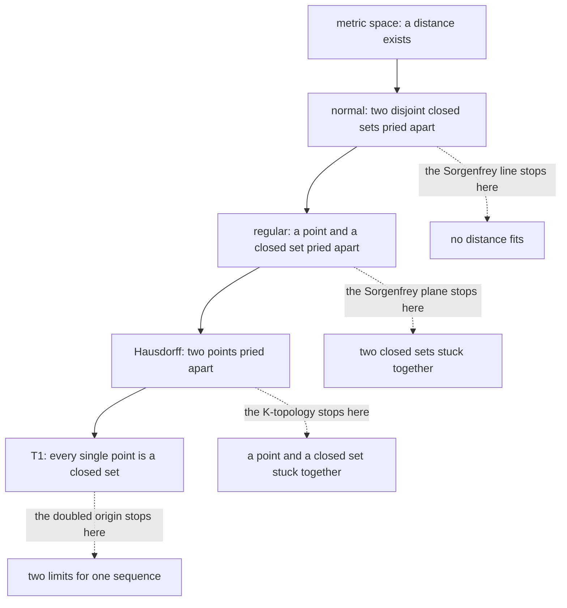

# Hausdorff and its ladder: how far apart open sets can pry two points

[Syllabus](../../../SYLLABUS.md) → [Topology](../README.md) → [Topological Spaces](../README.md#s02) → Hausdorff and its ladder

---

## General Overview

A kilogram of flour is shared among more and more bakers: 1/2 kg each, then 1/3, then 1/4, and on. On the ordinary number line the shares head for exactly one place, 0. Past the tenth baker every share is within 1/10 kg of 0; past the hundredth, within 1/100 kg ([Sequences](../../06-Calculus%20and%20analysis/01-Limits%20and%20Continuity/03-sequences-and-limits.md)).

Now change the line slightly. Keep every real number, and add one extra point, a twin of 0 written 0'. Near 0' means what near 0 means: the band of numbers from −r to r, with 0' in the middle instead of 0. This is the **line with a doubled origin**. Every test the shares passed for 0, they pass for 0'. So the same list of shares heads for two different places at once. "The limit" no longer names one thing.

What went wrong is that 0 and 0' cannot be pried apart. Every band around 0 and every band around 0' share points: a band of radius 1/10 around 0 and one of radius 1/1000 around 0' both contain 1/2000. A space where any two different points sit inside two open sets that do not overlap is called **Hausdorff**. This card shows that Hausdorff guarantees unique limits, checks it on the shelf's circle, and places two stronger conditions, **regular** and **normal**, above it on a ladder.

**A space is Hausdorff when any two different points lie in two non-overlapping open sets; then every sequence has at most one limit, and regular and normal are the next rungs up, prying apart a point from a closed set, and two closed sets.**

**What kind of fact this is:** definitions and theorems. Limits are unique in a Hausdorff space, each rung implies the one below, and each rung is strictly stronger; all are proved on this card in Why it works, except that the Sorgenfrey line is normal and the Sorgenfrey plane is not, which are stated with their sources. The census of every topology on 3 and 4 points is exhaustive, so it is a proof for those sizes.

### The picture: the ladder



Each solid arrow means "is also". Each dotted arrow names a space that has the rung and fails the rung above, so no arrow can be reversed. Regular and normal include "points are closed" (the T1 rung); without it they would not even imply Hausdorff.

---

## The formula

[Topological space](01-topological-spaces-and-bases.md) gives the setting: a set $`X`$ with a chosen family $`\tau`$ of **open sets**. A set is **closed** when everything outside it is open. "Pried apart" means: placed inside two open sets that share no point.

```math
\begin{aligned} \textbf{Hausdorff:}\quad & x \neq y \;\Rightarrow\; \text{open } U \ni x,\ V \ni y \text{ with } U \cap V = \{\} \\ \textbf{regular:}\quad & x \notin C,\ C \text{ closed} \;\Rightarrow\; \text{open } U \ni x,\ V \supseteq C \text{ with } U \cap V = \{\} \\ \textbf{normal:}\quad & C \cap D = \{\},\ C, D \text{ closed} \;\Rightarrow\; \text{open } U \supseteq C,\ V \supseteq D \text{ with } U \cap V = \{\} \\ \textbf{the payoff:}\quad & X \text{ Hausdorff},\ a_n \to L,\ a_n \to M \;\Rightarrow\; L = M \end{aligned}
```

**Read it aloud:** two different points, a point and a closed set it is not in, or two closed sets that do not touch, can each be wrapped in their own open set with no overlap; and in a Hausdorff space a sequence that heads for L and for M forces L to equal M.

Regular and normal also ask that every single point be a closed set, the **T1** condition. Some books drop that clause; this card keeps it, and Step 4 shows why. The older labels T2, T3 and T4 mean Hausdorff, regular and normal.

A sequence $`a_n`$ **converges** to $`L`$ when every open set around $`L`$ holds every term from some cutoff on. With a distance, the open sets are bands and balls, and this is the tolerance-and-cutoff definition from [Sequences](../../06-Calculus%20and%20analysis/01-Limits%20and%20Continuity/03-sequences-and-limits.md).

| Symbol | Plain meaning | In our example | Push it up and the answer… |
| --- | --- | --- | --- |
| $`X`$ | the whole space | the line with a doubled origin; the circle | — |
| $`\tau`$ | the open sets of $`X`$ | bands, with 0' standing in for 0 near 0' | more open sets: easier to pry points apart |
| $`x`$, $`y`$, $`z`$, $`P`$, $`Q`$ | points of $`X`$ | 0 and 0'; $`P = (1, 0)`$ and $`Q = (3/5, 4/5)`$ on the circle | — |
| $`U`$, $`V`$, $`W`$ | open sets; $`U`$ and $`V`$ must not overlap | bands of radius $`r`$ and $`s`$ | — |
| $`C`$, $`D`$ | closed sets | the whole numbers $`2, 3, 4, \ldots`$, and the points $`n + 1/n`$ | — |
| $`a_n`$, $`n`$ | the $`n`$-th term of a sequence; a whole number | the share $`1/n`$ kg; cutoffs 10, 100, 1000 | — |
| $`L`$, $`M`$ | two limits of one sequence | 0 and 0' | — |
| $`r`$, $`s`$, $`b`$, $`e`$ | radii of bands or discs | 1/10 and 1/1000 | bigger radius: more overlap |
| $`d`$, $`d(x, C)`$ | distance between two points; from a point to $`C`$: the largest number no distance to a point of $`C`$ falls below (the smallest such distance, when one exists) | gap from $`P`$ to $`Q`$: 0.8944... | bigger gap: easier to pry apart |
| $`K`$ | the points $`1, 1/2, 1/3, \ldots`$ | the set the K-topology removes | — |
| $`S^1`$ | the circle; $`S^1 \times S^1`$ is the torus | the shelf's house example | — |
| $`f`$ | a continuous function to the real numbers | must give 0 and 0' one value | — |

### When it holds

- **The open sets decide, not the points.** The same set of points can be Hausdorff or not. The line with its usual bands is Hausdorff; give it the **cofinite** topology (open means missing only finitely many points) and any two non-empty open sets overlap, so no two points can be pried apart.
- **Unique limits do not prove Hausdorff in every space.** On an uncountable set with the **cocountable** topology (open means missing only countably many points), a sequence converges only if it is eventually constant, so limits are unique; yet any two non-empty open sets overlap. With a distance, or with a countable list of shrinking open sets at each point, unique limits and Hausdorff are the same thing.
- **"Points are closed" is weaker than Hausdorff.** The doubled origin has every point closed, yet the shares have two limits. That is the gap between T1 and Hausdorff.
- **Gluing can break Hausdorff.** Subspaces and products of Hausdorff spaces are Hausdorff; a quotient need not be. The doubled origin is two copies of the line glued at every point except 0.
- **Regular and normal need the T1 clause.** Without it, the **indiscrete** space (only the empty set and the whole space open) passes both conditions, and there a constant sequence converges to every point.

---

## Why it works

### Step 0: a limit is a claim on every open set around it

"$`a_n`$ converges to $`L`$" says: name any open set around $`L`$, and from some cutoff on, every term is inside it. If the same terms also head for $`M`$, then every open set around $`M`$ eventually holds them too. Past both cutoffs one term sits in an open set around $`L`$ and in one around $`M`$ at once. So two limits force every open set around $`L`$ to meet every open set around $`M`$. Hausdorff forbids exactly that.

### Step 1: Hausdorff makes limits unique

Suppose $`X`$ is Hausdorff, $`a_n \to L`$, $`a_n \to M`$, and $`L \neq M`$. Pry them apart with open sets $`U \ni L`$ and $`V \ni M`$ that do not overlap. From some cutoff on every term is in $`U`$; from another, every term is in $`V`$. A term past both cutoffs is in $`U \cap V`$, which is empty. That is impossible, so $`L = M`$.

Every distance space is Hausdorff. The [Sequences](../../06-Calculus%20and%20analysis/01-Limits%20and%20Continuity/03-sequences-and-limits.md) card proved limits unique with a tolerance of half the gap between two candidates. Its two half-gap bands are exactly the non-overlapping open sets Hausdorff asks for.

### Step 2: the doubled origin fails, and only at the twins

Points of the doubled origin are the real numbers and 0'. An open set is any set $`W`$ such that each point of $`W`$ has a band around it inside $`W`$. Around a real point other than 0 the bands are the usual ones. Around 0 they are $`(-r, r)`$. Around 0' they are $`(-r, 0) \cup \{0'\} \cup (0, r)`$: the same band with 0' in place of 0.

- **Two limits.** For tolerance $`r = 1/10`$ the cutoff is 10: from the 11th baker on, $`1/n < 1/10`$, and $`1/n`$ is a nonzero real, so it lies in the band around 0 and in the band around 0'. The same holds for every $`r`$, with cutoff the whole part of $`1/r`$. So $`1/n \to 0`$ and $`1/n \to 0'`$.
- **No prying.** A band of radius $`r`$ around 0 and one of radius $`s`$ around 0' both contain $`\min(r, s)/2`$, a positive real smaller than both radii. So no open set around 0 misses every open set around 0'.
- **Still T1.** The band around 0' leaves out 0, and the band around 0 leaves out 0'. Every other pair of points has the usual half-gap bands. So every single point is closed, and the space fails Hausdorff only at the one pair 0, 0'.

The same space is a quotient, the gluing construction of [Subspace, product and quotient](04-subspace-product-and-quotient-topologies.md): two copies of the line, each point glued to its copy except 0. A continuous real-valued function on it must give 0 and 0' the same value, because $`f(1/n)`$ heads for both $`f(0)`$ and $`f(0')`$ in the line, which is Hausdorff. No measurement by a continuous number can tell the twins apart.

### Step 3: the circle is Hausdorff, three ways

The shelf's house example is the circle. Each of its three descriptions passes.

- **In the plane.** $`P = (1, 0)`$ and $`Q = (3/5, 4/5)`$ have gap $`d`$ with $`d^2 = 4/5`$, so $`d = 0.8944...`$. Discs of radius $`d/2 = 0.4472...`$ around each cannot share a point $`z`$: that would make the trip $`P \to z \to Q`$ shorter than $`d`$, against the triangle inequality. Cut the discs down to the circle and they stay open there and stay apart. Any subspace of a Hausdorff space is Hausdorff this way.
- **Glued from an interval.** Take $`[0, 1]`$ with 0 and 1 glued into one point. The glued point lies in $`[0, 1/4) \cup (3/4, 1]`$, and $`1/2`$ lies in $`(1/4, 3/4)`$. Both sets respect the gluing (each holds both ends or neither), so both are open in the glued space, and they do not overlap. Other pairs of points work the same way with shorter pieces.
- **As one factor of the torus.** Two points of the torus $`S^1 \times S^1`$ differ in at least one circle. Pry them apart there, and take the whole other circle alongside: $`S^1 \times U`$ and $`S^1 \times V`$ are open and do not overlap. A product of Hausdorff spaces is Hausdorff.

A **homeomorphism** (a continuous map with a continuous inverse, from [Continuity by pre-images, and homeomorphism](03-continuity-and-homeomorphism.md)) carries open sets to open sets both ways, so it carries Hausdorff, regular and normal across. A merely continuous map can lose them: the gluing map from two lines onto the doubled origin is continuous, and only its source is Hausdorff.

### Step 4: each rung implies the one below

- **Normal implies regular.** In a T1 space a single point $`\{x\}`$ is closed. Prying a point from a closed set is prying two closed sets, $`\{x\}`$ and $`C`$.
- **Regular implies Hausdorff.** For $`x \neq y`$, the set $`\{y\}`$ is closed and misses $`x`$. Regular pries $`x`$ from $`\{y\}`$.
- **Hausdorff implies T1.** For each $`y \neq x`$ there is an open set around $`y`$ missing $`x`$. Their union is everything except $`x`$, and it is open, so $`\{x\}`$ is closed.

The T1 clause does real work in the first two steps. Without it, "regular" and "normal" would let points blur together.

### Step 5: every distance space is normal

Let $`C`$ and $`D`$ be disjoint closed sets in a space with a distance. Write $`d(x, C)`$ for the distance from $`x`$ to $`C`$: the largest number that no distance from $`x`$ to a point of $`C`$ falls below. It is the smallest such distance when one exists; a nearest point need not exist. Put

```math
U = \{\, x : d(x, C) < d(x, D) \,\}, \qquad V = \{\, x : d(x, D) < d(x, C) \,\}
```

Each point goes to the set it is nearer. No point is strictly nearer to both, so $`U`$ and $`V`$ do not overlap. A point of $`C`$ has $`d(x, C) = 0`$ and, since $`D`$ is closed and misses it, $`d(x, D) > 0`$; so $`C \subseteq U`$, and likewise $`D \subseteq V`$. Both distances change by at most the step taken, so a small enough step keeps the strict inequality, and $`U`$ and $`V`$ are open.

The trick matters when the sets get arbitrarily close. Take $`C`$ = the whole numbers $`2, 3, 4, \ldots`$ and $`D`$ = the points $`n + 1/n`$ beside them. Both are closed: neither has points piling up anywhere. The gap at $`n`$ is $`1/n`$, which shrinks toward 0, so no fixed buffer width works. The nearer-to-which rule switches at the midpoint $`n + 1/(2n)`$: at 9/4 for $`n = 2`$, at 201/20 for $`n = 10`$. The buffer narrows exactly as fast as the gap.

### Step 6: no rung can be reversed

- **T1 but not Hausdorff.** The doubled origin (Step 2). Also the cofinite topology on any infinite set: there any sequence of distinct points converges to every point at once.
- **Hausdorff but not regular.** The **K-topology** on the line: its basic open sets are the usual bands plus the bands with $`K = \{1, 1/2, 1/3, \ldots\}`$ removed. It has more open sets than the line, so it is still Hausdorff. But the point 0 cannot be pried from the closed set $`K`$. The proof is in the fold.
- **Regular but not normal.** The **Sorgenfrey plane**, the product of two copies of the line whose basic open sets are $`[a, b)`$. Each factor is normal, the product is regular, and two closed sets on the anti-diagonal $`y = -x`$, its points with rational $`x`$ and those with irrational $`x`$, cannot be pried apart. This card states it; Sorgenfrey's 1947 paper and Munkres §31 prove it.
- **Normal but no distance.** The **Sorgenfrey line**, one factor of that plane, is normal, as Munkres §31 proves. If a distance fitted it, the larger of the two coordinate distances would give the plane its open sets, and Step 5 would make the plane normal. It is not, so no distance fits the Sorgenfrey line.

<details>
<summary>Detailed proof: 0 and K cannot be pried apart in the K-topology</summary>

$`K`$ is closed: everything outside it is a union of bands with $`K`$ removed, which are open.

Take any open $`U`$ around 0. It contains a basic set around 0, at worst a band $`(-b, b)`$ with $`K`$ removed. Pick $`n`$ with $`1/n < b`$.

Take any open $`V`$ holding $`K`$. The point $`1/n`$ is in $`V`$, and $`1/n`$ is in $`K`$, so the basic set around it inside $`V`$ cannot be a band with $`K`$ removed; it is an ordinary band of some radius $`e`$ around $`1/n`$.

Shrink that band, if needed, so it stays inside $`(-b, b)`$ and clear of $`1/(n+1)`$; call its radius $`e`$. It holds the point

$`\displaystyle x = \frac{1}{n} - \frac{e}{2}`$

which lies strictly between $`1/(n+1)`$ and $`1/n`$. Then $`x`$ is not in $`K`$, so $`x`$ is in $`U`$ as well as $`V`$. No choice of $`U`$ and $`V`$ avoids such a shared point.

With $`b = 1/10`$, $`n = 11`$ and $`e = 1/1000`$ the shared point is 1989/22000; with $`e = 1/1000000`$ it is 1999989/22000000. Neither is $`1/n`$ for a whole $`n`$.

</details>

### Step 7: in a finite space, the ladder collapses

In a finite T1 space every set is a finite union of single points, each closed, so every set is closed. Then every set is open too: the space is **discrete** (every set open). A discrete space is Hausdorff, regular and normal at once. So among finite spaces the top four rungs hold only for the discrete topology, and a finite space with any coarser topology already has a sequence with two limits.

The code checks this on every topology on 3 and 4 points: 29 and 355 of them. Exactly 1 of each size is T1, Hausdorff, regular, normal, or has unique limits for every sequence. A second road counts the same topologies through **preorders**, the "x sits in every open set that y does" relation: 29 and 355 again. Topologies where every two points are told apart by some open set (T0) match partial orders: 19 and 219.

---

## Worked numbers, by hand

The shares $`1/n`$ kg on the line with a doubled origin.

| Step | Arithmetic | Value |
| --- | --- | --- |
| tolerance | band of radius 1/10 around 0, and around 0' | 1/10 |
| cutoff | $`1/n < 1/10`$ exactly when $`n > 10`$ | 10 |
| later shares | 1/11, 1/12, ... are nonzero reals below 1/10: in both bands | in both |
| tolerance 1/100, 1/1000 | cutoffs by the same rule | 100, 1000 |
| try to pry apart | band 1/10 around 0, band 1/1000 around 0' | share 1/1000 ÷ 2 |
| shared point | $`\min(1/10, 1/1000)/2`$ | 1/2000 |
| limits of the shares | every band around either twin holds every share past a cutoff | **two: 0 and 0'** |

The space cannot say where the flour shares end up, because no open set can keep 0 and 0' apart.

The same test on the circle, with $`P = (1, 0)`$ and $`Q = (3/5, 4/5)`$:

| Step | Arithmetic | Value |
| --- | --- | --- |
| gap squared | $`(1 - 3/5)^2 + (0 - 4/5)^2 = 4/25 + 16/25`$ | 4/5 |
| gap | square root of 4/5 | 0.8944... |
| radius | half the gap | 0.4472... |
| shared point? | it would need a trip $`P \to z \to Q`$ under 0.8944 | none: **pried apart** |

On the circle every pair of points has its own pair of discs, so a sequence on the circle has at most one limit.

### What breaks if you drop a piece

| Mistake | Comes out at | What went wrong |
| --- | --- | --- |
| Discs of radius the whole gap, not half | 2451 grid points (steps of 1/50) lie in both discs; with half the gap, 0 | discs that wide overlap |
| One buffer width for two closed sets, here 1/100 | buffers first overlap at $`n = 51`$, where the gap $`1/51`$ is under twice 1/100 | the gap $`1/n`$ shrinks without end |
| Taking T1 for Hausdorff | the doubled origin is T1, yet 1/n has two limits | closed points do not pry pairs apart |
| Dropping T1 from regular | 15 of the 355 topologies on 4 points pass the regular condition alone, against 1 that is regular | the indiscrete space passes and has every point as a limit |

The code prints all four.

---

## Code, from first principles, and it actually runs

The code has five parts, with two or three independent roads in Parts 1, 3 and 5. Part 1 models the doubled origin as the real numbers plus a separate twin point, with one membership test per band. It finds the cutoffs by formula and by search, tests 2500 pairs of radii for a point in both bands, and checks that each band misses the other twin (checked on 2500 cases; the proof is Step 2). Part 2 counts grid points in the circle's two discs, with half the gap and with the whole gap. Part 3 finds where nearer-to-which switches by bisection and checks it against the formula $`n + 1/(2n)`$, and finds the fixed buffer's first overlap by search and by formula. Part 4 checks the K-topology's shared points exactly. Part 5 builds every topology on 3 and 4 points and sorts it onto the ladder; it is exhaustive, so its counts are proofs for those sizes. Its totals are matched by counting preorders, its T0 count by partial orders, and its regular-condition count by equivalence relations and by the Bell triangle (the count of ways to split a set into groups). Arithmetic is exact: fractions, and whole numbers in Rust.

### Python

```python
# Hausdorff and its ladder -- the check behind the card.  Standard library only.
# Part 1: the line with a doubled origin, where 1/n has two limits.  Part 2: the
# circle in the plane, split by two discs of radius half the gap.  Part 3: two
# closed sets of the line with no fixed gap, split by "nearer to which".  Part 4:
# the K-topology, Hausdorff but not regular.  Part 5: every topology on 3 and 4
# points, sorted onto the ladder; that part is exhaustive, so it is a proof.
from fractions import Fraction as F
from itertools import combinations

def yn(claim):
    return "yes" if claim else "no"

print("Part 1: the line with a doubled origin: every real number, plus a twin 0' of 0")
print("near 0: the band (-r, r); near 0': the same band with 0 swapped for 0'")
TWIN = "0'"                                            # the twin: a point that is not a real number
def band(c, r, z):                                     # is z in the band of radius r round c, 0 or 0'?
    return z == c or (z not in (0, TWIN) and abs(z) < r)
for k in (10, 100, 1000):
    r = F(1, k)
    formula = int(1 / r)                               # n > 1/r gives 1/n < r
    search = next(N for N in range(1, 10 ** 4) if all(F(1, n) < r for n in range(N + 1, N + 3 * k)))
    both = all(band(0, r, F(1, n)) and band(TWIN, r, F(1, n)) for n in range(formula + 1, formula + 3 * k))
    print(f"  tolerance {r}: cutoff {formula} by formula, {search} by search; "
          f"later shares 1/n lie in both bands: {yn(both)}")
    assert formula == search == k and both
radii = [F(1, a) for a in range(1, 51)]
meet = all(band(0, r, min(r, s) / 2) and band(TWIN, s, min(r, s) / 2) for r in radii for s in radii)
apart = all(not band(0, r, TWIN) and not band(TWIN, r, 0) for r in radii)
print(f"bands round 0 and 0' of radius r and s share the point min(r, s)/2: checked on 2500 pairs: {yn(meet)}")
print(f"  radius 1/10 round 0 and 1/1000 round 0': shared point {min(F(1, 10), F(1, 1000)) / 2}")
print(f"so 1/n converges to 0 and to 0': two limits; yet each band round one twin misses the other (T1): {yn(apart)}")
assert meet and apart

def isqrt(n):                                          # largest whole r with r * r <= n
    lo, hi = 0, n + 1
    while hi - lo > 1:
        mid = (lo + hi) // 2
        lo, hi = (mid, hi) if mid * mid <= n else (lo, mid)
    return lo

print("Part 2: the circle in the plane; P = (1, 0), Q = (3/5, 4/5)")
P, Q = (F(1), F(0)), (F(3, 5), F(4, 5))
gap2 = (P[0] - Q[0]) ** 2 + (P[1] - Q[1]) ** 2
print(f"  gap squared {gap2}; gap 0.{isqrt(8 * 10 ** 7)}...; half the gap 0.{isqrt(2 * 10 ** 7)}...")
def shared(rad2):                                      # grid points in both discs, steps of 1/50
    pts = [(F(i, 50), F(j, 50)) for i in range(-50, 101) for j in range(-50, 101)]
    def inside(z, c):
        return (z[0] - c[0]) ** 2 + (z[1] - c[1]) ** 2 < rad2
    return sum(1 for z in pts if inside(z, P) and inside(z, Q)), sum(1 for z in pts if inside(z, P))
none, inP = shared(gap2 / 4)
many, _ = shared(gap2)
print(f"  discs of radius half the gap: {inP} grid points in the disc round P, {none} in both")
print(f"  mistake, discs of radius the whole gap: {many} grid points in both")
assert gap2 == F(4, 5) and none == 0 and inP > 0 and many > 0
grid = [F(k, 1000) for k in range(1001)]                # the circle glued from [0, 1]
U, V = (lambda x: x < F(1, 4) or x > F(3, 4)), (lambda x: F(1, 4) < x < F(3, 4))
glued = U(F(0)) and U(F(1)) and V(F(1, 2)) and not any(U(x) and V(x) for x in grid)
print(f"  [0, 1] with its ends glued: [0, 1/4) and (3/4, 1] hold both ends, (1/4, 3/4) holds 1/2; "
      f"no shared point among {len(grid)}: {yn(glued)}")
assert glued

print("Part 3: C = the whole numbers 2, 3, 4, ...; D = n + 1/n beside each; both closed")
def dist(x, pts):
    return min(abs(x - p) for p in pts)
C = [F(n) for n in range(2, 202)]
D = [n + F(1, n) for n in range(2, 202)]
for n in (2, 3, 10, 100):
    lo, hi = F(n), n + F(1, n)                         # bisect for where nearer-to-C stops
    for _ in range(40):                                # width 1/n halved 40 times
        mid = (lo + hi) / 2
        lo, hi = (mid, hi) if dist(mid, C) < dist(mid, D) else (lo, mid)
    switch = n + F(1, 2 * n)
    print(f"  n = {n}: gap 1/{n}; nearer-to-C ends at {switch} by formula; bisection within 10^-12: "
          f"{yn(abs(lo - switch) < F(1, 10 ** 12))}")
    assert abs(lo - switch) < F(1, 10 ** 12)
w = F(1, 100)
first = next(n for n in range(2, 10 ** 4) if n + w > n + F(1, n) - w)
print(f"mistake, a fixed buffer of width {w} round both sets: buffers first overlap at n = {first} "
      f"(formula {int(1 / (2 * w)) + 1})")
assert first == int(1 / (2 * w)) + 1 == 51

print("Part 4: the K-topology; K = {1/n}; basic open sets: bands, and bands with K removed")
for e in (F(1, 1000), F(1, 10 ** 6)):
    x = F(1, 11) - e / 2
    ok = abs(x) < F(1, 10) and abs(x - F(1, 11)) < e and (1 / x).denominator != 1
    print(f"  band (-1/10, 1/10) minus K round 0, band of radius {e} round 1/11 in K: share {x}, "
          f"not in K: {yn(ok)}")
    assert ok

print("Part 5: every topology on a 3-point and a 4-point set, sorted onto the ladder")
def census(n):
    full, masks = (1 << n) - 1, range(1, (1 << n) - 1)
    stats = dict.fromkeys(["tops", "T0", "T1", "T2", "reg", "nor", "regc", "norc", "uniq"], 0)
    for r in range(len(masks) + 1):
        for pick in combinations(masks, r):
            fam = {0, full, *pick}
            if any(u | v not in fam or u & v not in fam for u in fam for v in fam):
                continue
            def small(s):                              # smallest open set holding s
                return min((u for u in fam if u & s == s), key=lambda u: bin(u).count("1"))
            pts = [1 << i for i in range(n)]
            closed = [full ^ u for u in fam]
            t0 = all(small(x) != small(y) for x, y in combinations(pts, 2))
            t1 = all(small(x) & y == 0 for x in pts for y in pts if x != y)
            t2 = all(small(x) & small(y) == 0 for x, y in combinations(pts, 2))
            regc = all(small(x) & small(c) == 0 for c in closed if c for x in pts if x & c == 0)
            norc = all(small(c) & small(d) == 0 for c in closed for d in closed if c and d and c & d == 0)
            limits = [sum(1 for y in pts if small(y) & s == s) for s in range(1, full + 1)]
            uniq = all(k <= 1 for k in limits)          # values s visited forever: limits
            for key, val in (("tops", 1), ("T0", t0), ("T1", t1), ("T2", t2), ("reg", t1 and regc),
                             ("nor", t1 and norc), ("regc", regc), ("norc", norc), ("uniq", uniq)):
                stats[key] += bool(val)
    return stats
def preorders(n):                                      # second road: relations x <= y
    pairs = [(i, j) for i in range(n) for j in range(n) if i != j]
    tot = anti = sym = 0
    for bits in range(1 << len(pairs)):
        R = {(i, i) for i in range(n)} | {p for k, p in enumerate(pairs) if bits >> k & 1}
        if all((a, d) in R for (a, b) in R for (c, d) in R if b == c):
            tot += 1
            anti += all((b, a) not in R for (a, b) in R if a != b)
            sym += all((b, a) in R for (a, b) in R)
    return tot, anti, sym
def bell(n):                                           # third road: the Bell triangle
    row = [1]
    for _ in range(n - 1):
        nxt = [row[-1]]
        for v in row:
            nxt.append(nxt[-1] + v)
        row = nxt
    return row[-1]
for n in (3, 4):
    s, (tot, anti, sym) = census(n), preorders(n)
    print(f"{n} points: topologies {s['tops']} (preorders {tot}); T0 {s['T0']} (partial orders {anti}); "
          f"T1 {s['T1']}; Hausdorff {s['T2']}; regular {s['reg']}; normal {s['nor']}")
    print(f"  every sequence has at most one limit: {s['uniq']}; regular condition alone {s['regc']} "
          f"(equivalence relations {sym}, Bell number {bell(n)}); normal condition alone {s['norc']}")
    assert s["tops"] == tot and s["T0"] == anti and s["regc"] == sym == bell(n)
    assert s["T1"] == s["T2"] == s["reg"] == s["nor"] == s["uniq"] == 1
print("ALL CHECKS PASS")
```

**Ran 2026-11-14 on macOS, Python 3.14.10, standard library only. All checks passed. Output, pasted from the run:**

```
Part 1: the line with a doubled origin: every real number, plus a twin 0' of 0
near 0: the band (-r, r); near 0': the same band with 0 swapped for 0'
  tolerance 1/10: cutoff 10 by formula, 10 by search; later shares 1/n lie in both bands: yes
  tolerance 1/100: cutoff 100 by formula, 100 by search; later shares 1/n lie in both bands: yes
  tolerance 1/1000: cutoff 1000 by formula, 1000 by search; later shares 1/n lie in both bands: yes
bands round 0 and 0' of radius r and s share the point min(r, s)/2: checked on 2500 pairs: yes
  radius 1/10 round 0 and 1/1000 round 0': shared point 1/2000
so 1/n converges to 0 and to 0': two limits; yet each band round one twin misses the other (T1): yes
Part 2: the circle in the plane; P = (1, 0), Q = (3/5, 4/5)
  gap squared 4/5; gap 0.8944...; half the gap 0.4472...
  discs of radius half the gap: 1565 grid points in the disc round P, 0 in both
  mistake, discs of radius the whole gap: 2451 grid points in both
  [0, 1] with its ends glued: [0, 1/4) and (3/4, 1] hold both ends, (1/4, 3/4) holds 1/2; no shared point among 1001: yes
Part 3: C = the whole numbers 2, 3, 4, ...; D = n + 1/n beside each; both closed
  n = 2: gap 1/2; nearer-to-C ends at 9/4 by formula; bisection within 10^-12: yes
  n = 3: gap 1/3; nearer-to-C ends at 19/6 by formula; bisection within 10^-12: yes
  n = 10: gap 1/10; nearer-to-C ends at 201/20 by formula; bisection within 10^-12: yes
  n = 100: gap 1/100; nearer-to-C ends at 20001/200 by formula; bisection within 10^-12: yes
mistake, a fixed buffer of width 1/100 round both sets: buffers first overlap at n = 51 (formula 51)
Part 4: the K-topology; K = {1/n}; basic open sets: bands, and bands with K removed
  band (-1/10, 1/10) minus K round 0, band of radius 1/1000 round 1/11 in K: share 1989/22000, not in K: yes
  band (-1/10, 1/10) minus K round 0, band of radius 1/1000000 round 1/11 in K: share 1999989/22000000, not in K: yes
Part 5: every topology on a 3-point and a 4-point set, sorted onto the ladder
3 points: topologies 29 (preorders 29); T0 19 (partial orders 19); T1 1; Hausdorff 1; regular 1; normal 1
  every sequence has at most one limit: 1; regular condition alone 5 (equivalence relations 5, Bell number 5); normal condition alone 26
4 points: topologies 355 (preorders 355); T0 219 (partial orders 219); T1 1; Hausdorff 1; regular 1; normal 1
  every sequence has at most one limit: 1; regular condition alone 15 (equivalence relations 15, Bell number 15); normal condition alone 255
ALL CHECKS PASS
```

### Rust

Same numbers, same labels, built with `rustc --edition 2021 -O`.

```rust
// Hausdorff and its ladder -- the same check as the Python, in Rust.  No crates.
// Part 1: the line with a doubled origin, where 1/n has two limits.  Part 2: the
// circle in the plane, split by two discs of radius half the gap.  Part 3: two
// closed sets of the line with no fixed gap, split by "nearer to which".  Part 4:
// the K-topology, Hausdorff but not regular.  Part 5: every topology on 3 and 4
// points, sorted onto the ladder; that part is exhaustive, so it is a proof.
// Fractions are (top, bottom) pairs of i128, bottom positive, kept in lowest terms.
type Q = (i128, i128);

fn gcd(a: i128, b: i128) -> i128 { if b == 0 { a.abs() } else { gcd(b, a % b) } }
fn q(p: i128, d: i128) -> Q { let g = gcd(p, d).max(1); (p / g, d / g) }
fn add(a: Q, b: Q) -> Q { q(a.0 * b.1 + b.0 * a.1, a.1 * b.1) }
fn sub(a: Q, b: Q) -> Q { add(a, (-b.0, b.1)) }
fn lt(a: Q, b: Q) -> bool { a.0 * b.1 < b.0 * a.1 }
fn abs(a: Q) -> Q { (a.0.abs(), a.1) }
fn show(a: Q) -> String { if a.1 == 1 { format!("{}", a.0) } else { format!("{}/{}", a.0, a.1) } }
fn yn(claim: bool) -> &'static str { if claim { "yes" } else { "no" } }
fn isqrt(n: i128) -> i128 {                         // largest whole r with r * r <= n
    let (mut lo, mut hi) = (0i128, n + 1);
    while hi - lo > 1 { let mid = (lo + hi) / 2; if mid * mid <= n { lo = mid } else { hi = mid } }
    lo
}
fn dist(x: Q, pts: &[Q]) -> Q {
    pts.iter().map(|&p| abs(sub(x, p))).reduce(|m, d| if lt(d, m) { d } else { m }).unwrap()
}
fn popcount(x: u32) -> u32 { x.count_ones() }
type P = Option<Q>;                                 // a point: Some(real number), or None for the twin 0'
const ZERO: P = Some((0, 1));
const TWIN: P = None;
fn band(c: P, r: Q, z: P) -> bool {                 // is z in the band of radius r round c, 0 or 0'?
    z == c || matches!(z, Some(x) if x.0 != 0 && lt(abs(x), r))
}

fn census(n: usize) -> [u32; 9] {                   // tops T0 T1 T2 reg nor regc norc uniq
    let full: u32 = (1 << n) - 1;
    let masks: Vec<u32> = (1..full).collect();
    let mut st = [0u32; 9];
    for pick in 0u32..(1 << masks.len()) {
        let mut fam = vec![0, full];
        for (k, &m) in masks.iter().enumerate() { if pick >> k & 1 == 1 { fam.push(m) } }
        if fam.iter().any(|&u| fam.iter().any(|&v| !fam.contains(&(u | v)) || !fam.contains(&(u & v)))) { continue }
        let small = |s: u32| *fam.iter().filter(|&&u| u & s == s).min_by_key(|&&u| popcount(u)).unwrap();
        let pts: Vec<u32> = (0..n).map(|i| 1u32 << i).collect();
        let closed: Vec<u32> = fam.iter().map(|&u| full ^ u).collect();
        let pairs: Vec<(u32, u32)> = (0..n).flat_map(|i| (i + 1..n).map(move |j| (1u32 << i, 1u32 << j))).collect();
        let t0 = pairs.iter().all(|&(x, y)| small(x) != small(y));
        let t1 = pts.iter().all(|&x| pts.iter().all(|&y| x == y || small(x) & y == 0));
        let t2 = pairs.iter().all(|&(x, y)| small(x) & small(y) == 0);
        let regc = closed.iter().all(|&c| c == 0 || pts.iter().all(|&x| x & c != 0 || small(x) & small(c) == 0));
        let norc = closed.iter().all(|&c| closed.iter().all(|&d| c == 0 || d == 0 || c & d != 0 || small(c) & small(d) == 0));
        let uniq = (1..=full).all(|s| pts.iter().filter(|&&y| small(y) & s == s).count() <= 1);
        for (k, v) in [true, t0, t1, t2, t1 && regc, t1 && norc, regc, norc, uniq].iter().enumerate() {
            if *v { st[k] += 1 }
        }
    }
    st
}
fn preorders(n: usize) -> (u32, u32, u32) {         // second road: relations x <= y
    let pairs: Vec<(usize, usize)> = (0..n).flat_map(|i| (0..n).filter(move |&j| j != i).map(move |j| (i, j))).collect();
    let (mut tot, mut anti, mut sym) = (0, 0, 0);
    for bits in 0u32..(1 << pairs.len()) {
        let mut r = vec![vec![false; n]; n];
        for i in 0..n { r[i][i] = true }
        for (k, &(i, j)) in pairs.iter().enumerate() { if bits >> k & 1 == 1 { r[i][j] = true } }
        let trans = (0..n).all(|a| (0..n).all(|b| (0..n).all(|d| !(r[a][b] && r[b][d]) || r[a][d])));
        if !trans { continue }
        tot += 1;
        if (0..n).all(|a| (0..n).all(|b| a == b || !(r[a][b] && r[b][a]))) { anti += 1 }
        if (0..n).all(|a| (0..n).all(|b| r[a][b] == r[b][a])) { sym += 1 }
    }
    (tot, anti, sym)
}
fn bell(n: usize) -> u32 {                          // third road: the Bell triangle
    let mut row = vec![1u32];
    for _ in 0..n - 1 {
        let mut nxt = vec![*row.last().unwrap()];
        for &v in &row { let l = *nxt.last().unwrap(); nxt.push(l + v) }
        row = nxt;
    }
    *row.last().unwrap()
}

fn main() {
    println!("Part 1: the line with a doubled origin: every real number, plus a twin 0' of 0");
    println!("near 0: the band (-r, r); near 0': the same band with 0 swapped for 0'");
    for k in [10i128, 100, 1000] {
        let r = q(1, k);
        let formula = r.1 / r.0;                    // whole part of 1/r: n > 1/r gives 1/n < r
        let search = (1i128..10000).find(|&nn| (nn + 1..nn + 3 * k).all(|n| lt((1, n), r))).unwrap();
        let both = (formula + 1..formula + 3 * k).all(|n| band(ZERO, r, Some((1, n))) && band(TWIN, r, Some((1, n))));
        println!("  tolerance 1/{}: cutoff {} by formula, {} by search; later shares 1/n lie in both bands: {}",
                 k, formula, search, yn(both));
        assert!(formula == search && search == k && both);
    }
    let radii: Vec<Q> = (1i128..51).map(|a| (1, a)).collect();
    let half_min = |r: Q, s: Q| -> P { let m = if lt(r, s) { r } else { s }; Some(q(m.0, 2 * m.1)) };
    let meet = radii.iter().all(|&r| radii.iter().all(|&s| band(ZERO, r, half_min(r, s)) && band(TWIN, s, half_min(r, s))));
    let apart = radii.iter().all(|&r| !band(ZERO, r, TWIN) && !band(TWIN, r, ZERO));
    println!("bands round 0 and 0' of radius r and s share the point min(r, s)/2: checked on 2500 pairs: {}", yn(meet));
    println!("  radius 1/10 round 0 and 1/1000 round 0': shared point {}", show(half_min((1, 10), (1, 1000)).unwrap()));
    println!("so 1/n converges to 0 and to 0': two limits; yet each band round one twin misses the other (T1): {}", yn(apart));
    assert!(meet && apart);

    println!("Part 2: the circle in the plane; P = (1, 0), Q = (3/5, 4/5)");
    let (p, qq) = ((50i128, 0i128), (30i128, 40i128)); // in fiftieths
    let gap2 = (p.0 - qq.0).pow(2) + (p.1 - qq.1).pow(2);   // in 1/2500 units
    println!("  gap squared {}; gap 0.{}...; half the gap 0.{}...", show(q(gap2, 2500)), isqrt(8 * 10i128.pow(7)), isqrt(2 * 10i128.pow(7)));
    let shared = |rad2: i128| -> (u32, u32) {     // grid points in both discs, steps of 1/50
        let (mut both, mut in_p) = (0, 0);
        for i in -50i128..101 { for j in -50i128..101 {
            let a = (i - p.0).pow(2) + (j - p.1).pow(2) < rad2;
            let b = (i - qq.0).pow(2) + (j - qq.1).pow(2) < rad2;
            if a && b { both += 1 }
            if a { in_p += 1 }
        } }
        (both, in_p)
    };
    let (none, in_p) = shared(gap2 / 4);
    let (many, _) = shared(gap2);
    println!("  discs of radius half the gap: {} grid points in the disc round P, {} in both", in_p, none);
    println!("  mistake, discs of radius the whole gap: {} grid points in both", many);
    assert!(gap2 == 2000 && none == 0 && in_p > 0 && many > 0);
    let u = |k: i128| 4 * k < 1000 || 4 * k > 3000;         // the circle glued from [0, 1], in thousandths
    let v = |k: i128| 1000 < 4 * k && 4 * k < 3000;
    let glued = u(0) && u(1000) && v(500) && !(0i128..1001).any(|k| u(k) && v(k));
    println!("  [0, 1] with its ends glued: [0, 1/4) and (3/4, 1] hold both ends, (1/4, 3/4) holds 1/2; no shared point among {}: {}", 1001, yn(glued));
    assert!(glued);

    println!("Part 3: C = the whole numbers 2, 3, 4, ...; D = n + 1/n beside each; both closed");
    let cs: Vec<Q> = (2i128..202).map(|n| (n, 1)).collect();
    let ds: Vec<Q> = (2i128..202).map(|n| q(n * n + 1, n)).collect();
    for n in [2i128, 3, 10, 100] {
        let (mut lo, mut hi) = ((n, 1), q(n * n + 1, n));   // bisect for where nearer-to-C stops
        for _ in 0..40 {                                    // width 1/n halved 40 times
            let mid = q(lo.0 * hi.1 + hi.0 * lo.1, 2 * lo.1 * hi.1);
            if lt(dist(mid, &cs), dist(mid, &ds)) { lo = mid } else { hi = mid }
        }
        let switch = q(2 * n * n + 1, 2 * n);
        let close = lt(abs(sub(lo, switch)), (1, 10i128.pow(12)));
        println!("  n = {}: gap 1/{}; nearer-to-C ends at {} by formula; bisection within 10^-12: {}", n, n, show(switch), yn(close));
        assert!(close);
    }
    let w = 100i128;                                     // buffer width 1/w
    let first = (2i128..10000).find(|&n| lt(sub(q(n * n + 1, n), (1, w)), add((n, 1), (1, w)))).unwrap();
    println!("mistake, a fixed buffer of width 1/{} round both sets: buffers first overlap at n = {} (formula {})", w, first, w / 2 + 1);
    assert!(first == w / 2 + 1 && first == 51);

    println!("Part 4: the K-topology; K = {{1/n}}; basic open sets: bands, and bands with K removed");
    for e in [1000i128, 1000000] {
        let x = sub((1, 11), (1, 2 * e));
        let ok = lt(abs(x), (1, 10)) && lt(abs(sub(x, (1, 11))), (1, e)) && x.0 != 1;
        println!("  band (-1/10, 1/10) minus K round 0, band of radius 1/{} round 1/11 in K: share {}, not in K: {}", e, show(x), yn(ok));
        assert!(ok);
    }

    println!("Part 5: every topology on a 3-point and a 4-point set, sorted onto the ladder");
    for n in [3usize, 4] {
        let s = census(n);
        let (tot, anti, sym) = preorders(n);
        println!("{} points: topologies {} (preorders {}); T0 {} (partial orders {}); T1 {}; Hausdorff {}; regular {}; normal {}",
                 n, s[0], tot, s[1], anti, s[2], s[3], s[4], s[5]);
        println!("  every sequence has at most one limit: {}; regular condition alone {} (equivalence relations {}, Bell number {}); normal condition alone {}",
                 s[8], s[6], sym, bell(n), s[7]);
        assert!(s[0] == tot && s[1] == anti && s[6] == sym && sym == bell(n));
        assert!(s[2..6].iter().chain([s[8]].iter()).all(|&v| v == 1));
    }
    println!("ALL CHECKS PASS");
}
```

**Ran 2026-11-14 on macOS, rustc 1.98.1, no crates. All checks passed. Output, pasted from the run:**

```
Part 1: the line with a doubled origin: every real number, plus a twin 0' of 0
near 0: the band (-r, r); near 0': the same band with 0 swapped for 0'
  tolerance 1/10: cutoff 10 by formula, 10 by search; later shares 1/n lie in both bands: yes
  tolerance 1/100: cutoff 100 by formula, 100 by search; later shares 1/n lie in both bands: yes
  tolerance 1/1000: cutoff 1000 by formula, 1000 by search; later shares 1/n lie in both bands: yes
bands round 0 and 0' of radius r and s share the point min(r, s)/2: checked on 2500 pairs: yes
  radius 1/10 round 0 and 1/1000 round 0': shared point 1/2000
so 1/n converges to 0 and to 0': two limits; yet each band round one twin misses the other (T1): yes
Part 2: the circle in the plane; P = (1, 0), Q = (3/5, 4/5)
  gap squared 4/5; gap 0.8944...; half the gap 0.4472...
  discs of radius half the gap: 1565 grid points in the disc round P, 0 in both
  mistake, discs of radius the whole gap: 2451 grid points in both
  [0, 1] with its ends glued: [0, 1/4) and (3/4, 1] hold both ends, (1/4, 3/4) holds 1/2; no shared point among 1001: yes
Part 3: C = the whole numbers 2, 3, 4, ...; D = n + 1/n beside each; both closed
  n = 2: gap 1/2; nearer-to-C ends at 9/4 by formula; bisection within 10^-12: yes
  n = 3: gap 1/3; nearer-to-C ends at 19/6 by formula; bisection within 10^-12: yes
  n = 10: gap 1/10; nearer-to-C ends at 201/20 by formula; bisection within 10^-12: yes
  n = 100: gap 1/100; nearer-to-C ends at 20001/200 by formula; bisection within 10^-12: yes
mistake, a fixed buffer of width 1/100 round both sets: buffers first overlap at n = 51 (formula 51)
Part 4: the K-topology; K = {1/n}; basic open sets: bands, and bands with K removed
  band (-1/10, 1/10) minus K round 0, band of radius 1/1000 round 1/11 in K: share 1989/22000, not in K: yes
  band (-1/10, 1/10) minus K round 0, band of radius 1/1000000 round 1/11 in K: share 1999989/22000000, not in K: yes
Part 5: every topology on a 3-point and a 4-point set, sorted onto the ladder
3 points: topologies 29 (preorders 29); T0 19 (partial orders 19); T1 1; Hausdorff 1; regular 1; normal 1
  every sequence has at most one limit: 1; regular condition alone 5 (equivalence relations 5, Bell number 5); normal condition alone 26
4 points: topologies 355 (preorders 355); T0 219 (partial orders 219); T1 1; Hausdorff 1; regular 1; normal 1
  every sequence has at most one limit: 1; regular condition alone 15 (equivalence relations 15, Bell number 15); normal condition alone 255
ALL CHECKS PASS
```

The two outputs match line for line.

### Lean

Lean proves unique limits and each downward step of the ladder for every space, normality for every distance space, and checks the worked numbers.

- Suppose $`X`$ is Hausdorff and a sequence $`a_n`$ converges to $`L`$ and to $`M`$. Then $`L = M`$.
- A normal space with every point closed is also regular.
- A regular space with every point closed is Hausdorff.
- In a Hausdorff space every single point is a closed set.
- Every distance space is normal, and every single point in it is a closed set.
- Bands of radius 1/10 around 0 and 1/1000 around 0' share the point 1/2000.
- For tolerance 1/10 the cutoff is 10: the share 1/11 is inside the band, and 1/10 is not.
- Take $`P = (1, 0)`$ and $`Q = (3/5, 4/5)`$. Then $`Q`$ lies on the circle, and the gap squared is 4/5.
- Take $`n`$ = 2, 3, 10 or 100. Then the nearer-to-which rule switches at 9/4, 19/6, 201/20 and 20001/200.
- Take a fixed buffer of width 1/100. Then it first fails at $`n = 51`$, where the gap 1/51 is under twice 1/100.
- Take $`n = 11`$ in the K-topology proof. Then the shared points 1989/22000 and 1999989/22000000 lie strictly between 1/12 and 1/11.

The doubled origin, the K-topology itself, the disc grid counts and the census of small topologies are left to the Python and Rust checks.

```lean
-- Hausdorff and its ladder: in a Hausdorff space every sequence has at most one limit, normal implies regular implies Hausdorff implies T1, and every metric space is normal.
import Mathlib.Topology.Separation.Hausdorff
import Mathlib.Topology.Separation.Regular
import Mathlib.Topology.MetricSpace.Basic
import Mathlib.Order.Filter.AtTopBot.Basic
import Mathlib.Tactic.NormNum

open Filter Topology

/-- In a Hausdorff space (any two different points lie in two open sets that do not
overlap), a sequence that converges to `L` and also to `M` forces `L = M`:
every sequence has at most one limit. -/
theorem hausdorff_sequence_limit_unique {X : Type*} [TopologicalSpace X] [T2Space X]
    {a : ℕ → X} {L M : X}
    (hL : Tendsto a atTop (𝓝 L)) (hM : Tendsto a atTop (𝓝 M)) : L = M := by
  exact tendsto_nhds_unique hL hM

/-- The ladder: each rung implies the one below. Normal (with points closed) implies
regular (with points closed); regular (with points closed) implies Hausdorff;
Hausdorff implies that every single point is a closed set (T1). -/
theorem separation_ladder (X : Type*) [TopologicalSpace X] :
    ((T1Space X ∧ NormalSpace X) → (T1Space X ∧ RegularSpace X)) ∧
    ((T1Space X ∧ RegularSpace X) → T2Space X) ∧
    (T2Space X → T1Space X) := by
  refine ⟨fun ⟨h1, h2⟩ => ⟨h1, inferInstance⟩, fun ⟨h1, h2⟩ => inferInstance,
    fun h => inferInstance⟩

/-- Every distance (metric) space is normal: points are closed, and any two disjoint
closed sets lie in two open sets that do not overlap. -/
theorem metric_space_normal (X : Type*) [MetricSpace X] : T1Space X ∧ NormalSpace X := by
  exact ⟨inferInstance, inferInstance⟩

-- Worked numbers: two bands of radius 1/10 and 1/1000 share the point min(r, s)/2 = 1/2000.
example : min (1 / 10 : ℚ) (1 / 1000) / 2 = 1 / 2000 := by norm_num

-- Cutoff 10 for tolerance 1/10: the 11th share is inside the band, the 10th is not.
example : (1 / 11 : ℚ) < 1 / 10 ∧ ¬ ((1 / 10 : ℚ) < 1 / 10) := by norm_num

-- The circle: P = (1, 0) and Q = (3/5, 4/5); Q is on the circle and the gap squared is 4/5.
example : (3 / 5 : ℚ) ^ 2 + (4 / 5) ^ 2 = 1 := by norm_num
example : (1 - 3 / 5 : ℚ) ^ 2 + (0 - 4 / 5) ^ 2 = 4 / 5 := by norm_num

-- The nearer-to-which rule switches at n + 1/(2n): 9/4, 19/6, 201/20, 20001/200.
example : (2 + 1 / (2 * 2) : ℚ) = 9 / 4 := by norm_num
example : (3 + 1 / (2 * 3) : ℚ) = 19 / 6 := by norm_num
example : (10 + 1 / (2 * 10) : ℚ) = 201 / 20 := by norm_num
example : (100 + 1 / (2 * 100) : ℚ) = 20001 / 200 := by norm_num

-- A fixed buffer of width 1/100 first fails at n = 51: the gap 1/51 is under 2/100, while 1/50 is not.
example : (1 / 51 : ℚ) < 2 / 100 ∧ ¬ ((1 / 50 : ℚ) < 2 / 100) := by norm_num

-- K-topology: with n = 11 the shared point 1/n - e/2 is 1989/22000 (e = 1/1000)
-- and 1999989/22000000 (e = 1/1000000); both lie strictly between 1/12 and 1/11.
example : (1 / 11 - (1 / 1000) / 2 : ℚ) = 1989 / 22000 := by norm_num
example : (1 / 11 - (1 / 1000000) / 2 : ℚ) = 1999989 / 22000000 := by norm_num
example : (1 / 12 : ℚ) < 1989 / 22000 ∧ (1989 / 22000 : ℚ) < 1 / 11 := by norm_num
example : (1 / 12 : ℚ) < 1999989 / 22000000 ∧ (1999989 / 22000000 : ℚ) < 1 / 11 := by norm_num

#print axioms hausdorff_sequence_limit_unique
#print axioms separation_ladder
#print axioms metric_space_normal
```

**Checked 2026-11-15 on macOS, Lean 4.36.0-rc2, Mathlib v4.36.0-rc2. Every proof is complete and uses only Lean's standard axioms. Output, pasted from the run:**

```
'hausdorff_sequence_limit_unique' depends on axioms: [propext, Classical.choice, Quot.sound]
'separation_ladder' depends on axioms: [propext, Classical.choice, Quot.sound]
'metric_space_normal' depends on axioms: [propext, Classical.choice, Quot.sound]
```

> [!TIP]
> **Try changing**
> - **Guess first: how wide can the circle's discs be?** Change `shared(gap2 / 4)` to `shared(gap2 / 3)`, discs whose radius squared is a third of the gap squared. The two discs now share 121 grid points, and the assert stops the run.
> - **Guess first: where does a thinner buffer fail?** Change `w = F(1, 100)` to `w = F(1, 1000)`. The buffers first overlap at $`n = 501`$, still well short of forever, and the assert that expected 51 stops the run.
> - **Guess first: what does the T1 clause cost?** In the census, change `("reg", t1 and regc)` to `("reg", regc)`. On 3 points the regular count jumps from 1 to 5, the five ways to split three points into groups, and the ladder assert stops the run.
> - **Guess first: does the K-topology witness need $`e/2`$?** Change `x = F(1, 11) - e / 2` to `x = F(1, 11) - e`. The point lands exactly on the edge of the band around 1/11, outside it, and the assert stops the run.

---

## The usual mistake

> [!warning]
> **Taking "every point is closed" for Hausdorff.** It is one rung lower. On the line with a doubled origin each point is closed, yet the shares $`1/n`$ converge to 0 and to 0', two limits. Closed points say each point can be avoided; Hausdorff says each pair can be separated, which is what pins down a limit.
>
> - **Using a fixed buffer to separate closed sets.** Around the whole numbers and the points $`n + 1/n`$, a buffer of width 1/100 first collides at $`n = 51`$. Normality needs a buffer that narrows with the gap, such as nearer-to-which.
> - **Dropping the T1 clause from regular or normal.** Then 15 of the 355 topologies on 4 points count as regular, including the indiscrete one, where a constant sequence converges to all 4 points.
> - **Assuming gluing keeps Hausdorff.** Two Hausdorff lines glued everywhere except 0 give the doubled origin, with two limits for one sequence.
> - **Confusing Hausdorff distance with a Hausdorff space.** Hausdorff distance, from [The distance menu](../01-Metric%20Spaces/02-distances-on-vectors-and-functions.md), measures how far apart two sets are. A Hausdorff space is the separation property on this card. Same name, two ideas.

---

## Where you meet it in real life

- **The definition of a manifold.** A curved space that looks like flat space near every point (a manifold) must also be declared Hausdorff. The line with a doubled origin looks like the line near every point, so without the extra clause it would count, and limits on it would give two answers.
- **Algebraic geometry.** The topology whose closed sets are solution sets of polynomial equations (the Zariski topology) is, on a line, the cofinite topology. It is T1 and not Hausdorff, so a sequence of distinct points converges to every point. Geometers work with that rather than around it.
- **Digital images.** A screen has finitely many pixels, and a finite T1 space is discrete, so no region of two or more pixels is connected. Digital topology therefore uses spaces that are only T0, such as the Khalimsky line, so that a run of pixels can be connected.
- **Filling in sensor data.** Temperature readings known on a closed region extend to a continuous field over the whole space when the space is normal. That extension is the subject of [Urysohn and Tietze](10-urysohn-tietze-and-metrisation.md).

> **Say it back**
> A space is Hausdorff when any two different points sit inside two open sets that share nothing. Then a sequence cannot head for two places, because past both cutoffs a term would sit in both sets. The line with a doubled origin fails: 1/n heads for 0 and for its twin 0'. Regular pries a point from a closed set and normal pries two closed sets apart; each, with points closed, implies the rung below, and every distance space is normal by sending each point to the set it is nearer. In a finite space all of these force the discrete topology.

---

## What this builds on

- [Subspace, product and quotient](04-subspace-product-and-quotient-topologies.md): the three constructions; subspaces and products keep Hausdorff, and the doubled origin is a quotient that loses it.
- [Sequences](../../06-Calculus%20and%20analysis/01-Limits%20and%20Continuity/03-sequences-and-limits.md): the tolerance-and-cutoff limit, and the half-gap proof that a limit on the line is unique, which this card generalises.

## Where this goes next

- [Compactness with no distances, and Tychonoff](06-compactness-and-tychonoff.md): open covers, the finite intersection property, Tychonoff's theorem and where choice enters; with covers, compact sets in a Hausdorff space are closed, and a compact Hausdorff space is normal.
- [Urysohn and Tietze](10-urysohn-tietze-and-metrisation.md): a normal space has enough continuous functions to separate closed sets, and a regular space with a countable basis has a distance.
- [Stone-Cech compactification](12-stone-cech-compactification.md): the biggest compact space a space sits densely inside.
- [Paracompactness](13-paracompactness-and-nagata-smirnov.md): every cover can be thinned to one that is locally finite, and partitions of unity follow.

The question this card leaves open: once two closed sets can be pried apart by open sets, can a continuous function do it, reading 0 on one and 1 on the other?

---

## Sources

Verified 2026-11-14: every link below resolves to the publisher's page.

- Tietze, Heinrich. "Beiträge zur allgemeinen Topologie. I." *Mathematische Annalen* 88 (1923): 290–312. [doi:10.1007/BF01579182](https://doi.org/10.1007/BF01579182). Sets out separation axioms for neighbourhood systems, an early form of the T-numbered ladder.
- Munkres, James R. *Topology*, Classic Version, 2nd ed. Pearson. [Publisher page](https://www.pearson.com/en-us/subject-catalog/p/topology-classic-version/P200000006299/9780137848669). The standard course text: Hausdorff spaces and unique limits, the K-topology, and the Sorgenfrey line and plane in §31.
- Sorgenfrey, R. H. "On the topological product of paracompact spaces." *Bulletin of the American Mathematical Society* 53 (1947): 631–632. [doi:10.1090/S0002-9904-1947-08858-3](https://doi.org/10.1090/S0002-9904-1947-08858-3). The plane built from half-open intervals, regular but not normal.
- Steen, Lynn Arthur, and J. Arthur Seebach. *Counterexamples in Topology*, 2nd ed. Springer, 1978. [doi:10.1007/978-1-4612-6290-9](https://doi.org/10.1007/978-1-4612-6290-9). The cofinite and cocountable topologies and a space for every gap on the ladder.
- Kong, T. Yung, Ralph Kopperman, and Paul R. Meyer. "A topological approach to digital topology." *The American Mathematical Monthly* 98 (1991): 901–917. [doi:10.1080/00029890.1991.12000810](https://doi.org/10.1080/00029890.1991.12000810). Finite spaces such as the Khalimsky line, and why digital topology gives up T1.
