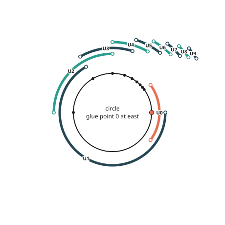

# Compactness with no distances, and Tychonoff: any product of compact spaces is compact

[Syllabus](../../../SYLLABUS.md) → [Topology](../README.md) → [Topological Spaces](../README.md#s02) → Compactness with no distances, and Tychonoff

---

## General Overview

A robot arm whose shoulder and elbow each turn all the way round has a pose for every pair of angles: a point of the torus, the circle times the circle. Some pose brings the gripper closest to a target, because the circle and the torus are **compact**: whenever they are covered by open pieces, finitely many of those pieces already do the job, and then any continuous score has a best value ([What compactness and connectedness buy](08-images-of-compact-and-connected-sets.md)).

With a distance, compactness has three equal forms ([Compactness three ways](../01-Metric%20Spaces/06-compactness-in-metric-spaces.md)). With only open sets, this card uses the cover form and its mirror image, the **finite intersection property**.

Then it proves Tychonoff's theorem: any product of compact spaces is compact, even with infinitely many factors, such as the cube of dials: one setting from 0 to 1 for each dial in an endless row. For arbitrary products the proof needs the axiom of choice, and this card shows the two places where it enters; for the cube of dials a fixed-rule halving search avoids it (Step 6).

**A space is compact when every cover by open sets has a finite selection that still covers it; Tychonoff's theorem says a product of compact spaces, any number of them, is compact, and for arbitrary products this is equivalent to the axiom of choice.**

**What kind of fact this is:** a definition and four theorems, all proved on this card in Why it works: the cover form equals the finite-intersection form, the circle is compact, Tychonoff's theorem, and a compact Hausdorff space is normal. The converse, that Tychonoff's theorem gives back the axiom of choice, is proved in outline with its source.

### The picture: ten arcs that cover the circle

<p align="center"></p>

Measure the circle in **turns** from one marked point, the **glue point**: 1 turn is 360 degrees. The arcs are open, so their ends are left out. $`U_0`$ runs from −1/10 to 1/10 of a turn around the glue point. For every whole number $`n \ge 1`$, $`U_n`$ runs from $`1/(n+2)`$ to $`1/n`$ of a turn. The arcs $`U_2, U_3, \ldots`$ crowd toward the glue point without reaching it.

The angles are to scale. All the arcs lie on the one circle; each is drawn at its own radius only so they can be told apart. The black dots mark 1/2, 1/3, ..., 1/10 of a turn.

---

## The formula

[Topological space](01-topological-spaces-and-bases.md) gives the setting: a set $`X`$ with a chosen family of **open sets**. A set is **closed** when everything outside it is open. $`S^1`$ is the circle.

- An **open cover** of $`X`$ is a family of open sets $`U_i`$, one for each label $`i`$ in a label set $`I`$, whose union is all of $`X`$. The family may be infinite.
- A **finite subcover** is a finite selection from the family whose union is still $`X`$.
- A family of sets has the **finite intersection property** (FIP) when every finite batch of its sets has a point in common. The compactness test uses families of closed sets.

The definition and its mirror image:

```math
\begin{aligned} X \text{ is compact} &\iff \text{every open cover } \{U_i\}_{i \in I} \text{ of } X \text{ has a finite subcover} \\ &\iff \text{every family of closed sets with the FIP has a point common to all its sets} \end{aligned}
```

**Read it aloud:** X is compact when every way of covering it with open sets can be cut down to finitely many; equivalently, when closed sets that meet in every finite batch also meet all together.

Tychonoff's theorem. For each label $`i`$ in $`I`$, let $`X_i`$ be a space. The **product** $`\prod_{i \in I} X_i`$ is the set of all lists $`x = (x_i)`$ with one coordinate $`x_i`$ from each $`X_i`$. Its open sets are unions of **basic boxes**: sets that restrict finitely many coordinates to open sets and leave every other coordinate free ([Subspace, product and quotient](04-subspace-product-and-quotient-topologies.md)). The map $`\pi_i`$ reads off coordinate $`i`$.

```math
\text{every } X_i \text{ compact} \implies \prod_{i \in I} X_i \text{ compact}
```

**Read it aloud:** if each factor is compact, so is the product, however many factors there are.

Two products carry this card. The torus $`T^2 = S^1 \times S^1`$ is the arm's poses. The **cube of dials** $`[0, 1]^{\mathbb{N}}`$ is all endless lists of settings from 0 to 1, one for each counting number $`1, 2, 3, \ldots`$ (the set $`\mathbb{N}`$). In it, $`e_n`$ is the list with dial $`n`$ at 1 and every other dial at 0.

| Symbol | Plain meaning | In our example | Push it up and the answer… |
| --- | --- | --- | --- |
| $`X`$, $`S^1`$ | the space; the circle | the circle, in turns from the glue point | — |
| $`U_i`$, $`i`$, $`I`$ | one open set of a cover, its label, all the labels | arcs $`U_0, U_1, U_2, \ldots`$; $`I = \{0, 1, 2, \ldots\}`$ | — |
| $`n`$ | a counting number: an arc's label in $`U_n`$, or a dial's number in $`e_n`$ | $`U_9 = (1/11, 1/9)`$; $`e_4`$ | — |
| $`C_i`$, $`K_n`$ | everything outside $`U_i`$; what $`U_1, \ldots, U_n`$ leave uncovered | $`K_n`$ is the closed arc $`[0, 1/(n+2)]`$ | $`K_n`$ shrinks toward the glue point |
| $`X_i`$, $`\prod X_i`$ | the factors and their product | $`S^1`$ twice: the torus $`T^2`$; or $`[0, 1]`$ for every dial | — |
| $`x = (x_i)`$, $`\pi_i`$ | a point of the product; reading coordinate $`i`$ | (shoulder angle, elbow angle) | — |
| $`[0, 1]^{\mathbb{N}}`$, $`e_n`$ | the cube of dials; dial $`n`$ at 1, the rest at 0 | $`e_4 = (0, 0, 0, 1, 0, \ldots)`$ | — |
| $`\mathcal{A}`$, $`\mathcal{D}`$, $`D`$, $`B`$ | a family with the FIP; a maximal one containing it; a member of it; a set tested against it | on 3 points: the 4 sets holding $`a`$ | — |
| $`g`$, $`a`$, $`V`$ | the gluing map; one shoulder angle; an open arc of shoulder angles around it | $`g`$ sends $`[0, 1]`$ onto $`S^1`$ | — |
| $`Z`$, $`z`$, $`W_k`$, $`A_z \times B_z`$, $`m`$, $`r`$ | tube-lemma pieces: a second compact factor and its point, cover sets, a basic box round $`(a, z)`$, and how many of each | $`Z = S^1`$, the elbow circle | — |
| $`P`$, $`\le`$ | a partly ordered set and its order (Zorn's lemma) | FIP families, ordered by "is part of" | — |
| $`Y_i`$, $`p`$, $`F_i`$, $`s`$ | Kelley's box with an extra point; the extra point; "coordinate $`i`$ is not $`p`$"; how many $`F_i`$ in a batch | $`\{\text{left}, \text{right}, p\}`$; $`s = 3`$ | $`s`$ up: fewer common points, $`2^s \times 3^{10-s}`$ |

### When it holds

- **Every cover, not some cover.** Any space is covered by one open set, itself. Compactness asks that every cover, however wasteful, can be cut down to finitely many sets.
- **The space must keep its points.** Remove the glue point and the circle is no longer compact: $`U_1, \ldots, U_{1000}`$ miss the point 1/1002 of a turn, and no finite selection from the cover $`U_1, U_2, \ldots`$ catches every point.
- **The finite intersection form needs closed sets.** The open arcs from 0 to $`1/n`$ of a turn are nested and never empty, yet no point lies in all of them, even on the compact circle.
- **Tychonoff needs the product topology.** In the **box topology** a basic set may restrict every coordinate. On finitely many dials that is the product topology again. On endlessly many, one cover by boxes holds each corner in exactly one box, so it needs all its uncountably many boxes, and the cube is not compact.
- **Infinitely many arbitrary factors need choice.** Finitely many factors need no axiom of choice; for arbitrary families Tychonoff's theorem and the axiom of choice imply each other.

---

## Why it works

### Step 0: compactness turns "every point" into "finitely many checks"

A cover catches each point in some open set. Compactness says finitely many of those sets catch every point. So a fact proved near each point, one open set at a time, becomes a fact about the whole space.

The finite intersection property says the same thing through what each open set leaves uncovered.

### Step 1: covers and the finite intersection property are one test

Let $`C_i`$ be everything outside $`U_i`$; it is closed. A point lies in no $`U_i`$ exactly when it lies in every $`C_i`$. So:

- the $`U_i`$ cover $`X`$ exactly when the $`C_i`$ have no common point;
- a finite selection covers exactly when that finite batch of $`C_i`$ has no common point.

Read through these two lines, "every cover has a finite subcover" and "closed sets with the FIP have a common point" are the same sentence.

On the circle, $`U_1, \ldots, U_n`$ together are the arc from $`1/(n+2)`$ to 1 turn, and their leftover is $`K_n = [0, 1/(n+2)]`$. The $`K_n`$ are nested and never empty, so they have the FIP. On the whole circle they share the glue point 0, and indeed $`U_1, U_2, \ldots`$ alone do not cover the circle. With 0 removed, the leftovers share no point, and the cover has no finite subcover.

### Step 2: the circle is compact

The circle is the interval $`[0, 1]`$ with its two ends glued. The gluing map $`g`$ from the interval to the circle is continuous ([Continuity by pre-images, and homeomorphism](03-continuity-and-homeomorphism.md)). The interval is compact by Heine–Borel ([Compactness three ways](../01-Metric%20Spaces/06-compactness-in-metric-spaces.md)).

Given an open cover of the circle, pull each set back through $`g`$. The pre-images are open and cover $`[0, 1]`$, so finitely many cover the interval. Their arcs then cover the circle, because every circle point is $`g`$ of some interval point.

A second road: as a subspace of the plane, the circle is closed and bounded, so Heine–Borel applies directly.

For one cover, a finite subcover can be found by a walk, and the code runs it. Start at 0 in $`U_0`$, which reaches 1/10. At each stop, take the arc holding the stop that reaches furthest, and move to its end. The proof of Heine–Borel on $`[0, 1]`$ uses the same idea for every cover: the furthest point that finitely many sets can reach from 0 turns out to be 1.

### Step 3: finitely many factors, the tube lemma

For the torus, take an open cover. Fix a shoulder angle $`a`$. The elbow circle above it, $`\{a\} \times S^1`$, is a copy of $`S^1`$, so finitely many cover sets catch it.

The union of those finitely many sets contains a whole **tube** $`V \times S^1`$, where $`V`$ is an open arc around $`a`$. Finitely many tubes cover the torus, because the shoulder circle is compact. Each tube needs finitely many sets, so the torus needs finitely many.

<details>
<summary>Detailed proof: the tube lemma, and why it needs no choice</summary>

Let $`W_1, \ldots, W_m`$ be open sets of $`X \times Z`$ that cover the slice $`\{a\} \times Z`$, with $`Z`$ compact. Call an open set $`B_z`$ of $`Z`$ good when some open $`A_z`$ around $`a`$ makes the basic box $`A_z \times B_z`$ fit inside the union of the $`W_k`$. Each point $`(a, z)`$ lies in some $`W_k`$, and so in such a box. So the good sets cover $`Z`$, and no pick was needed to say so.

Finitely many good sets cover $`Z`$: $`B_{z_1}, \ldots, B_{z_r}`$. For each of these $`r`$, pick one $`A_{z_j}`$, and put $`V = A_{z_1} \cap \cdots \cap A_{z_r}`$. It is open, since a finite overlap of open sets is open, and it contains $`a`$. Every point of $`V \times Z`$ lies in some $`A_{z_j} \times B_{z_j}`$, and so in some $`W_k`$.

For $`X \times Z`$ with both compact, take any open cover. Call an open set $`V`$ of $`X`$ good when finitely many cover sets cover the tube $`V \times Z`$. By the step above, every point of $`X`$ lies in a good set, so finitely many good sets cover $`X`$. Pick a finite batch of cover sets for each of those finitely many tubes. The proof makes only finitely many picks, so the axiom of choice is never used. Induction on the number of factors extends it to any finite product.

</details>

Induction stops at finitely many factors; the cube of dials needs a different argument.

### Step 4: Zorn's lemma

A **partly ordered set** $`P`$ is a set with an order $`\le`$ in which some pairs may be incomparable, such as families of sets ordered by "is part of". A **chain** is a part of $`P`$ in which every two members are comparable. An **upper bound** of a chain is a member of $`P`$ at least as big as every member of the chain. A **maximal** member has nothing strictly bigger.

```math
\text{every chain in } P \text{ has an upper bound in } P \implies P \text{ has a maximal member}
```

**Read it aloud:** if every rising chain has something on top of it, then something sits at the top with nothing above.

This is **Zorn's lemma** (Zorn, 1935; see [Zorn's lemma and the well-ordering theorem](../../01-Foundations/09-Sizes%20of%20Infinity/08-zorns-lemma-and-well-ordering.md)). It is equivalent to [The axiom of choice](../../01-Foundations/09-Sizes%20of%20Infinity/05-axiom-of-choice.md): each one proves the other from the other rules of set theory. Its role is to finish a construction that would otherwise take endlessly many steps, by jumping straight to a maximal member.

On a finite set no axiom is needed: keep enlarging until no step is left. The code checks this on a 3-point set $`\{a, b, c\}`$. Of the 256 families of its subsets, 38 have the FIP, counting the empty family. Exactly 3 are maximal, and each is "every set holding one point", such as the 4 sets holding $`a`$.

### Step 5: Tychonoff's proof, and the two places choice enters

Let $`\mathcal{A}`$ be a family of closed sets in $`\prod X_i`$ with the FIP. By Step 1 it is enough to find one point common to all of them.

1. **Enlarge to a maximal family (choice enters here).** Order all FIP families of subsets that contain $`\mathcal{A}`$ by "is part of". The union of a chain still has the FIP: any finite batch from the union sits inside one member of the chain. Zorn's lemma gives a maximal FIP family $`\mathcal{D}`$.
2. **Maximal families decide.** $`\mathcal{D}`$ contains every finite overlap of its members, and every set that meets all its members. Either kind could be added without breaking the FIP, so maximality says it is already in.
3. **Project to each factor and pick (choice enters again).** For each label $`i`$, the closures of the sets $`\pi_i(D)`$ (the **closure** of a set: the points whose every open set meets the set, from [Closure, interior and boundary](02-closure-interior-and-boundary.md)), for $`D`$ in $`\mathcal{D}`$, are closed sets in $`X_i`$ with the FIP. $`X_i`$ is compact, so they share at least one point. Pick one, $`x_i`$, for every $`i`$ at once. That is exactly a choice function, one pick from each of the non-empty boxes.
4. **The picked point is common to all.** Put $`x = (x_i)`$. Any basic box around $`x`$ meets every member of $`\mathcal{D}`$ (detailed proof below). So $`x`$ is in the closure of every member of $`\mathcal{D}`$. Each $`A`$ in $`\mathcal{A}`$ is closed and lies in $`\mathcal{D}`$, so $`x`$ is in every $`A`$.

<details>
<summary>Detailed proof: step 2's two closure facts, and step 4's box argument</summary>

Step 2. Let $`D_1, D_2`$ be in $`\mathcal{D}`$. Adding $`D_1 \cap D_2`$ keeps the FIP: any finite batch including it is a finite batch of members of $`\mathcal{D}`$. So by maximality $`D_1 \cap D_2`$ is in $`\mathcal{D}`$, and by repetition every finite overlap is.

Now let $`B`$ meet every member of $`\mathcal{D}`$. A finite batch from $`\mathcal{D}`$ together with $`B`$ has a common point, because the batch's overlap is itself in $`\mathcal{D}`$ and meets $`B`$. So adding $`B`$ keeps the FIP, and $`B`$ is in $`\mathcal{D}`$.

Step 4. Take an open set $`U`$ of $`X_i`$ holding $`x_i`$. Since $`x_i`$ is in the closure of $`\pi_i(D)`$, $`U`$ meets $`\pi_i(D)`$ for every $`D`$ in $`\mathcal{D}`$. So $`\pi_i^{-1}(U)`$, the set of lists whose coordinate $`i`$ lies in $`U`$, meets every $`D`$. By step 2 it is in $`\mathcal{D}`$.

A basic box around $`x`$ is a finite overlap of such sets, one per restricted coordinate. By step 2 it is in $`\mathcal{D}`$. Members of $`\mathcal{D}`$ meet each other, so the box meets every $`D`$. Every box around $`x`$ meets $`D`$, which is the definition of $`x`$ lying in the closure of $`D`$.

</details>

### Step 6: how much choice, and when

| Product | Choice needed? | Why |
| --- | --- | --- |
| finitely many factors, such as the torus | no | the tube lemma makes finitely many picks |
| countably many copies of $`[0, 1]`$, the cube of dials | no | a halving search with a fixed rule replaces every pick (fold below) |
| arbitrary factors, arbitrarily many | yes, all of it | Kelley, 1950: Tychonoff's theorem gives back the axiom of choice |

<details>
<summary>Detailed proof: the cube of dials is compact with no choice</summary>

Suppose an open cover of the cube of dials has no finite subcover. Halve the dials in the order 1; 1, 2; 1, 2, 3; and so on, each time keeping the lower closed half if it has no finite subcover, and the upper half otherwise. One half must lack one, since two finite subcovers would together cover the piece before.

On each dial the kept intervals close in on one setting ([The real numbers have no gaps](../../01-Foundations/02-The%20Number%20Line/04-real-numbers-no-gaps.md)). Some cover set holds that point with a basic box around it, which restricts finitely many dials. Once those are halved often enough, the kept piece lies in the box, so one cover set covers it, against the rule. No step chose anything.

</details>

Kelley's argument runs Tychonoff backwards. Given non-empty boxes $`X_i`$, add one extra point $`p`$ to each, making $`Y_i`$. Declare the open sets of $`Y_i`$ to be the empty set, $`\{p\}`$ and all of $`Y_i`$. Every space with finitely many open sets is compact, so the product of the $`Y_i`$ is compact by Tychonoff.

The sets $`F_i`$, "coordinate $`i`$ is not $`p`$", are closed. A finite batch of them has a common point, built by hand: a pick from each of those finitely many boxes, and $`p`$ everywhere else. So they have the FIP, and compactness gives a point in all of them at once. That point has no $`p`$ anywhere: it is one pick from every box.

The code checks the finite case on the axiom-of-choice card's ten boxes of two socks: the points common to all ten $`F_i`$ are exactly the $`2^{10} = 1024`$ full picks.

### Step 7: compact and Hausdorff together give normal

Finite covers upgrade the prying of [Hausdorff and its ladder](05-separation-axioms-and-hausdorff.md) from points to closed sets.

- **A point and a compact set.** Pry a point outside a compact set from each point of the set. Finitely many of the open sets round the set's points cover it, and their union misses the overlap of the matching open sets round the outside point. So the outside of a compact set is open: in a Hausdorff space, compact sets are closed.
- **Two closed sets.** A closed set in a compact space is compact: add its open outside to any cover of it, cut down to finitely many, and drop the added set. So pry the first of two disjoint closed sets from each point of the second, by the first bullet. Finitely many of the open sets round those points cover the second set, and their union misses the overlap of the matching open sets round the first.

Points of a Hausdorff space are closed, so a compact Hausdorff space is normal: the circle, the torus and the cube of dials all are.

---

## Worked numbers, by hand

Finding a finite subcover of the circle from the cover $`U_0, U_1, U_2, \ldots`$, by the walk of Step 2. Angles in turns, with degrees after.

| Step | Arithmetic | Value |
| --- | --- | --- |
| start at the glue point | 0 lies only in $`U_0 = (-1/10, 1/10)`$ | reach 1/10 = 36° |
| at 1/10 | only $`U_9 = (1/11, 1/9)`$ holds it | reach 1/9 = 40° |
| at 1/9 | only $`U_8 = (1/10, 1/8)`$ holds it | reach 1/8 = 45° |
| at 1/8, 1/7, ..., 1/3 | $`U_7`$, $`U_6`$, ..., $`U_2`$ in turn | reach 1/2 = 180° |
| at 1/2 | only $`U_1 = (1/3, 1)`$ holds it | reach 1 turn, past 9/10 where $`U_0`$ begins |
| arcs used | $`U_0`$, then $`U_9`$ down to $`U_1`$ | **10** |
| fewer is impossible | the 10 points 0, 1/2, 1/3, ..., 1/10 each lie in exactly one arc | at least 10 |

An endless cover of the circle cuts down to 10 arcs, and no smaller selection works.

Kelley's step on the ten sock boxes of the axiom-of-choice card:

| Step | Arithmetic | Value |
| --- | --- | --- |
| points in one $`Y_i`$ | left, right, $`p`$ | 3 |
| points in the product | $`3^{10}`$ | 59049 |
| common points of $`F_1, F_2, F_3`$ | $`2^3 \times 3^7`$ | 17496 |
| common points of all ten $`F_i`$ | $`2^{10}`$ | **1024** |

The points shared by every $`F_i`$ are exactly the full picks, one sock from each box.

### What breaks if you drop a piece

| Mistake | Comes out at | What went wrong |
| --- | --- | --- |
| Remove the glue point | $`U_1, \ldots, U_{1000}`$ miss the point 1/1002 turn = 60/167 degrees; $`U_{1001}`$ holds it | the leftovers $`(0, 1/(n+2)]`$ have the FIP and no common point |
| FIP with open sets | arcs $`(0, 1/n)`$: 0 is in none, and 1/1000 is gone at $`n = 1000`$ | open sets can shrink to nothing even in a compact space |
| Box topology on the dials | 8 dials: 256 corners, each in exactly 1 of 256 boxes, doubling per dial | on endlessly many dials each corner needs its own box, so no finite selection works |
| Largest-gap distance on the dials | $`e_m`$ and $`e_n`$ always 1 apart; the box "every dial below 1/2" holds none of them | in the product topology $`e_n`$ tends to 0; under this distance no subsequence settles |

The code prints all four.

---

## Code, from first principles, and it actually runs

Points of the circle are fractions of a turn, so every test is exact. Part 1 reaches the smallest finite subcover three independent ways: the walk of Step 2, an exhaustive search through selections from $`U_0`$ to $`U_{13}`$ smallest first, and the ten witness points that each need their own arc. Part 2 removes the glue point. Part 3 tests the cube of dials on its first 20 dials, which illustrates and does not prove. Part 4 checks the finite cases of Zorn's lemma and Kelley's step on every case, so those finite statements are proved; there, inclusion–exclusion and the counting formula $`2^s \times 3^{10-s}`$ are the second roads.

### Python

```python
# Compactness and Tychonoff -- the check behind the card.  Standard library only.
# A point of the circle is a fraction of a turn, from 0 (the glue point) up to
# 1, so every test is exact.  Part 1 finds the smallest finite subcover of one
# cover of the circle three ways.  Part 2 removes the glue point and watches
# that fail.  Part 3 tests the infinite cube of dials on 20 coordinates: it
# illustrates, it does not prove.  Part 4 checks the finite cases of Zorn's
# lemma and of Kelley's step on every case, so those finite cases are proved.
from fractions import Fraction as F
from itertools import combinations, product

def yn(claim):
    return "yes" if claim else "no"

def arc(n):                                # U_0 round the glue point; U_n for n >= 1
    return (F(-1, 10), F(1, 10)) if n == 0 else (F(1, n + 2), F(1, n))

def inside(t, n):                          # is the point t, 0 <= t < 1, in U_n?
    a, b = arc(n)
    return a < t < b or a < t - 1 < b      # an arc may run past the glue point

def covers(ns):                            # coverage can change only at an arc's end,
    ends = sorted({e % 1 for n in ns for e in arc(n)} | {F(0)})   # so test the ends
    gaps = [(x + y) / 2 for x, y in zip(ends, ends[1:] + [ends[0] + 1])]  # and gaps
    return all(any(inside(t % 1, n) for n in ns) for t in ends + gaps)

def names(ns):
    return ", ".join(f"U_{n}" for n in ns)

POOL = range(14)                           # U_0 .. U_13; every later arc sits in (0, 1/14), inside U_0
print("Part 1: the circle in turns; U_0 = (-1/10, 1/10), U_n = (1/(n+2), 1/n)")
reach, walk = arc(0)[1], [0]               # road 1: walk round from the glue point
while reach <= 1 + arc(0)[0]:
    n = max((m for m in POOL if inside(reach, m)), key=lambda m: arc(m)[1])
    walk.append(n)
    reach = arc(n)[1]
print(f"road 1, walk from the glue point: {len(walk)} arcs: {names(walk)}")
best = next(k for k in range(1, 15) if any(covers(c) for c in combinations(POOL, k)))
smallest = [c for c in combinations(POOL, best) if covers(c)]
print(f"road 2, search U_0..U_13, smallest selections first: {best} arcs; "
      f"{len(smallest)} cover of that size: {names(smallest[0])}")
witness = [F(0)] + [F(1, k) for k in range(2, 11)]
hits = [sum(inside(t, n) for n in POOL) for t in witness]
print("road 3, points 0, 1/2, 1/3, ..., 1/10: arcs holding each: " + " ".join(map(str, hits)))
print(f"each needs its own arc, so at least {len(witness)} arcs; U_0..U_9 cover: {yn(covers(range(10)))}")

print("Part 2: the glue point removed; U_1, U_2, U_3, ... still cover what is left")
for N in (10, 100, 1000):
    miss = F(1, N + 2)
    assert not any(inside(miss, n) for n in range(1, N + 1)) and inside(miss, N + 1)
    print(f"  U_1..U_{N} miss the point {miss} turn = {360 * miss} degrees; U_{N + 1} holds it")
zero_left = not any(inside(F(0), n) for n in range(1, 1001))
gone = next(n for n in range(1, 2000) if inside(F(1, 1000), n))
print(f"  leftover after U_1..U_n: the closed arc [0, 1/(n+2)]; 0 in none of U_1..U_1000: {yn(zero_left)}")
print(f"  with 0 removed, the leftovers lose the point 1/1000 at n = {gone}: no common point")
open_gone = next(n for n in range(1, 2000) if not F(0) < F(1, 1000) < F(1, n))
print(f"mistake, open arcs (0, 1/n) in the whole circle: 0 in none; 1/1000 gone at n = {open_gone}")

print("Part 3: the cube of dials [0, 1]^N, on its first 20 dials")
D = 20
e = {n: tuple(F(int(i == n)) for i in range(1, D + 1)) for n in range(1, D + 1)}
near = {}
for m in (3, 10):
    near[m] = [n for n in e if all(e[n][i] < F(1, 2) for i in range(m))]
    print(f"  open set 'dials 1..{m} below 1/2' round 0 holds e_n for {len(near[m])} of n = 1..{D}, "
          f"from n = {near[m][0]}")
in_box = [n for n in e if all(x < F(1, 2) for x in e[n])]
sup = {max(abs(a - b) for a, b in zip(e[m], e[n])) for m in e for n in e if m != n}
print(f"mistake, box 'every dial below 1/2': holds e_n for {len(in_box)} of n = 1..{D}")
print(f"mistake, largest-gap distance between e_m and e_n, m != n: always {min(sup)}")
k = 8
corners = list(product((0, 1), repeat=k))  # box for pattern s: dial i in [0, 2/3) or (1/3, 1]
def in_pattern(x, s):
    return all(xi < F(2, 3) if si == 0 else xi > F(1, 3) for xi, si in zip(x, s))
per_corner = {sum(in_pattern(c, s) for s in corners) for c in corners}
print(f"mistake, box topology: on {k} dials {len(corners)} corners, each in exactly "
      f"{min(per_corner)} of the {2 ** k} boxes, so all {2 ** k} are needed")

print("Part 4: finite cases, every case checked")
S = frozenset("abc")
SUBS = [frozenset(c) for r in range(4) for c in combinations(sorted(S), r)]
fams = [frozenset(f) for r in range(len(SUBS) + 1) for f in combinations(SUBS, r)]
def fip(f):                                # every finite subfamily has a common point
    return all(S.intersection(*g) for r in range(1, len(f) + 1) for g in combinations(f, r))
good = [f for f in fams if fip(f)]
incl_excl = 3 * 2 ** 4 - 3 * 2 ** 2 + 1 * 2 ** 1
top = [f for f in good if not any(f < g for g in good)]
by_point = all(any(f == {A for A in SUBS if x in A} for x in S) for f in top)
decides = all(A in f or S - A in f for f in top for A in SUBS)
print(f"Zorn, 3 points: {len(fams)} families of subsets; {len(good)} have the FIP "
      f"(inclusion-exclusion {incl_excl}); {len(top)} maximal")
print(f"  each maximal one is the {len(top[0])} sets holding one point: {yn(by_point)}; "
      f"holds A or its outside: {yn(decides)}")
m = 10                                     # ten boxes of two socks, plus the extra point p
masks = {}
for y in product(("left", "right", "p"), repeat=m):
    key = sum(1 << i for i, v in enumerate(y) if v != "p")
    masks[key] = masks.get(key, 0) + 1
common = {T: sum(c for M, c in masks.items() if M & T == T) for T in range(2 ** m)}
formula = all(common[T] == 2 ** bin(T).count("1") * 3 ** (m - bin(T).count("1")) for T in common)
print(f"Kelley, {m} boxes of 2 socks plus p: {3 ** m} points; all {2 ** m} subfamilies of F_1..F_{m} "
      f"meet: {yn(min(common.values()) > 0)}; smallest common set {min(common.values())} = the full picks")
print(f"  common points of F_1, F_2, F_3: {common[7]}; of all {m}: {common[2 ** m - 1]}")
assert walk == [0, 9, 8, 7, 6, 5, 4, 3, 2, 1] and smallest == [tuple(range(10))]   # roads 1, 2
assert hits == [1] * 10 and best == len(witness)                       # road 3 lower bound
assert zero_left and gone == 999 and open_gone == 1000
assert [len(near[3]), len(near[10]), len(in_box)] == [D - 3, D - 10, 0] and sup == {1}
assert per_corner == {1} and len(good) == incl_excl and len(top) == 3 and by_point
assert formula and common[2 ** m - 1] == 2 ** m and decides
print("figure, arcs in degrees from east: " + "; ".join(
    f"U_{n} {360 * arc(n)[0]}..{360 * arc(n)[1]}" for n in range(10)))
print("ALL CHECKS PASS")
```

**Ran 2026-11-14 on macOS, Python 3.14.10, standard library only. All checks passed. Output, pasted from the run:**

```
Part 1: the circle in turns; U_0 = (-1/10, 1/10), U_n = (1/(n+2), 1/n)
road 1, walk from the glue point: 10 arcs: U_0, U_9, U_8, U_7, U_6, U_5, U_4, U_3, U_2, U_1
road 2, search U_0..U_13, smallest selections first: 10 arcs; 1 cover of that size: U_0, U_1, U_2, U_3, U_4, U_5, U_6, U_7, U_8, U_9
road 3, points 0, 1/2, 1/3, ..., 1/10: arcs holding each: 1 1 1 1 1 1 1 1 1 1
each needs its own arc, so at least 10 arcs; U_0..U_9 cover: yes
Part 2: the glue point removed; U_1, U_2, U_3, ... still cover what is left
  U_1..U_10 miss the point 1/12 turn = 30 degrees; U_11 holds it
  U_1..U_100 miss the point 1/102 turn = 60/17 degrees; U_101 holds it
  U_1..U_1000 miss the point 1/1002 turn = 60/167 degrees; U_1001 holds it
  leftover after U_1..U_n: the closed arc [0, 1/(n+2)]; 0 in none of U_1..U_1000: yes
  with 0 removed, the leftovers lose the point 1/1000 at n = 999: no common point
mistake, open arcs (0, 1/n) in the whole circle: 0 in none; 1/1000 gone at n = 1000
Part 3: the cube of dials [0, 1]^N, on its first 20 dials
  open set 'dials 1..3 below 1/2' round 0 holds e_n for 17 of n = 1..20, from n = 4
  open set 'dials 1..10 below 1/2' round 0 holds e_n for 10 of n = 1..20, from n = 11
mistake, box 'every dial below 1/2': holds e_n for 0 of n = 1..20
mistake, largest-gap distance between e_m and e_n, m != n: always 1
mistake, box topology: on 8 dials 256 corners, each in exactly 1 of the 256 boxes, so all 256 are needed
Part 4: finite cases, every case checked
Zorn, 3 points: 256 families of subsets; 38 have the FIP (inclusion-exclusion 38); 3 maximal
  each maximal one is the 4 sets holding one point: yes; holds A or its outside: yes
Kelley, 10 boxes of 2 socks plus p: 59049 points; all 1024 subfamilies of F_1..F_10 meet: yes; smallest common set 1024 = the full picks
  common points of F_1, F_2, F_3: 17496; of all 10: 1024
figure, arcs in degrees from east: U_0 -36..36; U_1 120..360; U_2 90..180; U_3 72..120; U_4 60..90; U_5 360/7..72; U_6 45..60; U_7 40..360/7; U_8 36..45; U_9 360/11..40
ALL CHECKS PASS
```

### Rust

Same numbers, same labels, built with `rustc --edition 2021 -O`.

```rust
// Compactness and Tychonoff -- the same check as the Python, in Rust.  No crates.
// A point of the circle is a fraction of a turn, from 0 (the glue point) up to
// 1, so every test is exact.  Part 1 finds the smallest finite subcover of one
// cover of the circle three ways.  Part 2 removes the glue point and watches
// that fail.  Part 3 tests the infinite cube of dials on 20 coordinates: it
// illustrates, it does not prove.  Part 4 checks the finite cases of Zorn's
// lemma and of Kelley's step on every case, so those finite cases are proved.
use std::cmp::Ordering;

#[derive(Clone, Copy, Debug)]
struct Fr { p: i64, q: i64 }                       // p/q in lowest terms, q > 0
fn gcd(a: i64, b: i64) -> i64 { if b == 0 { a.abs() } else { gcd(b, a % b) } }
fn fr(p: i64, q: i64) -> Fr { let g = gcd(p, q).max(1) * q.signum(); Fr { p: p / g, q: q / g } }
impl PartialEq for Fr { fn eq(&self, o: &Fr) -> bool { self.p * o.q == o.p * self.q } }
impl Eq for Fr {}
impl PartialOrd for Fr { fn partial_cmp(&self, o: &Fr) -> Option<Ordering> { Some(self.cmp(o)) } }
impl Ord for Fr { fn cmp(&self, o: &Fr) -> Ordering { (self.p * o.q).cmp(&(o.p * self.q)) } }
fn add(a: Fr, b: Fr) -> Fr { fr(a.p * b.q + b.p * a.q, a.q * b.q) }
fn sub(a: Fr, b: Fr) -> Fr { fr(a.p * b.q - b.p * a.q, a.q * b.q) }
fn show(a: Fr) -> String { if a.q == 1 { format!("{}", a.p) } else { format!("{}/{}", a.p, a.q) } }
fn yn(claim: bool) -> &'static str { if claim { "yes" } else { "no" } }

fn arc(n: i64) -> (Fr, Fr) {                       // U_0 round the glue point; U_n for n >= 1
    if n == 0 { (fr(-1, 10), fr(1, 10)) } else { (fr(1, n + 2), fr(1, n)) }
}
fn inside(t: Fr, n: i64) -> bool {                 // is the point t, 0 <= t < 1, in U_n?
    let (a, b) = arc(n);
    let u = sub(t, fr(1, 1));                      // an arc may run past the glue point
    (a < t && t < b) || (a < u && u < b)
}
fn modone(e: Fr) -> Fr { fr(e.p.rem_euclid(e.q), e.q) }
fn covers(ns: &[i64]) -> bool {                    // test every arc end and every gap
    let mut ends: Vec<Fr> = ns.iter().flat_map(|&n| { let (a, b) = arc(n); vec![modone(a), modone(b)] }).collect();
    ends.push(fr(0, 1));
    ends.sort();
    ends.dedup();
    let mut tests = ends.clone();
    for i in 0..ends.len() {
        let next = if i + 1 < ends.len() { ends[i + 1] } else { add(ends[0], fr(1, 1)) };
        tests.push(modone(fr(ends[i].p * next.q + next.p * ends[i].q, 2 * ends[i].q * next.q)));
    }
    tests.iter().all(|&t| ns.iter().any(|&n| inside(t, n)))
}
fn names(ns: &[i64]) -> String { ns.iter().map(|n| format!("U_{}", n)).collect::<Vec<_>>().join(", ") }

fn main() {
    let pool: Vec<i64> = (0..14).collect();        // U_0 .. U_13; every later arc sits in (0, 1/14), inside U_0
    println!("Part 1: the circle in turns; U_0 = (-1/10, 1/10), U_n = (1/(n+2), 1/n)");
    let (mut reach, mut walk) = (arc(0).1, vec![0i64]);   // road 1: walk round from the glue point
    while reach <= add(fr(1, 1), arc(0).0) {
        let n = *pool.iter().filter(|&&m| inside(reach, m)).max_by_key(|&&m| arc(m).1).unwrap();
        walk.push(n);
        reach = arc(n).1;
    }
    println!("road 1, walk from the glue point: {} arcs: {}", walk.len(), names(&walk));
    let pick = |mask: u32| -> Vec<i64> { pool.iter().copied().filter(|&n| mask >> n & 1 == 1).collect() };
    let best = (1..15u32).find(|&k| (0..1u32 << 14).any(|s| s.count_ones() == k && covers(&pick(s)))).unwrap();
    let smallest: Vec<Vec<i64>> = (0..1u32 << 14).filter(|&s| s.count_ones() == best && covers(&pick(s))).map(pick).collect();
    println!("road 2, search U_0..U_13, smallest selections first: {} arcs; {} cover of that size: {}",
             best, smallest.len(), names(&smallest[0]));
    let mut witness = vec![fr(0, 1)];
    witness.extend((2..11).map(|k| fr(1, k)));
    let hits: Vec<usize> = witness.iter().map(|&t| pool.iter().filter(|&&n| inside(t, n)).count()).collect();
    println!("road 3, points 0, 1/2, 1/3, ..., 1/10: arcs holding each: {}",
             hits.iter().map(|h| h.to_string()).collect::<Vec<_>>().join(" "));
    let first_ten: Vec<i64> = (0..10).collect();
    println!("each needs its own arc, so at least {} arcs; U_0..U_9 cover: {}", witness.len(), yn(covers(&first_ten)));

    println!("Part 2: the glue point removed; U_1, U_2, U_3, ... still cover what is left");
    for big_n in [10i64, 100, 1000] {
        let miss = fr(1, big_n + 2);
        assert!(!(1..=big_n).any(|n| inside(miss, n)) && inside(miss, big_n + 1));
        println!("  U_1..U_{} miss the point {} turn = {} degrees; U_{} holds it",
                 big_n, show(miss), show(fr(360, big_n + 2)), big_n + 1);
    }
    let zero_left = !(1..=1000).any(|n| inside(fr(0, 1), n));
    let gone = (1..2000).find(|&n| inside(fr(1, 1000), n)).unwrap();
    println!("  leftover after U_1..U_n: the closed arc [0, 1/(n+2)]; 0 in none of U_1..U_1000: {}", yn(zero_left));
    println!("  with 0 removed, the leftovers lose the point 1/1000 at n = {}: no common point", gone);
    let open_gone = (1..2000i64).find(|&n| !(fr(0, 1) < fr(1, 1000) && fr(1, 1000) < fr(1, n))).unwrap();
    println!("mistake, open arcs (0, 1/n) in the whole circle: 0 in none; 1/1000 gone at n = {}", open_gone);

    println!("Part 3: the cube of dials [0, 1]^N, on its first 20 dials");
    let d = 20usize;
    let e = |n: usize| -> Vec<Fr> { (1..=d).map(|i| fr((i == n) as i64, 1)).collect() };
    let half = fr(1, 2);
    let mut near = Vec::new();
    for m in [3usize, 10] {
        let held: Vec<usize> = (1..=d).filter(|&n| e(n)[..m].iter().all(|&x| x < half)).collect();
        println!("  open set 'dials 1..{} below 1/2' round 0 holds e_n for {} of n = 1..{}, from n = {}",
                 m, held.len(), d, held[0]);
        near.push(held.len());
    }
    let in_box = (1..=d).filter(|&n| e(n).iter().all(|&x| x < half)).count();
    let mut sup = Vec::new();
    for a in 1..=d { for b in 1..=d { if a != b {
        sup.push(e(a).iter().zip(e(b).iter()).map(|(&x, &y)| if x > y { sub(x, y) } else { sub(y, x) }).max().unwrap());
    } } }
    sup.sort();
    sup.dedup();
    println!("mistake, box 'every dial below 1/2': holds e_n for {} of n = 1..{}", in_box, d);
    println!("mistake, largest-gap distance between e_m and e_n, m != n: always {}", show(sup[0]));
    let k = 8u32;                                  // box for pattern s: dial i in [0, 2/3) or (1/3, 1]
    let in_pattern = |c: u32, s: u32| (0..k).all(|i| {
        let x = fr((c >> i & 1) as i64, 1);
        if s >> i & 1 == 0 { x < fr(2, 3) } else { x > fr(1, 3) }
    });
    let mut per_corner: Vec<usize> = (0..1u32 << k).map(|c| (0..1u32 << k).filter(|&s| in_pattern(c, s)).count()).collect();
    per_corner.sort();
    per_corner.dedup();
    println!("mistake, box topology: on {} dials {} corners, each in exactly {} of the {} boxes, so all {} are needed",
             k, 1u32 << k, per_corner[0], 1u32 << k, 1u32 << k);

    println!("Part 4: finite cases, every case checked");
    let fip = |f: u32| -> bool {                   // a family is a mask over the 8 subsets of {a, b, c}
        (1..256u32).filter(|&g| g & f == g).all(|g| (0..8u32).filter(|&a| g >> a & 1 == 1).fold(7u32, |acc, a| acc & a) != 0)
    };
    let good: Vec<u32> = (0..256u32).filter(|&f| fip(f)).collect();
    let incl_excl = 3 * 16 - 3 * 4 + 2;
    let top: Vec<u32> = good.iter().copied().filter(|&f| !good.iter().any(|&g| g != f && g & f == f)).collect();
    let by_point = top.iter().all(|&f| (0..3).any(|x| f == (0..8u32).filter(|&a| a >> x & 1 == 1).fold(0, |acc, a| acc | 1 << a)));
    let decides = top.iter().all(|&f| (0..8u32).all(|a| f >> a & 1 == 1 || f >> (7 - a) & 1 == 1));
    println!("Zorn, 3 points: 256 families of subsets; {} have the FIP (inclusion-exclusion {}); {} maximal",
             good.len(), incl_excl, top.len());
    println!("  each maximal one is the {} sets holding one point: {}; holds A or its outside: {}",
             top[0].count_ones(), yn(by_point), yn(decides));
    let m = 10u32;                                 // ten boxes of two socks, plus the extra point p
    let mut masks = vec![0u64; 1 << m];
    for code in 0..3u32.pow(m) {                   // digit 0 left, 1 right, 2 the point p
        let (mut c, mut key) = (code, 0usize);
        for i in 0..m { if c % 3 != 2 { key |= 1 << i; } c /= 3; }
        masks[key] += 1;
    }
    let common: Vec<u64> = (0..1usize << m).map(|t| (0..1usize << m).filter(|&mm| mm & t == t).map(|mm| masks[mm]).sum()).collect();
    let formula = (0..1usize << m).all(|t| { let s = t.count_ones(); common[t] == 2u64.pow(s) * 3u64.pow(m - s) });
    let least = *common.iter().min().unwrap();
    println!("Kelley, {} boxes of 2 socks plus p: {} points; all {} subfamilies of F_1..F_{} meet: {}; smallest common set {} = the full picks",
             m, 3u32.pow(m), 1u32 << m, m, yn(least > 0), least);
    println!("  common points of F_1, F_2, F_3: {}; of all {}: {}", common[7], m, common[(1 << m) - 1]);
    assert!(walk == vec![0, 9, 8, 7, 6, 5, 4, 3, 2, 1] && smallest == vec![first_ten.clone()]);   // roads 1, 2
    assert!(hits == vec![1; 10] && best as usize == witness.len());                // road 3 lower bound
    assert!(zero_left && gone == 999 && open_gone == 1000);
    assert!(near == vec![d - 3, d - 10] && in_box == 0 && sup == vec![fr(1, 1)]);
    assert!(per_corner == vec![1] && good.len() == incl_excl && top.len() == 3 && by_point);
    assert!(formula && common[(1 << m) - 1] == 1 << m && decides);
    let fig: Vec<String> = (0..10).map(|n| { let (a, b) = arc(n);
        format!("U_{} {}..{}", n, show(fr(360 * a.p, a.q)), show(fr(360 * b.p, b.q))) }).collect();
    println!("figure, arcs in degrees from east: {}", fig.join("; "));
    println!("ALL CHECKS PASS");
}
```

**Ran 2026-11-14 on macOS, rustc 1.98.1, no crates. All checks passed. Output, pasted from the run:**

```
Part 1: the circle in turns; U_0 = (-1/10, 1/10), U_n = (1/(n+2), 1/n)
road 1, walk from the glue point: 10 arcs: U_0, U_9, U_8, U_7, U_6, U_5, U_4, U_3, U_2, U_1
road 2, search U_0..U_13, smallest selections first: 10 arcs; 1 cover of that size: U_0, U_1, U_2, U_3, U_4, U_5, U_6, U_7, U_8, U_9
road 3, points 0, 1/2, 1/3, ..., 1/10: arcs holding each: 1 1 1 1 1 1 1 1 1 1
each needs its own arc, so at least 10 arcs; U_0..U_9 cover: yes
Part 2: the glue point removed; U_1, U_2, U_3, ... still cover what is left
  U_1..U_10 miss the point 1/12 turn = 30 degrees; U_11 holds it
  U_1..U_100 miss the point 1/102 turn = 60/17 degrees; U_101 holds it
  U_1..U_1000 miss the point 1/1002 turn = 60/167 degrees; U_1001 holds it
  leftover after U_1..U_n: the closed arc [0, 1/(n+2)]; 0 in none of U_1..U_1000: yes
  with 0 removed, the leftovers lose the point 1/1000 at n = 999: no common point
mistake, open arcs (0, 1/n) in the whole circle: 0 in none; 1/1000 gone at n = 1000
Part 3: the cube of dials [0, 1]^N, on its first 20 dials
  open set 'dials 1..3 below 1/2' round 0 holds e_n for 17 of n = 1..20, from n = 4
  open set 'dials 1..10 below 1/2' round 0 holds e_n for 10 of n = 1..20, from n = 11
mistake, box 'every dial below 1/2': holds e_n for 0 of n = 1..20
mistake, largest-gap distance between e_m and e_n, m != n: always 1
mistake, box topology: on 8 dials 256 corners, each in exactly 1 of the 256 boxes, so all 256 are needed
Part 4: finite cases, every case checked
Zorn, 3 points: 256 families of subsets; 38 have the FIP (inclusion-exclusion 38); 3 maximal
  each maximal one is the 4 sets holding one point: yes; holds A or its outside: yes
Kelley, 10 boxes of 2 socks plus p: 59049 points; all 1024 subfamilies of F_1..F_10 meet: yes; smallest common set 1024 = the full picks
  common points of F_1, F_2, F_3: 17496; of all 10: 1024
figure, arcs in degrees from east: U_0 -36..36; U_1 120..360; U_2 90..180; U_3 72..120; U_4 60..90; U_5 360/7..72; U_6 45..60; U_7 40..360/7; U_8 36..45; U_9 360/11..40
ALL CHECKS PASS
```

The two outputs match line for line.

### Lean

Lean proves three of the card's theorems for all spaces, and checks the card's exact counts for the circle, Zorn and Kelley.

- Take any label set $`I`$, and a compact space $`X_i`$ for each label $`i`$. Then the product $`\prod_{i \in I} X_i`$ is compact: Tychonoff's theorem.
- A space is compact exactly when every open cover has a finite subcover.
- A space is also compact exactly when every family of closed sets with the FIP has a point common to all its sets.
- Suppose a space is compact and Hausdorff. Then any two disjoint closed sets lie in two non-overlapping open sets.
- Take the point 1/12 of a turn. Then $`U_1, \ldots, U_{10}`$ all miss it, and $`U_{11}`$ holds it.
- Take $`k`$ from 2 to 10. Then the point $`1/k`$ of a turn lies in $`U_{k-1}`$ and in no other arc from $`U_1`$ to $`U_{13}`$.
- Take the 3-point set. Then 38 of the 256 families of its subsets have the FIP, and exactly 3 of those are maximal.
- Inclusion–exclusion gives the same 38: $`3 \times 2^4 - 3 \times 2^2 + 2 = 38`$.
- The sock-box counts are exact: $`3^{10} = 59049`$, $`2^3 \times 3^7 = 17496`$ and $`2^{10} = 1024`$.

The 10-arc walk and search, the cube of dials and the box topology are left to the Python and Rust checks.

```lean
-- Compactness with no distances, and Tychonoff: any product of compact spaces is compact, compactness by open covers equals compactness by closed sets with the finite intersection property, and a compact Hausdorff space is normal.
import Mathlib.Topology.Compactness.Compact
import Mathlib.Topology.Separation.Regular
import Mathlib.Data.Fintype.Powerset
import Mathlib.Order.Interval.Finset.Nat
import Mathlib.Algebra.Order.Field.Rat
import Mathlib.Tactic.NormNum
import Mathlib.Tactic.IntervalCases

open Set

universe u

/-- Tychonoff's theorem: if every factor `X i` is compact, then the product of all of them,
with the product topology, is compact, however many factors there are. -/
theorem tychonoff_product_of_compact_spaces_is_compact
    {I : Type*} {X : I → Type*} [∀ i, TopologicalSpace (X i)]
    (h : ∀ i, CompactSpace (X i)) : CompactSpace (∀ i, X i) := by
  exact Pi.compactSpace

/-- A space is compact exactly when every open cover has a finite subcover, and exactly when
every family of closed sets with the finite intersection property (every finite batch has a
point in common) has a point common to all its sets. -/
theorem compact_iff_finite_subcover_iff_closed_fip {X : Type u} [TopologicalSpace X] :
    (CompactSpace X ↔
      ∀ (I : Type u) (U : I → Set X), (∀ i, IsOpen (U i)) → (⋃ i, U i) = univ →
        ∃ t : Finset I, (⋃ i ∈ t, U i) = univ) ∧
    (CompactSpace X ↔
      ∀ (I : Type u) (C : I → Set X), (∀ i, IsClosed (C i)) →
        (∀ t : Finset I, (⋂ i ∈ t, C i).Nonempty) → (⋂ i, C i).Nonempty) := by
  constructor
  · rw [← isCompact_univ_iff, isCompact_iff_finite_subcover]
    constructor
    · intro h I U hU hcov
      obtain ⟨t, ht⟩ := h U hU (by rw [hcov])
      exact ⟨t, univ_subset_iff.mp ht⟩
    · intro h ι U hU hs
      obtain ⟨t, ht⟩ := h ι U hU (univ_subset_iff.mp hs)
      exact ⟨t, by rw [ht]⟩
  · rw [← isCompact_univ_iff, isCompact_iff_finite_subfamily_closed]
    constructor
    · intro h I C hC hfip
      by_contra hne
      rw [not_nonempty_iff_eq_empty] at hne
      obtain ⟨u, hu⟩ := h C hC (by rw [hne]; exact disjoint_empty _)
      exact (nonempty_iff_ne_empty.mp (hfip u)) (univ_disjoint.mp hu)
    · intro h ι t ht hd
      by_contra hne
      push Not at hne
      have hfip : ∀ u : Finset ι, (⋂ i ∈ u, t i).Nonempty := fun u =>
        nonempty_iff_ne_empty.mpr fun he => hne u (by rw [he]; exact disjoint_empty _)
      exact nonempty_iff_ne_empty.mp (h ι t ht hfip) (univ_disjoint.mp hd)

/-- A compact Hausdorff space is normal: any two disjoint closed sets lie in disjoint
open sets. -/
theorem compact_hausdorff_space_is_normal {X : Type u} [TopologicalSpace X]
    [CompactSpace X] [T2Space X] : NormalSpace X := by
  infer_instance

/-! The card's exact checks. The circle is measured in turns from the glue point, and for
`n ≥ 1` the arc `U_n` is the open arc from `1/(n+2)` to `1/n` of a turn. -/

/-- With the glue point removed: `U_1, ..., U_10` all miss the point 1/12 of a turn. -/
example : ∀ n ∈ Finset.Icc (1 : ℕ) 10,
    ¬ ((1 : ℚ) / ((n : ℚ) + 2) < 1 / 12 ∧ (1 : ℚ) / 12 < 1 / (n : ℚ)) := by
  intro n hn
  simp only [Finset.mem_Icc] at hn
  obtain ⟨h1, h2⟩ := hn
  interval_cases n <;> norm_num

/-- `U_11`, the arc from 1/13 to 1/11, holds the point 1/12. -/
example : (1 : ℚ) / 13 < 1 / 12 ∧ (1 : ℚ) / 12 < 1 / 11 := by norm_num

/-- Each point 1/k of a turn, k = 2, ..., 10, lies in exactly one of `U_1, ..., U_13`,
namely `U_(k-1)`; so these nine points need nine different arcs. -/
example : ∀ k ∈ Finset.Icc (2 : ℕ) 10, ∀ n ∈ Finset.Icc (1 : ℕ) 13,
    ((1 : ℚ) / ((n : ℚ) + 2) < 1 / (k : ℚ) ∧ (1 : ℚ) / (k : ℚ) < 1 / (n : ℚ)) ↔ n = k - 1 := by
  intro k hk n hn
  simp only [Finset.mem_Icc] at hk hn
  obtain ⟨hk1, hk2⟩ := hk
  obtain ⟨hn1, hn2⟩ := hn
  interval_cases k <;> interval_cases n <;> norm_num

/-- On the 3-point set, 38 of the 256 families of subsets have the finite intersection
property (counting the empty family). -/
example :
    ((Finset.univ : Finset (Fin 3)).powerset.powerset.filter
      (fun F => ∀ G ∈ F.powerset, ∃ x : Fin 3, ∀ A ∈ G, x ∈ A)).card = 38 := by
  decide +kernel

/-- On the 3-point set, exactly 3 families with the finite intersection property are maximal. -/
example :
    let fip := (Finset.univ : Finset (Fin 3)).powerset.powerset.filter
      (fun F => ∀ G ∈ F.powerset, ∃ x : Fin 3, ∀ A ∈ G, x ∈ A)
    (fip.filter (fun F => ∀ H ∈ fip, ¬ F ⊂ H)).card = 3 := by
  decide +kernel

/-- Inclusion-exclusion gives the same 38, and ten boxes of two socks give 2^10 = 1024 full
picks among 3^10 = 59049 points, and three of the sets F_i share 2^3 * 3^7 = 17496 points. -/
example : 3 * 2 ^ 4 - 3 * 2 ^ 2 + 1 * 2 ^ 1 = 38 ∧ 2 ^ 10 = 1024 ∧ 3 ^ 10 = 59049 ∧
    2 ^ 3 * 3 ^ 7 = 17496 := by
  norm_num

#print axioms tychonoff_product_of_compact_spaces_is_compact
#print axioms compact_iff_finite_subcover_iff_closed_fip
#print axioms compact_hausdorff_space_is_normal
```

**Checked 2026-11-15 on macOS, Lean 4.36.0-rc2, Mathlib v4.36.0-rc2. Every proof is complete and uses only Lean's standard axioms. Output, pasted from the run:**

```
'tychonoff_product_of_compact_spaces_is_compact' depends on axioms: [propext, Classical.choice, Quot.sound]
'compact_iff_finite_subcover_iff_closed_fip' depends on axioms: [propext, Classical.choice, Quot.sound]
'compact_hausdorff_space_is_normal' depends on axioms: [propext, Classical.choice, Quot.sound]
```

> [!TIP]
> **Try changing**
> - **Guess first: does $`U_0`$ need to reach 1/10?** Shrink it to `(F(-1, 20), F(1, 20))`. The walk reaches 1/20 and stops with an error: only $`U_{19}`$ holds that point, and the search pool ends at $`U_{13}`$. A smaller $`U_0`$ means more arcs, here 20.
> - **Guess first: how many boxes for 10 dials?** Set `k = 10`. Each of 1024 corners sits in exactly 1 of 1024 boxes, so all 1024 are needed: one more power of 2 per dial.
> - **Guess first: how many full picks for six sock boxes?** Set `m = 6`. The product has 729 points, every batch of the $`F_i`$ still meets, and the common points of all six are the 64 full picks.

---

## The usual mistake

> [!warning]
> **Proving Tychonoff with every coordinate controlled at once.** The product topology lets an open set restrict only finitely many dials. If every dial may be restricted, by the box topology or by the largest-gap distance, the cube of dials is not compact: each dial doubles the boxes a cover needs, 256 on 8 dials, so endlessly many dials need uncountably many, and the lists $`e_n`$ stay 1 apart forever.
>
> - **"Closed and bounded" as the definition.** With no distance there is no "bounded". Even in a metric space it fails: the dials under the largest-gap distance are closed and within 1 of each other, and not compact.
> - **"Some finite cover exists".** Every space has one, itself. Compactness asks that every cover can be cut down: the circle's cover by $`U_0, U_1, \ldots`$ needs exactly 10 of them.
> - **The finite intersection property with open sets.** The open arcs $`(0, 1/n)`$ have the FIP on the compact circle and no common point; the theorem is about closed sets.
> - **Saying Tychonoff never needs choice.** It does not for finitely many factors, or for the cube of dials. For arbitrary factors it is equivalent to the axiom of choice.

---

## Where you meet it in real life

- **Robot arms.** A two-joint arm's poses form the torus $`S^1 \times S^1`$, compact by Step 3. So any continuous score, such as distance from gripper to target, has a best pose.
- **Colouring infinite maps.** If every finite part of an infinite map can be coloured with four colours so that neighbours differ, the whole map can (de Bruijn and Erdős, 1951). The proof is Tychonoff on the space of all colourings: each finite part's rule is a closed set, and the FIP gives one colouring that obeys them all.
- **Logic and puzzle solvers.** A list of infinitely many yes-or-no conditions can all be met at once if every finite batch can. This is the compactness theorem of logic ([Compactness and Lowenheim-Skolem](../../24-Computability%20and%20complexity/02-Computability%20and%20Logic/13-compactness-and-lowenheim-skolem.md)), the same argument on the product of $`\{\text{true}, \text{false}\}`$ over all variables.

> **Say it back**
> A space is compact when every open cover can be cut down to finitely many sets. Turned inside out, closed sets that meet in every finite batch then meet all together. The circle is compact: an endless cover by arcs cuts down to 10 of them, and removing one point breaks it. Tychonoff's theorem says any product of compact spaces is compact in the product topology, where an open set restricts only finitely many coordinates. The proof uses Zorn's lemma to build a maximal family and then picks one point in every factor; for arbitrary products the theorem is equivalent to the axiom of choice.

---

## What this builds on

- [Hausdorff and its ladder](05-separation-axioms-and-hausdorff.md): how far open sets can pry points apart; Step 7 adds this card's finite covers to show that compact sets in a Hausdorff space are closed and that a compact Hausdorff space is normal.
- [The axiom of choice](../../01-Foundations/09-Sizes%20of%20Infinity/05-axiom-of-choice.md): one pick from every box at once; Step 5 shows the two places it enters Tychonoff's proof, and Kelley's step runs it backwards.
- [Compactness three ways](../01-Metric%20Spaces/06-compactness-in-metric-spaces.md): covers, sequences and Heine–Borel with a distance; this card keeps the cover form and drops the distance.
- [Subspace, product and quotient](04-subspace-product-and-quotient-topologies.md): the product topology and the glued circle used throughout.

## Where this goes next

- [Connected and path-connected](07-connectedness-and-path-connectedness.md): the other property continuous maps carry across, one piece instead of finitely many.
- [What compactness and connectedness buy](08-images-of-compact-and-connected-sets.md): why the arm's best pose exists, and why a continuous bijection from a compact space to a Hausdorff space has a continuous inverse.
- [Urysohn and Tietze](10-urysohn-tietze-and-metrisation.md): a normal space carries continuous dials between its closed sets, so by Step 7 every compact Hausdorff space does.
- [Nets and filters](11-nets-and-filters.md): when sequences are too short to find every limit.
- [Stone-Cech compactification](12-stone-cech-compactification.md): the biggest compact space a space sits densely inside.
- [Paracompactness](13-paracompactness-and-nagata-smirnov.md): every cover can be thinned to one that is locally finite, and partitions of unity follow.
- [Mapping spaces](../07-Higher%20Homotopy%20and%20Mapping%20Spaces/01-mapping-spaces-and-the-compact-open-topology.md): the continuous maps between two spaces form a space of their own.
- [Haar measure](../../20-Harmonic%20analysis/08-Harmonic%20Analysis%20on%20Groups/02-haar-measure.md): the one fair way to measure size on a group.
- [Pontryagin duality](../../20-Harmonic%20analysis/08-Harmonic%20Analysis%20on%20Groups/03-pontryagin-duality.md): the line, the circle, the integers and the clock as one Fourier theory.
- [Compactness and Lowenheim-Skolem](../../24-Computability%20and%20complexity/02-Computability%20and%20Logic/13-compactness-and-lowenheim-skolem.md): finite checks decide everything, and no first-order theory can fix an infinite size.

The question this card leaves open: compact spaces are where maxima exist, so which continuous maps carry compactness, and connectedness, from one space to another?

---

## Sources

Verified 2026-11-14: every link below resolves to the publisher's page.

- Tychonoff, A. "Über die topologische Erweiterung von Räumen." *Mathematische Annalen* 102 (1930): 544–561. [doi:10.1007/BF01782364](https://doi.org/10.1007/BF01782364). The original product theorem, for products of intervals.
- Zorn, Max. "A remark on method in transfinite algebra." *Bulletin of the American Mathematical Society* 41 (1935): 667–670. [doi:10.1090/S0002-9904-1935-06166-X](https://doi.org/10.1090/S0002-9904-1935-06166-X). The maximum principle now called Zorn's lemma.
- Kelley, John L. "The Tychonoff product theorem implies the axiom of choice." *Fundamenta Mathematicae* 37 (1950): 75–76. [doi:10.4064/fm-37-1-75-76](https://doi.org/10.4064/fm-37-1-75-76). The converse argued in Step 6.
- Munkres, James R. *Topology*, Classic Version, 2nd ed. Pearson. [Publisher page](https://www.pearson.com/en-us/subject-catalog/p/topology-classic-version/P200000006299/9780137848669). The standard course text: the finite intersection property, the tube lemma and the Zorn's-lemma proof of Tychonoff's theorem.
