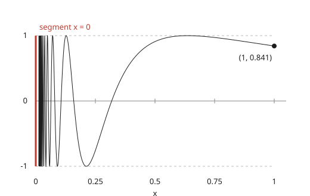

# Connected and path-connected: one piece, and one piece you can walk across

[Syllabus](../../../SYLLABUS.md) → [Topology](../README.md) → [Topological Spaces](../README.md#s02) → Connected and path-connected

---

## General Overview

Draw the graph of $`y = \sin(1/x)`$, starting at $`x = 1`$, where the height is 0.841470985, and moving left towards $`x = 0`$. The curve starts to wave, and the waves get tighter. Below $`x = 0.01`$ it still reaches a peak of height 1, at $`x = 0.009794150`$, and a trough of height −1, at $`x = 0.009501788`$. Below $`x = 0.001`$ it does the same again. It never settles.

Now add the upright segment on the $`y`$-axis, from $`(0, -1)`$ to $`(0, 1)`$. The whole set is the **topologist's sine curve**. The waves crowd so close to the segment that no knife can cut the set into two separate parts. Yet a walker on the waves can never step onto the segment: each time the walker gets closer, the curve swings the full height again.

Topology has a word for each fact. A space is **connected** when it cannot be split into two separate open parts: it is one piece. It is **path-connected** when any two of its points can be joined by a walk inside it. Walking implies one piece. The sine curve shows that one piece does not imply walking.

This card also splits a space into its **components**, its largest one-piece parts. Counting them is an **invariant**: a number that a homeomorphism (a continuous map with a continuous inverse) cannot change. Remove one point from the circle and one piece is left. Remove one point from the line and two pieces are left. So the circle and the line are different spaces.

**A space is connected when no two disjoint non-empty open sets cover it, and path-connected when a continuous path joins any two of its points; paths imply connected, but the topologist's sine curve is connected with no path from its segment to its graph.**

**What kind of fact this is:** two definitions, and theorems proved on this card in Why it works: the interval is connected, path-connected spaces are connected, and the sine curve is connected but not path-connected. The piece counts for the finite models of the circle and the line are proved by an exhaustive check in the code.

### The picture: the topologist's sine curve

<p align="center"></p>

The drawing is to scale, with 400 drawing units per unit of $`x`$ and 110 per unit of $`y`$. It stops at $`x = 0.0125`$; closer in, the waves are too tight to draw, so the drawing looks solid there. The space is not solid: between any two waves there is empty plane.

---

## The formula

Notation first, in words. A space $`X`$ has open sets, as on [Topological space](01-topological-spaces-and-bases.md). A subset of $`X`$ uses the **subspace topology**: its open sets are the open sets of $`X`$ cut down to it ([Subspace, product and quotient](04-subspace-product-and-quotient-topologies.md)). A **path** from $`p`$ to $`q`$ is a continuous map $`\gamma`$ (the Greek letter gamma) from the interval $`[0, 1]`$ into $`X`$, with $`\gamma(0) = p`$ and $`\gamma(1) = q`$. Read $`t`$ in $`[0, 1]`$ as time.

```math
X \text{ is connected} \iff \text{there are no open } U, V \subseteq X \text{ with } U \neq \varnothing,\ V \neq \varnothing,\ U \cap V = \varnothing,\ U \cup V = X
```

**Read it aloud:** a space is connected when it cannot be cut into two non-empty open sets that share no point.

Such a pair $`U, V`$ is called a **separation**. Each of $`U`$ and $`V`$ is then both open and closed, since each is everything outside the other. So an equivalent test is: the only sets that are both open and closed are $`\varnothing`$ and $`X`$.

```math
X \text{ is path-connected} \iff \text{for all } p, q \in X \text{ there is a continuous } \gamma : [0, 1] \to X \text{ with } \gamma(0) = p,\ \gamma(1) = q
```

**Read it aloud:** a space is path-connected when any point can walk to any other point, continuously, without leaving the space.

The **component** of a point $`p`$, written $`C(p)`$, is the union of all connected subsets that contain $`p`$. Step 3 shows it is connected, so it is the largest connected set around $`p`$. The **path component** is the same with paths: every point that $`p`$ can walk to.

The card's example, with the graph $`G`$ and the segment $`L`$:

```math
S = G \cup L, \qquad G = \{\, (x, \sin(1/x)) : 0 < x \le 1 \,\}, \qquad L = \{\, (0, y) : -1 \le y \le 1 \,\}
```

**Read it aloud:** the sine curve is the wavy graph for $`x`$ from just above 0 up to 1, together with the upright segment at $`x = 0`$.

| Symbol | Plain meaning | In our example | Push it up and the answer… |
| --- | --- | --- | --- |
| $`X`$ | the space being tested | the sine curve $`S`$; the circle $`S^1`$; the line | — |
| $`U`$, $`V`$ | a candidate separation: two open sets | $`\{t : 2t^2 < 1\}`$ and $`\{t : 2t^2 \ge 1\}`$ in $`[0, 1]`$ | — |
| $`p`$, $`q`$ | two points to be joined | $`(0, 0)`$ and $`(1, 0.841)`$ | — |
| $`\gamma`$, $`h`$ | a path: a continuous walk in time; in Step 3, a homeomorphism | no $`\gamma`$ from $`(0, 0)`$ to $`(1, 0.841)`$; no $`h`$ from circle to line | — |
| $`t`$, $`t_0`$, $`t_1`$, $`t_\pm`$, $`s`$ | a time in $`[0, 1]`$; the last time a path is on the segment; the end of the short while after it; the times it would hit a peak and a trough; the seam, a least upper bound | $`s = 1/\sqrt{2} = 0.707106781`$ | — |
| $`x`$, $`y`$; $`x_k`$, $`x_\pm`$ | coordinates in the plane; chosen points of $`G`$ near the segment, at height 0.5, 1 or −1 | $`x = 0.009794150`$, $`y = 1`$ | smaller $`x`$: faster waves |
| $`S`$ | the topologist's sine curve | $`G \cup L`$ | — |
| $`G`$, $`L`$ | the wavy graph; the upright segment | $`G`$ starts at $`(1, 0.841470985)`$ | — |
| $`\overline{G}`$ | the closure of $`G`$: every point it touches | holds all of $`S = G \cup L`$ | — |
| $`\delta`$, $`\varepsilon`$ | a window width near $`x = 0`$; a window of time after $`t_0`$ | 0.1, 0.01, 0.001 | smaller: still a full swing inside |
| $`k`$ | which wave, counting from $`x = 1`$; in Step 3, how many cut points are removed | 16 for the first peak below 0.01 | bigger: closer to $`x = 0`$ |
| $`C(p)`$ | the component of $`p`$: its largest one-piece set | $`C((0, 0)) = S`$ | — |

### When it holds

- **The open sets must be named.** A two-point space with every set open is two pieces. The same two points with only $`\varnothing`$ and the whole set open is one piece.
- **The line must have no gaps.** Keep only the fractions in $`[0, 1]`$, and $`\{2t^2 < 1\}`$ and $`\{2t^2 > 1\}`$ split them into two open sets. No fraction sits on the seam $`1/\sqrt{2}`$ ([The real numbers have no gaps](../../01-Foundations/02-The%20Number%20Line/04-real-numbers-no-gaps.md)).
- **Open means open in the subset.** In the circle minus its east and west points, the open top arc is open in what is left. The two arcs separate it, though neither arc is open in the plane.
- **Connected gives paths only with local help.** For an open set of the plane the two words agree (Step 3). For the sine curve they do not: no small window around a segment point is one walkable piece.
- **Paths always give connected.** That direction holds in every space (Step 2).

---

## Why it works

### Step 0: one piece means no clean cut

A separation is a clean cut: two open parts, neither touching the other. In the interval, any attempted cut has a seam, and the seam belongs to one side while the other side crowds up against it. So the side holding the seam is not open there. A path drags this fact into any space: a cut of the space would cut the path's interval.

### Step 1: the interval $`[0, 1]`$ is connected

Suppose $`U`$ and $`V`$ separate $`[0, 1]`$, with $`0`$ in $`U`$. Let $`s`$ be the least upper bound (the sup) of the times $`t`$ with all of $`[0, t]`$ inside $`U`$. The reals have no gaps, so $`s`$ exists.

- If $`s`$ is in $`U`$: $`U`$ is open, so a window round $`s`$ lies in $`U`$. Then $`[0, t]`$ stays in $`U`$ a little past $`s`$, against the choice of $`s`$, unless $`s = 1`$. But $`s = 1`$ in $`U`$ puts all of $`[0, 1]`$ in $`U`$ and leaves $`V`$ empty.
- If $`s`$ is in $`V`$: $`V`$ is open, so a window round $`s`$ lies in $`V`$. Times just below $`s`$ lie in some $`[0, t]`$ inside $`U`$. They would be in both $`U`$ and $`V`$.

Both cases fail, so no separation exists.

The code tries the cut $`U = \{t : 2t^2 < 1\}`$, $`V = \{t : 2t^2 \ge 1\}`$ and halves onto its seam. After 30 halvings the seam is pinned between 0.707106780260 and 0.707106781192: it is $`1/\sqrt{2}`$. It lies in $`V`$, and every window round it meets $`U`$, so $`V`$ is not open. On the fractions the seam is missing, and the cut works.

The [Intermediate value theorem](../../06-Calculus%20and%20analysis/01-Limits%20and%20Continuity/06-intermediate-value-theorem.md) is this step seen through a function: a continuous function cannot skip a value, because skipping would cut the interval in two.

### Step 2: path-connected implies connected

Suppose $`U`$ and $`V`$ separate a path-connected $`X`$. Pick $`p`$ in $`U`$, $`q`$ in $`V`$, and a path $`\gamma`$ from $`p`$ to $`q`$. The pre-images $`\gamma^{-1}(U)`$ and $`\gamma^{-1}(V)`$ are open, because $`\gamma`$ is continuous ([Continuity by pre-images, and homeomorphism](03-continuity-and-homeomorphism.md)). They share no time, they cover $`[0, 1]`$, and they hold $`0`$ and $`1`$. That separates $`[0, 1]`$, which Step 1 forbids.

The house example follows at once. The circle $`S^1`$ is the path $`t \mapsto (\cos 2\pi t, \sin 2\pi t)`$, the interval with its ends glued. Any two points on it are joined by an arc of that path, so the circle is path-connected and connected. The torus $`S^1 \times S^1`$ is too: to go from $`(a, b)`$ to $`(c, d)`$, walk the first factor from $`a`$ to $`c`$, then the second from $`b`$ to $`d`$.

### Step 3: components split any space

Connected sets that share a point have a connected union. A separation of the union would put each set wholly on one side, the side holding the shared point. So every set is on that side, and the other side is empty.

So the component $`C(p)`$ is connected, and two components either coincide or share no point. The components split the space. Each path component sits inside one component, because a path's image is connected by Step 2.

**The circle against the line.** Remove $`k`$ points from the circle, with $`k \ge 1`$. What is left is $`k`$ open arcs. Each arc is path-connected, and each is open in what is left, so the arcs are the components: $`k`$ pieces. Remove one point from the line, and two open rays are left: two pieces.

A homeomorphism $`h`$ from the circle to the line would carry the circle minus a point $`p`$ onto the line minus $`h(p)`$, piece for piece. That is one piece against two. So no such $`h`$ exists: the circle and the line are not homeomorphic.

The code checks this on finite models. It squeezes each open arc to one point and keeps the cut points, as on [Closure, interior and boundary](02-closure-interior-and-boundary.md). It tests every subset, so the counts are proved for those models.

**Open sets of the plane.** The regions card calls a set connected when any two points join by a path inside it ([Limits and regions in the plane](../../07-Complex%20analysis/01-Complex%20Numbers%20and%20the%20Plane/06-complex-limits-series-and-regions.md)). That is path-connectedness. For an open set of the plane the two words agree. The points that $`p`$ can walk to form an open set, since a small disc round each is walkable. The points it cannot reach also form an open set, for the same reason. If the open set is connected, the second set is empty.

### Step 4: the sine curve is connected

The graph $`G`$ is the image of $`(0, 1]`$ under the continuous map $`x \mapsto (x, \sin(1/x))`$, so it is path-connected, and connected by Step 2.

Every point of the segment is a limit of points of $`G`$. For the point $`(0, 0.5)`$, take $`x_k = 1/(\pi/6 + 2\pi k)`$. There $`\sin(1/x_k) = 0.5`$, and $`x_k`$ shrinks to 0: 0.015783961 at $`k = 10`$, 0.000159142 at $`k = 1000`$. So every point of $`S`$ lies in $`\overline{G}`$, the closure of $`G`$.

A set caught between a connected set and its closure is connected. Suppose $`U`$ and $`V`$ separate $`S`$. The connected $`G`$ lies wholly in one side, say $`U`$. Then $`V`$ is a non-empty open part of $`S`$ that misses $`G`$. But every point of $`S`$ is touched by $`G`$, so every open set around it meets $`G`$. That is impossible, so $`S`$ is connected. The sine curve has one component.

### Step 5: no path reaches the segment

Suppose a path $`\gamma(t) = (x(t), y(t))`$ runs from $`(0, 0)`$ on the segment to $`(1, \sin 1)`$ on the graph. Let $`t_0`$ be the last time it is on the segment. After $`t_0`$ it is on the graph, so $`y = \sin(1/x)`$ there.

Continuity at $`t_0`$ keeps $`y(t)`$ within $`1/2`$ of $`y(t_0)`$ for a short while. In that while, $`x(t)`$ climbs from 0 to some positive value. By the intermediate value theorem it passes every smaller value, including a peak and a trough of the waves. So $`y`$ is 1 at one moment and −1 at another, both within $`1/2`$ of $`y(t_0)`$. They would be less than 1 apart, yet they are 2 apart.

<details>
<summary>Detailed proof: the last time on the segment</summary>

Let $`\gamma = (x, y) : [0, 1] \to S`$ be continuous with $`\gamma(0) = (0, 0)`$ and $`\gamma(1) = (1, \sin 1)`$.

The set of times with $`x(t) = 0`$ is closed, being the pre-image of a closed set, and it holds 0. Let $`t_0`$ be its largest member. Then $`x(t_0) = 0`$, $`t_0 < 1`$, and $`x(t) > 0`$ for every $`t > t_0`$, so there $`y(t) = \sin(1/x(t))`$.

Continuity of $`y`$ at $`t_0`$, with tolerance $`1/2`$, gives a window width $`\varepsilon > 0`$ with

$`\displaystyle |y(t) - y(t_0)| < \tfrac{1}{2} \quad \text{whenever } t_0 \le t \le t_0 + \varepsilon.`$

Set $`t_1 = t_0 + \varepsilon`$ (or 1, if that is smaller) and $`\delta = x(t_1) > 0`$. Choose $`k`$ so large that

$`\displaystyle x_+ = \frac{1}{\pi/2 + 2\pi k} < \delta, \qquad x_- = \frac{1}{3\pi/2 + 2\pi k} < \delta.`$

The function $`x`$ is continuous on $`[t_0, t_1]`$ with $`x(t_0) = 0`$ and $`x(t_1) = \delta`$. By the intermediate value theorem there are times $`t_+`$ and $`t_-`$ in $`(t_0, t_1)`$ with $`x(t_+) = x_+`$ and $`x(t_-) = x_-`$. Then $`y(t_+) = 1`$ and $`y(t_-) = -1`$, so

$`\displaystyle 2 = |y(t_+) - y(t_-)| \le |y(t_+) - y(t_0)| + |y(t_0) - y(t_-)| < 1.`$

That is false, so no such path exists. The same argument starts from any point of the segment and ends at any point of the graph.

</details>

So the sine curve has two path components, the graph and the segment, inside its one component.

### Step 6: which maps keep these

A continuous image of a connected space is connected, and a continuous image of a path-connected space is path-connected. The first is Step 2's pre-image argument; [What compactness and connectedness buy](08-images-of-compact-and-connected-sets.md) puts it to work. A homeomorphism keeps everything on this card: connectedness, paths, and the number of components, also after removing a point. That is why the piece count in Step 3 tells the circle from the line.

---

## Worked numbers, by hand

The window $`x < 0.01`$, near the segment.

| Step | Arithmetic | Value |
| --- | --- | --- |
| start of the graph | $`\sin 1`$ | 0.841470985 |
| first peak below 0.01 | $`x = 1/(\pi/2 + 2\pi k)`$ with $`k = 16`$ | $`x = 0.009794150`$, $`y = 1`$ |
| first trough below 0.01 | $`x = 1/(3\pi/2 + 2\pi k)`$ with $`k = 16`$ | $`x = 0.009501788`$, $`y = -1`$ |
| swing inside the window | $`1 - (-1)`$ | 2 |
| what a path allows near the segment | within $`1/2`$ either side | swing below 1 |
| a segment point is touched | $`x = 1/(\pi/6 + 2\pi k)`$ with $`k = 100`$: 0.001590224, $`y = 0.5`$ | 0.001590224 from $`(0, 0.5)`$ |
| result | touched, but never walked to | **one component, two path components** |

Every window next to the segment, however thin, holds a full swing of height 2. The curve touches the segment everywhere and never arrives at it.

**Splitting the circle into components.** Mark four cut points on the circle, at east, north, west and south. Squeeze each of the four open arcs between them to one point. That gives a space of 8 points; a cut point's smallest open set is itself plus its two neighbouring arcs. Remove cut points one at a time.

| Step | Arithmetic | Value |
| --- | --- | --- |
| whole circle | subsets both open and closed: 2 of 256, the empty set and everything | 1 piece |
| remove east | the 7 points left still chain round through each cut point | 1 piece, 7 points |
| remove north too | the arc between east and north is cut off on both sides | 2 pieces: 1 point and 5 points |
| remove west too | the arc from north to west is cut off as well | 3 pieces: 3, 1 and 1 points |
| remove south too | only the four arcs are left, none touching another | **4 pieces** |

With $`k \ge 1`$ cut points removed, $`k`$ pieces are left, exactly as for the real circle in Step 3. The line model with one cut point removed leaves 2 pieces.

### What breaks if you drop a piece

| Mistake | Comes out at | What went wrong |
| --- | --- | --- |
| Drop the gap-free line: use fractions only | split at $`1/\sqrt{2}`$; no fraction with bottom up to 1000 on the seam: 2 pieces | without completeness the interval falls apart |
| Damp the waves: $`y = x \sin(1/x)`$ | highest height between 0.005 and 0.01 is 0.009795: a path exists | the swing shrinks to 0, so the walk can arrive |
| Treat the circle and the line as the same space | one cut point out: circle 1 piece, line 2 pieces | the piece count is an invariant |
| Count path components as components | sine curve: 2, not 1 | walkable is stronger than one piece |

The code prints the first three; the fourth rests on Steps 4 and 5.

---

## Code, from first principles, and it actually runs

Part 1 builds finite models of the circle (8 points) and the line (9 points), with open arcs as single points. It finds the pieces two independent ways: as the union of every connected subset round each point, found by testing every split, and by joining each point to its smallest open set with union-find. Every subset is tested, so these counts are proved for the models. Part 2 halves $`[0, 1]`$ onto the seam of the failed cut, and searches every fraction with bottom up to 1000. Part 3 finds peaks and troughs in three windows two ways, by formula and by a scan of 10001 points, and checks that the scan's highest and lowest points sit within one scan step of a formula peak and trough. That part is checked on 3 windows; the proof is Step 5.

### Python

```python
# Connected and path-connected -- the check behind the card.  Standard library
# only.  Part 1 cuts the circle and the line into finitely many pieces (open
# arcs and cut points) and splits what is left into components two independent
# ways; every subset is tested, so those counts are proved for the finite
# models.  Part 2 halves [0, 1] onto the seam of a split that fails.  Part 3
# measures the topologist's sine curve; it illustrates the proofs on the card.
from fractions import Fraction as F
import math

def minimal(p, m):                         # smallest open set round point p
    return {p} if p % 2 == 0 else {(p - 1) % m, p, (p + 1) % m}

def is_open(s, y, m):                      # open in the subspace y
    return all(minimal(p, m) & y <= s for p in s)

def subsets(y):
    pts = sorted(y)
    return [frozenset(p for i, p in enumerate(pts) if b >> i & 1) for b in range(1 << len(pts))]

def connected(y, m):                       # no split into two non-empty open pieces
    return not any(s and s != y and is_open(s, y, m) and is_open(y - s, y, m) for s in subsets(y))

def pieces_by_splits(y, m):                # road 1: union of every connected set round p
    good = [s for s in subsets(y) if s and connected(s, m)]
    return sorted({frozenset().union(*[s for s in good if p in s]) for p in y}, key=min)

def pieces_by_joins(y, m):                 # road 2: join each point to its smallest open set
    boss = {p: p for p in y}
    def find(p):
        while boss[p] != p:
            p = boss[p]
        return p
    for p in sorted(y):
        for q in sorted(minimal(p, m) & y):
            boss[find(q)] = find(p)
    return sorted({frozenset(q for q in y if find(q) == find(p)) for p in y}, key=min)

print("Part 1: the circle and the line cut into open arcs (even) and cut points (odd)")
n = 4
circle, line = 2 * n, 2 * n + 1            # the line's two end pieces are open rays
whole = frozenset(range(circle))
clopen = [s for s in subsets(whole) if is_open(s, whole, circle) and is_open(whole - s, whole, circle)]
print(f"circle of {circle} points: open-and-closed subsets {len(clopen)} of {2 ** circle}: connected {'yes' if len(clopen) == 2 else 'no'}")
counts = []
for k in range(n + 1):
    y = whole - {2 * j + 1 for j in range(k)}
    a, b = pieces_by_splits(y, circle), pieces_by_joins(y, circle)
    assert a == b                                                        # two roads agree
    counts.append(len(a))
    print(f"circle minus {k} cut points: pieces {len(a)}, sizes {[len(c) for c in a]}")
line_counts = []
for k in range(3):
    y = frozenset(range(line)) - {2 * j + 1 for j in range(k)}
    a, b = pieces_by_splits(y, line), pieces_by_joins(y, line)
    assert a == b
    line_counts.append(len(a))
    print(f"line minus {k} cut points: pieces {len(a)}, sizes {[len(c) for c in a]}")
print(f"one cut point out: circle pieces {counts[1]}, line pieces {line_counts[1]}: not homeomorphic")
assert len(clopen) == 2 and counts == [1, 1, 2, 3, 4] and line_counts == [1, 2, 3]

print("Part 2: try to split [0, 1] at U = {t : 2t^2 < 1}, V = {t : 2t^2 >= 1}")
a, i = 0, 0                                # the bracket is a/2^i to (a+1)/2^i
while i < 30:
    a, i = (2 * a + 1, i + 1) if 2 * (2 * a + 1) ** 2 < 4 ** (i + 1) else (2 * a, i + 1)
    if i in (10, 20, 30):
        print(f"after {i} halvings: {a}/2^{i} to {a + 1}/2^{i}"
              f" = 0.{a * 10 ** 12 // 2 ** i:012d} to 0.{(a + 1) * 10 ** 12 // 2 ** i:012d}")
assert 2 * a * a < 4 ** i <= 2 * (a + 1) ** 2                            # seam inside
seam = math.sqrt(0.5)
assert a / 2 ** i < seam < (a + 1) / 2 ** i                             # bracket meets root
print(f"the seam: 1/root 2 = {seam:.12f}; in V, and every window round it meets U")
none = all(2 * p * p != q * q for q in range(1, 1001) for p in range(q + 1))
print(f"no fraction p/q in [0, 1] with q up to 1000 sits on the seam: {'yes' if none else 'no'}")
print("so the fractions in [0, 1] do split: U and V are both open there")
assert none

print("Part 3: the topologist's sine curve, y = sin(1/x) for 0 < x <= 1, plus x = 0")
PI = math.pi
print(f"start of the graph: (1, {math.sin(1.0):.9f})")
for d in (0.1, 0.01, 0.001):
    kp, km = 0, 0
    while 1 / (PI / 2 + 2 * PI * kp) >= d:
        kp += 1
    while 1 / (3 * PI / 2 + 2 * PI * km) >= d:
        km += 1
    xp, xm = 1 / (PI / 2 + 2 * PI * kp), 1 / (3 * PI / 2 + 2 * PI * km)
    yp, ym = math.sin(1 / xp), math.sin(1 / xm)
    print(f"x below {d}: peak k = {kp} at x = {xp:.9f}, y = {yp:.9f}; trough k = {km} at x = {xm:.9f}, y = {ym:.9f}")
    hi = max(math.sin(1 / d + j / (d * 10000)) for j in range(10001))
    lo = min(math.sin(1 / d + j / (d * 10000)) for j in range(10001))
    damp = max(abs(math.sin(u) / u) for u in (1 / d + j / (d * 10000) for j in range(10001)))
    print(f"  scan of 10001 points, x from {d / 2} to {d}: highest y {hi:.6f}, lowest y {lo:.6f};"
          f" damped x sin(1/x) at most {damp:.6f}")
    step = 1 / (d * 10000)                                               # scan step in 1/x
    u_hi = max((1 / d + j / (d * 10000) for j in range(10001)), key=math.sin)   # where it peaks
    u_lo = min((1 / d + j / (d * 10000) for j in range(10001)), key=math.sin)
    k_hi, k_lo = round((u_hi - PI / 2) / (2 * PI)), round((u_lo - 3 * PI / 2) / (2 * PI))
    gap_hi, gap_lo = abs(u_hi - PI / 2 - 2 * PI * k_hi), abs(u_lo - 3 * PI / 2 - 2 * PI * k_lo)
    print(f"  scan's highest point x = {1 / u_hi:.9f}: formula peak k = {k_hi}; lowest x = {1 / u_lo:.9f}:"
          f" formula trough k = {k_lo}; each within one scan step: {'yes' if max(gap_hi, gap_lo) <= step else 'no'}")
    assert xp < d and xm < d and yp > 0.999999 and ym < -0.999999       # formula road
    assert hi > 0.998 and lo < -0.998 and damp <= d                       # scan road
    assert gap_hi <= step and gap_lo <= step                              # the two roads meet
for k in (1, 10, 100, 1000):
    xk = 1 / (PI / 6 + 2 * PI * k)
    print(f"towards (0, 0.5): k = {k}, x = {xk:.9f}, y = {math.sin(1 / xk):.9f}, distance {xk:.9f}")
    assert abs(math.sin(1 / xk) - 0.5) < 1e-9
print("components of the curve: 1; path components: 2 (the graph, and the segment)")
print("figure, scale 400 per unit of x, 110 per unit of y; graph from (1, 0.841470985) drawn to x = 0.0125; segment (0, -1) to (0, 1);"
      f" peaks x = {2 / PI:.9f}, {2 / (5 * PI):.9f}; trough x = {2 / (3 * PI):.9f}")
print("ALL CHECKS PASS")
```

**Ran 2026-11-14 on macOS, Python 3.14.10, standard library only. All checks passed. Output, pasted from the run:**

```
Part 1: the circle and the line cut into open arcs (even) and cut points (odd)
circle of 8 points: open-and-closed subsets 2 of 256: connected yes
circle minus 0 cut points: pieces 1, sizes [8]
circle minus 1 cut points: pieces 1, sizes [7]
circle minus 2 cut points: pieces 2, sizes [5, 1]
circle minus 3 cut points: pieces 3, sizes [3, 1, 1]
circle minus 4 cut points: pieces 4, sizes [1, 1, 1, 1]
line minus 0 cut points: pieces 1, sizes [9]
line minus 1 cut points: pieces 2, sizes [1, 7]
line minus 2 cut points: pieces 3, sizes [1, 1, 5]
one cut point out: circle pieces 1, line pieces 2: not homeomorphic
Part 2: try to split [0, 1] at U = {t : 2t^2 < 1}, V = {t : 2t^2 >= 1}
after 10 halvings: 724/2^10 to 725/2^10 = 0.707031250000 to 0.708007812500
after 20 halvings: 741455/2^20 to 741456/2^20 = 0.707106590270 to 0.707107543945
after 30 halvings: 759250124/2^30 to 759250125/2^30 = 0.707106780260 to 0.707106781192
the seam: 1/root 2 = 0.707106781187; in V, and every window round it meets U
no fraction p/q in [0, 1] with q up to 1000 sits on the seam: yes
so the fractions in [0, 1] do split: U and V are both open there
Part 3: the topologist's sine curve, y = sin(1/x) for 0 < x <= 1, plus x = 0
start of the graph: (1, 0.841470985)
x below 0.1: peak k = 2 at x = 0.070735530, y = 1.000000000; trough k = 1 at x = 0.090945682, y = -1.000000000
  scan of 10001 points, x from 0.05 to 0.1: highest y 1.000000, lowest y -1.000000; damped x sin(1/x) at most 0.091325
  scan's highest point x = 0.070736366: formula peak k = 2; lowest x = 0.057873720: formula trough k = 2; each within one scan step: yes
x below 0.01: peak k = 16 at x = 0.009794150, y = 1.000000000; trough k = 16 at x = 0.009501788, y = -1.000000000
  scan of 10001 points, x from 0.005 to 0.01: highest y 1.000000, lowest y -1.000000; damped x sin(1/x) at most 0.009795
  scan's highest point x = 0.005633803: formula peak k = 28; lowest x = 0.008488244: formula trough k = 18; each within one scan step: yes
x below 0.001: peak k = 159 at x = 0.000999403, y = 1.000000000; trough k = 159 at x = 0.000996275, y = -1.000000000
  scan of 10001 points, x from 0.0005 to 0.001: highest y 1.000000, lowest y -1.000000; damped x sin(1/x) at most 0.000999
  scan's highest point x = 0.000625978: formula peak k = 254; lowest x = 0.000804829: formula trough k = 197; each within one scan step: yes
towards (0, 0.5): k = 1, x = 0.146912255, y = 0.500000000, distance 0.146912255
towards (0, 0.5): k = 10, x = 0.015783961, y = 0.500000000, distance 0.015783961
towards (0, 0.5): k = 100, x = 0.001590224, y = 0.500000000, distance 0.001590224
towards (0, 0.5): k = 1000, x = 0.000159142, y = 0.500000000, distance 0.000159142
components of the curve: 1; path components: 2 (the graph, and the segment)
figure, scale 400 per unit of x, 110 per unit of y; graph from (1, 0.841470985) drawn to x = 0.0125; segment (0, -1) to (0, 1); peaks x = 0.636619772, 0.127323954; trough x = 0.212206591
ALL CHECKS PASS
```

### Rust

Same numbers, same labels, built with `rustc --edition 2021 -O`.

```rust
// Connected and path-connected -- the same check as the Python, in Rust.  No
// crates.  Part 1 cuts the circle and the line into finitely many pieces (open
// arcs and cut points) and splits what is left into components two independent
// ways; every subset is tested, so those counts are proved for the finite
// models.  Part 2 halves [0, 1] onto the seam of a split that fails.  Part 3
// measures the topologist's sine curve; it illustrates the proofs on the card.
// A set of points is a bit mask: point p is bit p.
use std::f64::consts::PI;

fn minimal(p: u32, m: u32) -> u32 {               // smallest open set round point p
    if p % 2 == 0 { 1 << p } else { (1 << ((p + m - 1) % m)) | (1 << p) | (1 << ((p + 1) % m)) }
}
fn is_open(s: u32, y: u32, m: u32) -> bool {      // open in the subspace y
    (0..m).filter(|&p| s >> p & 1 == 1).all(|p| minimal(p, m) & y & !s == 0)
}
fn subsets(y: u32) -> Vec<u32> { (0..1u32 << 9).filter(|&s| s & !y == 0).collect() }
fn connected(y: u32, m: u32) -> bool {            // no split into two non-empty open pieces
    !subsets(y).iter().any(|&s| s != 0 && s != y && is_open(s, y, m) && is_open(y & !s, y, m))
}
fn sorted_pieces(mut v: Vec<u32>) -> Vec<u32> {
    v.sort_by_key(|&c| c.trailing_zeros());
    v.dedup();
    v
}
fn pieces_by_splits(y: u32, m: u32) -> Vec<u32> { // road 1: union of every connected set round p
    let good: Vec<u32> = subsets(y).into_iter().filter(|&s| s != 0 && connected(s, m)).collect();
    sorted_pieces((0..m).filter(|&p| y >> p & 1 == 1)
        .map(|p| good.iter().filter(|&&s| s >> p & 1 == 1).fold(0, |a, &s| a | s)).collect())
}
fn find(boss: &Vec<u32>, mut p: u32) -> u32 {
    while boss[p as usize] != p { p = boss[p as usize]; }
    p
}
fn pieces_by_joins(y: u32, m: u32) -> Vec<u32> {  // road 2: join each point to its smallest open set
    let mut boss: Vec<u32> = (0..m).collect();
    for p in (0..m).filter(|&p| y >> p & 1 == 1) {
        for q in (0..m).filter(|&q| (minimal(p, m) & y) >> q & 1 == 1) {
            let (rq, rp) = (find(&boss, q), find(&boss, p));
            boss[rq as usize] = rp;
        }
    }
    sorted_pieces((0..m).filter(|&p| y >> p & 1 == 1)
        .map(|p| (0..m).filter(|&q| y >> q & 1 == 1 && find(&boss, q) == find(&boss, p)).fold(0, |a, q| a | 1 << q))
        .collect())
}
fn sizes(v: &Vec<u32>) -> Vec<u32> { v.iter().map(|c| c.count_ones()).collect() }
fn yn(b: bool) -> &'static str { if b { "yes" } else { "no" } }

fn main() {
    println!("Part 1: the circle and the line cut into open arcs (even) and cut points (odd)");
    let n = 4u32;
    let (circle, line) = (2 * n, 2 * n + 1);      // the line's two end pieces are open rays
    let whole = (1u32 << circle) - 1;
    let clopen = subsets(whole).iter().filter(|&&s| is_open(s, whole, circle) && is_open(whole & !s, whole, circle)).count();
    println!("circle of {} points: open-and-closed subsets {} of {}: connected {}", circle, clopen, 1 << circle, yn(clopen == 2));
    let mut counts = vec![];
    for k in 0..=n {
        let y = whole & !(0..k).fold(0, |a, j| a | 1 << (2 * j + 1));
        let (a, b) = (pieces_by_splits(y, circle), pieces_by_joins(y, circle));
        assert!(a == b);                                                 // two roads agree
        counts.push(a.len());
        println!("circle minus {} cut points: pieces {}, sizes {:?}", k, a.len(), sizes(&a));
    }
    let mut line_counts = vec![];
    for k in 0..3u32 {
        let y = ((1u32 << line) - 1) & !(0..k).fold(0, |a, j| a | 1 << (2 * j + 1));
        let (a, b) = (pieces_by_splits(y, line), pieces_by_joins(y, line));
        assert!(a == b);
        line_counts.push(a.len());
        println!("line minus {} cut points: pieces {}, sizes {:?}", k, a.len(), sizes(&a));
    }
    println!("one cut point out: circle pieces {}, line pieces {}: not homeomorphic", counts[1], line_counts[1]);
    assert!(clopen == 2 && counts == vec![1, 1, 2, 3, 4] && line_counts == vec![1, 2, 3]);

    println!("Part 2: try to split [0, 1] at U = {{t : 2t^2 < 1}}, V = {{t : 2t^2 >= 1}}");
    let (mut a, mut i): (i128, u32) = (0, 0);     // the bracket is a/2^i to (a+1)/2^i
    while i < 30 {
        let mid = 2 * a + 1;
        a = if 2 * mid * mid < 4i128.pow(i + 1) { mid } else { 2 * a };
        i += 1;
        if i == 10 || i == 20 || i == 30 {
            let t = 10i128.pow(12);
            println!("after {} halvings: {}/2^{} to {}/2^{} = 0.{:012} to 0.{:012}",
                     i, a, i, a + 1, i, a * t / (1i128 << i), (a + 1) * t / (1i128 << i));
        }
    }
    assert!(2 * a * a < 4i128.pow(i) && 4i128.pow(i) <= 2 * (a + 1) * (a + 1));   // seam inside
    let seam = 0.5f64.sqrt();
    let p2 = (1i128 << i) as f64;
    assert!((a as f64) / p2 < seam && seam < ((a + 1) as f64) / p2);   // bracket meets root
    println!("the seam: 1/root 2 = {:.12}; in V, and every window round it meets U", seam);
    let none = (1..=1000i64).all(|q| (0..=q).all(|p| 2 * p * p != q * q));
    println!("no fraction p/q in [0, 1] with q up to 1000 sits on the seam: {}", yn(none));
    println!("so the fractions in [0, 1] do split: U and V are both open there");
    assert!(none);

    println!("Part 3: the topologist's sine curve, y = sin(1/x) for 0 < x <= 1, plus x = 0");
    println!("start of the graph: (1, {:.9})", 1.0f64.sin());
    for d in [0.1f64, 0.01, 0.001] {
        let (mut kp, mut km) = (0.0f64, 0.0f64);
        while 1.0 / (PI / 2.0 + 2.0 * PI * kp) >= d { kp += 1.0; }
        while 1.0 / (3.0 * PI / 2.0 + 2.0 * PI * km) >= d { km += 1.0; }
        let (xp, xm) = (1.0 / (PI / 2.0 + 2.0 * PI * kp), 1.0 / (3.0 * PI / 2.0 + 2.0 * PI * km));
        let (yp, ym) = ((1.0 / xp).sin(), (1.0 / xm).sin());
        println!("x below {}: peak k = {} at x = {:.9}, y = {:.9}; trough k = {} at x = {:.9}, y = {:.9}", d, kp, xp, yp, km, xm, ym);
        let us: Vec<f64> = (0..10001).map(|j| 1.0 / d + j as f64 / (d * 10000.0)).collect();
        let hi = us.iter().map(|u| u.sin()).fold(f64::MIN, f64::max);
        let lo = us.iter().map(|u| u.sin()).fold(f64::MAX, f64::min);
        let damp = us.iter().map(|u| (u.sin() / u).abs()).fold(0.0, f64::max);
        println!("  scan of 10001 points, x from {} to {}: highest y {:.6}, lowest y {:.6}; damped x sin(1/x) at most {:.6}",
                 d / 2.0, d, hi, lo, damp);
        let step = 1.0 / (d * 10000.0);                                 // scan step in 1/x
        let (mut u_hi, mut u_lo) = (us[0], us[0]);                      // where the scan peaks
        for &u in &us { if u.sin() > u_hi.sin() { u_hi = u } if u.sin() < u_lo.sin() { u_lo = u } }
        let (k_hi, k_lo) = (((u_hi - PI / 2.0) / (2.0 * PI)).round(), ((u_lo - 3.0 * PI / 2.0) / (2.0 * PI)).round());
        let (gap_hi, gap_lo) = ((u_hi - PI / 2.0 - 2.0 * PI * k_hi).abs(), (u_lo - 3.0 * PI / 2.0 - 2.0 * PI * k_lo).abs());
        println!("  scan's highest point x = {:.9}: formula peak k = {}; lowest x = {:.9}: formula trough k = {}; each within one scan step: {}",
                 1.0 / u_hi, k_hi, 1.0 / u_lo, k_lo, yn(gap_hi.max(gap_lo) <= step));
        assert!(xp < d && xm < d && yp > 0.999999 && ym < -0.999999);  // formula road
        assert!(hi > 0.998 && lo < -0.998 && damp <= d);                // scan road
        assert!(gap_hi <= step && gap_lo <= step);                      // the two roads meet
    }
    for k in [1.0f64, 10.0, 100.0, 1000.0] {
        let xk = 1.0 / (PI / 6.0 + 2.0 * PI * k);
        println!("towards (0, 0.5): k = {}, x = {:.9}, y = {:.9}, distance {:.9}", k, xk, (1.0 / xk).sin(), xk);
        assert!(((1.0 / xk).sin() - 0.5).abs() < 1e-9);
    }
    println!("components of the curve: 1; path components: 2 (the graph, and the segment)");
    println!("figure, scale 400 per unit of x, 110 per unit of y; graph from (1, 0.841470985) drawn to x = 0.0125; segment (0, -1) to (0, 1); peaks x = {:.9}, {:.9}; trough x = {:.9}",
             2.0 / PI, 2.0 / (5.0 * PI), 2.0 / (3.0 * PI));
    println!("ALL CHECKS PASS");
}
```

**Ran 2026-11-14 on macOS, rustc 1.98.1, no crates. All checks passed. Output, pasted from the run:**

```
Part 1: the circle and the line cut into open arcs (even) and cut points (odd)
circle of 8 points: open-and-closed subsets 2 of 256: connected yes
circle minus 0 cut points: pieces 1, sizes [8]
circle minus 1 cut points: pieces 1, sizes [7]
circle minus 2 cut points: pieces 2, sizes [5, 1]
circle minus 3 cut points: pieces 3, sizes [3, 1, 1]
circle minus 4 cut points: pieces 4, sizes [1, 1, 1, 1]
line minus 0 cut points: pieces 1, sizes [9]
line minus 1 cut points: pieces 2, sizes [1, 7]
line minus 2 cut points: pieces 3, sizes [1, 1, 5]
one cut point out: circle pieces 1, line pieces 2: not homeomorphic
Part 2: try to split [0, 1] at U = {t : 2t^2 < 1}, V = {t : 2t^2 >= 1}
after 10 halvings: 724/2^10 to 725/2^10 = 0.707031250000 to 0.708007812500
after 20 halvings: 741455/2^20 to 741456/2^20 = 0.707106590270 to 0.707107543945
after 30 halvings: 759250124/2^30 to 759250125/2^30 = 0.707106780260 to 0.707106781192
the seam: 1/root 2 = 0.707106781187; in V, and every window round it meets U
no fraction p/q in [0, 1] with q up to 1000 sits on the seam: yes
so the fractions in [0, 1] do split: U and V are both open there
Part 3: the topologist's sine curve, y = sin(1/x) for 0 < x <= 1, plus x = 0
start of the graph: (1, 0.841470985)
x below 0.1: peak k = 2 at x = 0.070735530, y = 1.000000000; trough k = 1 at x = 0.090945682, y = -1.000000000
  scan of 10001 points, x from 0.05 to 0.1: highest y 1.000000, lowest y -1.000000; damped x sin(1/x) at most 0.091325
  scan's highest point x = 0.070736366: formula peak k = 2; lowest x = 0.057873720: formula trough k = 2; each within one scan step: yes
x below 0.01: peak k = 16 at x = 0.009794150, y = 1.000000000; trough k = 16 at x = 0.009501788, y = -1.000000000
  scan of 10001 points, x from 0.005 to 0.01: highest y 1.000000, lowest y -1.000000; damped x sin(1/x) at most 0.009795
  scan's highest point x = 0.005633803: formula peak k = 28; lowest x = 0.008488244: formula trough k = 18; each within one scan step: yes
x below 0.001: peak k = 159 at x = 0.000999403, y = 1.000000000; trough k = 159 at x = 0.000996275, y = -1.000000000
  scan of 10001 points, x from 0.0005 to 0.001: highest y 1.000000, lowest y -1.000000; damped x sin(1/x) at most 0.000999
  scan's highest point x = 0.000625978: formula peak k = 254; lowest x = 0.000804829: formula trough k = 197; each within one scan step: yes
towards (0, 0.5): k = 1, x = 0.146912255, y = 0.500000000, distance 0.146912255
towards (0, 0.5): k = 10, x = 0.015783961, y = 0.500000000, distance 0.015783961
towards (0, 0.5): k = 100, x = 0.001590224, y = 0.500000000, distance 0.001590224
towards (0, 0.5): k = 1000, x = 0.000159142, y = 0.500000000, distance 0.000159142
components of the curve: 1; path components: 2 (the graph, and the segment)
figure, scale 400 per unit of x, 110 per unit of y; graph from (1, 0.841470985) drawn to x = 0.0125; segment (0, -1) to (0, 1); peaks x = 0.636619772, 0.127323954; trough x = 0.212206591
ALL CHECKS PASS
```

The two outputs match line for line.

### Lean

Lean proves Steps 1, 2, 4 and 5 in full, the first for every space, and checks the halving fractions.

- Suppose any two points of a space $`X`$ are joined by a path inside it. Then $`X`$ has no separation, so it is connected.
- Take the interval $`[0, 1]`$ of real numbers. Then it is not empty and has no separation.
- Take the sine curve $`S = G \cup L`$ in the plane. Then $`S`$ is connected.
- Take a point $`p`$ of the segment $`L`$ and a point $`q`$ of the graph $`G`$. Then no path inside $`S`$ runs from $`p`$ to $`q`$.
- Take the fractions the code prints after 10, 20 and 30 halvings. Then each pair has the seam $`1/\sqrt{2}`$ between them.

The piece counts for the circle and the line, the scans and the decimals are left to the Python and Rust checks.

```lean
-- Connected and path-connected: a space in which any two points are joined by a path is connected, the interval [0, 1] is connected, and the topologist's sine curve is connected yet no path joins its segment to its graph.
import Mathlib.Topology.Connected.PathConnected
import Mathlib.Topology.Order.IntermediateValue
import Mathlib.Analysis.SpecialFunctions.Trigonometric.Basic
import Mathlib.Analysis.SpecialFunctions.Trigonometric.Inverse

open Set

/-- The wavy graph `G`: the points `(x, sin (1/x))` with `0 < x ≤ 1`. -/
def sineGraph : Set (ℝ × ℝ) := {p | 0 < p.1 ∧ p.1 ≤ 1 ∧ p.2 = Real.sin (1 / p.1)}

/-- The upright segment `L`: the points `(0, y)` with `-1 ≤ y ≤ 1`. -/
def sineSegment : Set (ℝ × ℝ) := {p | p.1 = 0 ∧ -1 ≤ p.2 ∧ p.2 ≤ 1}

/-- The topologist's sine curve `S = G ∪ L`, a subset of the plane. -/
def sineCurve : Set (ℝ × ℝ) := sineGraph ∪ sineSegment

/-- Paths imply connected: if any two points of a space are joined by a continuous path
inside it, the space cannot be cut into two disjoint non-empty open sets.
(`PreconnectedSpace` is exactly the card's "no separation"; it makes no non-emptiness demand,
just as the card's definitions do not.) -/
theorem path_connected_implies_connected (X : Type*) [TopologicalSpace X]
    (h : ∀ p q : X, Joined p q) : PreconnectedSpace X := by
  refine ⟨?_⟩
  apply isPreconnected_of_forall_pair
  intro x _ y _
  obtain ⟨γ⟩ := h x y
  exact ⟨range γ, subset_univ _, ⟨0, γ.source⟩, ⟨1, γ.target⟩,
    (isConnected_range γ.continuous).isPreconnected⟩

/-- The interval `[0, 1]` of real numbers is connected. -/
theorem unit_interval_is_connected : IsConnected (Icc (0 : ℝ) 1) := by
  exact isConnected_Icc zero_le_one

/-- The topologist's sine curve is connected, but no path inside it runs from any point
of its segment to any point of its graph; so it is not path-connected. -/
theorem sine_curve_connected_not_path_connected :
    IsConnected sineCurve ∧
      ∀ p ∈ sineSegment, ∀ q ∈ sineGraph, ¬ JoinedIn sineCurve p q := by
  refine ⟨?_, ?_⟩
  · -- the graph is connected, and the curve lies between the graph and its closure
    have hG : sineGraph = (fun x : ℝ => (x, Real.sin (1 / x))) '' Ioc 0 1 := by
      ext ⟨a, b⟩
      simp only [sineGraph, mem_image, mem_Ioc, Prod.mk.injEq]
      constructor
      · rintro ⟨h1, h2, h3⟩
        exact ⟨a, ⟨h1, h2⟩, rfl, h3.symm⟩
      · rintro ⟨x, ⟨h1, h2⟩, rfl, rfl⟩
        exact ⟨h1, h2, rfl⟩
    have hGc : IsConnected sineGraph := by
      rw [hG]
      refine (isConnected_Ioc zero_lt_one).image _ ?_
      intro x hx
      have hx0 : x ≠ 0 := ne_of_gt hx.1
      exact (continuousAt_id.prodMk
        ((Real.continuous_sin.continuousAt).comp
          (continuousAt_const.div continuousAt_id hx0))).continuousWithinAt
    refine hGc.subset_closure subset_union_left ?_
    rintro ⟨a, b⟩ (hp | ⟨ha, hb1, hb2⟩)
    · exact subset_closure hp
    · simp only at ha hb1 hb2
      subst ha
      set t := Real.arcsin b with ht
      have hsin : Real.sin t = b := Real.sin_arcsin hb1 hb2
      have htlo : -(Real.pi / 2) ≤ t := Real.neg_pi_div_two_le_arcsin b
      have hpi : 2 ≤ Real.pi := Real.two_le_pi
      let u : ℕ → ℝ := fun n => t + ((n : ℝ) + 1) * (2 * Real.pi)
      have hu_pos : ∀ n : ℕ, 1 < u n := by
        intro n
        have : (0 : ℝ) ≤ n := Nat.cast_nonneg n
        simp only [u]
        nlinarith
      have hu_tend : Filter.Tendsto u Filter.atTop Filter.atTop := by
        apply Filter.tendsto_atTop_add_const_left
        apply Filter.Tendsto.atTop_mul_const (by positivity)
        exact Filter.tendsto_atTop_add_const_right _ 1 tendsto_natCast_atTop_atTop
      have hlim : Filter.Tendsto (fun n => ((u n)⁻¹, b)) Filter.atTop (nhds ((0 : ℝ), b)) :=
        (tendsto_inv_atTop_zero.comp hu_tend).prodMk_nhds tendsto_const_nhds
      apply mem_closure_of_tendsto hlim
      refine Filter.Eventually.of_forall (fun n => ?_)
      have h1 := hu_pos n
      refine ⟨by positivity, ?_, ?_⟩
      · exact inv_le_one_of_one_le₀ h1.le
      · simp only [one_div, inv_inv, u]
        rw [show ((n : ℝ) + 1) = ((n + 1 : ℕ) : ℝ) by push_cast; ring,
          Real.sin_add_nat_mul_two_pi, hsin]
  · rintro p hp q hq ⟨γ, hγ⟩
    have hpi : 2 ≤ Real.pi := Real.two_le_pi
    let f : ℝ → ℝ × ℝ := γ.extend
    have hf : Continuous f := γ.continuous_extend
    have hfS : ∀ s, f s ∈ sineCurve := fun s => hγ _
    -- a point of the curve with positive first coordinate lies on the graph
    have hgraph : ∀ s, 0 < (f s).1 → (f s).2 = Real.sin (1 / (f s).1) := by
      intro s hs
      rcases hfS s with h | h
      · exact h.2.2
      · exact absurd h.1 (ne_of_gt hs)
    -- every point of the curve has first coordinate ≥ 0
    have hnonneg : ∀ s, 0 ≤ (f s).1 := by
      intro s
      rcases hfS s with h | h
      · exact h.1.le
      · exact h.1.ge
    let A : Set ℝ := {s | (f s).1 = 0}
    have hAclosed : IsClosed A := isClosed_eq (continuous_fst.comp hf) continuous_const
    have hAopen : IsOpen A := by
      rw [Metric.isOpen_iff]
      intro s0 hs0
      have hg : Continuous (fun s => (f s).2) := continuous_snd.comp hf
      obtain ⟨δ, hδ, hδg⟩ := Metric.continuous_iff.1 hg s0 (1 / 2) (by norm_num)
      refine ⟨δ, hδ, fun s hs => ?_⟩
      by_contra hne
      have ha : 0 < (f s).1 := lt_of_le_of_ne (hnonneg s) (Ne.symm hne)
      set a := (f s).1 with ha_def
      -- the first coordinate takes every value in [0, a] between s0 and s
      have hivt := intermediate_value_uIcc
        (a := s0) (b := s) (f := fun s => (f s).1)
        ((continuous_fst.comp hf).continuousOn)
      have hs0' : (f s0).1 = 0 := hs0
      obtain ⟨n, hn⟩ := exists_nat_gt (1 / a)
      have hn0 : (0 : ℝ) ≤ n := Nat.cast_nonneg n
      have h1a : 0 < 1 / a := by positivity
      -- the value where sin (1/x) = 1, and the value where sin (1/x) = -1
      have key : ∀ c : ℝ, -(Real.pi / 2) ≤ c →
          ∃ s1 ∈ uIcc s0 s, (f s1).2 = Real.sin c := by
        intro c hc
        set w := c + ((n : ℝ) + 1) * (2 * Real.pi) with hw
        have hw1 : 1 / a < w := by nlinarith
        have hwpos : 0 < w := lt_trans h1a hw1
        have hx : 1 / w ∈ uIcc (f s0).1 (f s).1 := by
          rw [hs0', uIcc_of_le ha.le]
          refine ⟨by positivity, ?_⟩
          rw [div_le_iff₀ hwpos]
          rw [div_lt_iff₀ ha] at hw1
          linarith
        obtain ⟨s1, hs1, hs1x⟩ := hivt hx
        refine ⟨s1, hs1, ?_⟩
        simp only at hs1x
        rw [hgraph s1 (by rw [hs1x]; positivity), hs1x, one_div_one_div, hw,
          show ((n : ℝ) + 1) = ((n + 1 : ℕ) : ℝ) by push_cast; ring,
          Real.sin_add_nat_mul_two_pi]
      obtain ⟨s1, hs1, h1⟩ := key (Real.pi / 2) (by linarith)
      obtain ⟨s2, hs2, h2⟩ := key (-(Real.pi / 2)) le_rfl
      rw [Real.sin_pi_div_two] at h1
      rw [Real.sin_neg, Real.sin_pi_div_two] at h2
      have hd : ∀ r ∈ uIcc s0 s, dist r s0 < δ := by
        intro r hr
        rw [Real.dist_eq]
        have := abs_sub_left_of_mem_uIcc hr
        rw [Metric.mem_ball, Real.dist_eq] at hs
        linarith
      have e1 := hδg s1 (hd s1 hs1)
      have e2 := hδg s2 (hd s2 hs2)
      simp only [Real.dist_eq] at e1 e2
      rw [h1] at e1
      rw [h2] at e2
      have := abs_lt.1 e1
      have := abs_lt.1 e2
      linarith
    have hA0 : (0 : ℝ) ∈ A := by
      show (γ.extend 0).1 = 0
      rw [γ.extend_zero]
      exact hp.1
    have hA : A = univ := (IsClopen.eq_univ ⟨hAclosed, hAopen⟩ ⟨0, hA0⟩)
    have hA1 : (1 : ℝ) ∈ A := hA ▸ mem_univ _
    have : (γ.extend 1).1 = 0 := hA1
    rw [γ.extend_one] at this
    exact absurd this (ne_of_gt hq.1)

-- Step 1's halving: after 30 halvings the seam 1/√2 lies between 759250124/2^30 and
-- 759250125/2^30, i.e. 2·a² < 4^30 ≤ 2·(a+1)² for a = 759250124.
example : 2 * 759250124 ^ 2 < 4 ^ 30 ∧ 4 ^ 30 ≤ 2 * 759250125 ^ 2 := by norm_num
example : 2 * 724 ^ 2 < 4 ^ 10 ∧ 4 ^ 10 ≤ 2 * 725 ^ 2 := by norm_num
example : 2 * 741455 ^ 2 < 4 ^ 20 ∧ 4 ^ 20 ≤ 2 * 741456 ^ 2 := by norm_num

#print axioms path_connected_implies_connected
#print axioms unit_interval_is_connected
#print axioms sine_curve_connected_not_path_connected
```

**Checked 2026-11-15 on macOS, Lean 4.36.0-rc2, Mathlib v4.36.0-rc2. Every proof is complete and uses only Lean's standard axioms. Output, pasted from the run:**

```
'path_connected_implies_connected' depends on axioms: [propext, Classical.choice, Quot.sound]
'unit_interval_is_connected' depends on axioms: [propext, Classical.choice, Quot.sound]
'sine_curve_connected_not_path_connected' depends on axioms: [propext, Classical.choice, Quot.sound]
```

> [!TIP]
> **Try changing**
> - **Guess first: how many pieces does the line leave with 4 cut points out?** Change `range(3)` to `range(5)` in the line loop. It prints pieces 4 and then 5: the line minus $`k`$ points has $`k + 1`$ pieces. The fixed list in the last Part 1 assert then stops the run.
> - **Guess first: does a finer circle change the rule?** Set `n = 5`. The circle of 10 points gives pieces 1, 1, 2, 3, 4, 5: still $`k`$ pieces for $`k \ge 1`$. The fixed list in the assert stops the run.
> - **Guess first: can a cut at a fraction split the fractions?** Change `2 * p * p != q * q` to `4 * p * p != q * q`, a seam at $`1/2`$. The search finds $`1/2`$ on the seam, prints "no", and the assert stops the run.
> - **Guess first: does the swing survive a window 10 times thinner?** Add `0.0001` to the windows. The peak is at $`x = 0.000099956`$ and the trough at $`x = 0.000099987`$, heights 1 and −1, and all checks still pass.

---

## The usual mistake

> [!warning]
> **Treating "connected" as "you can walk from any point to any other".** Walking implies one piece, not the reverse. The topologist's sine curve is one piece, yet no path goes from $`(0, 0)`$ to $`(1, 0.841)`$: below $`x = 0.01`$ the curve still swings from $`y = 1`$ at $`x = 0.009794150`$ to $`y = -1`$ at $`x = 0.009501788`$.
>
> - **Counting path components as components.** The sine curve has 2 path components and 1 component.
> - **Trusting a drawing.** Near $`x = 0`$ the picture looks like a solid band joined to the segment. The space has gaps between every pair of waves, yet no path can cross from the waves onto the segment.
> - **Forgetting the gaps in the number line.** The fractions in $`[0, 1]`$ split into two open sets at $`1/\sqrt{2}`$; no fraction with bottom up to 1000 sits on the seam.
> - **Reading an equal count as proof of sameness.** The circle and the disc each stay 1 piece after one point is removed, yet they are different spaces. A different count proves two spaces different; an equal count proves nothing.

---

## Where you meet it in real life

- **Medical and satellite images.** Software counts cells on a slide or lakes in a photo by connected-component labelling: it groups pixels that touch. Whether diagonal pixels count as touching is a choice of topology, and it changes the count.
- **Robot motion planning.** The safe positions of a robot arm form a space. A motion between two positions exists only when they lie in the same path component. Planners compute the components first, so they never search for an impossible motion.
- **Power grids.** After a fault, a grid can split into islands, each a component of the network. Each island must balance its own generation and load.
- **Root finding.** A solver that brackets a sign change and halves it relies on the interval being connected. On the fractions alone, $`2t^2 - 1`$ changes sign on $`[0, 1]`$ and has no root.

> **Say it back**
> A space is connected when no two disjoint non-empty open sets cover it: it is one piece. It is path-connected when any two points join by a continuous walk inside it. The interval is connected because any cut has a seam that one side crowds up against, and so paths carry connectedness into every space. The components are the largest one-piece parts, and their count after removing a point tells the circle from the line. The topologist's sine curve is one piece, yet no walk reaches its segment, because every window next to the segment holds a full swing from 1 to −1.

---

## What this builds on

- [Compactness with no distances, and Tychonoff](06-compactness-and-tychonoff.md): the other property that continuous maps carry forward; its open-set arguments are the style used here.
- [Intermediate value theorem](../../06-Calculus%20and%20analysis/01-Limits%20and%20Continuity/06-intermediate-value-theorem.md): a continuous function cannot skip a value; Step 1 is its open-set form, and Step 5 uses it.
- [Limits and regions in the plane](../../07-Complex%20analysis/01-Complex%20Numbers%20and%20the%20Plane/06-complex-limits-series-and-regions.md): a region joined by paths; Step 3 shows that for open sets this is the same as one piece.

## Where this goes next

- [What compactness and connectedness buy](08-images-of-compact-and-connected-sets.md): continuous images of connected sets are connected, and with compactness this gives the extreme and intermediate values on any compact connected space.

The question this card leaves open: which extra local condition on a connected space guarantees that it is also path-connected?

---

## Sources

Verified 2026-11-14: every link below resolves to the publisher's page.

- Knaster, Bronisław, and Casimir Kuratowski. "Sur les ensembles connexes." *Fundamenta Mathematicae* 2 (1921): 206–255. [doi:10.4064/fm-2-1-206-255](https://doi.org/10.4064/fm-2-1-206-255). The early systematic study of connected sets and their components.
- Munkres, James R. *Topology*, Classic Version, 2nd ed. Pearson. [Publisher page](https://www.pearson.com/en-us/subject-catalog/p/topology-classic-version/P200000006299/9780137848669). The standard course text on connected and path-connected spaces, components and the topologist's sine curve.
- Steen, Lynn Arthur, and J. Arthur Seebach. *Counterexamples in Topology*, 2nd ed. Springer, 1978. [doi:10.1007/978-1-4612-6290-9](https://doi.org/10.1007/978-1-4612-6290-9). The topologist's sine curve and its relatives, with the properties each one fails.
- McCord, Michael C. "Singular homology groups and homotopy groups of finite topological spaces." *Duke Mathematical Journal* 33 (1966): 465–474. [doi:10.1215/S0012-7094-66-03352-7](https://doi.org/10.1215/S0012-7094-66-03352-7). Finite spaces such as the squeezed circle, and why they model the circle.
