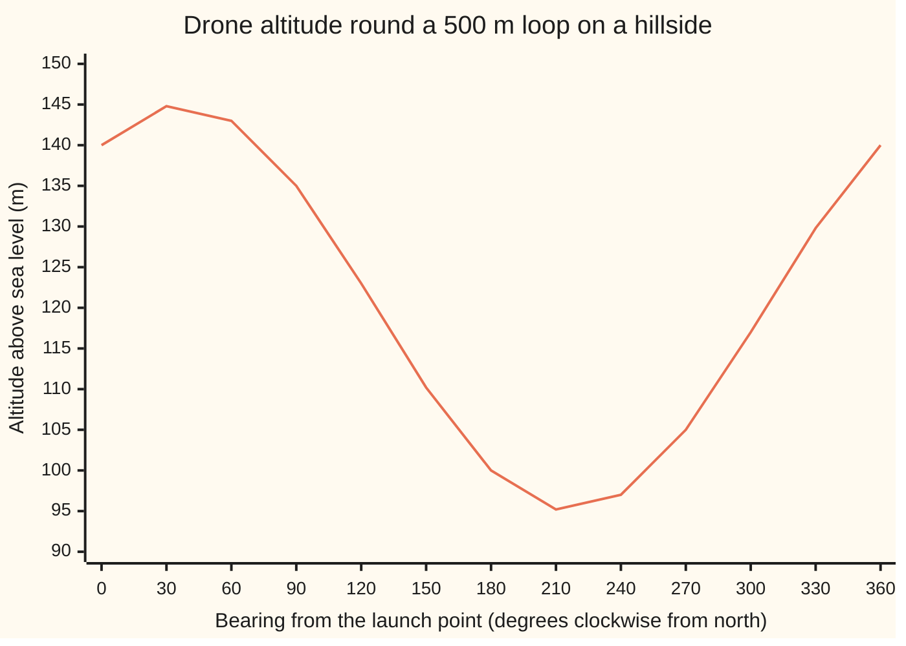

# What compactness and connectedness buy: attained maxima, crossed values, free inverses

[Syllabus](../../../SYLLABUS.md) → [Topology](../README.md) → [Topological Spaces](../README.md#s02) → What compactness and connectedness buy

---

## General Overview

A survey drone flies a closed loop of radius 500 m round its launch point. The ground is a hillside that rises 3 m for every 100 m east and 4 m for every 100 m north. The drone holds 40 m above the ground, and the ground at the launch point is 80 m above sea level. So over the launch point the drone flies at 120 m above sea level, and it gains 0.03 m for every metre east and 0.04 m for every metre north.

The cloud base is at 150 m. Does the drone stay under it all lap? That question needs the lap to have a highest point. A lap has infinitely many points, so nobody can check them one by one. Here the top is 145 m, at 300 m east and 400 m north: 5 m under the cloud base.

Topology says why a top must exist, for any continuous altitude. The loop is **compact** and **connected**, and a continuous map carries both properties to its image. That one fact pays out three times:

- **attained maxima:** a continuous altitude on the closed loop reaches a highest and a lowest value;
- **crossed values:** the altitude passes through every height between them, 120 m included;
- **free inverses:** a continuous one-to-one map from a compact space onto a Hausdorff space has a continuous inverse, with no work.

**A continuous map sends compact sets to compact sets and connected sets to connected sets; so a continuous real function on a compact space reaches its maximum and minimum, one on a connected space takes every value between two it takes, and a continuous bijection from a compact space onto a Hausdorff space is a homeomorphism.**

**What kind of fact this is:** theorems, proved on this card in Why it works. The code checks the connected-image and free-inverse theorems on every map between three-point spaces, which is a proof for those spaces, and illustrates all three on the drone's loop.

### The picture: altitude round the lap



The line is the altitude every 30° of bearing; it ends where it started, because the loop is closed. The samples suggest a top near 145 m. The theorems guarantee one; algebra locates it.

---

## The formula

The shelf's house example is the circle $`S^1`$ (read "S one"). Here it is the drone's loop. Write a loop point as $`(E, N)`$: its distance east and north of launch, in units of the 500 m radius, so $`E^2 + N^2 = 1`$. Then the altitude in metres is

```math
h(E, N) = 120 + 15E + 20N
```

The terms used below come from earlier cards. Each gets a one-line reminder.

- A map $`f : X \to Y`$ is **continuous** when the **pre-image** $`f^{-1}(V)`$, the set of points that $`f`$ sends into $`V`$, is open for every open set $`V`$ of $`Y`$ ([Continuity by pre-images, and homeomorphism](03-continuity-and-homeomorphism.md)).
- An **open cover** of a set $`K`$ is a family of open sets $`U_1, U_2, \ldots`$ whose union contains $`K`$. The set $`K`$ is **compact** when every open cover has a finite subfamily that still covers it ([Compactness with no distances, and Tychonoff](06-compactness-and-tychonoff.md)).
- A set $`C`$ is **connected** when it cannot be split into two disjoint, non-empty pieces that are each open in $`C`$ ([Connected and path-connected](07-connectedness-and-path-connectedness.md)).
- A space is **Hausdorff** when any two different points sit in two disjoint open sets ([Hausdorff and its ladder](05-separation-axioms-and-hausdorff.md)).
- A **homeomorphism** is a continuous bijection whose inverse is also continuous; $`X \cong Y`$ says one exists.

The three theorems, for a continuous map $`f`$:

```math
\begin{aligned} K \text{ compact} &\;\Longrightarrow\; f(K) \text{ compact} \\ C \text{ connected} &\;\Longrightarrow\; f(C) \text{ connected} \\ X \text{ compact},\ Y \text{ Hausdorff},\ f : X \to Y \text{ a bijection} &\;\Longrightarrow\; f^{-1} \text{ continuous, so } X \cong Y \end{aligned}
```

**Read it aloud:** a continuous map cannot break a compact set into something non-compact, cannot tear a connected set apart, and, from a compact space onto a Hausdorff one, cannot be one-to-one without being a homeomorphism.

For a real-valued continuous $`h`$, the first two become the extreme and intermediate value theorems:

```math
X \text{ compact, non-empty} \;\Longrightarrow\; \text{some } c, d \text{ have } h(d) \le h(x) \le h(c) \text{ for all } x, \qquad X \text{ connected},\ h(p) < y < h(q) \;\Longrightarrow\; h(x) = y \text{ for some } x
```

On the loop: $`c`$ is $`(3/5, 4/5)`$ with $`h = 145`$, $`d`$ is $`(-3/5, -4/5)`$ with $`h = 95`$, and $`y = 120`$ is met at $`(4/5, -3/5)`$ and $`(-4/5, 3/5)`$.

| Symbol | Plain meaning | In our example | Push it up and the answer… |
| --- | --- | --- | --- |
| $`f`$ | a continuous map | the lap clock, lap fraction to loop point | — |
| $`X`$, $`Y`$, $`X \cong Y`$ | domain and target; homeomorphic | the glued lap clock and the loop | — |
| $`K`$, $`f(K)`$, $`F`$ | a compact set and its image; a closed set | the loop; its altitudes, 95 to 145 m | — |
| $`C`$; $`A`$, $`B`$; $`a`$, $`b`$ | a connected set; the two pieces of a would-be split; two members of a connected set of reals | the loop, or one arc of it; altitudes 95 and 145 m | — |
| $`U_i`$, $`V`$, $`W`$ | open sets: a cover's members, target sets | heights above 150 m | — |
| $`f^{-1}(V)`$ | pre-image: points sent into $`V`$ | no loop point flies above 150 m | — |
| $`S^1`$ | the circle | the 500 m loop | — |
| $`E`$, $`N`$ | position east and north, in loop radii | $`(3/5, 4/5)`$ is 300 m east, 400 m north | — |
| $`h`$ | altitude, a continuous map $`S^1 \to \mathbb{R}`$ to the real numbers | $`120 + 15E + 20N`$ metres | steeper hillside: a higher top |
| $`x`$; $`z`$; $`c`$, $`d`$; $`p`$, $`q`$ | any point; a point outside a compact set; where the maximum and minimum are reached; two points with values either side of $`y`$ | $`c`$ flies 145 m, $`d`$ 95 m | — |
| $`y`$ | a target value between two values taken | 120 m, the launch altitude | nearer 145: the two crossings close in |
| $`s`$; $`t`$ | lap fraction, 0 to 1; slope from the loop's west point $`(-1, 0)`$ to a loop point | $`t = 1/2`$ gives the top | — |

### When it holds

- **The map must be continuous.** A jump can tear a connected space apart. Among maps between three-point spaces, 4218 discontinuous maps send a connected space onto a disconnected set.
- **The domain must be compact, not just closed.** Take the top point out of the loop. The altitudes come as close to 145 m as you like (144.999999680 m at one point near the gap) and never reach it. And $`1/(1 + x^2)`$ on the closed set $`[0, \infty)`$ never reaches 0: its image $`(0, 1]`$ is not closed.
- **The domain must be connected.** Two separate loops, the second 60 m higher, fly every height from 95 to 145 m and from 155 to 205 m, but never 150 m.
- **The target must be Hausdorff for the free inverse.** The identity map from three points with every set open onto three points with only the empty set and the whole set open is a continuous bijection. Its inverse is not continuous.

---

## Why it works

### Step 0: continuity pulls open sets back, and both properties are about open sets

Compactness talks about open covers. Connectedness talks about splits into open pieces. Continuity moves open sets backwards: an open set in the target gives an open pre-image in the domain.

So suppose the image had a bad cover or a split. Pull it back, and the domain would have one too. The domain has none, so the image has none.

### Step 1: the image of a compact set is compact

Cover $`f(K)`$ with open sets $`V_1, V_2, \ldots`$. Their pre-images are open, by continuity, and they cover $`K`$, because each point of $`K`$ lands in some $`V_i`$.

Since $`K`$ is compact, finitely many pre-images already cover $`K`$. The matching finitely many $`V_i`$ then cover $`f(K)`$. Every open cover of $`f(K)`$ has a finite subcover, so $`f(K)`$ is compact.

### Step 2: the image of a connected set is connected

Suppose $`f(C)`$ split into two disjoint, non-empty pieces, each open in $`f(C)`$. Their pre-images are disjoint, non-empty and open in $`C`$, and together they make up $`C`$. That is a split of $`C`$, which cannot exist. So $`f(C)`$ is connected. [Connected and path-connected](07-connectedness-and-path-connectedness.md) uses the same pre-image argument for paths.

The code checks this on every continuous map between three-point spaces: 5223 maps from a connected space, every image connected.

### Step 3: read off the extreme value theorem

The loop is compact. It is the image of the closed interval $`[0, 1]`$, which is compact by Heine–Borel (a closed, bounded interval of the line is compact), under the lap clock $`s \mapsto (\cos 2\pi s, \sin 2\pi s)`$: Step 1 again.

So the altitudes $`h(S^1)`$ form a compact set of reals. It is bounded, since finitely many of the intervals $`(-1, 1)`$, $`(-2, 2)`$, $`(-3, 3)`$, … cover it. It is closed, by Step 4 below, since the line is Hausdorff. A closed, bounded set of reals contains its least upper bound, so that bound is a height the drone actually flies.

This is the [Extreme value theorem](../../06-Calculus%20and%20analysis/01-Limits%20and%20Continuity/07-extreme-value-theorem.md) on any compact space. That card proves the interval case by subsequences; here it is one line from Step 1.

### Step 4: compact sets in a Hausdorff space are closed, and closed sets in a compact space are compact

Take a compact set $`K`$ in a Hausdorff space and a point $`z`$ outside it. Each point of $`K`$ and the point $`z`$ sit in disjoint open sets. The open sets round the points of $`K`$ cover $`K`$, so finitely many do. The finitely many matching open sets round $`z`$ overlap in an open set that misses all of $`K`$. So the outside of $`K`$ is open, and $`K`$ is closed.

In the other direction, a closed set $`F`$ inside a compact space is compact. Add the open set "everything outside $`F`$" to any open cover of $`F`$. That covers the whole space, so finitely many sets do, and dropping the added one leaves a finite cover of $`F`$.

### Step 5: read off the intermediate value theorem, twice per lap

A connected set of real numbers holds every number between two of its members. If it held $`a`$ and $`b`$ but missed some $`y`$ between them, the parts below $`y`$ and above $`y`$ would split it. The loop is connected, as the image of the connected interval $`[0, 1]`$ (Step 2). So its altitudes fill the whole range: every height from 95 to 145 m is flown.

This is the [Intermediate value theorem](../../06-Calculus%20and%20analysis/01-Limits%20and%20Continuity/06-intermediate-value-theorem.md), now on any connected space. That card proves root existence by bisection; the code reuses bisection only to locate the 120 m crossing.

The loop gives more. Remove the highest and lowest points. What is left is two open arcs, a south-east arc and a north-west arc. Each arc with its two ends is a connected path from 95 m up to 145 m, so each arc flies every height in between. So every height strictly between 95 and 145 m is flown **at least twice per lap**. For 120 m the two points are 400 m east, 300 m south, and 400 m west, 300 m north.

One consequence: no continuous one-to-one map sends the circle into the line. It would have to take some value twice.

### Step 6: a continuous bijection from compact onto Hausdorff has a free inverse

Let $`f : X \to Y`$ be a continuous bijection, with $`X`$ compact and $`Y`$ Hausdorff. Take a closed set $`F`$ in $`X`$. Then:

1. $`F`$ is compact (Step 4, second half).
2. $`f(F)`$ is compact (Step 1).
3. $`f(F)`$ is closed in $`Y`$ (Step 4, first half).

The pre-image of $`F`$ under $`f^{-1}`$ is $`f(F)`$. So $`f^{-1}`$ pulls closed sets back to closed sets. Open sets are the outsides of closed sets, so it pulls open sets back to open sets too, and $`f^{-1}`$ is continuous. No formula for the inverse was needed.

This is how the shelf's three circles become one. [Subspace, product and quotient](04-subspace-product-and-quotient-topologies.md) proves it by hand; here it is free. Glue the ends of the lap clock $`[0, 1]`$, so 0 and 1 are the same moment, the start and end of the lap. The glued clock is compact, as the image of $`[0, 1]`$ under the gluing map. The loop in the plane is Hausdorff. The lap clock is a continuous bijection between them, so it is a homeomorphism. Doing the same with both coordinates of a square shows the glued square is the torus $`S^1 \times S^1`$.

<details>
<summary>Detailed proof: the two steps where open sets need care</summary>

**Connected image, with the subspace sets written out.** Suppose $`f(C) = A \cup B`$ with $`A`$, $`B`$ disjoint, non-empty and open in $`f(C)`$. Open in $`f(C)`$ means $`A = f(C) \cap V`$ and $`B = f(C) \cap W`$ for some $`V`$, $`W`$ open in $`Y`$. Then $`C \cap f^{-1}(V)`$ and $`C \cap f^{-1}(W)`$ are open in $`C`$, disjoint, non-empty, and their union is $`C`$. That contradicts connectedness of $`C`$.

**Compact in Hausdorff is closed, with the finite step written out.** Let $`K`$ be compact in a Hausdorff space and $`z \notin K`$. For each $`x \in K`$ choose disjoint open sets $`U_x \ni x`$ and $`W_x \ni z`$. Finitely many, $`U_{x_1}, \ldots, U_{x_n}`$, cover $`K`$. The overlap

$`\displaystyle W = W_{x_1} \cap \cdots \cap W_{x_n}`$

is open, as an overlap of finitely many open sets. It contains $`z`$ and misses every $`U_{x_j}`$, so it misses $`K`$. With infinitely many $`W_x`$ the overlap could shrink to the single point $`z`$, which need not be open: compactness is what keeps the list finite.

</details>

---

## Worked numbers, by hand

The drone's loop, altitude $`h = 120 + 15E + 20N`$ metres, with $`E^2 + N^2 = 1`$.

| Step | Arithmetic | Value |
| --- | --- | --- |
| altitude at the north point $`(0, 1)`$ | 120 + 0 + 20 | 140 m |
| a fixed sum of squares | $`(15E + 20N)^2 + (20E - 15N)^2 = 625(E^2 + N^2)`$ | 625 |
| so the slope term is bounded | $`(15E + 20N)^2 \le 625`$, so $`-25 \le 15E + 20N \le 25`$ | 95 m to 145 m |
| where the bound is reached | $`20E = 15N`$ on the loop: $`(E, N) = (3/5, 4/5)`$ | 300 m east, 400 m north |
| the top | 120 + 15 × 3/5 + 20 × 4/5 = 120 + 9 + 16 | **145 m** |
| the bottom | at $`(-3/5, -4/5)`$: 120 − 9 − 16 | 95 m |
| margin under the cloud base | 150 − 145 | 5 m |
| launch altitude, first crossing | at $`(4/5, -3/5)`$: 120 + 12 − 12 | 120 m |
| launch altitude, second crossing | at $`(-4/5, 3/5)`$: 120 − 12 + 12 | 120 m |

The drone's highest point is 145 m, 300 m east and 400 m north of launch, so the lap clears the 150 m cloud base by 5 m. The theorem says a top exists; the identity in the second row finds it.

### What breaks if you drop a piece

| Mistake | Comes out at | What went wrong |
| --- | --- | --- |
| top point removed from the loop | 144.996825648, 144.999968025, 144.999999680 m; never 145 | an open arc is not compact |
| two separate loops, the second 60 m higher | 95 to 145 m and 155 to 205 m; 150 m never flown | the course is not connected |
| lap clock on $`[0, 1)`$, ends not glued | positions 3.1416 m apart, lap fractions 0.999 apart | the domain is not compact; glued, they are 1/1000 apart |
| target not Hausdorff | 1146 continuous bijections between three-point spaces; only 168 homeomorphisms | the third theorem needs a Hausdorff target |

The code prints all four.

---

## Code, from first principles, and it actually runs

Part 1 lists all 29 topologies on three points and every map between two of them. The check is exhaustive, so it proves the connected-image and free-inverse theorems for three-point spaces. Part 2 checks the drone's loop on 130 exact points, each given by its slope $`t`$ as $`((1 - t^2)/(1 + t^2),\ 2t/(1 + t^2))`$. Each answer has two independent roads: brute force against the 625 identity for the top; bisection against the factored equation $`(3t + 1)(t - 3) = 0`$ for the 120 m crossings; sampled sign changes against an algebraic count; a chord formula against a direct distance. Part 2 illustrates; the proofs are in Why it works.

### Python

```python
# What compactness and connectedness buy -- the check behind the card.  Standard
# library only.  Part 1 is exhaustive: every topology on three points and every
# map between two of them, so its counts are proofs for three-point spaces.
# Part 2 is the drone: a closed loop of radius 500 m round the launch point, with
# altitude 120 + 15E + 20N metres at the loop point E radii east, N radii north.
# Loop points are exact fractions; the code illustrates the theorems there.
from fractions import Fraction as F
from itertools import permutations, product
import math

P = (0, 1, 2)
EVERY = frozenset(P)
SUBS = [frozenset(p for p in P if m >> p & 1) for m in range(8)]

def yn(claim):
    return "yes" if claim else "no"

def is_topology(t):
    return frozenset() in t and EVERY in t and all(u | v in t and u & v in t for u in t for v in t)

def continuous(f, t1, t2):                 # every pre-image of an open set is open
    return all(frozenset(x for x in P if f[x] in v) in t1 for v in t2)

def connected(s, t):                       # no split of s into two open pieces
    pieces = {u & s for u in t}
    return not any(a and s - a and s - a in pieces for a in pieces)

def hausdorff(t):                          # distinct points sit in disjoint open sets
    return all(any(x in u and y in v and not u & v for u in t for v in t)
               for x in P for y in P if x != y)

TOPS = [t for m in range(256) if is_topology(t := frozenset(SUBS[i] for i in range(8) if m >> i & 1))]
cont = conn = jumpy = 0
images_ok = True
for t1, t2 in product(TOPS, TOPS):
    for f in product(P, repeat=3):
        img = frozenset(f)
        if continuous(f, t1, t2):
            cont += 1
            if connected(EVERY, t1):
                conn += 1
                images_ok = images_ok and connected(img, t2)
        elif connected(EVERY, t1) and not connected(img, t2):
            jumpy += 1
counts = {True: [0, 0], False: [0, 0]}     # target Hausdorff? -> [continuous bijections, homeomorphisms]
for t1, t2 in product(TOPS, TOPS):
    for f in permutations(P):
        if continuous(f, t1, t2):
            inv = tuple(f.index(y) for y in P)
            counts[hausdorff(t2)][0] += 1
            counts[hausdorff(t2)][1] += continuous(inv, t2, t1)
discrete, indiscrete = frozenset(SUBS), frozenset([frozenset(), EVERY])
print("Part 1: every topology on three points, every map between two of them")
print(f"topologies on 3 points: {len(TOPS)}; Hausdorff ones: {sum(map(hausdorff, TOPS))}; "
      f"connected ones: {sum(connected(EVERY, t) for t in TOPS)}")
print(f"continuous maps: {cont}; from a connected space: {conn}; image connected every time: {yn(images_ok)}")
print(f"discontinuous maps from a connected space with a disconnected image: {jumpy}")
hb, nb = counts[True], counts[False]
print(f"continuous bijections onto a Hausdorff space: {hb[0]}; homeomorphisms among them: {hb[1]}")
print(f"continuous bijections onto a non-Hausdorff space: {nb[0]}; homeomorphisms among them: {nb[1]}")
print(f"identity, discrete onto indiscrete: continuous {yn(continuous(P, discrete, indiscrete))}, "
      f"inverse continuous {yn(continuous(P, indiscrete, discrete))}")

def alt(e, n):
    return 120 + 15 * e + 20 * n

def point(t):                              # exact loop point for slope t; t = infinity gives (-1, 0)
    return (1 - t * t) / (1 + t * t), 2 * t / (1 + t * t)

def dec(x, k):                             # a fraction to k decimal places, cut not rounded
    s, x = ("-" if x < 0 else ""), abs(x)
    w = x.numerator * 10 ** k // x.denominator
    return f"{s}{w // 10 ** k}.{w % 10 ** k:0{k}d}"

loop = [point(F(k, 8)) for k in range(-64, 65)] + [(F(-1), F(0))]
alts = [alt(e, n) for e, n in loop]
hi, lo = max(alts), min(alts)
top, bottom = loop[alts.index(hi)], loop[alts.index(lo)]
ident = all((15 * e + 20 * n) ** 2 + (20 * e - 15 * n) ** 2 == 625 for e, n in loop)
print("Part 2: the drone's loop, radius 500 m, altitude 120 + 15E + 20N metres")
print(f"checked on {len(loop)} exact loop points: highest {hi} m at ({top[0] * 500}, {top[1] * 500}) m; "
      f"lowest {lo} m at ({bottom[0] * 500}, {bottom[1] * 500}) m")
print(f"identity (15E + 20N)^2 + (20E - 15N)^2 = 625 at all {len(loop)} points: {yn(ident)}")
compass = [("north", 0, 1), ("east", 1, 0), ("south", 0, -1), ("west", -1, 0)]
print("compass points only: " + ", ".join(f"{c} {alt(e, n)} m" for c, e, n in compass)
      + f"; best {max(alt(e, n) for _, e, n in compass)} m")
print("chart, altitude in m at bearings 0, 30, ..., 360 degrees:", " ".join(
    f"{120 + 15 * math.sin(math.radians(b)) + 20 * math.cos(math.radians(b)):.1f}" for b in range(0, 361, 30)))
a, b = F(-2), F(1, 2)                      # lowest point to highest point
g = lambda t: 15 * (1 - t * t) + 40 * t    # (altitude - 120) times (1 + t^2)
for _ in range(40):
    m = (a + b) / 2
    a, b = (m, b) if g(m) < 0 else (a, m)
print(f"bisection for 120 m, 40 halvings: slope t in [{dec(a, 12)}, {dec(b, 12)}]; algebra: t = -1/3 or t = 3")
for t in (F(-1, 3), F(3)):
    e, n = point(t)
    print(f"  t = {t}: point ({e * 500}, {n * 500}) m, altitude {alt(e, n)} m")
crossings = {}
for y in (110, 130, 150):
    s = [v > y for v in alts]
    crossings[y] = sum(s[i] != s[i - 1] for i in range(len(s)))
print("crossings of one lap, sampled: " + ", ".join(f"{y} m: {c}" for y, c in crossings.items()))
near = [alt(*point(F(1, 2) + F(1, 10 ** k))) for k in (2, 3, 4)]
print("open loop, top point removed: altitudes " + ", ".join(dec(v, 9) for v in near) + "; 145 never reached")
print(f"two separate loops, the second 60 m higher: altitudes {lo} to {hi} and {lo + 60} to {hi + 60}; "
      f"150 m flown: {yn(any(v == 150 or v + 60 == 150 for v in alts))}")
chord = 1000 * math.sin(math.pi / 1000)
p0, p1 = (500.0, 0.0), (500 * math.cos(2 * math.pi * 0.999), 500 * math.sin(2 * math.pi * 0.999))
print(f"unglued lap clock [0, 1): lap fractions 0.999 and 0 sit {chord:.4f} m apart on the loop, "
      f"but 0.999 apart on the clock; glued, {min(F(999, 1000), 1 - F(999, 1000))} apart")
print(f"closed set, image not closed: 1/(1 + x^2) at x = 10, 100, 1000: "
      + ", ".join(str(F(1, 1 + x * x)) for x in (10, 100, 1000)) + "; 0 never reached")
assert len(TOPS) == 29 and sum(map(hausdorff, TOPS)) == 1         # Evans-Harary-Lynn count
assert sum(connected(EVERY, t) for t in TOPS) == 29 - 10            # 10 split ones, by hand
assert images_ok and jumpy > 0 and conn > 0                       # theorem holds, test can fail
assert hb[0] == hb[1] > 0 and nb[1] < nb[0]                         # compact to Hausdorff only
assert hb[1] + nb[1] == 6 * len(TOPS)        # one homeomorphism per topology and permutation
assert (hi, top, lo, bottom) == (145, (F(3, 5), F(4, 5)), 95, (F(-3, 5), F(-4, 5))) and ident
assert a < F(-1, 3) < b and b - a == F(5, 2) / 2 ** 40            # bisection meets the algebra
assert all(c == (2 if abs(y - 120) < 25 else 0) for y, c in crossings.items())
assert abs(math.dist(p0, p1) - chord) < 1e-9                      # cross-check of the chord
print("ALL CHECKS PASS")
```

**Ran 2026-11-14 on macOS, Python 3.14.10, standard library only. All checks passed. Output, pasted from the run:**

```
Part 1: every topology on three points, every map between two of them
topologies on 3 points: 29; Hausdorff ones: 1; connected ones: 19
continuous maps: 9867; from a connected space: 5223; image connected every time: yes
discontinuous maps from a connected space with a disconnected image: 4218
continuous bijections onto a Hausdorff space: 6; homeomorphisms among them: 6
continuous bijections onto a non-Hausdorff space: 1146; homeomorphisms among them: 168
identity, discrete onto indiscrete: continuous yes, inverse continuous no
Part 2: the drone's loop, radius 500 m, altitude 120 + 15E + 20N metres
checked on 130 exact loop points: highest 145 m at (300, 400) m; lowest 95 m at (-300, -400) m
identity (15E + 20N)^2 + (20E - 15N)^2 = 625 at all 130 points: yes
compass points only: north 140 m, east 135 m, south 100 m, west 105 m; best 140 m
chart, altitude in m at bearings 0, 30, ..., 360 degrees: 140.0 144.8 143.0 135.0 123.0 110.2 100.0 95.2 97.0 105.0 117.0 129.8 140.0
bisection for 120 m, 40 halvings: slope t in [-0.333333333334, -0.333333333332]; algebra: t = -1/3 or t = 3
  t = -1/3: point (400, -300) m, altitude 120 m
  t = 3: point (-400, 300) m, altitude 120 m
crossings of one lap, sampled: 110 m: 2, 130 m: 2, 150 m: 0
open loop, top point removed: altitudes 144.996825648, 144.999968025, 144.999999680; 145 never reached
two separate loops, the second 60 m higher: altitudes 95 to 145 and 155 to 205; 150 m flown: no
unglued lap clock [0, 1): lap fractions 0.999 and 0 sit 3.1416 m apart on the loop, but 0.999 apart on the clock; glued, 1/1000 apart
closed set, image not closed: 1/(1 + x^2) at x = 10, 100, 1000: 1/101, 1/10001, 1/1000001; 0 never reached
ALL CHECKS PASS
```

### Rust

Same numbers, same labels, built with `rustc --edition 2021 -O`.

```rust
// What compactness and connectedness buy -- the same check as the Python, in
// Rust.  No crates.  Part 1 is exhaustive: every topology on three points and
// every map between two of them, so its counts are proofs for three-point spaces.
// Part 2 is the drone: a closed loop of radius 500 m round the launch point, with
// altitude 120 + 15E + 20N metres at the loop point E radii east, N radii north.
// Loop points are exact fractions; the code illustrates the theorems there.
// A set of points is a 3-bit mask; a topology is an 8-bit mask over those sets.
use std::cmp::Ordering;

#[derive(Clone, Copy, PartialEq, Eq, Debug)]
struct Q { n: i128, d: i128 }                       // an exact fraction, lowest terms
fn gcd(a: i128, b: i128) -> i128 { if b == 0 { a.abs() } else { gcd(b, a % b) } }
fn q(n: i128, d: i128) -> Q { let g = gcd(n, d) * d.signum(); Q { n: n / g, d: d / g } }
fn add(a: Q, b: Q) -> Q { q(a.n * b.d + b.n * a.d, a.d * b.d) }
fn sub(a: Q, b: Q) -> Q { q(a.n * b.d - b.n * a.d, a.d * b.d) }
fn mul(a: Q, b: Q) -> Q { q(a.n * b.n, a.d * b.d) }
fn div(a: Q, b: Q) -> Q { q(a.n * b.d, a.d * b.n) }
fn cmpq(a: Q, b: Q) -> Ordering { (a.n * b.d).cmp(&(b.n * a.d)) }
fn wq(a: i128) -> Q { q(a, 1) }
fn show(a: Q) -> String { if a.d == 1 { format!("{}", a.n) } else { format!("{}/{}", a.n, a.d) } }
fn dec(x: Q, k: u32) -> String {                   // a fraction to k decimal places, cut not rounded
    let p = 10i128.pow(k);
    let w = x.n.abs() * p / x.d;
    format!("{}{}.{:0w$}", if x.n < 0 { "-" } else { "" }, w / p, w % p, w = k as usize)
}
fn yn(claim: bool) -> &'static str { if claim { "yes" } else { "no" } }

const EVERY: u8 = 7;
fn has(t: u16, s: u8) -> bool { t >> s & 1 == 1 }
fn opens(t: u16) -> Vec<u8> { (0..8u8).filter(|&s| has(t, s)).collect() }
fn is_topology(t: u16) -> bool {
    let o = opens(t);
    has(t, 0) && has(t, EVERY) && o.iter().all(|&u| o.iter().all(|&v| has(t, u | v) && has(t, u & v)))
}
fn pre(f: &[u8; 3], v: u8) -> u8 { (0..3).filter(|&x| v >> f[x] & 1 == 1).fold(0, |a, x| a | 1 << x) }
fn continuous(f: &[u8; 3], t1: u16, t2: u16) -> bool { opens(t2).iter().all(|&v| has(t1, pre(f, v))) }
fn connected(s: u8, t: u16) -> bool {               // no split of s into two open pieces
    let pieces: Vec<u8> = opens(t).iter().map(|&u| u & s).collect();
    !pieces.iter().any(|&a| a != 0 && s & !a != 0 && pieces.contains(&(s & !a)))
}
fn hausdorff(t: u16) -> bool {                       // distinct points sit in disjoint open sets
    let o = opens(t);
    (0..3).all(|x| (0..3).all(|y| x == y || o.iter().any(|&u| o.iter().any(|&v|
        u >> x & 1 == 1 && v >> y & 1 == 1 && u & v == 0))))
}
fn alt(e: Q, n: Q) -> Q { add(wq(120), add(mul(wq(15), e), mul(wq(20), n))) }
fn point(t: Q) -> (Q, Q) {                           // exact loop point for slope t
    let one = wq(1);
    let s = add(one, mul(t, t));
    (div(sub(one, mul(t, t)), s), div(mul(wq(2), t), s))
}

fn main() {
    let tops: Vec<u16> = (0..256u16).filter(|&t| is_topology(t)).collect();
    let maps: Vec<[u8; 3]> = (0..27u8).map(|m| [m / 9, m / 3 % 3, m % 3]).collect();
    let (mut cont, mut conn, mut jumpy, mut images_ok) = (0, 0, 0, true);
    let mut counts = [[0u32; 2]; 2];                 // [target Hausdorff?] -> [bijections, homeomorphisms]
    for &t1 in &tops {
        for &t2 in &tops {
            for f in &maps {
                let img = f.iter().fold(0u8, |a, &y| a | 1 << y);
                if continuous(f, t1, t2) {
                    cont += 1;
                    if connected(EVERY, t1) { conn += 1; images_ok = images_ok && connected(img, t2); }
                    if img == EVERY {
                        let mut inv = [0u8; 3];
                        for x in 0..3 { inv[f[x] as usize] = x as u8; }
                        let hd = hausdorff(t2) as usize;
                        counts[hd][0] += 1;
                        counts[hd][1] += continuous(&inv, t2, t1) as u32;
                    }
                } else if connected(EVERY, t1) && !connected(img, t2) { jumpy += 1; }
            }
        }
    }
    let (discrete, indiscrete, id) = (255u16, 1u16 | 1 << 7, [0u8, 1, 2]);
    println!("Part 1: every topology on three points, every map between two of them");
    println!("topologies on 3 points: {}; Hausdorff ones: {}; connected ones: {}", tops.len(),
             tops.iter().filter(|&&t| hausdorff(t)).count(), tops.iter().filter(|&&t| connected(EVERY, t)).count());
    println!("continuous maps: {}; from a connected space: {}; image connected every time: {}", cont, conn, yn(images_ok));
    println!("discontinuous maps from a connected space with a disconnected image: {}", jumpy);
    let (hb, nb) = (counts[1], counts[0]);
    println!("continuous bijections onto a Hausdorff space: {}; homeomorphisms among them: {}", hb[0], hb[1]);
    println!("continuous bijections onto a non-Hausdorff space: {}; homeomorphisms among them: {}", nb[0], nb[1]);
    println!("identity, discrete onto indiscrete: continuous {}, inverse continuous {}",
             yn(continuous(&id, discrete, indiscrete)), yn(continuous(&id, indiscrete, discrete)));

    let mut lp: Vec<(Q, Q)> = (-64..=64).map(|k| point(q(k, 8))).collect();
    lp.push((wq(-1), wq(0)));
    let alts: Vec<Q> = lp.iter().map(|&(e, n)| alt(e, n)).collect();
    let mut ih = 0; let mut il = 0;
    for i in 0..alts.len() {
        if cmpq(alts[i], alts[ih]) == Ordering::Greater { ih = i; }
        if cmpq(alts[i], alts[il]) == Ordering::Less { il = i; }
    }
    let (hi, lo, top, bottom) = (alts[ih], alts[il], lp[ih], lp[il]);
    let ident = lp.iter().all(|&(e, n)| {
        let (a, b) = (add(mul(wq(15), e), mul(wq(20), n)), sub(mul(wq(20), e), mul(wq(15), n)));
        add(mul(a, a), mul(b, b)) == wq(625)
    });
    let half = |p: (Q, Q)| format!("({}, {})", show(mul(p.0, wq(500))), show(mul(p.1, wq(500))));
    println!("Part 2: the drone's loop, radius 500 m, altitude 120 + 15E + 20N metres");
    println!("checked on {} exact loop points: highest {} m at {} m; lowest {} m at {} m",
             lp.len(), show(hi), half(top), show(lo), half(bottom));
    println!("identity (15E + 20N)^2 + (20E - 15N)^2 = 625 at all {} points: {}", lp.len(), yn(ident));
    let compass = [("north", 0, 1), ("east", 1, 0), ("south", 0, -1), ("west", -1, 0)];
    let ca: Vec<i128> = compass.iter().map(|&(_, e, n)| 120 + 15 * e + 20 * n).collect();
    println!("compass points only: {}; best {} m", compass.iter().zip(&ca).map(|(c, a)| format!("{} {} m", c.0, a))
             .collect::<Vec<_>>().join(", "), ca.iter().max().unwrap());
    println!("chart, altitude in m at bearings 0, 30, ..., 360 degrees: {}", (0..=12).map(|i| {
        let r = ((30 * i) as f64).to_radians();
        format!("{:.1}", 120.0 + 15.0 * r.sin() + 20.0 * r.cos())
    }).collect::<Vec<_>>().join(" "));
    let (mut a, mut b) = (wq(-2), q(1, 2));
    let g = |t: Q| add(mul(wq(15), sub(wq(1), mul(t, t))), mul(wq(40), t));
    for _ in 0..40 {
        let m = div(add(a, b), wq(2));
        if g(m).n < 0 { a = m } else { b = m }
    }
    println!("bisection for 120 m, 40 halvings: slope t in [{}, {}]; algebra: t = -1/3 or t = 3", dec(a, 12), dec(b, 12));
    for t in [q(-1, 3), wq(3)] {
        let p = point(t);
        println!("  t = {}: point {} m, altitude {} m", show(t), half(p), show(alt(p.0, p.1)));
    }
    let crossings: Vec<(i128, usize)> = [110, 130, 150].iter().map(|&y| {
        let s: Vec<bool> = alts.iter().map(|&v| cmpq(v, wq(y)) == Ordering::Greater).collect();
        (y, (0..s.len()).filter(|&i| s[i] != s[(i + s.len() - 1) % s.len()]).count())
    }).collect();
    println!("crossings of one lap, sampled: {}", crossings.iter().map(|(y, c)| format!("{} m: {}", y, c)).collect::<Vec<_>>().join(", "));
    let near: Vec<String> = [2u32, 3, 4].iter().map(|&k| {
        let p = point(add(q(1, 2), q(1, 10i128.pow(k))));
        dec(alt(p.0, p.1), 9)
    }).collect();
    println!("open loop, top point removed: altitudes {}; 145 never reached", near.join(", "));
    let flown = alts.iter().any(|&v| v == wq(150) || add(v, wq(60)) == wq(150));
    println!("two separate loops, the second 60 m higher: altitudes {} to {} and {} to {}; 150 m flown: {}",
             show(lo), show(hi), show(add(lo, wq(60))), show(add(hi, wq(60))), yn(flown));
    let chord = 1000.0 * (std::f64::consts::PI / 1000.0).sin();
    let w = 2.0 * std::f64::consts::PI * 0.999;
    let dist = ((500.0 - 500.0 * w.cos()).powi(2) + (500.0 * w.sin()).powi(2)).sqrt();
    let glued = if cmpq(q(999, 1000), q(1, 1000)) == Ordering::Less { q(999, 1000) } else { q(1, 1000) };
    println!("unglued lap clock [0, 1): lap fractions 0.999 and 0 sit {:.4} m apart on the loop, but 0.999 apart on the clock; glued, {} apart",
             chord, show(glued));
    println!("closed set, image not closed: 1/(1 + x^2) at x = 10, 100, 1000: {}; 0 never reached",
             [10i128, 100, 1000].iter().map(|&x| show(q(1, 1 + x * x))).collect::<Vec<_>>().join(", "));
    assert!(tops.len() == 29 && tops.iter().filter(|&&t| hausdorff(t)).count() == 1); // Evans-Harary-Lynn count
    assert!(tops.iter().filter(|&&t| connected(EVERY, t)).count() == 29 - 10);    // 10 split ones, by hand
    assert!(images_ok && jumpy > 0 && conn > 0);                      // theorem holds, test can fail
    assert!(hb[0] == hb[1] && hb[0] > 0 && nb[1] < nb[0]);            // compact to Hausdorff only
    assert!(hb[1] + nb[1] == 6 * tops.len() as u32);   // one homeomorphism per topology and permutation
    assert!(hi == wq(145) && top == (q(3, 5), q(4, 5)) && lo == wq(95) && bottom == (q(-3, 5), q(-4, 5)) && ident);
    assert!(cmpq(a, q(-1, 3)) == Ordering::Less && cmpq(q(-1, 3), b) == Ordering::Less
            && sub(b, a) == q(5, 2 << 40));                           // bisection meets the algebra
    assert!(crossings.iter().all(|&(y, c)| c == if (y - 120).abs() < 25 { 2 } else { 0 }));
    assert!((dist - chord).abs() < 1e-9);                             // cross-check of the chord
    println!("ALL CHECKS PASS");
}
```

**Ran 2026-11-14 on macOS, rustc 1.98.1, no crates. All checks passed. Output, pasted from the run:**

```
Part 1: every topology on three points, every map between two of them
topologies on 3 points: 29; Hausdorff ones: 1; connected ones: 19
continuous maps: 9867; from a connected space: 5223; image connected every time: yes
discontinuous maps from a connected space with a disconnected image: 4218
continuous bijections onto a Hausdorff space: 6; homeomorphisms among them: 6
continuous bijections onto a non-Hausdorff space: 1146; homeomorphisms among them: 168
identity, discrete onto indiscrete: continuous yes, inverse continuous no
Part 2: the drone's loop, radius 500 m, altitude 120 + 15E + 20N metres
checked on 130 exact loop points: highest 145 m at (300, 400) m; lowest 95 m at (-300, -400) m
identity (15E + 20N)^2 + (20E - 15N)^2 = 625 at all 130 points: yes
compass points only: north 140 m, east 135 m, south 100 m, west 105 m; best 140 m
chart, altitude in m at bearings 0, 30, ..., 360 degrees: 140.0 144.8 143.0 135.0 123.0 110.2 100.0 95.2 97.0 105.0 117.0 129.8 140.0
bisection for 120 m, 40 halvings: slope t in [-0.333333333334, -0.333333333332]; algebra: t = -1/3 or t = 3
  t = -1/3: point (400, -300) m, altitude 120 m
  t = 3: point (-400, 300) m, altitude 120 m
crossings of one lap, sampled: 110 m: 2, 130 m: 2, 150 m: 0
open loop, top point removed: altitudes 144.996825648, 144.999968025, 144.999999680; 145 never reached
two separate loops, the second 60 m higher: altitudes 95 to 145 and 155 to 205; 150 m flown: no
unglued lap clock [0, 1): lap fractions 0.999 and 0 sit 3.1416 m apart on the loop, but 0.999 apart on the clock; glued, 1/1000 apart
closed set, image not closed: 1/(1 + x^2) at x = 10, 100, 1000: 1/101, 1/10001, 1/1000001; 0 never reached
ALL CHECKS PASS
```

The two outputs match line for line.

### Lean

Lean proves the three theorems for every space, the extreme and intermediate value theorems, and the drone's worked numbers.

- Take a continuous map $`f`$. Then it sends compact sets to compact sets, and connected sets to connected sets.
- Take a continuous real function $`h`$ on a non-empty compact space. Then some $`c`$, $`d`$ have $`h(d) \le h(x) \le h(c)`$ for every $`x`$.
- Take a continuous real function $`h`$ on a connected space, with $`h(p) < y < h(q)`$. Then $`h(x) = y`$ for some $`x`$.
- Take a continuous bijection $`f : X \to Y`$, with $`X`$ compact and $`Y`$ Hausdorff. Then $`f`$ is a homeomorphism, so $`X \cong Y`$.
- The top, 300 m east and 400 m north, is on the loop and flies 145 m. The bottom, 300 m west and 400 m south, flies 95 m.
- The crossing 400 m east, 300 m south is on the loop. It and the crossing 400 m west, 300 m north both fly 120 m.
- The compass points fly 140, 135, 100 and 105 m. The margin under the 150 m cloud base is 5 m.
- Take the 120 m equation $`15(1 - t^2) + 40t = 0`$. Then $`t = -1/3`$ and $`t = 3`$ both solve it.

The three-point spaces, the sampled loop, the bisection and the What breaks cases are left to the Python and Rust checks.

```lean
-- What compactness and connectedness buy: a continuous map sends compact sets to compact sets and connected sets to connected sets, so real functions reach a maximum and minimum and cross every value between, and a continuous bijection from a compact space onto a Hausdorff space is a homeomorphism.
import Mathlib.Topology.Homeomorph.Lemmas
import Mathlib.Topology.Order.Compact
import Mathlib.Topology.Order.IntermediateValue
import Mathlib.Topology.Instances.Real.Lemmas
import Mathlib.Tactic.NormNum

/-! The card's terms in Mathlib:
* compact set: `IsCompact K` (every open cover has a finite subcover);
* connected set, as the card defines it (no split into two disjoint, non-empty pieces
  that are each open in the set): `IsPreconnected C`; a connected space is `PreconnectedSpace X`;
* Hausdorff space: `T2Space Y`;
* homeomorphism: `X ≃ₜ Y`, a continuous bijection with continuous inverse. -/

/-- A continuous map sends compact sets to compact sets and connected sets to
connected sets: if `f` is continuous, then `f(K)` is compact whenever `K` is compact,
and `f(C)` is connected whenever `C` is connected. -/
theorem continuous_image_compact_and_connected
    {X Y : Type*} [TopologicalSpace X] [TopologicalSpace Y]
    (f : X → Y) (hf : Continuous f) :
    (∀ K : Set X, IsCompact K → IsCompact (f '' K)) ∧
    (∀ C : Set X, IsPreconnected C → IsPreconnected (f '' C)) := by
  exact ⟨fun K hK => hK.image hf, fun C hC => hC.image f hf.continuousOn⟩

/-- The real-valued payoffs. Extreme values: a continuous real function `h` on a
non-empty compact space reaches its maximum at some `c` and its minimum at some `d`.
Intermediate values: a continuous real function on a connected space takes every
value `y` strictly between two values `h p < y < h q` it takes. -/
theorem extreme_and_intermediate_values
    {X : Type*} [TopologicalSpace X] (h : X → ℝ) (hh : Continuous h) :
    ((CompactSpace X ∧ Nonempty X) →
        ∃ c d : X, ∀ x : X, h d ≤ h x ∧ h x ≤ h c) ∧
    (PreconnectedSpace X → ∀ (p q : X) (y : ℝ), h p < y → y < h q →
        ∃ x : X, h x = y) := by
  refine ⟨?_, ?_⟩
  · rintro ⟨_, hne⟩
    obtain ⟨c, -, hc⟩ := isCompact_univ.exists_isMaxOn Set.univ_nonempty hh.continuousOn
    obtain ⟨d, -, hd⟩ := isCompact_univ.exists_isMinOn Set.univ_nonempty hh.continuousOn
    exact ⟨c, d, fun x => ⟨hd (Set.mem_univ x), hc (Set.mem_univ x)⟩⟩
  · intro _ p q y hpy hyq
    exact intermediate_value_univ p q hh ⟨hpy.le, hyq.le⟩

/-- Free inverses: a continuous bijection `f` from a compact space `X` onto a
Hausdorff space `Y` is a homeomorphism, so its inverse is continuous with no work:
there is a homeomorphism `X ≃ₜ Y` whose underlying map is `f`. -/
theorem continuous_bijection_compact_to_hausdorff_is_homeomorph
    {X Y : Type*} [TopologicalSpace X] [TopologicalSpace Y]
    [CompactSpace X] [T2Space Y]
    (f : X → Y) (hf : Continuous f) (hbij : Function.Bijective f) :
    ∃ g : X ≃ₜ Y, ⇑g = f := by
  exact ⟨(hf.homeoOfEquivCompactToT2 (f := Equiv.ofBijective f hbij)), rfl⟩

/-! The drone's loop: the point `(E, N)` in loop radii, with `E^2 + N^2 = 1`,
flies at altitude `120 + 15E + 20N` metres. -/

-- The top, 300 m east and 400 m north, is on the loop and flies 145 m.
example : (3 / 5 : ℚ) ^ 2 + (4 / 5) ^ 2 = 1 ∧ (120 : ℚ) + 15 * (3 / 5) + 20 * (4 / 5) = 145 := by
  norm_num

-- The bottom, 300 m west and 400 m south, flies 95 m.
example : (120 : ℚ) + 15 * (-3 / 5) + 20 * (-4 / 5) = 95 := by norm_num

-- The two 120 m crossings, 400 m east 300 m south and 400 m west 300 m north, are on the loop.
example : (4 / 5 : ℚ) ^ 2 + (-3 / 5) ^ 2 = 1 ∧ (120 : ℚ) + 15 * (4 / 5) + 20 * (-3 / 5) = 120 ∧
    (120 : ℚ) + 15 * (-4 / 5) + 20 * (3 / 5) = 120 := by
  norm_num

-- The four compass points fly 140, 135, 100 and 105 m; the margin under the 150 m cloud base is 5 m.
example : (120 : ℤ) + 20 = 140 ∧ (120 : ℤ) + 15 = 135 ∧ (120 : ℤ) - 20 = 100 ∧
    (120 : ℤ) - 15 = 105 ∧ (150 : ℤ) - 145 = 5 := by
  decide

-- The slopes t = -1/3 and t = 3 solve 15(1 - t^2) + 40t = 0, the 120 m equation.
example : (15 : ℚ) * (1 - (-1 / 3) ^ 2) + 40 * (-1 / 3) = 0 ∧ (15 : ℚ) * (1 - 3 ^ 2) + 40 * 3 = 0 := by
  norm_num

#print axioms continuous_image_compact_and_connected
#print axioms extreme_and_intermediate_values
#print axioms continuous_bijection_compact_to_hausdorff_is_homeomorph
```

**Checked 2026-11-14 on macOS, Lean 4.36.0-rc2, Mathlib v4.36.0-rc2. Every proof is complete and uses only Lean's standard axioms. Output, pasted from the run:**

```
'continuous_image_compact_and_connected' depends on axioms: [propext, Classical.choice, Quot.sound]
'extreme_and_intermediate_values' depends on axioms: [propext, Classical.choice, Quot.sound]
'continuous_bijection_compact_to_hausdorff_is_homeomorph' depends on axioms: [propext, Classical.choice, Quot.sound]
```

> [!TIP]
> **Try changing**
> - **Guess first: does a sample search still find the top on a steeper hillside?** Change `20 * n` to `21 * n` in `alt`. The 130 samples report 729/5 = 145.8 m, but the open-loop points near the old top now fly 145.806 m, higher than any sample. The top assert stops the run. A search over samples illustrates; it does not find or prove the top.
> - **Guess first: how close does the open loop get to 145 m?** Change `(2, 3, 4)` to `(2, 3, 4, 5, 6)` in the open-loop line. The altitudes reach 144.999999996 and 144.999999999 m. The shortfall shrinks about 100 times at each step and never reaches zero.
> - **Guess first: how often is 145 m crossed?** Change `(110, 130, 150)` to `(110, 130, 145, 150)`. The count is 0: the drone touches 145 m once, at the top, and never goes above it. The algebra agrees, since 145 is not strictly between 95 and 145, and every assert passes.
> - **Guess first: what if connectedness ignored the second piece?** In `connected`, drop `and s - a in pieces`. The count of connected three-point spaces stops matching the 19 counted by hand, and an assert stops the run.

---

## The usual mistake

> [!warning]
> **Reading the theorems backwards.** Continuous maps carry compactness forwards, not closedness, and not compactness backwards. The closed set $`[0, \infty)`$ goes under $`1/(1 + x^2)`$ to $`(0, 1]`$, which is not closed: the values 1/101, 1/10001, 1/1000001 close in on 0 and never reach it. A constant map sends the whole line onto one point, which is compact, so a compact target does not make the domain compact.
>
> - **Checking a few points and calling it the top.** The four compass points give 140, 135, 100 and 105 m. Their best, 140 m, is 5 m below the real top of 145 m.
> - **Reading "crossed" as "crossed once".** On a loop, every height strictly between 95 and 145 m is flown at least twice: 120 m at 400 m east, 300 m south and at 400 m west, 300 m north.
> - **Forgetting the Hausdorff target.** Among three-point spaces there are 1146 continuous bijections onto non-Hausdorff targets, and only 168 have continuous inverses.

---

## Where you meet it in real life

- **Flight planning.** Route-planning software checks a closed route against an altitude ceiling by its highest point. The extreme value theorem makes that point a height actually flown, not a limit.
- **Optimisation.** With a continuous cost over a compact set of allowed designs, the cheapest design exists. Over a non-compact set the best can be approached forever and never reached.
- **Opposite points of a loop.** For any continuous altitude round a closed loop, some pair of opposite points have equal altitude: apply the intermediate value theorem to the altitude minus the altitude opposite. On the drone's loop, 400 m east, 300 m south and 400 m west, 300 m north are opposite, and both fly at 120 m.

> **Say it back**
> A continuous map pulls open sets back, so it cannot spoil a compact set's finite covers or tear apart a connected set. So the images of compact and connected spaces are compact and connected. On the real line that means a continuous altitude round a closed loop reaches a highest point, 145 m for the drone, and flies every height strictly between its lowest and highest at least twice. A continuous bijection from a compact space onto a Hausdorff space has a continuous inverse for free; that is why the glued interval is the circle. Drop any hypothesis and the code shows the result failing.

---

## What this builds on

- [Connected and path-connected](07-connectedness-and-path-connectedness.md): the definition of connected, and the proof that $`[0, 1]`$ is connected, which Steps 2 and 5 carry through the lap clock and the altitude map.
- [Extreme value theorem](../../06-Calculus%20and%20analysis/01-Limits%20and%20Continuity/07-extreme-value-theorem.md): the interval case, proved by subsequences; this card gets it from compactness for any compact space.
- [Intermediate value theorem](../../06-Calculus%20and%20analysis/01-Limits%20and%20Continuity/06-intermediate-value-theorem.md): the interval case, proved by bisection; this card gets it from connectedness on any connected space.
- [Compactness with no distances, and Tychonoff](06-compactness-and-tychonoff.md): compactness by open covers, used in Steps 1 and 4.
- [Continuity by pre-images, and homeomorphism](03-continuity-and-homeomorphism.md): continuity as "pre-images of open sets are open", the tool behind Step 0.

## Where this goes next

- [The test spaces](09-standard-examples-and-counterexamples.md): the discrete, indiscrete and other extreme spaces, where each hypothesis on this card fails in its most extreme form.
- [Urysohn and Tietze](10-urysohn-tietze-and-metrisation.md): building continuous real functions on a space in the first place, the raw material this card's theorems act on.

The question this card leaves open: compactness gives a highest point, but how do you find it on a space with no algebra to help?

---

## Sources

Verified 2026-11-14: every link below resolves to the publisher's page.

- Munkres, James R. *Topology*, Classic Version, 2nd ed. Pearson. [Publisher page](https://www.pearson.com/en-us/subject-catalog/p/topology-classic-version/P200000006299/9780137848669). The standard course proofs that continuous images of compact and connected sets are compact and connected, and of the compact-to-Hausdorff homeomorphism theorem.
- Armstrong, M. A. *Basic Topology*. Springer, 1983. [doi:10.1007/978-1-4757-1793-8](https://doi.org/10.1007/978-1-4757-1793-8). Compactness, connectedness and the circle as a glued interval, at a first-course level.
- Evans, J. W., F. Harary and M. S. Lynn. "On the computer enumeration of finite topologies." *Communications of the ACM* 10 (1967): 295–297. [doi:10.1145/363282.363311](https://doi.org/10.1145/363282.363311). The count of 29 topologies on three points that the code's exhaustive part reproduces.
- Steen, Lynn Arthur, and J. Arthur Seebach. *Counterexamples in Topology*, 2nd ed. Springer, 1978. [doi:10.1007/978-1-4612-6290-9](https://doi.org/10.1007/978-1-4612-6290-9). Spaces where each hypothesis fails, such as non-Hausdorff targets.
