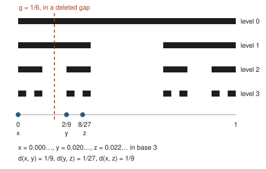

# The test spaces: discrete, indiscrete, cofinite, the Cantor set, and what each one breaks

[Syllabus](../../../SYLLABUS.md) → [Topology](../README.md) → [Topological Spaces](../README.md#s02) → The test spaces

---

## General Overview

On the number line, a set that is closed and bounded is **compact**: every way of covering it with open sets has a finite selection that still covers it. In the plane, a sequence has at most one limit. Both facts sound like laws of nature. Do they hold in every space?

A topologist tests a claim before trying to prove it. The test uses a short stock of small, extreme spaces, much as a materials lab tests a new alloy on a few standard samples before trusting it. A space where every assumption of the claim holds and its conclusion fails is a **counterexample**. One counterexample is enough: the claim is false as stated.

The stock has four standard members:

- **discrete**: every set of points is open;
- **indiscrete**: only the empty set and the whole set are open;
- **cofinite**: on an infinite set, a set is open when it is empty or leaves out only finitely many points;
- **the Cantor set**: what remains of the interval from 0 to 1 after the open middle third of every piece is deleted, again and again for ever.

The Cantor set carries this card's worked example. After 3 rounds of deleting, 8 pieces remain, each 1/27 long. In the limit no piece of positive length is left, yet the set has as many points as the whole interval ([The Cantor set](../../10-Measure%20and%20integration/02-Length%20Done%20Properly/07-the-cantor-set.md)). This card proves two more facts: the Cantor set is compact, and it is **totally disconnected**, meaning no part of it with two or more points hangs together. The points 0 and 2/9 both lie in it, and the point 1/6 between them lies in a deleted gap. A cut at 1/6 splits the set in two.

**One space where a claim's assumptions hold and its conclusion fails refutes the claim; the discrete, indiscrete and cofinite spaces and the Cantor set refute the most common false claims, and the Cantor set is compact and totally disconnected while every one of its points has other points of the set as close as wished.**

**What kind of fact this is:** the three topologies, the address distance and total disconnectedness are definitions. That the Cantor set is compact, totally disconnected and free of isolated points, and that the address distance is an ultrametric giving the usual open sets, are theorems, proved on this card in Why it works. The claims about finite spaces are checked on every topology on 1 to 4 points, which is a proof for those sizes; Step 3 proves the T1 claim for every finite size.

<p align="center"></p>

Drawn to scale, 360 units to the length 1. Each bar row is one level of deleting. The dashed line at $`g = 1/6`$ runs through a gap deleted at level 2. It splits the set into the part left of $`g`$, holding $`x`$, and the part right of $`g`$, holding $`y`$ and $`z`$.

---

## The formula

Notation first, in words. $`X`$ is a set of points and $`\tau`$ (the Greek letter tau) is its topology, the family of its open sets ([Topological space](01-topological-spaces-and-bases.md)). $`\varnothing`$ is the empty set. $`\mathbb{N}`$ is the counting numbers 0, 1, 2, and so on. The three topologies:

```math
\tau_{\mathrm{disc}} = \{\text{every subset of } X\}, \qquad \tau_{\mathrm{ind}} = \{\varnothing,\ X\}, \qquad \tau_{\mathrm{cof}} = \{\varnothing\} \cup \{\,U \subseteq X : X \setminus U \text{ is finite}\,\}
```

**Read it aloud:** in the discrete topology every set is open; in the indiscrete topology only the empty set and the whole set are open; in the cofinite topology a set is open when it is empty or misses only finitely many points.

Now the Cantor set, written $`C`$. Every point of $`C`$ has a **base-3 address** $`0.a_1a_2a_3\ldots`$ that uses only the digits 0 and 2, meaning the point is $`a_1/3 + a_2/9 + a_3/27 + \cdots`$. For two different points $`x`$ and $`y`$ of $`C`$, let $`n(x, y)`$ be the place where their addresses first differ. The **address distance** is

```math
d(x, y) = 3^{-n(x, y)}, \qquad d(x, z) \le \max\big(d(x, y),\ d(y, z)\big), \qquad d(x, y) \le |x - y| \le 3\, d(x, y)
```

with $`d(x, x) = 0`$.

**Read it aloud:** two points whose addresses first differ at digit $`n`$ are one over 3 to the $`n`$ apart; going from $`x`$ to $`z`$ is never farther than the longer of the two legs through any $`y`$; and the address distance is never more than the ordinary distance, nor less than a third of it.

The middle rule is the **strong triangle inequality**. A distance that obeys it is an **ultrametric**. The ordinary rule only says $`d(x, z) \le d(x, y) + d(y, z)`$; the strong rule replaces the sum by the larger leg.

Two more words. A point is **isolated** when the set holding only that point is open. A space is **totally disconnected** when its only connected parts are single points, where connected means it cannot be split into two disjoint, non-empty open pieces ([Connected and path-connected](07-connectedness-and-path-connectedness.md)).

| Symbol | Plain meaning | In our example | Push it up and the answer… |
| --- | --- | --- | --- |
| $`X`$; $`a`$, $`b`$ | the set of points; $`a`$ and $`b`$ name the two points of the smallest test space | $`\mathbb{N}`$, two points $`\{a, b\}`$, or $`C`$ | — |
| $`\tau`$, $`\tau_{\mathrm{disc}}`$, $`\tau_{\mathrm{ind}}`$, $`\tau_{\mathrm{cof}}`$ | a topology; the discrete, indiscrete and cofinite ones | 355 topologies on 4 points | more open sets: more points told apart, fewer sets compact |
| $`U`$; $`F`$, $`G`$ | an open set; the finite sets that open cofinite sets leave out | $`U`$ is $`\mathbb{N}`$ without $`F = \{3, 7\}`$ | — |
| $`\varnothing`$ | the empty set | open in every topology | — |
| $`\mathbb{N}`$ | the counting numbers 0, 1, 2, … | discrete and cofinite test spaces | — |
| $`C`$ | the Cantor set | holds 0, 2/9, 8/27, 1/4 | — |
| $`a_k`$, $`b_k`$; $`s`$ | the $`k`$-th base-3 digits of two points of $`C`$, 0 or 2; $`s`$ the value of their shared first digits | 2/9 is $`0.0200\ldots`$ | — |
| $`x`$, $`y`$, $`z`$; $`p`$ | points of $`C`$; $`p`$ a point of a test space | 0, 2/9, 8/27 | — |
| $`n(x, y)`$; $`n`$, $`m`$ | the first digit place where two addresses differ; in Step 6, $`n`$ and $`m`$ count shared first digits | $`n(0, 2/9) = 2`$ | larger: the points are closer |
| $`d(x, y)`$ | the address distance, $`3^{-n}`$ | $`d(0, 2/9) = 1/9`$ | — |
| $`\lvert x - y\rvert`$ | the ordinary distance on the line | $`\lvert 0 - 2/9\rvert = 2/9`$ | between $`d`$ and $`3d`$ |
| $`g`$ | a point in a deleted gap between two points of $`C`$ | 1/6 | — |

### When it holds

- **A counterexample must meet every assumption.** The open interval from 0 to 1 is bounded and not compact, but it is not closed. It refutes nothing about closed and bounded sets.
- **Cofinite needs an infinite set.** On a finite set every set misses only finitely many points, so the cofinite topology is the discrete one and breaks nothing.
- **Addresses must avoid the digit 1.** The point 1/3 has two addresses, $`0.1000\ldots`$ and $`0.0222\ldots`$. Only the second describes it as a point of $`C`$. Allowing the digit 1 would give such points two addresses, and so two different distances to the same neighbour.
- **The strong rule is for the address distance only.** The ordinary distance on $`C`$ breaks it: from 0 to 8/27 is 8/27, longer than both legs through 2/9, which are 2/9 and 2/27.
- **Compactness needs every point of $`C`$.** Remove the point 0 and the points 2/3, 2/9, 2/27, … close in on a point that is gone, so the rest is not compact.

---

## Why it works

### Step 0: one space is enough, and extreme spaces find it fastest

A general claim says "in every space with these properties, this happens". To refute it, one space is enough. Extreme spaces are the best places to look, because they push one feature as far as it goes:

- discrete has the most open sets, so every point stands alone and only finite sets are compact;
- indiscrete has the fewest, so no two points can be told apart and every set is compact;
- cofinite has the fewest open sets that still make every single point a closed set;
- the Cantor set is a compact set of the line that is as broken apart as possible.

### Step 1: discrete breaks "closed and bounded means compact"

Give $`\mathbb{N}`$ the distance 1 between any two different numbers. The ball of radius 1/2 round $`k`$ holds only $`k`$, so every single point is open, every set is open, and the topology is discrete. Every set is then closed too, since its complement is open. No two points are more than 1 apart, so $`\mathbb{N}`$ is bounded.

It is not compact. The balls of radius 1/2 cover $`\mathbb{N}`$, and each holds one number, so no finite number of them covers it. The code counts 10 balls for the first 10 numbers and 1,000 for the first 1,000.

On the line, closed and bounded does mean compact. In a general metric space the right test is complete and **totally bounded**: coverable by finitely many balls of every radius ([Compactness three ways](../01-Metric%20Spaces/06-compactness-in-metric-spaces.md)). This $`\mathbb{N}`$ is complete but not totally bounded.

### Step 2: indiscrete breaks "compact sets are closed" and "a limit is unique"

Take two points, $`a`$ and $`b`$, with only $`\varnothing`$ and $`\{a, b\}`$ open.

- **Compact but not closed.** Any open cover must use the whole set, so every subset is compact. But $`\{a\}`$ is not closed: its complement $`\{b\}`$ is not open.
- **Two limits.** A sequence converges to $`p`$ when it eventually stays inside every open set holding $`p`$. The only open set holding $`b`$ is the whole set. So the constant sequence $`a, a, a, \ldots`$ converges to $`b`$ as well as to $`a`$.
- **Connected with only two points.** No split into two open pieces exists. In a space with a distance this cannot happen. The distance to one point is a continuous map to the line. On a connected space it takes every value between 0 and the distance to a second point, which is uncountably many values, so the space has uncountably many points.

Both of the first two claims hold in every **Hausdorff** space, where any two points sit in disjoint open sets ([Hausdorff and its ladder](05-separation-axioms-and-hausdorff.md)). Indiscrete is the bluntest way to drop that assumption.

### Step 3: no finite space breaks "points closed means Hausdorff"

A space is **T1** when every single point is a closed set. On a finite set, T1 forces the discrete topology. Any set is a finite union of points, and a finite union of closed sets is closed. So every set is closed, so every complement is open, so every set is open. The discrete topology is Hausdorff.

So a counterexample to "T1 means Hausdorff" must be infinite. The code confirms this the slow way. It lists every topology on 1 to 4 points, 389 in all, and finds exactly one T1 topology for each size: the discrete one.

### Step 4: cofinite breaks "points closed means Hausdorff" on an infinite set

Give $`\mathbb{N}`$ the cofinite topology.

- **T1.** The set $`\mathbb{N}`$ without the point $`p`$ misses one point, so it is open. So $`\{p\}`$ is closed.
- **Not Hausdorff.** Two non-empty open sets miss finite sets $`F`$ and $`G`$. Their overlap misses only the points of $`F`$ and $`G`$ together, which is finitely many. So the overlap is infinite and never empty. The numbers 3 and 7 cannot be put in disjoint open sets.
- **Every number is a limit of $`0, 1, 2, \ldots`$.** An open set round $`p`$ misses a finite set $`F`$. Once the sequence passes the largest number in $`F`$, it stays inside.

### Step 5: the Cantor set is compact

**First road.** Each level of deleting leaves finitely many closed pieces, and $`C`$ is the overlap of all the levels. An overlap of closed sets is closed. $`C`$ lies between 0 and 1, so it is bounded. On the line, closed and bounded means compact ([Compactness three ways](../01-Metric%20Spaces/06-compactness-in-metric-spaces.md)).

**Second road, by addresses.** Take any sequence of points of $`C`$. Infinitely many of its terms share their first digit. Among those, infinitely many share their second digit too, and so on. Pick one term from each round. The picked terms agree on more and more digits, so they close in on the point whose address is the shared digits. That address has no 1 in it, so the limit lies in $`C`$. Every sequence in $`C`$ has a subsequence converging in $`C`$: that is compactness for a metric space.

The addresses also show that $`C`$ is, up to homeomorphism (a matching of points that is continuous both ways), the product of countably many copies of the two-point discrete space $`\{0, 2\}`$, one copy per digit place. [Compactness with no distances, and Tychonoff](06-compactness-and-tychonoff.md) proves any such product compact, a third road.

### Step 6: the address distance is an ultrametric with the usual open sets

**Strong triangle rule, in one line.** If $`x`$ and $`y`$ agree for their first $`n`$ digits, and $`y`$ and $`z`$ for their first $`m`$, then $`x`$ and $`z`$ agree for at least the smaller of $`n`$ and $`m`$ digits. So $`x`$ and $`z`$ are at most as far apart as the farther of the two pairs.

**Same open sets as the ordinary distance.** At the first differing digit $`n`$, one address has 0 and the other 2, a gap of $`2 \times 3^{-n}`$. All later digits together can add or take back at most $`3^{-n}`$. So $`|x - y|`$ lies between $`3^{-n}`$ and $`3 \times 3^{-n}`$, which is the sandwich in The formula. A ball of one distance therefore holds a ball of the other round the same point, so the two distances give the same open sets. They are **equivalent** metrics ([The distance menu](../01-Metric%20Spaces/02-distances-on-vectors-and-functions.md)).

<details>
<summary>Detailed proof: the sandwich between the address distance and the ordinary distance</summary>

Let $`x`$ and $`y`$ in $`C`$ first differ at digit $`n`$, with $`x`$ having 0 there and $`y`$ having 2. They share the first $`n - 1`$ digits, worth some amount $`s`$. Then

$`\displaystyle x = s + \sum_{k > n} \frac{a_k}{3^k}, \qquad y = s + \frac{2}{3^n} + \sum_{k > n} \frac{b_k}{3^k}.`$

Each tail lies between 0 and $`\sum_{k > n} 2/3^k = 3^{-n}`$. So $`y - x`$ is at least $`2 \times 3^{-n} - 3^{-n} = 3^{-n}`$ and at most $`2 \times 3^{-n} + 3^{-n} = 3 \times 3^{-n}`$. Since $`d(x, y) = 3^{-n}`$, this is $`d \le |x - y| \le 3d`$. The lower end is reached: $`0.0222\ldots = 1/3`$ and $`0.2000\ldots = 2/3`$ are exactly $`1/3`$ apart.

</details>

In an ultrametric every triangle has its two longest sides equal, and two balls either nest or do not meet. The same rule measures the **p-adic numbers**, where two whole numbers are close when their difference is divisible by a high power of a fixed prime, such as 2; the number-theory wing builds them on [The p-adic numbers](../../21-Algebraic%20and%20analytic%20number%20theory/06-Algebraic%20Numbers/10-p-adic-numbers-and-hensels-lemma.md).

### Step 7: the Cantor set is totally disconnected

Take two points $`x < y`$ of $`C`$ that first differ at digit $`n`$. Then $`x`$ has 0 there and $`y`$ has 2. Let $`g`$ share their first $`n - 1`$ digits, then have 1 at digit $`n`$ and 1 at every later digit. Then $`g`$ sits in the middle of a gap deleted at level $`n`$, strictly between $`x`$ and $`y`$, and $`g`$ is not in $`C`$.

Cut at $`g`$. The points of $`C`$ left of $`g`$ and the points of $`C`$ right of $`g`$ are both open in $`C`$, they do not meet, and together they make all of $`C`$. Any part of $`C`$ holding both $`x`$ and $`y`$ is split by this cut, so it is not connected. Only single points are left as connected parts.

In the example, 0 is $`0.000\ldots`$ and 2/9 is $`0.0200\ldots`$. They first differ at digit 2, so $`g = 0.0111\ldots = 1/6`$.

### Step 8: totally disconnected is not discrete

The discrete $`\mathbb{N}`$ is also totally disconnected, but there every point is isolated. In $`C`$ no point is. Change digit $`n`$ of a point's address from 0 to 2, or from 2 to 0. The result is another point of $`C`$, exactly $`2 \times 3^{-n}`$ away on the line. From 0 these points are 2/3, 2/9, 2/27, and on, closer and closer. So the set holding 0 alone is not open in $`C`$, and the same holds at every point.

That makes $`C`$ a counterexample to two claims:

- "A set with no interval in it has only countably many points." $`C`$ has no interval and uncountably many points.
- "Totally disconnected means discrete." $`C`$ is totally disconnected and has no isolated point.

---

## Worked numbers, by hand

Take three points of $`C`$: $`x = 0`$, $`y = 2/9`$ and $`z = 8/27`$. Check the strong triangle rule, the sandwich, and the cut.

| Step | Arithmetic | Value |
| --- | --- | --- |
| address of $`x`$ | $`0.000\ldots`$ | 0 |
| address of $`y`$ | $`0.020\ldots`$: $`2/9`$ | 2/9 |
| address of $`z`$ | $`0.022\ldots`$: $`2/9 + 2/27`$ | 8/27 |
| first differences | $`x, y`$ at digit 2; $`y, z`$ at digit 3; $`x, z`$ at digit 2 | 2, 3, 2 |
| address distances | $`3^{-2}`$, $`3^{-3}`$, $`3^{-2}`$ | 1/9, 1/27, 1/9 |
| strong triangle rule | $`d(x, z) = 1/9 \le \max(1/9,\ 1/27) = 1/9`$ | holds |
| ordinary distances | $`6/27`$, $`2/27`$, $`8/27`$ | 2/9, 2/27, 8/27 |
| ordinary distance, strong rule | $`8/27 > \max(6/27,\ 2/27)`$ | fails |
| sandwich for $`x, z`$ | $`1/9 = 3/27 \le 8/27 \le 9/27 = 1/3`$ | holds |
| gap point between $`x`$ and $`y`$ | $`0.0111\ldots = 1/9 + 1/27 + \cdots = (1/9)/(1 - 1/3)`$ | 1/6 |
| **the triangle $`x, y, z`$ under the address distance** | **two longest sides equal** | **1/9 and 1/9** |

The address distance treats $`x, y, z`$ as a family tree. $`y`$ and $`z`$ are close cousins that split at digit 3, and both split from $`x`$ at digit 2.

The finite spaces, counted by the code on every topology on 1 to 4 points:

| Points | Topologies | T1 | Hausdorff | Connected | "Compact means closed" fails | "One limit" fails |
| ---: | ---: | ---: | ---: | ---: | ---: | ---: |
| 1 | 1 | 1 | 1 | 1 | 0 | 0 |
| 2 | 4 | 1 | 1 | 3 | 3 | 3 |
| 3 | 29 | 1 | 1 | 19 | 28 | 28 |
| 4 | 355 | 1 | 1 | 233 | 354 | 354 |

On 4 points, 354 of the 355 topologies break "compact sets are closed". Only the discrete one does not.

### What breaks if you drop a piece

| Mistake | Comes out at | What went wrong |
| --- | --- | --- |
| Use the ordinary distance as if it were an ultrametric | 83,328 of the 262,144 triples of level-6 points break the strong rule; $`8/27 > 2/9`$ | the line's distance obeys only the plain triangle rule |
| Search finite spaces for a T1 space that is not Hausdorff | 0 found among all 389 topologies on 1 to 4 points | on a finite set T1 forces discrete; the counterexample must be infinite, as cofinite is |
| Drop the point 0 from the Cantor set | 2/3, 2/9, …, 2/729 close in on 0, which is gone | the rest is not closed, so not compact |
| Read "totally disconnected" as "discrete" | every one of the 64 level-6 points has another point 2/729 away | in $`C`$ no point is isolated |

---

## Code, from first principles, and it actually runs

The first part lists every topology on 1 to 4 points by testing every family of subsets. It counts them a second, independent way through reflexive, transitive relations, since each finite topology matches exactly one. It tests each claim on every topology, a proof for those sizes. The second part works on the 64 points of the Cantor set with 6-digit addresses, in exact whole numbers. It checks the strong triangle rule on all 262,144 triples, the sandwich on every pair, a deleted gap between every pair, and the worked example, and it runs the pigeonhole argument of Step 5 on 1,000 points from a stated generator. The checks on $`\mathbb{N}`$ and on finite levels of $`C`$ illustrate the proofs above; they do not replace them.

### Python

```python
# The test spaces -- the check behind the card.  Standard library only.
# Part 1 lists every topology on a set of 1 to 4 points and tries four claims on each one.
# Part 2 works on the Cantor set through base-3 addresses that use only the digits 0 and 2.
# Every number is an exact integer; Cantor positions are counted in units of 1/1458 = 1/(2 x 3^6).
from math import gcd

def topologies(n):  # road 1: every family of subsets holding the empty and whole set, closed under pairs
    full, out = (1 << n) - 1, []
    for fam in range(1 << (1 << n)):
        if fam & 1 and fam >> full & 1:
            opens = [s for s in range(1 << n) if fam >> s & 1]
            if all(fam >> (u | v) & 1 and fam >> (u & v) & 1 for u in opens for v in opens):
                out.append(opens)
    return out

def preorders(n):  # road 2: a topology on a finite set is the same as a reflexive, transitive relation
    count, idx = 0, range(n)
    for r in range(1 << (n * n)):
        rel = lambda i, j: r >> (i * n + j) & 1
        if all(rel(i, i) for i in idx) and all(rel(i, k) or not (rel(i, j) and rel(j, k)) for i in idx for j in idx for k in idx):
            count += 1
    return count

def props(n, opens):
    full, T = (1 << n) - 1, set(opens)
    closed = {full ^ u for u in opens}
    t1 = all(1 << p in closed for p in range(n))                      # every single point is a closed set
    haus = all(any(u >> p & 1 and v >> q & 1 and u & v == 0 for u in opens for v in opens)
               for p in range(n) for q in range(n) if p != q)
    conn = not any(u and u != full and full ^ u in T for u in opens)  # no split into two open pieces
    cc_fails = any(s not in closed for s in range(1 << n))            # every subset is compact: is it closed?
    lim_fails = any(p != q and all(u >> p & 1 for u in opens if u >> q & 1) for p in range(n) for q in range(n))
    return t1, haus, conn, cc_fails, lim_fails, len(opens) == 1 << n

total = 0
print("points  topologies  preorders  T1  Hausdorff  discrete  connected  compact-not-closed  two-limits  T1-not-Hausdorff")
for n in range(1, 5):
    tops = topologies(n)
    P = [props(n, t) for t in tops]
    c = [sum(p[i] for p in P) for i in range(6)]
    bad = sum(1 for p in P if p[0] and not p[1])
    print(f"{n:>6}  {len(tops):>10}  {preorders(n):>9}  {c[0]:>2}  {c[1]:>9}  {c[5]:>8}  {c[2]:>9}  {c[3]:>18}  {c[4]:>10}  {bad:>16}")
    assert len(tops) == preorders(n) and bad == 0 and all(p[0] == p[1] == p[5] for p in P)
    assert c[2] == [1, 3, 19, 233][n - 1] and c[3] == c[4] == len(tops) - 1   # known connected counts; all but discrete fail
    total += len(tops)
print(f"T1 but not Hausdorff, searched over all {total} topologies on 1 to 4 points: none")
ind = props(2, [0, 3])
print(f"indiscrete on 2 points: open sets {{}} {{a,b}}; {{a}} compact and closed {not ind[3]}; a,a,a,... also converges to b {ind[4]}; connected {ind[2]}")
assert ind[3] and ind[4] and ind[2]

print("discrete N, d = 1 between different points: balls of radius 1/2 needed to cover the first N points: "
      + ", ".join(f"N={N}: {len({frozenset(m for m in range(N) if 2 * (m != k) < 1) for k in range(N)})}" for N in (10, 100, 1000)))
pairs = [(F, G) for F in range(64) for G in range(64)]   # open sets N minus F and N minus G, F and G inside {0..5}
first = [min(k for k in range(8) if not (F | G) >> k & 1) for F, G in pairs]
inside = all(not (F >> k & 1 or G >> k & 1) and k <= bin(F).count("1") + bin(G).count("1") for (F, G), k in zip(pairs, first))  # in both, by |F| + |G|
print(f"cofinite N: {len(pairs)} pairs of open sets missing parts of {{0..5}}, all overlap {inside}, first shared point at most {max(first)}")
assert inside and max(first) == 6
tails = [max([k for k in range(6) if F >> k & 1] + [-1]) + 1 for F in range(64) if not F >> 3 & 1]
print(f"cofinite N: 0,1,2,... enters each of the {len(tails)} open sets round 3 that miss part of {{0..5}} by term {max(tails)}")
assert all(all(not F >> k & 1 for k in range(t, 100)) for F, t in zip([F for F in range(64) if not F >> 3 & 1], tails))

L, U = 6, 1458
fr = lambda a, b=U: "0" if a == 0 else str(a // b) if a % b == 0 else f"{a // gcd(a, b)}/{b // gcd(a, b)}"
pts = [tuple(2 * (i >> (L - 1 - k) & 1) for k in range(L)) for i in range(1 << L)]
val = lambda a: sum(2 * d * 3 ** (L - 1 - k) for k, d in enumerate(a))
first_diff = lambda a, b: next(k + 1 for k in range(L) if a[k] != b[k])
V = [val(a) for a in pts]
D = [[0 if a == b else U // 3 ** first_diff(a, b) for b in pts] for a in pts]   # address distance 3^-n
O = [[abs(x - y) for y in V] for x in V]                                         # ordinary distance
m = len(pts)
strong = sum(1 for i in range(m) for j in range(m) for k in range(m) if D[i][k] > max(D[i][j], D[j][k]))
plain = sum(1 for i in range(m) for j in range(m) for k in range(m) if O[i][k] > max(O[i][j], O[j][k]))
print(f"Cantor level {L}: {m} points, {m ** 3} triples; strong triangle fails for address distance {strong}, for ordinary distance {plain}")
assert strong == 0 and plain > 0
sand = all(D[i][j] <= O[i][j] <= 3 * D[i][j] for i in range(m) for j in range(m) if i != j)
print(f"sandwich d <= |x - y| <= 3d on all {m * (m - 1)} ordered pairs: {sand}")
assert sand
ok = 0
for i in range(m):
    for j in range(i + 1, m):
        n = first_diff(pts[i], pts[j])
        pre = val(pts[i][:n - 1] + (0,) * (L - n + 1))
        lo, g, hi = pre + U // 3 ** n, pre + 3 * U // (2 * 3 ** n), pre + 2 * U // 3 ** n
        ok += V[i] < lo < g < hi <= V[j]
print(f"gap between: every one of {m * (m - 1) // 2} pairs has a deleted gap strictly between its points: {ok == m * (m - 1) // 2}")
assert ok == m * (m - 1) // 2
x, y, z = pts[0], pts[16], pts[24]
print(f"worked: x={fr(val(x))} y={fr(val(y))} z={fr(val(z))}; first differences n(x,y)={first_diff(x, y)} n(y,z)={first_diff(y, z)} n(x,z)={first_diff(x, z)}")
print(f"worked: d(x,y)={fr(D[0][16])} d(y,z)={fr(D[16][24])} d(x,z)={fr(D[0][24])}; |x-y|={fr(O[0][16])} |y-z|={fr(O[16][24])} |x-z|={fr(O[0][24])}")
assert (D[0][24], O[0][24]) == (U // 9, 8 * U // 27) and D[0][24] <= max(D[0][16], D[16][24]) and O[0][24] > max(O[0][16], O[16][24])
g = 3 * U // (2 * 9)
left = sum(1 for v in V if v < g)
print(f"worked: gap point g={fr(g)}; level-{L} points left of g {left}, right of g {m - left}")
assert left == 16 and fr(g) == "1/6"
near = [fr(val(tuple(2 if k == n else 0 for k in range(L)))) for n in range(L)]
flip = all(O[i][i ^ 1] == 4 for i in range(m))   # change the last digit: another point 2/729 away
print(f"no isolated point: from 0 the points {' '.join(near)}; every level-{L} point has another at {fr(4)}: {flip}")
assert flip and near[1] == "2/9"

state, seq = 2026, []   # 1000 points of C, 12 digits each, from a 64-bit linear congruential generator
for k in range(1000 * 12):
    state = (state * 6364136223846793005 + 1442695040888963407) % 2 ** 64
    seq.append(2 * (state >> 63))
seq = [seq[12 * k:12 * k + 12] for k in range(1000)]
kept, sizes, prefix = list(range(1000)), [1000], []
for r in range(8):   # pigeonhole: keep the digit that more terms share
    zeros = [k for k in kept if seq[k][r] == 0]
    twos = [k for k in kept if seq[k][r] == 2]
    kept, dig = (zeros, 0) if len(zeros) >= len(twos) else (twos, 2)
    prefix.append(dig)
    sizes.append(len(kept))
    assert 2 * len(kept) >= sizes[-2] and all(seq[k][:r + 1] == prefix for k in kept)
v12 = [sum(d * 3 ** (11 - j) for j, d in enumerate(seq[k])) for k in kept]   # in units of 1/531441 = 3^-12
spread = max(v12) - min(v12)
print(f"compact by pigeonhole: terms kept {' '.join(map(str, sizes))}; shared address 0.{''.join(map(str, prefix))}; "
      f"kept terms spread {fr(spread, 3 ** 12)}, bound {fr(81, 3 ** 12)}")
assert 0 < spread <= 81

hund = lambda v: (2 * (3000 * U + 36000 * v) + U) // (2 * U)   # pixel x times 100, rounded: 360 px per unit
px = lambda v: f"{hund(v) // 100}.{hund(v) % 100:02d}"
for lev in range(4):
    ends = sorted(sum(2 * (i >> (lev - 1 - k) & 1) * 3 ** (L - 1 - k) * 2 for k in range(lev)) for i in range(1 << lev))
    print(f"figure,level {lev}, {len(ends)} pieces of length {fr(U // 3 ** lev)}: " + " ".join(f"{px(e)}-{px(e + U // 3 ** lev)}" for e in ends))
print(f"figure,x {px(val(x))} y {px(val(y))} z {px(val(z))} g {px(g)}")
print("ALL CHECKS PASS")
```

**Ran 2026-11-14 on macOS, Python 3.14.10, standard library only. All checks passed. Output, pasted from the run:**

```
points  topologies  preorders  T1  Hausdorff  discrete  connected  compact-not-closed  two-limits  T1-not-Hausdorff
     1           1          1   1          1         1          1                   0           0                 0
     2           4          4   1          1         1          3                   3           3                 0
     3          29         29   1          1         1         19                  28          28                 0
     4         355        355   1          1         1        233                 354         354                 0
T1 but not Hausdorff, searched over all 389 topologies on 1 to 4 points: none
indiscrete on 2 points: open sets {} {a,b}; {a} compact and closed False; a,a,a,... also converges to b True; connected True
discrete N, d = 1 between different points: balls of radius 1/2 needed to cover the first N points: N=10: 10, N=100: 100, N=1000: 1000
cofinite N: 4096 pairs of open sets missing parts of {0..5}, all overlap True, first shared point at most 6
cofinite N: 0,1,2,... enters each of the 32 open sets round 3 that miss part of {0..5} by term 6
Cantor level 6: 64 points, 262144 triples; strong triangle fails for address distance 0, for ordinary distance 83328
sandwich d <= |x - y| <= 3d on all 4032 ordered pairs: True
gap between: every one of 2016 pairs has a deleted gap strictly between its points: True
worked: x=0 y=2/9 z=8/27; first differences n(x,y)=2 n(y,z)=3 n(x,z)=2
worked: d(x,y)=1/9 d(y,z)=1/27 d(x,z)=1/9; |x-y|=2/9 |y-z|=2/27 |x-z|=8/27
worked: gap point g=1/6; level-6 points left of g 16, right of g 48
no isolated point: from 0 the points 2/3 2/9 2/27 2/81 2/243 2/729; every level-6 point has another at 2/729: True
compact by pigeonhole: terms kept 1000 502 263 146 82 44 24 14 8; shared address 0.00022002; kept terms spread 8/59049, bound 1/6561
figure,level 0, 1 pieces of length 1: 30.00-390.00
figure,level 1, 2 pieces of length 1/3: 30.00-150.00 270.00-390.00
figure,level 2, 4 pieces of length 1/9: 30.00-70.00 110.00-150.00 270.00-310.00 350.00-390.00
figure,level 3, 8 pieces of length 1/27: 30.00-43.33 56.67-70.00 110.00-123.33 136.67-150.00 270.00-283.33 296.67-310.00 350.00-363.33 376.67-390.00
figure,x 30.00 y 110.00 z 136.67 g 90.00
ALL CHECKS PASS
```

### Rust

```rust
// The test spaces -- the check behind the card.  Rust std only.
// Part 1 lists every topology on a set of 1 to 4 points and tries four claims on each one.
// Part 2 works on the Cantor set through base-3 addresses that use only the digits 0 and 2.
// Every number is an exact integer; Cantor positions are counted in units of 1/1458 = 1/(2 x 3^6).
use std::collections::BTreeSet;

fn topologies(n: u32) -> Vec<Vec<u32>> { // road 1: families holding the empty and whole set, closed under pairs
    let (full, mut out) = ((1u32 << n) - 1, Vec::new());
    for fam in 0u64..(1u64 << (1u32 << n)) {
        if fam & 1 == 1 && fam >> full & 1 == 1 {
            let opens: Vec<u32> = (0..(1u32 << n)).filter(|&s| fam >> s & 1 == 1).collect();
            if opens.iter().all(|&u| opens.iter().all(|&v| fam >> (u | v) & 1 == 1 && fam >> (u & v) & 1 == 1)) { out.push(opens); }
        }
    }
    out
}
fn preorders(n: u32) -> usize { // road 2: a topology on a finite set is the same as a reflexive, transitive relation
    let mut count = 0;
    for r in 0u32..(1u32 << (n * n)) {
        let rel = |i: u32, j: u32| r >> (i * n + j) & 1 == 1;
        if (0..n).all(|i| rel(i, i)) && (0..n).all(|i| (0..n).all(|j| (0..n).all(|k| rel(i, k) || !(rel(i, j) && rel(j, k))))) { count += 1; }
    }
    count
}
fn props(n: u32, opens: &[u32]) -> [bool; 6] {
    let full = (1u32 << n) - 1;
    let closed: BTreeSet<u32> = opens.iter().map(|&u| full ^ u).collect();
    let t1 = (0..n).all(|p| closed.contains(&(1 << p))); // every single point is a closed set
    let haus = (0..n).all(|p| (0..n).all(|q| p == q || opens.iter().any(|&u| opens.iter().any(|&v| u >> p & 1 == 1 && v >> q & 1 == 1 && u & v == 0))));
    let conn = !opens.iter().any(|&u| u != 0 && u != full && opens.contains(&(full ^ u))); // no split into two open pieces
    let cc_fails = (0..(1u32 << n)).any(|s| !closed.contains(&s)); // every subset is compact: is it closed?
    let lim_fails = (0..n).any(|p| (0..n).any(|q| p != q && opens.iter().filter(|&&u| u >> q & 1 == 1).all(|&u| u >> p & 1 == 1)));
    [t1, haus, conn, cc_fails, lim_fails, opens.len() == 1usize << n]
}
fn py(b: bool) -> &'static str { if b { "True" } else { "False" } }
fn gcd(a: i64, b: i64) -> i64 { if b == 0 { a } else { gcd(b, a % b) } }
fn fr(a: i64, b: i64) -> String { if a == 0 { "0".to_string() } else if a % b == 0 { (a / b).to_string() } else { let g = gcd(a, b); format!("{}/{}", a / g, b / g) } }
const L: usize = 6;
const U: i64 = 1458;
fn val(a: &[i64]) -> i64 { a.iter().enumerate().map(|(k, &d)| 2 * d * 3i64.pow((L - 1 - k) as u32)).sum() }
fn first_diff(a: &[i64], b: &[i64]) -> usize { (0..L).find(|&k| a[k] != b[k]).unwrap() + 1 }
fn px(v: i64) -> String { let h = (2 * (3000 * U + 36000 * v) + U) / (2 * U); format!("{}.{:02}", h / 100, h % 100) } // 360 px per unit

fn main() {
    let mut total = 0;
    println!("points  topologies  preorders  T1  Hausdorff  discrete  connected  compact-not-closed  two-limits  T1-not-Hausdorff");
    for n in 1..5u32 {
        let tops = topologies(n);
        let p: Vec<[bool; 6]> = tops.iter().map(|t| props(n, t)).collect();
        let c: Vec<usize> = (0..6).map(|i| p.iter().filter(|x| x[i]).count()).collect();
        let bad = p.iter().filter(|x| x[0] && !x[1]).count();
        println!("{:>6}  {:>10}  {:>9}  {:>2}  {:>9}  {:>8}  {:>9}  {:>18}  {:>10}  {:>16}", n, tops.len(), preorders(n), c[0], c[1], c[5], c[2], c[3], c[4], bad);
        assert!(tops.len() == preorders(n) && bad == 0 && p.iter().all(|x| x[0] == x[5] && x[1] == x[5]));
        assert!(c[2] == [1, 3, 19, 233][n as usize - 1] && c[3] == tops.len() - 1 && c[4] == tops.len() - 1); // known connected counts; all but discrete fail
        total += tops.len();
    }
    println!("T1 but not Hausdorff, searched over all {} topologies on 1 to 4 points: none", total);
    let ind = props(2, &[0, 3]);
    println!("indiscrete on 2 points: open sets {{}} {{a,b}}; {{a}} compact and closed {}; a,a,a,... also converges to b {}; connected {}", py(!ind[3]), py(ind[4]), py(ind[2]));
    assert!(ind[3] && ind[4] && ind[2]);

    let cover: Vec<String> = [10usize, 100, 1000].iter().map(|&n| {
        let balls: BTreeSet<Vec<usize>> = (0..n).map(|k| (0..n).filter(|&m| 2 * ((m != k) as i32) < 1).collect()).collect();
        format!("N={}: {}", n, balls.len())
    }).collect();
    println!("discrete N, d = 1 between different points: balls of radius 1/2 needed to cover the first N points: {}", cover.join(", "));
    let first: Vec<u32> = (0..64u32).flat_map(|f| (0..64u32).map(move |g| (0..8).find(|&k| (f | g) >> k & 1 == 0).unwrap())).collect();
    let inside = (0..64u32).flat_map(|f| (0..64u32).map(move |g| (f, g))).zip(&first)
        .all(|((f, g), &k)| f >> k & 1 == 0 && g >> k & 1 == 0 && k <= f.count_ones() + g.count_ones()); // in both, by |F| + |G|
    println!("cofinite N: {} pairs of open sets missing parts of {{0..5}}, all overlap {}, first shared point at most {}", first.len(), py(inside), first.iter().max().unwrap());
    assert!(inside && *first.iter().max().unwrap() == 6);
    let fs: Vec<u32> = (0..64u32).filter(|&f| f >> 3 & 1 == 0).collect();
    let tails: Vec<u32> = fs.iter().map(|&f| (0..6).filter(|&k| f >> k & 1 == 1).max().map_or(0, |k| k + 1)).collect();
    println!("cofinite N: 0,1,2,... enters each of the {} open sets round 3 that miss part of {{0..5}} by term {}", tails.len(), tails.iter().max().unwrap());
    assert!(fs.iter().zip(&tails).all(|(&f, &t)| (t..100).all(|k| k >= 32 || f >> k & 1 == 0)));

    let pts: Vec<Vec<i64>> = (0..(1usize << L)).map(|i| (0..L).map(|k| 2 * ((i >> (L - 1 - k)) & 1) as i64).collect()).collect();
    let m = pts.len();
    let v: Vec<i64> = pts.iter().map(|a| val(a)).collect();
    let d: Vec<Vec<i64>> = pts.iter().map(|a| pts.iter().map(|b| if a == b { 0 } else { U / 3i64.pow(first_diff(a, b) as u32) }).collect()).collect(); // address distance
    let o: Vec<Vec<i64>> = v.iter().map(|&x| v.iter().map(|&y| (x - y).abs()).collect()).collect(); // ordinary distance
    let (mut strong, mut plain) = (0, 0);
    for i in 0..m { for j in 0..m { for k in 0..m {
        if d[i][k] > d[i][j].max(d[j][k]) { strong += 1; }
        if o[i][k] > o[i][j].max(o[j][k]) { plain += 1; }
    } } }
    println!("Cantor level {}: {} points, {} triples; strong triangle fails for address distance {}, for ordinary distance {}", L, m, m * m * m, strong, plain);
    assert!(strong == 0 && plain > 0);
    let sand = (0..m).all(|i| (0..m).all(|j| i == j || (d[i][j] <= o[i][j] && o[i][j] <= 3 * d[i][j])));
    println!("sandwich d <= |x - y| <= 3d on all {} ordered pairs: {}", m * (m - 1), py(sand));
    assert!(sand);
    let mut ok = 0;
    for i in 0..m { for j in (i + 1)..m {
        let n = first_diff(&pts[i], &pts[j]);
        let mut a = pts[i][..n - 1].to_vec();
        a.resize(L, 0);
        let (pre, t) = (val(&a), 3i64.pow(n as u32));
        let (lo, g, hi) = (pre + U / t, pre + 3 * U / (2 * t), pre + 2 * U / t);
        if v[i] < lo && lo < g && g < hi && hi <= v[j] { ok += 1; }
    } }
    println!("gap between: every one of {} pairs has a deleted gap strictly between its points: {}", m * (m - 1) / 2, py(ok == m * (m - 1) / 2));
    assert!(ok == m * (m - 1) / 2);
    let (x, y, z) = (&pts[0], &pts[16], &pts[24]);
    println!("worked: x={} y={} z={}; first differences n(x,y)={} n(y,z)={} n(x,z)={}", fr(val(x), U), fr(val(y), U), fr(val(z), U), first_diff(x, y), first_diff(y, z), first_diff(x, z));
    println!("worked: d(x,y)={} d(y,z)={} d(x,z)={}; |x-y|={} |y-z|={} |x-z|={}", fr(d[0][16], U), fr(d[16][24], U), fr(d[0][24], U), fr(o[0][16], U), fr(o[16][24], U), fr(o[0][24], U));
    assert!((d[0][24], o[0][24]) == (U / 9, 8 * U / 27) && d[0][24] <= d[0][16].max(d[16][24]) && o[0][24] > o[0][16].max(o[16][24]));
    let g = 3 * U / (2 * 9);
    let left = v.iter().filter(|&&w| w < g).count();
    println!("worked: gap point g={}; level-{} points left of g {}, right of g {}", fr(g, U), L, left, m - left);
    assert!(left == 16 && fr(g, U) == "1/6");
    let near: Vec<String> = (0..L).map(|n| fr(val(&(0..L).map(|k| if k == n { 2 } else { 0 }).collect::<Vec<i64>>()), U)).collect();
    let flip = (0..m).all(|i| o[i][i ^ 1] == 4); // change the last digit: another point 2/729 away
    println!("no isolated point: from 0 the points {}; every level-{} point has another at {}: {}", near.join(" "), L, fr(4, U), py(flip));
    assert!(flip && near[1] == "2/9");

    let (mut state, mut raw) = (2026u64, Vec::new()); // 1000 points of C, 12 digits each, from a 64-bit linear congruential generator
    for _ in 0..12000 {
        state = state.wrapping_mul(6364136223846793005).wrapping_add(1442695040888963407);
        raw.push(2 * (state >> 63) as i64);
    }
    let seq: Vec<&[i64]> = raw.chunks(12).collect();
    let (mut kept, mut sizes, mut prefix): (Vec<usize>, Vec<usize>, Vec<i64>) = ((0..1000).collect(), vec![1000], vec![]);
    for r in 0..8 { // pigeonhole: keep the digit that more terms share
        let zeros: Vec<usize> = kept.iter().copied().filter(|&k| seq[k][r] == 0).collect();
        let twos: Vec<usize> = kept.iter().copied().filter(|&k| seq[k][r] == 2).collect();
        let dig = if zeros.len() >= twos.len() { kept = zeros; 0 } else { kept = twos; 2 };
        prefix.push(dig);
        sizes.push(kept.len());
        assert!(2 * kept.len() >= sizes[sizes.len() - 2] && kept.iter().all(|&k| seq[k][..r + 1] == prefix[..]));
    }
    let v12: Vec<i64> = kept.iter().map(|&k| seq[k].iter().enumerate().map(|(j, &dg)| dg * 3i64.pow(11 - j as u32)).sum()).collect();
    let spread = v12.iter().max().unwrap() - v12.iter().min().unwrap();
    let s: Vec<String> = sizes.iter().map(|x| x.to_string()).collect();
    let p: String = prefix.iter().map(|x| x.to_string()).collect();
    println!("compact by pigeonhole: terms kept {}; shared address 0.{}; kept terms spread {}, bound {}", s.join(" "), p, fr(spread, 3i64.pow(12)), fr(81, 3i64.pow(12)));
    assert!(0 < spread && spread <= 81);

    for lev in 0..4usize {
        let ends: BTreeSet<i64> = (0..(1usize << lev)).map(|i| (0..lev).map(|k| 2 * ((i >> (lev - 1 - k)) & 1) as i64 * 3i64.pow((L - 1 - k) as u32) * 2).sum()).collect();
        let parts: Vec<String> = ends.iter().map(|&e| format!("{}-{}", px(e), px(e + U / 3i64.pow(lev as u32)))).collect();
        println!("figure,level {}, {} pieces of length {}: {}", lev, ends.len(), fr(U / 3i64.pow(lev as u32), U), parts.join(" "));
    }
    println!("figure,x {} y {} z {} g {}", px(val(x)), px(val(y)), px(val(z)), px(g));
    println!("ALL CHECKS PASS");
}
```

**Ran 2026-11-14 on macOS, rustc 1.98.1, no crates. All checks passed. Output, pasted from the run:**

```
points  topologies  preorders  T1  Hausdorff  discrete  connected  compact-not-closed  two-limits  T1-not-Hausdorff
     1           1          1   1          1         1          1                   0           0                 0
     2           4          4   1          1         1          3                   3           3                 0
     3          29         29   1          1         1         19                  28          28                 0
     4         355        355   1          1         1        233                 354         354                 0
T1 but not Hausdorff, searched over all 389 topologies on 1 to 4 points: none
indiscrete on 2 points: open sets {} {a,b}; {a} compact and closed False; a,a,a,... also converges to b True; connected True
discrete N, d = 1 between different points: balls of radius 1/2 needed to cover the first N points: N=10: 10, N=100: 100, N=1000: 1000
cofinite N: 4096 pairs of open sets missing parts of {0..5}, all overlap True, first shared point at most 6
cofinite N: 0,1,2,... enters each of the 32 open sets round 3 that miss part of {0..5} by term 6
Cantor level 6: 64 points, 262144 triples; strong triangle fails for address distance 0, for ordinary distance 83328
sandwich d <= |x - y| <= 3d on all 4032 ordered pairs: True
gap between: every one of 2016 pairs has a deleted gap strictly between its points: True
worked: x=0 y=2/9 z=8/27; first differences n(x,y)=2 n(y,z)=3 n(x,z)=2
worked: d(x,y)=1/9 d(y,z)=1/27 d(x,z)=1/9; |x-y|=2/9 |y-z|=2/27 |x-z|=8/27
worked: gap point g=1/6; level-6 points left of g 16, right of g 48
no isolated point: from 0 the points 2/3 2/9 2/27 2/81 2/243 2/729; every level-6 point has another at 2/729: True
compact by pigeonhole: terms kept 1000 502 263 146 82 44 24 14 8; shared address 0.00022002; kept terms spread 8/59049, bound 1/6561
figure,level 0, 1 pieces of length 1: 30.00-390.00
figure,level 1, 2 pieces of length 1/3: 30.00-150.00 270.00-390.00
figure,level 2, 4 pieces of length 1/9: 30.00-70.00 110.00-150.00 270.00-310.00 350.00-390.00
figure,level 3, 8 pieces of length 1/27: 30.00-43.33 56.67-70.00 110.00-123.33 136.67-150.00 270.00-283.33 296.67-310.00 350.00-363.33 376.67-390.00
figure,x 30.00 y 110.00 z 136.67 g 90.00
ALL CHECKS PASS
```

### Lean

Lean proves the Cantor set theorems for every point of $`C`$, the indiscrete and cofinite claims, and the worked arithmetic.

- $`C`$ is compact and totally disconnected, and no point of it is isolated.
- Take $`x`$, $`y`$ and $`z`$ in $`C`$. Then $`d(x, z) \le \max(d(x, y),\ d(y, z))`$, so the address distance is an ultrametric.
- Take $`x`$ and $`y`$ in $`C`$. Then $`d(x, y) \le |x - y| \le 3\, d(x, y)`$.
- Take two points $`a`$ and $`b`$, with only $`\varnothing`$ and $`\{a, b\}`$ open. Then $`\{a\}`$ is compact but not closed.
- In that space, the constant sequence $`a, a, a, \ldots`$ also converges to $`b`$, and the space is connected.
- The cofinite $`\mathbb{N}`$ is T1 but not Hausdorff.
- After 3 rounds of deleting, 8 pieces remain, each 1/27 long.
- Take the worked points $`x = 0`$, $`y = 2/9`$ and $`z = 8/27`$. Then $`d(x, z) = 1/9 \le \max(1/9,\ 1/27)`$.
- For the same points, the ordinary distance breaks the strong rule: $`8/27 > \max(2/9,\ 2/27)`$.
- The sandwich for $`x`$ and $`z`$ holds: $`1/9 \le 8/27 \le 1/3`$.
- The gap point $`0.0111\ldots`$ is 1/6, strictly between 0 and 2/9.
- Under the address distance, the two longest sides of the triangle $`x, y, z`$ are both 1/9.

The discrete $`\mathbb{N}`$, the finite-space search, the pigeonhole run and the figure are left to the Python and Rust checks.

```lean
-- The test spaces: the Cantor set is compact, totally disconnected and has no isolated point, its address distance is an ultrametric squeezed between the ordinary distance and a third of it, and the indiscrete and cofinite spaces break the usual Hausdorff claims.
import Mathlib.Topology.Instances.CantorSet
import Mathlib.Topology.Perfect
import Mathlib.Topology.Connected.TotallyDisconnected
import Mathlib.Topology.MetricSpace.PiNat
import Mathlib.Topology.Separation.Basic

open Filter Topology

/-- The card's address distance between two points of the Cantor set: if their base-3 addresses
(digits 0 and 2 only, from `cantorToTernary`) first differ at digit place `n` (counting from 1),
the distance is `3 ^ (-n)`; a point is at distance 0 from itself. Mathlib numbers the digits from 0,
so the card's place `n` is `PiNat.firstDiff + 1`. -/
noncomputable def addrDist (x y : ℝ) : ℝ :=
  if x = y then 0
  else (3 : ℝ) ^ (-((PiNat.firstDiff (cantorToTernary x).get (cantorToTernary y).get : ℤ) + 1))

open Real in
/-- Two different points of the Cantor set have different digit strings. -/
theorem cantor_digits_ne {x y : ℝ} (hx : x ∈ cantorSet) (hy : y ∈ cantorSet) (h : x ≠ y) :
    (cantorToTernary x).get ≠ (cantorToTernary y).get := by
  intro e
  apply h
  rw [← ofDigits_cantorToTernary hx, ← ofDigits_cantorToTernary hy, e]

/-- For different points, the address distance is `(3 ^ (firstDiff + 1))⁻¹`. -/
theorem addrDist_of_ne {x y : ℝ} (h : x ≠ y) :
    addrDist x y =
      ((3 : ℝ) ^ (PiNat.firstDiff (cantorToTernary x).get (cantorToTernary y).get + 1))⁻¹ := by
  simp only [addrDist, h, ite_false]
  rw [show (-((PiNat.firstDiff (cantorToTernary x).get (cantorToTernary y).get : ℤ) + 1)) =
      -(((PiNat.firstDiff (cantorToTernary x).get (cantorToTernary y).get + 1 : ℕ) : ℤ)) by
    push_cast; ring, zpow_neg, zpow_natCast]

theorem addrDist_nonneg (x y : ℝ) : 0 ≤ addrDist x y := by
  unfold addrDist
  split_ifs
  · exact le_rfl
  · positivity

open Real in
/-- Two 0–2 digit strings that agree before place `n` and differ at place `n` give numbers at
least `(3 ^ (n + 1))⁻¹` apart. -/
theorem cantor_lower_bound {a b : ℕ → Fin 3} (ha : ∀ i, a i ≠ 1) (hb : ∀ i, b i ≠ 1) (n : ℕ)
    (heq : ∀ i < n, a i = b i) (hn : a n ≠ b n) :
    ((3 : ℝ) ^ (n + 1))⁻¹ ≤ |ofDigits a - ofDigits b| := by
  rw [ofDigits_eq_sum_add_ofDigits a (n + 1), ofDigits_eq_sum_add_ofDigits b (n + 1),
    Finset.sum_range_succ, Finset.sum_range_succ]
  have hs : ∑ i ∈ Finset.range n, ofDigitsTerm a i = ∑ i ∈ Finset.range n, ofDigitsTerm b i :=
    Finset.sum_congr rfl fun i hi ↦ by simp [ofDigitsTerm, heq i (Finset.mem_range.mp hi)]
  rw [hs]
  have hA0 := ofDigits_nonneg (fun i ↦ a (i + (n + 1)))
  have hA1 := ofDigits_le_one (fun i ↦ a (i + (n + 1)))
  have hB0 := ofDigits_nonneg (fun i ↦ b (i + (n + 1)))
  have hB1 := ofDigits_le_one (fun i ↦ b (i + (n + 1)))
  generalize ofDigits (fun i ↦ a (i + (n + 1))) = A at *
  generalize ofDigits (fun i ↦ b (i + (n + 1))) = B at *
  generalize ∑ i ∈ Finset.range n, ofDigitsTerm b i = S
  simp only [ofDigitsTerm, Nat.cast_ofNat]
  have hcpos : 0 < ((3 : ℝ) ^ (n + 1))⁻¹ := by positivity
  generalize ((3 : ℝ) ^ (n + 1))⁻¹ = c at *
  have ha' := ha n
  have hb' := hb n
  generalize a n = p at *
  generalize b n = q at *
  fin_cases p <;> fin_cases q <;> simp_all
  · rw [le_abs]
    right
    nlinarith [mul_nonneg hcpos.le (by linarith : (0 : ℝ) ≤ 1 + B - A)]
  · rw [le_abs]
    left
    nlinarith [mul_nonneg hcpos.le (by linarith : (0 : ℝ) ≤ 1 + A - B)]

/-- The Cantor set is compact, totally disconnected (its only connected parts are single points),
and has no isolated point: every point of it has other points of the set as close as wished. -/
theorem cantorSet_compact_totallyDisconnected_no_isolated_point :
    IsCompact cantorSet ∧ IsTotallyDisconnected cantorSet ∧ Preperfect cantorSet := by
  refine ⟨isCompact_cantorSet, ?_, ?_⟩
  · have : TotallyDisconnectedSpace cantorSet :=
      cantorSetHomeomorphNatToBool.symm.totallyDisconnectedSpace
    exact totallyDisconnectedSpace_subtype_iff.1 this
  · rw [preperfect_iff_nhds]
    intro x hx U hU
    obtain ⟨ε, hε, hball⟩ := Metric.mem_nhds_iff.1 hU
    obtain ⟨n, hn⟩ := exists_pow_lt_of_lt_one hε (by norm_num : (1 / 3 : ℝ) < 1)
    set a := (cantorToTernary x).get with ha
    let b : ℕ → Fin 3 := Function.update a n (if a n = 0 then 2 else 0)
    have hb1 : ∀ i, b i ≠ 1 := by
      intro i
      by_cases hi : i = n
      · subst hi
        simp only [b, Function.update_self]
        split_ifs <;> decide
      · simp only [b, Function.update_of_ne hi]
        exact cantorToTernary_ne_one
    have hbn : b n ≠ a n := by
      simp only [b, Function.update_self]
      have := (cantorToTernary_ne_one : a n ≠ 1)
      split_ifs with h
      · rw [h]; decide
      · exact Ne.symm h
    have hab : ∀ i < n, b i = a i := fun i hi ↦ Function.update_of_ne hi.ne _ _
    have hyC : Real.ofDigits b ∈ cantorSet := ofDigits_zero_two_sequence_mem_cantorSet hb1
    have hxa : Real.ofDigits a = x := ofDigits_cantorToTernary hx
    refine ⟨Real.ofDigits b, ⟨hball ?_, hyC⟩, ?_⟩
    · rw [Metric.mem_ball, Real.dist_eq, ← hxa]
      refine lt_of_le_of_lt (Real.abs_ofDigits_sub_ofDigits_le hab) ?_
      calc ((3 : ℕ) ^ n : ℝ)⁻¹ = (1 / 3 : ℝ) ^ n := by push_cast; rw [one_div, inv_pow]
        _ < ε := hn
    · intro e
      rw [← hxa] at e
      exact hbn (congrFun (ofDigits_zero_two_sequence_unique hb1
        (fun _ ↦ cantorToTernary_ne_one) e) n)

/-- The address distance on the Cantor set obeys the strong triangle rule
`d(x, z) ≤ max (d(x, y)) (d(y, z))`, so it is an ultrametric, and it is sandwiched by the
ordinary distance: `d(x, y) ≤ |x - y| ≤ 3 d(x, y)`. -/
theorem cantor_addrDist_ultrametric_and_sandwich :
    (∀ x ∈ cantorSet, ∀ y ∈ cantorSet, ∀ z ∈ cantorSet,
      addrDist x z ≤ max (addrDist x y) (addrDist y z)) ∧
    (∀ x ∈ cantorSet, ∀ y ∈ cantorSet,
      addrDist x y ≤ |x - y| ∧ |x - y| ≤ 3 * addrDist x y) := by
  refine ⟨?_, ?_⟩
  · intro x hx y hy z hz
    by_cases hxz : x = z
    · simp only [addrDist, hxz, ite_true]
      exact le_max_of_le_left (addrDist_nonneg _ _)
    by_cases hxy : x = y
    · subst hxy; exact le_max_right _ _
    by_cases hyz : y = z
    · subst hyz; exact le_max_left _ _
    rw [addrDist_of_ne hxz, addrDist_of_ne hxy, addrDist_of_ne hyz]
    have hm := PiNat.min_firstDiff_le (cantorToTernary x).get (cantorToTernary y).get
      (cantorToTernary z).get (cantor_digits_ne hx hz hxz)
    rcases le_total (PiNat.firstDiff (cantorToTernary x).get (cantorToTernary y).get)
        (PiNat.firstDiff (cantorToTernary y).get (cantorToTernary z).get) with h | h
    · rw [min_eq_left h] at hm
      refine le_max_of_le_left ?_
      gcongr
      · norm_num
    · rw [min_eq_right h] at hm
      refine le_max_of_le_right ?_
      gcongr
      · norm_num
  · intro x hx y hy
    by_cases hxy : x = y
    · simp [addrDist, hxy]
    rw [addrDist_of_ne hxy]
    have hne := cantor_digits_ne hx hy hxy
    set n := PiNat.firstDiff (cantorToTernary x).get (cantorToTernary y).get
    have hxa := ofDigits_cantorToTernary hx
    have hya := ofDigits_cantorToTernary hy
    constructor
    · have := cantor_lower_bound (fun _ ↦ cantorToTernary_ne_one)
        (fun _ ↦ cantorToTernary_ne_one) n (fun i hi ↦ PiNat.apply_eq_of_lt_firstDiff hi)
        (PiNat.apply_firstDiff_ne hne)
      rwa [hxa, hya] at this
    · have := Real.abs_ofDigits_sub_ofDigits_le (b := 3) (n := n)
        (x := (cantorToTernary x).get) (y := (cantorToTernary y).get)
        (fun i hi ↦ PiNat.apply_eq_of_lt_firstDiff hi)
      rw [hxa, hya] at this
      refine this.trans (le_of_eq ?_)
      push_cast
      rw [pow_succ, mul_inv]
      field_simp

/-- The indiscrete topology on two points (here `Bool`, with only the empty set and the whole set
open) has a compact set `{true}` that is not closed, a constant sequence `true, true, …` that also
converges to `false`, and it is connected. The cofinite topology on the counting numbers makes
every point a closed set (T1) but is not Hausdorff. -/
theorem indiscrete_and_cofinite_break_hausdorff_claims :
    (@IsCompact Bool ⊤ {true} ∧ ¬ @IsClosed Bool ⊤ {true}) ∧
    Tendsto (fun _ : ℕ => true) atTop (@nhds Bool ⊤ false) ∧
    @ConnectedSpace Bool ⊤ ∧
    (T1Space (CofiniteTopology ℕ) ∧ ¬ T2Space (CofiniteTopology ℕ)) := by
  refine ⟨⟨?_, ?_⟩, ?_, ?_, ⟨inferInstance, ?_⟩⟩
  · exact @Set.Finite.isCompact Bool ⊤ _ (Set.toFinite _)
  · intro h
    have h' := h.isOpen_compl
    rw [TopologicalSpace.isOpen_top_iff] at h'
    rcases h' with h | h
    · have : false ∈ ({true}ᶜ : Set Bool) := by simp
      rw [h] at this
      exact this
    · have : true ∈ ({true}ᶜ : Set Bool) := by rw [h]; trivial
      simp at this
  · rw [nhds_top]
    exact tendsto_top
  · refine @ConnectedSpace.mk Bool ⊤ (@PreconnectedSpace.mk Bool ⊤ ?_) ⟨true⟩
    intro u v hu hv _ hsu hsv
    rw [TopologicalSpace.isOpen_top_iff] at hu hv
    rcases hu with rfl | rfl
    · simp at hsu
    rcases hv with rfl | rfl
    · simp at hsv
    exact ⟨true, by simp⟩
  · intro hT2
    obtain ⟨u, v, hu, hv, h0, h1, huv⟩ :=
      t2_separation (show CofiniteTopology.of (0 : ℕ) ≠ CofiniteTopology.of 1 by
        simp [CofiniteTopology.of])
    rw [CofiniteTopology.isOpen_iff] at hu hv
    have hfin : (u ∩ v)ᶜ.Finite := by
      rw [Set.compl_inter]
      exact (hu ⟨_, h0⟩).union (hv ⟨_, h1⟩)
    have hinf : (u ∩ v).Infinite := by
      intro hf
      have : (Set.univ : Set (CofiniteTopology ℕ)).Finite := by
        rw [← Set.union_compl_self (u ∩ v)]
        exact hf.union hfin
      have : Infinite (CofiniteTopology ℕ) :=
        Infinite.of_injective CofiniteTopology.of CofiniteTopology.of.injective
      exact Set.infinite_univ (by assumption)
    obtain ⟨w, hw⟩ := hinf.nonempty
    exact Set.disjoint_left.1 huv hw.1 hw.2

-- After 3 rounds of deleting: 8 pieces, each 1/27 long.
example : (2 : ℕ) ^ 3 = 8 ∧ ((1 : ℚ) / 3) ^ 3 = 1 / 27 := by norm_num
-- Address distances for x = 0, y = 2/9, z = 8/27: first differences at digits 2, 3, 2.
example : (3 : ℚ) ^ (-2 : ℤ) = 1 / 9 ∧ (3 : ℚ) ^ (-3 : ℤ) = 1 / 27 := by norm_num
-- Strong triangle rule holds for the address distance: d(x, z) = 1/9 ≤ max (1/9) (1/27).
example : (1 / 9 : ℚ) ≤ max (1 / 9) (1 / 27) := by norm_num
-- Ordinary distances 2/9, 2/27, 8/27; the ordinary distance breaks the strong rule.
example : |(2 / 9 : ℚ) - 0| = 2 / 9 ∧ |(8 / 27 : ℚ) - 2 / 9| = 2 / 27 ∧ |(8 / 27 : ℚ) - 0| = 8 / 27 ∧
    (8 / 27 : ℚ) > max (2 / 9) (2 / 27) := by norm_num
-- Sandwich for x, z: 1/9 ≤ 8/27 ≤ 3 · 1/9.
example : (1 / 9 : ℚ) ≤ 8 / 27 ∧ (8 / 27 : ℚ) ≤ 3 * (1 / 9) := by norm_num
-- Gap point 0.0111… = (1/9) / (1 - 1/3) = 1/6, strictly between x = 0 and y = 2/9.
example : (1 / 9 : ℚ) / (1 - 1 / 3) = 1 / 6 ∧ (0 : ℚ) < 1 / 6 ∧ (1 / 6 : ℚ) < 2 / 9 := by norm_num
-- Two longest sides of the triangle x, y, z under the address distance are equal: 1/9 and 1/9.
example : max ((3 : ℚ) ^ (-2 : ℤ)) ((3 : ℚ) ^ (-3 : ℤ)) = (3 : ℚ) ^ (-2 : ℤ) := by norm_num

#print axioms cantor_digits_ne
#print axioms addrDist_of_ne
#print axioms addrDist_nonneg
#print axioms cantor_lower_bound
#print axioms cantorSet_compact_totallyDisconnected_no_isolated_point
#print axioms cantor_addrDist_ultrametric_and_sandwich
#print axioms indiscrete_and_cofinite_break_hausdorff_claims
```

**Checked 2026-11-15 on macOS, Lean 4.36.0-rc2, Mathlib v4.36.0-rc2. Every proof is complete and uses only Lean's standard axioms. Output, pasted from the run:**

```
'cantor_digits_ne' depends on axioms: [propext, Classical.choice, Quot.sound]
'addrDist_of_ne' depends on axioms: [propext, Classical.choice, Quot.sound]
'addrDist_nonneg' depends on axioms: [propext, Classical.choice, Quot.sound]
'cantor_lower_bound' depends on axioms: [propext, Classical.choice, Quot.sound]
'cantorSet_compact_totallyDisconnected_no_isolated_point' depends on axioms: [propext, Classical.choice, Quot.sound]
'cantor_addrDist_ultrametric_and_sandwich' depends on axioms: [propext, Classical.choice, Quot.sound]
'indiscrete_and_cofinite_break_hausdorff_claims' depends on axioms: [propext, Classical.choice, Quot.sound]
```

> [!TIP]
> **Try changing**
> Guess first, then run it.
> - **Use the ordinary distance.** In the line that defines `D`, replace `U // 3 ** first_diff(a, b)` with `abs(val(a) - val(b))`. Guess first: does the strong rule survive? No: it now fails on 83,328 triples, and the assert `strong == 0` stops the run.
> - **Swap in the discrete two-point space.** Change `props(2, [0, 3])` to `props(2, [0, 1, 2, 3])`, so every set is open. Guess first: is a compact set still not closed? No: the line prints `{a} compact and closed True`, `a,a,a,... also converges to b False` and `connected False`, and the assert stops the run.
> - **Keep the wrong half.** In the pigeonhole loop, change `>=` to `<`, so the smaller group is kept. Guess first: does the halving bound hold? No: the first round keeps 498 of 1,000 terms, and the assert `2 * len(kept) >= sizes[-2]` stops the run.

---

## The usual mistake

> [!warning]
> **Refuting a claim with a space that fails one of its assumptions.** The open interval from 0 to 1 is bounded and not compact, but it is not closed, so it says nothing about "closed and bounded means compact". The discrete $`\mathbb{N}`$ is closed and bounded, so it does refute that claim, outside the line.
>
> - **Trusting a finite search.** No topology on 1 to 4 points is T1 without being Hausdorff: 0 of 389. The claim is still false, through the infinite cofinite $`\mathbb{N}`$.
> - **Using the ordinary distance for the strong rule.** From 0 to 8/27 is 8/27, longer than the larger leg through 2/9, which is 2/9.
> - **Calling the Cantor set discrete because it is broken apart.** The point 0 has points of the set at 2/3, 2/9, 2/27 and closer; it is not isolated.

---

## Where you meet it in real life

- **Checking a claim before proving it.** Steen and Seebach's reference book catalogues test spaces and which claims each one breaks.
- **Streams of bits in computing.** An endless stream of 0s and 2s, or of bits, is a point of the Cantor set, and two streams are close when they agree for a long time. A program that reads a stream and answers must answer after reading finitely many bits, so its answer is a continuous function in exactly this sense. Weihrauch's computable analysis builds on that.
- **Family trees and clustering.** A tree of species, or the output of hierarchical clustering, gives a distance: how far up the tree two leaves first meet. That distance is an ultrametric, for the same reason as the address distance.
- **Glassy materials.** In physics, the many low-energy states of a spin glass, a disordered magnet, sit at ultrametric distances from one another, as Rammal, Toulouse and Virasoro survey.
- **Number theory.** The p-adic distance, close when divisible by a high power of a prime, is the other main ultrametric, and the whole numbers with the 2-adic distance sit inside a copy of the Cantor set.

> **Say it back**
> One space where a claim's assumptions hold and its conclusion fails refutes the claim. The discrete $`\mathbb{N}`$ is closed and bounded but not compact. The indiscrete two-point space has a compact set that is not closed and a sequence with two limits. The cofinite $`\mathbb{N}`$ has every point closed but cannot separate any two points. The Cantor set, measured by the address distance $`3^{-n}`$, is compact and totally disconnected, yet no point of it is isolated.

---

## What this builds on

- [What compactness and connectedness buy](08-images-of-compact-and-connected-sets.md): the theorems these test spaces probe, with the assumptions each one needs.
- [The Cantor set](../../10-Measure%20and%20integration/02-Length%20Done%20Properly/07-the-cantor-set.md): the middle-thirds set, its base-3 addresses, and the proofs that it is closed, uncountable, of length zero and free of intervals.
- [Fractals](../../05-Geometry%20and%20trig/07-Points%2C%20Convexity%20and%20Fractals/05-self-similarity-and-fractal-dimension.md): self-similar shapes and similarity dimension in general. [The Cantor set](../../10-Measure%20and%20integration/02-Length%20Done%20Properly/07-the-cantor-set.md) shows the Cantor set as two copies of itself at a third the size, the self-similarity the address distance reads off.

## Where this goes next

- [Urysohn and Tietze](10-urysohn-tietze-and-metrisation.md): when a topology comes from some distance; the indiscrete space on two or more points and the cofinite $`\mathbb{N}`$ never do; the Cantor set and the discrete space do.
- [The Zariski topology](../../22-Algebraic%20geometry/02-Affine%20and%20Projective%20Varieties/02-zariski-topology-and-irreducibility.md): a cofinite-like topology on the solution sets of polynomials, where the cofinite line is the simplest case.
- [Nets and filters](11-nets-and-filters.md): when sequences are too short to find every limit.
- [Covering dimension](../04-Homotopy/09-lebesgue-covering-dimension.md): count how many pieces of a fine cover must overlap at one point.

The indiscrete space and the cofinite $`\mathbb{N}`$ fail a separation property, the discrete $`\mathbb{N}`$ fails compactness, and the Cantor set fails neither, though it is totally disconnected. That leaves the question of which mix of properties forces a topology to come from a distance at all.

---

## Sources

Verified 2026-11-14: every link below resolves to the publisher's page.

- Steen, Lynn Arthur, and J. Arthur Seebach Jr. *Counterexamples in Topology*. Dover. [Publisher page](https://store.doverpublications.com/products/9780486687353). The discrete, indiscrete and cofinite spaces and the Cantor set, each with the claims it breaks.
- Willard, Stephen. *General Topology*. Dover. [Publisher page](https://store.doverpublications.com/products/9780486434797). Separation axioms, compactness and total disconnectedness at this card's level.
- Cantor, Georg. "Ueber unendliche, lineare Punktmannichfaltigkeiten." *Mathematische Annalen* 21 (1883), 545–591. [DOI 10.1007/BF01446819](https://doi.org/10.1007/BF01446819). The original middle-thirds set, as a perfect set containing no interval.
- Rammal, R., G. Toulouse and M. A. Virasoro. "Ultrametricity for physicists." *Reviews of Modern Physics* 58 (1986), 765–788. [DOI 10.1103/RevModPhys.58.765](https://doi.org/10.1103/RevModPhys.58.765). Ultrametric distances, their tree geometry, and where they occur in physics and clustering.
- Weihrauch, Klaus. *Computable Analysis*. Springer, 2000. [DOI 10.1007/978-3-642-56999-9](https://doi.org/10.1007/978-3-642-56999-9). Streams of digits as points of Cantor space, and why computable functions are continuous.
