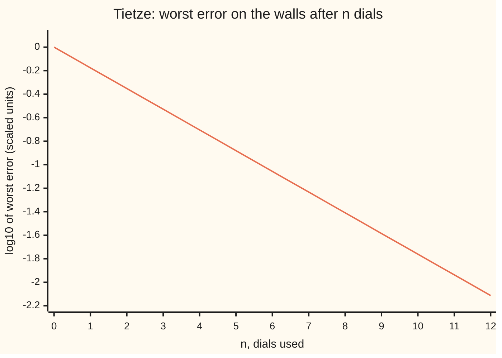
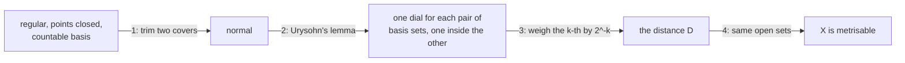

# Urysohn and Tietze: a dial between closed sets, and when a space is secretly metric

[Syllabus](../../../SYLLABUS.md) → [Topology](../README.md) → [Topological Spaces](../README.md#s02) → Urysohn and Tietze

---

## General Overview

A room's floor runs 6 m along its south wall and 4 m up its west wall. Its far wall slants 5 m from the south-east corner back to a point 3 m along the north side. A heating controller wants one number for every spot on the floor: a **dial** that reads 0 against the west wall, 1 against the far wall, and changes without jumps in between.

With distances, a formula does it. At a spot 3 m east and 1 m north, the west wall is 3 m away and the far wall 1.8 m away. The dial reads 3 out of 3 + 1.8, which is 5/8: a little nearer the far wall than the west one.

**Urysohn's lemma** says such a dial exists between any two separate closed sets in any **normal** space, a space where two separate closed sets always fit inside two separate open sets. It needs no distances at all: the dial is built from open sets alone. **Tietze's extension theorem** uses those dials to fill in readings. If thermometers on the walls read between 16 °C and 24 °C, a temperature map of the whole floor exists that agrees with every thermometer, has no jumps and stays between 16 °C and 24 °C.

The third result asks when a space with no distance in it secretly has one. The circle made by gluing the two ends of an interval comes with open sets but no distance. **Urysohn's metrisation theorem** says enough dials always give one.

**Between two separate closed sets of a normal space there is always a continuous dial from 0 to 1, so any bounded continuous reading on a closed set extends to the whole space, and a space with a countable basis whose points and closed sets can be pried apart is secretly metric.**

**What kind of fact this is:** three theorems. Urysohn's lemma and Tietze's theorem are proved on this card in Why it works. The metrisation theorem is stated with its key steps and a named source, not proved in full. On the room and the circle, the code checks the numbers on finitely many points, which illustrates and does not prove.

The dial along the middle of the room, 2 m north of the south wall, from the west wall (x = 0 m) to the far wall (x = 4.5 m):

```
x = 0 m    |                                          0.0000
x = 1 m    |###########                               0.2632
x = 2 m    |####################                      0.5000
x = 3 m    |#############################             0.7143
x = 4 m    |####################################      0.9091
x = 4.5 m  |########################################  1.0000
```

The dial is not a straight ramp. Each metre east adds 1 m to the distance from the west wall but takes less than 1 m off the distance to the slanting far wall, so the steps shrink a little as the spot moves east.

---

## The formula

Notation first, in words. $`X`$ is the space. A **closed set** is one whose outside is open ([Closure, interior and boundary](02-closure-interior-and-boundary.md)). $`A`$ and $`B`$ are two closed sets that share no point. $`[0, 1]`$ is the set of numbers from 0 to 1, ends included. A map is **continuous** when the pre-image of every open set is open ([Continuity by pre-images, and homeomorphism](03-continuity-and-homeomorphism.md)). A space is **normal** when any two disjoint closed sets sit inside two disjoint open sets ([Hausdorff and its ladder](05-separation-axioms-and-hausdorff.md)). That card also asks a normal space to have every single point closed. Urysohn's lemma and Tietze's theorem never use that clause, so this card states it separately, only where it is needed.

**Urysohn's lemma.** If $`X`$ is normal, there is a continuous dial

```math
f : X \to [0, 1], \qquad f = 0 \text{ on } A, \qquad f = 1 \text{ on } B .
```

**Read it aloud:** a normal space has a continuous function to the unit interval that is zero on one closed set and one on the other.

In a metric space the dial has a formula. Here $`d(x, A)`$ is the distance from the point $`x`$ to the nearest point of $`A`$:

```math
f(x) = \frac{d(x, A)}{d(x, A) + d(x, B)} .
```

**Read it aloud:** the dial is the share of the total distance that lies between the point and the first set.

**Tietze's extension theorem.** If $`X`$ is normal, $`A`$ is closed and $`g : A \to [-1, 1]`$ is continuous on $`A`$ only, there is a continuous $`F : X \to [-1, 1]`$ with $`F = g`$ on $`A`$. It is built as a sum of dials:

```math
F = u_0 + u_1 + u_2 + \cdots, \qquad \lvert u_n \rvert \le \tfrac13 \left(\tfrac23\right)^{n}, \qquad \lvert g - (u_0 + \cdots + u_{N-1}) \rvert \le \left(\tfrac23\right)^{N} \text{ on } A .
```

**Read it aloud:** the extension is a sum of dials, each at most a third of the error left over, and after $`N`$ dials the error on $`A`$ is at most two-thirds to the power $`N`$.

**Urysohn's metrisation theorem.** A space is **metrisable** when some distance gives exactly its open sets. It is **regular** when a point and a closed set that misses it sit inside disjoint open sets. A **countable basis** is a basis whose members can be numbered 1, 2, 3, and so on. If $`X`$ is regular, its points are closed sets, and it has a countable basis, then countably many dials $`f_1, f_2, \ldots`$ give a distance

```math
D(x, y) = \sum_{k \ge 1} 2^{-k} \, \lvert f_k(x) - f_k(y) \rvert
```

whose open sets are the open sets of $`X`$.

**Read it aloud:** list the dials, weigh the $`k`$-th by one over two to the $`k`$, and add up how far apart two points read.

| Symbol | Plain meaning | In our example | Push it up and the answer… |
| --- | --- | --- | --- |
| $`X`$; $`x`$, $`y`$ | the space; two of its points | the room's floor, later the glued circle | — |
| $`A`$, $`B`$, $`C`$ | closed sets; $`A`$ and $`B`$ share no point | west wall, far wall | closer sets: steeper dial |
| $`U`$, $`V`$, $`W`$, $`\overline{V}`$ | open sets; $`V`$ with its edge, the closure | the spots nearer the west wall than the far wall | — |
| $`d(x, A)`$, $`\delta`$; $`a`$, $`b`$, $`a'`$, $`b'`$ | distance from $`x`$ to the nearest point of $`A`$; the gap between $`A`$ and $`B`$; in the fold, the distances from $`x`$, then from $`y`$, to $`A`$ and $`B`$ | 3 m from $`P`$ to the west wall; gap 3 m | bigger gap: gentler dial |
| $`f`$ | Urysohn's dial, from 0 on $`A`$ to 1 on $`B`$ | $`f(P) = 5/8`$ | — |
| $`U_r`$; $`r`$, $`r'`$, $`q`$, $`s`$ | a rung: the open set where the dial reads below $`r`$; $`r`$, $`r'`$, $`q`$ dyadic fractions, $`s`$ any level | $`U_{1/2}`$: the spots nearer the west wall | bigger $`r`$: bigger rung |
| $`T`$, $`g`$ | temperature in °C; the reading on $`A`$ rescaled, $`g = (T - 20)/4`$ | 16 to 24 °C; $`g`$ from −1 to 1 | — |
| $`e_n`$, $`M`$ | the error left on $`A`$ after $`n`$ dials; its bound | $`M = (2/3)^n`$ | — |
| $`u_n`$, $`c`$ | the $`n`$-th correcting dial; the fraction of $`M`$ where the error is split | $`u_0(P) = -0.007045`$; $`c = 1/3`$ | $`c`$ to 1/2: the bound stops shrinking |
| $`F`$, $`F_N`$; $`N`$, $`n`$ | the extension; the sum of its first $`N`$ dials | 19.943 °C at $`P`$ with $`N = 12`$ | more dials: smaller error |
| $`f_k`$, $`k`$, $`B_n`$, $`B_m`$, $`D`$ | the $`k`$-th dial of a list; basis sets; the distance the dials make | three tent dials; $`D(1/24, 23/24) = 1/16`$ | — |
| $`P`$, $`t`$, $`0'`$ | the spot $`(3, 1)`$ in metres; a point of the glued circle as a fraction of a turn; the twin of 0 in the doubled origin | $`t = 1/24`$ | — |

### When it holds

- **The two sets are closed.** Let $`B`$ be the points $`(x, 2)`$ with $`0 < x \le 1`$. It misses the west wall but touches it in the limit. A dial would have to climb from 0 to 1 across $`x`$ metres: slopes 10, 100 and 1000 per metre at $`x`$ = 0.1, 0.01, 0.001. No continuous dial exists.
- **The space is normal.** In the line with a doubled origin, 0 and its twin 0' ([Hausdorff and its ladder](05-separation-axioms-and-hausdorff.md)), the two origins are closed points, yet every open set round one meets every open set round the other. A dial would read 0 and 1 on points that no open set can tell apart, so none exists.
- **Tietze needs $`A`$ closed.** On $`(0, 1]`$ a zigzag reads 1, −1, 1, −1, 1, −1 at 1, 1/2, …, 1/6. It has no limit at 0, so it cannot extend to $`[0, 1]`$.
- **Tietze needs values in an interval.** The circle's identity map, into the circle, winds once round. Any map defined on the whole disc can be shrunk to a point, and a shrinking loop winds 0 times. So it does not extend to the disc.
- **Metrisation needs points pried apart.** In the doubled origin, the points $`1/k`$ head for both origins. At the usual distance $`1/k`$ from each, a distance would need $`D(0, 0') \le 2/k`$: 0.2, 0.02, 0.002, and so on to 0. Any distance giving these open sets is squeezed the same way, so none fits. The countable basis is needed by the proof, not by every metric space: an uncountable set with every subset open has a distance and no countable basis.

---

## Why it works

### Step 0: a dial is a ladder of open sets

A dial $`f`$ is known once each set $`U_r`$, where $`f`$ reads below $`r`$, is known. These sets are open, and they are nested with room to spare: when $`r < s`$, the closure of $`U_r`$ lies inside $`U_s`$. Urysohn's idea runs this backwards. Build the ladder of open sets first, one rung at a time, and read the dial off it.

Normality is exactly the tool for adding a rung. Restated, it says: if a closed set $`C`$ lies inside an open set $`U`$, an open set $`V`$ fits between them with $`C \subseteq V`$ and $`\overline{V} \subseteq U`$. Here $`\overline{V}`$ is the closure of $`V`$: $`V`$ with its edge.

Why the restatement holds: $`C`$ and the outside of $`U`$ are disjoint closed sets, so normality puts them in disjoint open sets $`V`$ and $`W`$. Then $`V`$ lies in the closed set outside $`W`$, so its closure does too, and that closed set lies inside $`U`$.

Which spaces are normal? Every metric space, as [Hausdorff and its ladder](05-separation-axioms-and-hausdorff.md) proves, and every compact Hausdorff space, as the fold below proves.

<details>
<summary>Detailed proof: a compact Hausdorff space is normal</summary>

Let $`X`$ be compact and Hausdorff, with disjoint closed sets $`A`$ and $`B`$. Each is compact, because a closed set inside a compact space is compact (Step 4 of [What compactness and connectedness buy](08-images-of-compact-and-connected-sets.md)).

**One point against a closed set.** Fix a point $`x`$ of $`B`$. Step 4 of that card separates $`x`$ from the compact set $`A`$: each point of $`A`$ and the point $`x`$ sit in disjoint open sets, finitely many of the sets round points of $`A`$ cover $`A`$, and the matching sets round $`x`$ overlap in an open set. That gives an open $`U_x`$ holding $`A`$ and an open $`W_x`$ holding $`x`$, with no point in common.

**Two closed sets.** Run the same argument with $`B`$ in place of the point. The sets $`W_x`$, one for each point $`x`$ of $`B`$, cover $`B`$, so finitely many of them do. Their union $`V`$ is open and holds $`B`$. The matching $`U_x`$ overlap in a set $`U`$ that holds $`A`$ and is open, because there are finitely many. Each of those $`U_x`$ misses its own $`W_x`$, so $`U`$ misses every one of them, and so misses $`V`$.

Single points of a Hausdorff space are closed too, so $`X`$ is normal even in the stricter sense of [Hausdorff and its ladder](05-separation-axioms-and-hausdorff.md).

</details>

### Step 1: with distances, the formula works at once

In a metric space, $`d(x, A) = 0`$ exactly when $`x`$ is in the closed set $`A`$. So the formula reads 0 on $`A`$ and 1 on $`B`$. The bottom $`d(x, A) + d(x, B)`$ is never 0, because no point is in both sets.

Each distance changes by at most the step taken: it is Lipschitz with constant 1 ([Metric space](../01-Metric%20Spaces/01-metric-spaces.md)). If the gap between the sets is $`\delta`$, the bottom is at least $`\delta`$, and a short calculation (in the fold) gives

```math
\lvert f(x) - f(y) \rvert \le \frac{d(x, y)}{\delta} .
```

In the room the gap is 3 m, along the north wall, so the dial changes by at most 0.3333 per metre. On the 317 grid points the code finds the steepest change is 0.3333 per metre: along the north wall the bound is met.

<details>
<summary>Detailed proof: the distance dial changes by at most one over the gap</summary>

Write $`a = d(x, A)`$, $`b = d(x, B)`$, and $`a'`$, $`b'`$ for the same at $`y`$. Then

$`\displaystyle f(x) - f(y) = \frac{a}{a + b} - \frac{a'}{a' + b'} = \frac{a(b' - b) - b(a' - a)}{(a + b)(a' + b')} .`$

Each of $`\lvert a' - a\rvert`$ and $`\lvert b' - b\rvert`$ is at most $`d(x, y)`$. So the top is at most $`(a + b)\, d(x, y)`$. Cancel $`a + b`$, and use $`a' + b' \ge \delta`$, which holds because the nearest point of $`A`$ and the nearest point of $`B`$ are at least $`\delta`$ apart:

$`\displaystyle \lvert f(x) - f(y) \rvert \le \frac{d(x, y)}{a' + b'} \le \frac{d(x, y)}{\delta} .`$

</details>

### Step 2: without distances, build the ladder on the halves, quarters and eighths

A **dyadic fraction** is a fraction whose bottom is a power of 2: 1/2, 1/4, 3/4, 1/8, and so on. They are countable and fill $`[0, 1]`$ densely, so they can be added one at a time.

1. Set $`U_1`$ to be everything outside $`B`$. It is open and contains $`A`$.
2. Normality fits an open $`U_0`$ with $`A \subseteq U_0`$ and $`\overline{U_0} \subseteq U_1`$.
3. Normality again fits $`U_{1/2}`$ with $`\overline{U_0} \subseteq U_{1/2}`$ and $`\overline{U_{1/2}} \subseteq U_1`$.
4. Then $`U_{1/4}`$ between $`U_0`$ and $`U_{1/2}`$, and $`U_{3/4}`$ between $`U_{1/2}`$ and $`U_1`$. Keep halving.

Every rung's closure lies inside every higher rung. That is the only property the next step uses.

### Step 3: read the dial off the ladder

Set $`f(x)`$ to the smallest rung that $`x`$ is on: the infimum (greatest lower bound) of the dyadic $`r`$ with $`x \in U_r`$, and 1 if there is none. Points of $`A`$ are on every rung, so $`f = 0`$ there. Points of $`B`$ are on no rung, so $`f = 1`$ there.

Continuity needs two pre-images to be open, since the intervals below and above a number generate the open sets of $`[0, 1]`$:

- $`f(x) < s`$ means $`x`$ is on some rung $`U_r`$ with $`r < s`$. A union of open rungs is open.
- $`f(x) > s`$ means $`x`$ is outside $`\overline{U_r}`$ for some dyadic $`r > s`$. A union of open outsides is open.

<details>
<summary>Detailed proof: the two pre-images are the unions claimed</summary>

**Below $`s`$.** If $`f(x) < s`$, the infimum is below $`s`$, so some dyadic $`r < s`$ has $`x \in U_r`$. Conversely, if $`x \in U_r`$ with $`r < s`$, then $`f(x) \le r < s`$. So the pre-image of $`[0, s)`$ is the union of the open sets $`U_r`$ with $`r < s`$.

**Above $`s`$.** Suppose $`f(x) > s`$. Pick dyadic $`r`$ and $`r'`$ with $`s < r < r' < f(x)`$. Then $`x \notin U_{r'}`$. The closure of $`U_r`$ lies inside $`U_{r'}`$, so $`x \notin \overline{U_r}`$.

Conversely, suppose $`x \notin \overline{U_r}`$ for some dyadic $`r > s`$. Then $`x \notin U_q`$ for every $`q \le r`$, since $`U_q \subseteq \overline{U_r}`$. So every rung holding $`x`$ has $`q > r`$, and $`f(x) \ge r > s`$.

So the pre-image of $`(s, 1]`$ is the union of the open sets $`X \setminus \overline{U_r}`$ with $`r > s`$. Both pre-images are open, so $`f`$ is continuous.

</details>

### Step 4: Tietze corrects a third of the error at a time

Rescale the readings so that they lie between −1 and 1: $`g = (T - 20)/4`$. Then repeat one move.

1. The error still to fix on $`A`$ is a function $`e_n`$ with $`\lvert e_n \rvert \le M`$. At the start, $`e_0 = g`$ and $`M = 1`$.
2. Mark the **hot** part of $`A`$, where $`e_n \ge M/3`$, and the **cold** part, where $`e_n \le -M/3`$. Both are closed in $`A`$, so closed in $`X`$, and they share no point.
3. Urysohn gives a dial $`u_n`$ reading $`+M/3`$ on the hot part, $`-M/3`$ on the cold part and in between elsewhere.
4. On $`A`$, the new error $`e_n - u_n`$ is at most $`2M/3`$ in size: hot points drop from at most $`M`$ to at most $`2M/3`$, cold points likewise, and the rest started below $`M/3`$ and moved at most $`M/3`$.

So the errors shrink by 2/3 each round. The dials have sizes $`\frac13, \frac13 \cdot \frac23, \frac13 (\frac23)^2, \ldots`$, which add up to exactly 1. Their sum converges uniformly, so $`F`$ is continuous ([Uniform convergence](../../06-Calculus%20and%20analysis/06-Series/07-uniform-convergence.md)), and $`\lvert F \rvert \le 1`$. On $`A`$ the error tends to 0, so $`F = g`$ there.

Why a third: with a split at a fraction $`c`$ of $`M`$, the leftover is at most the larger of $`1 - c`$ and $`2c`$ times $`M`$. At $`c = 1/3`$ both are 2/3. At $`c = 1/2`$ the factor is 1, and the bound no longer shrinks.

In the room, 50 thermometers sit on the walls, 25 on each, ends included. The corners read 16 °C and 24 °C, so each round removes exactly a third of the worst error there, and the bound is met:



The line is the measured worst error on the 50 thermometers. It sits exactly on the proved bound $`(2/3)^n`$, a straight line of slope −0.176 on this log scale. After 12 dials the worst error is 0.0308 °C.

### Step 5: metrisation, in outline

The proof chains four facts. Each arrow is a step with a known proof; the card proves arrow 2, Urysohn's lemma.



1. **Regular with a countable basis gives normal.** Cover each closed set by countably many basis sets whose closures miss the other, then trim the two covers against each other.
2. **Countably many dials.** For each pair of basis sets $`B_n`$, $`B_m`$ with $`\overline{B_n} \subseteq B_m`$, Urysohn gives a dial that reads 1 on $`\overline{B_n}`$ and 0 outside $`B_m`$. There are countably many pairs, so the dials can be listed $`f_1, f_2, \ldots`$.
3. **The distance.** $`D`$ adds the weighted readings, and the weights add to at most 1. Two different points are told apart by some dial, so $`D`$ is 0 only from a point to itself.
4. **Same open sets.** Each dial is continuous, so $`D`$-balls are open in $`X`$. Conversely, if $`x`$ sits in an open set $`U`$, some dial $`f_k`$ reads 1 at $`x`$ and 0 outside $`U`$, so every point within $`2^{-k}`$ of $`x`$ lies in $`U`$.

The full proof is in Willard's chapter on metrisation (Sources). The circle, $`[0, 1]`$ with its ends glued and its points named by $`t`$ in $`[0, 1)`$, shows the idea on a small scale. Three tent dials, peaked at $`t = 0`$, $`1/3`$ and $`2/3`$ and falling to 0 half a turn away, already tell every point apart. With weights 1/2, 1/4 and 1/8 they give a distance $`D`$. The interval's own distance puts $`t = 1/24`$ and $`t = 23/24`$ 11/12 apart. The glue makes them close, and $`D`$ agrees: their dial readings, in twelfths, are `[11, 5, 3]` and `[11, 3, 5]`, so $`D = 1/16`$. Here the dials come from a formula; the theorem only promises that they exist.

---

## Worked numbers, by hand

**The dial at $`P = (3, 1)`$**, 3 m east and 1 m north. The far wall lies on the line $`4x + 3y = 24`$, so its distance is $`(24 - 4x - 3y)/5`$.

| Step | Arithmetic | Value |
| --- | --- | --- |
| distance to the west wall | $`d(P, A) = x`$ | 3 m |
| distance to the far wall | $`(24 - 12 - 3)/5`$ | 9/5 = 1.8 m |
| total | $`3 + 1.8`$ | 4.8 m |
| **dial** | $`3 / 4.8`$ | **5/8 = 0.6250** |

The spot is five-eighths of the way from the west wall's reading to the far wall's.

**Tietze's first dial at $`P`$.** The west wall reads $`16 + 2y`$ °C. The far wall reads 24 °C at its south end and falls 1.6 °C per metre along it to 16 °C. Hot means at least $`20 + 4/3`$ °C; cold means at most $`20 - 4/3`$ °C.

| Step | Arithmetic | Value |
| --- | --- | --- |
| nearest hot thermometer | far wall at $`(5, 4/3)`$: $`\sqrt{2^2 + (1/3)^2} = \sqrt{37}/3`$ | 2.0276 m |
| nearest cold thermometer | far wall at $`(4, 8/3)`$: $`\sqrt{1^2 + (5/3)^2} = \sqrt{34}/3`$ | 1.9437 m |
| first dial | $`\frac13 (1.9437 - 2.0276)/(1.9437 + 2.0276)`$ | −0.007045 |
| back to °C | $`20 + 4 \times (-0.007045)`$ | **19.972 °C** |

$`P`$ sits almost exactly between the hot and cold stretches of the far wall, so the first dial barely moves it from 20 °C. Later dials settle it at 19.943 °C after 12 rounds: 19.972, 19.948, 19.931, then 19.939 after 6.

Extensions are not unique. A second recipe weighs the nearest reading on each wall by the distance dial. It also matches all 50 thermometers and stays between 16 °C and 24 °C, yet reads 19.150 °C at $`P`$.

**The circle's distance.** Dial readings at $`t = 1/4`$ and $`t = 3/4`$ give $`D = 1/4`$, half their arc distance of 1/2. Over all pairs of 24 evenly spaced points, $`D`$ divided by arc distance runs from 1/2 to 7/4. When each distance stays within a fixed multiple of the other, the two give the same open sets; the code checks the multiples on those 24 points only.

### What breaks if you drop a piece

| Mistake | Comes out at | What went wrong |
| --- | --- | --- |
| Dial between the wall and points $`(x, 2)`$, $`0 < x \le 1`$ | slope 1000 per metre at $`x`$ = 0.001 m | the second set is not closed: it touches the wall |
| Split Tietze's error at 1/2 instead of 1/3 | shrink factor 1 | a middle point's error can end at twice the split, the full bound again; the proved bound no longer shrinks, so nothing guarantees convergence |
| Extend the circle's identity into the circle, over the disc | winding number 1.000000, not 0 | values must lie in an interval, not in a space with a hole |
| Seek a distance on the doubled origin | $`D(0, 0') \le`$ 0.002, then smaller | not Hausdorff: one sequence has two limits |

---

## Code, from first principles, and it actually runs

The code works on three examples. In the room, it computes the dial by projecting onto each wall and checks it against exact fractions from the line formula: two roads. It checks the dial's steepness against the proved bound on every pair of the 317 grid points. It runs Tietze's construction on the 50 thermometers and checks the error after each round against $`(2/3)^n`$, then checks a second extension. On the glued circle it checks that the three-dial $`D`$ is a distance on all 13,824 triples of 24 points, exactly, in whole numbers. These are checks on finitely many points; the theorems rest on the proofs above.

### Python

```python
# Urysohn, Tietze and metrisation -- the check behind the card.  Standard library only.
# Room floor in metres: corners (0,0), (6,0), (3,4), (0,4).  Wall A runs (0,0)-(0,4); the far
# wall B runs (6,0)-(3,4), a 3-4-5 slant.  Temperatures on the walls are in degrees C.
from math import sqrt, log10, atan2, pi, cos, sin
from fractions import Fraction as Fr

def seg(p, a, b):  # distance from p to the segment a-b: project, clamp to the ends, measure
    (px, py), (ax, ay), (bx, by) = p, a, b
    t = ((px - ax) * (bx - ax) + (py - ay) * (by - ay)) / ((bx - ax) ** 2 + (by - ay) ** 2)
    t = min(1.0, max(0.0, t))
    return sqrt((px - ax - t * (bx - ax)) ** 2 + (py - ay - t * (by - ay)) ** 2)
dA = lambda p: seg(p, (0, 0), (0, 4))
dB = lambda p: seg(p, (6, 0), (3, 4))
dial = lambda p: dA(p) / (dA(p) + dB(p))     # Urysohn's dial in a metric space
def exact(x, y):  # second road: wall A is x itself, wall B is the 3-4-5 line, exact fractions
    a, b = Fr(x), (24 - 4 * Fr(x) - 3 * Fr(y)) / 5
    return a, b, a / (a + b)
room = [(i / 4, j / 4) for i in range(25) for j in range(17) if 4 * i + 3 * j <= 96]
print(f"room grid every 0.25 m: {len(room)} points; gap between walls {min(dA(p) + dB(p) for p in room):.4f} m")
a, b, f = exact(3, 1)
print(f"P=(3,1): dA={a} dB={b} dial={f} = {float(f):.4f}; by projection {dial((3, 1)):.4f}")
assert f == Fr(5, 8) and abs(dial((3, 1)) - 5 / 8) < 1e-12
row = []
for x in (0, 1, 2, 3, 4, 4.5):
    a, b, f = exact(x, 2)
    assert abs(dial((x, 2)) - float(f)) < 1e-12
    row.append(f"{x}:{float(f):.4f}")
print("along y=2, x:dial  " + "  ".join(row))
ends = [dial((0, y)) for y in range(5)] + [dial((6 - 3 * s / 5, 4 * s / 5)) for s in range(6)]
print("on wall A: " + " ".join(f"{v:.4f}" for v in ends[:5]) + "; on wall B: " + " ".join(f"{v:.4f}" for v in ends[5:]))
assert max(ends[:5]) == 0 and min(ends[5:]) > 1 - 1e-12
slope = max(abs(dial(p) - dial(q)) / sqrt((p[0] - q[0]) ** 2 + (p[1] - q[1]) ** 2)
            for i, p in enumerate(room) for q in room[:i])
print(f"steepest dial change between grid points: {slope:.4f} per m; proved bound 1/gap = {1 / 3:.4f}")
assert 0 < slope <= 1 / 3 + 1e-12
# Tietze: wall A reads 16 + 2y, wall B reads 24 - 1.6 s (s = metres from (6,0)); scaled g = (T - 20)/4
walls = [((0.0, k / 6), (2 * k / 6 - 4) / 4) for k in range(25)] + \
        [((6 - 3 * (5 * k / 24) / 5, 4 * (5 * k / 24) / 5), (4 - 1.6 * 5 * k / 24) / 4) for k in range(25)]
near = lambda p, S: min(sqrt((p[0] - q[0]) ** 2 + (p[1] - q[1]) ** 2) for q in S)
def step(r, M):  # one Urysohn dial: -M/3 where r <= -M/3, +M/3 where r >= M/3, between elsewhere
    lo = [q for q, v in r if v <= -M / 3 + 1e-12]
    hi = [q for q, v in r if v >= M / 3 - 1e-12]
    return lambda p: M / 3 * (near(p, lo) - near(p, hi)) / (near(p, lo) + near(p, hi)), lo, hi
P, r, M, us, errs = (3, 1), list(walls), 1.0, [], []
for n in range(13):
    errs.append(max(abs(v) for q, v in r))
    assert abs(errs[-1] - (2 / 3) ** n) < 1e-9   # the remainder meets its proved bound (2/3)^n
    if n == 12:
        break
    u, lo, hi = step(r, M)
    if n == 0:
        print(f"step 1 at P: nearest hot {near(P, hi):.4f} m (sqrt37/3 = {sqrt(37) / 3:.4f}), "
              f"nearest cold {near(P, lo):.4f} m (sqrt34/3 = {sqrt(34) / 3:.4f}), u = {u(P):.6f}")
    us.append(u)
    r, M = [(q, v - u(q)) for q, v in r], 2 * M / 3
F = lambda p, N=12: sum(u(p) for u in us[:N])
print("chart,n " + " ".join(str(n) for n in range(13)))
print("chart,log10 worst wall error " + " ".join(f"{log10(e):.3f}" for e in errs))
print("Tietze at P, degrees C: " + "  ".join(f"N={N}:{20 + 4 * F(P, N):.3f}" for N in (1, 2, 3, 6, 12)))
top = max(abs(F(p)) for p in room)
print(f"after 12 steps: worst wall error {4 * errs[12]:.4f} C; room spans {20 - 4 * top:.3f} to {20 + 4 * top:.3f} C "
      f"(proved inside 20 +- {4 * (1 - (2 / 3) ** 12):.3f})")
assert top <= 1 - (2 / 3) ** 12 + 1e-12 and abs(20 + 4 * F(P, 1) - (20 + 4 / 3 * (sqrt(34) - sqrt(37)) / (sqrt(34) + sqrt(37)))) < 1e-12
def blend(p):  # a second extension: weigh the nearest reading on each wall by the dial
    x, y = p
    gA = (2 * min(4.0, max(0.0, y)) - 4) / 4
    t = min(5.0, max(0.0, (-3 * (x - 6) + 4 * y) / 5))
    return (dB(p) * gA + dA(p) * (4 - 1.6 * t) / 4) / (dA(p) + dB(p))
bw = max(abs(blend(q) - v) for q, v in walls)
print(f"blend extension at P {20 + 4 * blend(P):.3f} C; largest miss on the walls below 1e-12 {bw < 1e-12}; "
      f"inside 16 to 24 C {max(abs(blend(p)) for p in room) <= 1}")
assert bw < 1e-12 and abs(20 + 4 * blend(P) - 19.15) < 1e-9
# metrisation on the circle, [0,1] with its ends glued: t = j/24; three tent dials centred at 0, 1/3, 2/3
dials = lambda j: [12 - min((j - c) % 24, (c - j) % 24) for c in (0, 8, 16)]  # in twelfths
D = lambda i, j: sum(w * abs(x - y) for w, x, y in zip((4, 2, 1), dials(i), dials(j)))  # in 96ths
arc = lambda i, j: min((i - j) % 24, (j - i) % 24)                                     # in 24ths
pairs = [(i, j) for i in range(24) for j in range(24) if i != j]
tri = all(D(i, k) <= D(i, j) + D(j, k) for i in range(24) for j in range(24) for k in range(24))
print(f"dial metric on 24 points: zero only on the diagonal {all(D(i, j) > 0 for i, j in pairs)}, "
      f"symmetric {all(D(i, j) == D(j, i) for i, j in pairs)}, triangle on 13824 triples {tri}")
assert tri and all(D(i, j) > 0 for i, j in pairs)
rat = sorted(Fr(D(i, j), 4 * arc(i, j)) for i, j in pairs)
print(f"D / arc length: from {rat[0]} to {rat[-1]}")
assert rat[0] == Fr(1, 2)
print(f"dials at 1/24: {dials(1)}, at 23/24: {dials(23)} (twelfths); D(1/24, 23/24) = {Fr(D(1, 23), 96)} "
      f"though |1/24 - 23/24| = 11/12; D(1/4, 3/4) = {Fr(D(6, 18), 96)}")
assert D(1, 23) < D(6, 18)
# what breaks
print("B touching A along (x,2), 0<x<=1: the dial must jump 1 across x m, slope " +
      ", ".join(f"{1 / x:.0f}" for x in (0.1, 0.01, 0.001)) + " per m at x = 0.1, 0.01, 0.001")
print("Tietze from (0,1], zigzag at 1, 1/2, ..., 1/6: " + " ".join(str((-1) ** (k + 1)) for k in range(1, 7)))
ring = [(cos(2 * pi * k / 24), sin(2 * pi * k / 24)) for k in range(25)]
wind = sum(atan2(x1 * y2 - y1 * x2, x1 * x2 + y1 * y2) for (x1, y1), (x2, y2) in zip(ring, ring[1:])) / (2 * pi)
print(f"circle-valued: the identity loop winds {wind:.6f} times; a loop that shrinks in the disc winds 0")
assert abs(wind - 1) < 1e-9
print("Tietze split: " + "; ".join(f"at {c} shrinks by {max(1 - c, 2 * c)}" for c in (Fr(1, 4), Fr(1, 3), Fr(1, 2))))
print("doubled origin: 1/k near both origins forces D(0, 0') <= 2/k: " + ", ".join(f"{2 / k}" for k in (10, 100, 1000)))
print("ALL CHECKS PASS")
```

**Ran 2026-11-14 on macOS, Python 3.14.10, standard library only. All checks passed. Output, pasted from the run:**

```
room grid every 0.25 m: 317 points; gap between walls 3.0000 m
P=(3,1): dA=3 dB=9/5 dial=5/8 = 0.6250; by projection 0.6250
along y=2, x:dial  0:0.0000  1:0.2632  2:0.5000  3:0.7143  4:0.9091  4.5:1.0000
on wall A: 0.0000 0.0000 0.0000 0.0000 0.0000; on wall B: 1.0000 1.0000 1.0000 1.0000 1.0000 1.0000
steepest dial change between grid points: 0.3333 per m; proved bound 1/gap = 0.3333
step 1 at P: nearest hot 2.0276 m (sqrt37/3 = 2.0276), nearest cold 1.9437 m (sqrt34/3 = 1.9437), u = -0.007045
chart,n 0 1 2 3 4 5 6 7 8 9 10 11 12
chart,log10 worst wall error 0.000 -0.176 -0.352 -0.528 -0.704 -0.880 -1.057 -1.233 -1.409 -1.585 -1.761 -1.937 -2.113
Tietze at P, degrees C: N=1:19.972  N=2:19.948  N=3:19.931  N=6:19.939  N=12:19.943
after 12 steps: worst wall error 0.0308 C; room spans 16.031 to 23.969 C (proved inside 20 +- 3.969)
blend extension at P 19.150 C; largest miss on the walls below 1e-12 True; inside 16 to 24 C True
dial metric on 24 points: zero only on the diagonal True, symmetric True, triangle on 13824 triples True
D / arc length: from 1/2 to 7/4
dials at 1/24: [11, 5, 3], at 23/24: [11, 3, 5] (twelfths); D(1/24, 23/24) = 1/16 though |1/24 - 23/24| = 11/12; D(1/4, 3/4) = 1/4
B touching A along (x,2), 0<x<=1: the dial must jump 1 across x m, slope 10, 100, 1000 per m at x = 0.1, 0.01, 0.001
Tietze from (0,1], zigzag at 1, 1/2, ..., 1/6: 1 -1 1 -1 1 -1
circle-valued: the identity loop winds 1.000000 times; a loop that shrinks in the disc winds 0
Tietze split: at 1/4 shrinks by 3/4; at 1/3 shrinks by 2/3; at 1/2 shrinks by 1
doubled origin: 1/k near both origins forces D(0, 0') <= 2/k: 0.2, 0.02, 0.002
ALL CHECKS PASS
```

### Rust

```rust
// Urysohn, Tietze and metrisation -- the check behind the card.  Rust std only.
// Room floor in metres: corners (0,0), (6,0), (3,4), (0,4).  Wall A runs (0,0)-(0,4); the far
// wall B runs (6,0)-(3,4), a 3-4-5 slant.  Temperatures on the walls are in degrees C.
use std::f64::consts::PI;
type Pt = (f64, f64);
fn seg(p: Pt, a: Pt, b: Pt) -> f64 { // distance from p to the segment a-b: project, clamp, measure
    let t = ((p.0 - a.0) * (b.0 - a.0) + (p.1 - a.1) * (b.1 - a.1)) / ((b.0 - a.0).powi(2) + (b.1 - a.1).powi(2));
    let t = t.max(0.0).min(1.0);
    ((p.0 - a.0 - t * (b.0 - a.0)).powi(2) + (p.1 - a.1 - t * (b.1 - a.1)).powi(2)).sqrt()
}
fn da(p: Pt) -> f64 { seg(p, (0.0, 0.0), (0.0, 4.0)) }
fn db(p: Pt) -> f64 { seg(p, (6.0, 0.0), (3.0, 4.0)) }
fn dial(p: Pt) -> f64 { da(p) / (da(p) + db(p)) } // Urysohn's dial in a metric space
fn gcd(a: i64, b: i64) -> i64 { if b == 0 { a.abs() } else { gcd(b, a % b) } }
fn fr(n: i64, d: i64) -> String { let g = gcd(n, d); if d / g == 1 { format!("{}", n / g) } else { format!("{}/{}", n / g, d / g) } }
// second road: wall A is x itself, wall B is the 3-4-5 line; exact fractions in tenths, as (num, den)
fn exact(x10: i64, y10: i64) -> ((i64, i64), (i64, i64), (i64, i64)) {
    let (a, b) = ((x10, 10), (240 - 4 * x10 - 3 * y10, 50)); // dA = x, dB = (24 - 4x - 3y)/5
    let (fnum, fden) = (a.0 * b.1, a.0 * b.1 + b.0 * a.1);
    (a, b, (fnum, fden))
}
fn dist(p: Pt, q: Pt) -> f64 { ((p.0 - q.0).powi(2) + (p.1 - q.1).powi(2)).sqrt() }
fn near(p: Pt, s: &[Pt]) -> f64 { s.iter().map(|&q| dist(p, q)).fold(f64::INFINITY, f64::min) }
struct Step { m: f64, lo: Vec<Pt>, hi: Vec<Pt> } // one Urysohn dial: -M/3 on lo, +M/3 on hi
impl Step { fn u(&self, p: Pt) -> f64 { let (l, h) = (near(p, &self.lo), near(p, &self.hi)); self.m / 3.0 * (l - h) / (l + h) } }
fn blend(p: Pt) -> f64 { // a second extension: weigh the nearest reading on each wall by the dial
    let ga = (2.0 * p.1.max(0.0).min(4.0) - 4.0) / 4.0;
    let t = ((-3.0 * (p.0 - 6.0) + 4.0 * p.1) / 5.0).max(0.0).min(5.0);
    (db(p) * ga + da(p) * (4.0 - 1.6 * t) / 4.0) / (da(p) + db(p))
}
fn dials(j: i64) -> [i64; 3] { // dial values in twelfths: 12 - (24ths of circle distance to the centre)
    let mut v = [0; 3];
    for (k, c) in [0i64, 8, 16].iter().enumerate() { v[k] = 12 - (j - c).rem_euclid(24).min((c - j).rem_euclid(24)); }
    v
}
fn dd(i: i64, j: i64) -> i64 { let (a, b) = (dials(i), dials(j)); 4 * (a[0] - b[0]).abs() + 2 * (a[1] - b[1]).abs() + (a[2] - b[2]).abs() } // 96ths
fn arc(i: i64, j: i64) -> i64 { (i - j).rem_euclid(24).min((j - i).rem_euclid(24)) } // 24ths
fn main() {
    let mut room = vec![];
    for i in 0..25 { for j in 0..17 { if 4 * i + 3 * j <= 96 { room.push((i as f64 / 4.0, j as f64 / 4.0)); } } }
    let gap = room.iter().map(|&p| da(p) + db(p)).fold(f64::INFINITY, f64::min);
    println!("room grid every 0.25 m: {} points; gap between walls {:.4} m", room.len(), gap);
    let (a, b, f) = exact(30, 10);
    println!("P=(3,1): dA={} dB={} dial={} = {:.4}; by projection {:.4}", fr(a.0, a.1), fr(b.0, b.1), fr(f.0, f.1), f.0 as f64 / f.1 as f64, dial((3.0, 1.0)));
    assert!(f.0 * 8 == f.1 * 5 && (dial((3.0, 1.0)) - 0.625).abs() < 1e-12);
    let mut row = vec![];
    for (x10, s) in [(0, "0"), (10, "1"), (20, "2"), (30, "3"), (40, "4"), (45, "4.5")] {
        let (_, _, f) = exact(x10, 20);
        let v = f.0 as f64 / f.1 as f64;
        assert!((dial((x10 as f64 / 10.0, 2.0)) - v).abs() < 1e-12);
        row.push(format!("{}:{:.4}", s, v));
    }
    println!("along y=2, x:dial  {}", row.join("  "));
    let ea: Vec<f64> = (0..5).map(|y| dial((0.0, y as f64))).collect();
    let eb: Vec<f64> = (0..6).map(|s| dial((6.0 - 3.0 * s as f64 / 5.0, 4.0 * s as f64 / 5.0))).collect();
    let fmt = |v: &[f64]| v.iter().map(|x| format!("{:.4}", x)).collect::<Vec<_>>().join(" ");
    println!("on wall A: {}; on wall B: {}", fmt(&ea), fmt(&eb));
    assert!(ea.iter().all(|&v| v == 0.0) && eb.iter().all(|&v| v > 1.0 - 1e-12));
    let mut slope: f64 = 0.0;
    for i in 0..room.len() { for j in 0..i { slope = slope.max((dial(room[i]) - dial(room[j])).abs() / dist(room[i], room[j])); } }
    println!("steepest dial change between grid points: {:.4} per m; proved bound 1/gap = {:.4}", slope, 1.0 / 3.0);
    assert!(slope > 0.0 && slope <= 1.0 / 3.0 + 1e-12);
    // Tietze: wall A reads 16 + 2y, wall B reads 24 - 1.6 s (s = metres from (6,0)); scaled g = (T - 20)/4
    let mut r: Vec<(Pt, f64)> = (0..25).map(|k| ((0.0, k as f64 / 6.0), (2.0 * k as f64 / 6.0 - 4.0) / 4.0)).collect();
    r.extend((0..25).map(|k| { let s = 5.0 * k as f64 / 24.0; ((6.0 - 3.0 * s / 5.0, 4.0 * s / 5.0), (4.0 - 1.6 * 5.0 * k as f64 / 24.0) / 4.0) }));
    let walls = r.clone();
    let (p, mut m) = ((3.0, 1.0), 1.0f64);
    let (mut us, mut errs): (Vec<Step>, Vec<f64>) = (vec![], vec![]);
    for n in 0..13 {
        errs.push(r.iter().map(|x| x.1.abs()).fold(0.0, f64::max));
        assert!((errs[n] - (2.0f64 / 3.0).powi(n as i32)).abs() < 1e-9); // the remainder meets (2/3)^n
        if n == 12 { break; }
        let st = Step { m, lo: r.iter().filter(|x| x.1 <= -m / 3.0 + 1e-12).map(|x| x.0).collect(),
                        hi: r.iter().filter(|x| x.1 >= m / 3.0 - 1e-12).map(|x| x.0).collect() };
        if n == 0 {
            println!("step 1 at P: nearest hot {:.4} m (sqrt37/3 = {:.4}), nearest cold {:.4} m (sqrt34/3 = {:.4}), u = {:.6}",
                     near(p, &st.hi), 37f64.sqrt() / 3.0, near(p, &st.lo), 34f64.sqrt() / 3.0, st.u(p));
        }
        r = r.iter().map(|&(q, v)| (q, v - st.u(q))).collect();
        us.push(st);
        m = 2.0 * m / 3.0;
    }
    let ff = |q: Pt, nn: usize| us[..nn].iter().map(|s| s.u(q)).sum::<f64>();
    println!("chart,n {}", (0..13).map(|n| n.to_string()).collect::<Vec<_>>().join(" "));
    println!("chart,log10 worst wall error {}", errs.iter().map(|e| format!("{:.3}", e.log10())).collect::<Vec<_>>().join(" "));
    println!("Tietze at P, degrees C: {}", [1, 2, 3, 6, 12].iter().map(|&nn| format!("N={}:{:.3}", nn, 20.0 + 4.0 * ff(p, nn))).collect::<Vec<_>>().join("  "));
    let top = room.iter().map(|&q| ff(q, 12).abs()).fold(0.0, f64::max);
    println!("after 12 steps: worst wall error {:.4} C; room spans {:.3} to {:.3} C (proved inside 20 +- {:.3})",
             4.0 * errs[12], 20.0 - 4.0 * top, 20.0 + 4.0 * top, 4.0 * (1.0 - (2.0f64 / 3.0).powi(12)));
    let (s34, s37) = (34f64.sqrt(), 37f64.sqrt());
    assert!(top <= 1.0 - (2.0f64 / 3.0).powi(12) + 1e-12 && (20.0 + 4.0 * ff(p, 1) - (20.0 + 4.0 / 3.0 * (s34 - s37) / (s34 + s37))).abs() < 1e-12);
    let bw = walls.iter().map(|&(q, v)| (blend(q) - v).abs()).fold(0.0, f64::max);
    let inside = room.iter().map(|&q| blend(q).abs()).fold(0.0, f64::max) <= 1.0;
    let cap = |b: bool| if b { "True" } else { "False" };
    println!("blend extension at P {:.3} C; largest miss on the walls below 1e-12 {}; inside 16 to 24 C {}", 20.0 + 4.0 * blend(p), cap(bw < 1e-12), cap(inside));
    assert!(bw < 1e-12 && (20.0 + 4.0 * blend(p) - 19.15).abs() < 1e-9);
    // metrisation on the circle, [0,1] with its ends glued: t = j/24; three tent dials centred at 0, 1/3, 2/3
    let pairs: Vec<(i64, i64)> = (0..24).flat_map(|i| (0..24).map(move |j| (i, j))).filter(|&(i, j)| i != j).collect();
    let mut tri = true;
    for i in 0..24 { for j in 0..24 { for k in 0..24 { tri &= dd(i, k) <= dd(i, j) + dd(j, k); } } }
    let pos = pairs.iter().all(|&(i, j)| dd(i, j) > 0);
    println!("dial metric on 24 points: zero only on the diagonal {}, symmetric {}, triangle on 13824 triples {}",
             cap(pos), cap(pairs.iter().all(|&(i, j)| dd(i, j) == dd(j, i))), cap(tri));
    assert!(tri && pos);
    let (mut lo, mut hi) = ((1000i64, 1i64), (0i64, 1i64)); // D / arc as num/den = dd / (4 arc)
    for &(i, j) in &pairs {
        let (n, d) = (dd(i, j), 4 * arc(i, j));
        if n * lo.1 < lo.0 * d { lo = (n, d); }
        if n * hi.1 > hi.0 * d { hi = (n, d); }
    }
    println!("D / arc length: from {} to {}", fr(lo.0, lo.1), fr(hi.0, hi.1));
    assert!(lo.0 * 2 == lo.1);
    let (d1, d23) = (dials(1), dials(23));
    println!("dials at 1/24: [{}, {}, {}], at 23/24: [{}, {}, {}] (twelfths); D(1/24, 23/24) = {} though |1/24 - 23/24| = 11/12; D(1/4, 3/4) = {}",
             d1[0], d1[1], d1[2], d23[0], d23[1], d23[2], fr(dd(1, 23), 96), fr(dd(6, 18), 96));
    assert!(dd(1, 23) < dd(6, 18));
    // what breaks
    println!("B touching A along (x,2), 0<x<=1: the dial must jump 1 across x m, slope {} per m at x = 0.1, 0.01, 0.001",
             [0.1f64, 0.01, 0.001].iter().map(|x| format!("{:.0}", 1.0 / x)).collect::<Vec<_>>().join(", "));
    println!("Tietze from (0,1], zigzag at 1, 1/2, ..., 1/6: {}", (1..7).map(|k| if k % 2 == 1 { "1" } else { "-1" }).collect::<Vec<_>>().join(" "));
    let ring: Vec<Pt> = (0..25).map(|k| ((2.0 * PI * k as f64 / 24.0).cos(), (2.0 * PI * k as f64 / 24.0).sin())).collect();
    let wind = ring.windows(2).map(|w| (w[0].0 * w[1].1 - w[0].1 * w[1].0).atan2(w[0].0 * w[1].0 + w[0].1 * w[1].1)).sum::<f64>() / (2.0 * PI);
    println!("circle-valued: the identity loop winds {:.6} times; a loop that shrinks in the disc winds 0", wind);
    assert!((wind - 1.0).abs() < 1e-9);
    let split: Vec<String> = [(1i64, 4i64), (1, 3), (1, 2)].iter().map(|&(n, d)| {
        let (a, b) = (d - n, 2 * n); format!("at {} shrinks by {}", fr(n, d), fr(a.max(b), d)) }).collect();
    println!("Tietze split: {}", split.join("; "));
    println!("doubled origin: 1/k near both origins forces D(0, 0') <= 2/k: {}", [10.0f64, 100.0, 1000.0].iter().map(|k| format!("{}", 2.0 / k)).collect::<Vec<_>>().join(", "));
    println!("ALL CHECKS PASS");
}
```

**Ran 2026-11-14 on macOS, rustc 1.98.1, no crates. All checks passed. Output, pasted from the run:**

```
room grid every 0.25 m: 317 points; gap between walls 3.0000 m
P=(3,1): dA=3 dB=9/5 dial=5/8 = 0.6250; by projection 0.6250
along y=2, x:dial  0:0.0000  1:0.2632  2:0.5000  3:0.7143  4:0.9091  4.5:1.0000
on wall A: 0.0000 0.0000 0.0000 0.0000 0.0000; on wall B: 1.0000 1.0000 1.0000 1.0000 1.0000 1.0000
steepest dial change between grid points: 0.3333 per m; proved bound 1/gap = 0.3333
step 1 at P: nearest hot 2.0276 m (sqrt37/3 = 2.0276), nearest cold 1.9437 m (sqrt34/3 = 1.9437), u = -0.007045
chart,n 0 1 2 3 4 5 6 7 8 9 10 11 12
chart,log10 worst wall error 0.000 -0.176 -0.352 -0.528 -0.704 -0.880 -1.057 -1.233 -1.409 -1.585 -1.761 -1.937 -2.113
Tietze at P, degrees C: N=1:19.972  N=2:19.948  N=3:19.931  N=6:19.939  N=12:19.943
after 12 steps: worst wall error 0.0308 C; room spans 16.031 to 23.969 C (proved inside 20 +- 3.969)
blend extension at P 19.150 C; largest miss on the walls below 1e-12 True; inside 16 to 24 C True
dial metric on 24 points: zero only on the diagonal True, symmetric True, triangle on 13824 triples True
D / arc length: from 1/2 to 7/4
dials at 1/24: [11, 5, 3], at 23/24: [11, 3, 5] (twelfths); D(1/24, 23/24) = 1/16 though |1/24 - 23/24| = 11/12; D(1/4, 3/4) = 1/4
B touching A along (x,2), 0<x<=1: the dial must jump 1 across x m, slope 10, 100, 1000 per m at x = 0.1, 0.01, 0.001
Tietze from (0,1], zigzag at 1, 1/2, ..., 1/6: 1 -1 1 -1 1 -1
circle-valued: the identity loop winds 1.000000 times; a loop that shrinks in the disc winds 0
Tietze split: at 1/4 shrinks by 3/4; at 1/3 shrinks by 2/3; at 1/2 shrinks by 1
doubled origin: 1/k near both origins forces D(0, 0') <= 2/k: 0.2, 0.02, 0.002
ALL CHECKS PASS
```

### Lean

Lean proves all three theorems in general, and checks the room's and the circle's worked numbers exactly.

- Suppose $`X`$ is normal, and $`A`$ and $`B`$ are closed sets that share no point. Then a continuous dial $`f : X \to [0, 1]`$ reads 0 on $`A`$ and 1 on $`B`$.
- Suppose $`X`$ is normal, $`A`$ is closed and $`g : A \to [-1, 1]`$ is continuous. Then a continuous $`F : X \to [-1, 1]`$ has $`F = g`$ on $`A`$.
- Suppose $`X`$ is regular, its points are closed sets, and it has a countable basis. Then $`X`$ is metrisable.
- Take the spot $`P = (3, 1)`$. Then the far wall is 9/5 m away, and the dial reads 5/8.
- Take the three tent dials on the glued circle. Then $`t = 1/24`$ reads `[11, 5, 3]` twelfths, and $`t = 23/24`$ reads `[11, 3, 5]`.
- Take $`t = 1/24`$ and $`t = 23/24`$. Then $`D = 1/16`$.
- Take $`t = 1/4`$ and $`t = 3/4`$. Then $`D = 1/4`$, half their arc distance.
- Take any two of the 24 evenly spaced points. Then $`D`$ is 0 only from a point to itself, is symmetric, and is 1/2 to 7/4 times arc distance.
- Take any points $`x`$, $`y`$, $`z`$ among the 24, 13,824 triples in all. Then $`D(x, z) \le D(x, y) + D(y, z)`$.

The room's grid, Tietze's 12 rounds on the thermometers, the blend and the What breaks rows stay with the Python and Rust checks.

```lean
-- Urysohn and Tietze: a normal space has a continuous dial from 0 to 1 between any two disjoint closed sets, a bounded continuous reading on a closed set extends to the whole space, and a regular space with closed points and a countable basis is metrisable.
import Mathlib.Topology.UrysohnsLemma
import Mathlib.Topology.TietzeExtension
import Mathlib.Topology.Metrizable.Urysohn

open Set

/-- **Urysohn's lemma.** In a normal space, for two closed sets `A` and `B` that share no point,
there is a continuous dial `f : X → [0, 1]` that reads 0 on `A` and 1 on `B`. -/
theorem urysohn_dial_between_disjoint_closed_sets {X : Type*} [TopologicalSpace X] [NormalSpace X]
    {A B : Set X} (hA : IsClosed A) (hB : IsClosed B) (hAB : Disjoint A B) :
    ∃ f : X → ℝ, Continuous f ∧ (∀ x, f x ∈ Icc (0 : ℝ) 1) ∧
      (∀ x ∈ A, f x = 0) ∧ (∀ x ∈ B, f x = 1) := by
  obtain ⟨f, h0, h1, hI⟩ := exists_continuous_zero_one_of_isClosed hA hB hAB
  exact ⟨f, f.continuous, hI, fun x hx => h0 hx, fun x hx => h1 hx⟩

/-- **Tietze's extension theorem.** In a normal space, a continuous reading `g : A → [-1, 1]`
on a closed set `A` extends to a continuous `F : X → [-1, 1]` that agrees with `g` on `A`. -/
theorem tietze_extension_of_closed_set {X : Type*} [TopologicalSpace X] [NormalSpace X]
    {A : Set X} (hA : IsClosed A) (g : A → ℝ) (hg : Continuous g)
    (hg1 : ∀ a, g a ∈ Icc (-1 : ℝ) 1) :
    ∃ F : X → ℝ, Continuous F ∧ (∀ x, F x ∈ Icc (-1 : ℝ) 1) ∧ ∀ a : A, F a = g a := by
  obtain ⟨F, hF, hFg⟩ := ContinuousMap.exists_restrict_eq_forall_mem_of_closed
    (⟨g, hg⟩ : C(A, ℝ)) hg1 ⟨0, by norm_num⟩ hA
  exact ⟨F, F.continuous, hF, fun a => congrArg (fun k : C(A, ℝ) => k a) hFg⟩

/-- **Urysohn's metrisation theorem.** A space that is regular, whose single points are closed,
and that has a countable basis is metrisable: some distance gives exactly its open sets. -/
theorem urysohn_metrisation {X : Type*} [TopologicalSpace X] [RegularSpace X] [T1Space X]
    [SecondCountableTopology X] : TopologicalSpace.MetrizableSpace X := by
  infer_instance

/-! The card's worked numbers, checked exactly. -/

-- The dial at P = (3, 1): 3 m to the west wall, (24 - 4·3 - 3·1)/5 = 9/5 m to the far wall, dial 5/8.
example : (24 - 4 * 3 - 3 * 1 : ℚ) / 5 = 9 / 5 := by norm_num
example : (3 : ℚ) / (3 + 9 / 5) = 5 / 8 := by norm_num

/-- The three tent dials on the glued circle, at `t = j/24`, in twelfths, peaked at 0, 1/3, 2/3. -/
def circleDials (j : ℕ) : List ℕ :=
  [0, 8, 16].map fun c => 12 - min ((j + 24 - c) % 24) ((c + 24 - j) % 24)

/-- The dial distance `D` with weights 1/2, 1/4, 1/8, in 96ths. -/
def dialDist (i j : ℕ) : ℕ :=
  ((List.zip [4, 2, 1] (List.zip (circleDials i) (circleDials j))).map
    fun p => p.1 * ((p.2.1 - p.2.2) + (p.2.2 - p.2.1))).sum

/-- Arc length on the glued circle, in 24ths of a turn. -/
def arcDist (i j : ℕ) : ℕ := min ((i + 24 - j) % 24) ((j + 24 - i) % 24)

-- Dial readings at t = 1/24 and t = 23/24 are [11, 5, 3] and [11, 3, 5] twelfths.
example : circleDials 1 = [11, 5, 3] := by decide
example : circleDials 23 = [11, 3, 5] := by decide
-- D(1/24, 23/24) = 6/96 = 1/16 and D(1/4, 3/4) = 24/96 = 1/4.
example : dialDist 1 23 = 6 := by decide
example : dialDist 6 18 = 24 := by decide
-- On all pairs of 24 points, D is zero only on the diagonal, symmetric, and
-- D / arc length runs from 1/2 to 7/4 (D in 96ths, arc in 24ths: 2·arc ≤ D ≤ 7·arc).
example : ∀ i < 24, ∀ j < 24, i ≠ j → 0 < dialDist i j := by decide
example : ∀ i < 24, ∀ j < 24, dialDist i j = dialDist j i := by decide
example : ∀ i < 24, ∀ j < 24, 2 * arcDist i j ≤ dialDist i j ∧ dialDist i j ≤ 7 * arcDist i j := by decide
example : dialDist 6 18 = 2 * arcDist 6 18 := by decide
-- The triangle inequality on all 13,824 triples of the 24 points.
example : ∀ i < 24, ∀ j < 24, ∀ k < 24, dialDist i k ≤ dialDist i j + dialDist j k := by decide

#print axioms urysohn_dial_between_disjoint_closed_sets
#print axioms tietze_extension_of_closed_set
#print axioms urysohn_metrisation
```

**Checked 2026-11-14 on macOS, Lean 4.36.0-rc2, Mathlib v4.36.0-rc2. Every proof is complete and uses only Lean's standard axioms. Output, pasted from the run:**

```
'urysohn_dial_between_disjoint_closed_sets' depends on axioms: [propext, Classical.choice, Quot.sound]
'tietze_extension_of_closed_set' depends on axioms: [propext, Classical.choice, Quot.sound]
'urysohn_metrisation' depends on axioms: [propext, Classical.choice, Quot.sound]
```

> [!TIP]
> **Try changing**
> Guess first, then run it.
> - **Move the spot.** Change `(3, 1)` to `(1, 2)` in the line that sets `P, r, M, us, errs`. Guess first: what does the Tietze line print? 20.000 for every $`N`$: on the west wall the hot and cold stretches sit equally far above and below the spot. Then the hand-check assert stops the run, since $`\sqrt{34}`$ and $`\sqrt{37}`$ belong to $`(3, 1)`$.
> - **Split at a half.** In `step`, change all three `M / 3` to `M / 2`. Guess first: does the worst error follow $`(2/3)^n`$? After one round it is 0.5, better at the corners, but a middle point's error can now end at a whole $`M`$, so the guarantee is gone and the assert on $`(2/3)^n`$ stops the run.
> - **Drop a weight.** In `D`, change the weights `(4, 2, 1)` to `(4, 2, 0)`. Guess first: can two dials alone tell all 24 points apart? Yes: the zero and triangle checks pass, and $`D`$ over arc distance now runs from 1/3 to 3/2, so the assert on 1/2 stops the run.

---

## The usual mistake

> [!warning]
> **Thinking "disjoint" is enough.** Urysohn's lemma needs both sets closed. The points $`(x, 2)`$ with $`0 < x \le 1`$ miss the west wall, but a dial reading 1 on them and 0 on the wall must climb at 10, 100, then 1000 per metre as $`x`$ shrinks to 0.001 m. No continuous dial survives the limit.
>
> - **Taking the distance formula for the proof.** $`d(x, A)/(d(x, A) + d(x, B))`$ needs a distance. The lemma's point is that normality alone, with open sets only, builds a dial: Steps 2 and 3.
> - **Expecting one extension.** Tietze's sum gives 19.943 °C at $`P`$; the blend gives 19.150 °C. Both are correct.
> - **Extending into a circle.** Tietze works for values in an interval or the real line. The circle's identity winds 1.000000 times and cannot be filled in over the disc.
> - **Reading "metrisable" as "has one natural distance".** On the circle, $`D`$ and arc distance differ by a factor between 1/2 and 7/4, and both give the same open sets.

---

## Where you meet it in real life

- **Gluing local pieces.** Mathematicians and engineers build a global object from local ones with a partition of unity: dials that add up to 1 everywhere, each zero outside its own patch. Urysohn's dials are the raw material, and finite element methods use the same blending.
- **Filling in measured data.** Readings taken on a boundary or along survey lines are extended to a whole region without leaving the measured range. McShane's 1934 extension does this for Lipschitz data, with the slope bound kept as well.
- **Manifolds.** A topological manifold is Hausdorff, has a countable basis and looks locally like flat space, which also makes it regular. The metrisation theorem then gives it a distance, so lengths and nearness on a surface make sense before any geometry is chosen.

> **Say it back**
> A dial is a continuous map to the unit interval that reads 0 on one closed set and 1 on another. With distances, the share of the distance to the first set is such a dial. Without distances, normality inserts open sets on every dyadic rung between the two sets, and the dial is read off as the lowest rung a point is on. Tietze adds dials, each fixing a third of the remaining error, to extend any bounded reading from a closed set. Enough dials, weighted by powers of one half, give a distance on any regular space with a countable basis.

---

## What this builds on

- [Hausdorff and its ladder](05-separation-axioms-and-hausdorff.md): regular and normal spaces, the proof that every metric space is normal, and the doubled origin.
- [The test spaces](09-standard-examples-and-counterexamples.md): the indiscrete and cofinite spaces, which no distance fits, and the discrete space and Cantor set, which have one.
- [Continuity by pre-images, and homeomorphism](03-continuity-and-homeomorphism.md): the test Step 3 applies to the dial.
- [Uniform convergence](../../06-Calculus%20and%20analysis/06-Series/07-uniform-convergence.md): why Tietze's infinite sum of dials is continuous.
- [Subspace, product and quotient](04-subspace-product-and-quotient-topologies.md): the glued circle and the torus, both metrisable by this card.
- [Compactness with no distances, and Tychonoff](06-compactness-and-tychonoff.md): compactness by open covers, which the fold in Step 0 uses to prove that compact Hausdorff spaces are normal, so every one of them carries Urysohn dials.

## Where this goes next

- [Topological manifold](../03-Surfaces%20and%20Manifolds/01-topological-manifolds.md): spaces with a countable basis that look locally flat, which the metrisation theorem makes metric.
- Brouwer and Borsuk-Ulam (planned): why the circle's identity cannot be filled in over the disc.
- Hahn-Banach (planned): the extension idea again, for linear measurements, with the size bound kept.

Urysohn's theorem says when a distance exists, but not when a complete one does, or which spaces without a countable basis are metric: that is the question this card leaves open.

---

## Sources

Verified 2026-11-14: every link below resolves to the publisher's page.

- Willard, Stephen. *General Topology*. Dover. [Publisher page](https://store.doverpublications.com/products/9780486434797). Normal spaces, Urysohn's lemma, Tietze's theorem and the metrisation theorem, with full proofs.
- Urysohn, Paul. "Über die Mächtigkeit der zusammenhängenden Mengen." *Mathematische Annalen* 94 (1925), 262–295. [DOI 10.1007/BF01208659](https://doi.org/10.1007/BF01208659). The paper where the lemma first appears.
- Urysohn, Paul. "Zum Metrisationsproblem." *Mathematische Annalen* 94 (1925), 309–315. [DOI 10.1007/BF01208661](https://doi.org/10.1007/BF01208661). The metrisation theorem by dials.
- Tietze, Heinrich. "Über Funktionen, die auf einer abgeschlossenen Menge stetig sind." *Journal für die reine und angewandte Mathematik* 145 (1915), 9–14. [DOI 10.1515/crll.1915.145.9](https://doi.org/10.1515/crll.1915.145.9). The extension theorem, first for metric spaces.
- McShane, E. J. "Extension of range of functions." *Bulletin of the American Mathematical Society* 40 (1934), 837–842. [DOI 10.1090/S0002-9904-1934-05978-0](https://doi.org/10.1090/S0002-9904-1934-05978-0). Extension that keeps a Lipschitz bound.
