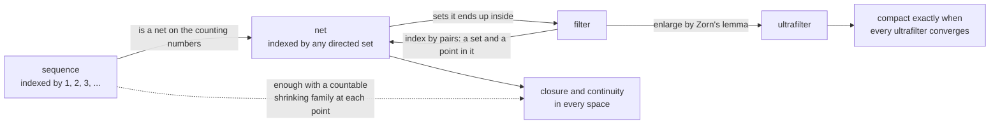

# Nets and filters: when sequences are too short to find every limit

[Syllabus](../../../SYLLABUS.md) → [Topology](../README.md) → [Topological Spaces](../README.md#s02) → Nets and filters

---

## General Overview

A wire 1 metre long carries a reading at every point. An inspector tests it with any finite number of probes. Two reading patterns count as **close** when they nearly agree at every chosen probe. This is the **pointwise** topology on $`\mathbb{R}^{[0,1]}`$: one real coordinate for each wire point ([Subspace, product and quotient](04-subspace-product-and-quotient-topologies.md)).

Let $`A`$ be the patterns that read 1 except at finitely many points, where they read 0. Probes at 1/2 m, 1/3 m and 2/7 m are fooled by the pattern that reads 0 at exactly those points. Every finite set of probes is fooled this way, so the all-zero pattern is in the **closure** of $`A`$: every open set round it meets $`A`$ ([Closure, interior and boundary](02-closure-interior-and-boundary.md)).

Yet no sequence from $`A`$ reaches the all-zero pattern. Its terms have countably many zeros in all, the wire has uncountably many points, and a probe at a missed point reads 1 forever.

The fix is to count by something richer than 1, 2, 3, …. Label each pattern by its finite set of zeros, with "later" meaning "a bigger set". This labelled family is a **net**, and it reaches the all-zero pattern. A **filter** records the same approach as the sets the net ends up inside.

**Sequences can miss points of a closure; nets, labelled by any directed set, and filters, families of sets closing in on a point, never miss, so they recover closure, continuity and compactness in every space: a space is compact exactly when every ultrafilter on it converges.**

**What kind of fact this is:** definitions (directed set, net, subnet, filter, ultrafilter, first countable) and four theorems, all proved on this card in Why it works: closure by nets, continuity by nets, sequences suffice in first-countable spaces, and compact exactly when every ultrafilter converges. That every filter sits inside an ultrafilter uses Zorn's lemma, as on [Compactness with no distances, and Tychonoff](06-compactness-and-tychonoff.md).

### The picture: three ways to approach a point



Nets and filters translate into each other, so either one carries the theorems. The dashed arrow is a condition under which sequences are already enough for closure and continuity.

---

## The formula

[Topological space](01-topological-spaces-and-bases.md) gives the setting: a set $`X`$ with a family $`\tau`$ of **open sets**. An open set "round $`p`$" contains the point $`p`$.

A **directed set** $`(D, \le)`$ is a set of labels with an order ($`d \le d`$, and transitive) in which any two labels have a common later label. A **net** in $`X`$ is one point $`x_d`$ for each label $`d`$. A sequence is a net labelled by the counting numbers.

```math
x_d \to p \iff \text{for every open } U \ni p \text{ there is a cutoff } d_0 \in D \text{ with } x_d \in U \text{ for all } d \ge d_0
```

**Read it aloud:** the net converges to $`p`$ when, for every open set round $`p`$, the net lies inside it from some label on.

A **subnet** of $`x_d`$ is a net $`y_e = x_{\varphi(e)}`$, labelled by another directed set $`E`$ through a map $`\varphi`$ from $`E`$ to $`D`$ that eventually passes every label: for every $`d_0`$ in $`D`$ there is a cutoff $`e_0`$ in $`E`$ with $`\varphi(e) \ge d_0`$ for all $`e \ge e_0`$. A subsequence is one kind.

A **filter** $`\mathcal{F}`$ on $`X`$ is a family of subsets that holds $`X`$, never holds the empty set, holds the overlap of any two of its members, and holds every superset of a member. The **neighbourhood filter** $`\mathcal{N}(p)`$ is all sets that contain an open set round $`p`$. A filter **converges** to $`p`$ when $`\mathcal{N}(p) \subseteq \mathcal{F}`$. An **ultrafilter** $`\mathcal{U}`$ is a filter that, for every subset $`S`$, holds $`S`$ or the outside of $`S`$.

The three theorems this card proves:

```math
\begin{aligned} p \in \overline{A} &\iff \text{some net in } A \text{ converges to } p \iff \text{some filter holding } A \text{ converges to } p \\ h \text{ continuous at } p &\iff h(x_d) \to h(p) \text{ for every net } x_d \to p \\ X \text{ compact} &\iff \text{every ultrafilter on } X \text{ converges} \end{aligned}
```

**Read it aloud:** a point touches a set exactly when a net from the set reaches it; a map is continuous exactly when it carries converging nets to converging nets; a space is compact exactly when every ultrafilter on it converges.

| Symbol | Plain meaning | In our example | Push it up and the answer… |
| --- | --- | --- | --- |
| $`X`$, $`\tau`$ | a space and its open sets | reading patterns $`\mathbb{R}^{[0,1]}`$, open sets built from probe boxes | — |
| $`A`$, $`\overline{A}`$, $`p`$, $`q`$, $`S`$ | a set, its closure, points being tested, any subset | patterns reading 1 except at finitely many zeros; $`p = 0`$, the all-zero pattern | — |
| $`x`$, $`x_1, \ldots, x_k`$; $`F`$; $`f`$, $`f_F`$ | a point, such as a wire point; finitely many points, such as $`k`$ probes; a finite set of them; any reading pattern; the pattern reading 0 on $`F`$ and 1 elsewhere | $`F = \{1/2, 1/3, 2/7\}`$ | $`F`$ bigger: $`f_F`$ passes more probe boxes |
| $`D`$, $`\le`$, $`d`$, $`d_0`$, $`x_d`$ | labels, their order, one label, a cutoff; a net, one point per label | finite sets $`F`$, ordered by "is part of"; cutoff $`\{1/2, 1/3, 2/7\}`$; the net $`f_F`$ | — |
| $`U`$, $`V`$; $`U_i`$, $`U_x`$, $`C_i`$ | open sets round a point; the sets of an open cover; the outside of $`U_i`$ | on the circle: arcs round $`p`$ | — |
| $`B`$, $`\varepsilon`$, $`B_n`$, $`B_m`$ | a probe box; its tolerance; a countable shrinking list of open sets round $`p`$, and its $`m`$-th set | $`B`$: $`\lvert f(x) \rvert < 1/10`$ at $`x = 1/2, 1/3, 2/7`$; $`B_n`$: arcs of radius $`1/n`$ | $`\varepsilon`$ above 1: every $`f_F`$ is in $`B`$ |
| $`g_n`$, $`Z_n`$, $`x_n`$, $`a_n`$, $`n_k`$ | sequences, labelled $`n = 1, 2, 3, \ldots`$; $`Z_n`$ the zeros of $`g_n`$; $`n_k`$ a subsequence's labels | $`g_n`$ reads 0 at every fraction with bottom at most $`n`$; $`x_n`$ on the circle | $`n`$ up: 33, then 3045 zeros, still none at $`\sqrt{2}/2`$ |
| $`\mathcal{F}`$, $`\mathcal{N}(p)`$; $`(S, s)`$, $`(T, t)`$ | a filter; the sets containing an open set round $`p`$; labels of a filter's net, a member and a point in it | sets holding $`f_F`$ for all $`F`$ past a cutoff | — |
| $`\mathcal{U}`$ | an ultrafilter | on $`\{a, b, c\}`$: every set holding $`a`$ | — |
| $`h`$ | a map tested for continuity | $`h = 1`$ at the zero pattern, 0 on $`A`$ | — |
| $`y_e`$, $`E`$, $`\varphi`$, $`e_0`$ | a subnet, its labels, the map from its labels to the old ones, a cutoff in $`E`$ | a subsequence $`n_k = 2k`$ is one | — |
| $`s_n`$ | the pattern reading each point's $`n`$-th binary digit | $`s_2(4369/16384) = 1`$ | — |

### When it holds

- **The labels must be directed.** Two cutoffs need a common later label. Labelled by single points only, the 8 single-zero patterns of the code's sample all miss the three-probe box $`B`$.
- **Sequences are guaranteed to suffice for closure and continuity when each point has a countable shrinking family.** Metric spaces have one, the balls of radius $`1/n`$. The pointwise topology on $`\mathbb{R}^{[0,1]}`$ has none, and there sequences miss the zero pattern. For compactness even this is not enough (Step 3).
- **Limits are unique only in Hausdorff spaces**, where any two points sit in non-overlapping open sets ([Hausdorff and its ladder](05-separation-axioms-and-hausdorff.md)). On a three-point set, 28 of the 29 topologies have an ultrafilter with two or more limits.
- **Compactness gives a converging subnet, not a converging subsequence.** The compact cube $`[0, 1]^{[0,1]}`$ holds a sequence with no converging subsequence (Step 7).
- **Most ultrafilters need a form of the axiom of choice.** On a finite set every ultrafilter is "the sets holding one point". Others exist by Zorn's lemma; without some form of choice they need not exist, and none can be written down.

---

## Why it works

### Step 0: approach a point through its open sets, not through counting

A sequence has only countably many steps. In a metric space that is enough: one step per ball of radius 1, 1/2, 1/3, … reaches the point.

In the pointwise topology there are uncountably many probe points, and countably many steps cannot answer them all. A net takes its labels from the open sets themselves, so it has as many steps as the space needs.

### Step 1: directed sets, and why "directed" is the rule

Convergence asks for one cutoff per open set. Two open sets round $`p`$ give two cutoffs. Their overlap is also open round $`p`$, and the net must eventually sit in both at once. That needs a label past both cutoffs, which is exactly the directed rule.

The finite sets of wire points are directed by "is part of": for $`F`$ and $`G`$, the union $`F \cup G`$ is later than both. The code checks this on the 256 finite sets made from 8 sample points: for all 65,536 pairs, the least later set, found by search, is the union.

The counting numbers are directed, so every sequence is a net.

### Step 2: a point is in the closure exactly when a net from the set reaches it

**From a net to the closure.** Let a net in $`A`$ converge to $`p`$. Every open $`U`$ round $`p`$ holds some $`x_d`$, and that point is in $`A`$. So every open set round $`p`$ meets $`A`$, which is the definition of $`p \in \overline{A}`$.

**From the closure to a net.** Let $`p \in \overline{A}`$. Use as labels the open sets round $`p`$, with $`U \le V`$ meaning $`V \subseteq U`$: smaller is later. The overlap of two such sets is later than both, so the labels are directed. For each $`U`$, the set $`U \cap A`$ is not empty, so pick one point $`x_U`$ in it. Given any open $`U`$ round $`p`$, every later $`V`$ lies inside $`U`$, so $`x_V \in U`$. The net converges to $`p`$.

The picking uses the axiom of choice. The wire needs none, because $`f_F`$ is a rule. A basic open set round 0 fixes probes $`x_1, \ldots, x_k`$ and a tolerance $`\varepsilon`$. Every $`F`$ holding the probes reads 0 at each, so with cutoff $`d_0 = \{x_1, \ldots, x_k\}`$, $`f_F \to 0`$.

### Step 3: why sequences fall short here, and when they are enough

**No sequence in $`A`$ converges to 0.** Let $`g_1, g_2, \ldots`$ be in $`A`$. Each $`g_n`$ reads 0 on a finite set $`Z_n`$. A countable union of finite sets is countable ([Countable sets](../../01-Foundations/09-Sizes%20of%20Infinity/02-countable-sets.md)). The wire $`[0, 1]`$ is not ([Cantor's diagonal](../../01-Foundations/09-Sizes%20of%20Infinity/03-cantors-diagonal-argument.md)), so some point $`x`$ lies in no $`Z_n`$. Then $`g_n(x) = 1`$ for every $`n`$, and the open set "$`\lvert f(x) \rvert < 1/10`$" round 0 holds no term.

The code tries a strong sequence: $`g_n`$ reads 0 at every fraction in $`[0, 1]`$ with bottom at most $`n`$, 33 zeros at $`n = 10`$ and 3045 at $`n = 100`$. At 2/7 it reads 0 from $`n = 7`$ on. But $`\sqrt{2}/2`$ is no fraction, so there $`g_n`$ reads 1 forever.

**When sequences are enough.** A space is **first countable** when each point $`p`$ has a countable list of open sets $`B_1, B_2, \ldots`$ round it such that every open set round $`p`$ contains one of them. Replace $`B_n`$ by $`B_1 \cap \cdots \cap B_n`$, so the list shrinks. If $`p \in \overline{A}`$, pick $`a_n`$ in $`B_n \cap A`$. Any open $`U`$ round $`p`$ contains some $`B_m`$, and so every $`a_n`$ with $`n \ge m`$. The sequence converges to $`p`$.

Every metric space is first countable, by the balls of radius $`1/n`$. That is why [Limits and continuity with distances](../01-Metric%20Spaces/04-convergence-and-continuity-in-metric-spaces.md) never needed nets.

**On the circle**, measured in **turns** (1 turn is 360 degrees), let $`A`$ be the open arc from 0 to 1/4 turn and $`p = 1/4`$ turn. Arcs of radius $`1/n`$ round $`p`$ form the countable list. The picks $`x_n = 1/4 - 1/(2n)`$ turn sit at 72 degrees for $`n = 10`$, 88.2 for $`n = 100`$ and 89.82 for $`n = 1000`$. They are inside the arc of radius 1/1000 from $`n = 501`$ on.

$`\mathbb{R}^{[0,1]}`$ is not first countable at 0. Countably many basic open sets use countably many probes, and the open set "$`\lvert f(x) \rvert < 1/10`$" at any other point $`x`$ contains none of them.

**Not for compactness.** First countability rescues closure and continuity, but a space can be **sequentially compact**, with a converging subsequence in every sequence, and still not compact. The **long ray** lays uncountably many copies of $`[0, 1)`$ end to end, arranged so that only countably many lie before any copy. Near each point it looks like an interval of the line, so it is first countable. A sequence touches only countably many copies, so it stays inside a part that is an ordinary closed interval, and has a converging subsequence. Yet the sets "everything before a given copy" cover the ray, and finitely many of them miss every later copy, so it is not compact.

### Step 4: continuity by nets

**Continuous maps carry nets.** Let $`h`$ be continuous at $`p`$ and $`x_d \to p`$. Take an open $`V`$ round $`h(p)`$. Continuity gives an open $`U`$ round $`p`$ with $`h(U) \subseteq V`$. The net is in $`U`$ past some cutoff, so $`h(x_d)`$ is in $`V`$ past it.

**Maps that carry nets are continuous.** Suppose $`h`$ is not continuous at $`p`$. Then some open $`V`$ round $`h(p)`$ has, inside every open $`U`$ round $`p`$, a point $`x_U`$ with $`h(x_U) \notin V`$. Labelled as in Step 2, $`x_U \to p`$, but $`h(x_U)`$ never enters $`V`$.

The sequence test alone can be fooled. On $`A`$ plus the zero pattern, let $`h = 1`$ at the zero pattern and 0 on $`A`$. A sequence there that converges to 0 has only finitely many terms in $`A`$: infinitely many would form a sequence in $`A`$ converging to 0, which Step 3 rules out. So the sequence ends in the zero pattern itself, and $`h`$ passes the sequence test. The net $`f_F`$ converges to 0, yet $`h(f_F) = 0`$ for every $`F`$ while $`h(0) = 1`$. So $`h`$ is not continuous, and only the net test says so.

### Step 5: filters, the same approach recorded as sets

A net decides which sets it ends up inside. Its **tail filter** is every set $`S`$ such that $`x_d \in S`$ for all $`d`$ past some cutoff. Directedness makes this a filter: two cutoffs have a common later label, so the overlap of two such sets is also one. The net converges to $`p`$ exactly when every open set round $`p`$ is in its tail filter, that is, when $`\mathcal{N}(p) \subseteq \mathcal{F}`$.

The other way round, a filter $`\mathcal{F}`$ gives a net. Label by pairs $`(S, s)`$ with $`s \in S \in \mathcal{F}`$, call $`(T, t)`$ later when $`T \subseteq S`$, and send $`(S, s)`$ to $`s`$. Its tail filter is $`\mathcal{F}`$ again.

So $`p \in \overline{A}`$ exactly when some filter holding $`A`$ converges to $`p`$: the supersets of the sets $`U \cap A`$, for $`U`$ open round $`p`$, are such a filter. Filters need no picking, so this form avoids the choice used in Step 2.

### Step 6: ultrafilters, and where they come from

An ultrafilter decides every set. Equivalently, it is a filter with no strictly larger filter.

On a finite set the code checks every case. On $`\{a, b, c\}`$, 7 of the 256 families of subsets are filters, one for each non-empty **core**, the overlap of all its members: the filter is all sets holding the core. The ultrafilters are the 3 filters whose core is one point, such as "every set holding $`a`$". They are exactly the 3 maximal families with the finite intersection property found on [Compactness with no distances, and Tychonoff](06-compactness-and-tychonoff.md).

On an infinite set, a chain of filters has its union as an upper bound, so Zorn's lemma enlarges any filter to a maximal one: the **ultrafilter lemma**. On the counting numbers it gives ultrafilters holding every set with a finite outside, so no finite set. No formula names one.

### Step 7: compact exactly when every ultrafilter converges

The theorem joins the cover form of compactness to ultrafilters through the finite intersection property (FIP): every finite batch of a family's sets has a common point.

<details>
<summary>Detailed proof: compact if and only if every ultrafilter converges</summary>

**Compact, so every ultrafilter converges.** Let $`\mathcal{U}`$ converge nowhere. Then each point $`x`$ has an open $`U_x`$ round it that is not in $`\mathcal{U}`$, so the outside $`X \setminus U_x`$ is in $`\mathcal{U}`$. The $`U_x`$ cover $`X`$. By compactness finitely many do, $`U_{x_1}, \ldots, U_{x_k}`$. Then the overlap of the outsides $`X \setminus U_{x_i}`$ is empty. It is a finite overlap of members of $`\mathcal{U}`$, so it is in $`\mathcal{U}`$. A filter never holds the empty set, a contradiction.

**Every ultrafilter converges, so compact.** Let an open cover $`U_i`$ have no finite subcover. The outsides $`C_i = X \setminus U_i`$ then have the FIP: a finite batch with no common point would mean finitely many $`U_i`$ cover. The finite overlaps of the $`C_i`$, and their supersets, form a filter. Enlarge it to an ultrafilter $`\mathcal{U}`$ (Step 6). It converges to some $`p`$. The point $`p`$ lies in some $`U_j`$, so $`U_j \in \mathcal{N}(p) \subseteq \mathcal{U}`$. But $`C_j \in \mathcal{U}`$ too, and $`U_j \cap C_j`$ is empty, a contradiction.

**With nets.** In a compact space, enlarge a net's tail filter to an ultrafilter $`\mathcal{U}`$, which converges to some $`p`$. Label by pairs $`(d, S)`$ with $`S \in \mathcal{U}`$ and $`x_d \in S`$, later when $`d`$ is later and $`S`$ smaller, and send $`(d, S)`$ to $`x_d`$. This is a subnet, and it converges to $`p`$. Conversely, give an ultrafilter its net from Step 5. If a subnet converges to $`p`$, every open set round $`p`$ meets every member of the ultrafilter, so the ultrafilter cannot hold its outside, and holds it. So: compact exactly when every net has a converging subnet.

</details>

**Where it fails.** On the circle minus the glue point 0, the sets holding some arc $`(0, 1/n)`$ turn form a filter. At every point $`q`$ some arc round $`q`$ misses one of its sets: at $`q = 1/12`$ turn, the arc $`(1/24, 1/8)`$ misses $`(0, 1/24)`$. So no ultrafilter holding this filter converges either: it cannot hold an arc round $`q`$ and a set that misses that arc. Its only limit was the removed point, and the punctured circle is not compact, as [Compactness with no distances, and Tychonoff](06-compactness-and-tychonoff.md) found with covers.

**Tychonoff in outline, as a contrast.** Take an ultrafilter on a product of compact spaces. Its image on each factor is an ultrafilter, so it converges; pick one limit per factor. Convergence in the product is convergence in each coordinate, so the ultrafilter converges to the point with those coordinates. The maximal FIP family of the full proof on the Tychonoff card is an ultrafilter, so this is the same argument with the work moved into Step 6.

**Compact, but sequences fail.** By Tychonoff, $`[0, 1]^{[0,1]}`$ is compact. Let $`s_n`$ read the $`n`$-th binary digit of each point. For any subsequence $`n_1 < n_2 < \cdots`$, take the point whose digit at $`n_k`$ is 1 for odd $`k`$ and 0 for even $`k`$; there the subsequence reads 1, 0, 1, 0, …. For $`n_k = 2k`$, eight digits give $`x = 4369/16384`$. A converging subnet exists, from an ultrafilter on the counting numbers, but no rule writes it down.

---

## Worked numbers, by hand

The net $`f_F`$ against one probe box $`B`$: $`\lvert f(x) \rvert < 1/10`$ at $`x = 1/2, 1/3, 2/7`$ m.

| Step | Arithmetic | Value |
| --- | --- | --- |
| $`F`$ empty | $`f_F`$ reads 1, 1, 1 at the probes; $`1 \ge 1/10`$ | outside $`B`$ |
| $`F = \{1/2, 1/3\}`$ | reads 0, 0, 1 | outside $`B`$ |
| $`F = \{1/2, 1/3, 2/7\}`$ | reads 0, 0, 0 | inside $`B`$: the cutoff |
| any $`F`$ holding the cutoff | still 0 at all three probes | inside $`B`$ |
| on 8 sample points | sets holding the 3 probes: $`2^{8-3}`$ | **32 of 256** |
| the sequence $`g_n`$ at $`n = 100`$ | fractions with bottom at most 100 | 3045 zeros |
| $`g_n(\sqrt{2}/2)`$ | no fraction squared gives 1/2, so $`\sqrt{2}/2`$ is no fraction | 1, for every $`n`$ |

The net enters every probe box round 0 from a cutoff on; the sequence, with thousands of zeros, never passes a probe at $`\sqrt{2}/2`$.

### What breaks if you drop a piece

| Mistake | Comes out at | What went wrong |
| --- | --- | --- |
| Use a sequence on $`\mathbb{R}^{[0,1]}`$ | $`g_n(\sqrt{2}/2) = 1`$ for all $`n`$ up to 100, with 3045 zeros at $`n = 100`$ | countably many zeros miss uncountably many probe points |
| Label by single points, not directed | $`B`$ holds 0 of the 8 single-zero patterns | no label is past three probes at once |
| Drop compactness: circle minus the glue point | the arcs $`(0, 1/n)`$, and every ultrafilter holding them, converge nowhere; at 1/12 turn, $`(1/24, 1/8)`$ misses $`(0, 1/24)`$ | the only limit was the removed point |
| Ask a compact space for subsequences | $`s_{2k}(4369/16384)`$ = 1 0 1 0 1 0 1 0 | compactness promises subnets only |
| Drop Hausdorff | 28 of the 29 topologies on three points give some ultrafilter two or more limits | open sets cannot pry those points apart |

The code prints every row.

---

## Code, from first principles, and it actually runs

Every point is an exact fraction. Each count has two independent roads:

- the least later label for each of the 65,536 pairs: a search over all 256 sets, and the union;
- the 32 patterns in the box: all 256 sets tested, and $`2^{8-3}`$;
- the zero counts 33 and 3045: fractions listed, and 1 plus a sum of Euler's totient (how many numbers up to $`k`$ share no factor with $`k`$), computed from primes;
- the circle cutoff 501: a scan, and $`1/(2n) < 1/1000`$;
- the 3 ultrafilters on $`\{a, b, c\}`$: maximal filters, the "S or its outside" test, and maximal FIP families.

Parts 5 and 6 check every case of a finite statement, so they prove it. The wire parts are checked on 8 sample points or $`n`$ up to 100, so they illustrate; the proofs are in Why it works. Part 7 chooses each arc so that it misses, so it only illustrates Step 7.

### Python

```python
# Nets and filters: the check behind the card.  Standard library only, exact fractions.
from fractions import Fraction as F
from itertools import combinations

def show(q): return str(q)                       # 1/2, 2/7, 0
def dec(q):                                      # a terminating fraction as a decimal
    for k in range(7):
        if (q * 10**k).denominator == 1:
            s = str(abs(q.numerator * 10**k // q.denominator)).rjust(k + 1, "0")
            return s if k == 0 else s[:-k] + "." + s[-k:]
    raise ValueError(q)

# Part 1: the net f_F in R^[0,1].  f_F is 0 on the finite set F and 1 elsewhere.
pts = [F(1, 8), F(1, 4), F(2, 7), F(1, 3), F(1, 2), F(3, 5), F(3, 4), F(1)]
box, eps = [F(1, 2), F(1, 3), F(2, 7)], F(1, 10)   # basic box round 0: |f(x)| < 1/10 at 3 coordinates
def f(Fset, x): return 0 if x in Fset else 1
def in_box(Fset, coords=box, e=eps): return all(abs(f(Fset, x)) < e for x in coords)
print("Part 1: R^[0,1], pointwise; f_F is 0 on the finite set F, 1 elsewhere")
print("box B round the zero function: |f(x)| < 1/10 at x = 1/2, 1/3, 2/7")
for Fs in [set(), {F(1, 2), F(1, 3)}, set(box)]:
    name = "{" + ", ".join(show(x) for x in sorted(Fs, reverse=True)) + "}"
    vals = " ".join(str(f(Fs, x)) for x in box)
    print(f"  F = {name}: values at 1/2, 1/3, 2/7: {vals}; in B: {'yes' if in_box(Fs) else 'no'}")
subsets = [frozenset(c) for r in range(9) for c in combinations(pts, r)]
later = {a: {c for c in subsets if a <= c} for a in subsets}       # the labels later than a, by search
least = all(min(later[a] & later[b], key=len) == a | b for a in subsets for b in subsets)   # road 2: the union
tail = [s for s in subsets if in_box(s)]
holds0 = all(in_box(s) == set(box).issubset(s) for s in subsets)
assert least and holds0
assert len(tail) == 2 ** (len(pts) - len(box))                      # road 2: count by formula
print(f"8 sample points, {len(subsets)} finite sets F: least later F, by search, is the union for all {len(subsets)**2} pairs: {'yes' if least else 'no'}")
print(f"  f_F in B for {len(tail)} of 256 F; exactly those holding the probes: yes; 2^({len(pts)}-{len(box)}) = {2 ** (len(pts) - len(box))}")
single = sum(in_box({x}) for x in pts)
assert single == 0
print(f"mistake, singletons only (not directed): f_x in B for {single} of 8")

# Part 2: the best sequence, g_n = 0 on every fraction p/q in [0, 1] with q <= n.
def farey(n): return {F(p, q) for q in range(1, n + 1) for p in range(q + 1)}
def phi(k):                                      # totient by the product over primes
    out, m, p = k, k, 2
    while p * p <= m:
        if m % p == 0:
            out -= out // p
            while m % p == 0: m //= p
        p += 1
    return out - out // m if m > 1 else out
print("Part 2: the best sequence: g_n is 0 on every fraction p/q in [0, 1] with q <= n")
sizes = []
for n in (10, 100):
    a, b = len(farey(n)), 1 + sum(phi(k) for k in range(1, n + 1))
    assert a == b
    sizes.append(f"n = {n}: {a} (1 + totient sum {b})")
print("  zero-set sizes: " + "; ".join(sizes))
first = min(n for n in range(1, 101) if F(2, 7) in farey(n))
assert first == 7 and all(F(2, 7) in farey(n) for n in range(7, 101))
print(f"  at x = 2/7: g_n(x) = 1 for n = 1..{first - 1}, 0 from n = {first} on")
miss = all(2 * q.numerator ** 2 != q.denominator ** 2 for q in farey(100))
assert miss
print("  at x = sqrt(2)/2: 2p^2 = q^2 for no p/q with q <= 100, so g_n(x) = 1 for n = 1..100")
print("  g_n never enters the box |f(sqrt(2)/2)| < 1/10: checked on n = 1..100")

# Part 3: the circle in turns.  A = open arc (0, 1/4), p = 1/4 turn.  Arcs of radius 1/n round p.
print("Part 3: the circle in turns; A = arc (0, 1/4), p = 1/4 turn = 90 degrees")
def x_n(n): return F(1, 4) - F(1, 2 * n)
for n in (10, 100, 1000):
    x = x_n(n)
    assert 0 < x < F(1, 4) and abs(x - F(1, 4)) < F(1, n)
    print(f"  n = {n}: x_n = {show(x)} turn = {dec(360 * x)} degrees")
entry = [n for n in range(1, 2001) if abs(x_n(n) - F(1, 4)) < F(1, 1000)]
assert entry == list(range(1000 // 2 + 1, 2001))                     # road 2: 1/(2n) < 1/1000 iff n > 500
print(f"  inside the arc of radius 1/1000 round p from n = {entry[0]} on (checked n = 1..2000)")

# Part 4: continuity.  h = 1 at the zero function, 0 on A.
witness = [next(F(1, m) for m in range(9, 99) if F(1, m) not in s) for s in subsets]   # f_F = 1 there
hvals = {0 if f(s, w) == 1 else 1 for s, w in zip(subsets, witness)}
assert hvals == {0}
print("Part 4: h = 1 at the zero function, 0 on A")
print(f"  h(f_F) over all 256 F: {sorted(hvals)} (f_F = 1 at {show(witness[-1])}); h(0) = 1; f_F -> 0 but h(f_F) stays 0")

# Part 5: filters on {a, b, c}, all 256 families of subsets.
X = 7                                             # subsets of {a, b, c} as bit masks 0..7
fams = range(1 << 8)
def has(fm, s): return fm >> s & 1
def is_filter(fm):
    return (has(fm, X) and not has(fm, 0)
            and all(has(fm, s & t) for s in range(8) for t in range(8) if has(fm, s) and has(fm, t))
            and all(has(fm, t) for s in range(8) for t in range(8) if has(fm, s) and s & t == s))
def fip(fm):
    mem = [s for s in range(8) if has(fm, s)]
    return all(X & eval_and(c) for r in range(1, len(mem) + 1) for c in combinations(mem, r))
def eval_and(c):
    out = X
    for s in c: out &= s
    return out
filters = [fm for fm in fams if is_filter(fm)]
principal = all(fm == sum(1 << t for t in range(8) if t & core == core)
                for fm in filters for core in [eval_and([s for s in range(8) if has(fm, s)])])
maxf = [g for g in filters if not any(h != g and h & g == g for h in filters)]
ultra = [g for g in filters if all(has(g, s) or has(g, X ^ s) for s in range(8))]
fips = [fm for fm in fams if fip(fm)]
maxfip = [g for g in fips if not any(h != g and h & g == g for h in fips)]
assert len(filters) == 2 ** 3 - 1 and principal and maxf == ultra == maxfip and len(ultra) == 3
print("Part 5: filters on {a, b, c}, every one of the 256 families checked")
print(f"  filters: {len(filters)} (one per non-empty core, 2^3 - 1 = 7); each is all sets holding its core: yes")
print(f"  ultrafilters: {len(ultra)}, by maximality, by 'S or its outside', and as the maximal FIP families: same 3")

# Part 6: every topology on {a, b, c}; an ultrafilter at a point converges where every open set holds it.
tops = [t for t in fams if has(t, 0) and has(t, X) and all(has(t, s & u) and has(t, s | u)
        for s in range(8) for u in range(8) if has(t, s) and has(t, u))]
def limits(t, pt): return [q for q in range(3) if all(not has(t, u) or u >> pt & 1 for u in range(8) if u >> q & 1)]
conv = all(limits(t, pt) for t in tops for pt in range(3))
unique = [t for t in tops if all(len(limits(t, pt)) == 1 for pt in range(3))]
haus = [t for t in tops if all(any(has(t, u) and has(t, v) and u >> i & 1 and v >> j & 1 and not u & v
        for u in range(8) for v in range(8)) for i in range(3) for j in range(3) if i != j)]
assert len(tops) == 29 and conv and unique == haus and len(unique) == 1
print(f"Part 6: all {len(tops)} topologies on {{a, b, c}}: every ultrafilter converges: yes")
print(f"  limits unique in {len(unique)} topology, the discrete one; Hausdorff ones: {len(haus)}; same: yes")
print(f"  mistake, no Hausdorff: some ultrafilter has two or more limits in {len(tops) - len(unique)} of {len(tops)}")

# Part 7: the circle without the glue point; the filter made from the arcs (0, 1/n) turn.  An illustration:
# r = min(q, 1 - q)/2 makes the arc (q - r, q + r) miss (0, r) by construction.
print("Part 7: the circle minus the glue point; the filter of the arcs (0, 1/n) turn")
for k in (1, 6, 11):
    q = F(k, 12); r = min(q, 1 - q) / 2          # arc (q - r, q + r) misses (0, r)
    n = r.denominator if r.numerator == 1 else None
    assert n                                      # r = 1/n, so (0, r) is one of the filter's sets
    print(f"  candidate limit {show(q)} turn: arc ({show(q - r)}, {show(q + r)}) misses (0, 1/{n})")
print("  on the whole circle every arc round 0 holds some (0, 1/n): limit 0, the removed point")

# Part 8: [0,1]^[0,1] is compact, yet s_n(x) = n-th binary digit of x has no convergent subsequence.
ks = range(1, 9)
x = sum(F(1, 2 ** (2 * k)) for k in ks if k % 2)             # digit 1 at positions 2k with k odd
digits = [int(x * 2 ** (2 * k)) % 2 for k in ks]             # road 2: read the digits back
assert digits == [k % 2 for k in ks]
print(f"Part 8: s_n = n-th binary digit; subsequence n_k = 2k; x = {show(x)}")
print("  s_(2k)(x) for k = 1..8: " + " ".join(map(str, digits)) + "; never settles")
print("ALL CHECKS PASS")
```

**Ran 2026-11-24 on macOS, Python 3.14.10, standard library only. All checks passed. Output, pasted from the run:**

```
Part 1: R^[0,1], pointwise; f_F is 0 on the finite set F, 1 elsewhere
box B round the zero function: |f(x)| < 1/10 at x = 1/2, 1/3, 2/7
  F = {}: values at 1/2, 1/3, 2/7: 1 1 1; in B: no
  F = {1/2, 1/3}: values at 1/2, 1/3, 2/7: 0 0 1; in B: no
  F = {1/2, 1/3, 2/7}: values at 1/2, 1/3, 2/7: 0 0 0; in B: yes
8 sample points, 256 finite sets F: least later F, by search, is the union for all 65536 pairs: yes
  f_F in B for 32 of 256 F; exactly those holding the probes: yes; 2^(8-3) = 32
mistake, singletons only (not directed): f_x in B for 0 of 8
Part 2: the best sequence: g_n is 0 on every fraction p/q in [0, 1] with q <= n
  zero-set sizes: n = 10: 33 (1 + totient sum 33); n = 100: 3045 (1 + totient sum 3045)
  at x = 2/7: g_n(x) = 1 for n = 1..6, 0 from n = 7 on
  at x = sqrt(2)/2: 2p^2 = q^2 for no p/q with q <= 100, so g_n(x) = 1 for n = 1..100
  g_n never enters the box |f(sqrt(2)/2)| < 1/10: checked on n = 1..100
Part 3: the circle in turns; A = arc (0, 1/4), p = 1/4 turn = 90 degrees
  n = 10: x_n = 1/5 turn = 72 degrees
  n = 100: x_n = 49/200 turn = 88.2 degrees
  n = 1000: x_n = 499/2000 turn = 89.82 degrees
  inside the arc of radius 1/1000 round p from n = 501 on (checked n = 1..2000)
Part 4: h = 1 at the zero function, 0 on A
  h(f_F) over all 256 F: [0] (f_F = 1 at 1/9); h(0) = 1; f_F -> 0 but h(f_F) stays 0
Part 5: filters on {a, b, c}, every one of the 256 families checked
  filters: 7 (one per non-empty core, 2^3 - 1 = 7); each is all sets holding its core: yes
  ultrafilters: 3, by maximality, by 'S or its outside', and as the maximal FIP families: same 3
Part 6: all 29 topologies on {a, b, c}: every ultrafilter converges: yes
  limits unique in 1 topology, the discrete one; Hausdorff ones: 1; same: yes
  mistake, no Hausdorff: some ultrafilter has two or more limits in 28 of 29
Part 7: the circle minus the glue point; the filter of the arcs (0, 1/n) turn
  candidate limit 1/12 turn: arc (1/24, 1/8) misses (0, 1/24)
  candidate limit 1/2 turn: arc (1/4, 3/4) misses (0, 1/4)
  candidate limit 11/12 turn: arc (7/8, 23/24) misses (0, 1/24)
  on the whole circle every arc round 0 holds some (0, 1/n): limit 0, the removed point
Part 8: s_n = n-th binary digit; subsequence n_k = 2k; x = 4369/16384
  s_(2k)(x) for k = 1..8: 1 0 1 0 1 0 1 0; never settles
ALL CHECKS PASS
```

### Rust

Same numbers, same labels, built with `rustc --edition 2021 -O`.

```rust
// Nets and filters: the check behind the card.  std only, exact fractions as reduced (top, bottom) pairs.
use std::collections::BTreeSet;

type Q = (i64, i64);
fn gcd(a: i64, b: i64) -> i64 { if b == 0 { a.abs() } else { gcd(b, a % b) } }
fn q(a: i64, b: i64) -> Q { let g = gcd(a, b); (a / g, b / g) }
fn sub(x: Q, y: Q) -> Q { q(x.0 * y.1 - y.0 * x.1, x.1 * y.1) }
fn add(x: Q, y: Q) -> Q { q(x.0 * y.1 + y.0 * x.1, x.1 * y.1) }
fn lt(x: Q, y: Q) -> bool { x.0 * y.1 < y.0 * x.1 }
fn show(x: Q) -> String { if x.1 == 1 { format!("{}", x.0) } else { format!("{}/{}", x.0, x.1) } }
fn dec(x: Q) -> String { // a terminating fraction as a decimal
    for k in 0..7u32 {
        let p = 10i64.pow(k);
        if (x.0 * p) % x.1 == 0 {
            let s = format!("{:0>w$}", (x.0 * p / x.1).abs(), w = k as usize + 1);
            return if k == 0 { s } else { format!("{}.{}", &s[..s.len() - k as usize], &s[s.len() - k as usize..]) };
        }
    }
    panic!("not terminating")
}
fn yn(b: bool) -> &'static str { if b { "yes" } else { "no" } }
fn has(fm: u32, s: u32) -> bool { fm >> s & 1 == 1 }
fn farey(n: i64) -> BTreeSet<Q> { (1..=n).flat_map(|d| (0..=d).map(move |p| q(p, d))).collect() }
fn phi(k: i64) -> i64 { // totient by the product over primes
    let (mut out, mut m, mut p) = (k, k, 2);
    while p * p <= m {
        if m % p == 0 { out -= out / p; while m % p == 0 { m /= p; } }
        p += 1;
    }
    if m > 1 { out - out / m } else { out }
}

fn main() {
    // Part 1: the net f_F in R^[0,1].  F is a bit mask over 8 sample points.
    let pts: [Q; 8] = [q(1, 8), q(1, 4), q(2, 7), q(1, 3), q(1, 2), q(3, 5), q(3, 4), q(1, 1)];
    let boxm: u32 = (1 << 4) | (1 << 3) | (1 << 2); // 1/2, 1/3, 2/7
    let f = |s: u32, x: Q| -> i64 { if (0..8).any(|i| has(s, i as u32) && pts[i] == x) { 0 } else { 1 } }; // f_F at x
    let in_box = |s: u32| [4usize, 3, 2].iter().all(|&i| lt(q(f(s, pts[i]), 1), q(1, 10)));
    println!("Part 1: R^[0,1], pointwise; f_F is 0 on the finite set F, 1 elsewhere");
    println!("box B round the zero function: |f(x)| < 1/10 at x = 1/2, 1/3, 2/7");
    for (name, s) in [("{}", 0u32), ("{1/2, 1/3}", (1 << 4) | (1 << 3)), ("{1/2, 1/3, 2/7}", boxm)] {
        let vals: Vec<String> = [4usize, 3, 2].iter().map(|&i| f(s, pts[i]).to_string()).collect();
        println!("  F = {}: values at 1/2, 1/3, 2/7: {}; in B: {}", name, vals.join(" "), yn(in_box(s)));
    }
    let least = (0..256u32).all(|a| (0..256u32).all(|b| (0..256u32).filter(|&c| a & c == a && b & c == b) // later, by search
        .min_by_key(|c| c.count_ones()) == Some(a | b))); // road 2: the union
    let tail: Vec<u32> = (0..256u32).filter(|&s| in_box(s)).collect();
    let holds0 = (0..256u32).all(|s| in_box(s) == (s & boxm == boxm));
    assert!(least && holds0);
    assert_eq!(tail.len(), 1 << (8 - 3)); // road 2: count by formula
    println!("8 sample points, 256 finite sets F: least later F, by search, is the union for all 65536 pairs: {}", yn(least));
    println!("  f_F in B for {} of 256 F; exactly those holding the probes: yes; 2^(8-3) = {}", tail.len(), 1 << (8 - 3));
    let single = (0..8u32).filter(|&i| in_box(1 << i)).count();
    assert_eq!(single, 0);
    println!("mistake, singletons only (not directed): f_x in B for {} of 8", single);

    // Part 2: the best sequence, g_n = 0 on every fraction p/q in [0, 1] with q <= n.
    println!("Part 2: the best sequence: g_n is 0 on every fraction p/q in [0, 1] with q <= n");
    let mut sizes = Vec::new();
    for n in [10i64, 100] {
        let (a, b) = (farey(n).len() as i64, 1 + (1..=n).map(phi).sum::<i64>());
        assert_eq!(a, b);
        sizes.push(format!("n = {}: {} (1 + totient sum {})", n, a, b));
    }
    println!("  zero-set sizes: {}", sizes.join("; "));
    let first = (1..=100).find(|&n| farey(n).contains(&q(2, 7))).unwrap();
    assert!(first == 7 && (7..=100).all(|n| farey(n).contains(&q(2, 7))));
    println!("  at x = 2/7: g_n(x) = 1 for n = 1..{}, 0 from n = {} on", first - 1, first);
    assert!(farey(100).iter().all(|&(p, d)| 2 * p * p != d * d));
    println!("  at x = sqrt(2)/2: 2p^2 = q^2 for no p/q with q <= 100, so g_n(x) = 1 for n = 1..100");
    println!("  g_n never enters the box |f(sqrt(2)/2)| < 1/10: checked on n = 1..100");

    // Part 3: the circle in turns.  A = open arc (0, 1/4), p = 1/4 turn.  Arcs of radius 1/n round p.
    println!("Part 3: the circle in turns; A = arc (0, 1/4), p = 1/4 turn = 90 degrees");
    let x_n = |n: i64| sub(q(1, 4), q(1, 2 * n));
    let gap = |n: i64| sub(q(1, 4), x_n(n));
    for n in [10i64, 100, 1000] {
        let x = x_n(n);
        assert!(lt(q(0, 1), x) && lt(x, q(1, 4)) && lt(gap(n), q(1, n)));
        println!("  n = {}: x_n = {} turn = {} degrees", n, show(x), dec(q(360 * x.0, x.1)));
    }
    let entry: Vec<i64> = (1..=2000).filter(|&n| lt(gap(n), q(1, 1000))).collect();
    assert_eq!(entry, (1000 / 2 + 1..=2000).collect::<Vec<i64>>()); // road 2: 1/(2n) < 1/1000 iff n > 500
    println!("  inside the arc of radius 1/1000 round p from n = {} on (checked n = 1..2000)", entry[0]);

    // Part 4: continuity.  h = 1 at the zero function, 0 on A.
    let witness = |s: u32| (9..99).map(|m| q(1, m)).find(|w| !(0..8).any(|i| has(s, i as u32) && pts[i] == *w)).unwrap();
    let hvals: BTreeSet<i64> = (0..256u32).map(|s| if f(s, witness(s)) == 1 { 0 } else { 1 }).collect(); // f_F = 1 there
    assert!(hvals == BTreeSet::from([0]));
    println!("Part 4: h = 1 at the zero function, 0 on A");
    println!("  h(f_F) over all 256 F: [0] (f_F = 1 at {}); h(0) = 1; f_F -> 0 but h(f_F) stays 0", show(witness(255)));

    // Part 5: filters on {a, b, c}, all 256 families of subsets (subsets as bit masks 0..7).
    let x_all = 7u32;
    let and_of = |c: &[u32]| c.iter().fold(x_all, |o, &s| o & s);
    let is_filter = |fm: u32| has(fm, x_all) && !has(fm, 0)
        && (0..8).all(|s| (0..8).all(|t| !(has(fm, s) && has(fm, t)) || has(fm, s & t)))
        && (0..8).all(|s| (0..8).all(|t| !(has(fm, s) && s & t == s) || has(fm, t)));
    let fip = |fm: u32| { let mem: Vec<u32> = (0..8).filter(|&s| has(fm, s)).collect();
        (1..1u32 << mem.len()).all(|c| { let pick: Vec<u32> = (0..mem.len()).filter(|&i| has(c, i as u32)).map(|i| mem[i]).collect(); and_of(&pick) != 0 }) };
    let filters: Vec<u32> = (0..256).filter(|&fm| is_filter(fm)).collect();
    let principal = filters.iter().all(|&fm| { let core = and_of(&(0..8).filter(|&s| has(fm, s)).collect::<Vec<u32>>());
        fm == (0..8).filter(|&t| t & core == core).map(|t| 1u32 << t).sum::<u32>() });
    let maximal = |v: &Vec<u32>| -> Vec<u32> { v.iter().copied().filter(|&g| !v.iter().any(|&h| h != g && h & g == g)).collect() };
    let maxf = maximal(&filters);
    let ultra: Vec<u32> = filters.iter().copied().filter(|&g| (0..8).all(|s| has(g, s) || has(g, x_all ^ s))).collect();
    let fips: Vec<u32> = (0..256).filter(|&fm| fip(fm)).collect();
    let maxfip = maximal(&fips);
    assert!(filters.len() == (1 << 3) - 1 && principal && maxf == ultra && ultra == maxfip && ultra.len() == 3);
    println!("Part 5: filters on {{a, b, c}}, every one of the 256 families checked");
    println!("  filters: {} (one per non-empty core, 2^3 - 1 = 7); each is all sets holding its core: yes", filters.len());
    println!("  ultrafilters: {}, by maximality, by 'S or its outside', and as the maximal FIP families: same 3", ultra.len());

    // Part 6: every topology on {a, b, c}; an ultrafilter at a point converges where every open set holds it.
    let tops: Vec<u32> = (0..256u32).filter(|&t| has(t, 0) && has(t, x_all)
        && (0..8).all(|s| (0..8).all(|u| !(has(t, s) && has(t, u)) || (has(t, s & u) && has(t, s | u))))).collect();
    let limits = |t: u32, pt: u32| -> usize { (0..3).filter(|&c| (0..8).all(|u| !has(t, u) || !has(u, c) || has(u, pt))).count() };
    let conv = tops.iter().all(|&t| (0..3).all(|pt| limits(t, pt) > 0));
    let unique: Vec<u32> = tops.iter().copied().filter(|&t| (0..3).all(|pt| limits(t, pt) == 1)).collect();
    let haus: Vec<u32> = tops.iter().copied().filter(|&t| (0..3).all(|i| (0..3).all(|j| i == j
        || (0..8).any(|u| (0..8).any(|v| has(t, u) && has(t, v) && has(u, i) && has(v, j) && u & v == 0))))).collect();
    assert!(tops.len() == 29 && conv && unique == haus && unique.len() == 1);
    println!("Part 6: all {} topologies on {{a, b, c}}: every ultrafilter converges: yes", tops.len());
    println!("  limits unique in {} topology, the discrete one; Hausdorff ones: {}; same: yes", unique.len(), haus.len());
    println!("  mistake, no Hausdorff: some ultrafilter has two or more limits in {} of {}", tops.len() - unique.len(), tops.len());

    // Part 7: the circle without the glue point; the filter made from the arcs (0, 1/n) turn.  An illustration:
    // r = min(q, 1 - q)/2 makes the arc (q - r, q + r) miss (0, r) by construction.
    println!("Part 7: the circle minus the glue point; the filter of the arcs (0, 1/n) turn");
    for k in [1i64, 6, 11] {
        let c = q(k, 12);
        let rest = sub(q(1, 1), c);
        let r = if lt(c, rest) { q(c.0, 2 * c.1) } else { q(rest.0, 2 * rest.1) };
        assert!(r.0 == 1); // r = 1/n, so (0, r) is one of the filter's sets
        println!("  candidate limit {} turn: arc ({}, {}) misses (0, 1/{})", show(c), show(sub(c, r)), show(add(c, r)), r.1);
    }
    println!("  on the whole circle every arc round 0 holds some (0, 1/n): limit 0, the removed point");

    // Part 8: [0,1]^[0,1] is compact, yet s_n(x) = n-th binary digit of x has no convergent subsequence.
    let x = (1..=8i64).filter(|k| k % 2 == 1).fold(q(0, 1), |a, k| add(a, q(1, 1 << (2 * k))));
    let digits: Vec<i64> = (1..=8i64).map(|k| (x.0 * (1 << (2 * k)) / x.1) % 2).collect(); // road 2: read back
    assert_eq!(digits, (1..=8i64).map(|k| k % 2).collect::<Vec<i64>>());
    println!("Part 8: s_n = n-th binary digit; subsequence n_k = 2k; x = {}", show(x));
    let ds: Vec<String> = digits.iter().map(|d| d.to_string()).collect();
    println!("  s_(2k)(x) for k = 1..8: {}; never settles", ds.join(" "));
    println!("ALL CHECKS PASS");
}
```

**Ran 2026-11-24 on macOS, rustc 1.98.1, no crates. All checks passed. Output, pasted from the run:**

```
Part 1: R^[0,1], pointwise; f_F is 0 on the finite set F, 1 elsewhere
box B round the zero function: |f(x)| < 1/10 at x = 1/2, 1/3, 2/7
  F = {}: values at 1/2, 1/3, 2/7: 1 1 1; in B: no
  F = {1/2, 1/3}: values at 1/2, 1/3, 2/7: 0 0 1; in B: no
  F = {1/2, 1/3, 2/7}: values at 1/2, 1/3, 2/7: 0 0 0; in B: yes
8 sample points, 256 finite sets F: least later F, by search, is the union for all 65536 pairs: yes
  f_F in B for 32 of 256 F; exactly those holding the probes: yes; 2^(8-3) = 32
mistake, singletons only (not directed): f_x in B for 0 of 8
Part 2: the best sequence: g_n is 0 on every fraction p/q in [0, 1] with q <= n
  zero-set sizes: n = 10: 33 (1 + totient sum 33); n = 100: 3045 (1 + totient sum 3045)
  at x = 2/7: g_n(x) = 1 for n = 1..6, 0 from n = 7 on
  at x = sqrt(2)/2: 2p^2 = q^2 for no p/q with q <= 100, so g_n(x) = 1 for n = 1..100
  g_n never enters the box |f(sqrt(2)/2)| < 1/10: checked on n = 1..100
Part 3: the circle in turns; A = arc (0, 1/4), p = 1/4 turn = 90 degrees
  n = 10: x_n = 1/5 turn = 72 degrees
  n = 100: x_n = 49/200 turn = 88.2 degrees
  n = 1000: x_n = 499/2000 turn = 89.82 degrees
  inside the arc of radius 1/1000 round p from n = 501 on (checked n = 1..2000)
Part 4: h = 1 at the zero function, 0 on A
  h(f_F) over all 256 F: [0] (f_F = 1 at 1/9); h(0) = 1; f_F -> 0 but h(f_F) stays 0
Part 5: filters on {a, b, c}, every one of the 256 families checked
  filters: 7 (one per non-empty core, 2^3 - 1 = 7); each is all sets holding its core: yes
  ultrafilters: 3, by maximality, by 'S or its outside', and as the maximal FIP families: same 3
Part 6: all 29 topologies on {a, b, c}: every ultrafilter converges: yes
  limits unique in 1 topology, the discrete one; Hausdorff ones: 1; same: yes
  mistake, no Hausdorff: some ultrafilter has two or more limits in 28 of 29
Part 7: the circle minus the glue point; the filter of the arcs (0, 1/n) turn
  candidate limit 1/12 turn: arc (1/24, 1/8) misses (0, 1/24)
  candidate limit 1/2 turn: arc (1/4, 3/4) misses (0, 1/4)
  candidate limit 11/12 turn: arc (7/8, 23/24) misses (0, 1/24)
  on the whole circle every arc round 0 holds some (0, 1/n): limit 0, the removed point
Part 8: s_n = n-th binary digit; subsequence n_k = 2k; x = 4369/16384
  s_(2k)(x) for k = 1..8: 1 0 1 0 1 0 1 0; never settles
ALL CHECKS PASS
```

The two outputs match line for line.

### Lean

Lean proves the card's three theorems for every space, and checks the card's exact counts.

- A space is compact exactly when every ultrafilter on it converges.
- Take a set $`A`$ and a point $`p`$. Then $`p \in \overline{A}`$ exactly when some net in $`A`$ converges to $`p`$.
- Take the same $`A`$ and $`p`$. Then $`p \in \overline{A}`$ exactly when some filter holding $`A`$ converges to $`p`$.
- Take a map $`h`$ and a point $`p`$. Then $`h`$ is continuous at $`p`$ exactly when $`h(x_d) \to h(p)`$ for every net $`x_d \to p`$.
- Take the 8 sample points. Then 32 of their 256 finite sets hold the three probes, matching $`2^{8-3} = 32`$.
- Take the sequence $`g_n`$. Then 1 plus a totient sum gives its zero counts: 33 at $`n = 10`$ and 3045 at $`n = 100`$.
- Take the set $`\{a, b, c\}`$. Then 7 of its 256 families of subsets are filters, 3 are ultrafilters, and 29 are topologies.
- Take $`x = 4369/16384`$. Then its binary digits at places 2, 4, …, 16 read 1 0 1 0 1 0 1 0.

The 65,536 pairs, the scans of $`g_n`$, the circle numbers, $`h`$ and most What breaks rows stay with the Python and Rust checks.

```lean
-- Nets and filters: a space is compact exactly when every ultrafilter on it converges, a point is in the closure of a set exactly when a net or a filter from the set converges to it, and a map is continuous at a point exactly when it carries every net converging there to a net converging to the image.
import Mathlib.Topology.Compactness.Compact
import Mathlib.Order.Filter.AtTopBot.Basic
import Mathlib.Data.Nat.Totient
import Mathlib.Data.Fintype.Powerset

open Set Filter Topology

universe u v

/-- Helper: a non-trivial filter `ℱ` holding `A` is the limit filter of a net in `A`. -/
theorem net_of_filter_aux {X : Type u} (ℱ : Filter X) [hF : ℱ.NeBot] (A : Set X)
    (hA : A ∈ ℱ) :
    ∃ (D : Type u) (_ : Preorder D) (_ : IsDirected D (· ≤ ·)) (_ : Nonempty D)
      (x : D → X), (∀ d, x d ∈ A) ∧ Tendsto x atTop ℱ ∧
        ∀ S : Set X, (∀ᶠ d in atTop, x d ∈ S) → S ∈ ℱ := by
  classical
  let D := {q : Set X × X // q.1 ∈ ℱ ∧ q.1 ⊆ A ∧ q.2 ∈ q.1}
  let _ : Preorder D := Preorder.lift (fun q : D => OrderDual.toDual q.1.1)
  have hle : ∀ a b : D, a ≤ b ↔ b.1.1 ⊆ a.1.1 := fun _ _ => Iff.rfl
  have hne : ∀ s ∈ ℱ, s.Nonempty := fun s hs => hF.nonempty_of_mem hs
  obtain ⟨y0, hy0⟩ := hne A hA
  have hdir : IsDirected D (· ≤ ·) := by
    refine ⟨fun a b => ?_⟩
    have hmem : a.1.1 ∩ b.1.1 ∈ ℱ := inter_mem a.2.1 b.2.1
    obtain ⟨w, hw⟩ := hne _ hmem
    refine ⟨⟨(a.1.1 ∩ b.1.1, w), hmem, inter_subset_left.trans a.2.2.1, hw⟩, ?_, ?_⟩
    · rw [hle]; exact inter_subset_left
    · rw [hle]; exact inter_subset_right
  have hnon : Nonempty D := ⟨⟨(A, y0), hA, subset_rfl, hy0⟩⟩
  refine ⟨D, inferInstance, hdir, hnon, fun q => q.1.2, fun q => q.2.2.1 q.2.2.2, ?_, ?_⟩
  · rw [tendsto_atTop']
    intro S hS
    have hmem : S ∩ A ∈ ℱ := inter_mem hS hA
    obtain ⟨w, hw⟩ := hne _ hmem
    refine ⟨⟨(S ∩ A, w), hmem, inter_subset_right, hw⟩, fun b hb => ?_⟩
    rw [hle] at hb
    exact (hb b.2.2.2).1
  · intro S hS
    rw [Filter.eventually_atTop] at hS
    obtain ⟨d0, hd0⟩ := hS
    refine mem_of_superset d0.2.1 fun y hy => ?_
    exact hd0 ⟨(d0.1.1, y), d0.2.1, d0.2.2.1, hy⟩ ((hle _ _).2 subset_rfl)

#print axioms net_of_filter_aux

/-- Compact exactly when every ultrafilter converges: a topological space `X` is compact
(every open cover has a finite subcover) exactly when every ultrafilter `𝒰` on `X` converges
to some point `p`, that is, holds every neighbourhood of `p` (`𝒩(p) ⊆ 𝒰`, written `𝒰 ≤ 𝓝 p`). -/
theorem compactSpace_iff_every_ultrafilter_converges {X : Type u} [TopologicalSpace X] :
    CompactSpace X ↔ ∀ 𝒰 : Ultrafilter X, ∃ p : X, (𝒰 : Filter X) ≤ 𝓝 p := by
  rw [← isCompact_univ_iff, isCompact_iff_ultrafilter_le_nhds]
  constructor
  · intro H 𝒰
    obtain ⟨x, -, hx⟩ := H 𝒰 (by simp)
    exact ⟨x, hx⟩
  · intro H 𝒰 _
    obtain ⟨x, hx⟩ := H 𝒰
    exact ⟨x, mem_univ x, hx⟩

/-- Closure by nets and by filters: a point `p` is in the closure of `A` exactly when some net
in `A` converges to `p`, labelled by a non-empty directed set `D` (an order, reflexive and
transitive, in which any two labels have a common later label), and exactly when some filter
holding `A` (never holding the empty set) converges to `p`. -/
theorem mem_closure_iff_net_or_filter_converges {X : Type u} [TopologicalSpace X]
    (A : Set X) (p : X) :
    (p ∈ closure A ↔
      ∃ (D : Type u) (_ : Preorder D) (_ : IsDirected D (· ≤ ·)) (_ : Nonempty D)
        (x : D → X), (∀ d, x d ∈ A) ∧ Tendsto x atTop (𝓝 p)) ∧
    (p ∈ closure A ↔ ∃ ℱ : Filter X, ℱ.NeBot ∧ A ∈ ℱ ∧ ℱ ≤ 𝓝 p) := by
  have key : p ∈ closure A ↔ ∃ ℱ : Filter X, ℱ.NeBot ∧ A ∈ ℱ ∧ ℱ ≤ 𝓝 p := by
    constructor
    · intro hp
      rw [mem_closure_iff_clusterPt] at hp
      exact ⟨𝓝 p ⊓ 𝓟 A, hp, mem_inf_of_right (mem_principal_self A), inf_le_left⟩
    · rintro ⟨ℱ, hF, hA, hle⟩
      exact mem_closure_of_tendsto (f := id) (b := ℱ) hle hA
  refine ⟨⟨fun hp => ?_, ?_⟩, key⟩
  · obtain ⟨ℱ, hF, hA, hle⟩ := key.1 hp
    obtain ⟨D, i1, i2, i3, x, hxA, hx, -⟩ := net_of_filter_aux ℱ A hA
    exact ⟨D, i1, i2, i3, x, hxA, hx.mono_right hle⟩
  · rintro ⟨D, i1, i2, i3, x, hxA, hx⟩
    exact mem_closure_of_tendsto hx (Filter.Eventually.of_forall hxA)

/-- Continuity by nets: a map `h` is continuous at `p` exactly when, for every net `x_d → p`
labelled by a non-empty directed set, the image net `h(x_d)` converges to `h(p)`. -/
theorem continuousAt_iff_preserves_net_limits {X : Type u} {Y : Type v}
    [TopologicalSpace X] [TopologicalSpace Y] (h : X → Y) (p : X) :
    ContinuousAt h p ↔
      ∀ (D : Type u) [Preorder D] [IsDirected D (· ≤ ·)] [Nonempty D] (x : D → X),
        Tendsto x atTop (𝓝 p) → Tendsto (h ∘ x) atTop (𝓝 (h p)) := by
  constructor
  · intro hc D _ _ _ x hx
    exact hc.tendsto.comp hx
  · intro H
    obtain ⟨D, i1, i2, i3, x, -, hx, hmap⟩ := net_of_filter_aux (𝓝 p) univ univ_mem
    intro V hV
    exact hmap _ (H D x hx hV)

-- The net f_F on 8 sample points: the finite sets F holding the 3 probes are 2^(8-3) = 32 of 256.
example : (Finset.univ.filter
    (fun F : Finset (Fin 8) => ({0, 1, 2} : Finset (Fin 8)) ⊆ F)).card = 32 := by decide

-- The sequence g_n: fractions in [0, 1] with bottom at most n number 1 + (totient sum),
-- 33 at n = 10 and 3045 at n = 100.
example : 1 + ∑ k ∈ Finset.Icc 1 10, Nat.totient k = 33 := by decide

set_option maxRecDepth 100000 in
example : 1 + ∑ k ∈ Finset.Icc 1 100, Nat.totient k = 3045 := by decide

-- On {a, b, c}: of the 256 families of subsets, 7 are filters and 3 are ultrafilters.
example : ((Finset.univ : Finset (Finset (Finset (Fin 3)))).filter (fun t =>
    Finset.univ ∈ t ∧ ∅ ∉ t ∧ (∀ s ∈ t, ∀ u ∈ t, s ∩ u ∈ t) ∧
      ∀ s ∈ t, ∀ u, s ⊆ u → u ∈ t)).card = 7 := by decide

example : ((Finset.univ : Finset (Finset (Finset (Fin 3)))).filter (fun t =>
    Finset.univ ∈ t ∧ ∅ ∉ t ∧ (∀ s ∈ t, ∀ u ∈ t, s ∩ u ∈ t) ∧
      (∀ s ∈ t, ∀ u, s ⊆ u → u ∈ t) ∧ ∀ s, s ∈ t ∨ sᶜ ∈ t)).card = 3 := by decide

-- There are 29 topologies on {a, b, c}.
example : ((Finset.univ : Finset (Finset (Finset (Fin 3)))).filter (fun t =>
    ∅ ∈ t ∧ Finset.univ ∈ t ∧ ∀ s ∈ t, ∀ u ∈ t, s ∩ u ∈ t ∧ s ∪ u ∈ t)).card = 29 := by decide

-- Compact, but sequences fail: at x = 4369/16384, the binary digits at places 2, 4, ..., 16
-- read 1 0 1 0 1 0 1 0.
example : (List.range 8).map (fun k => 4369 * 2 ^ (2 * (k + 1)) / 16384 % 2) =
    [1, 0, 1, 0, 1, 0, 1, 0] := by decide

#print axioms compactSpace_iff_every_ultrafilter_converges
#print axioms mem_closure_iff_net_or_filter_converges
#print axioms continuousAt_iff_preserves_net_limits
```

**Checked 2026-11-24 on macOS, Lean 4.36.0-rc2, Mathlib v4.36.0-rc2. Every proof is complete and uses only Lean's standard axioms. Output, pasted from the run:**

```
'net_of_filter_aux' depends on axioms: [propext, Classical.choice, Quot.sound]
'compactSpace_iff_every_ultrafilter_converges' depends on axioms: [propext, Classical.choice, Quot.sound]
'mem_closure_iff_net_or_filter_converges' depends on axioms: [propext, Classical.choice, Quot.sound]
'continuousAt_iff_preserves_net_limits' depends on axioms: [propext, Classical.choice, Quot.sound]
```

> [!TIP]
> **Try changing**
> - **Guess first: how many sets pass four probes?** Add `F(3, 5)` to `box`. The count falls to 16 = $`2^{8-4}`$: each probe halves the sets that pass.
> - **Guess first: what does a tolerance of 2 do?** Set `eps` to `F(2)`. Every one of the 256 patterns is then in $`B`$, and the assert that only sets holding the probes pass fails: a box wider than 1 tests nothing.
> - **Guess first: how many zeros at $`n = 1000`$?** Change `(10, 100)` to `(10, 1000)`. The zero set has 304193 points, and both roads agree.
> - **Guess first: does the digit trick need $`n_k = 2k`$?** Change every `2 * k` to `3 * k` in Part 8. The point becomes 266305/2097152 and the subsequence still reads 1 0 1 0 1 0 1 0.

---

## The usual mistake

> [!warning]
> **Proving a closure, continuity or compactness fact with sequences in a space with no distance.** Sequences see only countably many directions. In $`\mathbb{R}^{[0,1]}`$ the zero pattern is in the closure of $`A`$, yet the code's sequence, with 3045 zeros at $`n = 100`$, still reads 1 at $`\sqrt{2}/2`$. For closure and continuity, check first countability. For compactness even that is not enough (the long ray, Step 3), so use nets or filters.
>
> - **Labels that are only partly ordered, not directed.** Single-point labels have no common later label, and the box with three probes holds 0 of 8 of them.
> - **Treating a subnet as a subsequence.** A subnet may use a far larger label set. In the compact $`[0, 1]^{[0,1]}`$ the digit patterns have converging subnets and no converging subsequence: at 4369/16384 they read 1 0 1 0 1 0 1 0.
> - **Expecting one limit.** Only a Hausdorff space promises it; 28 of the 29 topologies on three points do not.
> - **Writing down a free ultrafilter.** Only the ultrafilters "every set holding one point" have a formula; the others come from Zorn's lemma and have none.

---

## Where you meet it in real life

- **Weak convergence in analysis.** Approximate solutions of differential equations often converge only one measurement at a time, a pointwise topology. In infinite dimensions it is not first countable, so the general proofs use nets or filters.
- **Limits in a theorem prover.** Lean's Mathlib library states every limit, from a sequence to a derivative, as a filter converging. One definition serves every kind of limit.
- **Limits of any bounded sequence.** An ultrafilter on the counting numbers gives a limit to every bounded sequence, even 0, 1, 0, 1, …. Such limits underlie non-standard analysis.

> **Say it back**
> A sequence has only countably many steps, and in a space like $`\mathbb{R}^{[0,1]}`$ that is too few: no sequence of finitely-zero patterns reaches the zero pattern, though it is in their closure. A net replaces 1, 2, 3, … by any directed set of labels, such as finite sets ordered by "is part of", and $`f_F`$ reaches 0. With nets, closure and continuity read exactly as they did with sequences in metric spaces, which are first countable and so never needed more. A filter records a net by the sets it ends up inside, and an ultrafilter decides every set. A space is compact exactly when every ultrafilter on it converges.

---

## What this builds on

- [Limits and continuity with distances](../01-Metric%20Spaces/04-convergence-and-continuity-in-metric-spaces.md): the sequence tests for closure and continuity; this card shows why they work there, first countability, and replaces them where it fails.
- [Closure, interior and boundary](02-closure-interior-and-boundary.md): the closure as every point whose every open set meets the set, and the first warning that sequences are not enough without a distance.
- [Subspace, product and quotient](04-subspace-product-and-quotient-topologies.md): the product topology on $`\mathbb{R}^{[0,1]}`$, built from boxes that restrict finitely many coordinates, and the circle as the glued interval.
- [Compactness with no distances, and Tychonoff](06-compactness-and-tychonoff.md): open covers, the finite intersection property, Zorn's lemma and the full Tychonoff proof this card shortens with ultrafilters.
- [The test spaces](09-standard-examples-and-counterexamples.md): the indiscrete space, where a constant sequence has two limits; on three points it is one of the 28 non-Hausdorff topologies.

## Where this goes next

- [Stone-Cech compactification](12-stone-cech-compactification.md): the next card; its points over the counting numbers are exactly the ultrafilters built here.
- [Weak convergence](../../18-Functional%20analysis/02-Hilbert%20Spaces/09-weak-convergence-and-banach-alaoglu.md): the weak and weak-star topologies, pointwise topologies on infinite-dimensional spaces, where nets replace sequences.
- [Paracompactness](13-paracompactness-and-nagata-smirnov.md): builds the long ray of Step 3 and proves it is not paracompact.
- [Operator topologies](../../18-Functional%20analysis/03-Bounded%20Operators/13-strong-and-weak-operator-topologies.md): the strong and weak operator topologies, which converge as nets for the same reason.

The question this card leaves open: every ultrafilter on the counting numbers is a would-be limit point, so can they be added to a space as real points?

---

## Sources

Verified 2026-11-24: every link below resolves to the publisher's page.

- Moore, E. H., and H. L. Smith. "A general theory of limits." *American Journal of Mathematics* 44 (1922): 102–121. [doi:10.2307/2370388](https://doi.org/10.2307/2370388). The original directed-set limits, now called nets.
- Kelley, J. L. "Convergence in topology." *Duke Mathematical Journal* 17, no. 3 (1950). [doi:10.1215/S0012-7094-50-01726-1](https://doi.org/10.1215/S0012-7094-50-01726-1). Subnets, and nets as a full replacement for open sets in describing a topology.
- Bartle, Robert G. "Nets and filters in topology." *The American Mathematical Monthly* 62 (1955): 551–557. [doi:10.1080/00029890.1955.11988688](https://doi.org/10.1080/00029890.1955.11988688). The translation between nets and filters used in Step 5.
- Willard, Stephen. *General Topology*. Dover, 2004. [Publisher page](https://store.doverpublications.com/products/9780486434797). Sections 11 and 12: nets, subnets, filters and ultrafilters in textbook form; section 17: compactness by nets and ultrafilters.
