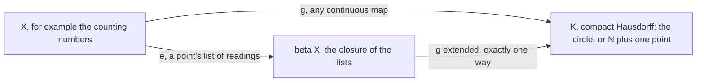

# Stone-Cech compactification: the biggest compact space a space sits densely inside

[Syllabus](../../../SYLLABUS.md) → [Topology](../README.md) → [Topological Spaces](../README.md#s02) → Stone-Cech compactification

---

## General Overview

Take the counting numbers 1, 2, 3, and so on, and two lists of readings on them. The first is $`a_n = (-1)^n`$: −1, +1, −1, +1, forever. The second is $`1/n`$: 1, 1/2, 1/3, sliding toward 0. Both stay between −1 and 1, but only the second settles.

The smallest way to make the counting numbers **compact** (every open cover has a finite subcover, [Compactness with no distances, and Tychonoff](06-compactness-and-tychonoff.md)) is to add one point, "infinity". The list $`1/n`$ then reads 0 at infinity. The list $`(-1)^n`$ cannot read anything there: at $`n`$ = 1000, 1001, 1000000 and 1000001 it reads 1, −1, 1, −1, and it never stops jumping. The circle shows the same thing: the real line plus one point is the circle, and $`t/(1 + \lvert t\rvert)`$ heads for +1 one way and −1 the other.

The **Stone–Čech compactification** adds as many points as it takes, so that every bounded continuous reading gets a value at every new point. For the counting numbers each new point is an **ultrafilter**: a consistent vote on which sets of counting numbers count as "large". Every new point votes for the even numbers or for the odd numbers, never both. So $`(-1)^n`$ reads +1 or −1 there, and nothing in between. The list $`1/n`$ reads 0 at every new point.

**A space that continuous functions can pry apart sits densely inside one biggest compact Hausdorff space, its Stone–Čech compactification, to which every bounded continuous function extends in exactly one way; for the counting numbers its points are the ultrafilters, and a bounded list's value at an ultrafilter is the one number that a "large" set of its entries crowds around.**

**What kind of fact this is:** a construction and four theorems, proved on this card in Why it works: the cube construction gives a compactification, every bounded continuous function extends to it, the extension property pins it down, and the ultrafilters give the same space for the counting numbers. Free ultrafilters exist by Zorn's lemma, a form of the axiom of choice; without some form of choice they need not exist, and no formula names one. The size of the new part is stated with a source, not proved.

### The picture: each function demanded adds new points

The counting numbers sent into a cube, one coordinate for each list, gain new points where the image piles up. More lists, more new points:

```
1/n                                     █                                                             1
1/n, (-1)^n                             ██                                                            2
1/n, (-1)^n, n mod 3                    ██████                                                        6
1/n, (-1)^n, n mod 3, n mod 4           ████████████                                                 12
1/n, (-1)^n, n mod 3, n mod 4, n mod 5  ████████████████████████████████████████████████████████████ 60
```

Here $`n \bmod 3`$ is the remainder on dividing $`n`$ by 3. Each block is one new point. The top row is the one-point compactification. Demanding every bounded list gives the Stone–Čech compactification, with more new points than the real line has.

---

## The formula

Notation first, in words. $`X`$ is a space ([Topological space](01-topological-spaces-and-bases.md)). $`\mathbb{N}`$ is the counting numbers $`1, 2, 3, \ldots`$ with every subset open (the **discrete** topology). A set is **dense** in a space when its closure is the whole space: every non-empty open set meets it ([Closure, interior and boundary](02-closure-interior-and-boundary.md)).

- $`X`$ is **completely regular** when its points are closed, and for every point $`x`$ and closed set $`C`$ missing it, some continuous $`f : X \to [0, 1]`$ reads 0 at $`x`$ and 1 on $`C`$. Every normal space with closed points is, by Urysohn's lemma ([Urysohn and Tietze](10-urysohn-tietze-and-metrisation.md)).
- A **compactification** of $`X`$ is a compact Hausdorff space $`Y`$ with a copy of $`X`$ dense inside it. Hausdorff means two points sit in two separate open sets ([Hausdorff and its ladder](05-separation-axioms-and-hausdorff.md)).

**The cube construction.** For each bounded continuous $`f : X \to \mathbb{R}`$, let $`I_f`$ be the closed interval from the greatest lower bound to the least upper bound of its values (for $`1/n`$: $`[0, 1]`$). Send each point to its list of readings, one coordinate per function:

```math
e : X \to \prod_{f} I_f, \qquad e(x) = \big(f(x)\big)_{f}, \qquad \beta X = \overline{e(X)} .
```

**Read it aloud:** write every point as the list of all its bounded readings; the Stone–Čech compactification, beta X, is the closure of those lists in the cube of all intervals.

**The extension property.** For every continuous $`g`$ from $`X`$ to a compact Hausdorff space $`K`$:

```math
\text{there is exactly one continuous } \tilde g : \beta X \to K \text{ with } \tilde g\big(e(x)\big) = g(x) \text{ for every } x .
```

**Read it aloud:** any continuous map into a compact Hausdorff space extends from X to beta X, and in only one way.

For a bounded $`f`$, with $`K = I_f`$, the extension is the reading of coordinate $`f`$: $`\tilde f = \pi_f`$.

**The counting numbers.** A **filter** on $`\mathbb{N}`$ is a family of "large" sets: always $`\mathbb{N}`$ itself, never the empty set, every superset of a member, and the overlap of any two members ([Nets and filters](11-nets-and-filters.md)). An **ultrafilter** $`p`$ also decides every set $`A`$: it holds $`A`$ or everything outside it. It is **free** when it holds no finite set. Then

```math
\beta\mathbb{N} = \{\text{ultrafilters } p \text{ on } \mathbb{N}\}, \qquad \tilde a(p) = L \iff \{\, n : \lvert a_n - L \rvert < \varepsilon \,\} \in p \text{ for every } \varepsilon > 0 .
```

**Read it aloud:** the points of beta N are the ultrafilters, and a bounded list reads L at an ultrafilter when, however small the tolerance, the entries within that tolerance of L form a large set. This $`L`$ is the **limit along** $`p`$, written $`p\text{-}\lim a_n`$.

| Symbol | Plain meaning | In our example | Push it up and the answer… |
| --- | --- | --- | --- |
| $`X`$; $`x`$, $`y`$, $`n`$; $`C`$; $`\mathbb{N}`$, $`\mathbb{R}`$ | the space; its points; a closed set missing $`x`$; the counting numbers, the real line | $`\mathbb{N}`$; the number 3 | — |
| $`f`$, $`h`$, $`I_f`$ | bounded continuous functions; the closed interval from the lower to the upper bound of $`f`$'s values | $`(-1)^n`$, with $`I_f = [-1, 1]`$ | — |
| $`\prod_f I_f`$, $`\pi_f`$ | the cube, one coordinate per function; reading coordinate $`f`$ | five lists: a 5-coordinate cube | more functions, more new points |
| $`e`$ | a point's list of readings | $`e(3)`$ has $`(-1)^n`$-coordinate −1, $`1/n`$-coordinate 1/3 | — |
| $`\beta X`$, $`\beta\mathbb{N}`$; $`Y`$, $`Z`$ | the Stone–Čech compactification, the closure of $`e(X)`$; any compactifications | $`\mathbb{N}`$ plus its free ultrafilters; $`\mathbb{N} \cup \{\infty\}`$ | — |
| $`K`$, $`g`$, $`\tilde g`$; $`u`$, $`v`$ | a compact Hausdorff target, a map into it, its extension; maps between compactifications | the circle $`S^1`$ | — |
| $`a_n`$; $`\tilde f`$, $`\tilde a`$ | a bounded list; the extension of a function or list | $`\tilde a(p_1) = -1`$ for $`a_n = (-1)^n`$ | — |
| $`A`$, $`\hat A`$; $`D`$ | a set of counting numbers, the ultrafilters holding it; a dense set | $`A`$ = the even numbers | bigger $`A`$: bigger $`\hat A`$ |
| $`p`$, $`q`$; $`p_r`$, $`r`$ | ultrafilters, the points of $`\beta\mathbb{N}`$; a free one holding the remainder class $`r`$ mod 12 | $`p_1`$ holds the odd numbers | — |
| $`L`$, $`\varepsilon`$; $`O`$, $`O_1`$, $`O_2`$, $`U`$, $`W`$ | the value along $`p`$, a tolerance; open sets | $`L = -1`$ at $`p_1`$ | smaller $`\varepsilon`$: a smaller set, still large |
| $`k`$, $`B`$ | halvings done; a bound on $`n`$ | 30 halvings: width 1/268435456 | more halvings: a narrower interval |
| $`t`$, $`\infty`$ | a real number; the one added point | $`t = \pm 1000`$ | larger $`t`$: closer to the north pole |

### When it holds

- **The space is completely regular.** Otherwise readings cannot tell points apart. On two points whose only open sets are the empty set and both together, 3 of the 9 maps into the values 0, 1/2, 1 are continuous, all constant: 2 points, 1 image.
- **The functions are bounded.** The list $`a_n = n`$ has no value at a new point: the set where $`n \le B`$ is finite, so no free ultrafilter holds it, for $`B`$ = 10, 1000 or 1000000.
- **The target is compact and Hausdorff.** Compact gives new values somewhere to land; Hausdorff makes them unique. The identity from $`\mathbb{N}`$ into the real line, which is not compact, has no extension.
- **Free ultrafilters need choice.** On 4 points, all 4 ultrafilters hold one fixed point. A free one on $`\mathbb{N}`$ exists by Zorn's lemma, and no formula names one.

---

## Why it works

### Step 0: a point of a compact space is known by its readings

In a compact Hausdorff space, continuous functions tell any two points apart, so a point can be recorded as the list of all its readings. Stone and Čech ran this backwards in 1937. Record each point of $`X`$ as its list of readings. The lists sit in a cube of intervals, compact by Tychonoff. Wherever the lists pile up, add the pile-up point: a list of readings that real points come arbitrarily close to.

### Step 1: the readings tell points apart

Each coordinate of $`e`$ is a continuous $`f`$, so $`e`$ is continuous into the product ([Subspace, product and quotient](04-subspace-product-and-quotient-topologies.md)). For two points $`x \ne y`$, the point $`y`$ is closed, so complete regularity gives an $`f`$ with $`f(x) = 0`$ and $`f(y) = 1`$. The lists differ in coordinate $`f`$, so $`e`$ is one-to-one.

### Step 2: the copy of X carries the right open sets

The map $`e`$ is a **homeomorphism onto its image**: it is one-to-one, continuous both ways, and an open set of $`X`$ goes to an open part of $`e(X)`$. So $`e(X)`$ is an exact copy of $`X`$.

<details>
<summary>Detailed proof: open sets of X go to open parts of e(X)</summary>

Let $`U`$ be open in $`X`$ and $`x`$ a point of $`U`$. The set $`C`$ outside $`U`$ is closed and misses $`x`$. Complete regularity gives $`f`$ with $`f(x) = 0`$ and $`f = 1`$ on $`C`$.

The set $`W`$ of lists whose $`f`$-coordinate is below 1 is open in the cube. It holds $`e(x)`$. A point $`e(y)`$ lies in $`W`$ exactly when $`f(y) < 1`$, which forces $`y`$ into $`U`$. So $`W \cap e(X)`$ is an open part of $`e(X)`$ that holds $`e(x)`$ and lies inside $`e(U)`$. Every point of $`e(U)`$ has such a neighbourhood, so $`e(U)`$ is open in $`e(X)`$.

</details>

### Step 3: the closure is a compactification

Each $`I_f`$ is a closed bounded interval, compact by Heine–Borel. The cube is compact by Tychonoff's theorem, and Hausdorff because each factor is. A closed part of a compact space is compact, so $`\beta X`$ is compact and Hausdorff. It is the closure of $`e(X)`$, so the copy of $`X`$ is dense in it.

### Step 4: every bounded function extends, in one way only

The coordinate reading $`\pi_f`$ is continuous on the cube, so on $`\beta X`$. On the copy of $`X`$ it reads $`\pi_f(e(x)) = f(x)`$. That is the extension $`\tilde f`$.

There is only one, because two continuous maps into a Hausdorff space that agree on a dense set agree everywhere. On $`\beta\mathbb{N}`$: $`\tilde a`$ is pinned at every new point by the values $`a_n`$ alone.

<details>
<summary>Detailed proof: maps that agree on a dense set agree</summary>

Let $`u`$ and $`v`$ be continuous from $`Y`$ into a Hausdorff space and agree on a dense set $`D`$. Suppose $`u(y) \ne v(y)`$ at some $`y`$. Hausdorff gives separate open sets $`O_1`$ round $`u(y)`$ and $`O_2`$ round $`v(y)`$.

The set where $`u`$ lands in $`O_1`$ and $`v`$ lands in $`O_2`$ is open, by continuity, and holds $`y`$. Since $`D`$ is dense, it holds some $`d`$ in $`D`$. Then $`u(d) = v(d)`$ lies in both $`O_1`$ and $`O_2`$, which share no point. So no such $`y`$ exists.

</details>

### Step 5: any compact Hausdorff target, and uniqueness of beta X



Both routes from $`X`$ to $`K`$ agree. The arrow from $`\beta X`$ exists for any compact Hausdorff $`K`$, not only an interval:

1. $`K`$ is normal ([Compactness with no distances, and Tychonoff](06-compactness-and-tychonoff.md), Step 7), so Urysohn makes it completely regular, and Steps 1 to 3 copy it into its own cube. Being compact, the copy is closed there.
2. Each coordinate $`h`$ of $`K`$'s cube gives a bounded function $`h \circ g`$ on $`X`$, which extends by Step 4. Together the extensions map $`\beta X`$ continuously into $`K`$'s cube.
3. The dense copy of $`X`$ lands in the closed copy of $`K`$, so by continuity all of $`\beta X`$ does.

The argument uses only that bounded real functions extend. Uniqueness comes from Step 4, and the same property fixes $`\beta X`$ itself.

<details>
<summary>Detailed proof: two spaces with the extension property are the same space</summary>

Let $`Y`$ and $`Z`$ both be compactifications of $`X`$ with the extension property. Extend the copy of $`X`$ in $`Z`$ to a map $`u : Y \to Z`$, and the copy in $`Y`$ to a map $`v : Z \to Y`$.

The composite $`v \circ u`$ maps $`Y`$ to itself and fixes every point of the dense copy of $`X`$. The identity map does the same. By Step 4 they agree on all of $`Y`$. Likewise $`u \circ v`$ is the identity on $`Z`$. So $`u`$ is a homeomorphism that fixes $`X`$: $`Y \cong Z`$.

</details>

### Step 6: why "biggest", and the one-point contrast

Let $`Y`$ be any compactification of $`X`$. The copy of $`X`$ in $`Y`$ extends to a map from $`\beta X`$ onto $`Y`$. It is onto because its image is compact, so closed, and contains the dense copy of $`X`$. So every compactification is $`\beta X`$ with some new points glued together.

The **one-point compactification** of a locally compact Hausdorff space adds one point $`\infty`$, whose open sets are $`\infty`$ together with everything outside a compact set. It is the smallest. The map from $`\beta\mathbb{N}`$ onto $`\mathbb{N} \cup \{\infty\}`$ sends every new point to $`\infty`$.

For the line, the added point closes it into the circle. **Stereographic projection** sends $`t`$ to $`\big(2t/(1+t^2),\ (t^2-1)/(1+t^2)\big)`$, which reaches every point of the circle except the north pole $`(0, 1)`$. At $`t = \pm 1000`$ it gives $`(\pm 2000/1000001,\ 999999/1000001)`$: both ends of the line approach the pole.

So a function extends to the circle when both ends give it one limit. The function $`t^2/(1+t^2)`$ reads 1000000/1000001 at $`t = \pm 1000`$, and 1 at the pole. The function $`t/(1+\lvert t\rvert)`$ reads 1000/1001 and −1000/1001: two limits, no value at the pole. It does extend to $`\beta\mathbb{R}`$.

### Step 7: free ultrafilters on the counting numbers

[Nets and filters](11-nets-and-filters.md) proves, by Zorn's lemma, that every filter sits inside an ultrafilter. For each $`n`$, the sets holding $`n`$ form the **principal** ultrafilter at $`n`$. On a finite set there are no others: on 4 points, 4 of 4 ultrafilters are principal, as the code checks family by family.

On $`\mathbb{N}`$, the **cofinite** sets, those missing only finitely many numbers, form a filter. An ultrafilter containing it holds every cofinite set, so it holds no finite set: it is free. Zorn's lemma gives it existence and no formula ([Zorn's lemma and the well-ordering theorem](../../01-Foundations/09-Sizes%20of%20Infinity/08-zorns-lemma-and-well-ordering.md)).

### Step 8: a bounded list has one value along each ultrafilter

Halving finds the value, and the same halving proves it exists; it is the interval case of "compact exactly when every ultrafilter converges" from [Nets and filters](11-nets-and-filters.md). All entries of a bounded list lie in some interval, and the set of all $`n`$ is large. Split the interval in two halves. The large set splits into two parts, and exactly one part is large, since $`p`$ holds a set or its outside. Keep that half.

After $`k`$ halvings the kept interval has width $`4/2^k`$ when the start is $`[-2, 2)`$, and its entries still form a large set. The kept intervals close in on one number $`L`$, and every tolerance window round $`L`$ holds a large set of entries.

Two values are impossible: windows round two different numbers, small enough, share no entries, and two large sets always overlap.

At a free ultrafilter, $`1/n`$ reads 0: the set where $`1/n < \varepsilon`$ misses only finitely many $`n`$, so it is large. At a principal ultrafilter at $`n`$, every list reads its own entry $`a_n`$. So the principal ultrafilters are the copy of $`\mathbb{N}`$.

### Step 9: the ultrafilters are beta N

Give the ultrafilters the open sets built from the basic sets $`\hat A`$, the ultrafilters that hold $`A`$. Send each $`n`$ to its principal ultrafilter. Then the ultrafilters are compact and Hausdorff, the copy of $`\mathbb{N}`$ is dense, and every bounded list extends by $`\tilde a(p) = p\text{-}\lim a_n`$. By the argument of Step 5, this is $`\beta\mathbb{N}`$.

<details>
<summary>Detailed proof: the ultrafilters form a compactification with the extension property</summary>

**Hausdorff.** Two different ultrafilters differ on some $`A`$: one holds $`A`$, the other its outside. The basic sets $`\hat A`$ and $`\widehat{\mathbb{N} \setminus A}`$ separate them.

**Dense.** A non-empty $`\hat A`$ has $`A`$ non-empty. The principal ultrafilter at any $`n`$ in $`A`$ lies in $`\hat A`$.

**Compact.** Suppose basic sets $`\hat A_i`$ cover every ultrafilter, but no finitely many do. Then for every finite batch, the outsides of the $`A_i`$ overlap in a non-empty set; otherwise the $`A_i`$ in that batch would cover $`\mathbb{N}`$, and every ultrafilter would hold one of them. The sets holding one of these overlaps form a filter, which Zorn extends to an ultrafilter $`q`$. It holds no $`A_i`$, so no $`\hat A_i`$ covers it, against the assumption.

**Extension.** The value $`\tilde a(p)`$ exists and is unique by Step 8. For continuity, let $`\tilde a(p)`$ lie in an open interval $`O`$, and pick a window $`W`$ round it whose closure sits in $`O`$. The set $`A`$ where $`a_n`$ lies in $`W`$ is in $`p`$, and every ultrafilter in $`\hat A`$ reads a value in the closure of $`W`$, inside $`O`$.

</details>

A free ultrafilter holds exactly one class of remainders mod 12. It cannot hold two, since two classes share no number. It cannot hold none, since then it would hold all 12 outsides, whose overlap is empty. Call a free one holding the class $`r`$ "$`p_r`$". There are many for each $`r`$. They agree on every set that repeats with period 12 from some point on, and the code needs only those sets.

The new part $`\beta\mathbb{N} \setminus \mathbb{N}`$ has two to the power of the size of the real line points ([Cardinal arithmetic](../../01-Foundations/09-Sizes%20of%20Infinity/09-cardinal-arithmetic.md)), stated here with its source, Hindman and Strauss, Chapter 3.

---

## Worked numbers, by hand

The value of $`(-1)^n`$ at $`p_1`$, a free ultrafilter holding the odd numbers, by halving from $`[-2, 2)`$:

| Step | Arithmetic | Value |
| --- | --- | --- |
| 1 | $`[-2, 0)`$ holds the odd $`n`$, $`[0, 2)`$ the even ones; $`p_1`$ holds the odd ones | keep $`[-2, 0)`$ |
| 2 | $`[-2, -1)`$ holds no entry; $`[-1, 0)`$ holds the odd $`n`$ | keep $`[-1, 0)`$ |
| 3 | $`[-1, -1/2)`$ holds the odd $`n`$ | keep $`[-1, -1/2)`$ |
| 4 to 30 | the left half always holds the odd $`n`$ | left half each time |
| width | $`4/2^{30}`$ | 1/268435456 |
| **value** | the interval is $`[-1, -1 + 1/268435456)`$ | **−1** |

At $`p_2`$, which holds the even numbers, the same halving gives **+1**. Over the 12 classes, $`(-1)^n`$ reads −1 at 6 and +1 at 6, and no other value. The list $`1/n`$ reads **0** at every $`p_r`$: the kept interval is always $`[0, \ldots)`$. The list $`(-1)^n + 1/n`$ reads −1 at $`p_1`$ and +1 at $`p_2`$: values add.

So $`(-1)^n`$, which has no limit, has a value at every new point, decided by that point's vote for the odd or the even numbers.

### What breaks if you drop a piece

| Mistake | Comes out at | What went wrong |
| --- | --- | --- |
| One added point for $`(-1)^n`$ | $`n`$ = 1000, 1001, 1000000, 1000001 give 1, −1, 1, −1 | one point cannot hold two limits |
| Extend the unbounded list $`a_n = n`$ | the set where $`n \le B`$ is large: no, no, no for $`B`$ = 10, 1000, 1000000 | no bounded interval holds a large set |
| Drop complete regularity: 2 points, open sets only the empty set and both | 3 of 9 maps continuous, all constant: 2 points, 1 image | readings cannot pry the points apart |
| Look for a free ultrafilter on a finite set | 4 points: 15 filters, 4 ultrafilters, 0 free | every ultrafilter on a finite set is principal |

The code prints all four.

---

## Code, from first principles, and it actually runs

Arithmetic is exact throughout. Each count takes two independent roads. Part 1 finds each value at $`p_r`$ by halving with the ultrafilter's votes and by the formula for the limit along the class $`r`$; 12 classes and 3 lists are checked, which illustrates and does not prove. Part 2 checks all 65536 families of subsets of 4 points against the formulas $`2^4 - 1`$ and 4, so that finite case is proved. Part 3 counts new points on 1000 far-out numbers against the least common multiple of the periods. Part 4 checks the circle points exactly.

### Python

```python
# Stone-Cech compactification -- the check behind the card.  Standard library only.
# Exact arithmetic throughout: Fraction for the halving, integers for the counts.
# Part 1 reads bounded sequences at new points of beta N by halving.  Part 2 checks
# every family of subsets of a 4-point set, so that finite case is proved.  Part 3
# counts the new points that more and more functions force.  Part 4 is the circle.
from fractions import Fraction as F
from math import lcm

# ---- Part 1: a value at a new point of beta N, by halving ----
# A free ultrafilter p holds exactly one residue class r mod 12.  On a set that is
# eventually periodic mod 12 (every set used below is), p says "large" exactly when
# the set holds the far-out members of that class.  The test reads three of them.
M, TAIL, STEPS = 12, 12 * 10**11, 30
def large(member, r):
    return all(member(TAIL + M * k + r) for k in range(3))

def halve(a, r):                      # the ultrafilter limit of the sequence a at p_r
    lo, hi = F(-2), F(2)              # every value lies in [-2, 2): a large set
    for _ in range(STEPS):
        mid = (lo + hi) / 2
        left = large(lambda n: lo <= a(n) < mid, r)
        right = large(lambda n: mid <= a(n) < hi, r)
        assert left != right          # a large set split in two: exactly one half is large
        lo, hi = (lo, mid) if left else (mid, hi)
    return lo, hi

seqs = [("(-1)^n", lambda n: F((-1) ** n), lambda r: F((-1) ** r)),
        ("1/n", lambda n: F(1, n), lambda r: F(0)),
        ("(-1)^n + 1/n", lambda n: F((-1) ** n) + F(1, n), lambda r: F((-1) ** r))]
print(f"Part 1: values at the new point p_r of beta N, by {STEPS} halvings of [-2, 2)")
odd_large = large(lambda n: -2 <= (-1) ** n < 0, 1)
assert odd_large and not large(lambda n: 0 <= (-1) ** n < 2, 1)
print(f"  step 1 for (-1)^n at r = 1: [-2, 0) holds the odd n; large: {'yes' if odd_large else 'no'}")
tally = {}
for r in range(M):
    for name, a, direct in seqs:
        lo, hi = halve(a, r)
        v = direct(r)                 # road 2: the limit along the class r, by formula
        assert lo <= v < hi
        assert hi - lo == F(4, 2 ** STEPS)    # the printed width, against its formula
        if name == "(-1)^n":
            tally[lo] = tally.get(lo, 0) + 1
        if r in (1, 2):
            print(f"  r = {r:>2} mod 12: {name:<13} -> {str(lo):>2}, interval width {hi - lo}")
assert tally == {F(-1): 6, F(1): 6}
print(f"  (-1)^n over all 12 classes: -1 at {tally[F(-1)]}, +1 at {tally[F(1)]}, anything else at 0")

# ---- Part 2: every family of subsets of a 4-point set (sets as 4-bit masks) ----
def is_filter(fam):
    mem = [A for A in range(16) if fam >> A & 1]
    if not mem or fam & 1:            # empty family, or the empty set inside
        return False
    up = all(fam >> B & 1 for A in mem for B in range(16) if A & B == A)
    return up and all(fam >> (A & B) & 1 for A in mem for B in mem)

filters = [fam for fam in range(1 << 16) if is_filter(fam)]
ultras = [f for f in filters if all(f >> A & 1 or f >> (15 ^ A) & 1 for A in range(16))]
principal = [sum(1 << A for A in range(16) if A >> i & 1) for i in range(4)]
assert len(filters) == 2 ** 4 - 1 and sorted(ultras) == sorted(principal)
print("Part 2: 4 points (4 voters), all 65536 families of subsets checked")
print(f"  filters {len(filters)} (formula 2^4 - 1 = {2 ** 4 - 1}); ultrafilters {len(ultras)}")
same = sorted(ultras) == sorted(principal)
free = [f for f in ultras if not any(f >> (1 << i) & 1 for i in range(4))]   # holds no single point
print(f"  each ultrafilter is 'the 8 sets holding point i': {'yes' if same else 'no'}; free ones: {len(free)}")

# ---- Part 3: more functions to extend, more new points ----
# Image of n in a cube, one coordinate per function.  1/n tends to 0, so a limit
# point is fixed by the periodic coordinates; count them on a far window of n.
funcs = [("1/n", 1), ("(-1)^n", 2), ("n mod 3", 3), ("n mod 4", 4), ("n mod 5", 5)]
print("Part 3: new points of the closure of N in the cube, function by function")
for k in range(1, len(funcs) + 1):
    periods = [p for _, p in funcs[:k]]
    window = range(10**9, 10**9 + 1000)
    seen = {tuple(n % p for p in periods[1:]) for n in window}
    assert len(seen) == lcm(*periods)
    names = ", ".join(nm for nm, _ in funcs[:k])
    print(f"  {names:<38} new points {len(seen):>2}; lcm of periods {lcm(*periods)}")

# ---- Part 4: the circle, R plus one point ----
def stereo(t):                        # the line onto the circle minus the north pole
    return F(2 * t, 1 + t * t), F(t * t - 1, 1 + t * t)
print("Part 4: R plus one point is the circle (north pole (0, 1) added)")
for t in (0, 1, -1, 1000, -1000):
    x, y = stereo(F(t))
    assert x * x + y * y == 1
    print(f"  t = {t:>5}: ({x}, {y})")
g = lambda t: F(t * t, 1 + t * t)
h = lambda t: F(t, 1 + abs(t))
assert g(1000) == g(-1000) and h(1000) != h(-1000)
print(f"  t^2/(1+t^2) at +-1000: {g(1000)}, {g(-1000)}: one value 1 at the pole, extends")
print(f"  t/(1+|t|)   at +-1000: {h(1000)}, {h(-1000)}: two limits, no value at the pole")

# ---- What breaks ----
print("What breaks")
far = [F((-1) ** n) for n in (1000, 1001, 10**6, 10**6 + 1)]
assert far == [1, -1, 1, -1]
print(f"  one point at infinity for (-1)^n: n = 1000, 1001, 10^6, 10^6+1 give {', '.join(map(str, far))}")
small = [large(lambda n: n <= B, 1) for B in (10, 1000, 10**6)]
assert small == [False, False, False]
print("  unbounded a_n = n: {n <= B} for B = 10, 1000, 10^6 has B members, large: no, no, no")
vals = [F(0), F(1, 2), F(1)]          # maps from the 2-point indiscrete space to [0, 1]
maps = [(u, w) for u in vals for w in vals]     # open set: within 1/4 of c; its pre-image
cont = [m for m in maps if all((abs(m[0] - c) < F(1, 4)) == (abs(m[1] - c) < F(1, 4)) for c in vals)]
assert len(cont) == 3 and all(u == w for u, w in cont)
print(f"  indiscrete 2 points: {len(cont)} of {len(maps)} maps continuous, all constant: 2 points, 1 image")
print("ALL CHECKS PASS")
```

**Ran 2026-11-24 on macOS, Python 3.14.10, standard library only. All checks passed. Output, pasted from the run:**

```
Part 1: values at the new point p_r of beta N, by 30 halvings of [-2, 2)
  step 1 for (-1)^n at r = 1: [-2, 0) holds the odd n; large: yes
  r =  1 mod 12: (-1)^n        -> -1, interval width 1/268435456
  r =  1 mod 12: 1/n           ->  0, interval width 1/268435456
  r =  1 mod 12: (-1)^n + 1/n  -> -1, interval width 1/268435456
  r =  2 mod 12: (-1)^n        ->  1, interval width 1/268435456
  r =  2 mod 12: 1/n           ->  0, interval width 1/268435456
  r =  2 mod 12: (-1)^n + 1/n  ->  1, interval width 1/268435456
  (-1)^n over all 12 classes: -1 at 6, +1 at 6, anything else at 0
Part 2: 4 points (4 voters), all 65536 families of subsets checked
  filters 15 (formula 2^4 - 1 = 15); ultrafilters 4
  each ultrafilter is 'the 8 sets holding point i': yes; free ones: 0
Part 3: new points of the closure of N in the cube, function by function
  1/n                                    new points  1; lcm of periods 1
  1/n, (-1)^n                            new points  2; lcm of periods 2
  1/n, (-1)^n, n mod 3                   new points  6; lcm of periods 6
  1/n, (-1)^n, n mod 3, n mod 4          new points 12; lcm of periods 12
  1/n, (-1)^n, n mod 3, n mod 4, n mod 5 new points 60; lcm of periods 60
Part 4: R plus one point is the circle (north pole (0, 1) added)
  t =     0: (0, -1)
  t =     1: (1, 0)
  t =    -1: (-1, 0)
  t =  1000: (2000/1000001, 999999/1000001)
  t = -1000: (-2000/1000001, 999999/1000001)
  t^2/(1+t^2) at +-1000: 1000000/1000001, 1000000/1000001: one value 1 at the pole, extends
  t/(1+|t|)   at +-1000: 1000/1001, -1000/1001: two limits, no value at the pole
What breaks
  one point at infinity for (-1)^n: n = 1000, 1001, 10^6, 10^6+1 give 1, -1, 1, -1
  unbounded a_n = n: {n <= B} for B = 10, 1000, 10^6 has B members, large: no, no, no
  indiscrete 2 points: 3 of 9 maps continuous, all constant: 2 points, 1 image
ALL CHECKS PASS
```

### Rust

Same numbers, same labels, built with `rustc --edition 2021 -O`.

```rust
// Stone-Cech compactification -- the same check as the Python, in Rust.  No crates.
// Exact arithmetic throughout: halving endpoints are whole multiples of 2^-30, and
// every sequence value is a fraction p/q held in i128.  Part 1 reads bounded
// sequences at new points of beta N by halving.  Part 2 checks every family of
// subsets of a 4-point set, so that finite case is proved.  Part 3 counts the new
// points that more and more functions force.  Part 4 is the circle.
use std::collections::{BTreeMap, BTreeSet};

const M: i128 = 12;
const TAIL: i128 = 12 * 100_000_000_000;
const STEPS: u32 = 30;
const SCALE: i128 = 1 << STEPS;                    // an endpoint u stands for u / 2^30

fn gcd(a: i128, b: i128) -> i128 { if b == 0 { a.abs() } else { gcd(b, a % b) } }
fn show(p: i128, q: i128) -> String {
    let g = gcd(p, q).max(1) * q.signum();
    if q / g == 1 { format!("{}", p / g) } else { format!("{}/{}", p / g, q / g) }
}
fn yn(b: bool) -> &'static str { if b { "yes" } else { "no" } }
fn sign(n: i128) -> i128 { if n % 2 == 0 { 1 } else { -1 } }
// A free ultrafilter p holds exactly one residue class r mod 12.  On a set that is
// eventually periodic mod 12 (every set used below is), p says "large" exactly when
// the set holds the far-out members of that class.  The test reads three of them.
fn large(member: &dyn Fn(i128) -> bool, r: i128) -> bool {
    (0..3).all(|k| member(TAIL + M * k + r))
}
// sequence k at n, as a fraction (p, q) with q > 0
fn seq(k: usize, n: i128) -> (i128, i128) {
    match k { 0 => (sign(n), 1), 1 => (1, n), _ => (sign(n) * n + 1, n) }
}
fn direct(k: usize, r: i128) -> i128 { if k == 1 { 0 } else { sign(r) } }   // road 2
fn within(k: usize, n: i128, lo: i128, hi: i128) -> bool {                    // lo <= a_n < hi
    let (p, q) = seq(k, n);
    lo * q <= p * SCALE && p * SCALE < hi * q
}
fn halve(k: usize, r: i128) -> (i128, i128) {
    let (mut lo, mut hi) = (-2 * SCALE, 2 * SCALE);  // every value lies in [-2, 2)
    for _ in 0..STEPS {
        let mid = (lo + hi) / 2;
        let left = large(&|n| within(k, n, lo, mid), r);
        let right = large(&|n| within(k, n, mid, hi), r);
        assert!(left != right);                       // exactly one half is large
        if left { hi = mid } else { lo = mid }
    }
    (lo, hi)
}

fn is_filter(fam: u32) -> bool {
    let mem: Vec<u32> = (0..16).filter(|&a| fam >> a & 1 == 1).collect();
    if mem.is_empty() || fam & 1 == 1 { return false; }
    let up = mem.iter().all(|&a| (0..16u32).all(|b| a & b != a || fam >> b & 1 == 1));
    up && mem.iter().all(|&a| mem.iter().all(|&b| fam >> (a & b) & 1 == 1))
}
fn lcm(a: i128, b: i128) -> i128 { a / gcd(a, b) * b }

fn main() {
    // ---- Part 1 ----
    let names = ["(-1)^n", "1/n", "(-1)^n + 1/n"];
    println!("Part 1: values at the new point p_r of beta N, by {} halvings of [-2, 2)", STEPS);
    let odd_large = large(&|n| sign(n) < 0, 1);
    assert!(odd_large && !large(&|n| sign(n) >= 0, 1));
    println!("  step 1 for (-1)^n at r = 1: [-2, 0) holds the odd n; large: {}", yn(odd_large));
    let mut tally: BTreeMap<i128, i32> = BTreeMap::new();
    for r in 0..M {
        for k in 0..3 {
            let (lo, hi) = halve(k, r);
            let v = direct(k, r) * SCALE;
            assert!(lo <= v && v < hi);
            assert!(hi - lo == 4 * SCALE >> STEPS);   // the printed width, against its formula
            if k == 0 { *tally.entry(lo / SCALE).or_insert(0) += 1; }
            if r == 1 || r == 2 {
                println!("  r = {:>2} mod 12: {:<13} -> {:>2}, interval width {}",
                         r, names[k], show(lo, SCALE), show(hi - lo, SCALE));
            }
        }
    }
    assert!(tally.len() == 2 && tally[&-1] == 6 && tally[&1] == 6);
    println!("  (-1)^n over all 12 classes: -1 at {}, +1 at {}, anything else at 0", tally[&-1], tally[&1]);

    // ---- Part 2 ----
    let filters: Vec<u32> = (0..1u32 << 16).filter(|&f| is_filter(f)).collect();
    let mut ultras: Vec<u32> = filters.iter().cloned()
        .filter(|&f| (0..16).all(|a| f >> a & 1 == 1 || f >> (15 ^ a) & 1 == 1)).collect();
    let mut principal: Vec<u32> = (0..4)
        .map(|i| (0..16u32).filter(|&a| a >> i & 1 == 1).map(|a| 1u32 << a).sum()).collect();
    ultras.sort(); principal.sort();
    assert!(filters.len() == (1 << 4) - 1 && ultras == principal);
    let free = ultras.iter().filter(|&&f| (0..4).all(|i| f >> (1u32 << i) & 1 == 0)).count(); // holds no single point
    println!("Part 2: 4 points (4 voters), all 65536 families of subsets checked");
    println!("  filters {} (formula 2^4 - 1 = {}); ultrafilters {}", filters.len(), (1 << 4) - 1, ultras.len());
    println!("  each ultrafilter is 'the 8 sets holding point i': {}; free ones: {}", yn(ultras == principal), free);

    // ---- Part 3 ----
    let funcs: [(&str, i128); 5] = [("1/n", 1), ("(-1)^n", 2), ("n mod 3", 3), ("n mod 4", 4), ("n mod 5", 5)];
    println!("Part 3: new points of the closure of N in the cube, function by function");
    for k in 1..=funcs.len() {
        let periods: Vec<i128> = funcs[..k].iter().map(|f| f.1).collect();
        let seen: BTreeSet<Vec<i128>> = (1_000_000_000..1_000_001_000i128)
            .map(|n| periods[1..].iter().map(|p| n % p).collect()).collect();
        let l = periods.iter().fold(1, |a, &b| lcm(a, b));
        assert!(seen.len() as i128 == l);
        let nm: Vec<&str> = funcs[..k].iter().map(|f| f.0).collect();
        println!("  {:<38} new points {:>2}; lcm of periods {}", nm.join(", "), seen.len(), l);
    }

    // ---- Part 4 ----
    println!("Part 4: R plus one point is the circle (north pole (0, 1) added)");
    for t in [0i128, 1, -1, 1000, -1000] {
        let d = 1 + t * t;
        assert!((2 * t) * (2 * t) + (t * t - 1) * (t * t - 1) == d * d);
        println!("  t = {:>5}: ({}, {})", t, show(2 * t, d), show(t * t - 1, d));
    }
    let g = |t: i128| (t * t, 1 + t * t);
    let h = |t: i128| (t, 1 + t.abs());
    assert!(g(1000) == g(-1000) && h(1000) != h(-1000));
    println!("  t^2/(1+t^2) at +-1000: {}, {}: one value 1 at the pole, extends",
             show(g(1000).0, g(1000).1), show(g(-1000).0, g(-1000).1));
    println!("  t/(1+|t|)   at +-1000: {}, {}: two limits, no value at the pole",
             show(h(1000).0, h(1000).1), show(h(-1000).0, h(-1000).1));

    // ---- What breaks ----
    println!("What breaks");
    let far: Vec<i128> = [1000i128, 1001, 1_000_000, 1_000_001].iter().map(|&n| sign(n)).collect();
    assert!(far == vec![1, -1, 1, -1]);
    let fs: Vec<String> = far.iter().map(|v| v.to_string()).collect();
    println!("  one point at infinity for (-1)^n: n = 1000, 1001, 10^6, 10^6+1 give {}", fs.join(", "));
    let small: Vec<bool> = [10i128, 1000, 1_000_000].iter().map(|&b| large(&|n| n <= b, 1)).collect();
    assert!(small == vec![false, false, false]);
    println!("  unbounded a_n = n: {{n <= B}} for B = 10, 1000, 10^6 has B members, large: no, no, no");
    let vals = [0i128, 2, 4];                         // 0, 1/2, 1 in quarters
    let maps: Vec<(i128, i128)> = vals.iter().flat_map(|&u| vals.iter().map(move |&w| (u, w))).collect();
    let cont: Vec<&(i128, i128)> = maps.iter()
        .filter(|m| vals.iter().all(|&c| ((m.0 - c).abs() < 1) == ((m.1 - c).abs() < 1))).collect();
    assert!(cont.len() == 3 && cont.iter().all(|m| m.0 == m.1));
    println!("  indiscrete 2 points: {} of {} maps continuous, all constant: 2 points, 1 image", cont.len(), maps.len());
    println!("ALL CHECKS PASS");
}
```

**Ran 2026-11-24 on macOS, rustc 1.98.1, no crates. All checks passed. Output, pasted from the run:**

```
Part 1: values at the new point p_r of beta N, by 30 halvings of [-2, 2)
  step 1 for (-1)^n at r = 1: [-2, 0) holds the odd n; large: yes
  r =  1 mod 12: (-1)^n        -> -1, interval width 1/268435456
  r =  1 mod 12: 1/n           ->  0, interval width 1/268435456
  r =  1 mod 12: (-1)^n + 1/n  -> -1, interval width 1/268435456
  r =  2 mod 12: (-1)^n        ->  1, interval width 1/268435456
  r =  2 mod 12: 1/n           ->  0, interval width 1/268435456
  r =  2 mod 12: (-1)^n + 1/n  ->  1, interval width 1/268435456
  (-1)^n over all 12 classes: -1 at 6, +1 at 6, anything else at 0
Part 2: 4 points (4 voters), all 65536 families of subsets checked
  filters 15 (formula 2^4 - 1 = 15); ultrafilters 4
  each ultrafilter is 'the 8 sets holding point i': yes; free ones: 0
Part 3: new points of the closure of N in the cube, function by function
  1/n                                    new points  1; lcm of periods 1
  1/n, (-1)^n                            new points  2; lcm of periods 2
  1/n, (-1)^n, n mod 3                   new points  6; lcm of periods 6
  1/n, (-1)^n, n mod 3, n mod 4          new points 12; lcm of periods 12
  1/n, (-1)^n, n mod 3, n mod 4, n mod 5 new points 60; lcm of periods 60
Part 4: R plus one point is the circle (north pole (0, 1) added)
  t =     0: (0, -1)
  t =     1: (1, 0)
  t =    -1: (-1, 0)
  t =  1000: (2000/1000001, 999999/1000001)
  t = -1000: (-2000/1000001, 999999/1000001)
  t^2/(1+t^2) at +-1000: 1000000/1000001, 1000000/1000001: one value 1 at the pole, extends
  t/(1+|t|)   at +-1000: 1000/1001, -1000/1001: two limits, no value at the pole
What breaks
  one point at infinity for (-1)^n: n = 1000, 1001, 10^6, 10^6+1 give 1, -1, 1, -1
  unbounded a_n = n: {n <= B} for B = 10, 1000, 10^6 has B members, large: no, no, no
  indiscrete 2 points: 3 of 9 maps continuous, all constant: 2 points, 1 image
ALL CHECKS PASS
```

The two outputs match line for line.

### Lean

Lean proves the extension theorem and the ultrafilter picture of beta N in general, and checks the worked numbers exactly.

- Suppose $`X`$ is completely regular. Then its copy is dense in $`\beta X`$, which is compact and Hausdorff.
- Suppose also $`K`$ is compact Hausdorff and $`g : X \to K`$ is continuous. Then exactly one continuous $`\tilde g : \beta X \to K`$ extends $`g`$.
- Suppose $`X`$ is completely regular and $`f`$ is a bounded continuous real function on it. Then exactly one continuous $`\tilde f`$ on $`\beta X`$ extends $`f`$.
- Take the counting numbers, which Lean starts at 0. Then $`\beta\mathbb{N}`$ is the space of ultrafilters, each $`n`$ matched to its principal ultrafilter.
- Take a bounded list $`a_n`$ and an ultrafilter $`p`$. Then $`\tilde a(p) = L`$ exactly when every tolerance window round $`L`$ holds a large set of entries.
- Take $`(-1)^n`$ at $`n`$ = 1000, 1001, 1000000 and 1000001. Then it reads 1, −1, 1, −1.
- Take 30 halvings of $`[-2, 2)`$. Then the kept interval has width 1/268435456.
- Take the lists $`(-1)^n`$, $`n \bmod 3`$, $`n \bmod 4`$ and $`n \bmod 5`$, added one at a time. Then the least common multiple of their periods runs 2, 6, 12, 60.
- Take the filter count $`2^4 - 1`$ for 4 points. Then it equals 15.
- Take $`t = 1000`$. Then stereographic projection gives $`(2000/1000001,\ 999999/1000001)`$, exactly on the circle.
- Take $`t = \pm 1000`$. Then $`t^2/(1+t^2)`$ reads 1000000/1000001 both times.
- Take $`t = \pm 1000`$. Then $`t/(1+\lvert t\rvert)`$ reads 1000/1001 and −1000/1001.

The halving at each $`p_r`$, the 4-point family check, the new-point counts and the What breaks rows stay with Python and Rust.

```lean
-- Stone-Cech compactification: a completely regular space sits densely inside its Stone-Cech compactification, every continuous map into a compact Hausdorff space (so every bounded real function) extends to it in exactly one way, and for the counting numbers its points are the ultrafilters, where a bounded list reads its limit along the ultrafilter.
import Mathlib.Topology.Separation.CompletelyRegular
import Mathlib.Topology.Instances.Real.Lemmas

open Filter Topology

universe u v

/-! `StoneCech X` is Mathlib's Stone-Cech compactification, `stoneCechUnit` sends a point of `X` to
its copy there. `T35Space X` is "completely regular with closed points", the card's hypothesis.
The counting numbers `ℕ` carry the discrete topology, and `Ultrafilter ℕ` carries the topology whose
basic open sets are the ultrafilters holding a fixed set `A`. -/

/-- The card's main claim. If `X` is completely regular (points closed, and continuous functions
pry a point away from any closed set missing it), then `X` sits as a dense copy inside its
Stone-Cech compactification, which is compact and Hausdorff, and every continuous map `g` from `X`
to a compact Hausdorff space `K` extends to the compactification in exactly one continuous way. -/
theorem stone_cech_dense_embedding_and_unique_extension (X : Type u) [TopologicalSpace X]
    [T35Space X] :
    IsDenseEmbedding (stoneCechUnit : X → StoneCech X) ∧ CompactSpace (StoneCech X) ∧
      T2Space (StoneCech X) ∧
      ∀ (K : Type v) [TopologicalSpace K] [CompactSpace K] [T2Space K] (g : X → K),
        Continuous g → ∃! G : StoneCech X → K, Continuous G ∧ G ∘ stoneCechUnit = g := by
  refine ⟨isDenseEmbedding_stoneCechUnit, inferInstance, inferInstance, ?_⟩
  intro K _ _ _ g hg
  refine ⟨stoneCechExtend hg, ⟨continuous_stoneCechExtend hg, stoneCechExtend_extends hg⟩, ?_⟩
  rintro G ⟨hG, hGg⟩
  exact stoneCech_hom_ext hG (continuous_stoneCechExtend hg)
    (hGg.trans (stoneCechExtend_extends hg).symm)

#print axioms stone_cech_dense_embedding_and_unique_extension

/-- Step 4: on a completely regular space, every bounded continuous real function `f` extends
to the Stone-Cech compactification in exactly one continuous way. -/
theorem bounded_continuous_extends_uniquely (X : Type u) [TopologicalSpace X] [T35Space X]
    (f : X → ℝ) (hf : Continuous f) (hb : ∃ C, ∀ x, |f x| ≤ C) :
    ∃! F : StoneCech X → ℝ, Continuous F ∧ F ∘ stoneCechUnit = f := by
  obtain ⟨C, hC⟩ := hb
  let g : X → Set.Icc (-C) C := fun x => ⟨f x, abs_le.mp (hC x)⟩
  have hg : Continuous g := hf.subtype_mk _
  refine ⟨Subtype.val ∘ stoneCechExtend hg,
    ⟨continuous_subtype_val.comp (continuous_stoneCechExtend hg), ?_⟩, ?_⟩
  · rw [Function.comp_assoc, stoneCechExtend_extends hg]
    rfl
  · rintro G ⟨hG, hGf⟩
    refine stoneCech_hom_ext hG (continuous_subtype_val.comp (continuous_stoneCechExtend hg)) ?_
    rw [hGf, Function.comp_assoc, stoneCechExtend_extends hg]
    rfl

#print axioms bounded_continuous_extends_uniquely

/-- Steps 8 and 9: for the counting numbers, beta N is the space of ultrafilters on N, with each
`n` matched to the principal ultrafilter at `n`; and a bounded list `a` reads `L` at the ultrafilter
`p` exactly when, for every tolerance `ε > 0`, the set of `n` with `|a n - L| < ε` is in `p`. -/
theorem stone_cech_nat_is_ultrafilters :
    ∃ h : StoneCech ℕ ≃ₜ Ultrafilter ℕ, (∀ n, h (stoneCechUnit n) = pure n) ∧
      ∀ (a : ℕ → ℝ), (∃ C, ∀ n, |a n| ≤ C) →
        ∀ F : StoneCech ℕ → ℝ, Continuous F → F ∘ stoneCechUnit = a →
          ∀ (p : Ultrafilter ℕ) (L : ℝ),
            F (h.symm p) = L ↔ ∀ ε > 0, {n | |a n - L| < ε} ∈ p := by
  have hp : Continuous (pure : ℕ → Ultrafilter ℕ) := continuous_of_discreteTopology
  let φ : StoneCech ℕ → Ultrafilter ℕ := stoneCechExtend hp
  let ψ : Ultrafilter ℕ → StoneCech ℕ := Ultrafilter.extend stoneCechUnit
  have hφ : Continuous φ := continuous_stoneCechExtend hp
  have hψ : Continuous ψ := continuous_ultrafilter_extend _
  have hφu : φ ∘ stoneCechUnit = pure := stoneCechExtend_extends hp
  have hψp : ψ ∘ pure = stoneCechUnit := ultrafilter_extend_extends _
  have h1 : ψ ∘ φ = id := by
    refine stoneCech_hom_ext (hψ.comp hφ) continuous_id ?_
    rw [Function.comp_assoc, hφu, hψp]
    rfl
  have h2 : φ ∘ ψ = id := by
    refine Continuous.ext_on denseRange_pure (hφ.comp hψ) continuous_id ?_
    rintro _ ⟨n, rfl⟩
    show φ ((ψ ∘ pure) n) = pure n
    rw [hψp]
    exact congrFun hφu n
  let h : StoneCech ℕ ≃ₜ Ultrafilter ℕ :=
    { toFun := φ
      invFun := ψ
      left_inv := fun x => congrFun h1 x
      right_inv := fun x => congrFun h2 x
      continuous_toFun := hφ
      continuous_invFun := hψ }
  refine ⟨h, fun n => congrFun hφu n, ?_⟩
  intro a _ F hF hFa p L
  have hsymm : h.symm p = ψ p := rfl
  rw [hsymm]
  have ht : Tendsto a p (𝓝 (F (ψ p))) := by
    have h3 : Tendsto (F ∘ ψ) (𝓝 p) (𝓝 (F (ψ p))) := (hF.comp hψ).tendsto p
    have h4 := h3.comp (Ultrafilter.tendsto_pure_self p)
    have h5 : (F ∘ ψ) ∘ pure = a := by
      rw [Function.comp_assoc, hψp, hFa]
    rwa [h5] at h4
  have key : F (ψ p) = L ↔ Tendsto a p (𝓝 L) := by
    constructor
    · rintro rfl; exact ht
    · intro hL; exact tendsto_nhds_unique ht hL
  rw [key, Metric.tendsto_nhds]
  simp only [Real.dist_eq]
  rfl

#print axioms stone_cech_nat_is_ultrafilters

/-! The card's whole-number worked examples. -/

-- (-1)^n at n = 1000, 1001, 10^6, 10^6 + 1 gives 1, -1, 1, -1: one point at infinity cannot hold both.
example : ((-1 : ℤ) ^ 1000, (-1 : ℤ) ^ 1001, (-1 : ℤ) ^ (10 ^ 6), (-1 : ℤ) ^ (10 ^ 6 + 1))
    = (1, -1, 1, -1) := by norm_num

-- 30 halvings of [-2, 2) leave an interval of width 4/2^30 = 1/268435456.
example : (4 : ℚ) / 2 ^ 30 = 1 / 268435456 := by norm_num

-- New points forced by 1/n, (-1)^n, n mod 3, n mod 4, n mod 5: lcm of the periods 1, 2, 6, 12, 60.
example : Nat.lcm 1 2 = 2 ∧ Nat.lcm 2 3 = 6 ∧ Nat.lcm 6 4 = 12 ∧ Nat.lcm 12 5 = 60 := by decide

-- On 4 points there are 2^4 - 1 = 15 filters, one for each non-empty set of points.
example : 2 ^ 4 - 1 = 15 := by norm_num

-- Stereographic projection at t = 1000 lands on the circle: (2000/1000001, 999999/1000001).
example : (2 * 1000 / (1 + 1000 ^ 2) : ℚ) = 2000 / 1000001 ∧
    ((1000 ^ 2 - 1) / (1 + 1000 ^ 2) : ℚ) = 999999 / 1000001 ∧
    (2000 / 1000001 : ℚ) ^ 2 + (999999 / 1000001) ^ 2 = 1 := by norm_num

-- t^2/(1+t^2) reads 1000000/1000001 at both t = 1000 and t = -1000: one limit, it extends.
example : ((1000 : ℚ) ^ 2 / (1 + 1000 ^ 2), ((-1000) : ℚ) ^ 2 / (1 + (-1000) ^ 2))
    = (1000000 / 1000001, 1000000 / 1000001) := by norm_num

-- t/(1+|t|) reads 1000/1001 and -1000/1001 at t = 1000 and t = -1000: two limits, no value at the pole.
example : ((1000 : ℚ) / (1 + |(1000 : ℚ)|), (-1000 : ℚ) / (1 + |(-1000 : ℚ)|))
    = (1000 / 1001, -1000 / 1001) := by norm_num
```

**Checked 2026-11-24 on macOS, Lean 4.36.0-rc2, Mathlib v4.36.0-rc2. Every proof is complete and uses only Lean's standard axioms. Output, pasted from the run:**

```
'stone_cech_dense_embedding_and_unique_extension' depends on axioms: [propext, Classical.choice, Quot.sound]
'bounded_continuous_extends_uniquely' depends on axioms: [propext, Classical.choice, Quot.sound]
'stone_cech_nat_is_ultrafilters' depends on axioms: [propext, Classical.choice, Quot.sound]
```

> [!TIP]
> **Try changing**
> - **Guess first: how narrow after 10 halvings?** Set `STEPS = 10`. The kept interval has width 4/1024, printed as 1/256, and the values are still −1, 0 and −1 at $`r = 1`$.
> - **Guess first: how many new points with $`n \bmod 7`$ added?** Add `("n mod 7", 7)` to `funcs`. The count is 420, the least common multiple of 2, 3, 4, 5 and 7.
> - **Guess first: how close to the north pole is $`t = 10^6`$?** Add `10**6` to the list of $`t`$ in Part 4. The point is (2000000/1000000000001, 999999999999/1000000000001), still exactly on the circle.

---

## The usual mistake

> [!warning]
> **Picturing a new point of beta N as the limit of a sequence of counting numbers.** No sequence of different counting numbers converges to a new point. Split such a sequence into its even-numbered and odd-numbered terms, and let $`A`$ be the numbers in the even-numbered terms. The list reading 1 on $`A`$ and 0 elsewhere extends continuously, yet along the sequence it reads 1, 0, 1, 0: it cannot settle on the limit's value. A new point is reached only along a large set, never along one sequence.
>
> - **"One point at infinity is enough."** It extends $`1/n`$ but not $`(-1)^n`$: at 1000 and 1001 the list reads 1 and −1, forever.
> - **"A free ultrafilter can be written down."** On 4 points, all 4 ultrafilters are principal; on $`\mathbb{N}`$ a free one comes from Zorn's lemma, and no formula names one.
> - **"Any bounded list has one value on beta N's new part."** $`(-1)^n`$ reads −1 at 6 of the 12 classes and +1 at the other 6.

---

## Where you meet it in real life

- **Payoff streams that never settle.** Comparing infinite streams of payoffs such as 1, 0, 1, 0 needs a limit for every bounded stream. Reading the stream at a free ultrafilter gives one that adds and scales correctly. Behind it, the bounded lists are exactly the continuous functions on the compact space $`\beta\mathbb{N}`$.
- **Voting rules.** For a finite electorate with at least three options to rank, the coalitions that can impose their choice under Arrow's fairness conditions (a choice everyone shares wins, and the choice between two options depends only on how voters rank those two) form an ultrafilter; the code's 4-voter check shows it must be principal, so one voter decides (Kirman and Sondermann, 1972). With infinitely many voters a free ultrafilter avoids a dictator, but cannot be written down.
- **Patterns in the whole numbers.** Hindman's theorem says that if the counting numbers are coloured with finitely many colours, some infinite set has all its finite sums one colour. Its short proof adds ultrafilters, turning $`\beta\mathbb{N}`$ into a compact space with an addition (Hindman and Strauss).

> **Say it back**
> Write each point of a completely regular space as the list of all its bounded readings, in a cube of intervals. The closure of those lists is compact and Hausdorff, with the space dense inside: the Stone–Čech compactification. Every map into a compact Hausdorff space extends to it in exactly one way, which pins it down and makes every other compactification a gluing of it. For the counting numbers the new points are the free ultrafilters, consistent votes on which sets are large. At each one, $`(-1)^n`$ reads +1 or −1 and $`1/n`$ reads 0.

---

## What this builds on

- [Nets and filters](11-nets-and-filters.md): filters as the general tool for limits without sequences; this card uses ultrafilters on the counting numbers as the points of $`\beta\mathbb{N}`$.
- [Compactness with no distances, and Tychonoff](06-compactness-and-tychonoff.md): the cube of intervals is compact by Tychonoff, and compact Hausdorff spaces are normal; both carry Steps 3 and 5.
- [Urysohn and Tietze](10-urysohn-tietze-and-metrisation.md): Urysohn's dials make every compact Hausdorff space completely regular, so it can be copied into its own cube.
- [Hausdorff and its ladder](05-separation-axioms-and-hausdorff.md): separate open sets round two points, which make extensions unique.
- [Zorn's lemma and the well-ordering theorem](../../01-Foundations/09-Sizes%20of%20Infinity/08-zorns-lemma-and-well-ordering.md): the maximal filter that becomes a free ultrafilter.

## Where this goes next

- [Paracompactness](13-paracompactness-and-nagata-smirnov.md): a weaker finiteness than compactness, for spaces too big to be compact.
- [Sequence spaces](../../18-Functional%20analysis/01-Normed%20and%20Banach%20Spaces/02-sequence-spaces-lp-and-c0.md): the bounded lists with their largest-entry size, which are exactly the continuous functions on $`\beta\mathbb{N}`$.
- [Hahn-Banach](../../18-Functional%20analysis/01-Normed%20and%20Banach%20Spaces/06-hahn-banach-theorem.md): Banach limits, long-run averages for every bounded list, built by extension where this card builds them as values at ultrafilters.
- [Dual spaces](../../18-Functional%20analysis/01-Normed%20and%20Banach%20Spaces/09-dual-spaces-and-lp-duality.md): why the dual of the bounded lists is bigger than the summable lists, seen as measures on $`\beta\mathbb{N}`$.

The question this card leaves open: the bounded lists are the continuous functions on $`\beta\mathbb{N}`$, so which continuous linear measurements do they carry, and how do they relate to the new points?

---

## Sources

Verified 2026-11-24: every link below resolves to the publisher's page.

- Stone, M. H. "Applications of the theory of Boolean rings to general topology." *Transactions of the American Mathematical Society* 41 (1937): 375–481. [doi:10.1090/S0002-9947-1937-1501905-7](https://doi.org/10.1090/S0002-9947-1937-1501905-7). One of the two original constructions, through ultrafilters of a Boolean algebra.
- Čech, Eduard. "On bicompact spaces." *Annals of Mathematics* 38 (1937): 823–844. [doi:10.2307/1968839](https://doi.org/10.2307/1968839). The other original: the closure inside a product of intervals.
- Kirman, Alan P., and Dieter Sondermann. "Arrow's theorem, many agents, and invisible dictators." *Journal of Economic Theory* 5 (1972): 267–277. [doi:10.1016/0022-0531(72)90106-8](https://doi.org/10.1016/0022-0531(72)90106-8). Decisive coalitions as an ultrafilter, principal for a finite electorate.
- Hindman, Neil, and Dona Strauss. *Algebra in the Stone-Čech Compactification: Theory and Applications*, 2nd ed. De Gruyter, 2012. [doi:10.1515/9783110258356](https://doi.org/10.1515/9783110258356). Chapter 3 builds $`\beta\mathbb{N}`$ from ultrafilters and counts its points; later chapters prove Hindman's theorem.
- Munkres, James R. *Topology*, Classic Version, 2nd ed. Pearson. [Publisher page](https://www.pearson.com/en-us/subject-catalog/p/topology-classic-version/P200000006299/9780137848669). Section 38: the cube construction and the extension property.
