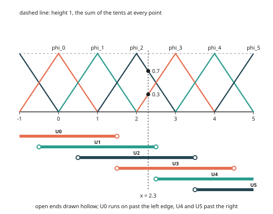
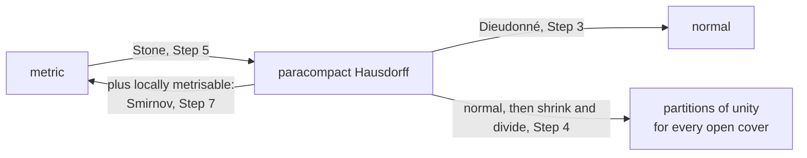

# Paracompactness: every cover can be thinned to one that is locally finite, and partitions of unity follow

[Syllabus](../../../SYLLABUS.md) → [Topology](../README.md) → [Topological Spaces](../README.md#s02) → Paracompactness

---

## General Overview

A road has survey markers every kilometre, at 0 to 5 km. Six crews each measured the height of the road at their own marker: 120, 128, 135, 150, 146 and 140 m. Each crew is trusted only within 1.5 km of its marker. The task is one height profile for the whole road.

The recipe gives each crew a weight that depends on the place. At 2.3 km, crew 2 gets weight 0.7 and crew 3 gets weight 0.3. The blended height is 0.7 × 135 + 0.3 × 150 = 139.5 m. The weights are **tents**: each is 1 at its own marker, falls in a straight line to 0 one kilometre away, and stays 0 beyond.

Three things make the recipe work. The weights add to exactly 1 everywhere, so a height all crews agree on comes back unchanged. Each weight is zero outside a closed piece of its crew's stretch. And near any point only a few weights are nonzero. Such a family of weights is a **partition of unity**.

The last property needs the stretches to be **locally finite**: near any point, only finitely many of them. Here each point lies in two or three. **Paracompactness** promises that every cover by open sets can be thinned to a locally finite one. Partitions of unity follow, and with them a test for when a space has a distance.

**A space is paracompact when every open cover can be refined to one that is locally finite; in a paracompact Hausdorff space every open cover carries a partition of unity, and the Nagata–Smirnov and Smirnov theorems say exactly which spaces are metrisable.**

**What kind of fact this is:** definitions and theorems. Proved in Why it works: the line is paracompact, paracompact Hausdorff implies normal, partitions of unity exist (the shrinking step for countable covers only), and the long line is not paracompact. Stated with key steps and sources: Stone's, Nagata–Smirnov's and Smirnov's theorems. The code checks finitely many points, which illustrates and does not prove.

### The picture: tents over the trusted stretches

<p align="center"></p>

Drawn to scale. Each bar is one crew's stretch, 1.5 km either side of its marker, open ends hollow. At 2.3 km the vertical line crosses U1, U2 and U3 and meets two tents.

---

## The formula

Notation first, in words. $`X`$ is a topological space: a set with a chosen family of **open sets** ([Topological space](01-topological-spaces-and-bases.md)).

- An **open cover** $`\mathcal{U} = \{U_i\}`$ is a family of open sets, one for each label $`i`$, whose union is all of $`X`$.
- A **refinement** of $`\mathcal{U}`$ is another open cover $`\mathcal{V}`$ in which every set lies inside some set of $`\mathcal{U}`$.
- A family of sets is **locally finite** when every point has an open set around it that meets only finitely many sets of the family.
- $`X`$ is **paracompact** when it is Hausdorff (any two points sit in disjoint open sets) and every open cover has a locally finite refinement. Some books leave out Hausdorff; this card includes it.
- The **support** of a function $`\varphi`$, written $`\mathrm{supp}\,\varphi`$, is the closure of the set where $`\varphi`$ is not 0 ([Closure, interior and boundary](02-closure-interior-and-boundary.md)).

A **partition of unity subordinate to** $`\mathcal{U}`$ is a family of continuous functions $`\varphi_i`$, one for each set of the cover, with

```math
\varphi_i : X \to [0, 1], \qquad \mathrm{supp}\,\varphi_i \subseteq U_i, \qquad \{\mathrm{supp}\,\varphi_i\} \text{ locally finite}, \qquad \sum_i \varphi_i(x) = 1 \text{ for every } x \text{ in } X .
```

**Read it aloud:** each weight lies between 0 and 1, lives inside its own open set, only finitely many are alive near any point, and at every point they add to 1.

On the road, $`U_n = (n - 1.5,\, n + 1.5)`$ and the tents are

```math
\varphi_n(x) = \max\bigl(0,\; 1 - \lvert x - n \rvert\bigr), \qquad \text{glued height } G(x) = \sum_n \varphi_n(x)\, h_n .
```

**Read it aloud:** the $`n`$-th weight is one minus the distance to marker $`n`$, cut off at zero, and the glued height adds each crew's height times its weight.

At $`x = 2.3`$: $`\varphi_2 = 0.7`$, $`\varphi_3 = 0.3`$, and $`G = 139.5`$ m.

The general recipe divides dials by their total. Urysohn's dials (continuous functions into $`[0, 1]`$, from [Urysohn and Tietze](10-urysohn-tietze-and-metrisation.md)) give $`\psi_i`$, each 1 on a shrunk set and 0 outside a slightly bigger one. Then

```math
\varphi_i(x) = \frac{\psi_i(x)}{\Psi(x)}, \qquad \Psi(x) = \sum_i \psi_i(x) \ge 1 .
```

**Read it aloud:** each weight is its dial's reading divided by the total of all the dials at that point.

**The metrisation theorems.** A space is **metrisable** when some distance gives exactly its open sets. A family is **σ-locally finite** (read "sigma locally finite") when it is the union of countably many locally finite families $`\mathcal{B}_1, \mathcal{B}_2, \ldots`$, called **layers**. A space is **locally metrisable** when every point lies in an open set that is metrisable on its own.

- **Stone (1948):** every metric space is paracompact.
- **Nagata–Smirnov (1950–51):** $`X`$ is metrisable exactly when it is regular (a point and a closed set that misses it sit in disjoint open sets), its points are closed, and it has a σ-locally finite basis (a family of open sets whose unions give every open set).
- **Smirnov:** $`X`$ is metrisable exactly when it is paracompact Hausdorff and locally metrisable.

Urysohn's metrisation theorem is the special case with a countable basis: each layer holds one basic set.

| Symbol | Plain meaning | In our example | Push it up and the answer… |
| --- | --- | --- | --- |
| $`X`$; $`x`$, $`y`$, $`p`$ | the space; points | the line, in km; $`x = 2.3`$ | — |
| $`\mathcal{U} = \{U_i\}`$; $`i`$ | an open cover; a label | $`U_n = (n - 1.5, n + 1.5)`$ | wider sets: more overlap |
| $`\mathcal{V}`$, $`V_k`$; $`W_k`$, $`Y_k`$, $`\overline{W}`$; $`k`$, $`k_0`$, $`K`$ | a cover to thin; a refinement or shrinking, bar for closure; counts | $`V_k = (-k, k)`$; $`W_k`$: $`k - 2 < \lvert x \rvert < k + 1`$ | — |
| $`\varphi_i`$, $`\varphi_n`$ | the weights | $`\varphi_2(2.3) = 0.7`$ | — |
| $`\psi_i`$, $`\Psi`$ | dials before dividing; their total | $`\psi_3(2.3) = 5/6`$, $`\Psi = 11/6`$ | — |
| $`\mathrm{supp}\,\varphi`$ | support: closure of where $`\varphi \ne 0`$ | $`[n - 1, n + 1]`$ | — |
| $`n`$, $`h_n`$, $`G`$ | a marker, or a counting number in Steps 5–6; its height in m; the glued height | $`h_2 = 135`$, $`G(2.3) = 139.5`$ | — |
| $`C`$, $`D`$; $`c`$; $`O`$ | disjoint closed sets; a point of $`C`$; an open set holding $`C`$ | in the proofs | — |
| $`\mathcal{B}_j`$; $`j`$, $`m`$ | layer $`j`$ of a basis; whole numbers | $`((m - 1)/2^j, (m + 1)/2^j)`$ | larger $`j`$: finer intervals |
| $`r`$ | a ball's radius | 0.1 | smaller $`r`$: a deeper layer |
| $`\omega_1`$, $`\alpha`$, $`L`$ | first uncountable well-ordered set; an element; the long ray | — | — |

### When it holds

- **The cover must be locally finite, not just a cover.** The cover of the line by $`V_k = (-k, k)`$ puts the point 0 in every set: 10 of the first 10, 100 of the first 100, 1000 of the first 1000. Dials that read 1 near 0 add to infinity there, and nothing can be divided by the total.
- **The support, a closed set, must sit inside the open set.** With the cover $`(n - 1, n + 1)`$ the tent $`\varphi_2`$ has support $`[1, 3]`$. Its ends 1 and 3 lie outside $`(1, 3)`$, so the tents are not subordinate to that cover.
- **Hausdorff is needed.** The line with a doubled origin ([Hausdorff and its ladder](05-separation-axioms-and-hausdorff.md)) is made of two open copies of the line, so it is locally metrisable. It is not Hausdorff, so no distance fits it.
- **Locally like the line is not enough.** The long line is Hausdorff and looks like the line near every point, but it is not paracompact (Step 7), so it has no distance.
- **Paracompact alone is not enough.** The Stone–Čech compactification of the counting numbers is compact Hausdorff, so paracompact, yet has no distance (Step 7).

---

## Why it works

### Step 0: divide by the total, and local finiteness makes the total safe

Take one dial for each set of a cover, 1 on a smaller piece and 0 outside the set. If the smaller pieces still cover, the total $`\Psi`$ is at least 1 everywhere. Divide each dial by $`\Psi`$ and the weights add to exactly 1.

An infinite total, or one that jumps, would spoil this. If only finitely many dials are alive near each point, then near that point $`\Psi`$ is a finite sum of continuous functions: finite and continuous. That is why the card is about locally finite covers.

### Step 1: the line is paracompact, by compact rings

Every bounded closed interval is compact ([Compactness with no distances, and Tychonoff](06-compactness-and-tychonoff.md)). Cut the line into compact rings $`C_k`$: the points with $`k - 1 \le \lvert x \rvert \le k`$, for $`k = 1, 2, 3, \ldots`$

1. Given any open cover, finitely many of its sets cover the ring $`C_k`$, by compactness.
2. Cut each of them down to the open ring $`k - 2 < \lvert x \rvert < k + 1`$. They still cover $`C_k`$.
3. All the cut sets, for every $`k`$, cover the line and refine the cover.
4. The open set $`\lvert y \rvert < k_0`$ meets only cut sets from rings $`k \le k_0 + 1`$: finitely many. So the family is locally finite.

On the cover $`V_k = (-k, k)`$ the first set holding $`C_k`$ is $`V_{k+1}`$, and the recipe returns the rings $`W_k`$: $`k - 2 < \lvert x \rvert < k + 1`$. The point 0 was in every $`V_k`$. Now each point lies in one to three of the $`W_k`$, and a window of width 1 meets at most four.

The same recipe works on the plane, the torus and every manifold with a countable basis ([Topological manifold](../03-Surfaces%20and%20Manifolds/01-topological-manifolds.md)). A compact Hausdorff space, such as the circle, needs no recipe: a finite subcover is already locally finite.

### Step 2: the closure of a locally finite union is the union of the closures

For any family, the union of the closures lies inside the closure of the union. Local finiteness gives the reverse. A point $`x`$ outside every closure has an open set meeting only finitely many of the sets. Remove the finitely many closures from it: what remains is open, holds $`x`$, and misses every set. So $`x`$ is outside the closure of the union.

This is the one tool the next step needs. It fails for the sets $`[1/k, 1]`$: each is closed, but their union $`(0, 1]`$ is not, because every open set round 0 meets infinitely many of them.

### Step 3: paracompact Hausdorff implies normal

Dieudonné, who defined paracompactness in 1944, proved that it gives normality: two disjoint closed sets lie in two disjoint open sets.

<details>
<summary>Detailed proof: paracompact Hausdorff spaces are regular, then normal</summary>

**Regular.** Let $`C`$ be closed and $`p`$ a point outside it. For each $`c`$ in $`C`$, Hausdorff gives an open $`U_c`$ round $`c`$ whose closure misses $`p`$. The sets $`U_c`$ and the outside of $`C`$ cover $`X`$. Take a locally finite refinement, and let $`O`$ be the union of its sets that meet $`C`$. Each of those meets $`C`$, so it lies in some $`U_c`$, and its closure misses $`p`$. By Step 2 the closure of $`O`$ misses $`p`$. So $`O`$ and the outside of its closure separate $`C`$ from $`p`$.

**Normal.** For disjoint closed $`C`$ and $`D`$, regularity gives each $`c`$ in $`C`$ an open $`U_c`$ whose closure misses $`D`$. The same argument, with $`D`$ for $`p`$, separates $`C`$ from $`D`$.

</details>

### Step 4: shrink the cover, then divide

A **shrinking** of an open cover $`\{V_i\}`$ is an open cover $`\{W_i\}`$ with the closure of each $`W_i`$ inside $`V_i`$. In a normal space every locally finite open cover has one.

For a countable cover the proof is a loop. At step $`i`$, the points in none of the $`W`$'s already chosen and none of the later $`V`$'s form a closed set inside $`V_i`$. Normality fits an open $`W_i`$ round it with its closure inside $`V_i`$ ([Urysohn and Tietze](10-urysohn-tietze-and-metrisation.md), Step 0). For every open cover of a paracompact Hausdorff space, Munkres §41 proves the shrinking another way: it groups a locally finite refinement by sets whose closures fit inside the cover.

Then the partition of unity follows in three moves:

1. Take a locally finite refinement $`\{V_i\}`$. Shrink it twice: $`\overline{W_i} \subseteq Y_i`$ and $`\overline{Y_i} \subseteq V_i`$, the bar marking closure.
2. Urysohn's lemma gives a dial $`\psi_i`$, 1 on $`\overline{W_i}`$ and 0 outside $`Y_i`$, so its support lies inside $`V_i`$.
3. Divide by $`\Psi = \sum_i \psi_i`$: at least 1, since the $`W_i`$ cover, and continuous by Step 0.

Adding the weights whose $`V_i`$ sit in the same original set gives one weight per original set; Step 2 keeps each support closed.

**On the road**, the code uses $`W_n = (n - 0.6,\, n + 0.6)`$ and $`Y_n = (n - 1.2,\, n + 1.2)`$: crew $`n`$'s dial is 1 within 0.6 km of its marker and falls in a straight line to 0 at 1.2 km. At 2.3 km the weights are 6/11 and 5/11, and the glued height is 141.818 m. On 801 points from −20 to 20 km, $`\Psi`$ runs from 5/3 to 2, and the weights add to exactly 1 at every one.

Partitions of unity are not unique: the tents gave 139.5 m at the same place. The tents also reproduce straight lines, $`\sum_n \varphi_n(x)\, n = x`$, which the code checks exactly at all 801 points.

### Step 5: every metric space is paracompact

Stone proved this in 1948, including for metric spaces with no countable basis, where the ring recipe has nothing to start from. The key steps: list the cover's sets in a well-order. For each $`n`$, give each point to the first set that contains it. Keep the points whose ball of radius $`3 \cdot 2^{-n}`$ fits inside their set and that no earlier $`n`$ has handled, and fatten them by $`2^{-n}`$. Pieces for different sets at one $`n`$ stay $`2^{-n}`$ apart, and Rudin's one-page proof (1969) shows all the pieces together are locally finite. This card states the theorem with those sources.

### Step 6: Nagata–Smirnov replaces "countable" by "countably many locally finite layers"

**From a distance to layers.** In a metric space, cover by all balls of radius $`1/n`$. Stone's theorem gives a locally finite refinement $`\mathcal{B}_n`$. Every set of $`\mathcal{B}_n`$ is small, at most $`2/n`$ across. So the union of $`\mathcal{B}_1, \mathcal{B}_2, \ldots`$ is a basis with countably many locally finite layers.

**From layers to a distance.** Urysohn's metrisation proof, with one dial for each basic set in each layer instead of each pair of basic sets. Local finiteness keeps every sum of dials finite and continuous. Munkres §40 gives the full proof.

On the line, layer $`j`$ holds the intervals $`((m - 1)/2^j,\, (m + 1)/2^j)`$ for every whole number $`m`$. On 961 points from −3 to 3, each point lies in at most 2 intervals of a layer, and a window of radius $`1/2^{j+1}`$ meets at most 3, for layers 0, 3 and 6. Inside the ball of radius 0.1 round 2.3 sits the layer-5 interval $`(73/32, 75/32)`$, from 2.28125 to 2.34375.

**Why the layers matter.** Take uncountably many separate copies of the line. No countable basis exists, so Urysohn's theorem says nothing. But layer $`j`$, taken in every copy at once, is still locally finite, since a point sees only its own copy. Nagata–Smirnov makes the space metric.

### Step 7: Smirnov, and the long line

**Smirnov's theorem.** If $`X`$ is paracompact Hausdorff and locally metrisable, cover it by metrisable open sets and take a locally finite refinement. Each piece carries its own distance. For each $`n`$, cover $`X`$ by all balls of radius $`1/n`$ inside the pieces, each measured in its own piece, and take a locally finite refinement $`\mathcal{B}_n`$, by paracompactness of $`X`$. A point lies in only finitely many pieces, so for large $`n`$ every set of $`\mathcal{B}_n`$ round it is small in one of those pieces' distances. So the union of the layers $`\mathcal{B}_n`$ is a basis, as in Step 6. Step 3 makes $`X`$ regular, and Nagata–Smirnov finishes. Merging each piece's own layers would not do: they can pile up at a piece's edge.

**The long line.** Call $`\omega_1`$ the first uncountable well-ordered set (an ordered set in which every nonempty part has a first element): uncountable, but every element has only countably many before it. The **long ray** $`L`$ lays a copy of $`[0, 1)`$ at each element of $`\omega_1`$, end to end. Below any point lie countably many copies, which fit together as an ordinary interval. So $`L`$ is Hausdorff, and away from its starting point it looks like the line. The **long line** glues two long rays at their starting points; it fails for the same reason as the ray.

<details>
<summary>Detailed proof: the long ray is not paracompact</summary>

One fact is used, not proved: any countable set of elements of $`\omega_1`$ has an element after all of them (Munkres §10).

**Every sequence stays below some stage.** The terms sit in countably many copies, so some $`\alpha`$ comes after all of them. The part of $`L`$ up to the start of the copy at $`\alpha`$ is a closed interval of an ordinary line, so compact, and the sequence has a convergent subsequence.

**A locally finite family of nonempty sets is finite.** Otherwise pick a point from each of infinitely many sets. A subsequence converges to some $`p`$, and every open set round $`p`$ meets infinitely many of the sets.

**So $`L`$ is not paracompact.** The sets "everything before the copy at $`\alpha`$" cover $`L`$. A locally finite refinement would be finite. Its sets lie before finitely many copies, and a copy after all of those is covered by none of them.

</details>

So the long ray is locally metrisable but not paracompact, and by Stone's theorem it has no distance. Nothing here is computed: the long ray has no finite model.

The opposite failure: the Stone–Čech compactification of the counting numbers ([Stone-Cech compactification](12-stone-cech-compactification.md)) is compact Hausdorff, so paracompact. It has 2 to the power continuum points, more than any compact metric space can hold, so it has no distance. By Smirnov's theorem it is not locally metrisable.



---

## Worked numbers, by hand

**The tents at 2.3 km.**

| Step | Arithmetic | Value |
| --- | --- | --- |
| stretches holding 2.3 | $`\lvert 2.3 - n \rvert < 1.5`$ for $`n`$ = 1, 2, 3 | 3 sets |
| $`\varphi_2`$ | $`1 - \lvert 2.3 - 2 \rvert`$ | 0.7 |
| $`\varphi_3`$ | $`1 - \lvert 2.3 - 3 \rvert`$ | 0.3 |
| $`\varphi_1`$ | $`\max(0, 1 - 1.3)`$ | 0 |
| total | $`0.7 + 0.3`$ | 1 |
| glued height | $`0.7 \times 135 + 0.3 \times 150`$ | **139.5 m** |

The road at 2.3 km is 139.5 m high, the same as a straight line from marker 2 to marker 3.

**The dials of Step 4 at 2.3 km.**

| Step | Arithmetic | Value |
| --- | --- | --- |
| $`\psi_2`$ | 2.3 is within 0.6 of 2 | 1 |
| $`\psi_3`$ | 0.7 from 3: $`(1.2 - 0.7)/(1.2 - 0.6)`$ | 5/6 |
| $`\psi_1`$ | 1.3 from 1, beyond 1.2 | 0 |
| total $`\Psi`$ | $`1 + 5/6`$ | 11/6 |
| weights | $`1 \div 11/6`$ and $`5/6 \div 11/6`$ | 6/11 and 5/11 |
| glued height | $`(6 \times 135 + 5 \times 150)/11`$, which is 1560/11 | **141.818 m** |

Both partitions are correct. They glue the same six heights into slightly different profiles.

### What breaks if you drop a piece

| Mistake | Comes out at | What went wrong |
| --- | --- | --- |
| Use the cover $`V_k = (-k, k)`$ as it is | the point 0 in 1000 of the first 1000 sets | not locally finite: dials near 0 add without end |
| Forget to divide by $`\Psi`$ | $`135 + (5/6) \times 150`$ = 260.0 m, not 141.818 m | the weights add to 11/6, not 1 |
| Tents on the cover $`(n - 1, n + 1)`$ | support $`[1, 3]`$; its ends outside $`(1, 3)`$ | the support is closed and must fit inside the open set |

The code prints all three.

---

## Code, from first principles, and it actually runs

The code works in exact fractions and takes four roads. It checks the tents at 801 points and glues the heights two ways, by tents and by a straight line. It builds a second partition by the proof's recipe and checks it adds to 1. It runs Step 1's ring recipe on the cover $`(-k, k)`$ and counts sets per point. It checks Step 6's layered basis against balls at 961 points and three radii. These are finitely many checks; the theorems rest on the proofs.

### Python

```python
# Paracompactness, partitions of unity, Nagata-Smirnov -- the check behind the card.  Standard library only.
# The line, covered by U_n = (n - 3/2, n + 3/2).  Survey heights in metres at kilometre markers 0 to 5.
from fractions import Fraction as Fr
from math import floor
half = Fr(1, 2)
grid = [Fr(j, 20) for j in range(-400, 401)]                    # x from -20 to 20 in steps of 0.05
ns = range(-25, 26)
near = lambda x: range(floor(x) - 3, floor(x) + 4)               # tents and dials vanish beyond these
inU = lambda x, n: abs(x - n) < Fr(3, 2)
tent = lambda x, n: max(Fr(0), 1 - abs(x - n))                  # zero outside [n - 1, n + 1]
inside = [sum(inU(x, n) for n in ns) for x in grid]
meets = [sum(abs(x - n) < 2 for n in ns) for x in grid]         # U_n meets (x - 1/2, x + 1/2)
print(f"cover U_n=(n-1.5,n+1.5) on {len(grid)} grid points: each point in {min(inside)} to {max(inside)} sets; "
      f"a width-1 window meets at most {max(meets)}")
assert min(inside) == 2 and max(inside) == 3 and max(meets) == 4
assert all(tent(x, n) == 0 for x in grid for n in ns if n not in near(x))
assert all(sum(tent(x, n) for n in near(x)) == 1 for x in grid)  # term-by-term sum, exact
assert all(sum(tent(x, n) * n for n in near(x)) == x for x in grid)  # tents reproduce straight lines
print(f"tents: sum exactly 1 at all {len(grid)} points; support [n-1,n+1] sits inside U_n with {half} to spare")
x = Fr(23, 10)
print(f"x=2.3: in U_n for n = {[n for n in ns if inU(x, n)]}; nonzero tents "
      + ", ".join(f"phi_{n}={tent(x, n)}" for n in ns if tent(x, n)))
assert tent(x, 2) == Fr(7, 10) and tent(x, 3) == Fr(3, 10)
h = {0: 120, 1: 128, 2: 135, 3: 150, 4: 146, 5: 140}           # heights at the markers, metres
print(f"heights at markers {min(h)} to {max(h)} km: {', '.join(str(h[n]) for n in sorted(h))} m")
glue = lambda x, w: sum(w(x, n) * h[n] for n in h)
line = h[2] + (x - 2) * (h[3] - h[2])                            # second road: straight line, markers 2 to 3
print(f"glued height at 2.3 km: tents {float(glue(x, tent)):.1f} m; straight line between markers {float(line):.1f} m")
assert glue(x, tent) == line == Fr(279, 2)
# the proof's construction: shrink to W_n=(n-3/5,n+3/5), Urysohn dial 1 on [n-3/5,n+3/5], 0 outside (n-6/5,n+6/5)
def psi(x, n):
    dA, dB = max(Fr(0), Fr(6, 5) - abs(x - n)), max(Fr(0), abs(x - n) - Fr(3, 5))
    return dA / (dA + dB)
Psi = lambda x: sum(psi(x, n) for n in near(x))
phi = lambda x, n: psi(x, n) / Psi(x)
assert all(any(abs(x - n) < Fr(3, 5) for n in ns) for x in grid)  # the shrunk sets W_n still cover
assert all(1 <= Psi(x) <= 2 and sum(phi(x, n) for n in near(x)) == 1 for x in grid)
assert all(psi(x, n) == 0 for x in grid for n in ns if abs(x - n) >= Fr(6, 5))
print(f"dial partition: Psi between {min(Psi(x) for x in grid)} and {max(Psi(x) for x in grid)}; after dividing, "
      f"sum exactly 1 at all {len(grid)} points; support [n-6/5,n+6/5] inside U_n")
print(f"dial partition at 2.3: psi_2={psi(x, 2)} psi_3={psi(x, 3)} Psi={Psi(x)} phi_2={phi(x, 2)} phi_3={phi(x, 3)}; "
      f"glued height {glue(x, phi)} = {float(glue(x, phi)):.3f} m")
assert phi(x, 2) == Fr(6, 11) and glue(x, phi) == Fr(1560, 11)
# thinning: the cover V_k = (-k, k) by the proof's ring recipe; a set is (lo, hi) meaning lo < |x| < hi
V = [(-1, k) for k in range(1, 41)]
def ring_refine(cover, K):
    out = []
    for k in range(1, K + 1):                                    # compact ring C_k: k-1 <= |x| <= k
        lo, hi = next(c for c in cover if c[0] < k - 1 and c[1] > k)   # first member holding C_k
        out.append((max(lo, k - 2), min(hi, k + 1)))             # cut down to the open ring k-2 < |x| < k+1
    return out
W = ring_refine(V, 30)
has = lambda s, x: s[0] < abs(x) < s[1]
def meets_win(s, a, b):                                         # does s meet the window (a, b)?
    m1, m2 = (Fr(-1), max(-a, b)) if a < 0 < b else (min(abs(a), abs(b)), max(abs(a), abs(b)))
    return s[0] < m2 and m1 < s[1]
inW = [sum(has(s, x) for s in W) for x in grid]
mW = [sum(meets_win(s, x - half, x + half) for s in W) for x in grid]
print(f"V_k=(-k,k): the first K sets all hold 0: " + ", ".join(f"K={K}: {sum(has((-1, k), 0) for k in range(1, K + 1))}"
      for K in (10, 100, 1000)))
print("ring refinement W_k={k-2<|x|<k+1}: " + " ".join(f"W_{k}: {lo}<|x|<{hi}" for k, (lo, hi) in enumerate(W[:3], 1))
      + f"; each point in {min(inW)} to {max(inW)} sets, a width-1 window meets at most {max(mW)}")
assert min(inW) >= 1 and max(inW) == 3 and max(mW) == 4
assert all(any(v[0] <= w[0] and w[1] <= v[1] for v in V) for w in W)   # each W_k sits inside some V
# Nagata-Smirnov layers on the line: layer j holds ((m-1)/2^j, (m+1)/2^j) for every whole m
g2 = [Fr(i, 160) for i in range(-480, 481)]
for j in (0, 3, 6):
    cnt = lambda x, t: sum(abs(2 ** j * x - m) < t for m in range(floor(2 ** j * x) - 3, floor(2 ** j * x) + 4))
    c1, c2 = max(cnt(x, 1) for x in g2), max(cnt(x, Fr(3, 2)) for x in g2)
    print(f"layer {j}: intervals of width {Fr(2, 2 ** j)}; each point in at most {c1}, a window of radius 1/{2 ** (j + 1)} meets at most {c2}")
    assert c1 == 2 and c2 == 3
def basic(x, r):                                                # a layer set holding x inside (x - r, x + r)
    j = next(j for j in range(40) if Fr(2, 2 ** j) <= r)
    m = floor(2 ** j * x) + (1 if 2 ** j * x - floor(2 ** j * x) > half else 0)
    return j, Fr(m - 1, 2 ** j), Fr(m + 1, 2 ** j)
j, a, b = basic(x, Fr(1, 10))
print(f"basis at x=2.3, r=0.1: layer {j}, interval ({a}, {b}) = ({float(a)}, {float(b)})")
assert a < x < b and x - Fr(1, 10) <= a and b <= x + Fr(1, 10)
assert all(a < z < b and z - r <= a and b <= z + r for z in g2 for r in (half, Fr(1, 10), Fr(1, 100)) for _, a, b in [basic(z, r)])
print(f"basis check: a layer set fits inside every ball tested, {len(g2)} points x 3 radii")
# what breaks
print(f"no normalising: psi_2 + psi_3 at 2.3 = {Psi(x)}, so sum psi*h = {float(glue(x, psi)):.1f} m, not {float(glue(x, phi)):.3f} m")
assert glue(x, psi) == 260
sup = [z for z in grid if tent(z, 2) > 0]                       # tent 2 is nonzero on (1, 3); its closure adds 1 and 3
ends = (sup[0] - Fr(1, 20), sup[-1] + Fr(1, 20))
print(f"open cover (n-1,n+1): support of phi_2 is [{ends[0]}, {ends[1]}]; ends inside U_2=(1,3): {[1 < e < 3 for e in ends]}")
assert ends == (1, 3) and not any(1 < e < 3 for e in ends) and all(abs(e - 2) < Fr(3, 2) for e in ends)
print("figure, bars " + " ".join(f"U_{n}=({n - Fr(3, 2)}, {n + Fr(3, 2)})" for n in sorted(h))
      + f"; tents peak at (n, 1) for n = {min(h)}..{max(h)}; at x={float(x)} dots {float(tent(x, 2))} and {float(tent(x, 3))}")
print("ALL CHECKS PASS")
```

**Ran 2026-11-24 on macOS, Python 3.14.10, standard library only. All checks passed. Output, pasted from the run:**

```
cover U_n=(n-1.5,n+1.5) on 801 grid points: each point in 2 to 3 sets; a width-1 window meets at most 4
tents: sum exactly 1 at all 801 points; support [n-1,n+1] sits inside U_n with 1/2 to spare
x=2.3: in U_n for n = [1, 2, 3]; nonzero tents phi_2=7/10, phi_3=3/10
heights at markers 0 to 5 km: 120, 128, 135, 150, 146, 140 m
glued height at 2.3 km: tents 139.5 m; straight line between markers 139.5 m
dial partition: Psi between 5/3 and 2; after dividing, sum exactly 1 at all 801 points; support [n-6/5,n+6/5] inside U_n
dial partition at 2.3: psi_2=1 psi_3=5/6 Psi=11/6 phi_2=6/11 phi_3=5/11; glued height 1560/11 = 141.818 m
V_k=(-k,k): the first K sets all hold 0: K=10: 10, K=100: 100, K=1000: 1000
ring refinement W_k={k-2<|x|<k+1}: W_1: -1<|x|<2 W_2: 0<|x|<3 W_3: 1<|x|<4; each point in 1 to 3 sets, a width-1 window meets at most 4
layer 0: intervals of width 2; each point in at most 2, a window of radius 1/2 meets at most 3
layer 3: intervals of width 1/4; each point in at most 2, a window of radius 1/16 meets at most 3
layer 6: intervals of width 1/32; each point in at most 2, a window of radius 1/128 meets at most 3
basis at x=2.3, r=0.1: layer 5, interval (73/32, 75/32) = (2.28125, 2.34375)
basis check: a layer set fits inside every ball tested, 961 points x 3 radii
no normalising: psi_2 + psi_3 at 2.3 = 11/6, so sum psi*h = 260.0 m, not 141.818 m
open cover (n-1,n+1): support of phi_2 is [1, 3]; ends inside U_2=(1,3): [False, False]
figure, bars U_0=(-3/2, 3/2) U_1=(-1/2, 5/2) U_2=(1/2, 7/2) U_3=(3/2, 9/2) U_4=(5/2, 11/2) U_5=(7/2, 13/2); tents peak at (n, 1) for n = 0..5; at x=2.3 dots 0.7 and 0.3
ALL CHECKS PASS
```

### Rust

```rust
// Paracompactness, partitions of unity, Nagata-Smirnov -- the check behind the card.  Rust std only.
// The line, covered by U_n = (n - 3/2, n + 3/2).  Survey heights in metres at kilometre markers 0 to 5.
use std::cmp::Ordering;
use std::fmt;
use std::ops::{Add, Div, Mul, Sub};
#[derive(Clone, Copy, Debug)]
struct Q { n: i64, d: i64 } // an exact fraction n/d, always in lowest terms with d > 0
fn gcd(a: i64, b: i64) -> i64 { if b == 0 { a.abs() } else { gcd(b, a % b) } }
fn q(n: i64, d: i64) -> Q { let g = gcd(n, d).max(1) * d.signum(); Q { n: n / g, d: d / g } }
fn z(n: i64) -> Q { q(n, 1) }
impl Add for Q { type Output = Q; fn add(self, o: Q) -> Q { q(self.n * o.d + o.n * self.d, self.d * o.d) } }
impl Sub for Q { type Output = Q; fn sub(self, o: Q) -> Q { q(self.n * o.d - o.n * self.d, self.d * o.d) } }
impl Mul for Q { type Output = Q; fn mul(self, o: Q) -> Q { q(self.n * o.n, self.d * o.d) } }
impl Div for Q { type Output = Q; fn div(self, o: Q) -> Q { q(self.n * o.d, self.d * o.n) } }
impl PartialEq for Q { fn eq(&self, o: &Q) -> bool { self.n * o.d == o.n * self.d } }
impl PartialOrd for Q { fn partial_cmp(&self, o: &Q) -> Option<Ordering> { (self.n * o.d).partial_cmp(&(o.n * self.d)) } }
impl fmt::Display for Q {
    fn fmt(&self, f: &mut fmt::Formatter) -> fmt::Result { if self.d == 1 { write!(f, "{}", self.n) } else { write!(f, "{}/{}", self.n, self.d) } }
}
impl Q { fn abs(self) -> Q { q(self.n.abs(), self.d) } fn floor(self) -> i64 { self.n.div_euclid(self.d) } fn f(self) -> f64 { self.n as f64 / self.d as f64 } }
fn mx(a: Q, b: Q) -> Q { if a > b { a } else { b } }
fn near(x: Q) -> std::ops::Range<i64> { x.floor() - 3..x.floor() + 4 } // tents and dials vanish beyond these
fn in_u(x: Q, n: i64) -> bool { (x - z(n)).abs() < q(3, 2) }
fn tent(x: Q, n: i64) -> Q { mx(z(0), z(1) - (x - z(n)).abs()) } // zero outside [n - 1, n + 1]
fn psi(x: Q, n: i64) -> Q { // Urysohn dial: 1 on [n-3/5, n+3/5], 0 outside (n-6/5, n+6/5)
    let (da, db) = (mx(z(0), q(6, 5) - (x - z(n)).abs()), mx(z(0), (x - z(n)).abs() - q(3, 5)));
    da / (da + db)
}
fn big_psi(x: Q) -> Q { near(x).fold(z(0), |s, n| s + psi(x, n)) }
fn phi(x: Q, n: i64) -> Q { psi(x, n) / big_psi(x) }
const H: [i64; 6] = [120, 128, 135, 150, 146, 140]; // heights at the markers, metres
fn glue(x: Q, w: fn(Q, i64) -> Q) -> Q { (0..6).fold(z(0), |s, n| s + w(x, n as i64) * z(H[n])) }
fn has(s: (i64, i64), x: Q) -> bool { z(s.0) < x.abs() && x.abs() < z(s.1) } // s = (lo, hi): lo < |x| < hi
fn meets_win(s: (i64, i64), a: Q, b: Q) -> bool { // does s meet the window (a, b)?
    let (m1, m2) = if a < z(0) && z(0) < b { (z(-1), mx(z(0) - a, b)) } else if a.abs() < b.abs() { (a.abs(), b.abs()) } else { (b.abs(), a.abs()) };
    z(s.0) < m2 && m1 < z(s.1)
}
fn ring_refine(cover: &[(i64, i64)], kk: i64) -> Vec<(i64, i64)> {
    (1..=kk).map(|k| { // compact ring C_k: k-1 <= |x| <= k; take the first member holding it, cut to k-2 < |x| < k+1
        let &(lo, hi) = cover.iter().find(|c| c.0 < k - 1 && c.1 > k).unwrap();
        (lo.max(k - 2), hi.min(k + 1))
    }).collect()
}
fn basic(x: Q, r: Q) -> (i64, Q, Q) { // a layer set holding x inside (x - r, x + r)
    let j = (0..40).find(|&j| q(2, 1 << j) <= r).unwrap();
    let t = x * z(1 << j);
    let m = t.floor() + if t - z(t.floor()) > q(1, 2) { 1 } else { 0 };
    (j, q(m - 1, 1 << j), q(m + 1, 1 << j))
}
fn main() {
    let half = q(1, 2);
    let grid: Vec<Q> = (-400..=400).map(|j| q(j, 20)).collect(); // x from -20 to 20 in steps of 0.05
    let ns = -25..26i64;
    let inside: Vec<usize> = grid.iter().map(|&x| ns.clone().filter(|&n| in_u(x, n)).count()).collect();
    let meets: Vec<usize> = grid.iter().map(|&x| ns.clone().filter(|&n| (x - z(n)).abs() < z(2)).count()).collect();
    let (imin, imax, mmax) = (*inside.iter().min().unwrap(), *inside.iter().max().unwrap(), *meets.iter().max().unwrap());
    println!("cover U_n=(n-1.5,n+1.5) on {} grid points: each point in {} to {} sets; a width-1 window meets at most {}", grid.len(), imin, imax, mmax);
    assert!(imin == 2 && imax == 3 && mmax == 4);
    assert!(grid.iter().all(|&x| ns.clone().all(|n| near(x).contains(&n) || tent(x, n) == z(0))));
    assert!(grid.iter().all(|&x| near(x).fold(z(0), |s, n| s + tent(x, n)) == z(1))); // term-by-term sum, exact
    assert!(grid.iter().all(|&x| near(x).fold(z(0), |s, n| s + tent(x, n) * z(n)) == x)); // tents reproduce straight lines
    println!("tents: sum exactly 1 at all {} points; support [n-1,n+1] sits inside U_n with {} to spare", grid.len(), half);
    let x = q(23, 10);
    let inn: Vec<String> = ns.clone().filter(|&n| in_u(x, n)).map(|n| n.to_string()).collect();
    let nz: Vec<String> = ns.clone().filter(|&n| tent(x, n) != z(0)).map(|n| format!("phi_{}={}", n, tent(x, n))).collect();
    println!("x=2.3: in U_n for n = [{}]; nonzero tents {}", inn.join(", "), nz.join(", "));
    assert!(tent(x, 2) == q(7, 10) && tent(x, 3) == q(3, 10));
    println!("heights at markers 0 to {} km: {} m", H.len() - 1, H.iter().map(|v| v.to_string()).collect::<Vec<String>>().join(", "));
    let line = z(H[2]) + (x - z(2)) * z(H[3] - H[2]); // second road: straight line, markers 2 to 3
    println!("glued height at 2.3 km: tents {:.1} m; straight line between markers {:.1} m", glue(x, tent).f(), line.f());
    assert!(glue(x, tent) == line && line == q(279, 2));
    assert!(grid.iter().all(|&x| ns.clone().any(|n| (x - z(n)).abs() < q(3, 5)))); // the shrunk sets W_n still cover
    assert!(grid.iter().all(|&x| z(1) <= big_psi(x) && big_psi(x) <= z(2) && near(x).fold(z(0), |s, n| s + phi(x, n)) == z(1)));
    assert!(grid.iter().all(|&x| ns.clone().all(|n| (x - z(n)).abs() < q(6, 5) || psi(x, n) == z(0))));
    let ps: Vec<Q> = grid.iter().map(|&x| big_psi(x)).collect();
    let pmin = ps.iter().fold(z(9), |a, &b| if b < a { b } else { a });
    let pmax = ps.iter().fold(z(0), |a, &b| mx(a, b));
    println!("dial partition: Psi between {} and {}; after dividing, sum exactly 1 at all {} points; support [n-6/5,n+6/5] inside U_n", pmin, pmax, grid.len());
    println!("dial partition at 2.3: psi_2={} psi_3={} Psi={} phi_2={} phi_3={}; glued height {} = {:.3} m",
             psi(x, 2), psi(x, 3), big_psi(x), phi(x, 2), phi(x, 3), glue(x, phi), glue(x, phi).f());
    assert!(phi(x, 2) == q(6, 11) && glue(x, phi) == q(1560, 11));
    // thinning: the cover V_k = (-k, k) by the proof's ring recipe
    let v: Vec<(i64, i64)> = (1..41).map(|k| (-1, k)).collect();
    let w = ring_refine(&v, 30);
    let in_w: Vec<usize> = grid.iter().map(|&x| w.iter().filter(|&&s| has(s, x)).count()).collect();
    let m_w: Vec<usize> = grid.iter().map(|&x| w.iter().filter(|&&s| meets_win(s, x - half, x + half)).count()).collect();
    let ks: Vec<String> = [10, 100, 1000].iter().map(|&kk| format!("K={}: {}", kk, (1..=kk).filter(|&k| has((-1, k), z(0))).count())).collect();
    println!("V_k=(-k,k): the first K sets all hold 0: {}", ks.join(", "));
    let (wmin, wmax, mwmax) = (*in_w.iter().min().unwrap(), *in_w.iter().max().unwrap(), *m_w.iter().max().unwrap());
    let w3: Vec<String> = w[..3].iter().enumerate().map(|(i, s)| format!("W_{}: {}<|x|<{}", i + 1, s.0, s.1)).collect();
    println!("ring refinement W_k={{k-2<|x|<k+1}}: {}; each point in {} to {} sets, a width-1 window meets at most {}", w3.join(" "), wmin, wmax, mwmax);
    assert!(wmin >= 1 && wmax == 3 && mwmax == 4);
    assert!(w.iter().all(|s| v.iter().any(|t| t.0 <= s.0 && s.1 <= t.1))); // each W_k sits inside some V
    // Nagata-Smirnov layers on the line: layer j holds ((m-1)/2^j, (m+1)/2^j) for every whole m
    let g2: Vec<Q> = (-480..=480).map(|i| q(i, 160)).collect();
    for j in [0u32, 3, 6] {
        let p = 1i64 << j;
        let cnt = |x: Q, t: Q| { let s = x * z(p); (s.floor() - 3..s.floor() + 4).filter(|&m| (s - z(m)).abs() < t).count() };
        let c1 = g2.iter().map(|&x| cnt(x, z(1))).max().unwrap();
        let c2 = g2.iter().map(|&x| cnt(x, q(3, 2))).max().unwrap();
        println!("layer {}: intervals of width {}; each point in at most {}, a window of radius 1/{} meets at most {}", j, q(2, p), c1, 2 * p, c2);
        assert!(c1 == 2 && c2 == 3);
    }
    let (j, a, b) = basic(x, q(1, 10));
    println!("basis at x=2.3, r=0.1: layer {}, interval ({}, {}) = ({}, {})", j, a, b, a.f(), b.f());
    assert!(a < x && x < b && x - q(1, 10) <= a && b <= x + q(1, 10));
    assert!(g2.iter().all(|&y| [half, q(1, 10), q(1, 100)].iter().all(|&r| { let (_, a, b) = basic(y, r); a < y && y < b && y - r <= a && b <= y + r })));
    println!("basis check: a layer set fits inside every ball tested, {} points x 3 radii", g2.len());
    // what breaks
    println!("no normalising: psi_2 + psi_3 at 2.3 = {}, so sum psi*h = {:.1} m, not {:.3} m", big_psi(x), glue(x, psi).f(), glue(x, phi).f());
    assert!(glue(x, psi) == z(260));
    let sup: Vec<Q> = grid.iter().cloned().filter(|&y| tent(y, 2) > z(0)).collect(); // tent 2 is nonzero on (1, 3)
    let ends = (sup[0] - q(1, 20), *sup.last().unwrap() + q(1, 20));
    let ins = |e: Q| if z(1) < e && e < z(3) { "True" } else { "False" };
    println!("open cover (n-1,n+1): support of phi_2 is [{}, {}]; ends inside U_2=(1,3): [{}, {}]", ends.0, ends.1, ins(ends.0), ins(ends.1));
    assert!(ends.0 == z(1) && ends.1 == z(3) && ins(ends.0) == "False" && ins(ends.1) == "False" && (ends.0 - z(2)).abs() < q(3, 2));
    let bars: Vec<String> = (0..H.len() as i64).map(|n| format!("U_{}=({}, {})", n, z(n) - q(3, 2), z(n) + q(3, 2))).collect();
    println!("figure, bars {}; tents peak at (n, 1) for n = 0..{}; at x={} dots {} and {}", bars.join(" "), H.len() - 1, x.f(), tent(x, 2).f(), tent(x, 3).f());
    println!("ALL CHECKS PASS");
}
```

**Ran 2026-11-24 on macOS, rustc 1.98.1, no crates. All checks passed. Output, pasted from the run:**

```
cover U_n=(n-1.5,n+1.5) on 801 grid points: each point in 2 to 3 sets; a width-1 window meets at most 4
tents: sum exactly 1 at all 801 points; support [n-1,n+1] sits inside U_n with 1/2 to spare
x=2.3: in U_n for n = [1, 2, 3]; nonzero tents phi_2=7/10, phi_3=3/10
heights at markers 0 to 5 km: 120, 128, 135, 150, 146, 140 m
glued height at 2.3 km: tents 139.5 m; straight line between markers 139.5 m
dial partition: Psi between 5/3 and 2; after dividing, sum exactly 1 at all 801 points; support [n-6/5,n+6/5] inside U_n
dial partition at 2.3: psi_2=1 psi_3=5/6 Psi=11/6 phi_2=6/11 phi_3=5/11; glued height 1560/11 = 141.818 m
V_k=(-k,k): the first K sets all hold 0: K=10: 10, K=100: 100, K=1000: 1000
ring refinement W_k={k-2<|x|<k+1}: W_1: -1<|x|<2 W_2: 0<|x|<3 W_3: 1<|x|<4; each point in 1 to 3 sets, a width-1 window meets at most 4
layer 0: intervals of width 2; each point in at most 2, a window of radius 1/2 meets at most 3
layer 3: intervals of width 1/4; each point in at most 2, a window of radius 1/16 meets at most 3
layer 6: intervals of width 1/32; each point in at most 2, a window of radius 1/128 meets at most 3
basis at x=2.3, r=0.1: layer 5, interval (73/32, 75/32) = (2.28125, 2.34375)
basis check: a layer set fits inside every ball tested, 961 points x 3 radii
no normalising: psi_2 + psi_3 at 2.3 = 11/6, so sum psi*h = 260.0 m, not 141.818 m
open cover (n-1,n+1): support of phi_2 is [1, 3]; ends inside U_2=(1,3): [False, False]
figure, bars U_0=(-3/2, 3/2) U_1=(-1/2, 5/2) U_2=(1/2, 7/2) U_3=(3/2, 9/2) U_4=(5/2, 11/2) U_5=(7/2, 13/2); tents peak at (n, 1) for n = 0..5; at x=2.3 dots 0.7 and 0.3
ALL CHECKS PASS
```

### Lean

Lean proves three of the card's theorems for every space, and checks the road's worked numbers exactly.

- Every open cover of a paracompact Hausdorff space carries a partition of unity subordinate to it.
- A paracompact Hausdorff space is normal: two disjoint closed sets lie in two disjoint open sets.
- Every metric space is paracompact and Hausdorff, Stone's theorem.
- Take $`x = 2.3`$. Then $`\varphi_2 = 7/10`$, $`\varphi_3 = 3/10`$ and $`\varphi_1 = 0`$, and the weights add to 1.
- Take the markers −25 to 25. Then only $`U_1`$, $`U_2`$ and $`U_3`$ hold the point 2.3.
- Take $`x = 2.3`$. Then the tents glue the heights to 139.5 m, the same as the straight line from marker 2 to 3.
- Take Step 4's dials at 2.3 km. Then $`\psi_3 = 5/6`$, $`\Psi = 11/6`$, and the weights are 6/11 and 5/11.
- Take those weights at 2.3 km. Then the glued height is 1560/11 m, and the dials without dividing give 260 m.
- Take the ball of radius 0.1 round 2.3. Then the layer-5 interval $`(73/32, 75/32)`$ holds 2.3 and lies inside the ball.

The ring recipe and Step 6's layers are left to the Python and Rust checks; Nagata–Smirnov and Smirnov rest on their sources.

```lean
-- Paracompactness: every open cover of a paracompact Hausdorff space carries a partition of unity, such a space is normal, and every metric space is paracompact Hausdorff.
import Mathlib.Topology.Compactness.Paracompact
import Mathlib.Topology.EMetricSpace.Paracompact
import Mathlib.Topology.PartitionOfUnity
import Mathlib.Topology.MetricSpace.Basic
import Mathlib.Tactic.NormNum

open Set

/-- In a paracompact Hausdorff space every open cover `{U i}` carries a partition of unity
subordinate to it: continuous weights `φ i : X → [0, 1]`, the support of each inside `U i`,
the supports locally finite, and at every point the weights add to exactly 1. -/
theorem paracompact_hausdorff_exists_partition_of_unity
    {X : Type*} [TopologicalSpace X] [ParacompactSpace X] [T2Space X]
    {ι : Type*} (U : ι → Set X) (hU : ∀ i, IsOpen (U i)) (hcover : ⋃ i, U i = univ) :
    ∃ φ : ι → C(X, ℝ),
      (∀ i x, φ i x ∈ Icc (0 : ℝ) 1) ∧
      (∀ i, tsupport (φ i) ⊆ U i) ∧
      LocallyFinite (fun i => tsupport (φ i)) ∧
      (∀ x, ∑ᶠ i, φ i x = 1) := by
  obtain ⟨f, hf⟩ := PartitionOfUnity.exists_isSubordinate isClosed_univ U hU (by rw [hcover])
  refine ⟨fun i => f i, fun i x => ⟨f.nonneg i x, f.le_one i x⟩, hf, f.locallyFinite_tsupport,
    fun x => f.sum_eq_one (mem_univ x)⟩

/-- Dieudonné: a paracompact Hausdorff space is normal, so any two disjoint closed sets
lie in two disjoint open sets. -/
theorem paracompact_hausdorff_is_normal
    {X : Type*} [TopologicalSpace X] [ParacompactSpace X] [T2Space X] :
    NormalSpace X := by
  infer_instance

/-- Stone (1948): every metric space is paracompact (and Hausdorff, as this card's
definition of paracompact requires). -/
theorem metric_space_is_paracompact {X : Type*} [MetricSpace X] :
    ParacompactSpace X ∧ T2Space X := by
  exact ⟨inferInstance, inferInstance⟩

-- The tents at 2.3 km: phi_2 = 7/10, phi_3 = 3/10, phi_1 = 0, and they add to 1.
example : max (0 : ℚ) (1 - |23/10 - 2|) = 7/10 := by norm_num [abs_of_pos]
example : max (0 : ℚ) (1 - |23/10 - 3|) = 3/10 := by norm_num [abs_of_neg]
example : max (0 : ℚ) (1 - |23/10 - 1|) = 0 := by norm_num [abs_of_pos]
example : (7/10 : ℚ) + 3/10 = 1 := by norm_num
-- The point 2.3 lies in the stretches U_n = (n - 3/2, n + 3/2) exactly for n = 1, 2, 3
-- (scaled by 10 to whole numbers: |23 - 10 n| < 15), checked over the markers -25 to 25.
example : ((Finset.Icc (-25 : ℤ) 25).filter
    (fun n : ℤ => |23 - 10 * n| < 15)) = {1, 2, 3} := by decide
-- The glued height by tents: 7/10 * 135 + 3/10 * 150 = 279/2 m (139.5 m), the straight line from marker 2 to 3.
example : (7/10 : ℚ) * 135 + 3/10 * 150 = 279/2 := by norm_num
example : (135 : ℚ) + (23/10 - 2) * (150 - 135) = 279/2 := by norm_num
-- The dials of Step 4 at 2.3 km: psi_3 = 5/6, Psi = 11/6, weights 6/11 and 5/11, glued height 1560/11 m.
example : ((6/5 : ℚ) - 7/10) / (6/5 - 3/5) = 5/6 := by norm_num
example : (1 : ℚ) + 5/6 = 11/6 := by norm_num
example : (1 : ℚ) / (11/6) = 6/11 ∧ (5/6 : ℚ) / (11/6) = 5/11 := by norm_num
example : (6/11 : ℚ) * 135 + 5/11 * 150 = 1560/11 := by norm_num
-- Forgetting to divide: 135 + (5/6) * 150 = 260 m.
example : (135 : ℚ) + 5/6 * 150 = 260 := by norm_num
-- The Nagata-Smirnov layer-5 interval (73/32, 75/32) lies inside the ball of radius 1/10 round 23/10.
example : (23/10 : ℚ) - 1/10 ≤ 73/32 ∧ (73/32 : ℚ) < 23/10 ∧ (23/10 : ℚ) < 75/32 ∧
    (75/32 : ℚ) ≤ 23/10 + 1/10 := by norm_num

#print axioms paracompact_hausdorff_exists_partition_of_unity
#print axioms paracompact_hausdorff_is_normal
#print axioms metric_space_is_paracompact
```

**Checked 2026-11-24 on macOS, Lean 4.36.0-rc2, Mathlib v4.36.0-rc2. Every proof is complete and uses only Lean's standard axioms. Output, pasted from the run:**

```
'paracompact_hausdorff_exists_partition_of_unity' depends on axioms: [propext, Classical.choice, Quot.sound]
'paracompact_hausdorff_is_normal' depends on axioms: [propext, Classical.choice, Quot.sound]
'metric_space_is_paracompact' depends on axioms: [propext, Classical.choice, Quot.sound]
```

> [!TIP]
> **Try changing**
> Guess first, then run it.
> - **Move the point.** Change `x = Fr(23, 10)` to `x = Fr(5, 2)`. Guess first: which tents are alive at 2.5 km? Two, each 1/2, and only $`U_2`$ and $`U_3`$ hold the point; the line still carries the label 2.3. Then the assert on 7/10 stops the run.
> - **Widen the tents.** In `tent`, change `1 - abs(x - n)` to `1 - abs(x - n) / 2`. Guess first: do the weights still add to 1? No: every point now sits under two layers of tent, the total is 2 everywhere, and the exact-sum assert stops the run.
> - **Cut the rings looser.** In `ring_refine`, change `k - 2` to `k - 3`. Guess first: is the refinement still locally finite? Yes, but points now lie in 2 to 4 sets and a window meets up to 5, so the assert on 3 stops the run.

---

## The usual mistake

> [!warning]
> **Thinking that each point lying in finitely many sets is enough.** Local finiteness asks for an open set round each point that meets finitely many. Bumps sitting on the intervals from $`1/(k+1)`$ to $`1/k`$ touch each point at most once, yet every open set round 0 meets infinitely many. Their sum is 0 at 0 and 1 at points arbitrarily close to 0, so it jumps, and dividing by it fails.
>
> - **Forgetting to divide.** Adding the dials without dividing gives 260.0 m at 2.3 km, not 141.818 m.
> - **Fitting the nonzero set, not the support.** A tent on $`(1, 3)`$ is nonzero only inside it, but its support $`[1, 3]`$ is not.
> - **"Looks like the line everywhere, so it has a distance."** The long ray does, and has none, because it is not paracompact.

---

## Where you meet it in real life

- **Finite element software.** Codes for stress and heat use these tents, called hat functions. They add to 1 and reproduce straight lines, so a linear field is represented with no error.
- **Curve design.** B-spline basis functions in drawing and manufacturing software form a partition of unity. Moving every control point by the same amount moves the whole curve by that amount.
- **Geometry on curved spaces.** Lengths and integrals on a manifold are defined in local charts, then glued with a partition of unity. Paracompactness guarantees the glue exists.

> **Say it back**
> A cover is locally finite when each point has an open set round it meeting finitely many of its sets. A space is paracompact when it is Hausdorff and every open cover can be cut down to a locally finite one. Then it is normal, and Urysohn dials divided by their total give weights that add to 1 inside the cover's sets. Every metric space is paracompact, and a paracompact Hausdorff space that is locally metric is metric. The long ray looks like the line everywhere but is not paracompact, so it has no distance.

---

## What this builds on

- [Urysohn and Tietze](10-urysohn-tietze-and-metrisation.md): the dials that become the weights, and Urysohn's metrisation theorem, which Nagata–Smirnov extends.
- [Compactness with no distances, and Tychonoff](06-compactness-and-tychonoff.md): finite subcovers, which make compact rings and compact Hausdorff spaces paracompact.
- [Hausdorff and its ladder](05-separation-axioms-and-hausdorff.md): Hausdorff, regular and normal, and the doubled origin.
- [Stone-Cech compactification](12-stone-cech-compactification.md): a compact Hausdorff space, so paracompact, that has no distance.

## Where this goes next

- [Topological manifold](../03-Surfaces%20and%20Manifolds/01-topological-manifolds.md): spaces with a countable basis that look locally like flat space, paracompact by the ring recipe of Step 1.
- [Partition of unity](../../23-Differential%20geometry%20and%20Lie%20groups/03-Manifolds/09-partitions-of-unity-and-whitney-embedding.md): the same gluing with smooth weights on a manifold, used to build lengths and integrals.

Paracompactness gives partitions of unity for every open cover, but not weights with a chosen smoothness or a chosen shape: when those exist is the question this card leaves open.

---

## Sources

Verified 2026-11-24: every link below resolves to the publisher's page.

- Munkres, James R. *Topology*, Classic Version, 2nd ed. Pearson. [Publisher page](https://www.pearson.com/en-us/subject-catalog/p/topology-classic-version/P200000006299/9780137848669). Local finiteness, the Nagata–Smirnov theorem, paracompactness with Stone's theorem and partitions of unity, and Smirnov's theorem, in §39–§42.
- Stone, A. H. "Paracompactness and product spaces." *Bulletin of the American Mathematical Society* 54 (1948): 977–982. [doi:10.1090/S0002-9904-1948-09118-2](https://doi.org/10.1090/S0002-9904-1948-09118-2). The proof that every metric space is paracompact.
- Rudin, Mary Ellen. "A new proof that metric spaces are paracompact." *Proceedings of the American Mathematical Society* 20 (1969): 603. [doi:10.1090/S0002-9939-1969-0236876-3](https://doi.org/10.1090/S0002-9939-1969-0236876-3). The one-page proof outlined in Step 5.
- Lee, John M. *Introduction to Topological Manifolds*, 2nd ed. Springer, 2011. [doi:10.1007/978-1-4419-7940-7](https://doi.org/10.1007/978-1-4419-7940-7). Paracompactness and partitions of unity on manifolds, in chapter 4.
