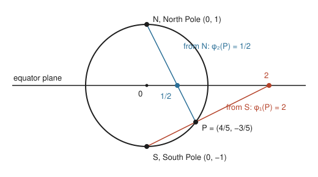

# Topological manifold: a space that looks like ordinary flat space up close

[Syllabus](../../../SYLLABUS.md) → [Topology](../README.md) → [Surfaces and Manifolds](../README.md#s03) → Topological manifold

---

## General Overview

A world atlas is a book of flat pages. Each page shows one region of the round Earth, and neighbouring pages overlap, so a city near the edge of one page also appears on the next. A sailor who crosses from one page to the next looks up the same harbour on both and carries on.

No single flat page can show the whole globe without a tear. Every flat world map cuts the Earth somewhere, often along a meridian (a north-south line of longitude), and puts two sides of the cut far apart on the paper. Two pages are enough, though. One map centred on the North Pole shows everything except the South Pole. A second, centred on the South Pole, shows everything except the North Pole. London sits 2224.4 km from the centre of the first map and 18247.5 km from the centre of the second.

A **topological manifold** is any space that can be covered by such pages. Each page is a **chart**: a two-way, tear-free match between a region of the space and a region of flat space. The set of pages is an **atlas**. Where two pages overlap, a **transition map** converts one page's coordinates into the other's. The idea also covers spaces with an edge, such as the Arctic cap with its rim on the Arctic Circle: near the rim, a page looks like a flat half-plane.

**A topological manifold is a space in which every point has a neighbourhood that matches a piece of flat space, with no tearing or gluing either way, and which also passes two background tests: separate points have separate neighbourhoods, and a countable list of open sets builds all the others.**

**What kind of fact this is:** a definition, plus theorems proved on this card in Why it works: the two polar maps are charts, their transition map is $`R^2 u / |u|^2`$, and no single chart covers a sphere. One theorem, that an edge point is never also an inside point, is stated with its source and not proved here.

<p align="center"></p>

The figure is drawn to scale, on a globe of radius 1. It shows a slice through both poles. Each chart sends a point to where the line from one pole through it meets the equator plane. The point $`P = (4/5, -3/5)`$ lands at 1/2 seen from the North Pole and at 2 seen from the South Pole, and $`2 = 1 / (1/2)`$: that reciprocal is the transition map. A map is named by the pole at its centre, so the line from the North Pole gives the south map $`\varphi_2`$, and the line from the South Pole gives the north map $`\varphi_1`$.

---

## The formula

Notation first, in words. A **homeomorphism** is a map that is one-to-one, onto, and continuous both ways, so it neither tears nor glues ([Continuity by pre-images, and homeomorphism](../02-Topological%20Spaces/03-continuity-and-homeomorphism.md)). $`\mathbb{R}^n`$ is flat space with $`n`$ coordinates. A space is **Hausdorff** when any two different points sit in two open sets that do not overlap. It is **second countable** when it has a basis (a family of open sets whose unions give every open set) with a countable list of members.

A space $`M`$ is a **topological $`n`$-manifold** when it is Hausdorff and second countable and every point passes this test:

```math
p \in M \;\Rightarrow\; \text{there are an open } U \ni p \text{ and a homeomorphism } \varphi : U \to \varphi(U), \text{ with } \varphi(U) \text{ open in } \mathbb{R}^n
```

**Read it aloud:** round every point there is an open patch that a chart matches, both ways continuously, with an open region of flat $`n`$-space.

The pair $`(U, \varphi)`$ is a **chart**, and a family of charts whose patches cover $`M`$ is an **atlas**. The sphere $`S^2`$ is the surface of a ball in three dimensions; the circle $`S^1`$ is its one-dimensional cousin. For the Earth as a sphere of radius $`R`$ with its centre at the origin, the two polar maps are

```math
\varphi_1(x, y, z) = \frac{R\,(x, y)}{R + z}, \qquad \varphi_2(x, y, z) = \frac{R\,(x, y)}{R - z}, \qquad \varphi_2 \circ \varphi_1^{-1}(u) = \frac{R^2\, u}{|u|^2}
```

**Read it aloud:** the north map scales the point's two equator-plane coordinates $`(x, y)`$ by $`R`$ over $`R`$ plus its height $`z`$; the south map does the same with $`R`$ minus its height; and to pass from the north map to the south map, keep the direction of $`u`$ and replace its distance $`|u|`$ by $`R^2`$ over that distance.

The north map $`\varphi_1`$ puts the North Pole at the centre and misses the South Pole, where $`R + z = 0`$. The south map $`\varphi_2`$ does the opposite. Both are **stereographic projections**, already met as the first step of Mercator's chart on [Conformal maps](../../07-Complex%20analysis/07-Conformal%20Maps%20and%20Harmonic%20Functions/01-conformal-maps.md). Here only their continuity matters, never their angles or derivatives.

A space with an edge uses the **half-space** $`\mathbb{H}^n`$: the points of $`\mathbb{R}^n`$ whose last coordinate is 0 or more. A **manifold with boundary** allows charts onto open pieces of $`\mathbb{H}^n`$. Its **boundary** $`\partial M`$ is the set of points that a chart sends to the flat edge, where the last coordinate is 0.

| Symbol | Plain meaning | In our example | Push it up and the answer… |
| --- | --- | --- | --- |
| $`M`$ | the space being tested | the Earth's surface | — |
| $`n`$ | the dimension: how many coordinates a chart gives | 2 for the Earth, 1 for a circle | more coordinates per page |
| $`p`$ | one point of $`M`$ | London | — |
| $`U`$ | an open patch of $`M`$: a chart's domain | the globe minus the South Pole | bigger patch, fewer pages needed |
| $`\varphi`$, $`\varphi_1`$, $`\varphi_2`$ | charts: tear-free two-way matches with flat space | the north map and the south map | — |
| $`\mathbb{R}^n`$, $`\mathbb{H}^n`$ | flat space; the half of it where the last coordinate is 0 or more | the plane of the equator; the Arctic cap's pages | — |
| $`S^1`$, $`S^2`$ | the circle and the sphere | a meridian slice; the globe | — |
| $`R`$ | the Earth's radius | 6371 km | every chart distance grows in proportion |
| $`(x, y, z)`$ | a point in space, $`z`$ its height above the equator plane | London at (3965.4, −8.8, 4986.5) km | higher $`z`$: nearer the north map's centre |
| $`u`$, $`\lvert u \rvert`$ | a point on a chart, and its distance from the chart's centre | London on the north map, 2224.4 km out | further out on one map, nearer the centre on the other |
| $`\varphi_2 \circ \varphi_1^{-1}`$ | the transition map: north-map position to south-map position | 2224.4 km becomes 18247.5 km | — |
| $`\partial M`$ | the boundary: points a chart sends to the flat edge | the Arctic Circle, for the Arctic cap | — |

### When it holds

- **Every point needs a chart, including the awkward ones.** Two globes touching at their North Poles match flat space everywhere except at the touching point. That one point fails, so the whole space fails.
- **A chart must be continuous both ways.** Angle on $`[0, 2\pi)`$ wraps an interval once round the circle, with no gaps and no overlaps. Its inverse jumps at the start: two points 0.002 apart on the circle land 6.281185 apart on the page.
- **Hausdorff is needed on top of the charts.** The line with two origins (a line whose 0 is doubled, described in Step 5) has a chart round every point, yet a sequence there has two limits.
- **The chart's image must be open in $`\mathbb{R}^n`$, or in $`\mathbb{H}^n`$ for an edge.** A rim point of the Arctic cap has no open disc round it in the cap. Only a half-disc fits, so it needs the half-space.

---

## Why it works

### Step 0: a manifold is checked one point at a time

Apart from the two background tests, the definition is local. To show a space is a manifold, cover it with charts that are homeomorphisms onto open sets. To show it is not, find one point where no chart can exist, usually by counting the pieces a small neighbourhood falls into once that point is removed.

### Step 1: each polar map is a chart

Work on the globe of radius 1; scaling by $`R`$ changes nothing. The south map $`\varphi_2`$ sends $`(x, y, z)`$ to $`(x, y) / (1 - z)`$. It is continuous wherever $`z \ne 1`$, which is everywhere but the North Pole.

Its inverse has a formula. A flat point $`u`$ goes back to the globe at

```math
\varphi_2^{-1}(u) = \frac{(2u,\ |u|^2 - 1)}{|u|^2 + 1}
```

The denominator is never 0, so the inverse is continuous on the whole plane. Both directions are continuous, so $`\varphi_2`$ is a homeomorphism from the globe minus the North Pole onto all of $`\mathbb{R}^2`$, which is open. The north map is the same with $`z`$ replaced by $`-z`$.

<details>
<summary>Detailed proof: the inverse formula lands on the globe and undoes the chart</summary>

Write $`s = |u|^2`$. The proposed point is $`p = (2u, s - 1) / (s + 1)`$.

On the globe: its squared length is $`(4s + (s - 1)^2) / (s + 1)^2`$. The top is $`s^2 + 2s + 1 = (s + 1)^2`$, so the length is 1.

Undoes the chart: the height of $`p`$ is $`z = (s - 1)/(s + 1)`$, so $`1 - z = 2/(s + 1)`$. The chart divides the first part, $`2u/(s + 1)`$, by that, and gets back $`u`$.

The chart is one-to-one because the line from the North Pole through a globe point meets the globe only once more. It is onto because every flat point lifts, by the formula.

</details>

### Step 2: the transition map is $`R^2 u / |u|^2`$

The two charts overlap on the globe minus both poles. The north map sends that overlap onto the plane minus its centre point.

For a point on the overlap, the north map gives $`u = R(x, y)/(R + z)`$. Since $`x^2 + y^2 = R^2 - z^2 = (R - z)(R + z)`$,

```math
|u|^2 = \frac{R^2 (R - z)}{R + z}, \qquad \frac{R^2\, u}{|u|^2} = \frac{R\,(x, y)}{R - z} = \varphi_2(x, y, z)
```

This map is continuous wherever $`u \ne 0`$. Applied twice it gives back $`u`$, so it is its own inverse. Every transition map is a homeomorphism for a simpler reason as well: it is one chart's inverse followed by another chart, and a composite of homeomorphisms is one.

London checks it: $`6371^2 / 2224.4`$ gives the south map's 18247.5 km.

### Step 3: the circle uses the same two charts, one dimension down

On the unit circle, with poles $`(0, 1)`$ and $`(0, -1)`$, the charts are $`x/(1 - y)`$ and $`x/(1 + y)`$. Each misses one pole and matches the rest of the circle with the whole line $`\mathbb{R}`$. The transition map is $`u \mapsto 1/u`$ on the line minus 0.

That overlap has two pieces, the right-hand and left-hand arcs; on the sphere it is one piece. The proof works either way.

The code lifts 24 rational points of the line to the circle and 168 rational points of the plane to the sphere, in exact fractions. Each lands exactly on the circle or the sphere, the chart takes it back, and the other chart agrees with $`u / |u|^2`$. That is a check on 24 and 168 cases; Steps 1 and 2 are the proof.

### Step 4: one chart cannot cover the sphere

The sphere is **compact**: every open cover has a finite subcover, and in $`\mathbb{R}^3`$ this is the same as closed and bounded ([Compactness three ways](../01-Metric%20Spaces/06-compactness-in-metric-spaces.md)). Suppose one chart $`\varphi`$ matched the whole sphere with an open set $`\varphi(S^2)`$ in the plane.

1. A continuous image of a compact set is compact, so $`\varphi(S^2)`$ is closed and bounded.
2. $`\varphi(S^2)`$ is open, closed and not empty. The plane is in one piece, so the only such set is the whole plane.
3. The whole plane is not bounded. That contradicts step 1.

So every atlas of the sphere has at least two charts, and the two polar maps reach that minimum. The same argument works for the circle and for every compact manifold of dimension 1 or more.

### Step 5: the two background tests

The globe sits inside $`\mathbb{R}^3`$, a metric space, so it inherits both tests. Two different points sit in balls of radius half their distance, and those balls do not overlap: Hausdorff. Balls with rational centres and rational radii form a countable basis: second countable.

Without Hausdorff, odd spaces slip in. Take the real line and add a second copy of 0, called origin B. A neighbourhood of either origin is that origin plus the nonzero points near 0. Every point has a chart onto an open interval. But the sequence $`1/k`$ comes within 0.001 of origin A at $`k = 1000`$, and within the same 0.001 of origin B. It has two limits, so no two neighbourhoods of A and B can be kept apart.

Without second countability, a space can be too long for countably many charts: the long line, built in Lee's book (Sources).

### Step 6: spaces with an edge

The Arctic cap is every point at latitude 66.56° N or more, its rim included. On the north map it fills a closed disc of radius 1321.7 km.

An inside point, such as the North Pole, has an open disc round it inside the cap. A rim point does not: any disc round it pokes past the Arctic Circle. It has a half-disc instead. A chart for it uses longitude and degrees north of the Arctic Circle. The rim goes to the flat edge, where the second coordinate is 0.

One question remains. Could some other, cleverer chart send a rim point to an inside point of the plane? **Invariance of domain** says no. A one-to-one continuous map from an open set of $`\mathbb{R}^n`$ into $`\mathbb{R}^n`$ has an open image. So a point with an open disc round it can never also be an edge point. Brouwer proved this in 1911 (Sources). This card states it without proof.

The boundary of a manifold with boundary is itself a manifold, one dimension lower, with no edge of its own. Restrict each half-space chart to the flat edge: it becomes a chart onto an open piece of $`\mathbb{R}^{n-1}`$. The Arctic cap's boundary is the Arctic Circle, a circle.

### Step 7: a test that a computer can run on a triangulated surface

A **triangulated surface** is built from flat triangles glued edge to edge. The globe as an **octahedron** is one: 6 corners (the two poles and four equator points at 0°, 90° E, 180° and 90° W), and 8 triangles, one in each eighth of the globe.

The triangles round a corner form a fan. The far edges of the fan make the corner's **link**. The test reads that link.

- **Link one closed loop:** the fan is a disc round the corner. The corner is an inside point.
- **Link one path:** the fan is a half-disc. The corner is an edge point.
- **Link in two or more pieces:** the corner is neither, so the surface is not a manifold there.

Each edge must also lie in exactly two triangles, or one at an edge. Three triangles on one edge make a fin, like three pages of a book, and no chart fits there.

Why two pieces rule out a chart: suppose a chart matched a neighbourhood of the corner with an open disc. Take a small disc centred on the corner's image, lying inside the image of the two fans. Its preimage is a neighbourhood of the corner that reaches into both fans. Remove the corner. The disc minus its centre is still in one piece, but the preimage now falls into two. A homeomorphism cannot change the number of pieces, so no such chart exists. A chart that sends the corner to the flat edge of a half-plane fails the same way: use a small half-disc centred there, since a half-disc minus that point on its straight edge is still in one piece.

---

## Worked numbers, by hand

London is at 51.5074° N, 0.1278° W, on a globe of radius 6371 km. On the north map its distance from the centre is $`R \tan(45° - \text{latitude}/2)`$. On the south map it is $`R \tan(45° + \text{latitude}/2)`$.

| Step | Arithmetic | Value |
| --- | --- | --- |
| half the latitude | 51.5074 / 2 | 25.7537° |
| north map angle | tan(45° − 25.7537°) = tan 19.2463° | 0.349143 |
| north map distance | 6371 × 0.349143 | 2224.4 km |
| south map angle | tan(45° + 25.7537°) = tan 70.7537° | 2.864154 |
| south map distance | 6371 × 2.864154 | 18247.5 km |
| product of the two distances | $`R^2`$ = 6371 × 6371 | 40589641 km² |
| **transition map** | 40589641 / 2224.4 | **18247.5 km** |

Both pages show London in the same direction from their centres, at very different distances. The transition map converts one into the other.

The same move on the unit circle, in exact fractions. Take $`u = 1/2`$ on the south map. Then $`|u|^2 = 1/4`$, and the inverse formula lifts it to $`(1, -3/4)/(5/4) = (4/5, -3/5)`$. Check: $`16/25 + 9/25 = 1`$, so the point is on the circle. The north map sends it to $`(4/5)/(1 - 3/5) = 2`$, which is $`1/u`$. On the sphere, $`u = (1/2, 1/2)`$ lifts to $`(2/3, 2/3, -1/3)`$, and the north map sends it to $`(1, 1) = u / |u|^2`$.

### What breaks if you drop a piece

| Mistake | Comes out at | What went wrong |
| --- | --- | --- |
| One chart for the circle by angle in $`[0, 2\pi)`$ | points 0.002000 apart on the circle are 6.281185 apart on the page | continuous one way only: the inverse tears the circle open at angle 0 |
| Two globes touching at the North Pole | 16 faces, all 24 edges in two faces, but the shared pole's link has 2 pieces of 8 edges | one point has no chart; a neighbourhood minus that point falls in two |
| Call the northern half of the octahedron a closed surface | 4 of its 8 edges lie in only one face; 4 corners have a path for a link | it has an edge: the equator is its boundary, and it needs half-space charts |
| Drop Hausdorff | the sequence 1/k is 0.100, 0.010, 0.001 from origin A and the same from origin B | charts everywhere, but a sequence has two limits |

---

## Code, from first principles, and it actually runs

The code checks the card's claims on finite cases and computes every number on it. It takes **two independent roads** to the transition map. Road 1 is the formula $`u / |u|^2`$. Road 2 lifts $`u`$ to the sphere in exact fractions and applies the other chart. For London it compares the projected coordinates with the tangent formula. It runs the vertex-link test on three triangulated surfaces, an exhaustive check of each finite surface, and prints the failing cases. The code names the unit-sphere charts by the pole each one misses: `from_top` is the south map $`\varphi_2`$, and `from_bottom`, printed as the bottom chart, is the north map $`\varphi_1`$. The doubled-origin line is an illustration, not a computed check: in each origin's chart the point $`1/k`$ sits at $`1/k`$, so one list of distances serves both origins.

### Python

```python
# Topological manifolds -- the check behind the card.  Standard library only.
# Charts for the circle and the sphere by stereographic projection, checked exactly
# with fractions; the Earth's two polar charts in km; the vertex-link test for a
# triangulated surface, with and without an edge; and the cases that fail.
from fractions import Fraction as F
from math import sin, cos, tan, radians, pi, sqrt

def lift(u):  # inverse of the chart from the top pole: a point u of R^n onto the unit sphere
    s = sum(c * c for c in u)
    return [2 * c / (s + 1) for c in u] + [(s - 1) / (s + 1)]

def from_top(p): return [c / (1 - p[-1]) for c in p[:-1]]     # chart missing the top pole
def from_bottom(p): return [c / (1 + p[-1]) for c in p[:-1]]  # chart missing the bottom pole

def invert(u):  # the transition map, by its formula: u / |u|^2
    s = sum(c * c for c in u)
    return [c / s for c in u]

def show(v): return "(" + ", ".join(str(c) for c in v) + ")"

for name, u in (("S1", [F(1, 2)]), ("S2", [F(1, 2), F(1, 2)])):
    p = lift(u)
    print(f"{name}: u = {show(u)}, |u|^2 = {sum(c * c for c in u)}, lifts to {show(p)}, |p|^2 = {sum(c * c for c in p)}, "
          f"bottom chart {show(from_bottom(p))}, u/|u|^2 = {show(invert(u))}")
for n, grid in ((1, [[F(a, 4)] for a in range(-12, 13) if a]),
                (2, [[F(a, 2), F(b, 2)] for a in range(-6, 7) for b in range(-6, 7) if a or b])):
    on = back = trans = 0
    for u in grid:  # road 1: the formula u/|u|^2; road 2: lift to the sphere, then the other chart
        p = lift(u)
        on += sum(c * c for c in p) == 1
        back += from_top(p) == u
        trans += from_bottom(p) == invert(u)
    print(f"S{n}: {len(grid)} rational points, on the sphere {on}, top chart undoes lift {back}, "
          f"bottom chart equals u/|u|^2 {trans}")
    assert on == back == trans == len(grid)

R = 6371.0  # the Earth as a sphere of radius 6371 km
def earth(lat, lon):
    a, b = radians(lat), radians(lon)
    return [R * cos(a) * cos(b), R * cos(a) * sin(b), R * sin(a)]
def north_map(p): return [R * c / (R + p[2]) for c in p[:2]]  # North Pole at 0; misses the South Pole
def south_map(p): return [R * c / (R - p[2]) for c in p[:2]]  # South Pole at 0; misses the North Pole

P = earth(51.5074, -0.1278)  # London
a, b = north_map(P), south_map(P)
ra, rb = sqrt(a[0] ** 2 + a[1] ** 2), sqrt(b[0] ** 2 + b[1] ** 2)
print(f"London 51.5074 N, 0.1278 W, in space: ({P[0]:.1f}, {P[1]:.1f}, {P[2]:.1f}) km")
print(f"half-latitude {51.5074 / 2:.4f}; tan({45 - 51.5074 / 2:.4f}) = {tan(radians(45 - 51.5074 / 2)):.6f}, "
      f"tan({45 + 51.5074 / 2:.4f}) = {tan(radians(45 + 51.5074 / 2)):.6f}")
print(f"north map: ({a[0]:.1f}, {a[1]:.1f}) km, {ra:.1f} km from the centre; "
      f"by R tan(45 - lat/2): {R * tan(radians(45 - 51.5074 / 2)):.1f}")
print(f"south map: ({b[0]:.1f}, {b[1]:.1f}) km, {rb:.1f} km from the centre; "
      f"by R tan(45 + lat/2): {R * tan(radians(45 + 51.5074 / 2)):.1f}")
t = [R * R * c / (ra * ra) for c in a]  # the transition map R^2 u / |u|^2
print(f"transition R^2 u/|u|^2 from the north map: ({t[0]:.1f}, {t[1]:.1f}) km; "
      f"product of distances {ra * rb:.0f} = R^2 {R * R:.0f}")
assert abs(t[0] - b[0]) < 1e-6 and abs(t[1] - b[1]) < 1e-6 and abs(ra * rb - R * R) < 1e-3
assert abs(ra - R * tan(radians(45 - 51.5074 / 2))) < 1e-6
r0 = R * tan(radians(45 - 66.56 / 2))
eq = north_map(earth(0, 30))
print(f"north map: equator at radius {sqrt(eq[0] ** 2 + eq[1] ** 2):.1f}, Arctic Circle (66.56 N) at {r0:.1f}")

def components(nodes, links):  # pieces of a small graph, by repeated merging
    group = {v: v for v in nodes}
    def top(v):
        while group[v] != v:
            v = group[v]
        return v
    for x, y in links:
        group[top(x)] = top(y)
    return len({top(v) for v in nodes})

def manifold_test(faces):  # every edge in 1 or 2 faces; every vertex link one cycle or one path
    count = {}
    for f in faces:
        for e in ((f[0], f[1]), (f[0], f[2]), (f[1], f[2])):
            e = tuple(sorted(e))
            count[e] = count.get(e, 0) + 1
    inner = sum(1 for c in count.values() if c == 2)
    edge = sum(1 for c in count.values() if c == 1)
    worse = sum(1 for c in count.values() if c > 2)
    kinds = {"disc": 0, "half-disc": 0, "neither": 0}
    bad = []
    for v in sorted({v for f in faces for v in f}):
        link = [tuple(x for x in f if x != v) for f in faces if v in f]
        nodes = sorted({x for e in link for x in e})
        deg = [sum(x in e for e in link) for x in nodes]
        pieces = components(nodes, link)
        if pieces == 1 and all(d == 2 for d in deg):
            kinds["disc"] += 1
        elif pieces == 1 and deg.count(1) == 2 and deg.count(2) == len(deg) - 2:
            kinds["half-disc"] += 1
        else:
            kinds["neither"] += 1
            bad.append(f"vertex {v}: link has {pieces} pieces, {len(link)} edges")
    return len(count), inner, edge, worse, kinds, bad

# The Earth as an octahedron: vertex 0 North Pole, 1 South Pole, 2..5 the equator at 0, 90E, 180, 90W.
octa = [(pole, 2 + i, 2 + (i + 1) % 4) for pole in (0, 1) for i in range(4)]
north_half = [f for f in octa if f[0] == 0]
two_globes = octa + [(0 if pole == 0 else 11, 12 + i, 12 + (i + 1) % 4) for pole in (0, 1) for i in range(4)]
for name, faces, want in (("octahedron", octa, (12, 12, 0, 0, 6, 0, 0)),
                          ("northern half", north_half, (8, 4, 4, 0, 1, 4, 0)),
                          ("two globes touching at the pole", two_globes, (24, 24, 0, 0, 10, 0, 1))):
    e, inner, edge, worse, k, bad = manifold_test(faces)
    print(f"{name}: {len(faces)} faces, {e} edges ({inner} in two faces, {edge} in one, {worse} in more); "
          f"vertices: {k['disc']} disc, {k['half-disc']} half-disc, {k['neither']} neither")
    for line in bad:
        print("  " + line)
    assert (e, inner, edge, worse, k["disc"], k["half-disc"], k["neither"]) == want

# What breaks: one chart for the whole circle by angle in [0, 2 pi); and the doubled origin.
t1, t2 = 0.001, 2 * pi - 0.001
gap = sqrt((cos(t1) - cos(t2)) ** 2 + (sin(t1) - sin(t2)) ** 2)
print(f"wrap chart: points at angles {t1} and {t2:.6f} are {gap:.6f} apart on the circle, "
      f"{t2 - t1:.6f} apart in the chart")
assert abs(gap - 2 * sin(0.001)) < 1e-12 and t2 - t1 > 6
x = [1 / k for k in (10, 100, 1000)]
print("doubled origin: 1/k for k = 10, 100, 1000 lies " + ", ".join(f"{v:.3f}" for v in x) +
      " from origin A and the same from origin B; both are limits")
p, w = lift([F(1, 2)]), from_bottom(lift([F(1, 2)]))[0]
print(f"figure, unit 100 px, centre (240,140): N (240,40) S (240,240) P ({240 + 100 * p[0]},{140 - 100 * p[1]}) "
      f"u ({240 + 100 * F(1, 2)},140) w ({240 + 100 * w},140)")
print("ALL CHECKS PASS")
```

**Ran 2026-11-14 on macOS, Python 3.14.10, standard library only. All checks passed. Output, pasted from the run:**

```
S1: u = (1/2), |u|^2 = 1/4, lifts to (4/5, -3/5), |p|^2 = 1, bottom chart (2), u/|u|^2 = (2)
S2: u = (1/2, 1/2), |u|^2 = 1/2, lifts to (2/3, 2/3, -1/3), |p|^2 = 1, bottom chart (1, 1), u/|u|^2 = (1, 1)
S1: 24 rational points, on the sphere 24, top chart undoes lift 24, bottom chart equals u/|u|^2 24
S2: 168 rational points, on the sphere 168, top chart undoes lift 168, bottom chart equals u/|u|^2 168
London 51.5074 N, 0.1278 W, in space: (3965.4, -8.8, 4986.5) km
half-latitude 25.7537; tan(19.2463) = 0.349143, tan(70.7537) = 2.864154
north map: (2224.4, -5.0) km, 2224.4 km from the centre; by R tan(45 - lat/2): 2224.4
south map: (18247.5, -40.7) km, 18247.5 km from the centre; by R tan(45 + lat/2): 18247.5
transition R^2 u/|u|^2 from the north map: (18247.5, -40.7) km; product of distances 40589641 = R^2 40589641
north map: equator at radius 6371.0, Arctic Circle (66.56 N) at 1321.7
octahedron: 8 faces, 12 edges (12 in two faces, 0 in one, 0 in more); vertices: 6 disc, 0 half-disc, 0 neither
northern half: 4 faces, 8 edges (4 in two faces, 4 in one, 0 in more); vertices: 1 disc, 4 half-disc, 0 neither
two globes touching at the pole: 16 faces, 24 edges (24 in two faces, 0 in one, 0 in more); vertices: 10 disc, 0 half-disc, 1 neither
  vertex 0: link has 2 pieces, 8 edges
wrap chart: points at angles 0.001 and 6.282185 are 0.002000 apart on the circle, 6.281185 apart in the chart
doubled origin: 1/k for k = 10, 100, 1000 lies 0.100, 0.010, 0.001 from origin A and the same from origin B; both are limits
figure, unit 100 px, centre (240,140): N (240,40) S (240,240) P (320,200) u (290,140) w (440,140)
ALL CHECKS PASS
```

### Rust

```rust
// Topological manifolds -- the check behind the card.  Rust std only.
// Charts for the circle and the sphere by stereographic projection, checked exactly
// with fractions; the Earth's two polar charts in km; the vertex-link test for a
// triangulated surface, with and without an edge; and the cases that fail.
use std::collections::{BTreeMap, BTreeSet};
use std::f64::consts::PI;

#[derive(Clone, Copy, PartialEq, Debug)]
struct Q(i128, i128); // a fraction in lowest terms, positive denominator
fn gcd(a: i128, b: i128) -> i128 { if b == 0 { a.abs() } else { gcd(b, a % b) } }
fn q(n: i128, d: i128) -> Q { let g = gcd(n, d) * d.signum(); Q(n / g, d / g) }
fn add(a: Q, b: Q) -> Q { q(a.0 * b.1 + b.0 * a.1, a.1 * b.1) }
fn mul(a: Q, b: Q) -> Q { q(a.0 * b.0, a.1 * b.1) }
fn div(a: Q, b: Q) -> Q { q(a.0 * b.1, a.1 * b.0) }
fn qs(a: Q) -> String { if a.1 == 1 { format!("{}", a.0) } else { format!("{}/{}", a.0, a.1) } }
fn show(v: &[Q]) -> String { format!("({})", v.iter().map(|&c| qs(c)).collect::<Vec<_>>().join(", ")) }
fn sq(u: &[Q]) -> Q { u.iter().fold(q(0, 1), |s, &c| add(s, mul(c, c))) }

// inverse of the chart from the top pole: a point u of R^n onto the unit sphere
fn lift(u: &[Q]) -> Vec<Q> {
    let s = sq(u);
    let mut p: Vec<Q> = u.iter().map(|&c| div(mul(q(2, 1), c), add(s, q(1, 1)))).collect();
    p.push(div(add(s, q(-1, 1)), add(s, q(1, 1))));
    p
}
fn from_top(p: &[Q]) -> Vec<Q> { let z = *p.last().unwrap(); p[..p.len() - 1].iter().map(|&c| div(c, add(q(1, 1), mul(q(-1, 1), z)))).collect() }
fn from_bottom(p: &[Q]) -> Vec<Q> { let z = *p.last().unwrap(); p[..p.len() - 1].iter().map(|&c| div(c, add(q(1, 1), z))).collect() }
fn invert(u: &[Q]) -> Vec<Q> { let s = sq(u); u.iter().map(|&c| div(c, s)).collect() } // u / |u|^2

const R: f64 = 6371.0; // the Earth as a sphere of radius 6371 km
fn earth(lat: f64, lon: f64) -> [f64; 3] {
    let (a, b) = (lat.to_radians(), lon.to_radians());
    [R * a.cos() * b.cos(), R * a.cos() * b.sin(), R * a.sin()]
}
fn north_map(p: [f64; 3]) -> [f64; 2] { [R * p[0] / (R + p[2]), R * p[1] / (R + p[2])] } // misses the South Pole
fn south_map(p: [f64; 3]) -> [f64; 2] { [R * p[0] / (R - p[2]), R * p[1] / (R - p[2])] } // misses the North Pole

fn components(nodes: &[usize], links: &[(usize, usize)]) -> usize { // pieces of a small graph
    let mut group: BTreeMap<usize, usize> = nodes.iter().map(|&v| (v, v)).collect();
    fn top(g: &BTreeMap<usize, usize>, mut v: usize) -> usize { while g[&v] != v { v = g[&v]; } v }
    for &(x, y) in links { let (a, b) = (top(&group, x), top(&group, y)); group.insert(a, b); }
    nodes.iter().map(|&v| top(&group, v)).collect::<BTreeSet<_>>().len()
}

// every edge in 1 or 2 faces; every vertex link one cycle (disc) or one path (half-disc)
fn manifold_test(faces: &[[usize; 3]]) -> (usize, usize, usize, usize, [usize; 3], Vec<String>) {
    let mut count: BTreeMap<(usize, usize), usize> = BTreeMap::new();
    for f in faces {
        for (i, j) in [(0, 1), (0, 2), (1, 2)] {
            let e = (f[i].min(f[j]), f[i].max(f[j]));
            *count.entry(e).or_insert(0) += 1;
        }
    }
    let inner = count.values().filter(|&&c| c == 2).count();
    let edge = count.values().filter(|&&c| c == 1).count();
    let worse = count.values().filter(|&&c| c > 2).count();
    let (mut kinds, mut bad) = ([0usize; 3], Vec::new());
    let verts: BTreeSet<usize> = faces.iter().flat_map(|f| f.iter().copied()).collect();
    for &v in &verts {
        let link: Vec<(usize, usize)> = faces.iter().filter(|f| f.contains(&v)).map(|f| {
            let o: Vec<usize> = f.iter().copied().filter(|&x| x != v).collect();
            (o[0], o[1])
        }).collect();
        let nodes: Vec<usize> = link.iter().flat_map(|&(a, b)| [a, b]).collect::<BTreeSet<_>>().into_iter().collect();
        let deg: Vec<usize> = nodes.iter().map(|&x| link.iter().filter(|&&(a, b)| a == x || b == x).count()).collect();
        let pieces = components(&nodes, &link);
        let ones = deg.iter().filter(|&&d| d == 1).count();
        let twos = deg.iter().filter(|&&d| d == 2).count();
        if pieces == 1 && twos == deg.len() { kinds[0] += 1; }
        else if pieces == 1 && ones == 2 && twos == deg.len() - 2 { kinds[1] += 1; }
        else { kinds[2] += 1; bad.push(format!("vertex {}: link has {} pieces, {} edges", v, pieces, link.len())); }
    }
    (count.len(), inner, edge, worse, kinds, bad)
}

fn main() {
    for (name, u) in [("S1", vec![q(1, 2)]), ("S2", vec![q(1, 2), q(1, 2)])] {
        let p = lift(&u);
        println!("{}: u = {}, |u|^2 = {}, lifts to {}, |p|^2 = {}, bottom chart {}, u/|u|^2 = {}",
                 name, show(&u), qs(sq(&u)), show(&p), qs(sq(&p)), show(&from_bottom(&p)), show(&invert(&u)));
    }
    let g1: Vec<Vec<Q>> = (-12..13).filter(|&a| a != 0).map(|a| vec![q(a, 4)]).collect();
    let mut g2: Vec<Vec<Q>> = Vec::new();
    for a in -6..7 { for b in -6..7 { if a != 0 || b != 0 { g2.push(vec![q(a, 2), q(b, 2)]); } } }
    for (n, grid) in [(1, g1), (2, g2)] {
        let (mut on, mut back, mut trans) = (0, 0, 0);
        for u in &grid { // road 1: the formula u/|u|^2; road 2: lift to the sphere, then the other chart
            let p = lift(u);
            on += (sq(&p) == q(1, 1)) as usize;
            back += (from_top(&p) == *u) as usize;
            trans += (from_bottom(&p) == invert(u)) as usize;
        }
        println!("S{}: {} rational points, on the sphere {}, top chart undoes lift {}, bottom chart equals u/|u|^2 {}",
                 n, grid.len(), on, back, trans);
        assert!(on == grid.len() && back == grid.len() && trans == grid.len());
    }

    let p = earth(51.5074, -0.1278); // London
    let (a, b) = (north_map(p), south_map(p));
    let (ra, rb) = ((a[0] * a[0] + a[1] * a[1]).sqrt(), (b[0] * b[0] + b[1] * b[1]).sqrt());
    println!("London 51.5074 N, 0.1278 W, in space: ({:.1}, {:.1}, {:.1}) km", p[0], p[1], p[2]);
    println!("half-latitude {:.4}; tan({:.4}) = {:.6}, tan({:.4}) = {:.6}", 51.5074 / 2.0, 45.0 - 51.5074 / 2.0,
             (45.0f64 - 51.5074 / 2.0).to_radians().tan(), 45.0 + 51.5074 / 2.0, (45.0f64 + 51.5074 / 2.0).to_radians().tan());
    println!("north map: ({:.1}, {:.1}) km, {:.1} km from the centre; by R tan(45 - lat/2): {:.1}",
             a[0], a[1], ra, R * (45.0f64 - 51.5074 / 2.0).to_radians().tan());
    println!("south map: ({:.1}, {:.1}) km, {:.1} km from the centre; by R tan(45 + lat/2): {:.1}",
             b[0], b[1], rb, R * (45.0f64 + 51.5074 / 2.0).to_radians().tan());
    let t = [R * R * a[0] / (ra * ra), R * R * a[1] / (ra * ra)]; // the transition map R^2 u / |u|^2
    println!("transition R^2 u/|u|^2 from the north map: ({:.1}, {:.1}) km; product of distances {:.0} = R^2 {:.0}",
             t[0], t[1], ra * rb, R * R);
    assert!((t[0] - b[0]).abs() < 1e-6 && (t[1] - b[1]).abs() < 1e-6 && (ra * rb - R * R).abs() < 1e-3);
    assert!((ra - R * (45.0f64 - 51.5074 / 2.0).to_radians().tan()).abs() < 1e-6);
    let r0 = R * (45.0f64 - 66.56 / 2.0).to_radians().tan();
    let eq = north_map(earth(0.0, 30.0));
    println!("north map: equator at radius {:.1}, Arctic Circle (66.56 N) at {:.1}", (eq[0] * eq[0] + eq[1] * eq[1]).sqrt(), r0);

    // The Earth as an octahedron: vertex 0 North Pole, 1 South Pole, 2..5 the equator at 0, 90E, 180, 90W.
    let mut octa = Vec::new();
    for pole in [0, 1] { for i in 0..4 { octa.push([pole, 2 + i, 2 + (i + 1) % 4]); } }
    let north_half: Vec<[usize; 3]> = octa.iter().copied().filter(|f| f[0] == 0).collect();
    let mut two_globes = octa.clone();
    for pole in [0, 1] { for i in 0..4 { two_globes.push([if pole == 0 { 0 } else { 11 }, 12 + i, 12 + (i + 1) % 4]); } }
    for (name, faces, want) in [("octahedron", octa, (12, 12, 0, 0, [6, 0, 0])),
                                ("northern half", north_half, (8, 4, 4, 0, [1, 4, 0])),
                                ("two globes touching at the pole", two_globes, (24, 24, 0, 0, [10, 0, 1]))] {
        let (e, inner, edge, worse, k, bad) = manifold_test(&faces);
        println!("{}: {} faces, {} edges ({} in two faces, {} in one, {} in more); vertices: {} disc, {} half-disc, {} neither",
                 name, faces.len(), e, inner, edge, worse, k[0], k[1], k[2]);
        for line in &bad { println!("  {}", line); }
        assert!((e, inner, edge, worse, k) == want);
    }

    // What breaks: one chart for the whole circle by angle in [0, 2 pi); and the doubled origin.
    let (t1, t2) = (0.001f64, 2.0 * PI - 0.001);
    let gap = ((t1.cos() - t2.cos()).powi(2) + (t1.sin() - t2.sin()).powi(2)).sqrt();
    println!("wrap chart: points at angles {} and {:.6} are {:.6} apart on the circle, {:.6} apart in the chart",
             t1, t2, gap, t2 - t1);
    assert!((gap - 2.0 * 0.001f64.sin()).abs() < 1e-12 && t2 - t1 > 6.0);
    let x: Vec<String> = [10.0f64, 100.0, 1000.0].iter().map(|k| format!("{:.3}", 1.0 / k)).collect();
    println!("doubled origin: 1/k for k = 10, 100, 1000 lies {} from origin A and the same from origin B; both are limits", x.join(", "));
    let (p, w) = (lift(&[q(1, 2)]), from_bottom(&lift(&[q(1, 2)]))[0]);
    println!("figure, unit 100 px, centre (240,140): N (240,40) S (240,240) P ({},{}) u ({},140) w ({},140)",
             qs(add(q(240, 1), mul(q(100, 1), p[0]))), qs(add(q(140, 1), mul(q(-100, 1), p[1]))),
             qs(add(q(240, 1), mul(q(100, 1), q(1, 2)))), qs(add(q(240, 1), mul(q(100, 1), w))));
    println!("ALL CHECKS PASS");
}
```

**Ran 2026-11-14 on macOS, rustc 1.98.1, no crates. All checks passed. Output, pasted from the run:**

```
S1: u = (1/2), |u|^2 = 1/4, lifts to (4/5, -3/5), |p|^2 = 1, bottom chart (2), u/|u|^2 = (2)
S2: u = (1/2, 1/2), |u|^2 = 1/2, lifts to (2/3, 2/3, -1/3), |p|^2 = 1, bottom chart (1, 1), u/|u|^2 = (1, 1)
S1: 24 rational points, on the sphere 24, top chart undoes lift 24, bottom chart equals u/|u|^2 24
S2: 168 rational points, on the sphere 168, top chart undoes lift 168, bottom chart equals u/|u|^2 168
London 51.5074 N, 0.1278 W, in space: (3965.4, -8.8, 4986.5) km
half-latitude 25.7537; tan(19.2463) = 0.349143, tan(70.7537) = 2.864154
north map: (2224.4, -5.0) km, 2224.4 km from the centre; by R tan(45 - lat/2): 2224.4
south map: (18247.5, -40.7) km, 18247.5 km from the centre; by R tan(45 + lat/2): 18247.5
transition R^2 u/|u|^2 from the north map: (18247.5, -40.7) km; product of distances 40589641 = R^2 40589641
north map: equator at radius 6371.0, Arctic Circle (66.56 N) at 1321.7
octahedron: 8 faces, 12 edges (12 in two faces, 0 in one, 0 in more); vertices: 6 disc, 0 half-disc, 0 neither
northern half: 4 faces, 8 edges (4 in two faces, 4 in one, 0 in more); vertices: 1 disc, 4 half-disc, 0 neither
two globes touching at the pole: 16 faces, 24 edges (24 in two faces, 0 in one, 0 in more); vertices: 10 disc, 0 half-disc, 1 neither
  vertex 0: link has 2 pieces, 8 edges
wrap chart: points at angles 0.001 and 6.282185 are 0.002000 apart on the circle, 6.281185 apart in the chart
doubled origin: 1/k for k = 10, 100, 1000 lies 0.100, 0.010, 0.001 from origin A and the same from origin B; both are limits
figure, unit 100 px, centre (240,140): N (240,40) S (240,240) P (320,200) u (290,140) w (440,140)
ALL CHECKS PASS
```

### Lean

Lean proves Steps 1, 2, 4 and 5 for spheres of every radius and dimension, and checks the worked numbers.

- Take the sphere of radius $`R > 0`$, of any dimension $`n`$. Then it is Hausdorff and second countable.
- On that sphere, the north map is a chart from everything but the South Pole onto the whole of $`\mathbb{R}^n`$.
- The south map is a chart from everything but the North Pole onto the whole of $`\mathbb{R}^n`$. Together the two charts form an atlas.
- Take a point that is neither pole, at $`u`$ on the north map. Then the south map puts it at $`R^2 u / |u|^2`$.
- Take a sphere of dimension 1 or more. Then no single chart has the whole sphere as its patch.
- Take $`u = 1/2`$ on the circle. Then it lifts to $`(4/5, -3/5)`$, and the north map sends it to $`2 = 1/u`$.
- Take $`u = (1/2, 1/2)`$ on the sphere. Then it lifts to $`(2/3, 2/3, -1/3)`$, and the north map sends it to $`(1, 1)`$.
- For London, $`R^2 = 6371 \times 6371 = 40589641`$ km².
- The octahedron has 8 faces and 12 edges, and every edge lies in exactly two faces.

The London distances, the grid points, the vertex-link test and the failing cases are left to the Python and Rust checks.

```lean
-- Topological manifold: the sphere of radius R in flat (n+1)-space is a topological n-manifold whose two polar maps are charts, their transition map is u ↦ R²u/|u|², and no single chart covers the sphere.
import Mathlib.Analysis.InnerProductSpace.PiL2
import Mathlib.Topology.OpenPartialHomeomorph.Defs
import Mathlib.Topology.MetricSpace.Basic
import Mathlib.Topology.Bases
import Mathlib.Data.Finset.Powerset
import Mathlib

lemma mem_sphere_iff_sum_sq (m : ℕ) (R : ℝ) (hR : 0 < R) (x : EuclideanSpace ℝ (Fin m)) :
    x ∈ Metric.sphere (0 : EuclideanSpace ℝ (Fin m)) R ↔ ∑ i, x i ^ 2 = R ^ 2 := by
  rw [mem_sphere_zero_iff_norm, ← EuclideanSpace.real_norm_sq_eq]
  constructor
  · rintro h; rw [h]
  · intro h
    have := norm_nonneg x
    nlinarith [sq_nonneg (‖x‖ - R), sq_nonneg (‖x‖ + R)]

#print axioms mem_sphere_iff_sum_sq

lemma stereo_chart_exists (n : ℕ) (R : ℝ) (hR : 0 < R) (s : ℝ) (hs : s * s = 1) :
    ∃ φ : OpenPartialHomeomorph (Metric.sphere (0 : EuclideanSpace ℝ (Fin (n + 1))) R)
        (EuclideanSpace ℝ (Fin n)),
      φ.source = {p : Metric.sphere (0 : EuclideanSpace ℝ (Fin (n + 1))) R | R + s * (p : EuclideanSpace ℝ (Fin (n + 1))) (Fin.last n) ≠ 0} ∧
      φ.target = Set.univ ∧
      ∀ p ∈ φ.source, ∀ i : Fin n,
        φ p i = R * (p : EuclideanSpace ℝ (Fin (n + 1))) i.castSucc /
          (R + s * (p : EuclideanSpace ℝ (Fin (n + 1))) (Fin.last n)) := by
  have hR0 : R ≠ 0 := hR.ne'
  set S : Set (Metric.sphere (0 : EuclideanSpace ℝ (Fin (n + 1))) R) :=
    {p | R + s * (p : EuclideanSpace ℝ (Fin (n + 1))) (Fin.last n) ≠ 0} with hS
  let F : Metric.sphere (0 : EuclideanSpace ℝ (Fin (n + 1))) R → EuclideanSpace ℝ (Fin n) :=
    fun p => WithLp.toLp 2 (fun i => R * (p : EuclideanSpace ℝ (Fin (n + 1))) i.castSucc /
      (R + s * (p : EuclideanSpace ℝ (Fin (n + 1))) (Fin.last n)))
  let N : EuclideanSpace ℝ (Fin n) → ℝ := fun u => ∑ i, u i ^ 2
  have hN0 : ∀ u, 0 ≤ N u := fun u => Finset.sum_nonneg (fun i _ => sq_nonneg _)
  have hD : ∀ u, R ^ 2 + N u ≠ 0 := fun u => by have := hN0 u; positivity
  let g : EuclideanSpace ℝ (Fin n) → EuclideanSpace ℝ (Fin (n + 1)) := fun u =>
    WithLp.toLp 2 (Fin.snoc (fun i => 2 * R ^ 2 * u i / (R ^ 2 + N u))
      (s * R * (R ^ 2 - N u) / (R ^ 2 + N u)))
  have hg : ∀ u, g u ∈ Metric.sphere (0 : EuclideanSpace ℝ (Fin (n + 1))) R := by
    intro u
    rw [mem_sphere_iff_sum_sq _ _ hR, Fin.sum_univ_castSucc]
    simp only [g, Fin.snoc_castSucc, Fin.snoc_last]
    have h1 : ∑ i : Fin n, (2 * R ^ 2 * u i / (R ^ 2 + N u)) ^ 2
        = (2 * R ^ 2) ^ 2 * N u / (R ^ 2 + N u) ^ 2 := by
      simp only [N, div_pow, mul_pow, Finset.mul_sum, Finset.sum_div]
    rw [h1]
    have := hD u
    field_simp
    linear_combination (R ^ 2 * (R ^ 2 - N u) ^ 2 - (2*R^2*N u + R^2*N u^2 - R^4 - 2*R^4*N u + R^6 - N u^2)) * hs
  let G : EuclideanSpace ℝ (Fin n) → Metric.sphere (0 : EuclideanSpace ℝ (Fin (n + 1))) R :=
    fun u => ⟨g u, hg u⟩
  have hlast : ∀ u, R + s * (s * R * (R ^ 2 - N u) / (R ^ 2 + N u)) = 2 * R ^ 3 / (R ^ 2 + N u) := by
    intro u
    have := hD u
    field_simp
    linear_combination (R * (R ^ 2 - N u) - (-R*N u - R^2 + R^3 + N u)) * hs
  have hNF : ∀ p ∈ S, N (F p) = R ^ 2 * (R - s * (p : EuclideanSpace ℝ (Fin (n + 1))) (Fin.last n)) /
      (R + s * (p : EuclideanSpace ℝ (Fin (n + 1))) (Fin.last n)) := by
    intro p hp
    have hsum := (mem_sphere_iff_sum_sq _ _ hR _).1 p.2
    rw [Fin.sum_univ_castSucc] at hsum
    have hp' : R + s * (p : EuclideanSpace ℝ (Fin (n + 1))) (Fin.last n) ≠ 0 := hp
    have h1 : N (F p) = R ^ 2 * (∑ i : Fin n, (p : EuclideanSpace ℝ (Fin (n + 1))) i.castSucc ^ 2) /
        (R + s * (p : EuclideanSpace ℝ (Fin (n + 1))) (Fin.last n)) ^ 2 := by
      simp only [N, F, div_pow, mul_pow, Finset.mul_sum, Finset.sum_div]
    have hT : ∑ i : Fin n, (p : EuclideanSpace ℝ (Fin (n + 1))) i.castSucc ^ 2
        = (R - s * (p : EuclideanSpace ℝ (Fin (n + 1))) (Fin.last n)) *
          (R + s * (p : EuclideanSpace ℝ (Fin (n + 1))) (Fin.last n)) := by
      linear_combination hsum + ((p : EuclideanSpace ℝ (Fin (n + 1))) (Fin.last n)) ^ 2 * hs
    rw [h1, hT]
    field_simp
  have hGS : ∀ u, G u ∈ S := by
    intro u
    show R + s * (g u) (Fin.last n) ≠ 0
    simp only [g, Fin.snoc_last]
    rw [hlast u]
    have := hD u
    positivity
  have hleft : ∀ p ∈ S, G (F p) = p := by
    intro p hp
    have hp' : R + s * (p : EuclideanSpace ℝ (Fin (n + 1))) (Fin.last n) ≠ 0 := hp
    have hRm : R - s * (p : EuclideanSpace ℝ (Fin (n + 1))) (Fin.last n) + 
        (R + s * (p : EuclideanSpace ℝ (Fin (n + 1))) (Fin.last n)) ≠ 0 := by
      ring_nf; positivity
    set z := (p : EuclideanSpace ℝ (Fin (n + 1))) (Fin.last n) with hz
    have hden : R ^ 2 + R ^ 2 * (R - s * z) / (R + s * z) = 2 * R ^ 3 / (R + s * z) := by
      field_simp; ring
    have hnum : R ^ 2 - R ^ 2 * (R - s * z) / (R + s * z) = 2 * R ^ 2 * s * z / (R + s * z) := by
      field_simp; ring
    apply Subtype.ext
    ext j
    simp only [G, g]
    rw [hNF p hp, hden, hnum]
    refine Fin.lastCases ?_ (fun i => ?_) j
    · simp only [Fin.snoc_last]
      field_simp
      linear_combination z * hs
    · simp only [Fin.snoc_castSucc, F]
      rw [← hz]
      field_simp
  have hright : ∀ u, F (G u) = u := by
    intro u
    ext i
    simp only [F, G, g, Fin.snoc_last, Fin.snoc_castSucc]
    rw [hlast u]
    have := hD u
    field_simp
  let e : PartialEquiv (Metric.sphere (0 : EuclideanSpace ℝ (Fin (n + 1))) R)
      (EuclideanSpace ℝ (Fin n)) :=
    { toFun := F
      invFun := G
      source := S
      target := Set.univ
      map_source' := fun _ _ => Set.mem_univ _
      map_target' := fun u _ => hGS u
      left_inv' := hleft
      right_inv' := fun u _ => hright u }
  have hcoord : ∀ j : Fin (n + 1), Continuous
      (fun p : Metric.sphere (0 : EuclideanSpace ℝ (Fin (n + 1))) R =>
        (p : EuclideanSpace ℝ (Fin (n + 1))) j) :=
    fun j => (continuous_apply j).comp ((PiLp.continuous_ofLp 2 _).comp continuous_subtype_val)
  have hFc : ContinuousOn F S := by
    refine (PiLp.continuous_toLp 2 _).comp_continuousOn ?_
    refine continuousOn_pi.2 fun i => ?_
    refine ContinuousOn.div ?_ ?_ (fun p hp => hp)
    · exact (continuous_const.mul (hcoord _)).continuousOn
    · exact (continuous_const.add (continuous_const.mul (hcoord _))).continuousOn
  have hNc : Continuous N := by
    refine continuous_finsetSum _ fun i _ => ?_
    exact ((continuous_apply i).comp (PiLp.continuous_ofLp 2 _)).pow 2
  have hgc : Continuous g := by
    refine (PiLp.continuous_toLp 2 _).comp (continuous_pi fun j => ?_)
    refine Fin.lastCases ?_ (fun i => ?_) j
    · simp only [Fin.snoc_last]
      exact (continuous_const.mul (continuous_const.sub hNc)).div
        (continuous_const.add hNc) hD
    · simp only [Fin.snoc_castSucc]
      exact (continuous_const.mul ((continuous_apply i).comp (PiLp.continuous_ofLp 2 _))).div
        (continuous_const.add hNc) hD
  have hGc : Continuous G := hgc.subtype_mk hg
  have hSo : IsOpen S :=
    isOpen_ne_fun (continuous_const.add (continuous_const.mul (hcoord _))) continuous_const
  refine ⟨{ toPartialEquiv := e
            continuousOn_toFun := hFc
            continuousOn_invFun := hGc.continuousOn
            open_source := hSo
            open_target := isOpen_univ }, rfl, rfl, fun p _ i => rfl⟩

#print axioms stereo_chart_exists

/-- The sphere is a topological manifold, covered by the two polar maps. Take the sphere of
radius R > 0 about the origin in flat (n+1)-space, with its last coordinate as the height z.
It is Hausdorff and second countable, and it has an atlas of two charts (homeomorphisms from
an open patch onto an open set of flat n-space): the north map, which sends a point to its
first n coordinates times R / (R + z) and covers everything except the South Pole (z = -R),
and the south map, which uses R / (R - z) and covers everything except the North Pole
(z = R). Each one matches its patch with the whole of flat n-space. For the Earth, n = 2. -/
theorem sphere_is_topological_manifold (n : ℕ) (R : ℝ) (hR : 0 < R) :
    T2Space (Metric.sphere (0 : EuclideanSpace ℝ (Fin (n + 1))) R) ∧
    SecondCountableTopology (Metric.sphere (0 : EuclideanSpace ℝ (Fin (n + 1))) R) ∧
    ∃ φ₁ φ₂ : OpenPartialHomeomorph (Metric.sphere (0 : EuclideanSpace ℝ (Fin (n + 1))) R)
        (EuclideanSpace ℝ (Fin n)),
      φ₁.source = {p : Metric.sphere (0 : EuclideanSpace ℝ (Fin (n + 1))) R |
        (p : EuclideanSpace ℝ (Fin (n + 1))) (Fin.last n) ≠ -R} ∧
      φ₂.source = {p : Metric.sphere (0 : EuclideanSpace ℝ (Fin (n + 1))) R |
        (p : EuclideanSpace ℝ (Fin (n + 1))) (Fin.last n) ≠ R} ∧
      φ₁.target = Set.univ ∧ φ₂.target = Set.univ ∧
      (∀ p ∈ φ₁.source, ∀ i : Fin n,
        φ₁ p i = R * (p : EuclideanSpace ℝ (Fin (n + 1))) i.castSucc /
          (R + (p : EuclideanSpace ℝ (Fin (n + 1))) (Fin.last n))) ∧
      (∀ p ∈ φ₂.source, ∀ i : Fin n,
        φ₂ p i = R * (p : EuclideanSpace ℝ (Fin (n + 1))) i.castSucc /
          (R - (p : EuclideanSpace ℝ (Fin (n + 1))) (Fin.last n))) ∧
      φ₁.source ∪ φ₂.source = Set.univ := by
  obtain ⟨φ₁, hs₁, ht₁, hf₁⟩ := stereo_chart_exists n R hR 1 (by norm_num)
  obtain ⟨φ₂, hs₂, ht₂, hf₂⟩ := stereo_chart_exists n R hR (-1) (by norm_num)
  refine ⟨inferInstance, inferInstance, φ₁, φ₂, ?_, ?_, ht₁, ht₂, ?_, ?_, ?_⟩
  · rw [hs₁]; ext p; simp only [Set.mem_ofPred_eq, one_mul, ne_eq]
    constructor <;> intro h h' <;> apply h <;> linarith
  · rw [hs₂]; ext p; simp only [Set.mem_ofPred_eq, ne_eq]
    constructor <;> intro h h' <;> apply h <;> linarith
  · intro p hp i; rw [hf₁ p hp i, one_mul]
  · intro p hp i; rw [hf₂ p hp i]; ring
  · rw [hs₁, hs₂]; ext p
    simp only [Set.mem_union, Set.mem_ofPred_eq, Set.mem_univ, iff_true]
    by_contra h; push Not at h; linarith [h.1, h.2]

/-- The transition map is R² u / |u|². Take a point of the sphere of radius R > 0 in flat
(n+1)-space that is neither pole, so both polar maps see it. If the north map puts it at u,
then the south map puts it at R² u / |u|²: the same direction from the centre, at distance
R² over |u|. -/
theorem polar_transition_map (n : ℕ) (R : ℝ) (hR : 0 < R)
    (p : EuclideanSpace ℝ (Fin (n + 1))) (hp : p ∈ Metric.sphere (0 : EuclideanSpace ℝ (Fin (n + 1))) R)
    (hN : p (Fin.last n) ≠ R) (hS : p (Fin.last n) ≠ -R) (i : Fin n) :
    R * p i.castSucc / (R - p (Fin.last n)) =
      R ^ 2 * (R * p i.castSucc / (R + p (Fin.last n))) /
        ∑ j : Fin n, (R * p j.castSucc / (R + p (Fin.last n))) ^ 2 := by
  have hR0 : R ≠ 0 := hR.ne'
  have h1 : R - p (Fin.last n) ≠ 0 := sub_ne_zero.mpr (Ne.symm hN)
  have h2 : R + p (Fin.last n) ≠ 0 := fun h => hS (by linarith)
  have hsum := (mem_sphere_iff_sum_sq _ _ hR _).1 hp
  rw [Fin.sum_univ_castSucc] at hsum
  have hT : ∑ j : Fin n, p j.castSucc ^ 2 = (R - p (Fin.last n)) * (R + p (Fin.last n)) := by
    linear_combination hsum
  have hE : ∑ j : Fin n, (R * p j.castSucc / (R + p (Fin.last n))) ^ 2
      = R ^ 2 * (∑ j : Fin n, p j.castSucc ^ 2) / (R + p (Fin.last n)) ^ 2 := by
    simp only [div_pow, mul_pow, Finset.mul_sum, Finset.sum_div]
  rw [hE, hT]
  field_simp

/-- One chart cannot cover the sphere. For dimension n of 1 or more and radius R > 0, no chart
of the sphere onto an open set of flat n-space has the whole sphere as its patch, so every
atlas of the sphere needs at least two charts. -/
theorem sphere_not_covered_by_one_chart (n : ℕ) (hn : 1 ≤ n) (R : ℝ) (hR : 0 < R)
    (φ : OpenPartialHomeomorph (Metric.sphere (0 : EuclideanSpace ℝ (Fin (n + 1))) R)
      (EuclideanSpace ℝ (Fin n))) :
    φ.source ≠ Set.univ := by
  intro h
  obtain ⟨m, rfl⟩ : ∃ m, n = m + 1 := ⟨n - 1, by omega⟩
  have hK : IsCompact (Set.univ : Set (Metric.sphere (0 : EuclideanSpace ℝ (Fin (m + 1 + 1))) R)) :=
    isCompact_iff_isCompact_univ.mp (isCompact_sphere _ _)
  have hT : IsCompact φ.target := by
    rw [← φ.image_source_eq_target, h]
    exact hK.image_of_continuousOn (h ▸ φ.continuousOn)
  obtain ⟨x, hx⟩ := (NormedSpace.sphere_nonempty (E := EuclideanSpace ℝ (Fin (m + 1 + 1)))
    (x := 0) (r := R)).mpr hR.le
  have hne : φ.target.Nonempty := ⟨φ ⟨x, hx⟩, φ.map_source (by rw [h]; trivial)⟩
  have huniv : φ.target = Set.univ := IsClopen.eq_univ ⟨hT.isClosed, φ.open_target⟩ hne
  exact noncompact_univ (EuclideanSpace ℝ (Fin (m + 1))) (huniv ▸ hT)

-- Unit circle, south map u = 1/2: the inverse formula (2u, |u|² - 1)/(|u|² + 1) lifts it to (4/5, -3/5).
example : 2 * (1 / 2 : ℚ) / ((1 / 2) ^ 2 + 1) = 4 / 5 ∧
    ((1 / 2 : ℚ) ^ 2 - 1) / ((1 / 2) ^ 2 + 1) = -3 / 5 := by norm_num
-- (4/5, -3/5) lies on the circle, and the north map sends it to 2 = 1/u.
example : (4 / 5 : ℚ) ^ 2 + (-3 / 5) ^ 2 = 1 := by norm_num
example : (4 / 5 : ℚ) / (1 + (-3 / 5)) = 2 ∧ (2 : ℚ) = 1 / (1 / 2) := by norm_num
-- Unit sphere, south map u = (1/2, 1/2), |u|² = 1/2: it lifts to (2/3, 2/3, -1/3), on the sphere.
example : 2 * (1 / 2 : ℚ) / (1 / 2 + 1) = 2 / 3 ∧ ((1 / 2 : ℚ) - 1) / (1 / 2 + 1) = -1 / 3 ∧
    (2 / 3 : ℚ) ^ 2 + (2 / 3) ^ 2 + (-1 / 3) ^ 2 = 1 := by norm_num
-- The north map sends (2/3, 2/3, -1/3) to (1, 1) = u / |u|².
example : (2 / 3 : ℚ) / (1 + (-1 / 3)) = 1 ∧ (1 / 2 : ℚ) / (1 / 2) = 1 := by norm_num
-- London: the product of its two chart distances is R² = 6371 × 6371 km².
example : (6371 : ℕ) * 6371 = 40589641 := by norm_num
-- The octahedron (North Pole 0, South Pole 5, equator 1, 2, 3, 4): 8 faces, 12 edges, and every
-- edge lies in exactly two faces; the 3 other vertex pairs (opposite corners) lie in none.
example :
    let faces : List (Finset (Fin 6)) :=
      [{0, 1, 2}, {0, 2, 3}, {0, 3, 4}, {0, 4, 1}, {5, 1, 2}, {5, 2, 3}, {5, 3, 4}, {5, 4, 1}]
    let pairs := (Finset.univ : Finset (Fin 6)).powersetCard 2
    faces.length = 8 ∧
      (pairs.filter fun e => (faces.filter fun f => decide (e ⊆ f)).length = 2).card = 12 ∧
      (pairs.filter fun e => (faces.filter fun f => decide (e ⊆ f)).length = 0).card = 3 := by
  decide

#print axioms sphere_is_topological_manifold
#print axioms polar_transition_map
#print axioms sphere_not_covered_by_one_chart
```

**Checked 2026-11-15 on macOS, Lean 4.36.0-rc2, Mathlib v4.36.0-rc2. Every proof is complete and uses only Lean's standard axioms. Output, pasted from the run:**

```
'mem_sphere_iff_sum_sq' depends on axioms: [propext, Classical.choice, Quot.sound]
'stereo_chart_exists' depends on axioms: [propext, Classical.choice, Quot.sound]
'sphere_is_topological_manifold' depends on axioms: [propext, Classical.choice, Quot.sound]
'polar_transition_map' depends on axioms: [propext, Classical.choice, Quot.sound]
'sphere_not_covered_by_one_chart' depends on axioms: [propext, Classical.choice, Quot.sound]
```

> [!TIP]
> **Try changing**
> Guess first, then run it.
> - **Break the transition formula.** In `invert`, change `c / s` to `c * s`. Guess first: how many of the 24 circle points still agree? Only 2, the points $`u = 1`$ and $`u = -1`$, where $`|u|^2 = 1`$. The run prints `u/|u|^2 = (1/8)` for the worked point and an assert stops it.
> - **A bigger grid.** Change both `range(-6, 7)` to `range(-20, 21)`. Guess first: does any point fail? None: 1680 of 1680 sphere points pass. A bigger finite check is still a check, not a proof.
> - **Cut one more triangle off the northern half.** Change `if f[0] == 0]` to `if f[0] == 0 and f[1] != 2]`. Guess first: is the North Pole still an inside point? No. The run prints 3 faces, 7 edges, 5 in one face, and 5 half-disc corners: the pole has joined the edge. Then an assert stops it.

---

## The usual mistake

> [!warning]
> **Thinking one good map should cover the whole space.** A manifold only promises flat-looking pages round each point. The sphere provably needs at least two (Step 4). Every world map that shows the whole Earth on one sheet either tears it along a line or stretches a pole into a whole line, so the match is not continuous both ways there.
>
> - **Mixing up a manifold's boundary with the closure card's boundary.** On [Closure, interior and boundary](../02-Topological%20Spaces/02-closure-interior-and-boundary.md), the boundary of a set depends on the space around it. The open disc inside the plane has the circle as that boundary, but as a manifold it has no edge at all: $`\partial M`$ is empty.
> - **Checking only most points.** Two globes touching at a pole pass the test at every corner but one. The one shared pole, with a link of 2 pieces, is enough to fail.
> - **Taking a bijection for a chart.** Angle on $`[0, 2\pi)`$ is one-to-one and onto the circle, yet points 0.002000 apart land 6.281185 apart. A chart needs continuity in both directions.

---

## Where you meet it in real life

- **Map projections.** Mapping agencies cover the Earth with many overlapping projections. The polar regions use exactly this card's polar stereographic maps, and Snyder's manual (Sources) gives their formulas. Software that converts coordinates from one projection to another is running a transition map.
- **Zoned grid coordinates.** Universal Transverse Mercator splits the Earth into narrow zones of longitude. Each zone is a chart. A point near a zone border has coordinates in both zones, and the conversion between them is a transition map.
- **Robot arms and joints.** A joint that spins all the way round has a position on a circle, not on a line. Control software that stores the angle as one number, from 0 up to just short of a full turn, meets the wrap-around jump of the "What breaks" table.
- **Computer graphics.** A mesh for a 3D model must be a triangulated surface for many algorithms to work. Tools check each edge for one or two triangles and each corner for a clean fan, the test of Step 7, and flag the others as "non-manifold".

> **Say it back**
> A topological manifold is a space where every point has a neighbourhood that matches a piece of flat space, continuously both ways. Those matches are charts, and a family that covers the space is an atlas. Where two charts overlap, a transition map converts between them; for the globe's two polar maps it is $`R^2 u / |u|^2`$. The sphere needs at least two charts, because it is compact and the plane is not. A space with an edge, such as the Arctic cap, uses half-plane charts, and its edge is itself a manifold one dimension lower.

---

## What this builds on

- [Continuity by pre-images, and homeomorphism](../02-Topological%20Spaces/03-continuity-and-homeomorphism.md): the homeomorphism, the two-way continuous match that every chart is.
- [Subspace, product and quotient](../02-Topological%20Spaces/04-subspace-product-and-quotient-topologies.md): the open sets of the globe as a subspace of $`\mathbb{R}^3`$, and the circle glued from an interval.
- [Triangles on a sphere](../../05-Geometry%20and%20trig/06-Beyond%20Euclid/01-triangles-on-a-sphere.md): the Earth as a sphere of radius 6371 km, with latitude and longitude turned into points in space.
- [Functions](../../01-Foundations/08-Relations%20and%20Functions/02-functions.md): domain, inverse and composite, the language of charts and transition maps.
- [Conformal maps](../../07-Complex%20analysis/07-Conformal%20Maps%20and%20Harmonic%20Functions/01-conformal-maps.md): stereographic projection, ready made as Mercator's first step and reused here as a sphere chart.

## Where this goes next

- [Closed surfaces classified](02-surfaces-and-the-classification-theorem.md): every closed surface is a sphere with handles or crosscaps, and nothing else.
- [Smooth manifold](../../23-Differential%20geometry%20and%20Lie%20groups/03-Manifolds/01-smooth-manifolds-and-charts.md): transition maps that can be differentiated, so calculus works on the pages.
- [Complex manifolds and Kahler forms](../../22-Algebraic%20geometry/05-Cohomology%20and%20the%20Hodge%20Conjecture/04-complex-manifolds-and-kahler-forms.md): transition maps that are holomorphic. Written as one complex number, the sphere's $`u / |u|^2`$ is 1 over the complex conjugate of $`u`$, which is not holomorphic; mirror one chart and it becomes $`1/u`$, which is.
- [Covering dimension](../04-Homotopy/09-lebesgue-covering-dimension.md): count how many pieces of a fine cover must overlap at one point.
- [Poincare duality](../05-Homology/12-cap-product-and-poincare-duality.md): on a closed oriented manifold, k-dimensional holes match (n - k)-dimensional ones.
- [The smooth Poincare conjecture in dimension four](../../25-Frontier/04-Geometry%20and%20Combinatorics/11-smooth-four-dimensional-poincare-conjecture.md): the one case still open.
- [The Hilbert-Smith conjecture](../../25-Frontier/04-Geometry%20and%20Combinatorics/14-hilbert-smith-conjecture.md): can the p-adic integers act faithfully on a manifold.

The other cards on this shelf study surfaces with these tools: [Orientability](03-orientability-mobius-strip-and-klein-bottle.md), [Euler characteristic](04-euler-characteristic-and-triangulations.md), the [Jordan curve theorem](05-jordan-curve-theorem.md), and knots through [Knots and links](06-knots-and-invariants-in-outline.md), [Reidemeister moves and the three-colour test](07-reidemeister-moves-and-tricolourability.md) and [Knot polynomials in outline](08-knot-polynomials-in-outline.md).

Charts say what a surface looks like near each point, but not what it is as a whole: can a finite list name every closed surface? That question opens [Closed surfaces classified](02-surfaces-and-the-classification-theorem.md).

---

## Sources

Verified 2026-11-14: every link below resolves to the publisher's page.

- Lee, John M. *Introduction to Topological Manifolds*, 2nd edition. Springer, Graduate Texts in Mathematics 202, 2011. [DOI 10.1007/978-1-4419-7940-7](https://doi.org/10.1007/978-1-4419-7940-7). The definition, charts and atlases, manifolds with boundary, the line with two origins and the long line.
- Brouwer, L. E. J. "Beweis der Invarianz des n-dimensionalen Gebiets." *Mathematische Annalen* 71 (1911), 305–313. [DOI 10.1007/BF01456846](https://doi.org/10.1007/BF01456846). Invariance of domain, which makes the boundary well defined.
- Snyder, John P. *Map Projections: A Working Manual*. U.S. Geological Survey Professional Paper 1395, 1987. [DOI 10.3133/pp1395](https://doi.org/10.3133/pp1395). The polar stereographic projection and the transverse Mercator zones used as charts in practice.
