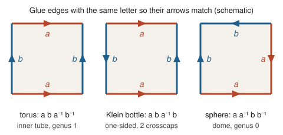

# Closed surfaces classified: a sphere with handles or crosscaps, and nothing else

[Syllabus](../../../SYLLABUS.md) → [Topology](../README.md) → [Surfaces and Manifolds](../README.md#s03) → Closed surfaces classified

---

## General Overview

Take a square game screen that wraps round. A ship that leaves through the right edge comes back through the left edge at the same height. A ship that leaves through the top comes back through the bottom. No point of that screen is an edge any more.

Roll the square into a tube so the top meets the bottom. Then bend the tube round so its two ends meet. The result is a bicycle inner tube. So the wrap-round screen *is* an inner tube, drawn flat. Mathematicians call that shape the **torus**.

Change one rule: the left edge comes back through the right edge *upside down*. That square glues into a different shape, the **Klein bottle**. Fold the square in half along its diagonal and seal the edges instead, and it closes into a ball's skin, the **sphere**. A geodesic dome closed into a full ball, with 42 vertices, 120 struts and 80 triangular panels, is a sphere too; call it the dome.

Every shape made this way is a **closed surface**: it is two-dimensional up close, it has no rim, it can be built from finitely many triangles, and it is one piece. The classification theorem says the list of closed surfaces is short. Each one is a sphere with some number of **handles** added (a handle: two small holes joined by a tube, like a mug's handle), or a sphere with some number of **crosscaps** added (a crosscap: a strip with a half twist sewn into a hole). Two invariants (properties that stretching cannot change) tell you which: the count vertices minus edges plus faces, and whether the surface is orientable (two-sided).

**Every closed surface is the same, up to stretching, as exactly one of two lists: the sphere with g handles, or the sphere with k crosscaps; the number V − E + F and the one-sided-or-two-sided test say which one.**

**What kind of fact this is:** a theorem. This card states it, proves the counting parts, and gives the cut-and-paste proof as key steps; the full proof, which also needs every surface to be cut into triangles, is in Gallier and Xu (Sources). The code checks 10 diagrams and one dome; that illustrates the theorem and does not prove it.

### The picture: three squares, three surfaces

<p align="center"></p>

The drawing is schematic: a gluing diagram is a recipe, not a picture to scale. Glue every pair of edges that share a letter, so that their arrows point the same way.

---

## The formula

The words first, one sentence each.

- A **closed surface** $`M`$ is a 2-dimensional manifold: every point has a neighbourhood that looks like an open disc ([Topological manifold](01-topological-manifolds.md)). It is also compact (it can be built from finitely many triangles; for a surface sitting in space, that means bounded and containing every point it comes arbitrarily close to), connected (one piece), and has no rim.
- Two surfaces are the same for topology, $`M \cong N`$ (read "homeomorphic"), when a continuous map with a continuous inverse turns one into the other: stretching and bending are allowed, tearing and gluing are not.
- A **gluing diagram** is a polygon whose edges are labelled with letters, each letter on exactly two edges. Its **edge word** reads the letters going round the polygon. A letter with an arrow against the walk is written with a minus-one power: the torus square reads $`aba^{-1}b^{-1}`$.
- The **connected sum** $`M \# N`$: cut a small disc out of each surface and sew the two circular holes together.
- A **handle** is a connected sum with the torus $`T^2`$. A **crosscap** is a connected sum with the projective plane $`\mathbb{RP}^2`$, the square with edge word $`abab`$. The crosscap sews a strip with a half twist into a hole; [Orientability](03-orientability-mobius-strip-and-klein-bottle.md) studies it.
- **Two-sided** is short for **orientable**: every small piece can be given a turning sense, clockwise or anticlockwise, that agrees across every shared edge ([Orientability](03-orientability-mobius-strip-and-klein-bottle.md)). For a surface sitting in space without crossing itself, that is the same as having two sides. The Klein bottle and $`\mathbb{RP}^2`$ cannot sit in space that way, so for them the turning sense is the meaning.
- The **genus** $`g`$ is the number of handles. The **crosscap number** $`k`$ is the number of crosscaps.
- $`V`$, $`E`$, $`F`$ count vertices, edges and faces after gluing. $`\chi = V - E + F`$ is the **Euler characteristic**, read "kye", studied on [Euler characteristic](04-euler-characteristic-and-triangulations.md).

The theorem lists the surfaces.

```math
M \;\cong\; \begin{cases}
S^2 \# \underbrace{T^2 \# \cdots \# T^2}_{g \text{ handles}}, & \chi = 2 - 2g, \text{ if } M \text{ is two-sided} \\[2ex]
\underbrace{\mathbb{RP}^2 \# \cdots \# \mathbb{RP}^2}_{k \text{ crosscaps}}, & \chi = 2 - k, \text{ if } M \text{ is one-sided}
\end{cases}
```

**Read it aloud:** a closed surface with two sides is a sphere with g handles and has Euler characteristic two minus twice g; a closed surface with one side is a sphere with k crosscaps and has Euler characteristic two minus k.

Here $`g`$ can be 0 (the sphere $`S^2`$ itself) and $`k`$ is at least 1. A connected sum changes the count by a fixed amount:

```math
\chi(M \# N) = \chi(M) + \chi(N) - 2
```

**Read it aloud:** sewing two surfaces together adds their Euler characteristics and takes away two.

For the inner tube, $`\chi = 1 - 2 + 1 = 0`$ and it is two-sided, so $`0 = 2 - 2g`$ gives $`g = 1`$. Two inner tubes sewn together give $`0 + 0 - 2 = -2`$, so $`g = 2`$.

| Symbol | Plain meaning | In our example | Push it up and the answer… |
| --- | --- | --- | --- |
| $`M`$, $`N`$ | closed surfaces | the inner tube; the dome | — |
| $`\cong`$ | the same up to stretching (homeomorphic) | wrap-round screen $`\cong`$ inner tube | — |
| $`S^2`$ | the sphere | the dome, $`aa^{-1}bb^{-1}`$ | — |
| $`T^2`$ | the torus | the inner tube, $`aba^{-1}b^{-1}`$ | — |
| $`\mathbb{RP}^2`$ | the projective plane | the square $`abab`$ | — |
| $`\#`$ | connected sum: cut a disc from each, sew the holes | torus # torus | add the parts' $`\chi`$, then subtract 2 |
| $`g`$ | genus: the number of handles | 1 for the inner tube | $`\chi`$ falls by 2 per handle |
| $`k`$ | crosscap number | 2 for the Klein bottle | $`\chi`$ falls by 1 per crosscap |
| $`V`$, $`E`$, $`F`$ | vertices, edges, faces after gluing; $`V_M`$ is $`M`$'s count | 1, 2, 1 for the inner tube | — |
| $`\chi`$ | Euler characteristic, $`V - E + F`$ | 0 for the inner tube, 2 for the dome | higher means simpler; 2 is the most |
| $`a`$, $`b`$, $`a^{-1}`$; $`P_0`$ to $`P_3`$ | edge letters ($`x`$, $`y`$, $`z`$ in Step 4, where capital $`A`$, $`B`$ stand for blocks of letters); $`a^{-1}`$ runs against the walk; $`P_i`$ are the square's corners | the square's sides and corners | — |
| $`n`$; $`\varphi`$ | triangles per polygon edge, in the code's fan; the golden ratio, about 1.618, for the dome's corners | 3; — | $`V`$, $`E`$, $`F`$ grow; $`\chi`$ does not |

### When it holds

- **No rim.** A paper strip glued with a half twist has $`\chi = 0`$, like the inner tube, but it keeps one rim. It is not on the list. Surfaces with rims have their own list: a closed surface with discs cut out.
- **Compact.** The whole flat plane is a surface with no rim, but it is not compact and is not on the list. Its count $`V - E + F`$ is not even defined, since it needs infinitely many triangles. Bounded is not enough: the open disc, the inside of a circle without the circle itself, is bounded and has no rim, yet it also needs infinitely many triangles, crowding towards the missing circle.
- **Connected.** Two separate spheres are two surfaces, not one. Classify each piece on its own.
- **A surface at every point.** Two balloons touching at one point fail at the touching point: no small neighbourhood of it looks like a disc.
- **It can be cut into triangles.** Every compact surface can (Radó, 1925; [Euler characteristic](04-euler-characteristic-and-triangulations.md) names a source that proves it). The proof needs that fact and this card uses it without proof.

---

## Why it works

### Step 0: three moves and two counts

Any closed surface can be cut into triangles. The triangles can be laid flat and glued edge to edge into one polygon. The polygon's edge word can then be rewritten by cutting and pasting until it takes one of two standard forms.

Two numbers never change while you cut and paste: $`\chi`$ and whether the surface is two-sided. The standard forms differ in at least one of them. So every surface lands on the list, and on exactly one place in it.

### Step 1: read V − E + F off a gluing diagram

A one-polygon diagram has $`F = 1`$ face. Each letter is one edge, so $`E`$ is the number of letters. $`V`$ is the number of corner groups after gluing.

To find the groups, follow the arrows. Each letter glues its start corners together and its end corners together. On the inner tube square, with corners $`P_0`$ (bottom left) round to $`P_3`$ (top left):

1. Bottom $`a`$ runs $`P_0 \to P_1`$; top $`a`$ runs $`P_3 \to P_2`$. So $`P_0`$ joins $`P_3`$, and $`P_1`$ joins $`P_2`$.
2. Right $`b`$ runs $`P_1 \to P_2`$; left $`b`$ runs $`P_0 \to P_3`$. So $`P_1`$ joins $`P_0`$.
3. All four corners are one vertex: $`V = 1`$, and $`\chi = 1 - 2 + 1 = 0`$.

The count does not depend on how finely you cut. Adding a vertex in the middle of an edge adds one vertex and one edge. Adding a diagonal across a face adds one edge and one face. Neither changes $`V - E + F`$. That is the same bookkeeping as the edge-by-edge proof for flat drawings in [Planar graphs](../../04-Combinatorics%20and%20graphs/12-Planarity%20and%20Colouring/01-planar-graphs-and-eulers-formula.md), and the code checks it on every diagram, cut 2, 3, 4 and 5 ways.

That any two triangulations of one surface give the same count is harder. [Euler characteristic](04-euler-characteristic-and-triangulations.md) states that part.

### Step 2: two sides or one, from the word

Look for a letter that appears twice with the same power, like $`b`$ in the Klein bottle's $`aba^{-1}b`$. A thin band of the square joining those two edges is glued with a half twist. That band is a Möbius strip, a strip glued with a half twist, so the surface is one-sided.

If every letter appears once plain and once with the minus-one power, orient every triangle the same way in the flat polygon. Every gluing then matches arrows head to tail, so the orientation survives. The surface is two-sided. That one-sidedness survives any homeomorphism is stated with a source on [Orientability](03-orientability-mobius-strip-and-klein-bottle.md); this shelf does not prove it.

### Step 3: connected sum joins the words

Cut a small disc at one corner of each polygon. The two cuts are circles, and sewing them opens both polygons into one bigger polygon. The new edge word is the two words written one after the other: the torus # torus word is $`aba^{-1}b^{-1}cdc^{-1}d^{-1}`$.

Count it: the vertex groups merge at the cut corner, so $`V = V_M + V_N - 1`$. Edges add, $`E = E_M + E_N`$. One polygon remains, $`F = 1`$.

```math
\chi(M \# N) = (V_M + V_N - 1) - (E_M + E_N) + 1 = \chi(M) + \chi(N) - 2
```

For two inner tubes: $`1 - 4 + 1 = -2`$, and $`0 + 0 - 2 = -2`$.

### Step 4: cut and paste to the standard form

This is the step the card gives as key steps only. Each move cuts the polygon along a straight line and glues the two pieces back along a pair of matching edges. The surface does not change; only its drawing does.

<details>
<summary>Key steps: from any word to a standard word</summary>

1. **Cancel folds.** A pair $`xx^{-1}`$ side by side folds shut like a book. Remove it, unless the whole word is $`aa^{-1}`$, which is the sphere.

2. **Make one vertex.** Cut off a triangle at a corner whose vertex group is not the main one, and glue it back along its other paired edge. Each such move shrinks that group by one corner. Repeat until all corners are one vertex.

3. **Gather crosscaps.** For a letter that appears twice with the same power, the word reads $`xAxB`$, with blocks of letters $`A`$ and $`B`$ between the copies. Cut along the line from the start of one copy to the start of the other, and re-glue along $`x`$. The word becomes $`yyA^{-1}B`$: the new letter $`y`$ sits twice side by side, one crosscap, and the block $`A`$ is read backwards with every power flipped. On the projective plane's $`abab`$, this gives $`yyb^{-1}b`$, and the fold $`b^{-1}b`$ cancels by move 1, leaving $`yy`$: still one crosscap, as it must be.

4. **Gather handles.** With one vertex, a letter with opposite powers, $`\ldots x \ldots x^{-1} \ldots`$, has another such letter interlocked with it. Two cuts and two pastes turn the pair into the block $`yzy^{-1}z^{-1}`$: one handle.

5. **Trade a handle for crosscaps.** If both blocks occur, use Dyck's rule:

$`\displaystyle T^2 \# \mathbb{RP}^2 \cong \mathbb{RP}^2 \# \mathbb{RP}^2 \# \mathbb{RP}^2`$

Each handle beside a crosscap becomes two more crosscaps. The code prints both sides at $`\chi = -1`$, one-sided.

The result is $`a_1b_1a_1^{-1}b_1^{-1} \cdots a_gb_ga_g^{-1}b_g^{-1}`$ (g handles) or $`a_1a_1 \cdots a_ka_k`$ (k crosscaps). The two-letter crosscap form $`aabb`$ and the Klein bottle square $`aba^{-1}b`$ count the same: $`\chi = 0`$, one-sided.

A cleaner route to the same list is Conway's ZIP proof (Francis and Weeks, Sources). The full proof, with the triangulation step, is in Gallier and Xu.

</details>

### Step 5: the list has no repeats

For $`g \ge 1`$ the g-handle form has one vertex, 2g edges and one face: $`\chi = 1 - 2g + 1 = 2 - 2g`$. The sphere's $`aa^{-1}`$ has two vertices: $`2 - 1 + 1 = 2`$. The k-crosscap form has one vertex, k edges, one face: $`\chi = 2 - k`$.

Two different entries differ in sidedness or in $`\chi`$. Both are invariants, stated with sources on [Orientability](03-orientability-mobius-strip-and-klein-bottle.md) and [Euler characteristic](04-euler-characteristic-and-triangulations.md), so different entries are different surfaces. Read backwards, the counts name any surface: $`g = (2 - \chi)/2`$ if two-sided, $`k = 2 - \chi`$ if one-sided.

---

## Worked numbers, by hand

The three squares in the picture, then two sums and the dome.

| Step | Arithmetic | Value |
| --- | --- | --- |
| inner tube, $`aba^{-1}b^{-1}`$ | all 4 corners glue to one: $`1 - 2 + 1`$ | $`\chi = 0`$, two-sided, $`g = 1`$ |
| Klein bottle, $`aba^{-1}b`$ | all 4 corners glue to one: $`1 - 2 + 1`$ | $`\chi = 0`$, one-sided, $`k = 2`$ |
| sphere, $`aa^{-1}bb^{-1}`$ | corners in 3 groups: $`3 - 2 + 1`$ | $`\chi = 2`$, two-sided, $`g = 0`$ |
| torus # torus | $`0 + 0 - 2`$; word count $`1 - 4 + 1`$ | $`\chi = -2`$, $`g = 2`$ |
| torus # projective plane | $`0 + 1 - 2`$; word count $`1 - 3 + 1`$ | $`\chi = -1`$, one-sided, $`k = 3`$ |
| dome: icosahedron, each face cut in 4 | $`42 - 120 + 80`$ | **$`\chi = 2`$, two-sided: a sphere, genus 0** |

The dome's 42 vertices, 120 struts and 80 panels say it has no handles: it is a sphere, whatever its size. The inner tube's square says one handle, and the Klein bottle's square, with the same count, says two crosscaps.

### What breaks if you drop a piece

| Mistake | Comes out at | What went wrong |
| --- | --- | --- |
| Inner tube's 4 corners left unglued | $`4 - 2 + 1 = 3`$, above the maximum 2 | the corners glue into one vertex |
| Inner tube read with every arrow dropped | $`abab`$: $`\chi = 1`$, one-sided, the projective plane | the arrows decide the gluing |
| Connected sum with no −2 | $`0 + 0 = 0`$, "a torus"; the count is −2 | two discs are removed |
| $`\chi`$ alone | inner tube 0 and Klein bottle 0 | sidedness is the second invariant |
| Paper strip with a half twist, $`abac`$ | $`\chi = 0`$, one-sided, but 1 rim | not closed: the theorem does not apply |

The code prints all five.

---

## Code, from first principles, and it actually runs

The code reads 10 diagrams two independent ways. Road 1 is Step 1's corner rule and Step 2's same-power test. Road 2 cuts the polygon into a fan of $`n`$ thin triangles per edge around a centre point. It counts every vertex, edge and triangle again, and checks two-sidedness by trying to give all triangles one orientation, flipping as it goes, until it succeeds or finds a contradiction. Both roads must agree, at $`n`$ = 2, 3, 4 and 5.

It then builds the geodesic dome from scratch. It places the icosahedron's 12 corners with exact arithmetic in $`a + b\varphi`$, where $`\varphi`$ is the golden ratio, finds its 20 faces, cuts each into 4, and counts. Everything is whole numbers. This is checked on 11 cases, which illustrates the theorem and does not prove it.

### Python

```python
# Closed surfaces classified -- the check behind the card.  Standard library only.
# A gluing diagram is a polygon with lettered edges; "a^-1" runs against the walk.
# Road 1 is the by-hand rule on the polygon's corners.  Road 2 cuts the polygon into
# a fan of thin triangles, counts everything again, and tries to orient them all.

def parse(w):                                # "a b^-1" -> [("a", 1), ("b", -1)]
    return [(x[0], -1 if x.endswith("^-1") else 1) for x in w.split()]

def find(p, x):
    while p[x] != x:
        x = p[x]
    return x

def by_corners(w):                           # road 1: corners, edge pairs, one face
    m, p, ends = len(w), list(range(len(w))), {}
    for k, (l, e) in enumerate(w):
        se = (k, (k + 1) % m) if e > 0 else ((k + 1) % m, k)
        if l in ends:                        # glue start to start, end to end
            p[find(p, se[0])] = find(p, ends[l][0])
            p[find(p, se[1])] = find(p, ends[l][1])
        ends[l] = se
    V, E = len({find(p, k) for k in range(m)}), len(ends)
    free = [l for l in ends if [x for x, _ in w].count(l) == 1]
    q = {find(p, k): find(p, k) for k in range(m)}          # rims: free edges joined
    for l in free:
        q[find(q, find(p, ends[l][0]))] = find(q, find(p, ends[l][1]))
    rims = len({find(q, find(p, ends[l][0])) for l in free})
    twisted = any(w[i] == w[j] for i in range(m) for j in range(i + 1, m))
    return V, E, 1, not twisted, rims

def analyse(V, tris):                        # count, test closed, try to orient
    uses = {}
    for i, t in enumerate(tris):
        for edge, sign in t:
            uses.setdefault(edge, []).append((i, sign))
    closed = all(len(u) == 2 for u in uses.values())
    links = {i: [] for i in range(len(tris))}
    for u in uses.values():
        if len(u) == 2:                      # the two must run the shared edge oppositely
            (i, si), (j, sj) = u
            links[i].append((j, -si * sj))
            links[j].append((i, -si * sj))
    side, todo, ok = {0: 1}, [0], True
    while todo:
        i = todo.pop()
        for j, rel in links[i]:
            if j not in side:
                side[j] = side[i] * rel
                todo.append(j)
            elif side[j] != side[i] * rel:
                ok = False
    return V, len(uses), len(tris), ok, closed

def by_fan(w, n):                            # road 2: n triangles per polygon edge
    N, marks, tris = len(w) * n, {}, []
    p = list(range(N + 1))                   # point N is the centre of the fan
    for k, (l, e) in enumerate(w):
        for s in range(n + 1):
            key, q = (l, s if e > 0 else n - s), (k * n + s) % N
            if key in marks and find(p, q) != find(p, marks[key]):
                p[find(p, q)] = find(p, marks[key])
            marks.setdefault(key, q)
        for s in range(n):
            q = k * n + s
            seg = (l, s if e > 0 else n - 1 - s)
            tris.append([(("spoke", q), 1), (seg, e), (("spoke", (q + 1) % N), -1)])
    return analyse(len({find(p, x) for x in range(N + 1)}), tris)

def dome():                                  # icosahedron in a + b*phi, each face cut in 4
    pts = []
    for s1 in (1, -1):
        for s2 in (1, -1):
            for c in range(3):
                v = [(0, 0), (s1, 0), (0, s2)]
                pts.append(tuple(v[(i - c) % 3] for i in range(3)))
    def d2(u, v):                            # squared distance, using phi^2 = phi + 1
        A = B = 0
        for (a1, b1), (a2, b2) in zip(u, v):
            a, b = a1 - a2, b1 - b2
            A, B = A + a * a + b * b, B + 2 * a * b + b * b
        return (A, B)
    near = lambda i, j: d2(pts[i], pts[j]) == (4, 0)
    faces = [(i, j, k) for i in range(12) for j in range(i + 1, 12) for k in range(j + 1, 12)
             if near(i, j) and near(j, k) and near(i, k)]
    mid = {}
    m = lambda i, j: mid.setdefault((min(i, j), max(i, j)), 12 + len(mid))
    small = []
    for i, j, k in faces:
        a, b, c = m(i, j), m(j, k), m(i, k)
        small += [(i, a, c), (a, j, b), (c, b, k), (a, b, c)]
    tris = [[((min(x, y), max(x, y)), 1 if x < y else -1) for x, y in zip(t, t[1:] + t[:1])]
            for t in small]
    return len(faces), analyse(12 + len(mid), tris)

def name(chi, orient):
    if orient:
        g = (2 - chi) // 2
        return {0: "sphere, genus 0", 1: "torus, genus 1"}.get(g, f"genus {g}")
    k = 2 - chi
    return {1: "projective plane, 1 crosscap", 2: "Klein bottle, 2 crosscaps"}.get(k, f"{k} crosscaps")

yn = lambda b: "yes" if b else "no"
CASES = [("inner tube", "a b a^-1 b^-1"), ("Klein bottle", "a b a^-1 b"), ("sphere", "a a^-1 b b^-1"),
         ("projective plane", "a b a b"), ("torus # torus", "a b a^-1 b^-1 c d c^-1 d^-1"),
         ("torus # proj. plane", "a b a^-1 b^-1 c c"), ("three crosscaps", "a a b b c c"),
         ("two crosscaps", "a a b b"), ("half-twist strip", "a b a c"), ("plain band", "a b a^-1 c")]
chi = {}
for label, word in CASES:
    w = parse(word)
    V, E, F, orient, rims = by_corners(w)
    v2, e2, f2, orient2, closed2 = by_fan(w, 3)
    chi[label] = V - E + F
    assert chi[label] == v2 - e2 + f2 and orient == orient2 and (rims == 0) == closed2
    for n in (2, 4, 5):
        v, e, f, _, _ = by_fan(w, n)
        assert v - e + f == chi[label]
    verdict = name(chi[label], orient) if rims == 0 else f"not closed: {rims} rim" + "s" * (rims > 1)
    print(f"{label:20} {word:28} corners {V}-{E}+{F} = {chi[label]:2}; fan {v2}-{e2}+{f2} = "
          f"{v2 - e2 + f2:2}; two-sided {yn(orient)} -> {verdict}")
print("fan cut 2, 3, 4 and 5 triangles per edge: same V - E + F every time: yes")
for a, b, s in [("inner tube", "inner tube", "torus # torus"), ("inner tube", "projective plane", "torus # proj. plane")]:
    print(f"connected sum: {chi[a]} + {chi[b]} - 2 = {chi[a] + chi[b] - 2}, counted {chi[s]}")
    assert chi[a] + chi[b] - 2 == chi[s]
assert chi["inner tube"] == chi["Klein bottle"] == 0 and chi["sphere"] == 2
assert chi["torus # proj. plane"] == chi["three crosscaps"] == -1 and chi["two crosscaps"] == 0
nf, (V, E, F, orient, closed) = dome()
print(f"geodesic dome: icosahedron {nf} faces, each cut in 4: {V} - {E} + {F} = {V - E + F}; "
      f"closed {yn(closed)}, two-sided {yn(orient)} -> {name(V - E + F, orient)}")
assert (nf, V, E, F, closed, orient) == (20, 42, 120, 80, True, True)
tube = parse("a b a^-1 b^-1")
print(f"mistake 1, inner tube with its {len(tube)} corners left unglued: {len(tube)} - 2 + 1 = "
      f"{len(tube) - 2 + 1}, above 2")
V, E, F, orient, _ = by_corners([(l, 1) for l, _ in tube])
print(f"mistake 2, inner tube read with every arrow dropped: chi = {V - E + F}, "
      f"two-sided {yn(orient)} -> {name(V - E + F, orient)}")
assert (V - E + F, orient) == (1, False)
print(f"mistake 3, connected sum with no -2: 0 + 0 = 0 -> torus, but counted {chi['torus # torus']}")
print(f"mistake 4, chi alone: inner tube {chi['inner tube']} and Klein bottle {chi['Klein bottle']}")
print("figure, squares at x = 20, 180, 340, y = 40, side 120; arrows mid-edge")
print("ALL CHECKS PASS")
```

**Ran 2026-11-14 on macOS, Python 3.14.10, standard library only. All checks passed. Output, pasted from the run:**

```
inner tube           a b a^-1 b^-1                corners 1-2+1 =  0; fan 6-18+12 =  0; two-sided yes -> torus, genus 1
Klein bottle         a b a^-1 b                   corners 1-2+1 =  0; fan 6-18+12 =  0; two-sided no -> Klein bottle, 2 crosscaps
sphere               a a^-1 b b^-1                corners 3-2+1 =  2; fan 8-18+12 =  2; two-sided yes -> sphere, genus 0
projective plane     a b a b                      corners 2-2+1 =  1; fan 7-18+12 =  1; two-sided no -> projective plane, 1 crosscap
torus # torus        a b a^-1 b^-1 c d c^-1 d^-1  corners 1-4+1 = -2; fan 10-36+24 = -2; two-sided yes -> genus 2
torus # proj. plane  a b a^-1 b^-1 c c            corners 1-3+1 = -1; fan 8-27+18 = -1; two-sided no -> 3 crosscaps
three crosscaps      a a b b c c                  corners 1-3+1 = -1; fan 8-27+18 = -1; two-sided no -> 3 crosscaps
two crosscaps        a a b b                      corners 1-2+1 =  0; fan 6-18+12 =  0; two-sided no -> Klein bottle, 2 crosscaps
half-twist strip     a b a c                      corners 2-3+1 =  0; fan 9-21+12 =  0; two-sided no -> not closed: 1 rim
plain band           a b a^-1 c                   corners 2-3+1 =  0; fan 9-21+12 =  0; two-sided yes -> not closed: 2 rims
fan cut 2, 3, 4 and 5 triangles per edge: same V - E + F every time: yes
connected sum: 0 + 0 - 2 = -2, counted -2
connected sum: 0 + 1 - 2 = -1, counted -1
geodesic dome: icosahedron 20 faces, each cut in 4: 42 - 120 + 80 = 2; closed yes, two-sided yes -> sphere, genus 0
mistake 1, inner tube with its 4 corners left unglued: 4 - 2 + 1 = 3, above 2
mistake 2, inner tube read with every arrow dropped: chi = 1, two-sided no -> projective plane, 1 crosscap
mistake 3, connected sum with no -2: 0 + 0 = 0 -> torus, but counted -2
mistake 4, chi alone: inner tube 0 and Klein bottle 0
figure, squares at x = 20, 180, 340, y = 40, side 120; arrows mid-edge
ALL CHECKS PASS
```

### Rust

Same numbers, same labels, built with `rustc --edition 2021 -O`.

```rust
// Closed surfaces classified -- the same check as the Python, in Rust.  No crates.
// A gluing diagram is a polygon with lettered edges; "a^-1" runs against the walk.
// Road 1 is the by-hand rule on the polygon's corners.  Road 2 cuts the polygon into
// a fan of thin triangles, counts everything again, and tries to orient them all.
use std::collections::{BTreeMap, BTreeSet};

type Key = (i64, i64, i64);
type Tri = Vec<(Key, i64)>;
fn parse(w: &str) -> Vec<(i64, i64)> {                // "a b^-1" -> [(a, 1), (b, -1)]
    w.split(' ').map(|x| (x.as_bytes()[0] as i64, if x.ends_with("^-1") { -1 } else { 1 })).collect()
}

fn find(p: &[usize], mut x: usize) -> usize { while p[x] != x { x = p[x] } x }
fn by_corners(w: &[(i64, i64)]) -> (i64, i64, i64, bool, usize) {   // road 1
    let (m, mut p) = (w.len(), (0..w.len()).collect::<Vec<usize>>());
    let mut ends: BTreeMap<i64, (usize, usize)> = BTreeMap::new();
    for (k, &(l, e)) in w.iter().enumerate() {
        let se = if e > 0 { (k, (k + 1) % m) } else { ((k + 1) % m, k) };
        if let Some(&(s0, s1)) = ends.get(&l) {       // glue start to start, end to end
            for (x, y) in [(se.0, s0), (se.1, s1)] { let (a, b) = (find(&p, x), find(&p, y)); p[a] = b }
        }
        ends.insert(l, se);
    }
    let cls: BTreeSet<usize> = (0..m).map(|k| find(&p, k)).collect();
    let free: Vec<i64> = ends.keys().copied().filter(|l| w.iter().filter(|x| x.0 == *l).count() == 1).collect();
    let mut q: Vec<usize> = (0..m).collect();          // rims: free edges joined
    for l in &free {
        let (a, b) = (find(&q, find(&p, ends[l].0)), find(&q, find(&p, ends[l].1)));
        q[a] = b;
    }
    let rims: BTreeSet<usize> = free.iter().map(|l| find(&q, find(&p, ends[l].0))).collect();
    let twisted = (0..m).any(|i| (i + 1..m).any(|j| w[i] == w[j]));
    (cls.len() as i64, ends.len() as i64, 1, !twisted, rims.len())
}

fn analyse(v: i64, tris: &[Tri]) -> (i64, i64, i64, bool, bool) {  // count, closed, orient
    let mut uses: BTreeMap<Key, Vec<(usize, i64)>> = BTreeMap::new();
    for (i, t) in tris.iter().enumerate() {
        for &(edge, sign) in t { uses.entry(edge).or_default().push((i, sign)) }
    }
    let closed = uses.values().all(|u| u.len() == 2);
    let mut links: Vec<Vec<(usize, i64)>> = vec![Vec::new(); tris.len()];
    for u in uses.values() {
        if u.len() == 2 {                             // the two must run the shared edge oppositely
            let ((i, si), (j, sj)) = (u[0], u[1]);
            links[i].push((j, -si * sj));
            links[j].push((i, -si * sj));
        }
    }
    let (mut side, mut todo, mut ok) = (vec![0i64; tris.len()], vec![0usize], true);
    side[0] = 1;
    while let Some(i) = todo.pop() {
        for &(j, rel) in &links[i] {
            if side[j] == 0 { side[j] = side[i] * rel; todo.push(j) }
            else if side[j] != side[i] * rel { ok = false }
        }
    }
    (v, uses.len() as i64, tris.len() as i64, ok, closed)
}

fn by_fan(w: &[(i64, i64)], n: usize) -> (i64, i64, i64, bool, bool) {   // road 2
    let nn = w.len() * n;
    let mut p: Vec<usize> = (0..nn + 1).collect();     // point nn is the centre of the fan
    let mut marks: BTreeMap<(i64, usize), usize> = BTreeMap::new();
    let mut tris: Vec<Tri> = Vec::new();
    for (k, &(l, e)) in w.iter().enumerate() {
        for s in 0..=n {
            let (key, q) = ((l, if e > 0 { s } else { n - s }), (k * n + s) % nn);
            if let Some(&r) = marks.get(&key) { let (a, b) = (find(&p, q), find(&p, r)); if a != b { p[a] = b } }
            else { marks.insert(key, q); }
        }
        for s in 0..n {
            let q = k * n + s;
            let seg = (1, l, (if e > 0 { s } else { n - 1 - s }) as i64);
            tris.push(vec![((0, q as i64, 0), 1), (seg, e), ((0, ((q + 1) % nn) as i64, 0), -1)]);
        }
    }
    analyse((0..nn + 1).map(|x| find(&p, x)).collect::<BTreeSet<usize>>().len() as i64, &tris)
}

fn dome() -> (usize, (i64, i64, i64, bool, bool)) {   // icosahedron in a + b*phi, faces cut in 4
    let mut pts: Vec<[(i64, i64); 3]> = Vec::new();
    for s1 in [1, -1] {
        for s2 in [1, -1] {
            let v = [(0, 0), (s1, 0), (0, s2)];
            for c in 0..3 { pts.push([v[(3 - c) % 3], v[(4 - c) % 3], v[(5 - c) % 3]]) }
        }
    }
    let d2 = |u: &[(i64, i64); 3], v: &[(i64, i64); 3]| {   // squared distance, phi^2 = phi + 1
        let (mut aa, mut bb) = (0, 0);
        for t in 0..3 { let (a, b) = (u[t].0 - v[t].0, u[t].1 - v[t].1); aa += a * a + b * b; bb += 2 * a * b + b * b }
        (aa, bb)
    };
    let near = |i: usize, j: usize| d2(&pts[i], &pts[j]) == (4, 0);
    let mut faces = Vec::new();
    for i in 0..12 { for j in i + 1..12 { for k in j + 1..12 {
        if near(i, j) && near(j, k) && near(i, k) { faces.push((i, j, k)) }
    } } }
    let mut mid: BTreeMap<(usize, usize), usize> = BTreeMap::new();
    let mut m = |i: usize, j: usize| { let n = 12 + mid.len(); *mid.entry((i.min(j), i.max(j))).or_insert(n) };
    let mut small = Vec::new();
    for &(i, j, k) in &faces {
        let (a, b, c) = (m(i, j), m(j, k), m(i, k));
        small.extend([[i, a, c], [a, j, b], [c, b, k], [a, b, c]]);
    }
    let tris: Vec<Tri> = small.iter().map(|t| (0..3).map(|r| {
        let (x, y) = (t[r], t[(r + 1) % 3]);
        ((2, x.min(y) as i64, x.max(y) as i64), if x < y { 1 } else { -1 })
    }).collect()).collect();
    (faces.len(), analyse(12 + mid.len() as i64, &tris))
}

fn name(chi: i64, orient: bool) -> String {
    let (g, k) = ((2 - chi) / 2, 2 - chi);
    match (orient, g, k) {
        (true, 0, _) => "sphere, genus 0".into(), (true, 1, _) => "torus, genus 1".into(), (true, _, _) => format!("genus {}", g),
        (false, _, 1) => "projective plane, 1 crosscap".into(), (false, _, 2) => "Klein bottle, 2 crosscaps".into(),
        _ => format!("{} crosscaps", k),
    }
}

fn yn(b: bool) -> &'static str { if b { "yes" } else { "no" } }

fn main() {
    let cases = [("inner tube", "a b a^-1 b^-1"), ("Klein bottle", "a b a^-1 b"), ("sphere", "a a^-1 b b^-1"),
        ("projective plane", "a b a b"), ("torus # torus", "a b a^-1 b^-1 c d c^-1 d^-1"),
        ("torus # proj. plane", "a b a^-1 b^-1 c c"), ("three crosscaps", "a a b b c c"),
        ("two crosscaps", "a a b b"), ("half-twist strip", "a b a c"), ("plain band", "a b a^-1 c")];
    let mut chi: BTreeMap<&str, i64> = BTreeMap::new();
    for (label, word) in cases {
        let w = parse(word);
        let (v, e, f, orient, rims) = by_corners(&w);
        let (v2, e2, f2, orient2, closed2) = by_fan(&w, 3);
        chi.insert(label, v - e + f);
        assert!(v - e + f == v2 - e2 + f2 && orient == orient2 && (rims == 0) == closed2);
        for n in [2, 4, 5] {
            let (a, b, c, _, _) = by_fan(&w, n);
            assert!(a - b + c == v - e + f);
        }
        let verdict = if rims == 0 { name(v - e + f, orient) }
                      else { format!("not closed: {} rim{}", rims, if rims > 1 { "s" } else { "" }) };
        println!("{:20} {:28} corners {}-{}+{} = {:2}; fan {}-{}+{} = {:2}; two-sided {} -> {}",
                 label, word, v, e, f, v - e + f, v2, e2, f2, v2 - e2 + f2, yn(orient), verdict);
    }
    println!("fan cut 2, 3, 4 and 5 triangles per edge: same V - E + F every time: yes");
    for (a, b, s) in [("inner tube", "inner tube", "torus # torus"), ("inner tube", "projective plane", "torus # proj. plane")] {
        println!("connected sum: {} + {} - 2 = {}, counted {}", chi[a], chi[b], chi[a] + chi[b] - 2, chi[s]);
        assert!(chi[a] + chi[b] - 2 == chi[s]);
    }
    assert!(chi["inner tube"] == 0 && chi["Klein bottle"] == 0 && chi["sphere"] == 2);
    assert!(chi["torus # proj. plane"] == -1 && chi["three crosscaps"] == -1 && chi["two crosscaps"] == 0);
    let (nf, (v, e, f, orient, closed)) = dome();
    println!("geodesic dome: icosahedron {} faces, each cut in 4: {} - {} + {} = {}; closed {}, two-sided {} -> {}",
             nf, v, e, f, v - e + f, yn(closed), yn(orient), name(v - e + f, orient));
    assert!((nf, v, e, f, closed, orient) == (20, 42, 120, 80, true, true));
    let tube = parse("a b a^-1 b^-1");
    let t = tube.len() as i64;
    println!("mistake 1, inner tube with its {} corners left unglued: {} - 2 + 1 = {}, above 2", t, t, t - 2 + 1);
    let flat: Vec<(i64, i64)> = tube.iter().map(|&(l, _)| (l, 1)).collect();
    let (v, e, f, orient, _) = by_corners(&flat);
    println!("mistake 2, inner tube read with every arrow dropped: chi = {}, two-sided {} -> {}",
             v - e + f, yn(orient), name(v - e + f, orient));
    assert!((v - e + f, orient) == (1, false));
    println!("mistake 3, connected sum with no -2: 0 + 0 = 0 -> torus, but counted {}", chi["torus # torus"]);
    println!("mistake 4, chi alone: inner tube {} and Klein bottle {}", chi["inner tube"], chi["Klein bottle"]);
    println!("figure, squares at x = 20, 180, 340, y = 40, side 120; arrows mid-edge");
    println!("ALL CHECKS PASS");
}
```

**Ran 2026-11-14 on macOS, rustc 1.98.1, no crates. All checks passed. Output, pasted from the run:**

```
inner tube           a b a^-1 b^-1                corners 1-2+1 =  0; fan 6-18+12 =  0; two-sided yes -> torus, genus 1
Klein bottle         a b a^-1 b                   corners 1-2+1 =  0; fan 6-18+12 =  0; two-sided no -> Klein bottle, 2 crosscaps
sphere               a a^-1 b b^-1                corners 3-2+1 =  2; fan 8-18+12 =  2; two-sided yes -> sphere, genus 0
projective plane     a b a b                      corners 2-2+1 =  1; fan 7-18+12 =  1; two-sided no -> projective plane, 1 crosscap
torus # torus        a b a^-1 b^-1 c d c^-1 d^-1  corners 1-4+1 = -2; fan 10-36+24 = -2; two-sided yes -> genus 2
torus # proj. plane  a b a^-1 b^-1 c c            corners 1-3+1 = -1; fan 8-27+18 = -1; two-sided no -> 3 crosscaps
three crosscaps      a a b b c c                  corners 1-3+1 = -1; fan 8-27+18 = -1; two-sided no -> 3 crosscaps
two crosscaps        a a b b                      corners 1-2+1 =  0; fan 6-18+12 =  0; two-sided no -> Klein bottle, 2 crosscaps
half-twist strip     a b a c                      corners 2-3+1 =  0; fan 9-21+12 =  0; two-sided no -> not closed: 1 rim
plain band           a b a^-1 c                   corners 2-3+1 =  0; fan 9-21+12 =  0; two-sided yes -> not closed: 2 rims
fan cut 2, 3, 4 and 5 triangles per edge: same V - E + F every time: yes
connected sum: 0 + 0 - 2 = -2, counted -2
connected sum: 0 + 1 - 2 = -1, counted -1
geodesic dome: icosahedron 20 faces, each cut in 4: 42 - 120 + 80 = 2; closed yes, two-sided yes -> sphere, genus 0
mistake 1, inner tube with its 4 corners left unglued: 4 - 2 + 1 = 3, above 2
mistake 2, inner tube read with every arrow dropped: chi = 1, two-sided no -> projective plane, 1 crosscap
mistake 3, connected sum with no -2: 0 + 0 = 0 -> torus, but counted -2
mistake 4, chi alone: inner tube 0 and Klein bottle 0
figure, squares at x = 20, 180, 340, y = 40, side 120; arrows mid-edge
ALL CHECKS PASS
```

The two outputs match line for line.

### Lean

Lean proves the counting parts of Steps 3 and 5 on edge words, for any number of handles or crosscaps.

- Take the standard word for $`g`$ handles, with $`aa^{-1}`$ for the sphere. Then each letter is on two edges, the word is two-sided, and $`\chi = 2 - 2g`$.
- Take the standard word for $`k`$ crosscaps, with $`k \ge 1`$. Then each letter is on two edges, the word is one-sided, and $`\chi = 2 - k`$.
- The list has no repeats. Two handle words with the same $`\chi`$ have the same genus, and likewise for crosscaps. A handle word and a crosscap word differ in sidedness.
- Take two non-empty edge words with no letter in common, each letter on exactly two edges. Then the two written one after the other give $`\chi(M \# N) = \chi(M) + \chi(N) - 2`$.
- The inner tube, Klein bottle, sphere, both sums, two and three crosscaps, and $`abab`$ count as in the worked numbers.

The fan triangles, the orientation test and the dome are left to the Python and Rust checks; the full classification rests on the Sources.

```lean
-- Closed surfaces classified: on gluing diagrams, the standard words for g handles and k crosscaps have V - E + F equal to 2 - 2g (two-sided) and 2 - k (one-sided), no two of them share both counts, and writing two closed words one after the other (connected sum) gives V - E + F equal to the two counts added minus 2.
import Mathlib.Combinatorics.SimpleGraph.Connectivity.Finite
import Mathlib

/-!
Mathlib has no connected sum of spaces, no orientation of a topological surface and no
triangulations, so the classification theorem itself cannot be stated here; the card also
gives its proof only as key steps. This file states the parts the card proves, on the card's
own gluing diagrams.

A gluing diagram is one polygon whose edges carry letters, read round the polygon as an
edge word. A letter is a whole number; `true` means its arrow runs with the walk, `false`
means against it (the card's minus-one power). The torus square `a b a⁻¹ b⁻¹` is
`[(0, true), (1, true), (0, false), (1, false)]`.
-/

/-- An edge word: the letters met going round the polygon, each with its arrow's direction
(`true` with the walk, `false` against it). -/
abbrev EdgeWord := List (ℕ × Bool)

namespace EdgeWord

/-- The corner after corner `i`, going round the polygon. Edge `i` runs from corner `i` to
this corner. -/
def next (w : EdgeWord) (i : Fin w.length) : Fin w.length :=
  ⟨(i.1 + 1) % w.length, Nat.mod_lt _ (Nat.lt_of_le_of_lt (Nat.zero_le _) i.2)⟩

/-- The corner where edge `i`'s arrow starts. -/
def startCorner (w : EdgeWord) (i : Fin w.length) : Fin w.length :=
  if (w.get i).2 then i else w.next i

/-- The corner where edge `i`'s arrow ends. -/
def endCorner (w : EdgeWord) (i : Fin w.length) : Fin w.length :=
  if (w.get i).2 then w.next i else i

/-- Gluing the corners (card, Step 1): two edges with the same letter glue start corner to
start corner and end corner to end corner. -/
def cornerGluing (w : EdgeWord) : SimpleGraph (Fin w.length) :=
  SimpleGraph.fromRel fun c d => ∃ i j : Fin w.length, i ≠ j ∧ (w.get i).1 = (w.get j).1 ∧
    ((c = w.startCorner i ∧ d = w.startCorner j) ∨ (c = w.endCorner i ∧ d = w.endCorner j))

instance (w : EdgeWord) : DecidableRel w.cornerGluing.Adj := by
  unfold cornerGluing; infer_instance

/-- `V`: the number of vertices after gluing, one for each group of glued corners. -/
def vertices (w : EdgeWord) : ℕ := Fintype.card w.cornerGluing.ConnectedComponent

/-- `E`: the number of edges after gluing, one for each letter. -/
def edges (w : EdgeWord) : ℕ := (w.map Prod.fst).toFinset.card

/-- The Euler characteristic `χ = V - E + F`, with `F = 1` face, the polygon. -/
def euler (w : EdgeWord) : ℤ := (w.vertices : ℤ) - w.edges + 1

/-- A closed diagram: every letter is on exactly two edges, so no edge is left as a rim. -/
def IsClosedDiagram (w : EdgeWord) : Prop :=
  ∀ p ∈ w, w.countP (fun q => q.1 = p.1) = 2

instance (w : EdgeWord) : Decidable w.IsClosedDiagram := by
  unfold IsClosedDiagram; infer_instance

/-- The card's two-sided test on a word (Step 2): every letter appears once plain and once
with the minus-one power. A letter appearing twice with the same power is a half-twisted
band, and the surface is one-sided. -/
def IsTwoSided (w : EdgeWord) : Prop :=
  ∀ p ∈ w, w.count (p.1, true) = 1 ∧ w.count (p.1, false) = 1

instance (w : EdgeWord) : Decidable w.IsTwoSided := by
  unfold IsTwoSided; infer_instance

/-- The standard word for the sphere with `g` handles: `a a⁻¹` for the sphere itself (`g = 0`),
and `a₁ b₁ a₁⁻¹ b₁⁻¹ ⋯ a_g b_g a_g⁻¹ b_g⁻¹` for `g ≥ 1`. -/
def handleForm : ℕ → EdgeWord
  | 0 => [(0, true), (0, false)]
  | g + 1 => (List.range (g + 1)).flatMap fun i =>
      [(2 * i, true), (2 * i + 1, true), (2 * i, false), (2 * i + 1, false)]

/-- The standard word for the sphere with `k` crosscaps: `a₁ a₁ a₂ a₂ ⋯ a_k a_k`. -/
def crosscapForm (k : ℕ) : EdgeWord :=
  (List.range k).flatMap fun i => [(i, true), (i, true)]

end EdgeWord

open EdgeWord

namespace SurfHelp

lemma flatMap_length {α} (f : ℕ → List α) (L : ℕ) (hf : ∀ i, (f i).length = L) (n : ℕ) :
    ((List.range n).flatMap f).length = L * n := by
  induction n with
  | zero => simp
  | succ n ih => simp [List.range_succ, List.flatMap_append, ih, hf]; ring

lemma flatMap_getElem {α} (f : ℕ → List α) (L : ℕ) (hf : ∀ i, (f i).length = L) (n i r : ℕ)
    (hi : i < n) (hr : r < L) (h : L * i + r < ((List.range n).flatMap f).length) :
    ((List.range n).flatMap f)[L * i + r] = (f i)[r]'(by rw [hf]; exact hr) := by
  induction n with
  | zero => omega
  | succ n ih =>
    simp only [List.range_succ, List.flatMap_append, List.flatMap_singleton]
    rw [List.getElem_append]
    have hl := flatMap_length f L hf n
    split_ifs with h1
    · rcases Nat.lt_succ_iff_lt_or_eq.mp hi with h2 | h2
      · exact ih h2 _
      · subst h2; rw [hl] at h1; nlinarith
    · rcases Nat.lt_succ_iff_lt_or_eq.mp hi with h2 | h2
      · rw [hl] at h1; exfalso; apply h1; nlinarith
      · subst h2; simp [hl]


def blkH (i : ℕ) : EdgeWord := [(2 * i, true), (2 * i + 1, true), (2 * i, false), (2 * i + 1, false)]
def blkC (i : ℕ) : EdgeWord := [(i, true), (i, true)]

lemma handle_eq (g : ℕ) : handleForm (g + 1) = (List.range (g + 1)).flatMap blkH := rfl
lemma crosscap_eq (k : ℕ) : crosscapForm k = (List.range k).flatMap blkC := rfl

lemma countP_H (n a : ℕ) : ((List.range n).flatMap blkH).countP (fun q => decide (q.1 = a)) =
    if a < 2 * n then 2 else 0 := by
  induction n with
  | zero => simp
  | succ n ih =>
    simp only [List.range_succ, List.flatMap_append, List.flatMap_singleton, List.countP_append,
      ih, blkH, List.countP_cons, List.countP_nil]
    split_ifs <;> simp_all <;> omega

lemma count_H (n a : ℕ) (b : Bool) : ((List.range n).flatMap blkH).count (a, b) =
    if a < 2 * n then 1 else 0 := by
  induction n with
  | zero => simp
  | succ n ih =>
    simp only [List.range_succ, List.flatMap_append, List.flatMap_singleton, List.count_append,
      ih, blkH, List.count_cons, List.count_nil]
    cases b <;> split_ifs <;> simp_all <;> omega

lemma countP_C (n a : ℕ) : ((List.range n).flatMap blkC).countP (fun q => decide (q.1 = a)) =
    if a < n then 2 else 0 := by
  induction n with
  | zero => simp
  | succ n ih =>
    simp only [List.range_succ, List.flatMap_append, List.flatMap_singleton, List.countP_append,
      ih, blkC, List.countP_cons, List.countP_nil]
    split_ifs <;> simp_all <;> omega

lemma mem_H (n : ℕ) (p : ℕ × Bool) (hp : p ∈ (List.range n).flatMap blkH) : p.1 < 2 * n := by
  simp only [List.mem_flatMap, List.mem_range, blkH, List.mem_cons, List.not_mem_nil] at hp
  obtain ⟨i, hi, h⟩ := hp
  rcases h with h | h | h | h | h <;> first | (subst h; simp; omega) | exact absurd h id

lemma mem_C (n : ℕ) (p : ℕ × Bool) (hp : p ∈ (List.range n).flatMap blkC) : p.1 < n := by
  simp only [List.mem_flatMap, List.mem_range, blkC, List.mem_cons, List.not_mem_nil] at hp
  obtain ⟨i, hi, h⟩ := hp
  rcases h with h | h | h <;> first | (subst h; simp; omega) | exact absurd h id

lemma edges_H (n : ℕ) : edges ((List.range n).flatMap blkH) = 2 * n := by
  unfold edges
  have : (((List.range n).flatMap blkH).map Prod.fst).toFinset = Finset.range (2 * n) := by
    ext a
    simp only [List.mem_toFinset, List.mem_map, Finset.mem_range]
    constructor
    · rintro ⟨p, hp, rfl⟩; exact mem_H n p hp
    · intro ha
      refine ⟨(a, true), ?_, rfl⟩
      simp only [List.mem_flatMap, List.mem_range, blkH, List.mem_cons, List.not_mem_nil]
      refine ⟨a / 2, by omega, ?_⟩
      rcases Nat.even_or_odd a with ⟨t, ht⟩ | ⟨t, ht⟩
      · left; simp; omega
      · right; left; simp; omega
  rw [this, Finset.card_range]

lemma edges_C (n : ℕ) : edges ((List.range n).flatMap blkC) = n := by
  unfold edges
  have : (((List.range n).flatMap blkC).map Prod.fst).toFinset = Finset.range n := by
    ext a
    simp only [List.mem_toFinset, List.mem_map, Finset.mem_range]
    constructor
    · rintro ⟨p, hp, rfl⟩; exact mem_C n p hp
    · intro ha
      refine ⟨(a, true), ?_, rfl⟩
      simp only [List.mem_flatMap, List.mem_range, blkC, List.mem_cons, List.not_mem_nil]
      exact ⟨a, ha, by simp⟩
  rw [this, Finset.card_range]


lemma reach_start (w : EdgeWord) (i j : Fin w.length) (h : (w.get i).1 = (w.get j).1) :
    w.cornerGluing.Reachable (w.startCorner i) (w.startCorner j) := by
  by_cases hij : i = j
  · subst hij; rfl
  by_cases hc : w.startCorner i = w.startCorner j
  · rw [hc]
  apply SimpleGraph.Adj.reachable
  simp only [cornerGluing, SimpleGraph.fromRel_adj]
  exact ⟨hc, Or.inl ⟨i, j, hij, h, Or.inl ⟨rfl, rfl⟩⟩⟩

lemma reach_end (w : EdgeWord) (i j : Fin w.length) (h : (w.get i).1 = (w.get j).1) :
    w.cornerGluing.Reachable (w.endCorner i) (w.endCorner j) := by
  by_cases hij : i = j
  · subst hij; rfl
  by_cases hc : w.endCorner i = w.endCorner j
  · rw [hc]
  apply SimpleGraph.Adj.reachable
  simp only [cornerGluing, SimpleGraph.fromRel_adj]
  exact ⟨hc, Or.inl ⟨i, j, hij, h, Or.inr ⟨rfl, rfl⟩⟩⟩

lemma start_val (w : EdgeWord) (i : Fin w.length) :
    (w.startCorner i).val = if (w.get i).2 then i.val else (i.val + 1) % w.length := by
  unfold startCorner next; split_ifs <;> rfl

lemma end_val (w : EdgeWord) (i : Fin w.length) :
    (w.endCorner i).val = if (w.get i).2 then (i.val + 1) % w.length else i.val := by
  unfold endCorner next; split_ifs <;> rfl

lemma vertices_one (w : EdgeWord) (hN : 0 < w.length)
    (h : ∀ c : Fin w.length, w.cornerGluing.Reachable ⟨0, hN⟩ c) : w.vertices = 1 := by
  unfold vertices
  rw [Fintype.card_eq_one_iff]
  refine ⟨w.cornerGluing.connectedComponentMk ⟨0, hN⟩, fun x => ?_⟩
  induction x using SimpleGraph.ConnectedComponent.ind with
  | h v => exact (SimpleGraph.ConnectedComponent.sound (h v)).symm

/-- Reachability between corners given by their numbers. -/
def R (w : EdgeWord) (a b : ℕ) : Prop :=
  ∀ (ha : a < w.length) (hb : b < w.length), w.cornerGluing.Reachable ⟨a, ha⟩ ⟨b, hb⟩

lemma R_symm {w : EdgeWord} {a b : ℕ} (h : R w a b) : R w b a := fun ha hb => (h hb ha).symm

lemma R_trans {w : EdgeWord} {a b c : ℕ} (hb : b < w.length) (h1 : R w a b) (h2 : R w b c) :
    R w a c := fun ha hc => (h1 ha hb).trans (h2 hb hc)

lemma R_start (w : EdgeWord) (i j : ℕ) (hi : i < w.length) (hj : j < w.length)
    (h : (w[i]).1 = (w[j]).1) (a b : ℕ)
    (ha : a = if (w[i]).2 then i else (i + 1) % w.length)
    (hb : b = if (w[j]).2 then j else (j + 1) % w.length) : R w a b := by
  intro ha' hb'
  have := reach_start w ⟨i, hi⟩ ⟨j, hj⟩ h
  convert this using 1 <;> apply Fin.ext <;> simp [start_val, ha, hb]

lemma R_end (w : EdgeWord) (i j : ℕ) (hi : i < w.length) (hj : j < w.length)
    (h : (w[i]).1 = (w[j]).1) (a b : ℕ)
    (ha : a = if (w[i]).2 then (i + 1) % w.length else i)
    (hb : b = if (w[j]).2 then (j + 1) % w.length else j) : R w a b := by
  intro ha' hb'
  have := reach_end w ⟨i, hi⟩ ⟨j, hj⟩ h
  convert this using 1 <;> apply Fin.ext <;> simp [end_val, ha, hb]

lemma handle_len (g : ℕ) : (handleForm (g + 1)).length = 4 * (g + 1) := by
  rw [handle_eq, flatMap_length blkH 4 (fun _ => rfl)]

lemma crosscap_len (k : ℕ) : (crosscapForm k).length = 2 * k := by
  rw [crosscap_eq, flatMap_length blkC 2 (fun _ => rfl)]

lemma handle_get (g i r : ℕ) (hi : i < g + 1) (hr : r < 4) (h : 4 * i + r < (handleForm (g + 1)).length) :
    (handleForm (g + 1))[4 * i + r] = (blkH i)[r]'(by simp [blkH]; omega) := by
  simp only [handle_eq]
  exact flatMap_getElem blkH 4 (fun _ => rfl) (g + 1) i r hi hr _

lemma crosscap_get (k i r : ℕ) (hi : i < k) (hr : r < 2) (h : 2 * i + r < (crosscapForm k).length) :
    (crosscapForm k)[2 * i + r] = (blkC i)[r]'(by simp [blkC]; omega) := by
  simp only [crosscap_eq]
  exact flatMap_getElem blkC 2 (fun _ => rfl) k i r hi hr _

lemma handle_step (g c : ℕ) (hc : c + 1 < 4 * (g + 1)) : R (handleForm (g + 1)) c (c + 1) := by
  have hL := handle_len g
  obtain ⟨i, r, hr, rfl⟩ : ∃ i r, r < 4 ∧ c = 4 * i + r := ⟨c / 4, c % 4, by omega, by omega⟩
  have hi : i < g + 1 := by omega
  have g0 := handle_get g i 0 hi (by norm_num) (by omega)
  have g1 := handle_get g i 1 hi (by norm_num) (by omega)
  have g2 := handle_get g i 2 hi (by norm_num) (by omega)
  have g3 := handle_get g i 3 hi (by norm_num) (by omega)
  simp only [blkH, add_zero, List.getElem_cons_zero, List.getElem_cons_succ] at g0 g1 g2 g3
  -- the four gluings of block i
  have A : R (handleForm (g + 1)) (4 * i) (4 * i + 3) := R_start (handleForm (g + 1)) (4 * i) (4 * i + 2) (by omega) (by omega)
    (by rw [g0, g2]) _ _ (by rw [g0]; simp) (by rw [g2]; simp [hL, Nat.mod_eq_of_lt (show 4 * i + 3 < 4 * (g + 1) by omega)])
  have B : R (handleForm (g + 1)) (4 * i + 1) (4 * i + 2) := R_end (handleForm (g + 1)) (4 * i) (4 * i + 2) (by omega) (by omega)
    (by rw [g0, g2]) _ _ (by rw [g0]; simp [hL, Nat.mod_eq_of_lt (show 4 * i + 1 < 4 * (g + 1) by omega)]) (by rw [g2]; simp)
  have C : R (handleForm (g + 1)) (4 * i + 2) (4 * i + 3) := R_end (handleForm (g + 1)) (4 * i + 1) (4 * i + 3) (by omega) (by omega)
    (by rw [g1, g3]) _ _ (by rw [g1]; simp [hL, Nat.mod_eq_of_lt (show 4 * i + 2 < 4 * (g + 1) by omega)]) (by rw [g3]; simp)
  have D : R (handleForm (g + 1)) (4 * i + 1) ((4 * i + 4) % (4 * (g + 1))) := R_start (handleForm (g + 1)) (4 * i + 1) (4 * i + 3)
    (by omega) (by omega) (by rw [g1, g3]) _ _ (by rw [g1]; simp) (by rw [g3]; simp [hL])
  interval_cases r
  · exact R_trans (b := 4 * i + 3) (by omega) A (R_trans (b := 4 * i + 2) (by omega) (R_symm C) (R_symm B))
  · exact B
  · exact C
  · have : (4 * i + 4) % (4 * (g + 1)) = 4 * i + 3 + 1 := Nat.mod_eq_of_lt (by omega)
    rw [this] at D
    exact R_trans (b := 4 * i + 2) (by omega) (R_symm C)
      (R_trans (b := 4 * i + 1) (by omega) (R_symm B) D)

lemma crosscap_step (k c : ℕ) (hc : c + 1 < 2 * k) : R (crosscapForm k) c (c + 1) := by
  have hL := crosscap_len k
  obtain ⟨i, r, hr, rfl⟩ : ∃ i r, r < 2 ∧ c = 2 * i + r := ⟨c / 2, c % 2, by omega, by omega⟩
  have hi : i < k := by omega
  have g0 := crosscap_get k i 0 hi (by norm_num) (by omega)
  have g1 := crosscap_get k i 1 hi (by norm_num) (by omega)
  simp only [blkC, add_zero, List.getElem_cons_zero, List.getElem_cons_succ] at g0 g1
  interval_cases r
  · exact R_start (crosscapForm k) (2 * i) (2 * i + 1) (by omega) (by omega) (by rw [g0, g1]) _ _
      (by rw [g0]; simp) (by rw [g1]; simp)
  · exact R_end (crosscapForm k) (2 * i) (2 * i + 1) (by omega) (by omega) (by rw [g0, g1]) _ _
      (by rw [g0]; simp [hL, Nat.mod_eq_of_lt (show 2 * i + 1 < 2 * k by omega)]) (by rw [g1]; simp [hL, Nat.mod_eq_of_lt (show 2 * i + 2 < 2 * k by omega)])

lemma R_chain (w : EdgeWord) (h : ∀ c, c + 1 < w.length → R w c (c + 1)) :
    ∀ c, c < w.length → R w 0 c := by
  intro c
  induction c with
  | zero => intro _ _ _; rfl
  | succ c ih => intro hc; exact R_trans (b := c) (by omega) (ih (by omega)) (h c hc)

lemma handle_vertices (g : ℕ) : (handleForm (g + 1)).vertices = 1 := by
  have hL := handle_len g
  refine vertices_one _ (by omega) (fun c => ?_)
  exact R_chain _ (fun c hc => handle_step g c (by omega)) c.1 c.2 _ _

lemma crosscap_vertices (k : ℕ) (hk : 1 ≤ k) : (crosscapForm k).vertices = 1 := by
  have hL := crosscap_len k
  refine vertices_one _ (by omega) (fun c => ?_)
  exact R_chain _ (fun c hc => crosscap_step k c (by omega)) c.1 c.2 _ _


lemma count_C (n a : ℕ) : ((List.range n).flatMap blkC).count (a, true) =
    if a < n then 2 else 0 := by
  induction n with
  | zero => simp
  | succ n ih =>
    simp only [List.range_succ, List.flatMap_append, List.flatMap_singleton, List.count_append,
      ih, blkC, List.count_cons, List.count_nil]
    split_ifs <;> simp_all <;> omega


lemma countP_eq_card {α} (p : α → Bool) (l : List α) :
    l.countP p = (Finset.univ.filter (fun j : Fin l.length => p (l.get j) = true)).card := by
  induction l with
  | nil => simp
  | cons a l ih =>
    rw [Finset.card_filter]
    refine Eq.trans ?_ (Fin.sum_univ_succ (n := l.length) _).symm
    rw [List.countP_cons, ih, Finset.card_filter]
    simp only [List.length_cons, List.get_eq_getElem, Fin.val_zero, List.getElem_cons_zero,
      Fin.val_succ, List.getElem_cons_succ]
    split_ifs <;> simp_all [add_comm]

lemma startL (w w' : EdgeWord) (hm : 0 < w'.length) (i : ℕ) (hi : i < w.length) :
    ((w ++ w').startCorner ⟨i, by simp; omega⟩).val = (w.startCorner ⟨i, hi⟩).val ∨
    (((w ++ w').startCorner ⟨i, by simp; omega⟩).val = w.length ∧
      (w.startCorner ⟨i, hi⟩).val = 0) := by
  rw [start_val, start_val]
  simp only [List.get_eq_getElem, List.getElem_append_left hi, List.length_append]
  split_ifs
  · left; rfl
  · rcases Nat.lt_or_ge (i + 1) w.length with h | h
    · left; rw [Nat.mod_eq_of_lt h, Nat.mod_eq_of_lt (by omega)]
    · right
      have : i + 1 = w.length := by omega
      rw [this, Nat.mod_self, Nat.mod_eq_of_lt (by omega)]; simp

lemma endL (w w' : EdgeWord) (hm : 0 < w'.length) (i : ℕ) (hi : i < w.length) :
    ((w ++ w').endCorner ⟨i, by simp; omega⟩).val = (w.endCorner ⟨i, hi⟩).val ∨
    (((w ++ w').endCorner ⟨i, by simp; omega⟩).val = w.length ∧
      (w.endCorner ⟨i, hi⟩).val = 0) := by
  rw [end_val, end_val]
  simp only [List.get_eq_getElem, List.getElem_append_left hi, List.length_append]
  split_ifs
  · rcases Nat.lt_or_ge (i + 1) w.length with h | h
    · left; rw [Nat.mod_eq_of_lt h, Nat.mod_eq_of_lt (by omega)]
    · right
      have : i + 1 = w.length := by omega
      rw [this, Nat.mod_self, Nat.mod_eq_of_lt (by omega)]; simp
  · left; rfl

lemma startR (w w' : EdgeWord) (i : ℕ) (hi : i < w'.length) :
    ((w ++ w').startCorner ⟨w.length + i, by simp; omega⟩).val =
      w.length + (w'.startCorner ⟨i, hi⟩).val ∨
    (((w ++ w').startCorner ⟨w.length + i, by simp; omega⟩).val = 0 ∧
      (w'.startCorner ⟨i, hi⟩).val = 0) := by
  rw [start_val, start_val]
  simp only [List.get_eq_getElem, List.getElem_append_right (Nat.le_add_right _ _),
    Nat.add_sub_cancel_left, List.length_append]
  split_ifs
  · left; rfl
  · rcases Nat.lt_or_ge (i + 1) w'.length with h | h
    · left; rw [Nat.mod_eq_of_lt h, Nat.mod_eq_of_lt (by omega)]; omega
    · right
      have : i + 1 = w'.length := by omega
      rw [this, Nat.mod_self, show w.length + i + 1 = w.length + w'.length by omega, Nat.mod_self]
      simp

lemma endR (w w' : EdgeWord) (i : ℕ) (hi : i < w'.length) :
    ((w ++ w').endCorner ⟨w.length + i, by simp; omega⟩).val =
      w.length + (w'.endCorner ⟨i, hi⟩).val ∨
    (((w ++ w').endCorner ⟨w.length + i, by simp; omega⟩).val = 0 ∧
      (w'.endCorner ⟨i, hi⟩).val = 0) := by
  rw [end_val, end_val]
  simp only [List.get_eq_getElem, List.getElem_append_right (Nat.le_add_right _ _),
    Nat.add_sub_cancel_left, List.length_append]
  split_ifs
  · rcases Nat.lt_or_ge (i + 1) w'.length with h | h
    · left; rw [Nat.mod_eq_of_lt h, Nat.mod_eq_of_lt (by omega)]; omega
    · right
      have : i + 1 = w'.length := by omega
      rw [this, Nat.mod_self, show w.length + i + 1 = w.length + w'.length by omega, Nat.mod_self]
      simp
  · left; rfl


lemma reach_zero_n (w w' : EdgeWord) (hw : w.IsClosedDiagram) (hn : 0 < w.length)
    (hm : 0 < w'.length) :
    (w ++ w').cornerGluing.Reachable ⟨0, by simp; omega⟩ ⟨w.length, by simp; omega⟩ := by
  classical
  by_contra hnot
  have hN : (w ++ w').length = w.length + w'.length := List.length_append
  let Q : ℕ → Prop := fun c => ∃ h : c < (w ++ w').length,
    (w ++ w').cornerGluing.Reachable ⟨0, by omega⟩ ⟨c, h⟩
  let f : ℕ → ℕ := fun c => if Q c then 1 else 0
  have hf : ∀ a b : Fin (w ++ w').length, (w ++ w').cornerGluing.Reachable a b →
      f a.val = f b.val := by
    intro a b hab
    have : Q a.val ↔ Q b.val :=
      ⟨fun ⟨_, r⟩ => ⟨b.2, r.trans hab⟩, fun ⟨_, r⟩ => ⟨a.2, r.trans hab.symm⟩⟩
    simp only [f, this]
  have hQ0 : Q 0 := ⟨by omega, SimpleGraph.Reachable.refl _⟩
  have hQn : ¬ Q w.length := fun ⟨_, r⟩ => hnot r
  have f0 : f 0 = 1 := by simp only [f, hQ0, ite_true]
  have fn : f w.length = 0 := by simp only [f, hQn, ite_false]
  let s : Fin w.length → ℕ := fun i =>
    f ((w ++ w').startCorner ⟨i, by omega⟩).val + f ((w ++ w').endCorner ⟨i, by omega⟩).val
  have hs : ∀ i : Fin w.length, s i = f i + f (i + 1) := by
    intro i
    simp only [s, start_val, end_val, hN]
    rw [Nat.mod_eq_of_lt (by omega)]
    split_ifs <;> ring
  have hodd : ∑ i, s i + 1 = 2 * ∑ i ∈ Finset.range w.length, f i := by
    rw [Finset.sum_congr rfl (fun i _ => hs i),
      Fin.sum_univ_eq_sum_range (fun i => f i + f (i + 1)) w.length, Finset.sum_add_distrib]
    have e1 := Finset.sum_range_succ f w.length
    have e2 := Finset.sum_range_succ' f w.length
    omega
  have heven : 2 ∣ ∑ i, s i := by
    rw [← Finset.sum_fiberwise_of_maps_to (s := Finset.univ)
      (t := Finset.univ.image (fun i : Fin w.length => (w.get i).1))
      (g := fun i => (w.get i).1) (fun i _ => Finset.mem_image_of_mem _ (Finset.mem_univ i))]
    apply Finset.dvd_sum
    intro a ha
    obtain ⟨i0, -, rfl⟩ := Finset.mem_image.mp ha
    rw [Finset.sum_const_nat (m := s i0) (fun j hj => ?_)]
    · have hc := hw (w.get i0) (List.get_mem _ _)
      rw [countP_eq_card] at hc
      simp only [decide_eq_true_eq] at hc
      rw [hc]
      exact dvd_mul_right 2 _
    · simp only [Finset.mem_filter, Finset.mem_univ, true_and] at hj
      have hWj : ((w ++ w').get ⟨j, by omega⟩).1 = ((w ++ w').get ⟨i0, by omega⟩).1 := by
        simp only [List.get_eq_getElem, List.getElem_append_left j.2,
          List.getElem_append_left i0.2]
        simpa using hj
      simp only [s]
      rw [hf _ _ (reach_start _ _ _ hWj), hf _ _ (reach_end _ _ _ hWj)]
  omega


open Classical in
/-- Where a corner of the second word goes: its own component, or the first word's component
of corner 0 when it is in the component of corner 0. -/
noncomputable def psiR (w w' : EdgeWord) (hn : 0 < w.length) (hm : 0 < w'.length)
    (c' : Fin w'.length) :
    w.cornerGluing.ConnectedComponent ⊕ w'.cornerGluing.ConnectedComponent :=
  if w'.cornerGluing.connectedComponentMk c' = w'.cornerGluing.connectedComponentMk ⟨0, hm⟩ then
    Sum.inl (w.cornerGluing.connectedComponentMk ⟨0, hn⟩)
  else Sum.inr (w'.cornerGluing.connectedComponentMk c')

/-- Where a corner of the joined word goes. -/
noncomputable def psi (w w' : EdgeWord) (hn : 0 < w.length) (hm : 0 < w'.length)
    (c : Fin (w ++ w').length) :
    w.cornerGluing.ConnectedComponent ⊕ w'.cornerGluing.ConnectedComponent :=
  if h : c.val < w.length then Sum.inl (w.cornerGluing.connectedComponentMk ⟨c.val, h⟩)
  else psiR w w' hn hm ⟨c.val - w.length, by have := c.2; simp at this; omega⟩

lemma psiR_zero (w w' : EdgeWord) (hn : 0 < w.length) (hm : 0 < w'.length) :
    psiR w w' hn hm ⟨0, hm⟩ = Sum.inl (w.cornerGluing.connectedComponentMk ⟨0, hn⟩) := by
  simp [psiR]

lemma psi_L (w w' : EdgeWord) (hn : 0 < w.length) (hm : 0 < w'.length)
    (c : Fin (w ++ w').length) (c0 : Fin w.length)
    (h : c.val = c0.val ∨ (c.val = w.length ∧ c0.val = 0)) :
    psi w w' hn hm c = Sum.inl (w.cornerGluing.connectedComponentMk c0) := by
  rcases h with h | ⟨h1, h2⟩
  · have hc : c.val < w.length := h ▸ c0.2
    simp only [psi, hc, ↓reduceDIte]
    congr 2; exact Fin.ext h
  · have hc : ¬ c.val < w.length := by omega
    simp only [psi, hc, ↓reduceDIte]
    have : (⟨c.val - w.length, by have := c.2; simp at this; omega⟩ : Fin w'.length) = ⟨0, hm⟩ :=
      Fin.ext (by simp; omega)
    rw [this, psiR_zero]
    congr 2; exact Fin.ext h2.symm

lemma psi_R (w w' : EdgeWord) (hn : 0 < w.length) (hm : 0 < w'.length)
    (c : Fin (w ++ w').length) (c0 : Fin w'.length)
    (h : c.val = w.length + c0.val ∨ (c.val = 0 ∧ c0.val = 0)) :
    psi w w' hn hm c = psiR w w' hn hm c0 := by
  rcases h with h | ⟨h1, h2⟩
  · have hc : ¬ c.val < w.length := by omega
    simp only [psi, hc, ↓reduceDIte]
    congr 1; exact Fin.ext (by simp; omega)
  · have hc : c.val < w.length := by omega
    simp only [psi, hc, ↓reduceDIte]
    have : c0 = ⟨0, hm⟩ := Fin.ext h2
    rw [this, psiR_zero]
    congr 2; exact Fin.ext h1

lemma psiR_reach (w w' : EdgeWord) (hn : 0 < w.length) (hm : 0 < w'.length)
    (a b : Fin w'.length) (h : w'.cornerGluing.Reachable a b) :
    psiR w w' hn hm a = psiR w w' hn hm b := by
  have e := SimpleGraph.ConnectedComponent.sound h
  unfold psiR
  split_ifs with h1 h2 h2
  · rfl
  · rw [e] at h1; exact absurd h1 h2
  · rw [e] at h1; exact absurd h2 h1
  · rw [e]

lemma side_eq (w w' : EdgeWord) (hdisj : ∀ p ∈ w, ∀ q ∈ w', p.1 ≠ q.1)
    (i j : Fin (w ++ w').length) (h : ((w ++ w').get i).1 = ((w ++ w').get j).1)
    (hi : i.val < w.length) : j.val < w.length := by
  by_contra hj
  push Not at hj
  have hjm : j.val - w.length < w'.length := by have := j.2; simp at this; omega
  simp only [List.get_eq_getElem, List.getElem_append_left hi, List.getElem_append_right hj] at h
  exact hdisj _ (List.getElem_mem _) _ (List.getElem_mem _) h

lemma side_eq' (w w' : EdgeWord) (hdisj : ∀ p ∈ w, ∀ q ∈ w', p.1 ≠ q.1)
    (i j : Fin (w ++ w').length) (h : ((w ++ w').get i).1 = ((w ++ w').get j).1)
    (hi : ¬ i.val < w.length) : ¬ j.val < w.length := fun hj =>
  hi (side_eq w w' hdisj j i h.symm hj)

lemma rel_psi (w w' : EdgeWord) (hn : 0 < w.length) (hm : 0 < w'.length)
    (hdisj : ∀ p ∈ w, ∀ q ∈ w', p.1 ≠ q.1) (c d : Fin (w ++ w').length)
    (i j : Fin (w ++ w').length) (hl : ((w ++ w').get i).1 = ((w ++ w').get j).1)
    (hcd : (c = (w ++ w').startCorner i ∧ d = (w ++ w').startCorner j) ∨
      (c = (w ++ w').endCorner i ∧ d = (w ++ w').endCorner j)) :
    psi w w' hn hm c = psi w w' hn hm d := by
  by_cases hi : i.val < w.length
  · have hj := side_eq w w' hdisj i j hl hi
    obtain ⟨i, hiN⟩ := i
    obtain ⟨j, hjN⟩ := j
    simp only at hi hj
    have hl' : (w.get ⟨i, hi⟩).1 = (w.get ⟨j, hj⟩).1 := by
      simpa [List.getElem_append_left hi, List.getElem_append_left hj] using hl
    rcases hcd with ⟨rfl, rfl⟩ | ⟨rfl, rfl⟩
    · rw [psi_L w w' hn hm _ _ (startL w w' hm i hi), psi_L w w' hn hm _ _ (startL w w' hm j hj),
        SimpleGraph.ConnectedComponent.sound (reach_start w _ _ hl')]
    · rw [psi_L w w' hn hm _ _ (endL w w' hm i hi), psi_L w w' hn hm _ _ (endL w w' hm j hj),
        SimpleGraph.ConnectedComponent.sound (reach_end w _ _ hl')]
  · have hj := side_eq' w w' hdisj i j hl hi
    obtain ⟨i, hiN⟩ := i
    obtain ⟨j, hjN⟩ := j
    simp only [not_lt] at hi hj
    obtain ⟨i, rfl⟩ : ∃ i', i = w.length + i' := ⟨i - w.length, by omega⟩
    obtain ⟨j, rfl⟩ : ∃ j', j = w.length + j' := ⟨j - w.length, by omega⟩
    have hiN' : i < w'.length := by simp at hiN; omega
    have hjN' : j < w'.length := by simp at hjN; omega
    have hl' : (w'.get ⟨i, hiN'⟩).1 = (w'.get ⟨j, hjN'⟩).1 := by
      simpa [List.getElem_append_right] using hl
    rcases hcd with ⟨rfl, rfl⟩ | ⟨rfl, rfl⟩
    · rw [psi_R w w' hn hm _ _ (startR w w' i hiN'), psi_R w w' hn hm _ _ (startR w w' j hjN'),
        psiR_reach w w' hn hm _ _ (reach_start w' _ _ hl')]
    · rw [psi_R w w' hn hm _ _ (endR w w' i hiN'), psi_R w w' hn hm _ _ (endR w w' j hjN'),
        psiR_reach w w' hn hm _ _ (reach_end w' _ _ hl')]

lemma psi_reach (w w' : EdgeWord) (hn : 0 < w.length) (hm : 0 < w'.length)
    (hdisj : ∀ p ∈ w, ∀ q ∈ w', p.1 ≠ q.1) (c d : Fin (w ++ w').length)
    (h : (w ++ w').cornerGluing.Reachable c d) : psi w w' hn hm c = psi w w' hn hm d := by
  obtain ⟨p⟩ := h
  induction p with
  | nil => rfl
  | cons hadj _ ih =>
    rw [← ih]
    simp only [cornerGluing, SimpleGraph.fromRel_adj] at hadj
    rcases hadj.2 with ⟨i, j, -, hl, hcd⟩ | ⟨i, j, -, hl, hcd⟩
    · exact rel_psi w w' hn hm hdisj _ _ i j hl hcd
    · exact (rel_psi w w' hn hm hdisj _ _ i j hl hcd).symm


lemma liftL (w w' : EdgeWord) (hn : 0 < w.length) (hm : 0 < w'.length)
    (hP : (w ++ w').cornerGluing.Reachable ⟨0, by simp only [List.length_append]; omega⟩ ⟨w.length, by simp only [List.length_append]; omega⟩)
    (u v : Fin w.length) (h : w.cornerGluing.Reachable u v) :
    (w ++ w').cornerGluing.Reachable ⟨u.val, by simp only [List.length_append]; omega⟩ ⟨v.val, by simp only [List.length_append]; omega⟩ := by
  -- two corners of the joined word standing for the same corner of `w` are joined
  have hrep : ∀ (x y : Fin (w ++ w').length) (u : Fin w.length),
      (x.val = u.val ∨ (x.val = w.length ∧ u.val = 0)) →
      (y.val = u.val ∨ (y.val = w.length ∧ u.val = 0)) →
      (w ++ w').cornerGluing.Reachable x y := by
    rintro ⟨x, hxN⟩ ⟨y, hyN⟩ u hx hy
    simp only at hx hy
    rcases hx with hx | ⟨hx, hu⟩ <;> rcases hy with hy | ⟨hy, hu'⟩
    · have hxy : x = y := hx.trans hy.symm
      subst hxy; rfl
    · have hx0 : x = 0 := by omega
      subst hx0 hy; exact hP
    · have hy0 : y = 0 := by omega
      subst hy0 hx; exact hP.symm
    · have hxy : x = y := hx.trans hy.symm
      subst hxy; rfl
  have hrel : ∀ (a b : Fin w.length) (i j : Fin w.length), (w.get i).1 = (w.get j).1 →
      ((a = w.startCorner i ∧ b = w.startCorner j) ∨ (a = w.endCorner i ∧ b = w.endCorner j)) →
      (w ++ w').cornerGluing.Reachable ⟨a.val, by simp only [List.length_append]; omega⟩ ⟨b.val, by simp only [List.length_append]; omega⟩ := by
    intro a b i j hl hab
    obtain ⟨i, hi⟩ := i
    obtain ⟨j, hj⟩ := j
    have hW : ((w ++ w').get ⟨i, by simp only [List.length_append]; omega⟩).1 = ((w ++ w').get ⟨j, by simp only [List.length_append]; omega⟩).1 := by
      simpa [List.getElem_append_left hi, List.getElem_append_left hj] using hl
    rcases hab with ⟨rfl, rfl⟩ | ⟨rfl, rfl⟩
    · exact (hrep _ _ _ (Or.inl rfl) (startL w w' hm i hi)).trans
        ((reach_start _ _ _ hW).trans (hrep _ _ _ (startL w w' hm j hj) (Or.inl rfl)))
    · exact (hrep _ _ _ (Or.inl rfl) (endL w w' hm i hi)).trans
        ((reach_end _ _ _ hW).trans (hrep _ _ _ (endL w w' hm j hj) (Or.inl rfl)))
  obtain ⟨p⟩ := h
  induction p with
  | nil => rfl
  | cons hadj _ ih =>
    refine SimpleGraph.Reachable.trans ?_ ih
    simp only [cornerGluing, SimpleGraph.fromRel_adj] at hadj
    rcases hadj.2 with ⟨i, j, -, hl, hcd⟩ | ⟨i, j, -, hl, hcd⟩
    · exact hrel _ _ i j hl hcd
    · exact (hrel _ _ i j hl hcd).symm

lemma liftR (w w' : EdgeWord) (hn : 0 < w.length) (hm : 0 < w'.length)
    (hP : (w ++ w').cornerGluing.Reachable ⟨0, by simp only [List.length_append]; omega⟩ ⟨w.length, by simp only [List.length_append]; omega⟩)
    (u v : Fin w'.length) (h : w'.cornerGluing.Reachable u v) :
    (w ++ w').cornerGluing.Reachable ⟨w.length + u.val, by simp only [List.length_append]; omega⟩
      ⟨w.length + v.val, by simp only [List.length_append]; omega⟩ := by
  have hrep : ∀ (x y : Fin (w ++ w').length) (u : Fin w'.length),
      (x.val = w.length + u.val ∨ (x.val = 0 ∧ u.val = 0)) →
      (y.val = w.length + u.val ∨ (y.val = 0 ∧ u.val = 0)) →
      (w ++ w').cornerGluing.Reachable x y := by
    rintro ⟨x, hxN⟩ ⟨y, hyN⟩ u hx hy
    simp only at hx hy
    rcases hx with hx | ⟨hx, hu⟩ <;> rcases hy with hy | ⟨hy, hu'⟩
    · have hxy : x = y := hx.trans hy.symm
      subst hxy; rfl
    · have hxn : x = w.length := by omega
      subst hxn hy; exact hP.symm
    · have hyn : y = w.length := by omega
      subst hyn hx; exact hP
    · have hxy : x = y := hx.trans hy.symm
      subst hxy; rfl
  have hrel : ∀ (a b : Fin w'.length) (i j : Fin w'.length), (w'.get i).1 = (w'.get j).1 →
      ((a = w'.startCorner i ∧ b = w'.startCorner j) ∨
        (a = w'.endCorner i ∧ b = w'.endCorner j)) →
      (w ++ w').cornerGluing.Reachable ⟨w.length + a.val, by simp only [List.length_append]; omega⟩
        ⟨w.length + b.val, by simp only [List.length_append]; omega⟩ := by
    intro a b i j hl hab
    obtain ⟨i, hi⟩ := i
    obtain ⟨j, hj⟩ := j
    have hW : ((w ++ w').get ⟨w.length + i, by simp only [List.length_append]; omega⟩).1 =
        ((w ++ w').get ⟨w.length + j, by simp only [List.length_append]; omega⟩).1 := by
      simpa [List.getElem_append_right] using hl
    rcases hab with ⟨rfl, rfl⟩ | ⟨rfl, rfl⟩
    · exact (hrep _ _ _ (Or.inl rfl) (startR w w' i hi)).trans
        ((reach_start _ _ _ hW).trans (hrep _ _ _ (startR w w' j hj) (Or.inl rfl)))
    · exact (hrep _ _ _ (Or.inl rfl) (endR w w' i hi)).trans
        ((reach_end _ _ _ hW).trans (hrep _ _ _ (endR w w' j hj) (Or.inl rfl)))
  obtain ⟨p⟩ := h
  induction p with
  | nil => rfl
  | cons hadj _ ih =>
    refine SimpleGraph.Reachable.trans ?_ ih
    simp only [cornerGluing, SimpleGraph.fromRel_adj] at hadj
    rcases hadj.2 with ⟨i, j, -, hl, hcd⟩ | ⟨i, j, -, hl, hcd⟩
    · exact hrel _ _ i j hl hcd
    · exact (hrel _ _ i j hl hcd).symm


lemma psi_inl (w w' : EdgeWord) (hn : 0 < w.length) (hm : 0 < w'.length)
    (hP : (w ++ w').cornerGluing.Reachable ⟨0, by simp only [List.length_append]; omega⟩
      ⟨w.length, by simp only [List.length_append]; omega⟩)
    (c : Fin (w ++ w').length) (x : w.cornerGluing.ConnectedComponent)
    (h : psi w w' hn hm c = Sum.inl x) :
    ∃ u : Fin w.length, x = w.cornerGluing.connectedComponentMk u ∧
      (w ++ w').cornerGluing.Reachable c ⟨u.val, by simp only [List.length_append]; omega⟩ := by
  by_cases hc : c.val < w.length
  · simp only [psi, hc, ↓reduceDIte, Sum.inl.injEq] at h
    exact ⟨⟨c.val, hc⟩, h.symm, SimpleGraph.Reachable.refl _⟩
  · simp only [psi, hc, ↓reduceDIte] at h
    unfold psiR at h
    split_ifs at h with h0
    · simp only [Sum.inl.injEq] at h
      refine ⟨⟨0, hn⟩, h.symm, ?_⟩
      have r := liftR w w' hn hm hP _ _ (SimpleGraph.ConnectedComponent.exact h0)
      have e1 : (⟨w.length + (c.val - w.length),
          by have := c.2; simp only [List.length_append] at this ⊢; omega⟩ :
          Fin (w ++ w').length) = c := Fin.ext (by simp only; omega)
      rw [e1] at r
      exact r.trans hP.symm

lemma psi_inr (w w' : EdgeWord) (hn : 0 < w.length) (hm : 0 < w'.length)
    (c : Fin (w ++ w').length) (y : w'.cornerGluing.ConnectedComponent)
    (h : psi w w' hn hm c = Sum.inr y) :
    ∃ u : Fin w'.length, y = w'.cornerGluing.connectedComponentMk u ∧
      w'.cornerGluing.connectedComponentMk u ≠ w'.cornerGluing.connectedComponentMk ⟨0, hm⟩ ∧
      (w ++ w').cornerGluing.Reachable c
        ⟨w.length + u.val, by simp only [List.length_append]; omega⟩ := by
  by_cases hc : c.val < w.length
  · simp [psi, hc] at h
  · simp only [psi, hc, ↓reduceDIte] at h
    unfold psiR at h
    split_ifs at h with h0
    simp only [Sum.inr.injEq] at h
    refine ⟨_, h.symm, h0, ?_⟩
    have e1 : (⟨w.length + (c.val - w.length),
        by have := c.2; simp only [List.length_append] at this ⊢; omega⟩ :
        Fin (w ++ w').length) = c := Fin.ext (by simp only; omega)
    rw [e1]

lemma psi_inj (w w' : EdgeWord) (hn : 0 < w.length) (hm : 0 < w'.length)
    (hP : (w ++ w').cornerGluing.Reachable ⟨0, by simp only [List.length_append]; omega⟩
      ⟨w.length, by simp only [List.length_append]; omega⟩)
    (c d : Fin (w ++ w').length) (h : psi w w' hn hm c = psi w w' hn hm d) :
    (w ++ w').cornerGluing.Reachable c d := by
  rcases hz : psi w w' hn hm c with x | y
  · obtain ⟨u, hu, ru⟩ := psi_inl w w' hn hm hP c x hz
    obtain ⟨v, hv, rv⟩ := psi_inl w w' hn hm hP d x (h ▸ hz)
    have huv := SimpleGraph.ConnectedComponent.exact (hu.symm.trans hv)
    exact ru.trans ((liftL w w' hn hm hP u v huv).trans rv.symm)
  · obtain ⟨u, hu, -, ru⟩ := psi_inr w w' hn hm c y hz
    obtain ⟨v, hv, -, rv⟩ := psi_inr w w' hn hm d y (h ▸ hz)
    have huv := SimpleGraph.ConnectedComponent.exact (hu.symm.trans hv)
    exact ru.trans ((liftR w w' hn hm hP u v huv).trans rv.symm)

lemma vertices_append (w w' : EdgeWord) (hw : w.IsClosedDiagram) (hn : 0 < w.length)
    (hm : 0 < w'.length) (hdisj : ∀ p ∈ w, ∀ q ∈ w', p.1 ≠ q.1) :
    (w ++ w').vertices + 1 = w.vertices + w'.vertices := by
  classical
  have hP := reach_zero_n w w' hw hn hm
  let Ψ : (w ++ w').cornerGluing.ConnectedComponent →
      w.cornerGluing.ConnectedComponent ⊕ w'.cornerGluing.ConnectedComponent :=
    SimpleGraph.ConnectedComponent.lift (psi w w' hn hm)
      (fun v u p _ => psi_reach w w' hn hm hdisj v u ⟨p⟩)
  have hΨ : ∀ c, Ψ ((w ++ w').cornerGluing.connectedComponentMk c) = psi w w' hn hm c :=
    fun c => rfl
  have hinj : Function.Injective Ψ := by
    intro a b hab
    induction a using SimpleGraph.ConnectedComponent.ind with
    | h a =>
    induction b using SimpleGraph.ConnectedComponent.ind with
    | h b =>
    rw [hΨ, hΨ] at hab
    exact SimpleGraph.ConnectedComponent.sound (psi_inj w w' hn hm hP a b hab)
  have himg : Finset.univ.image Ψ =
      Finset.univ.erase (Sum.inr (w'.cornerGluing.connectedComponentMk ⟨0, hm⟩)) := by
    ext z
    simp only [Finset.mem_image, Finset.mem_univ, true_and, Finset.mem_erase, and_true]
    constructor
    · rintro ⟨a, rfl⟩
      induction a using SimpleGraph.ConnectedComponent.ind with
      | h a =>
      intro hz
      rw [hΨ] at hz
      obtain ⟨u, h1, h2, -⟩ := psi_inr w w' hn hm a _ hz
      exact h2 h1.symm
    · intro hz
      rcases z with x | y
      · induction x using SimpleGraph.ConnectedComponent.ind with
        | h u =>
        exact ⟨(w ++ w').cornerGluing.connectedComponentMk
          ⟨u.val, by simp only [List.length_append]; omega⟩,
          by rw [hΨ]; exact psi_L w w' hn hm _ u (Or.inl rfl)⟩
      · induction y using SimpleGraph.ConnectedComponent.ind with
        | h u =>
        refine ⟨(w ++ w').cornerGluing.connectedComponentMk
          ⟨w.length + u.val, by simp only [List.length_append]; omega⟩, ?_⟩
        rw [hΨ, psi_R w w' hn hm _ u (Or.inl rfl)]
        unfold psiR
        split_ifs with h0
        · exact absurd (by rw [h0]) hz
        · rfl
  have hcard := Finset.card_image_of_injective Finset.univ hinj
  rw [himg, Finset.card_erase_of_mem (Finset.mem_univ _), Finset.card_univ, Finset.card_univ,
    Fintype.card_sum] at hcard
  have h1 : 0 < Fintype.card w.cornerGluing.ConnectedComponent := by
    have : Nonempty (Fin w.length) := ⟨⟨0, hn⟩⟩
    exact Fintype.card_pos
  unfold vertices
  omega

lemma edges_append (w w' : EdgeWord) (hdisj : ∀ p ∈ w, ∀ q ∈ w', p.1 ≠ q.1) :
    (w ++ w').edges = w.edges + w'.edges := by
  classical
  unfold edges
  rw [List.map_append, List.toFinset_append, Finset.card_union_of_disjoint]
  rw [Finset.disjoint_left]
  intro a ha hb
  simp only [List.mem_toFinset, List.mem_map] at ha hb
  obtain ⟨p, hp, rfl⟩ := ha
  obtain ⟨q, hq, hq'⟩ := hb
  exact hdisj p hp q hq hq'.symm

end SurfHelp

open SurfHelp

/-- The list's counts (card, Step 5). The sphere with `g` handles is a closed, two-sided
diagram with `V - E + F = 2 - 2g`; the sphere with `k ≥ 1` crosscaps is a closed, one-sided
diagram with `V - E + F = 2 - k`. -/
theorem standard_forms_euler_characteristic_and_sides :
    (∀ g : ℕ, (handleForm g).IsClosedDiagram ∧ (handleForm g).IsTwoSided ∧
      (handleForm g).euler = 2 - 2 * (g : ℤ)) ∧
    (∀ k : ℕ, 1 ≤ k → (crosscapForm k).IsClosedDiagram ∧ ¬ (crosscapForm k).IsTwoSided ∧
      (crosscapForm k).euler = 2 - (k : ℤ)) := by
  refine ⟨fun g => ?_, fun k hk => ?_⟩
  · rcases g with _ | g
    · refine ⟨by decide, by decide, ?_⟩
      simp only [CharP.cast_eq_zero, mul_zero, sub_zero]
      decide
    · refine ⟨?_, ?_, ?_⟩
      · intro p hp
        rw [handle_eq] at hp ⊢
        have := mem_H _ p hp
        rw [countP_H]; simp [this]
      · intro p hp
        rw [handle_eq] at hp ⊢
        have := mem_H _ p hp
        simp [count_H, this]
      · unfold euler
        rw [handle_vertices, handle_eq, edges_H]
        push_cast; ring
  · refine ⟨?_, ?_, ?_⟩
    · intro p hp
      rw [crosscap_eq] at hp ⊢
      have := mem_C _ p hp
      rw [countP_C]; simp [this]
    · intro h
      have hm : ((0 : ℕ), true) ∈ crosscapForm k := by
        rw [crosscap_eq]
        simp only [List.mem_flatMap, List.mem_range, blkC, List.mem_cons]
        exact ⟨0, by omega, Or.inl rfl⟩
      have := (h _ hm).1
      rw [crosscap_eq, count_C] at this
      have hk0 : 0 < k := hk
      simp [hk0] at this
    · unfold euler
      rw [crosscap_vertices k hk, crosscap_eq, edges_C]
      push_cast; ring

/-- The list has no repeats (card, Step 5). Two handle forms with the same `V - E + F` have
the same number of handles, two crosscap forms with the same `V - E + F` have the same number
of crosscaps, and a handle form and a crosscap form always differ in sidedness. -/
theorem standard_list_has_no_repeats (g g' k k' : ℕ) (hk : 1 ≤ k) (hk' : 1 ≤ k') :
    ((handleForm g).euler = (handleForm g').euler → g = g') ∧
    ((crosscapForm k).euler = (crosscapForm k').euler → k = k') ∧
    ¬ ((handleForm g).IsTwoSided ↔ (crosscapForm k).IsTwoSided) := by
  obtain ⟨hH, hC⟩ := standard_forms_euler_characteristic_and_sides
  refine ⟨fun h => ?_, fun h => ?_, fun h => ?_⟩
  · rw [(hH g).2.2, (hH g').2.2] at h; omega
  · rw [(hC k hk).2.2, (hC k' hk').2.2] at h; omega
  · exact (hC k hk).2.1 (h.1 (hH g).2.1)

/-- Connected sum on gluing diagrams (card, Step 3). Write two closed edge words with no
letter in common one after the other; the result's `V - E + F` is the two counts added,
minus 2: `χ(M # N) = χ(M) + χ(N) - 2`. -/
theorem euler_connected_sum (w w' : EdgeWord) (hw : w.IsClosedDiagram)
    (hw' : w'.IsClosedDiagram) (hne : w ≠ []) (hne' : w' ≠ [])
    (hdisj : ∀ p ∈ w, ∀ q ∈ w', p.1 ≠ q.1) :
    (w ++ w').euler = w.euler + w'.euler - 2 := by
  have hn : 0 < w.length := List.length_pos_iff.mpr hne
  have hm : 0 < w'.length := List.length_pos_iff.mpr hne'
  have hV := vertices_append w w' hw hn hm hdisj
  have hE := edges_append w w' hdisj
  have hV' : ((w ++ w').vertices : ℤ) + 1 = w.vertices + w'.vertices := by exact_mod_cast hV
  unfold euler
  rw [hE]
  push_cast
  linarith

-- The card's worked numbers. Letters a, b, c, d are 0, 1, 2, 3.
-- Inner tube, a b a⁻¹ b⁻¹: χ = 1 - 2 + 1 = 0, two-sided, genus 1.
example : euler [(0, true), (1, true), (0, false), (1, false)] = 0 ∧
    IsTwoSided [(0, true), (1, true), (0, false), (1, false)] := by decide
-- Klein bottle, a b a⁻¹ b: χ = 0, one-sided.
example : euler [(0, true), (1, true), (0, false), (1, true)] = 0 ∧
    ¬ IsTwoSided [(0, true), (1, true), (0, false), (1, true)] := by decide
-- Sphere, a a⁻¹ b b⁻¹: corners in 3 groups, χ = 3 - 2 + 1 = 2, two-sided.
example : vertices [(0, true), (0, false), (1, true), (1, false)] = 3 ∧
    euler [(0, true), (0, false), (1, true), (1, false)] = 2 := by decide
-- Torus # torus, a b a⁻¹ b⁻¹ c d c⁻¹ d⁻¹: χ = 1 - 4 + 1 = -2, genus 2.
example : euler [(0, true), (1, true), (0, false), (1, false),
    (2, true), (3, true), (2, false), (3, false)] = -2 := by decide
-- Torus # projective plane, a b a⁻¹ b⁻¹ c c: χ = 1 - 3 + 1 = -1, one-sided.
example : euler [(0, true), (1, true), (0, false), (1, false), (2, true), (2, true)] = -1 ∧
    ¬ IsTwoSided [(0, true), (1, true), (0, false), (1, false), (2, true), (2, true)] := by
  decide
-- Three crosscaps, a a b b c c: χ = -1 (Dyck's rule: the same count as the line above).
example : euler (crosscapForm 3) = -1 := by decide
-- Two crosscaps, a a b b: χ = 0, one-sided, like the Klein bottle.
example : euler (crosscapForm 2) = 0 ∧ ¬ IsTwoSided (crosscapForm 2) := by decide
-- Mistake 2: the inner tube with every arrow dropped is a b a b, the projective plane.
example : euler [(0, true), (1, true), (0, true), (1, true)] = 1 ∧
    ¬ IsTwoSided [(0, true), (1, true), (0, true), (1, true)] := by decide
-- The connected sum count: 0 + 0 - 2 = -2 and 0 + 1 - 2 = -1.
example : (0 : ℤ) + 0 - 2 = -2 ∧ (0 : ℤ) + 1 - 2 = -1 := by decide
-- The geodesic dome: 42 - 120 + 80 = 2, a sphere, genus 0.
example : (42 : ℤ) - 120 + 80 = 2 := by decide
-- Mistake 1: the inner tube's 4 corners left unglued give 4 - 2 + 1 = 3, above the maximum 2.
example : (4 : ℤ) - 2 + 1 = 3 := by decide
-- Read backwards: χ = -2 and two-sided gives g = (2 - χ)/2 = 2; χ = -1 one-sided gives k = 3.
example : (2 - (-2 : ℤ)) / 2 = 2 ∧ 2 - (-1 : ℤ) = 3 := by decide

#print axioms standard_forms_euler_characteristic_and_sides
#print axioms standard_list_has_no_repeats
#print axioms euler_connected_sum
#print axioms flatMap_length
#print axioms flatMap_getElem
#print axioms blkH
#print axioms blkC
#print axioms handle_eq
#print axioms crosscap_eq
#print axioms countP_H
#print axioms count_H
#print axioms countP_C
#print axioms mem_H
#print axioms mem_C
#print axioms edges_H
#print axioms edges_C
#print axioms reach_start
#print axioms reach_end
#print axioms start_val
#print axioms end_val
#print axioms vertices_one
#print axioms R
#print axioms R_symm
#print axioms R_trans
#print axioms R_start
#print axioms R_end
#print axioms handle_len
#print axioms crosscap_len
#print axioms handle_get
#print axioms crosscap_get
#print axioms handle_step
#print axioms crosscap_step
#print axioms R_chain
#print axioms handle_vertices
#print axioms crosscap_vertices
#print axioms count_C
#print axioms countP_eq_card
#print axioms startL
#print axioms endL
#print axioms startR
#print axioms endR
#print axioms reach_zero_n
#print axioms psiR
#print axioms psi
#print axioms psiR_zero
#print axioms psi_L
#print axioms psi_R
#print axioms psiR_reach
#print axioms side_eq
#print axioms side_eq'
#print axioms rel_psi
#print axioms psi_reach
#print axioms liftL
#print axioms liftR
#print axioms psi_inl
#print axioms psi_inr
#print axioms psi_inj
#print axioms vertices_append
#print axioms edges_append
```

**Checked 2026-11-15 on macOS, Lean 4.36.0-rc2, Mathlib v4.36.0-rc2. Every proof is complete and uses only Lean's standard axioms. Output, pasted from the run:**

```
'standard_forms_euler_characteristic_and_sides' depends on axioms: [propext, Classical.choice, Quot.sound]
'standard_list_has_no_repeats' depends on axioms: [propext, Classical.choice, Quot.sound]
'euler_connected_sum' depends on axioms: [propext, Classical.choice, Quot.sound]
'SurfHelp.flatMap_length' depends on axioms: [propext]
'SurfHelp.flatMap_getElem' depends on axioms: [propext, Classical.choice, Quot.sound]
'SurfHelp.blkH' does not depend on any axioms
'SurfHelp.blkC' does not depend on any axioms
'SurfHelp.handle_eq' does not depend on any axioms
'SurfHelp.crosscap_eq' does not depend on any axioms
'SurfHelp.countP_H' depends on axioms: [propext, Classical.choice, Quot.sound]
'SurfHelp.count_H' depends on axioms: [propext, Classical.choice, Quot.sound]
'SurfHelp.countP_C' depends on axioms: [propext, Classical.choice, Quot.sound]
'SurfHelp.mem_H' depends on axioms: [propext, Classical.choice, Quot.sound]
'SurfHelp.mem_C' depends on axioms: [propext, Quot.sound]
'SurfHelp.edges_H' depends on axioms: [propext, Classical.choice, Quot.sound]
'SurfHelp.edges_C' depends on axioms: [propext, Classical.choice, Quot.sound]
'SurfHelp.reach_start' depends on axioms: [propext, Quot.sound]
'SurfHelp.reach_end' depends on axioms: [propext, Quot.sound]
'SurfHelp.start_val' does not depend on any axioms
'SurfHelp.end_val' does not depend on any axioms
'SurfHelp.vertices_one' depends on axioms: [propext, Classical.choice, Quot.sound]
'SurfHelp.R' depends on axioms: [propext, Quot.sound]
'SurfHelp.R_symm' depends on axioms: [propext, Quot.sound]
'SurfHelp.R_trans' depends on axioms: [propext, Quot.sound]
'SurfHelp.R_start' depends on axioms: [propext, Quot.sound]
'SurfHelp.R_end' depends on axioms: [propext, Quot.sound]
'SurfHelp.handle_len' depends on axioms: [propext]
'SurfHelp.crosscap_len' depends on axioms: [propext]
'SurfHelp.handle_get' depends on axioms: [propext, Classical.choice, Quot.sound]
'SurfHelp.crosscap_get' depends on axioms: [propext, Classical.choice, Quot.sound]
'SurfHelp.handle_step' depends on axioms: [propext, Classical.choice, Quot.sound]
'SurfHelp.crosscap_step' depends on axioms: [propext, Classical.choice, Quot.sound]
'SurfHelp.R_chain' depends on axioms: [propext, Quot.sound]
'SurfHelp.handle_vertices' depends on axioms: [propext, Classical.choice, Quot.sound]
'SurfHelp.crosscap_vertices' depends on axioms: [propext, Classical.choice, Quot.sound]
'SurfHelp.count_C' depends on axioms: [propext, Classical.choice, Quot.sound]
'SurfHelp.countP_eq_card' depends on axioms: [propext, Classical.choice, Quot.sound]
'SurfHelp.startL' depends on axioms: [propext, Quot.sound]
'SurfHelp.endL' depends on axioms: [propext, Quot.sound]
'SurfHelp.startR' depends on axioms: [propext, Quot.sound]
'SurfHelp.endR' depends on axioms: [propext, Quot.sound]
'SurfHelp.reach_zero_n' depends on axioms: [propext, Classical.choice, Quot.sound]
'SurfHelp.psiR' depends on axioms: [propext, Classical.choice, Quot.sound]
'SurfHelp.psi' depends on axioms: [propext, Classical.choice, Quot.sound]
'SurfHelp.psiR_zero' depends on axioms: [propext, Classical.choice, Quot.sound]
'SurfHelp.psi_L' depends on axioms: [propext, Classical.choice, Quot.sound]
'SurfHelp.psi_R' depends on axioms: [propext, Classical.choice, Quot.sound]
'SurfHelp.psiR_reach' depends on axioms: [propext, Classical.choice, Quot.sound]
'SurfHelp.side_eq' depends on axioms: [propext, Quot.sound]
'SurfHelp.side_eq'' depends on axioms: [propext, Quot.sound]
'SurfHelp.rel_psi' depends on axioms: [propext, Classical.choice, Quot.sound]
'SurfHelp.psi_reach' depends on axioms: [propext, Classical.choice, Quot.sound]
'SurfHelp.liftL' depends on axioms: [propext, Quot.sound]
'SurfHelp.liftR' depends on axioms: [propext, Classical.choice, Quot.sound]
'SurfHelp.psi_inl' depends on axioms: [propext, Classical.choice, Quot.sound]
'SurfHelp.psi_inr' depends on axioms: [propext, Classical.choice, Quot.sound]
'SurfHelp.psi_inj' depends on axioms: [propext, Classical.choice, Quot.sound]
'SurfHelp.vertices_append' depends on axioms: [propext, Classical.choice, Quot.sound]
'SurfHelp.edges_append' depends on axioms: [propext, Classical.choice, Quot.sound]
```

> [!TIP]
> **Try changing**
> - Guess first: a hexagon with word `a b c a^-1 b^-1 c^-1`, opposite sides glued straight across. Add it to the list. Answer: corners $`2 - 3 + 1 = 0`$, two-sided: the torus again, drawn as a hexagon.
> - Guess first: a polygon with only two edges, word `a a`. Answer: $`1 - 1 + 1 = 1`$, one-sided: the projective plane.
> - Guess first: three handles, `a b a^-1 b^-1 c d c^-1 d^-1 e f e^-1 f^-1`. Answer: $`1 - 6 + 1 = -4`$, genus 3.
> - Guess first: cut the inner tube's fan finer, `by_fan(w, 10)`. Answer: the counts grow to $`20 - 60 + 40`$, and $`\chi`$ stays 0.

---

## The usual mistake

> [!warning]
> **Naming a surface from V − E + F alone.** The inner tube and the Klein bottle both count 0. One has two sides and one handle; the other has one side and two crosscaps. Every name needs both invariants.
>
> - **Leaving the corners unglued.** The inner tube's square then counts $`4 - 2 + 1 = 3`$, more than any closed surface allows.
> - **Ignoring the arrows.** Read without arrows, $`aba^{-1}b^{-1}`$ becomes $`abab`$: $`\chi = 1`$, the projective plane, not the inner tube.
> - **Forgetting the −2 in a connected sum.** Two inner tubes would add to 0 and look like one torus. The true count is −2, genus 2.
> - **Classifying a surface with a rim.** The half-twisted paper strip counts 0 and is one-sided, like the Klein bottle, but it has 1 rim, so it is not on the closed list.

---

## Where you meet it in real life

- **Wrap-round game maps.** A screen that wraps left to right and top to bottom is a flat torus. Players can loop round it two independent ways and never meet an edge.
- **3D printing and meshes.** A printable model must be a closed surface: every edge on exactly two triangles, the code's closed test. Then $`\chi = 2 - 2g`$ gives the number of through-holes, $`g`$, from the mesh counts alone.
- **Texture mapping.** To paint a flat image onto a closed mesh, software cuts the surface open into one polygon, as in Step 1. A genus-$`g`$ surface needs $`2g`$ cut loops; a sphere-like dome needs only a cut along a path.
- **Geodesic domes.** Every triangulated sphere counts 2, as the 42-vertex dome does. Knowing the struts and panels fixes the vertices: $`120 - 80 + 2 = 42`$.

> **Say it back**
> A closed surface is two-dimensional up close, has no rim, is built from finitely many triangles, and is one piece. Any closed surface can be drawn as a polygon with paired edges, and cutting and pasting the polygon brings it to a sphere with handles or a sphere with crosscaps. Two invariants place it on the list: V − E + F, and whether it has two sides. Each handle lowers V − E + F by 2 and each crosscap by 1, starting from the sphere's 2. The inner tube is one handle; the dome is the sphere.

---

## What this builds on

- [Topological manifold](01-topological-manifolds.md): what "looks like a disc up close" means, and why a rim point fails it.
- [Planar graphs](../../04-Combinatorics%20and%20graphs/12-Planarity%20and%20Colouring/01-planar-graphs-and-eulers-formula.md): $`V - E + F = 2`$ for flat drawings, proved by rubbing out one edge at a time, the same bookkeeping as Step 1.
- [Polyhedra](../../05-Geometry%20and%20trig/02-Circles%20and%20Solids/06-polyhedra-and-eulers-formula.md): the same count on solids like the icosahedron.
- [Subspace, product and quotient](../02-Topological%20Spaces/04-subspace-product-and-quotient-topologies.md): gluing points together, the construction behind every gluing diagram.

## Where this goes next

- [Orientability](03-orientability-mobius-strip-and-klein-bottle.md): the test for one-sidedness, the Möbius strip and $`\mathbb{RP}^2`$, and, stated with a source, the fact that no homeomorphism changes the answer.
- [Euler characteristic](04-euler-characteristic-and-triangulations.md): why every triangulation of one surface gives the same $`\chi`$.
- Genus (planned): handles counted as loops that cut the surface without splitting it.
- Gauss-Bonnet (planned): total curvature equals $`2\pi\chi`$, so geometry knows the genus.
- Hairy ball theorem (planned): every smooth wind pattern on a sphere has a calm point, because $`\chi = 2`$ is not 0.
- Ricci flow (planned): the route to the three-dimensional version, where the list is far harder.

The open question this card leaves: one dimension up, which closed shapes exist, and can a short list of counts still tell them apart?

---

## Sources

Verified 2026-11-14: every link below resolves to the publisher's page.

- Gallier, Jean, and Dianna Xu. *A Guide to the Classification Theorem for Compact Surfaces*. Springer, 2013. [doi:10.1007/978-3-642-34364-3](https://doi.org/10.1007/978-3-642-34364-3). The full proof, including triangulation and the normal-form moves.
- Francis, George K., and Jeffrey R. Weeks. "Conway's ZIP Proof." *The American Mathematical Monthly* 106 (1999). [doi:10.1080/00029890.1999.12005061](https://doi.org/10.1080/00029890.1999.12005061). A short proof that every surface is on the list.
- Brahana, H. R. "Systems of Circuits on Two-Dimensional Manifolds." *Annals of Mathematics* 23 (1921). [doi:10.2307/1968030](https://doi.org/10.2307/1968030). The first complete cut-and-paste proof to normal form.
- Armstrong, M. A. *Basic Topology*. Springer, 1983. [doi:10.1007/978-1-4757-1793-8](https://doi.org/10.1007/978-1-4757-1793-8). Gluing diagrams, connected sums and the invariants at textbook pace.
- Massey, William S. *A Basic Course in Algebraic Topology*. Springer, 1991. [doi:10.1007/978-1-4939-9063-4](https://doi.org/10.1007/978-1-4939-9063-4). Chapter 1 classifies surfaces by edge words.
