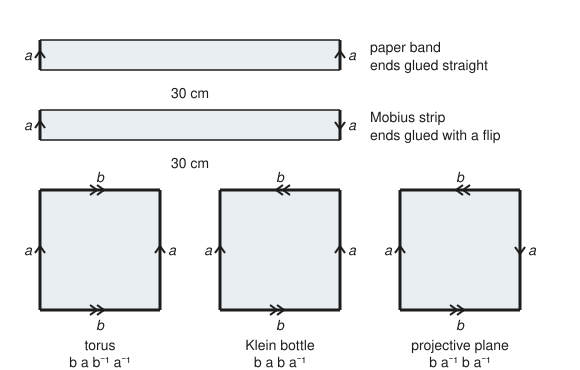

# Orientability: whether a surface has two sides, and the famous ones that do not

[Syllabus](../../../SYLLABUS.md) → [Topology](../README.md) → [Surfaces and Manifolds](../README.md#s03) → Orientability

---

## General Overview

Cut a strip of paper 30 cm long and 3 cm wide. Bring the ends together and tape them straight: you get a band, like a short bicycle inner tube cut open. Run a pen along the middle without lifting it. After 30 cm the pen is back where it started, and the other face of the paper is still clean.

Now tape a second strip with a half twist: turn one end over before you join it. Run the pen again. After 30 cm the pen is back at the start, but on the *other* face. After 60 cm it closes up, and both faces carry ink. This strip has only one side. It is the **Möbius strip**, found in 1858.

Cut each one along the pen line. The plain band falls into two bands, each 30 cm round. The Möbius strip stays in **one** piece, 60 cm round. Something about the whole strip has changed, yet every 3 cm square of paper looks the same as before.

This card names that property. A surface is **orientable** when every small piece of it can be given a turning sense, clockwise or anticlockwise, that agrees across every shared edge. For a surface sitting in space without crossing itself, that is the same as having two sides.

The card gives a test for it, builds the three famous surfaces that fail it, the Möbius strip, the **Klein bottle** and the **projective plane**, and says why the last two cannot be built in ordinary space without passing through themselves.

**Choose a turning sense on one panel and every shared edge forces the choice on its neighbour, so a surface is orientable exactly when no closed path of panels brings the choice back reversed.**

**What kind of fact this is:** a definition, orientable, with two theorems proved on this card in Why it works: the loop test and the gluing-word rule. Two facts are stated with a source, not proved here: no homeomorphism changes orientability, and the Klein bottle and projective plane cannot sit in space without crossing themselves.

### The picture: five surfaces as glued paper

<p align="center"></p>

Sides with matching letters are glued so their arrows match. The two strips are drawn to scale, 10 pixels per centimetre. The three squares are schematic: the torus is the inner tube, glued from a square; the Klein bottle and the projective plane cannot be drawn in space without the surface crossing itself, so the square is the honest picture.

---

## The formula

The shelf's earlier cards give the setting. A **surface** is a space where every point has a neighbourhood like a small flat disc, possibly with a rim ([Topological manifold](01-topological-manifolds.md)). Here a surface is built from **panels**: squares or triangles glued edge to edge, every edge on one panel (a rim edge) or two.

Notation, in words first. Walk round each panel anticlockwise as it lies flat on the page. Fix an arrow on every edge. Then:

- $`c(T, e)`$ is $`+1`$ if panel $`T`$'s walk runs along edge $`e`$ with its arrow, and $`-1`$ if against.
- $`s_T`$ is the **sense** chosen for panel $`T`$: $`+1`$ keeps its walk, $`-1`$ reverses it.
- A choice of senses is **consistent** when, on every edge shared by two panels, the two walks run in opposite directions. That is how two pieces of one sheet meet: turn both anticlockwise, and along their shared edge they pass each other.

```math
s_{T'} = t(e)\, s_T, \qquad t(e) = -\,c(T, e)\, c(T', e)
```

**Read it aloud:** the sense of the neighbour across edge e is the sense of this panel times the twist of e; the twist is plus one when the two walks already run opposite, minus one when the gluing turns one over.

Following the forced choices round a closed path of panels gives the test:

```math
\text{orientable} \iff \prod_{e \text{ crossed by } \gamma} t(e) = +1 \text{ for every closed path } \gamma
```

**Read it aloud:** a surface is orientable exactly when, round every closed path of panels, the twists multiply to plus one.

On the Möbius strip of 10 panels, one lap crosses 9 joins with twist $`+1`$ and the taped seam with twist $`-1`$. The product is $`-1`$: not orientable. Two laps give $`(-1)^2 = +1`$, which is why the pen closes up after 60 cm.

| Symbol | Plain meaning | In our example | Push it up and the answer… |
| --- | --- | --- | --- |
| $`T`$, $`T'`$ | two panels sharing an edge | two 3 cm squares side by side | — |
| $`e`$ | the edge they share | the taped seam | — |
| $`c(T, e)`$ | $`+1`$ if $`T`$'s anticlockwise walk follows $`e`$'s arrow, else $`-1`$ | $`-1`$ on both sides of the seam | — |
| $`s_T`$ | the sense chosen for panel $`T`$ | $`+1`$ on the first square | flipping it flips every forced sense |
| $`t(e)`$ | the twist across $`e`$ | $`+1`$ on 9 joins, $`-1`$ on the seam | one more $`-1`$ on a loop flips the verdict |
| $`\gamma`$ | a closed path of $`n`$ panels, $`T_0`$ to $`T_n = T_0`$, ending where it starts | one lap of the strip, 10 panels | — |
| $`\prod`$ | multiply the terms together | $`(+1)^9 \times (-1) = -1`$ | — |
| $`a`$, $`b`$, $`a^{-1}`$ | edge labels in a gluing word; $`a^{-1}`$ is $`a`$ walked against its arrow | the Möbius strip reads $`a^{-1}\,a^{-1}`$ | — |
| $`V`$, $`E`$, $`F`$, $`\chi`$ | vertices, edges, panels; $`\chi = V - E + F`$ | 20, 30, 10; $`\chi = 0`$ | — |
| $`\mathbb{RP}^2`$ | the real projective plane, built as a surface | the square glued $`b\,a^{-1}\,b\,a^{-1}`$ | — |

### When it holds

- **Every edge is on at most two panels.** Three panels on one edge, like the pages of a book at the spine, is no surface, and "the neighbour across e" has no single meaning.
- **The surface is connected.** On two separate pieces, one choice does not force the other, so the count of consistent choices is no longer 2 or 0. Each piece is tested on its own.
- **Every closed path is tested, not just some.** One lap of the Möbius strip shows the twist; a path that never crosses the seam reports $`+1`$ and proves nothing.
- **"Two-sided" equals "orientable" only for a surface sitting in space without crossing itself.** The general definition uses senses, not sides, because a surface need not sit anywhere.

---

## Why it works

### Step 0: one choice decides everything

Each panel alone is a flat square: it has two senses, and either works. The question is only whether the choices can agree everywhere at once.

They are not free. Once one panel's sense is chosen, each shared edge forces its neighbour's, and that neighbour forces the next. On a connected surface the first choice reaches every panel. So there are only two candidates for a consistent choice, one for each sense of the first panel, and the whole question is whether the forced choices ever collide.

### Step 1: an edge passes the choice on

Panel $`T`$, with sense $`s_T`$, runs along $`e`$ in the direction $`s_T\,c(T, e)`$. Its neighbour runs in the direction $`s_{T'}\,c(T', e)`$. Consistency asks for opposite directions:

```math
s_{T'}\, c(T', e) = -\,s_T\, c(T, e)
```

Multiply both sides by $`c(T', e)`$, which squares to 1: $`s_{T'} = -c(T, e)\,c(T', e)\,s_T = t(e)\,s_T`$. That is the formula.

On the flat strip, two neighbouring squares run along their shared edge in opposite directions already, so $`t = +1`$. At the twisted seam, the gluing turns one end over: both walks run down the seam, so $`t = -1`$.

### Step 2: the loop test

Carry the choice round a closed path of panels. Each crossing multiplies the sense by that edge's twist. Back at the start, the sense has been multiplied by the product of the twists. Consistency needs the sense to come back as it left, so the product must be $`+1`$. The fold proves the converse: when every loop gives $`+1`$, a consistent choice exists.

<details>
<summary>Detailed proof: orientable exactly when every loop's twists multiply to +1</summary>

**If a consistent choice exists.** Let the path be $`T_0, T_1, \dots, T_n = T_0`$, crossing edges $`e_1, \dots, e_n`$. Step 1 gives $`s_{T_k} = t(e_k)\, s_{T_{k-1}}`$ for each crossing. Chaining them:

$`\displaystyle s_{T_0} = t(e_1)\, t(e_2) \cdots t(e_n)\, s_{T_0}`$

Since $`s_{T_0}`$ is $`\pm 1`$, it can be cancelled, and the product is $`+1`$.

**If every loop gives +1.** Fix a panel $`T_0`$ with sense $`+1`$. For any panel $`T`$, pick a path from $`T_0`$ to $`T`$ (the surface is connected) and set $`s_T`$ to the product of the twists along it. Two paths to $`T`$ give the same value: the first path followed by the second walked backwards is a loop, whose product is $`+1`$, and each twist is its own inverse. So $`s_T`$ is well defined. Across any shared edge $`e`$ from $`T`$ to $`T'`$, a path to $`T`$ extended across $`e`$ is a path to $`T'`$, so $`s_{T'} = t(e)\,s_T`$. That is Step 1's condition on every edge: the choice is consistent.

**Counting.** On a connected surface, every consistent choice is fixed by its value on $`T_0`$. So there are exactly 2 consistent choices, or none.

</details>

The code takes this road literally: it spreads one sense across shared edges and reports any collision. It then checks the answer by brute force, trying all $`2^F`$ choices of sense on surfaces of 9 or 10 panels. That exhaustive search is a proof for those finite panel sets, not for surfaces in general.

### Step 3: a sense is a side

For a surface in space, a sense on a panel picks a normal: curl the fingers of the right hand along the walk, and the thumb points out of one face. A unit normal, an arrow of length 1 at right angles to the surface, is what [Surface integrals](../../06-Calculus%20and%20analysis/09-Vector%20Calculus/05-surface-integrals-and-flux.md) needs to measure flow through a sheet. A consistent sense is a normal that moves continuously over the whole surface: a chosen side.

On the Möbius strip, carry the normal along the pen line. After one lap of 30 cm it points the opposite way. That is the twist product $`-1`$, seen as an arrow, and it is why flux through a Möbius strip has no meaning.

### Step 4: the gluing-word rule

The squares in the picture are described by **words**. Walk anticlockwise round the polygon from its bottom-left corner. Write each glued side's letter, with exponent $`-1`$ when the walk goes against the side's arrow. The torus, the inner tube, reads $`b\,a\,b^{-1}\,a^{-1}`$ ([Closed surfaces classified](02-surfaces-and-the-classification-theorem.md) uses these words to list every closed surface). That card starts its walk elsewhere and points some arrows the other way, so its words can look different: its projective plane reads $`abab`$. Reversing one letter's arrow swaps that letter's exponents everywhere, so whether a letter repeats with the same exponent never changes.

**Rule:** a surface glued from one polygon is orientable exactly when no letter appears twice with the same exponent.

<details>
<summary>Detailed proof: the gluing-word rule</summary>

Give the whole polygon one sense, its anticlockwise walk. Each glued letter appears on two sides, and the walk passes both.

**Opposite exponents, as in $`a`$ and $`a^{-1}`$.** The walk follows the arrow on one side and opposes it on the other. After gluing, the two sides are one edge, and the walk runs along it in both directions: exactly what consistency asks. If every letter is like this, the one sense on the polygon is consistent everywhere. Orientable.

**The same exponent, as in $`a`$ and $`a`$.** The walk follows the arrow on both sides, so after gluing both walks run the same way: the twist is $`-1`$. Take a path that starts in the polygon next to one copy of the letter, crosses the glued edge, and arrives next to the other copy. The two ends are in the same polygon, so join them by a path inside it, which crosses no edge. This loop crosses exactly one edge, with twist $`-1`$. By Step 2, not orientable.

</details>

The Möbius strip reads $`a^{-1}\,a^{-1}`$: the seam letter twice with the same exponent. The plain band reads $`a\,a^{-1}`$.

### Step 5: the Möbius strip is the only obstacle

If a surface contains a Möbius strip made of its own panels, the loop round the strip's middle has twist product $`-1`$, so the surface is not orientable. The converse also holds: a loop with product $`-1`$ has a thin band of panels around it, and that band, crossed once with a reversal, is a Möbius strip. So a surface is non-orientable exactly when a Möbius strip sits inside it. This card proves the first direction and only sketches the second.

**Which maps keep it.** Orientability is a topological invariant: two surfaces related by a homeomorphism get the same verdict, however each one is cut into panels. This card does not prove it. The test above reads one chosen panelling, and showing that every panelling gives the same answer needs homology, an algebra of cycles that later shelves of this wing build. Hatcher (Sources, Section 3.3) defines orientability from small neighbourhoods alone, with no panels, so a homeomorphism carries it over, and his Theorem 3.26 reads it off one homology group. The intuitive reason is this step's: a homeomorphism carries a Möbius strip to a Möbius strip.

### Step 6: the Klein bottle and the projective plane

Both are closed surfaces, with no rim, and both contain a Möbius strip.

- **The Klein bottle** reads $`b\,a\,b\,a^{-1}`$. Glue the $`a`$ sides first: a tube, like the inner tube before it is closed. Then glue the tube's two ends, but with the $`b`$ arrows opposed: one end must come round and meet the other from inside. The letter $`b`$ appears twice with the same exponent, so the rule says not orientable. Cut lengthwise, it falls into two Möbius strips.
- **The projective plane** reads $`b\,a^{-1}\,b\,a^{-1}`$. Read $`b\,a^{-1}`$ as one letter $`c`$: the word is $`c\,c`$, so each point of a disc's rim is glued to the opposite point. [Perspective](../../05-Geometry%20and%20trig/05-Vectors%20in%20Space/05-perspective-and-projective-coordinates.md) gave the projective plane in coordinates: each point is a line through the camera's lens. Each line meets the upper half of a sphere round the lens once, except the level lines, which meet its rim at two opposite points. So the plane is that half-sphere, a disc, with opposite rim points glued: the same surface. Cut a band round the rim and it is a Möbius strip; what is left is a disc.

Two words carry the honest picture of fitting a surface into space. An **embedding** is a map that is a homeomorphism onto its image: a copy with no crossings. An **immersion** is a map that is an embedding near each point, though distant parts may pass through each other. The familiar glass Klein bottle is an immersion: the neck passes through the wall along a circle, and that circle belongs to the drawing, not to the surface.

That crossing cannot be removed. A closed surface embedded in space would cut space into an inside and an outside, and the outward direction would be a consistent normal. So no closed non-orientable surface embeds in ordinary space; Hatcher proves it by homology (Corollary 3.46 and the remark after it). Both immerse: Werner Boy found an immersion of the projective plane in 1903. The smooth versions belong to the immersions card in the differential-geometry wing (Immersions, planned).

---

## Worked numbers, by hand

The Möbius strip as 10 squares of 3 cm, ends taped with a flip.

| Step | Arithmetic | Value |
| --- | --- | --- |
| panels and joins | 10 squares; 9 joins inside, 1 seam | 10 panels, 10 shared edges |
| twist at each inside join | the two walks run opposite | $`+1`$ |
| twist at the seam | the flip makes both walks run down the seam | $`-1`$ |
| one lap | $`(+1)^9 \times (-1)`$ | **−1: not orientable** |
| two laps | $`(-1)^2`$ | $`+1`$: the pen line closes after 60 cm |
| consistent choices, out of $`2^{10} = 1024`$ | every choice tried | 0 |
| the rim | the free edges of 3 cm, joined end to end | one circle, 60 cm |
| the plain band, same count | 10 twists of $`+1`$ | 2 choices; two rims of 30 cm |

The strip has one side and one rim edge, 60 cm long; the band has two of each.

The other surfaces, from 3 by 3 grids of squares. Here $`V`$, $`E`$ and $`F`$ count vertices, edges and panels after gluing, and $`\chi = V - E + F`$ is the Euler characteristic, the subject of [Euler characteristic](04-euler-characteristic-and-triangulations.md).

| Surface | Word | V, E, F | $`\chi`$ | Consistent choices |
| --- | --- | --- | --- | --- |
| torus | $`b\,a\,b^{-1}\,a^{-1}`$ | 9, 18, 9 | 0 | 2 |
| Klein bottle | $`b\,a\,b\,a^{-1}`$ | 9, 18, 9 | 0 | 0 |
| projective plane | $`b\,a^{-1}\,b\,a^{-1}`$ | 10, 18, 9 | 1 | 0 |
| geodesic dome, closed into a sphere | 80 triangles | 42, 120, 80 | 2 | two-sided |

The **geodesic dome** is the shelf's sphere: 42 hubs, 120 struts and 80 triangular panels. Every panel can be turned to face outward at once.

### What breaks if you drop a piece

| Mistake | Comes out at | What went wrong |
| --- | --- | --- |
| Tell the band from the Möbius strip by $`\chi`$ | band 0, strip 0; torus 0, Klein bottle 0 | Equal invariants prove nothing; $`\chi`$ cannot see a twist |
| Check the joins but skip the taped seam | the Möbius strip reported two-sided | Orientability lives on whole loops; every join away from the seam is fine |
| Treat any repeated letter as a twist | the torus reported one-sided, yet it has 2 consistent choices | Only a letter repeated with the **same** exponent twists |
| Cut the Möbius strip down the middle, expecting two bands | one piece, 60 cm, two-sided | The pen line is one closed curve of 60 cm, not two of 30 cm |

The code prints all four.

---

## Code, from first principles, and it actually runs

Nothing is imported. A surface is a grid of squares whose sides are glued by a rule, or the dome's 80 triangles, each panel listed as its sides walked anticlockwise. The code takes three independent roads to orientability: spreading one panel's sense across shared edges (Step 2), trying every choice of senses by brute force, and reading the gluing word (Step 4). It also cuts strips along their row lines and sorts the pieces with its own union-find, a short routine that merges points into groups.

### Python

```python
# Orientability -- the check behind the card.  Nothing is imported.
# A surface is a grid of square panels with glued sides, or the geodesic dome's
# 80 triangles.  A panel is its list of sides, walked anticlockwise: (edge, +1 or
# -1 for the way the walk runs along it).  Three roads test for a consistent
# turning sense: spreading one panel's sense, trying every choice, the gluing word.

SIDED = {True: "two-sided", False: "one-sided"}

def find(par, p):                         # union-find, written out here
    while par.setdefault(p, p) != p:
        p = par[p]
    return p

def grid(L, H, a_flip, b_glue, b_flip):   # L x H panels; right side glued to left
    par = {}                              # side (a); top to bottom (b) if b_glue
    for y in range(H + 1):
        par[find(par, (L, y))] = find(par, (0, H - y if a_flip else y))
    for x in range(L + 1) if b_glue else []:
        par[find(par, (x, H))] = find(par, (L - x if b_flip else x, 0))
    def side(p, q):                       # carry a glued segment to its partner
        if p[0] == q[0] == L:
            p, q = [(0, H - y if a_flip else y) for x, y in (p, q)]
        elif b_glue and p[1] == q[1] == H:
            p, q = [(L - x if b_flip else x, 0) for x, y in (p, q)]
        return (min(p, q), max(p, q)), (1 if p < q else -1)
    faces = [[side(c[k], c[(k + 1) % 4]) for k in range(4)] for i in range(L) for j in range(H)
             for c in [[(i, j), (i + 1, j), (i + 1, j + 1), (i, j + 1)]]]
    return faces, par

def links(faces, skip=()):                # twist t(e) = +1 if the two walks run opposite
    uses = {}
    for f, sides in enumerate(faces):
        for e, d in sides:
            uses.setdefault(e, []).append((f, d))
    nb = {f: [] for f in range(len(faces))}
    for e, u in uses.items():
        if len(u) == 2 and e not in skip:
            (f, d), (g, d2) = u
            nb[f].append((g, -d * d2))
            nb[g].append((f, -d * d2))
    return uses, nb

def spread(faces, skip=()):               # road one: one sense forces its neighbours
    uses, nb = links(faces, skip)
    s, pieces = {}, []
    for start in range(len(faces)):
        if start not in s:
            s[start], todo, size, ok = 1, [start], 0, True
            while todo:
                f = todo.pop()
                size += 1
                for g, t in nb[f]:
                    if g not in s:
                        s[g] = t * s[f]
                        todo.append(g)
                    elif s[g] != t * s[f]:
                        ok = False
            pieces.append((size, ok))
    return pieces

def brute(faces):                         # road two: try all 2^F choices of sense
    _, nb = links(faces)
    return sum(all(((m >> g) & 1) == ((m >> f) & 1) ^ (t < 0) for f in nb for g, t in nb[f])
               for m in range(2 ** len(faces)))

def word(a_flip, b_glue, b_flip):         # road three: sides read anticlockwise
    w = (["b"] if b_glue else []) + ["a^-1" if a_flip else "a"]
    return w + (["b" if b_flip else "b^-1"] if b_glue else []) + ["a^-1"]

def repeats(w, exact):                    # a letter met twice: same exponent, or at all
    return any([x if exact else x[0] for x in w].count(c) == 2 for c in set(w) | {"a", "b"})

def lap(faces, laps):                     # product of t(e) round the panels 0..L-1
    _, nb = links(faces)
    L, prod = len(faces), 1
    for k in range(L * laps):
        prod *= [t for g, t in nb[k % L] if g == (k + 1) % L][0]
    return prod

def rim(faces, par):                      # free edges joined into circles, 3 cm each
    uses, _ = links(faces)
    loops, free = {}, [e for e, u in uses.items() if len(u) == 1]
    for p, q in free:
        loops[find(loops, find(par, p))] = find(loops, find(par, q))
    roots = [find(loops, find(par, p)) for p, q in free]
    return " + ".join(f"{3 * roots.count(r)} cm" for r in sorted(set(roots))) or "none"

def cut(L, H, a_flip):                    # cut along every line between rows
    faces, _ = grid(L, H, a_flip, False, False)
    lines = {((i, y), (i + 1, y)) for i in range(L) for y in range(1, H)}
    return ", ".join(f"{3 * n} cm {SIDED[ok]}" for n, ok in sorted(spread(faces, lines)))

def dome():                               # icosahedron, each triangle cut in four
    ico = [t for i in range(5) for j in [(i + 1) % 5] for t in
           ((0, 1 + i, 1 + j), (11, 6 + i, 6 + j), (1 + i, 6 + i, 1 + j), (1 + j, 6 + i, 6 + j))]
    mid = {}
    def m(u, v):
        return mid.setdefault((min(u, v), max(u, v)), 12 + len(mid))
    tris = [t for a, b, c in ico for t in ((a, m(a, b), m(a, c)), (b, m(b, c), m(a, b)),
                                           (c, m(a, c), m(b, c)), (m(a, b), m(b, c), m(a, c)))]
    return [[((min(p, q), max(p, q)), 1 if p < q else -1) for p, q in zip(t, t[1:] + t[:1])]
            for t in tris]

SURFACES = [("paper band", 10, 1, False, False, False), ("Mobius strip", 10, 1, True, False, False),
            ("torus", 3, 3, False, True, False), ("Klein bottle", 3, 3, False, True, True),
            ("projective plane", 3, 3, True, True, True)]
res = {}
for name, L, H, af, bg, bf in SURFACES:
    faces, par = grid(L, H, af, bg, bf)
    V, E, F = len({find(par, (x, y)) for x in range(L + 1) for y in range(H + 1)}), len(links(faces)[0]), len(faces)
    ok, w = spread(faces)[0][1], word(af, bg, bf)
    res[name] = (ok, brute(faces), repeats(w, True), V - E + F, repeats(w, False))
    print(f"{name}: V {V}, E {E}, F {F}, chi {V - E + F}; word {' '.join(w)}; spread {SIDED[ok]}; "
          f"choices {res[name][1]} of {2 ** F}; word rule {SIDED[not repeats(w, True)]}; rim {rim(faces, par)}")
band, mob = grid(10, 1, False, False, False)[0], grid(10, 1, True, False, False)[0]
print(f"twist product, one lap: band {lap(band, 1)}, Mobius {lap(mob, 1)}; two laps: Mobius {lap(mob, 2)}")
print(f"cut down the middle: band {cut(10, 2, False)}; Mobius {cut(10, 2, True)}")
print(f"cut a third in: band {cut(10, 3, False)}; Mobius {cut(10, 3, True)}")
du = links(d := dome())[0]
dv = {v for e in du for v in e}
print(f"geodesic dome: V {len(dv)}, E {len(du)}, F {len(d)}, chi {len(dv) - len(du) + len(d)}; every edge on 2 "
      f"panels: {'yes' if all(len(u) == 2 for u in du.values()) else 'no'}; spread {SIDED[spread(d)[0][1]]}")
seam = {e for e, u in links(mob)[0].items() if len(u) == 2 and e[0][0] == 0}
print(f"mistake, chi alone: band {res['paper band'][3]} = Mobius {res['Mobius strip'][3]}, "
      f"torus {res['torus'][3]} = Klein {res['Klein bottle'][3]}")
print(f"mistake, Mobius strip with the glued seam left unchecked: {SIDED[spread(mob, seam)[0][1]]}")
print(f"mistake, any repeated letter taken as a twist: torus {SIDED[not res['torus'][4]]}, "
      f"yet {res['torus'][1]} consistent choices exist")
print("figure, 10 px per cm: band and strip 300 x 30 at (40, 40) and (40, 110); "
      "squares 120 x 120 at (40, 190), (220, 190), (400, 190)")
assert all((r[1] == 2) == r[0] and r[2] == (not r[0]) for r in res.values())   # three roads agree
assert [r[0] for r in res.values()] == [True, False, True, False, False]
assert [r[3] for r in res.values()] == [0, 0, 0, 0, 1]
assert (lap(band, 1), lap(mob, 1), lap(mob, 2)) == (1, -1, 1)
assert cut(10, 2, True) == "60 cm two-sided"
assert cut(10, 3, True) == "30 cm one-sided, 60 cm two-sided"
assert spread(d) == [(80, True)] and (len(dv), len(du)) == (42, 120)
print("ALL CHECKS PASS")
```

**Ran 2026-11-14 on macOS, Python 3.14.10, standard library only. All checks passed. Output, pasted from the run:**

```
paper band: V 20, E 30, F 10, chi 0; word a a^-1; spread two-sided; choices 2 of 1024; word rule two-sided; rim 30 cm + 30 cm
Mobius strip: V 20, E 30, F 10, chi 0; word a^-1 a^-1; spread one-sided; choices 0 of 1024; word rule one-sided; rim 60 cm
torus: V 9, E 18, F 9, chi 0; word b a b^-1 a^-1; spread two-sided; choices 2 of 512; word rule two-sided; rim none
Klein bottle: V 9, E 18, F 9, chi 0; word b a b a^-1; spread one-sided; choices 0 of 512; word rule one-sided; rim none
projective plane: V 10, E 18, F 9, chi 1; word b a^-1 b a^-1; spread one-sided; choices 0 of 512; word rule one-sided; rim none
twist product, one lap: band 1, Mobius -1; two laps: Mobius 1
cut down the middle: band 30 cm two-sided, 30 cm two-sided; Mobius 60 cm two-sided
cut a third in: band 30 cm two-sided, 30 cm two-sided, 30 cm two-sided; Mobius 30 cm one-sided, 60 cm two-sided
geodesic dome: V 42, E 120, F 80, chi 2; every edge on 2 panels: yes; spread two-sided
mistake, chi alone: band 0 = Mobius 0, torus 0 = Klein 0
mistake, Mobius strip with the glued seam left unchecked: two-sided
mistake, any repeated letter taken as a twist: torus one-sided, yet 2 consistent choices exist
figure, 10 px per cm: band and strip 300 x 30 at (40, 40) and (40, 110); squares 120 x 120 at (40, 190), (220, 190), (400, 190)
ALL CHECKS PASS
```

### Rust

Same numbers, same labels, built with `rustc --edition 2021 -O`.

```rust
// Orientability -- the same check as the Python, in Rust.  No crates.  A panel is
// its list of sides, walked anticlockwise: (edge, +1 or -1 for the walk's way along
// it).  Three roads: spreading one panel's sense, every choice, the gluing word.
use std::collections::{BTreeMap, BTreeSet};

type P = (i64, i64);
type Edge = (P, P);
type Face = Vec<(Edge, i64)>;
type Uses = BTreeMap<Edge, Vec<(usize, i64)>>;

fn sided(ok: bool) -> &'static str { if ok { "two-sided" } else { "one-sided" } }

fn find(par: &mut BTreeMap<P, P>, mut p: P) -> P {   // union-find, written out here
    while *par.entry(p).or_insert(p) != p { p = par[&p] }
    p
}

fn join(par: &mut BTreeMap<P, P>, p: P, q: P) { let (a, b) = (find(par, p), find(par, q)); par.insert(a, b); }

fn key(p: P, q: P) -> (Edge, i64) { ((p.min(q), p.max(q)), if p < q { 1 } else { -1 }) }

// L x H panels; right side glued to left (a); top to bottom (b) if b_glue
fn grid(l: i64, h: i64, a_flip: bool, b_glue: bool, b_flip: bool) -> (Vec<Face>, BTreeMap<P, P>) {
    let mut par = BTreeMap::new();
    for y in 0..=h { join(&mut par, (l, y), (0, if a_flip { h - y } else { y })) }
    for x in 0..=l { if b_glue { join(&mut par, (x, h), (if b_flip { l - x } else { x }, 0)) } }
    let side = |p: P, q: P| -> (Edge, i64) {             // carry a glued segment to its partner
        let a = |s: P| (0, if a_flip { h - s.1 } else { s.1 });
        let b = |s: P| (if b_flip { l - s.0 } else { s.0 }, 0);
        if p.0 == l && q.0 == l { key(a(p), a(q)) }
        else if b_glue && p.1 == h && q.1 == h { key(b(p), b(q)) } else { key(p, q) }
    };
    let faces = (0..l).flat_map(|i| (0..h).map(move |j| [(i, j), (i + 1, j), (i + 1, j + 1), (i, j + 1)]))
        .map(|c| (0..4).map(|k| side(c[k], c[(k + 1) % 4])).collect()).collect();
    (faces, par)
}

// twist t(e) = +1 if the two walks run opposite
fn links(faces: &[Face], skip: &BTreeSet<Edge>) -> (Uses, Vec<Vec<(usize, i64)>>) {
    let mut uses: Uses = BTreeMap::new();
    for (f, sides) in faces.iter().enumerate() {
        for &(e, d) in sides { uses.entry(e).or_default().push((f, d)) }
    }
    let mut nb = vec![Vec::new(); faces.len()];
    for (e, u) in &uses {
        if u.len() == 2 && !skip.contains(e) {
            let ((f, d), (g, d2)) = (u[0], u[1]);
            nb[f].push((g, -d * d2)); nb[g].push((f, -d * d2));
        }
    }
    (uses, nb)
}

fn spread(faces: &[Face], skip: &BTreeSet<Edge>) -> Vec<(usize, bool)> {   // road one
    let (_, nb) = links(faces, skip);
    let (mut s, mut pieces) = (vec![0i64; faces.len()], Vec::new());
    for start in 0..faces.len() {
        if s[start] != 0 { continue }
        s[start] = 1;
        let (mut todo, mut size, mut ok) = (vec![start], 0, true);
        while let Some(f) = todo.pop() {
            size += 1;
            for &(g, t) in &nb[f] {
                if s[g] == 0 { s[g] = t * s[f]; todo.push(g) } else if s[g] != t * s[f] { ok = false }
            }
        }
        pieces.push((size, ok));
    }
    pieces
}

fn brute(faces: &[Face]) -> usize {                     // road two: all 2^F choices
    let (_, nb) = links(faces, &BTreeSet::new());
    (0u32..1 << faces.len()).filter(|m| (0..faces.len()).all(|f| nb[f].iter()
        .all(|&(g, t)| ((m >> g) & 1) == ((m >> f) & 1) ^ (t < 0) as u32))).count()
}

fn word(a_flip: bool, b_glue: bool, b_flip: bool) -> Vec<&'static str> {  // road three
    let w = [Some("b"), Some(if a_flip { "a^-1" } else { "a" }), Some(if b_flip { "b" } else { "b^-1" }), Some("a^-1")];
    w.iter().enumerate().filter(|(i, _)| b_glue || i % 2 == 1).map(|(_, x)| x.unwrap()).collect()
}

fn repeats(w: &[&str], exact: bool) -> bool {           // a letter met twice: same exponent, or at all
    let v: Vec<&str> = w.iter().map(|x| if exact { *x } else { &x[..1] }).collect();
    w.iter().chain(["a", "b"].iter()).any(|c| v.iter().filter(|x| *x == c).count() == 2)
}

fn lap(faces: &[Face], laps: usize) -> i64 {            // product of t(e) round panels 0..L-1
    let (nb, l) = (links(faces, &BTreeSet::new()).1, faces.len());
    (0..l * laps).map(|k| nb[k % l].iter().find(|&&(g, _)| g == (k + 1) % l).unwrap().1).product()
}

fn rim(faces: &[Face], par: &mut BTreeMap<P, P>) -> String {   // free edges into circles, 3 cm each
    let free: Vec<Edge> = links(faces, &BTreeSet::new()).0.iter().filter(|(_, u)| u.len() == 1).map(|(e, _)| *e).collect();
    let mut loops = BTreeMap::new();
    for &(p, q) in &free { let (rp, rq) = (find(par, p), find(par, q)); join(&mut loops, rp, rq) }
    let mut count: BTreeMap<P, i64> = BTreeMap::new();
    for &(p, _) in &free { let rp = find(par, p); *count.entry(find(&mut loops, rp)).or_default() += 3 }
    let s: Vec<String> = count.values().map(|c| format!("{} cm", c)).collect();
    if s.is_empty() { "none".to_string() } else { s.join(" + ") }
}

fn cut(l: i64, h: i64, a_flip: bool) -> String {        // cut along every line between rows
    let (faces, _) = grid(l, h, a_flip, false, false);
    let lines: BTreeSet<Edge> = (0..l).flat_map(|i| (1..h).map(move |y| ((i, y), (i + 1, y)))).collect();
    let mut p = spread(&faces, &lines);
    p.sort();
    p.iter().map(|&(n, ok)| format!("{} cm {}", 3 * n, sided(ok))).collect::<Vec<_>>().join(", ")
}

fn dome() -> Vec<Face> {                                // icosahedron, each triangle cut in four
    let mut ico = Vec::new();
    for (i, j) in (0..5).map(|i| (i, (i + 1) % 5)) {
        ico.extend([(0, 1 + i, 1 + j), (11, 6 + i, 6 + j), (1 + i, 6 + i, 1 + j), (1 + j, 6 + i, 6 + j)]);
    }
    let mut mid: BTreeMap<(i64, i64), i64> = BTreeMap::new();
    let mut m = |u: i64, v: i64| { let n = 12 + mid.len() as i64; *mid.entry((u.min(v), u.max(v))).or_insert(n) };
    let mut faces = Vec::new();
    for (a, b, c) in ico {
        let (ab, ac, bc) = (m(a, b), m(a, c), m(b, c));
        for t in [[a, ab, ac], [b, bc, ab], [c, ac, bc], [ab, bc, ac]] {
            faces.push((0..3).map(|k| key((t[k], 0), (t[(k + 1) % 3], 0))).collect());
        }
    }
    faces
}

fn main() {
    let none = BTreeSet::new();
    let surfaces = [("paper band", 10, 1, false, false, false), ("Mobius strip", 10, 1, true, false, false),
        ("torus", 3, 3, false, true, false), ("Klein bottle", 3, 3, false, true, true),
        ("projective plane", 3, 3, true, true, true)];
    let mut res = Vec::new();
    for &(name, l, h, af, bg, bf) in &surfaces {
        let (faces, mut par) = grid(l, h, af, bg, bf);
        let vs: BTreeSet<P> = (0..=l).flat_map(|x| (0..=h).map(move |y| (x, y))).map(|q| find(&mut par, q)).collect();
        let (v, e, f) = (vs.len() as i64, links(&faces, &none).0.len() as i64, faces.len() as i64);
        let (ok, w) = (spread(&faces, &none)[0].1, word(af, bg, bf));
        let r = (ok, brute(&faces), repeats(&w, true), v - e + f, repeats(&w, false));
        println!("{}: V {}, E {}, F {}, chi {}; word {}; spread {}; choices {} of {}; word rule {}; rim {}", name, v,
                 e, f, v - e + f, w.join(" "), sided(ok), r.1, 1u64 << f, sided(!r.2), rim(&faces, &mut par));
        res.push(r);
    }
    let (band, mob) = (grid(10, 1, false, false, false).0, grid(10, 1, true, false, false).0);
    println!("twist product, one lap: band {}, Mobius {}; two laps: Mobius {}", lap(&band, 1), lap(&mob, 1), lap(&mob, 2));
    println!("cut down the middle: band {}; Mobius {}", cut(10, 2, false), cut(10, 2, true));
    println!("cut a third in: band {}; Mobius {}", cut(10, 3, false), cut(10, 3, true));
    let (d, closed) = (dome(), |b: bool| if b { "yes" } else { "no" });
    let du = links(&d, &none).0;
    let dv: BTreeSet<P> = du.keys().flat_map(|&(p, q)| [p, q]).collect();
    println!("geodesic dome: V {}, E {}, F {}, chi {}; every edge on 2 panels: {}; spread {}", dv.len(), du.len(),
             d.len(), dv.len() as i64 - du.len() as i64 + d.len() as i64, closed(du.values().all(|u| u.len() == 2)), sided(spread(&d, &none)[0].1));
    let seam: BTreeSet<Edge> = links(&mob, &none).0.iter().filter(|(e, u)| u.len() == 2 && e.0 .0 == 0)
        .map(|(e, _)| *e).collect();
    println!("mistake, chi alone: band {} = Mobius {}, torus {} = Klein {}", res[0].3, res[1].3, res[2].3, res[3].3);
    println!("mistake, Mobius strip with the glued seam left unchecked: {}", sided(spread(&mob, &seam)[0].1));
    println!("mistake, any repeated letter taken as a twist: torus {}, yet {} consistent choices exist",
             sided(!res[2].4), res[2].1);
    println!("figure, 10 px per cm: band and strip 300 x 30 at (40, 40) and (40, 110); \
              squares 120 x 120 at (40, 190), (220, 190), (400, 190)");
    assert!(res.iter().all(|r| (r.1 == 2) == r.0 && r.2 == !r.0));           // three roads agree
    assert!(res.iter().map(|r| r.0).collect::<Vec<_>>() == [true, false, true, false, false]);
    assert!(res.iter().map(|r| r.3).collect::<Vec<_>>() == [0, 0, 0, 0, 1]);
    assert!((lap(&band, 1), lap(&mob, 1), lap(&mob, 2)) == (1, -1, 1));
    assert!(cut(10, 2, true) == "60 cm two-sided");
    assert!(cut(10, 3, true) == "30 cm one-sided, 60 cm two-sided");
    assert!(spread(&d, &none) == [(80, true)] && (dv.len(), du.len()) == (42, 120));
    println!("ALL CHECKS PASS");
}
```

**Ran 2026-11-14 on macOS, rustc 1.98.1, no crates. All checks passed. Output, pasted from the run:**

```
paper band: V 20, E 30, F 10, chi 0; word a a^-1; spread two-sided; choices 2 of 1024; word rule two-sided; rim 30 cm + 30 cm
Mobius strip: V 20, E 30, F 10, chi 0; word a^-1 a^-1; spread one-sided; choices 0 of 1024; word rule one-sided; rim 60 cm
torus: V 9, E 18, F 9, chi 0; word b a b^-1 a^-1; spread two-sided; choices 2 of 512; word rule two-sided; rim none
Klein bottle: V 9, E 18, F 9, chi 0; word b a b a^-1; spread one-sided; choices 0 of 512; word rule one-sided; rim none
projective plane: V 10, E 18, F 9, chi 1; word b a^-1 b a^-1; spread one-sided; choices 0 of 512; word rule one-sided; rim none
twist product, one lap: band 1, Mobius -1; two laps: Mobius 1
cut down the middle: band 30 cm two-sided, 30 cm two-sided; Mobius 60 cm two-sided
cut a third in: band 30 cm two-sided, 30 cm two-sided, 30 cm two-sided; Mobius 30 cm one-sided, 60 cm two-sided
geodesic dome: V 42, E 120, F 80, chi 2; every edge on 2 panels: yes; spread two-sided
mistake, chi alone: band 0 = Mobius 0, torus 0 = Klein 0
mistake, Mobius strip with the glued seam left unchecked: two-sided
mistake, any repeated letter taken as a twist: torus one-sided, yet 2 consistent choices exist
figure, 10 px per cm: band and strip 300 x 30 at (40, 40) and (40, 110); squares 120 x 120 at (40, 190), (220, 190), (400, 190)
ALL CHECKS PASS
```

The two outputs match line for line.

### Lean

Lean proves Step 1, the loop test and the count for any surface built from panels, every edge on at most two panels.

- Take a choice of senses. It is consistent exactly when every shared edge $`e`$ from $`T`$ to $`T'`$ gives $`s_{T'} = t(e)\, s_T`$.
- Suppose the surface is connected. Then it is orientable exactly when, round every closed path of panels, the twists multiply to $`+1`$.
- Suppose the surface is connected. Then it has exactly 2 consistent choices of senses when orientable, and none when not.
- Take the Möbius strip of 10 panels. Then one lap's twists multiply to $`-1`$, and two laps give $`(-1)^2 = +1`$.
- One lap of the plain band of 10 panels multiplies to $`+1`$.
- The hand arithmetic holds: $`(+1)^9 \times (-1) = -1`$, $`2^{10} = 1024`$ choices, and the tables' $`\chi`$ values 0, 0, 1 and 2.

The gluing-word rule, the brute-force counts, the cuts, the rims and the dome are left to the Python and Rust checks.

```lean
-- Orientability: a connected surface built from panels has a consistent turning sense exactly when the twists round every closed path of panels multiply to +1, and then it has exactly two.
import Mathlib.Combinatorics.Quiver.ConnectedComponent
import Mathlib.Algebra.GroupWithZero.Units.Fintype
import Mathlib.Algebra.BigOperators.Group.Finset.Basic
import Mathlib.SetTheory.Cardinal.Finite
import Mathlib.Tactic.NormNum
import Mathlib.Data.Int.Order.Units

/-- A surface built from panels, as the card sets it up. `P` is the set of panels and `E`
the set of shared edges. Each shared edge `e`, with one arrow fixed on it, lies on the side
of panel `T₁ e` and on the side of panel `T₂ e` (the same panel twice when a panel is glued
to itself). `c₁ e` is `+1` when `T₁ e`'s anticlockwise walk runs along `e` with the arrow and
`-1` when against: the card's `c(T, e)`. `c₂ e` is the same for `T₂ e`. A rim edge, on one
panel only, joins nothing and is left out. Giving each shared edge exactly two sides is the
card's condition that every edge is on at most two panels. -/
structure Panelling (P E : Type*) where
  /-- The first panel on the shared edge. -/
  T₁ : E → P
  /-- The second panel on the shared edge. -/
  T₂ : E → P
  /-- `c(T₁ e, e)`: `+1` if the first panel's walk follows the edge's arrow, `-1` if against. -/
  c₁ : E → ℤˣ
  /-- `c(T₂ e, e)`: the same for the second panel. -/
  c₂ : E → ℤˣ

namespace Panelling

variable {P E : Type*} (S : Panelling P E)

/-- A choice of senses `s`, `+1` keeping each panel's anticlockwise walk and `-1` reversing it,
is consistent when on every shared edge the two walks run in opposite directions:
`s_{T'} c(T', e) = -(s_T c(T, e))`. -/
def Consistent (s : P → ℤˣ) : Prop :=
  ∀ e, s (S.T₂ e) * S.c₂ e = -(s (S.T₁ e) * S.c₁ e)

/-- The surface is orientable when some choice of senses is consistent. -/
def Orientable : Prop :=
  ∃ s : P → ℤˣ, S.Consistent s

/-- The twist of a shared edge: `t(e) = -c(T, e) c(T', e)`. -/
def twist (e : E) : ℤˣ :=
  -(S.c₁ e * S.c₂ e)

/-- The panels, as the stops of paths. -/
def Panel (_ : Panelling P E) : Type _ := P

/-- Each shared edge `e` is a step from panel `T₁ e` to panel `T₂ e`. Paths in
`Quiver.Symmetrify S.Panel` may cross each edge either way. -/
instance : Quiver S.Panel where
  Hom a b := {e : E // S.T₁ e = a ∧ S.T₂ e = b}

/-- The twist of one crossing, whichever way the edge is crossed. -/
def crossingTwist {a b : Quiver.Symmetrify S.Panel} : (a ⟶ b) → ℤˣ
  | Sum.inl e => S.twist e.1
  | Sum.inr e => S.twist e.1

/-- The product of the twists of every edge a path of panels crosses. -/
def twistProd (S : Panelling P E) {a : Quiver.Symmetrify S.Panel} :
    ∀ {b : Quiver.Symmetrify S.Panel}, Quiver.Path a b → ℤˣ
  | _, .nil => 1
  | _, .cons p e => twistProd S p * S.crossingTwist e

/-- The surface is connected: there is at least one panel, and any two panels are joined by a
path of panels, each step crossing a shared edge. -/
def Connected : Prop :=
  Nonempty P ∧ Quiver.IsStronglyConnected (Quiver.Symmetrify S.Panel)

end Panelling

open Panelling

theorem Panelling.twistProd_comp {P E : Type*} (S : Panelling P E)
    {a b : Quiver.Symmetrify S.Panel} (p : Quiver.Path a b) :
    ∀ {c : Quiver.Symmetrify S.Panel} (q : Quiver.Path b c),
      S.twistProd (p.comp q) = S.twistProd p * S.twistProd q
  | _, .nil => by simp [Panelling.twistProd]
  | _, .cons q e => by
    rw [Quiver.Path.comp_cons, Panelling.twistProd, Panelling.twistProd,
      Panelling.twistProd_comp S p q, mul_assoc]

theorem Panelling.crossingTwist_reverse {P E : Type*} (S : Panelling P E)
    {a b : Quiver.Symmetrify S.Panel} (e : a ⟶ b) :
    S.crossingTwist (Quiver.reverse e) = S.crossingTwist e := by
  cases e <;> rfl

theorem Panelling.twistProd_reverse {P E : Type*} (S : Panelling P E)
    {a : Quiver.Symmetrify S.Panel} :
    ∀ {b : Quiver.Symmetrify S.Panel} (p : Quiver.Path a b),
      S.twistProd p.reverse = S.twistProd p
  | _, .nil => rfl
  | _, .cons p e => by
    rw [Quiver.Path.reverse, Panelling.twistProd_comp, Panelling.twistProd_reverse S p]
    simp only [Quiver.Hom.toPath, Panelling.twistProd, Panelling.crossingTwist_reverse, one_mul]
    rw [mul_comm]

theorem Panelling.sense_eq_twistProd_mul {P E : Type*} (S : Panelling P E) (s : P → ℤˣ)
    (hs : ∀ e, s (S.T₂ e) = S.twist e * s (S.T₁ e)) {a : Quiver.Symmetrify S.Panel} :
    ∀ {b : Quiver.Symmetrify S.Panel} (γ : Quiver.Path a b), s b = S.twistProd γ * s a
  | _, .nil => by simp [Panelling.twistProd]
  | _, .cons γ e => by
    have ih := Panelling.sense_eq_twistProd_mul S s hs γ
    rcases e with ⟨e, h1, h2⟩ | ⟨e, h1, h2⟩
    · subst h1 h2
      simp only [Panelling.twistProd, Panelling.crossingTwist]
      rw [hs e, ih, ← mul_assoc, mul_comm (S.twist e)]
    · subst h1 h2
      have h := hs e
      simp only [Panelling.twistProd, Panelling.crossingTwist]
      rw [mul_comm (S.twistProd γ), mul_assoc, ← ih, h, ← mul_assoc, Int.units_mul_self, one_mul]

/-- The edge rule (Step 1). A choice of senses is consistent exactly when, across every shared
edge `e`, the second panel's sense is the first panel's sense times the twist:
`s_{T'} = t(e) s_T`. -/
theorem consistent_iff_sense_eq_twist_mul {P E : Type*} (S : Panelling P E) (s : P → ℤˣ) :
    S.Consistent s ↔ ∀ e, s (S.T₂ e) = S.twist e * s (S.T₁ e) := by
  unfold Panelling.Consistent Panelling.twist
  refine forall_congr' fun e => ?_
  constructor
  · intro h
    have h' := congrArg (· * S.c₂ e) h
    simp only [mul_assoc, Int.units_mul_self, mul_one] at h'
    rw [h', neg_mul, neg_mul]
    congr 1
    ac_rfl
  · intro h
    rw [h, neg_mul, neg_mul, mul_comm (S.c₁ e * S.c₂ e), mul_assoc, mul_assoc,
      Int.units_mul_self, mul_one]

/-- The loop test. A connected surface built from panels, every edge on at most two panels, is
orientable exactly when, round every closed path of panels, the twists of the edges crossed
multiply to `+1`. -/
theorem orientable_iff_twist_prod_eq_one_of_closed_path {P E : Type*} (S : Panelling P E)
    (hS : S.Connected) :
    S.Orientable ↔
      ∀ (a : Quiver.Symmetrify S.Panel) (γ : Quiver.Path a a), S.twistProd γ = 1 := by
  rw [Panelling.Orientable]
  constructor
  · rintro ⟨s, hs⟩ a γ
    rw [consistent_iff_sense_eq_twist_mul] at hs
    have h := S.sense_eq_twistProd_mul s hs γ
    exact (mul_eq_right.mp h.symm)
  · intro h
    obtain ⟨p0⟩ : Nonempty (Quiver.Symmetrify S.Panel) := hS.1
    have hc := hS.2
    have indep : ∀ (b : Quiver.Symmetrify S.Panel) (p q : Quiver.Path p0 b),
        S.twistProd p = S.twistProd q := by
      intro b p q
      have := h _ (p.comp q.reverse)
      rw [S.twistProd_comp, S.twistProd_reverse] at this
      rw [← mul_one (S.twistProd p), ← Int.units_mul_self (S.twistProd q), ← mul_assoc, this,
        one_mul]
    refine ⟨fun b => S.twistProd (Classical.choice (hc p0 b)), ?_⟩
    rw [consistent_iff_sense_eq_twist_mul]
    intro e
    have := indep (S.T₂ e) (Classical.choice (hc p0 (S.T₂ e)))
      ((Classical.choice (hc p0 (S.T₁ e))).cons (Sum.inl ⟨e, rfl, rfl⟩))
    refine this.trans ?_
    exact mul_comm _ _

/-- The count. On a connected surface built from panels, there are exactly 2 consistent
choices of senses or none: 2 when it is orientable, 0 when it is not. -/
theorem card_consistent_eq_two_or_zero {P E : Type*} (S : Panelling P E) (hS : S.Connected) :
    (S.Orientable → Nat.card {s : P → ℤˣ // S.Consistent s} = 2) ∧
      (¬ S.Orientable → Nat.card {s : P → ℤˣ // S.Consistent s} = 0) := by
  obtain ⟨p0⟩ : Nonempty (Quiver.Symmetrify S.Panel) := hS.1
  have hc := hS.2
  have dich : ∀ s s' : P → ℤˣ, S.Consistent s → S.Consistent s' → s' = s ∨ s' = -s := by
    intro s s' hs hs'
    rw [consistent_iff_sense_eq_twist_mul] at hs hs'
    have key : ∀ b : P, s' b = (s' p0 * s p0) * s b := by
      intro b
      obtain ⟨γ⟩ := hc p0 b
      rw [S.sense_eq_twistProd_mul s hs γ, S.sense_eq_twistProd_mul s' hs' γ]
      rcases Int.units_eq_one_or (s p0) with h1 | h1 <;>
        rcases Int.units_eq_one_or (s' p0) with h2 | h2 <;> rw [h1, h2] <;> simp
    rcases Int.units_eq_one_or (s' p0 * s p0) with h | h
    · left; funext b; rw [key b, h, one_mul]
    · right; funext b; rw [key b, h, Pi.neg_apply, neg_mul, one_mul]
  have negc : ∀ s : P → ℤˣ, S.Consistent s → S.Consistent (-s) := by
    intro s hs e
    simp only [Pi.neg_apply, neg_mul, hs e]
  refine ⟨?_, ?_⟩
  · rintro ⟨s, hs⟩
    rw [Nat.card_eq_two_iff' (⟨s, hs⟩ : {s : P → ℤˣ // S.Consistent s})]
    refine ⟨⟨-s, negc s hs⟩, ?_, ?_⟩
    · intro heq
      have := congrFun (congrArg Subtype.val heq) p0
      change -(s p0) = s p0 at this
      rcases Int.units_eq_one_or (s p0) with h | h <;> rw [h] at this <;> exact absurd this (by decide)
    · rintro ⟨y, hy⟩ hne
      rcases dich s y hs hy with h | h
      · exact absurd (Subtype.ext h) hne
      · exact Subtype.ext h
  · intro h
    have : IsEmpty {s : P → ℤˣ // S.Consistent s} := ⟨fun ⟨s, hs⟩ => h ⟨s, hs⟩⟩
    exact Nat.card_of_isEmpty

/-- The card's paper strips: 10 square panels in a row, edge `i` joining panel `i` to panel
`i + 1`, edge 9 the taped seam back to panel 0. Panel `i`'s walk follows each join's arrow and
panel `i + 1`'s walk runs against it, so inside joins have twist `+1`. With `flip`, the seam is
taped with a half twist: both walks run against its arrow, and its twist is `-1`. -/
def strip (flip : Bool) : Panelling (Fin 10) (Fin 10) where
  T₁ i := i
  T₂ i := i + 1
  c₁ i := if flip && i = 9 then -1 else 1
  c₂ _ := -1

-- One lap of the Möbius strip: 9 joins of twist +1 and the seam of twist -1 multiply to -1.
example : ∏ i : Fin 10, (strip true).twist i = -1 := by
  decide

-- One lap of the plain band multiplies to +1.
example : ∏ i : Fin 10, (strip false).twist i = 1 := by
  decide

-- Two laps of the Möbius strip: (-1)^2 = +1, so the pen line closes after 60 cm.
example : (∏ i : Fin 10, (strip true).twist i) ^ 2 = 1 := by
  decide

-- The card's hand arithmetic: (+1)^9 × (-1) = -1 and (-1)^2 = +1.
example : (1 : ℤ) ^ 9 * (-1) = -1 ∧ (-1 : ℤ) ^ 2 = 1 := by
  norm_num

-- 10 panels give 2^10 = 1024 choices of sense to try.
example : Fintype.card (Fin 10 → ℤˣ) = 1024 := by
  rw [Fintype.card_fun, Fintype.card_units_int, Fintype.card_fin]; norm_num

-- Euler characteristics V − E + F from the card's table: band and Möbius strip 20 − 30 + 10,
-- torus and Klein bottle 9 − 18 + 9, projective plane 10 − 18 + 9, geodesic dome 42 − 120 + 80.
example : (20 : ℤ) - 30 + 10 = 0 ∧ (9 : ℤ) - 18 + 9 = 0 ∧ (10 : ℤ) - 18 + 9 = 1 ∧
    (42 : ℤ) - 120 + 80 = 2 := by
  norm_num

#print axioms consistent_iff_sense_eq_twist_mul
#print axioms orientable_iff_twist_prod_eq_one_of_closed_path
#print axioms card_consistent_eq_two_or_zero
#print axioms Panelling.twistProd_comp
#print axioms Panelling.crossingTwist_reverse
#print axioms Panelling.twistProd_reverse
#print axioms Panelling.sense_eq_twistProd_mul
```

**Checked 2026-11-15 on macOS, Lean 4.36.0-rc2, Mathlib v4.36.0-rc2. Every proof is complete and uses only Lean's standard axioms. Output, pasted from the run:**

```
'consistent_iff_sense_eq_twist_mul' depends on axioms: [propext, Classical.choice]
'orientable_iff_twist_prod_eq_one_of_closed_path' depends on axioms: [propext, Classical.choice]
'card_consistent_eq_two_or_zero' depends on axioms: [propext, Classical.choice, Quot.sound]
'Panelling.twistProd_comp' depends on axioms: [propext]
'Panelling.crossingTwist_reverse' depends on axioms: [propext]
'Panelling.twistProd_reverse' depends on axioms: [propext]
'Panelling.sense_eq_twistProd_mul' depends on axioms: [propext, Classical.choice]
```

> [!TIP]
> **Try changing**
> Guess first, then run the Python.
> - **A shorter strip.** In the line printing "cut down the middle", change `cut(10, 2, True)` to `cut(7, 2, True)`. Guess the piece. It is one two-sided piece, 42 cm: twice the strip's length, whatever that length is.
> - **Cut in quarters.** Change the "cut a third in" line's `cut(10, 3, True)` to `cut(10, 4, True)`. Two pieces of 60 cm, both two-sided: rows pair up across the flip, and no row is left in the middle. With `cut(10, 5, True)` the middle row survives as a 30 cm Möbius strip beside two 60 cm bands.
> - **Unflip one side.** Set the projective plane's last flag to `False`. The word becomes `b a^-1 b^-1 a^-1`, still one-sided, but $`\chi`$ drops to 0: it is the Klein bottle again, glued differently. The $`\chi`$ assert stops the run.

---

## The usual mistake

> [!warning]
> **Looking for the twist in one place.** Every 3 cm square of a Möbius strip is an ordinary flat square, and every join between squares can be made to agree. The failure is only visible round a whole loop: one lap gives twist product −1. A check of the joins that skips the taped seam calls the strip two-sided.
>
> - **Using $`\chi`$ to separate surfaces.** The band and the Möbius strip both have $`\chi = 0`$; so do the torus and the Klein bottle. Orientability separates them.
> - **Counting repeated letters, not exponents.** The torus word $`b\,a\,b^{-1}\,a^{-1}`$ repeats both letters, yet it has 2 consistent choices.
> - **Expecting the middle cut to halve the strip.** It gives one 60 cm piece, which is two-sided. Cutting a third in gives a 60 cm two-sided band linked with a 30 cm Möbius strip.
> - **Reading the glass Klein bottle's crossing circle as part of the surface.** It is an artefact of forcing the surface into space.

---

## Where you meet it in real life

- **Computer graphics and 3D printing.** A mesh of triangles must list each triangle's corners in one consistent winding order, so its normals point out and the slicer knows which side is solid. Repair tools fix a mesh by spreading one triangle's order across shared edges, Step 2's road. A mesh that cannot be fixed this way is not orientable and cannot be printed as a solid.
- **Flux and fluid flow.** A flux integral needs one side of the surface chosen throughout ([Surface integrals](../../06-Calculus%20and%20analysis/09-Vector%20Calculus/05-surface-integrals-and-flux.md)). On a Möbius strip there is no such choice.
- **Drive and conveyor belts.** A belt given a half twist presents both faces to the pulleys in turn, so it wears along its whole surface, one side of 60 cm on our strip instead of two of 30 cm.
- **Cameras and projective geometry.** The lines through a lens form the projective plane. Coordinates such as $`(1, 2, 3)`$ and $`(-1, -2, -3)`$ name the same line, and that sign rule is the gluing of opposite rim points that makes the surface one-sided.
- **Domes and shells.** A geodesic dome closed into a sphere, 80 panels, is orientable: every panel has an outside, and the weatherproof face is chosen once.

> **Say it back**
> A surface is orientable when every panel can be given a turning sense that agrees across every shared edge. One panel's choice forces its neighbours', so the only question is whether a loop brings the choice back reversed. The twists along a loop multiply to +1 or −1, and the surface is orientable exactly when every loop gives +1. The Möbius strip gives −1 in one lap, and any surface containing one is non-orientable, among them the Klein bottle and the projective plane. Neither can sit in space without crossing itself.

---

## What this builds on

- [Closed surfaces classified](02-surfaces-and-the-classification-theorem.md): the gluing words and the list of closed surfaces that orientability helps sort.
- [Symmetry](../../05-Geometry%20and%20trig/06-Beyond%20Euclid/04-symmetry-and-tilings.md): a flip reverses the turning sense and a glide is a slide with a flip; the Klein bottle's $`b`$ gluing is a glide.
- [Perspective](../../05-Geometry%20and%20trig/05-Vectors%20in%20Space/05-perspective-and-projective-coordinates.md): homogeneous coordinates and the projective plane as lines through a lens.
- [Surface integrals](../../06-Calculus%20and%20analysis/09-Vector%20Calculus/05-surface-integrals-and-flux.md): the unit normal and why flux needs one side chosen throughout.

## Where this goes next

- [Euler characteristic](04-euler-characteristic-and-triangulations.md): the count $`V - E + F`$ that, together with orientability, names every closed surface.
- [Sphere, torus and projective plane](../../23-Differential%20geometry%20and%20Lie%20groups/03-Manifolds/02-example-manifolds-sphere-torus-and-projective-space.md): the three surfaces compared by their invariants.
- [Jordan curve theorem](05-jordan-curve-theorem.md): the plane version of "a closed surface in space has an inside and an outside".
- [Poincare duality](../05-Homology/12-cap-product-and-poincare-duality.md): on a closed oriented manifold, k-dimensional holes match (n - k)-dimensional ones.
- [Transversality and cobordism](../../23-Differential%20geometry%20and%20Lie%20groups/03-Manifolds/11-transversality-intersection-numbers-and-cobordism.md): crossings that survive a wiggle, and shapes that bound together.
- [Chern-Weil](../../23-Differential%20geometry%20and%20Lie%20groups/06-Lie%20Groups/13-chern-weil-theory-and-characteristic-classes.md): whole numbers from curvature that no connection can change.

The loop test says whether a surface twists; how to count, by algebra, the loops that cannot be shrunk is the question this card leaves open.

---

## Sources

Verified 2026-11-14: every link below resolves to the publisher's page, except Hatcher's, which goes to the author's page carrying the full text.

- Armstrong, M. A. *Basic Topology*. Springer, 1983. [DOI 10.1007/978-1-4757-1793-8](https://doi.org/10.1007/978-1-4757-1793-8). Chapter 7, Surfaces: surfaces glued from polygons, orientability, and the classification.
- Hatcher, Allen. *Algebraic Topology*. Cambridge University Press, 2002. [Author's page, with the full text](https://pi.math.cornell.edu/~hatcher/AT/ATpage.html). Section 3.3 and Theorem 3.26: orientability defined from small neighbourhoods alone, so no homeomorphism changes it. Corollary 3.46 and the remark after it: a closed non-orientable surface cannot be embedded in space, so neither can the Klein bottle.
- Boy, Werner. "Über die Curvatura integra und die Topologie geschlossener Flächen." *Mathematische Annalen* 57 (1903), 151–184. [DOI 10.1007/BF01444342](https://doi.org/10.1007/BF01444342). The immersion of the projective plane in space now called Boy's surface.
- O'Connor, J. J., and E. F. Robertson. "August Möbius." MacTutor Archive, University of St Andrews. [Biography](https://mathshistory.st-andrews.ac.uk/Biographies/Mobius/). The strip's discovery in 1858, and Listing's priority.
