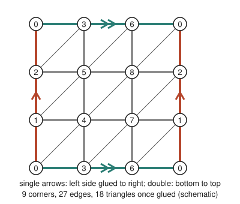

# Euler characteristic: vertices minus edges plus faces, the number bending cannot change

[Syllabus](../../../SYLLABUS.md) → [Topology](../README.md) → [Surfaces and Manifolds](../README.md#s03) → Euler characteristic

---

## General Overview

A geodesic sphere is a dome carried all the way round: a frame of straight struts whose joints sit on a ball. A common small design has 42 joints, 120 struts and 80 triangular panels. Joints minus struts plus panels is 42 − 120 + 80 = 2.

[Polyhedra](../../05-Geometry%20and%20trig/02-Circles%20and%20Solids/06-polyhedra-and-eulers-formula.md) already showed that every solid that could be pumped up into a ball gives 2. This card asks what the count says about other shapes.

Cut a bicycle inner tube's surface into triangles and count the same way. The smallest neat pattern, a 3 × 3 grid of squares each cut by one diagonal, gives 9 corners, 27 edges and 18 triangles: 9 − 27 + 18 = 0. Cut either surface into more triangles and all three counts change, but the 2 and the 0 do not. Bend or stretch it and nothing about the count changes at all.

So the count is a property of the surface, not of how it was cut up. A dome and a tube can never be bent into each other, because one says 2 and the other says 0.

**Cut a surface into triangles that meet edge to edge, and vertices minus edges plus triangles is the same number however it is cut and however it is bent: 2 for a sphere, 0 for a torus, and a different number for every count of holes.**

**What kind of fact this is:** a definition and a theorem. That every subdivision keeps the count is proved on this card in Why it works. That bending keeps it also needs two theorems about surfaces, stated with a source, not proved here.

### The picture: the inner tube, cut flat

<p align="center"></p>

Slit the tube once around and once along, and it lies flat as a square. Gluing the single-arrow sides makes a sleeve; gluing the double-arrow ends of the sleeve makes the tube again. Corners with the same label are one corner after gluing, so the 16 dots drawn are 9 corners. The drawing is schematic: a real tube is curved, and only the pattern of which pieces touch matters.

---

## The formula

A **triangulation** of a surface cuts it into triangles so that any two triangles share a whole edge, a single corner, or nothing. A **surface** here means a space that looks like a flat sheet near every point ([Topological manifold](01-topological-manifolds.md)). Write $`V`$ for the vertices (corners), $`E`$ for the edges and $`F`$ for the faces (triangles) after all gluing is done.

```math
\chi = V - E + F
```

**Read it aloud:** the Euler characteristic, written chi, is vertices minus edges plus faces.

The Greek letter $`\chi`$ (chi, said "kye") was met on [Closed surfaces classified](02-surfaces-and-the-classification-theorem.md); this card shows that it cannot change. It is not the chromatic number of the colouring cards, which uses the same letter.

Two more facts come with it, both met on [Closed surfaces classified](02-surfaces-and-the-classification-theorem.md). Joining two surfaces by cutting a triangle from each and gluing along the cuts is the **connected sum** $`M \# N`$:

```math
\chi(M \# N) = \chi(M) + \chi(N) - 2, \qquad \chi(\text{surface with } g \text{ holes}) = 2 - 2g
```

**Read it aloud:** joining two surfaces costs 2; so a closed surface with $`g`$ holes through it, its **genus**, has chi equal to 2 minus twice the genus. This holds for surfaces with two sides, like the sphere and the tube.

On a closed surface of triangles a second count gives the same answer. The **degree** of a vertex, $`\deg v`$, is the number of edges that meet there:

```math
\sum_{v} (6 - \deg v) = 6\chi
```

**Read it aloud:** add up six minus each corner's degree, over all corners, and get six times chi.

| Symbol | Plain meaning | In our example | Push it up and the answer… |
| --- | --- | --- | --- |
| $`V`$ | vertices: corners after gluing | 42 on the dome, 9 on the tube | one corner added inside a triangle adds 3 edges and 2 faces: no change |
| $`E`$ | edges after gluing | 120 struts, 27 on the tube | counted once per panel instead: −118 |
| $`F`$ | faces: triangles | 80 panels, 18 on the tube | one panel left out: falls to 1 |
| $`\chi`$ | the Euler characteristic, $`V - E + F`$ | 2 for the dome, 0 for the tube | fixed by the surface |
| $`g`$ | genus: holes through a two-sided closed surface | 0 for the dome, 1 for the tube, 2 for a pretzel | each hole lowers $`\chi`$ by 2 |
| $`M`$, $`N`$ | two surfaces | two tubes | — |
| $`M \# N`$ | connected sum: a triangle cut from each, rims glued | the pretzel, $`\chi = -2`$ | — |
| $`v`$ | one vertex | a dome joint | — |
| $`\deg v`$ | degree: edges meeting at $`v`$ | 5 at 12 dome joints, 6 at the other 30 | a degree-5 corner adds 1 to the sum |
| $`K`$, $`K'`$ | a triangulation, and a finer one cut from it | the icosahedron, and the 80-panel dome | — |
| $`D`$ | one triangle of $`K`$ after cutting: a disc of small triangles | one icosahedron face, cut into 4 panels | — |
| $`k`$ | new corners placed inside one edge of $`K`$ | 1 on each icosahedron edge | each adds one corner and one edge: no change |

### When it holds

- **The pieces are glued before counting.** Count the flat square of the picture as drawn, with its rim open, and it reads 16 − 33 + 18 = 1, the answer for a disc.
- **A sphere reads 2 only when it is closed.** Leave one panel out of the dome and it reads 1: the sphere with a hole is a disc.
- **The cut-up is a real triangulation.** Glue a 2 × 2 grid into a tube and different triangles share all three corners. Counting edges by their end corners then reads 4 − 6 + 8 = 6, which is no surface's number.
- **The surface is in one piece.** Each extra piece adds its own chi, so two separate tubes read 0 + 0, not the pretzel's −2.
- **Chi alone does not name the surface.** The Klein bottle, a closed one-sided surface ([Orientability](03-orientability-mobius-strip-and-klein-bottle.md)), also reads 0, like the tube. Chi together with the number of sides does name a closed surface ([Closed surfaces classified](02-surfaces-and-the-classification-theorem.md)).

---

## Why it works

### Step 0: every local change adds as much as it takes away

Chi counts corners with a plus, edges with a minus, faces with a plus. Any change to a triangulation that adds pieces in the pattern "one corner, three edges, two faces" leaves the total alone: +1 − 3 + 2 = 0. The whole proof is about finding such patterns. The sphere case is not repeated here: [Planar graphs](../../04-Combinatorics%20and%20graphs/12-Planarity%20and%20Colouring/01-planar-graphs-and-eulers-formula.md) proves that a flat drawing in one piece gives 2, by rubbing out one edge at a time, and [Polyhedra](../../05-Geometry%20and%20trig/02-Circles%20and%20Solids/06-polyhedra-and-eulers-formula.md) carries it to solids like the dome.

### Step 1: the two basic cuts keep chi

There are two ways to cut one triangulation into a finer one.

- **Face cut.** Put a new corner inside a triangle and join it to the three corners. One corner, three edges, and one triangle becomes three: +1 − 3 + 2 = 0.
- **Edge cut.** Put a new corner in the middle of an edge. The edge becomes two (one new edge), and the new corner joins the far corner of each of the two triangles on that edge (two more). Two triangles become four: +1 − 3 + 2 = 0.

The code makes 300 random cuts on the dome and 300 on the tube, and recounts after every one. The dome ends at 342 − 1020 + 680 = 2 and the tube at 309 − 927 + 618 = 0. That illustrates the claim on 600 cases; the proof is the counting above.

### Step 2: any subdivision keeps chi

A **subdivision** of a triangulation $`K`$ is a finer triangulation $`K'`$ in which every triangle of $`K`$ is cut into smaller triangles. Its effect can be counted one piece of $`K`$ at a time.

<details>
<summary>Detailed proof: a subdivision has the same chi</summary>

Charge every piece of $`K'`$ to the smallest piece of $`K`$ it lies in.

- A corner of $`K`$ stays a corner of $`K'`$: it contributes +1, as before.
- An edge of $`K`$ becomes a path. If it gains $`k`$ new corners inside it, it is cut into $`k + 1`$ edges, and its interior contributes $`k - (k + 1) = -1`$, as before.
- A triangle of $`K`$ becomes a triangulated disc $`D`$. The whole disc has $`\chi(D) = 1`$: [Planar graphs](../../04-Combinatorics%20and%20graphs/12-Planarity%20and%20Colouring/01-planar-graphs-and-eulers-formula.md) gives 2 for its flat drawing, and one of those faces is the outside, which is not part of $`D`$. The disc's rim is a loop with as many corners as edges, so it contributes 0. The inside of the triangle therefore contributes 1 − 0 = 1, as before.

Every piece of $`K`$ contributes the same amount to $`K'`$ as to $`K`$, so

$`\displaystyle \chi(K') = \chi(K).`$

</details>

### Step 3: from cutting to bending

Two different triangulations of one surface need not subdivide each other. Two theorems close the gap. They are stated here, not proved; Moise's book, listed in Sources, proves both.

1. **Every surface can be triangulated.** Tibor Radó proved this in 1925.
2. **Any two triangulations of the same surface have a common refinement.** After a homeomorphism (a stretch with a continuous inverse, no tearing or gluing), they have subdivisions that match piece for piece. This is the two-dimensional case of the "main conjecture" of the early topologists, and it is true for surfaces.

By Step 2 each triangulation has the chi of its subdivision, and the two subdivisions match. So every triangulation of a surface gives the same chi, and a homeomorphism cannot change it. The other proof, through counting loops, is in [Simplicial complexes and chains](../05-Homology/01-simplicial-complexes-and-chains.md).

### Step 4: chi tells the tube from the dome

The dome gives 2 and the tube gives 0. By Step 3 no stretch turns one into the other. This is how invariants work: a different value proves the shapes different. An equal value proves nothing: the Klein bottle also gives 0.

### Step 5: building the tube, and every hole after it

The **rim** of a surface is its open edge: the edges that border only one triangle. "Rim loops" counts how many separate loops the rim makes. The picture shows chi changing only when a rim is glued.

| Stage | V | E | F | chi | Rim loops |
| --- | ---: | ---: | ---: | ---: | ---: |
| flat square | 16 | 33 | 18 | 1 | 1 |
| left glued to right: a sleeve | 12 | 30 | 18 | 0 | 2 |
| top glued to bottom: the tube | 9 | 27 | 18 | 0 | 0 |

The first gluing joins a path of 4 corners and 3 edges to another: chi loses 4 − 3 = 1. The second joins a loop of 3 corners and 3 edges: chi loses 3 − 3 = 0.

Join two tubes the same way. Cut one triangle out of each (each loses a face) and glue the two rims of 3 corners and 3 edges. The result has 9 + 9 − 3 = 15 corners, 27 + 27 − 3 = 51 edges and 17 + 17 = 34 faces: chi is −2. That is the connected-sum rule, $`0 + 0 - 2`$, and each further hole costs another 2: $`\chi = 2 - 2g`$.

### Step 6: a second road, through the corners

On a closed surface of triangles each triangle has 3 edges and each edge borders 2 triangles, so $`3F = 2E`$. Each edge has 2 ends, so the degrees add up to $`2E`$. Then

```math
\sum_v (6 - \deg v) = 6V - 2E = 6V - 6E + 4E = 6V - 6E + 6F = 6\chi
```

On the dome, 12 joints have 5 struts and 30 have 6: the sum is 12 × 1 = 12 = 6 × 2. On the tube every corner has degree 6: the sum is 0. If every joint has five or six struts, a dome builder cannot avoid the 12 five-strut joints. On the pretzel the sum is −12 = 6 × (−2).

---

## Worked numbers, by hand

| Step | Arithmetic | Value |
| --- | --- | --- |
| icosahedron, the dome's starting solid | 12 − 30 + 20 | 2 |
| dome: each triangle cut into four | 12 + 30 corners, 2 × 30 + 3 × 20 edges, 4 × 20 faces | 42, 120, 80 |
| dome chi | 42 − 120 + 80 | **2** |
| dome, by degrees | 12 × (6 − 5) + 30 × (6 − 6) | 12 = 6 × 2 |
| tube chi | 9 − 27 + 18 | **0** |
| tube, by degrees | 9 × (6 − 6) | 0 = 6 × 0 |
| pretzel chi | 15 − 51 + 34 | −2 |
| dome after 300 random cuts | 342 − 1020 + 680 | 2 |

The dome is a sphere and the tube is not: no amount of bending turns 2 into 0.

### What breaks if you drop a piece

| Mistake | Comes out at | What went wrong |
| --- | --- | --- |
| The flat square counted before gluing | 16 − 33 + 18 = 1 | the rim is still open: this is a disc |
| Struts counted once per panel | 42 − 240 + 80 = −118 | each strut borders two panels |
| One dome panel left out | 42 − 120 + 79 = 1 | a hole turns the sphere into a disc |
| The tube glued from a 2 × 2 grid | 4 − 6 + 8 = 6 | triangles share all three corners: not a triangulation |

The code prints all four.

---

## Code, from first principles, and it actually runs

The code stores a surface as a list of triangles, each a sorted triple of corner numbers. It builds the dome from an icosahedron, the tube, the Klein bottle and the two paper strips from glued grids, and the pretzel from two tubes. It takes three roads to chi: counting corners, edges and triangles; adding six minus each degree; and 300 random cuts on the dome and 300 on the tube, recounted after every cut. It also tests that every model is a real surface of triangles: no repeated triangle, and every edge on two triangles, or one on a rim.

### Python

```python
# Euler characteristic -- the check behind the card.  Standard library only.
# A surface is a list of triangles, each a sorted triple of vertex numbers.
# Road 1 counts vertices, edges and triangles.  Road 2 adds up 6 minus each
# vertex's degree, which is 6 times chi on a closed surface of triangles.
# Road 3 cuts the dome and the tube up at random and recounts after every cut.
def tri(a, b, c):
    return tuple(sorted((a, b, c)))

def edge_uses(tris):                      # how many triangles touch each edge
    uses = {}
    for t in tris:
        for e in ((t[0], t[1]), (t[0], t[2]), (t[1], t[2])):
            uses[e] = uses.get(e, 0) + 1
    return uses

def counts(tris):
    return len({v for t in tris for v in t}), len(edge_uses(tris)), len(tris)

def chi(tris):
    return counts(tris)[0] - counts(tris)[1] + counts(tris)[2]

def degree_sum(tris):                     # road 2: sum of (6 - degree)
    deg = {}
    for a, b in edge_uses(tris):
        deg[a], deg[b] = deg.get(a, 0) + 1, deg.get(b, 0) + 1
    return sum(6 - d for d in deg.values()), sorted(deg.values())

def rim_loops(tris):                      # edges used once, joined into loops
    rim = [e for e, k in edge_uses(tris).items() if k == 1]
    boss = {v: v for e in rim for v in e}
    def find(x):
        return x if boss[x] == x else find(boss[x])
    for a, b in rim:
        boss[find(a)] = find(b)
    return len({find(v) for v in boss})

def is_surface(tris, closed):             # no repeats; each edge used once or twice
    ok = len(set(tris)) == len(tris) and all(len(set(t)) == 3 for t in tris)
    return ok and all(k == 2 or (k == 1 and not closed) for k in edge_uses(tris).values())

def icosahedron():                        # top 0, rings 1-5 and 6-10, bottom 11
    u, l, out = lambda i: 1 + i % 5, lambda i: 6 + i % 5, []
    for i in range(5):
        out += [tri(0, u(i), u(i + 1)), tri(u(i), u(i + 1), l(i)),
                tri(u(i + 1), l(i), l(i + 1)), tri(11, l(i), l(i + 1))]
    return out

def split4(tris):                         # each triangle into four, at edge midpoints
    mid, out = {}, []
    def m(a, b):
        return mid.setdefault((a, b), 12 + len(mid))
    for a, b, c in tris:
        ab, ac, bc = m(a, b), m(a, c), m(b, c)
        out += [tri(a, ab, ac), tri(b, ab, bc), tri(c, ac, bc), tri(ab, ac, bc)]
    return out

def grid(cols, rows, glue_i, glue_j):     # glue_i: 0 open, 1 straight, 2 half twist
    def name(i, j):
        if i == cols and glue_i:
            i, j = 0, (j if glue_i == 1 else rows - j)
        if j == rows and glue_j:
            j = 0
        return i * (rows + 1) + j
    out = []
    for i in range(cols):
        for j in range(rows):
            a, b, c, d = name(i, j), name(i + 1, j), name(i + 1, j + 1), name(i, j + 1)
            out += [(a, b, c), (a, d, c)]
    ids = sorted({v for t in out for v in t})   # renumber the corners 0, 1, 2, ...
    return [tri(*(ids.index(v) for v in t)) for t in out]

def yn(claim):
    return "yes" if claim else "no"

def show(label, tris):
    return f"{label}: V {counts(tris)[0]}, E {counts(tris)[1]}, F {len(tris)}, chi {chi(tris)}"

state = 2026                              # SplitMix64, written out
def rand():
    global state
    state = (state + 0x9E3779B97F4A7C15) & 0xFFFFFFFFFFFFFFFF
    z = ((state ^ (state >> 30)) * 0xBF58476D1CE4E5B9) & 0xFFFFFFFFFFFFFFFF
    z = ((z ^ (z >> 27)) * 0x94D049BB133111EB) & 0xFFFFFFFFFFFFFFFF
    return z ^ (z >> 31)

def cut_up(tris, moves):                  # road 3: random edge and face splits
    tris, new, ok, kinds, start = list(tris), 1 + max(map(max, tris)), True, [0, 0], chi(tris)
    for _ in range(moves):
        k, pick = rand() % len(tris), rand() % 4
        a, b, c = tris[k]
        if pick == 0:                     # a new corner inside triangle k
            tris[k] = tri(a, b, new)
            tris += [tri(a, c, new), tri(b, c, new)]
        else:                             # a new corner on one edge of triangle k
            a, b, c = [(a, b, c), (a, c, b), (b, c, a)][pick - 1]
            k2 = next(j for j, t in enumerate(tris) if j != k and a in t and b in t)
            d = sum(tris[k2]) - a - b
            tris[k], tris[k2] = tri(a, new, c), tri(a, new, d)
            tris += [tri(new, b, c), tri(new, b, d)]
        kinds[pick != 0] += 1
        new += 1
        ok = ok and chi(tris) == start and degree_sum(tris)[0] == 6 * start
    return tris, ok and is_surface(tris, True), kinds

dome, tube, flat, sleeve = split4(icosahedron()), grid(3, 3, 1, 1), grid(3, 3, 0, 0), grid(3, 3, 1, 0)
klein, loop, twist = grid(3, 3, 2, 1), grid(6, 1, 1, 0), grid(6, 1, 2, 0)
cut = tube[0]                             # pretzel: two tubes, one triangle out of each
pretzel = tube[1:] + [tri(*[v if v in cut else v + 100 for v in t]) for t in tube[1:]]
ds, dd = degree_sum(dome)
print(show("icosahedron, before subdividing", icosahedron()))
print(show("dome, geodesic sphere", dome))
print(f"dome degrees: {dd.count(5)} corners of 5 struts, {dd.count(6)} of 6; "
      f"sum of (6 - degree) = {ds} = 6 x {ds // 6}")
print(show("tube, 3 x 3 grid glued both ways", tube) + f"; sum of (6 - degree) = {degree_sum(tube)[0]}")
for label, t in (("flat square", flat), ("glued left to right", sleeve), ("glued top to bottom", tube)):
    print(show("  " + label, t) + f", rim loops {rim_loops(t)}")
print(show("pretzel, two tubes joined", pretzel) + f"; sum of (6 - degree) = {degree_sum(pretzel)[0]}")
print(show("klein bottle, one side flipped", klein))
print(show("paper strip, plain loop", loop) + f", rim loops {rim_loops(loop)}")
print(show("paper strip, half twist", twist) + f", rim loops {rim_loops(twist)}")
closed, rimmed = (dome, tube, pretzel, klein), (flat, sleeve, loop, twist)
all_ok = all(is_surface(t, True) for t in closed) and all(is_surface(t, False) for t in rimmed)
print(f"every model a surface of triangles, each edge on 1 or 2 of them: {yn(all_ok)}")
print(f"random cuts, SplitMix64 seed {state}, 300 on each, chi recounted after every cut:")
(d2, dok, dk), (t2, tok, tk) = cut_up(dome, 300), cut_up(tube, 300)
print(show("  dome", d2) + f"; unchanged every time: {yn(dok)}; edge cuts {dk[1]}, face cuts {dk[0]}")
print(show("  tube", t2) + f"; unchanged every time: {yn(tok)}; edge cuts {tk[1]}, face cuts {tk[0]}")
v, f = counts(dome)[0], len(dome)
print(f"mistake 1, flat square left unglued: {chi(flat)}, not 0")
print(f"mistake 2, struts counted once per panel: {v} - {3 * f} + {f} = {v - 3 * f + f}")
print(f"mistake 3, one dome panel left out: {chi(dome[1:])}, rim loops {rim_loops(dome[1:])}")
print(f"mistake 4, tube from a 2 x 2 grid: {show('counted', grid(2, 2, 1, 1))}; "
      f"a surface of triangles: {yn(is_surface(grid(2, 2, 1, 1), True))}")
print("figure, schematic: 3 x 3 squares, side 80, from (60, 40); left glued to right, bottom to top")
assert [chi(t) for t in closed] == [2, 0, -2, 0]                    # road 1, by counting
assert [degree_sum(t)[0] for t in closed] == [6 * chi(t) for t in closed]  # road 2 agrees
assert counts(dome) == (42, 120, 80) and dd.count(5) == 12 and counts(tube) == (9, 27, 18)
assert chi(flat) == 1 and rim_loops(loop) == 2 and rim_loops(twist) == 1
assert all_ok and dok and tok and not is_surface(grid(2, 2, 1, 1), True)
print("ALL CHECKS PASS")
```

**Ran 2026-11-14 on macOS, Python 3.14.10, standard library only. All checks passed. Output, pasted from the run:**

```
icosahedron, before subdividing: V 12, E 30, F 20, chi 2
dome, geodesic sphere: V 42, E 120, F 80, chi 2
dome degrees: 12 corners of 5 struts, 30 of 6; sum of (6 - degree) = 12 = 6 x 2
tube, 3 x 3 grid glued both ways: V 9, E 27, F 18, chi 0; sum of (6 - degree) = 0
  flat square: V 16, E 33, F 18, chi 1, rim loops 1
  glued left to right: V 12, E 30, F 18, chi 0, rim loops 2
  glued top to bottom: V 9, E 27, F 18, chi 0, rim loops 0
pretzel, two tubes joined: V 15, E 51, F 34, chi -2; sum of (6 - degree) = -12
klein bottle, one side flipped: V 9, E 27, F 18, chi 0
paper strip, plain loop: V 12, E 24, F 12, chi 0, rim loops 2
paper strip, half twist: V 12, E 24, F 12, chi 0, rim loops 1
every model a surface of triangles, each edge on 1 or 2 of them: yes
random cuts, SplitMix64 seed 2026, 300 on each, chi recounted after every cut:
  dome: V 342, E 1020, F 680, chi 2; unchanged every time: yes; edge cuts 237, face cuts 63
  tube: V 309, E 927, F 618, chi 0; unchanged every time: yes; edge cuts 224, face cuts 76
mistake 1, flat square left unglued: 1, not 0
mistake 2, struts counted once per panel: 42 - 240 + 80 = -118
mistake 3, one dome panel left out: 1, rim loops 1
mistake 4, tube from a 2 x 2 grid: counted: V 4, E 6, F 8, chi 6; a surface of triangles: no
figure, schematic: 3 x 3 squares, side 80, from (60, 40); left glued to right, bottom to top
ALL CHECKS PASS
```

### Rust

Same numbers, same labels, built with `rustc --edition 2021 -O`.

```rust
// Euler characteristic -- the same check as the Python, in Rust.  No crates.
// A surface is a list of triangles, each a sorted triple of vertex numbers.
// Road 1 counts vertices, edges and triangles.  Road 2 adds up 6 minus each
// vertex's degree, which is 6 times chi on a closed surface of triangles.
// Road 3 cuts the dome and the tube up at random and recounts after every cut.
use std::collections::{BTreeMap, BTreeSet};
type T = [i64; 3];

fn tri(a: i64, b: i64, c: i64) -> T { let mut t = [a, b, c]; t.sort(); t }

fn edge_uses(tris: &[T]) -> BTreeMap<(i64, i64), i64> {   // how many triangles touch each edge
    let mut uses = BTreeMap::new();
    for t in tris {
        for e in [(t[0], t[1]), (t[0], t[2]), (t[1], t[2])] { *uses.entry(e).or_insert(0) += 1 }
    }
    uses
}

fn counts(tris: &[T]) -> (i64, i64, i64) {
    let verts: BTreeSet<i64> = tris.iter().flatten().copied().collect();
    (verts.len() as i64, edge_uses(tris).len() as i64, tris.len() as i64)
}

fn chi(tris: &[T]) -> i64 { let (v, e, f) = counts(tris); v - e + f }

fn degree_sum(tris: &[T]) -> (i64, Vec<i64>) {             // road 2: sum of (6 - degree)
    let mut deg: BTreeMap<i64, i64> = BTreeMap::new();
    for (a, b) in edge_uses(tris).keys() {
        *deg.entry(*a).or_insert(0) += 1;
        *deg.entry(*b).or_insert(0) += 1;
    }
    let mut d: Vec<i64> = deg.values().copied().collect(); d.sort();
    (d.iter().map(|x| 6 - x).sum(), d)
}

fn find(boss: &BTreeMap<i64, i64>, x: i64) -> i64 { if boss[&x] == x { x } else { find(boss, boss[&x]) } }

fn rim_loops(tris: &[T]) -> usize {                        // edges used once, joined into loops
    let rim: Vec<(i64, i64)> = edge_uses(tris).into_iter().filter(|e| e.1 == 1).map(|e| e.0).collect();
    let mut boss: BTreeMap<i64, i64> = BTreeMap::new();
    for &(a, b) in &rim { boss.insert(a, a); boss.insert(b, b); }
    for &(a, b) in &rim { let (ra, rb) = (find(&boss, a), find(&boss, b)); boss.insert(ra, rb); }
    boss.keys().map(|&v| find(&boss, v)).collect::<BTreeSet<i64>>().len()
}

fn is_surface(tris: &[T], closed: bool) -> bool {          // no repeats; each edge used once or twice
    let distinct: BTreeSet<T> = tris.iter().copied().collect();
    let ok = distinct.len() == tris.len() && tris.iter().all(|t| t[0] != t[1] && t[1] != t[2]);
    ok && edge_uses(tris).values().all(|&k| k == 2 || (k == 1 && !closed))
}

fn icosahedron() -> Vec<T> {                               // top 0, rings 1-5 and 6-10, bottom 11
    let (u, l) = (|i: i64| 1 + i % 5, |i: i64| 6 + i % 5);
    let mut out = vec![];
    for i in 0..5 {
        out.extend([tri(0, u(i), u(i + 1)), tri(u(i), u(i + 1), l(i)),
                    tri(u(i + 1), l(i), l(i + 1)), tri(11, l(i), l(i + 1))]);
    }
    out
}

fn split4(tris: &[T]) -> Vec<T> {                          // each triangle into four, at edge midpoints
    let mut mid: BTreeMap<(i64, i64), i64> = BTreeMap::new();
    let mut out = vec![];
    for t in tris {
        let mut m = |a: i64, b: i64| { let n = 12 + mid.len() as i64; *mid.entry((a, b)).or_insert(n) };
        let (a, b, c) = (t[0], t[1], t[2]);
        let (ab, ac, bc) = (m(a, b), m(a, c), m(b, c));
        out.extend([tri(a, ab, ac), tri(b, ab, bc), tri(c, ac, bc), tri(ab, ac, bc)]);
    }
    out
}

fn grid(cols: i64, rows: i64, glue_i: i64, glue_j: i64) -> Vec<T> {  // glue_i: 0 open, 1 straight, 2 half twist
    let name = |mut i: i64, mut j: i64| {
        if i == cols && glue_i != 0 { i = 0; if glue_i == 2 { j = rows - j } }
        if j == rows && glue_j != 0 { j = 0 }
        i * (rows + 1) + j
    };
    let mut out: Vec<[i64; 3]> = vec![];
    for i in 0..cols {
        for j in 0..rows {
            let (a, b, c, d) = (name(i, j), name(i + 1, j), name(i + 1, j + 1), name(i, j + 1));
            out.extend([[a, b, c], [a, d, c]]);
        }
    }
    let ids: Vec<i64> = out.iter().flatten().copied().collect::<BTreeSet<i64>>().into_iter().collect();
    let ix = |v: i64| ids.iter().position(|&w| w == v).unwrap() as i64;   // renumber the corners
    out.iter().map(|t| tri(ix(t[0]), ix(t[1]), ix(t[2]))).collect()
}

fn yn(claim: bool) -> &'static str { if claim { "yes" } else { "no" } }

fn show(label: &str, t: &[T]) -> String { let (v, e, f) = counts(t); format!("{}: V {}, E {}, F {}, chi {}", label, v, e, f, v - e + f) }

fn rand(state: &mut u64) -> u64 {                          // SplitMix64, written out
    *state = state.wrapping_add(0x9E3779B97F4A7C15);
    let z = (*state ^ (*state >> 30)).wrapping_mul(0xBF58476D1CE4E5B9);
    let z = (z ^ (z >> 27)).wrapping_mul(0x94D049BB133111EB);
    z ^ (z >> 31)
}

fn cut_up(rng: &mut u64, start_tris: &[T], moves: usize) -> (Vec<T>, bool, [i64; 2]) {  // road 3
    let mut tris = start_tris.to_vec();
    let (mut new, mut ok, mut kinds, start) = (1 + tris.iter().map(|t| t[2]).max().unwrap(), true, [0, 0], chi(&tris));
    for _ in 0..moves {
        let (k, pick) = ((rand(rng) % tris.len() as u64) as usize, (rand(rng) % 4) as usize);
        let [a, b, c] = tris[k];
        if pick == 0 {                                     // a new corner inside triangle k
            tris[k] = tri(a, b, new);
            tris.extend([tri(a, c, new), tri(b, c, new)]);
        } else {                                           // a new corner on one edge of triangle k
            let (a, b, c) = [(a, b, c), (a, c, b), (b, c, a)][pick - 1];
            let k2 = (0..tris.len()).find(|&j| j != k && tris[j].contains(&a) && tris[j].contains(&b)).unwrap();
            let d = tris[k2].iter().sum::<i64>() - a - b;
            (tris[k], tris[k2]) = (tri(a, new, c), tri(a, new, d));
            tris.extend([tri(new, b, c), tri(new, b, d)]);
        }
        kinds[(pick != 0) as usize] += 1;
        new += 1;
        ok = ok && chi(&tris) == start && degree_sum(&tris).0 == 6 * start;
    }
    let ok = ok && is_surface(&tris, true); (tris, ok, kinds)
}

fn main() {
    let (dome, tube, flat, sleeve) = (split4(&icosahedron()), grid(3, 3, 1, 1), grid(3, 3, 0, 0), grid(3, 3, 1, 0));
    let (klein, lp, twist) = (grid(3, 3, 2, 1), grid(6, 1, 1, 0), grid(6, 1, 2, 0));
    let cut = tube[0];                                     // pretzel: two tubes, one triangle out of each
    let m = |v: i64| if cut.contains(&v) { v } else { v + 100 };
    let pretzel: Vec<T> = tube[1..].iter().copied().chain(tube[1..].iter().map(|t| tri(m(t[0]), m(t[1]), m(t[2])))).collect();
    let (ds, dd) = degree_sum(&dome);
    let cnt = |x: i64| dd.iter().filter(|&&d| d == x).count();
    println!("{}", show("icosahedron, before subdividing", &icosahedron()));
    println!("{}", show("dome, geodesic sphere", &dome));
    println!("dome degrees: {} corners of 5 struts, {} of 6; sum of (6 - degree) = {} = 6 x {}", cnt(5), cnt(6), ds, ds / 6);
    println!("{}; sum of (6 - degree) = {}", show("tube, 3 x 3 grid glued both ways", &tube), degree_sum(&tube).0);
    for (label, t) in [("flat square", &flat), ("glued left to right", &sleeve), ("glued top to bottom", &tube)] {
        println!("{}, rim loops {}", show(&format!("  {}", label), t), rim_loops(t));
    }
    println!("{}; sum of (6 - degree) = {}", show("pretzel, two tubes joined", &pretzel), degree_sum(&pretzel).0);
    println!("{}", show("klein bottle, one side flipped", &klein));
    println!("{}, rim loops {}", show("paper strip, plain loop", &lp), rim_loops(&lp));
    println!("{}, rim loops {}", show("paper strip, half twist", &twist), rim_loops(&twist));
    let closed = [&dome, &tube, &pretzel, &klein];
    let all_ok = closed.iter().all(|t| is_surface(t, true)) && [&flat, &sleeve, &lp, &twist].iter().all(|t| is_surface(t, false));
    println!("every model a surface of triangles, each edge on 1 or 2 of them: {}", yn(all_ok));
    let mut rng: u64 = 2026;
    println!("random cuts, SplitMix64 seed {}, 300 on each, chi recounted after every cut:", rng);
    let (d2, dok, dk) = cut_up(&mut rng, &dome, 300);
    let (t2, tok, tk) = cut_up(&mut rng, &tube, 300);
    println!("{}; unchanged every time: {}; edge cuts {}, face cuts {}", show("  dome", &d2), yn(dok), dk[1], dk[0]);
    println!("{}; unchanged every time: {}; edge cuts {}, face cuts {}", show("  tube", &t2), yn(tok), tk[1], tk[0]);
    let (v, f) = (counts(&dome).0, dome.len() as i64);
    println!("mistake 1, flat square left unglued: {}, not 0", chi(&flat));
    println!("mistake 2, struts counted once per panel: {} - {} + {} = {}", v, 3 * f, f, v - 3 * f + f);
    println!("mistake 3, one dome panel left out: {}, rim loops {}", chi(&dome[1..]), rim_loops(&dome[1..]));
    let coarse = grid(2, 2, 1, 1);
    println!("mistake 4, tube from a 2 x 2 grid: {}; a surface of triangles: {}", show("counted", &coarse), yn(is_surface(&coarse, true)));
    println!("figure, schematic: 3 x 3 squares, side 80, from (60, 40); left glued to right, bottom to top");
    assert!(closed.iter().map(|t| chi(t)).collect::<Vec<i64>>() == vec![2, 0, -2, 0]);       // road 1, by counting
    assert!(closed.iter().all(|t| degree_sum(t).0 == 6 * chi(t)));                            // road 2 agrees
    assert!(counts(&dome) == (42, 120, 80) && cnt(5) == 12 && counts(&tube) == (9, 27, 18));
    assert!(chi(&flat) == 1 && rim_loops(&lp) == 2 && rim_loops(&twist) == 1);
    assert!(all_ok && dok && tok && !is_surface(&coarse, true));
    println!("ALL CHECKS PASS");
}
```

**Ran 2026-11-14 on macOS, rustc 1.98.1, no crates. All checks passed. Output, pasted from the run:**

```
icosahedron, before subdividing: V 12, E 30, F 20, chi 2
dome, geodesic sphere: V 42, E 120, F 80, chi 2
dome degrees: 12 corners of 5 struts, 30 of 6; sum of (6 - degree) = 12 = 6 x 2
tube, 3 x 3 grid glued both ways: V 9, E 27, F 18, chi 0; sum of (6 - degree) = 0
  flat square: V 16, E 33, F 18, chi 1, rim loops 1
  glued left to right: V 12, E 30, F 18, chi 0, rim loops 2
  glued top to bottom: V 9, E 27, F 18, chi 0, rim loops 0
pretzel, two tubes joined: V 15, E 51, F 34, chi -2; sum of (6 - degree) = -12
klein bottle, one side flipped: V 9, E 27, F 18, chi 0
paper strip, plain loop: V 12, E 24, F 12, chi 0, rim loops 2
paper strip, half twist: V 12, E 24, F 12, chi 0, rim loops 1
every model a surface of triangles, each edge on 1 or 2 of them: yes
random cuts, SplitMix64 seed 2026, 300 on each, chi recounted after every cut:
  dome: V 342, E 1020, F 680, chi 2; unchanged every time: yes; edge cuts 237, face cuts 63
  tube: V 309, E 927, F 618, chi 0; unchanged every time: yes; edge cuts 224, face cuts 76
mistake 1, flat square left unglued: 1, not 0
mistake 2, struts counted once per panel: 42 - 240 + 80 = -118
mistake 3, one dome panel left out: 1, rim loops 1
mistake 4, tube from a 2 x 2 grid: counted: V 4, E 6, F 8, chi 6; a surface of triangles: no
figure, schematic: 3 x 3 squares, side 80, from (60, 40); left glued to right, bottom to top
ALL CHECKS PASS
```

The two outputs match line for line. Both scripts use the same small random-number generator, SplitMix64, written out, so the random cuts are the same in both.

### Lean

Lean proves Step 1, the connected-sum rule and Step 6, for surfaces stored as triangles; Steps 2 and 3 are not in Lean.

- Take a triangulation and make any number of face cuts and edge cuts, each with a new corner. Then chi does not change.
- Suppose $`M`$ and $`N`$ are closed surfaces of triangles, every edge on two triangles, sharing only the corners of one triangle. Then cutting it from both and gluing gives $`\chi(M \# N) = \chi(M) + \chi(N) - 2`$.
- Suppose every edge of a surface of triangles borders exactly two triangles. Then $`\sum_v (6 - \deg v) = 6\chi`$.
- The tube has 9 corners, 27 edges and 18 triangles, so chi is 0. Every corner has degree 6, and every edge borders two triangles.
- The icosahedron reads 12 − 30 + 20 = 2, and the hand arithmetic in the two tables above holds.

The dome, the pretzel, the Klein bottle, the strips, the rim loops and the random cuts are left to the Python and Rust checks.

```lean
-- Euler characteristic: vertices minus edges plus triangles does not change when a triangle or an edge is cut, joining two closed surfaces costs 2, and on a closed surface six minus each degree adds up to six times chi.
import Mathlib.Data.Finset.Powerset
import Mathlib.Data.Finset.Card
import Mathlib.Algebra.BigOperators.Group.Finset.Basic
import Mathlib.Algebra.Order.Group.Int
import Mathlib.Logic.Relation
import Mathlib.Tactic.NormNum
import Mathlib.Combinatorics.Enumerative.DoubleCounting

/-! A triangulation is stored as on the card: a finite set `K` of triangles, each triangle the
finite set of its corner labels, with the gluing already done (a corner shared after gluing
has one label). Mathlib has no abstract triangulated surface, so the counts are defined here.

* `vertices K`: every corner of every triangle (`V`).
* `edges K`: every two-corner set inside a triangle (`E`).
* `K.card`: the triangles (`F`).
* `eulerChar K = V - E + F`, the Euler characteristic chi, as an integer.
* `degree K v`: the number of edges that meet at `v`.

Bending (homeomorphism invariance) needs Radó's theorem and the common-refinement theorem,
which the card states with a source and does not prove; Mathlib has neither, so this file
states the parts the card proves: the two basic cuts, the connected-sum count and the
degree sum. -/

namespace EulerTriangulation

open Finset

variable {α : Type*} [DecidableEq α]

/-- The corners of a triangulation `K`: `V`. -/
def vertices (K : Finset (Finset α)) : Finset α := K.biUnion id

/-- The edges of a triangulation `K`: every two-corner set inside one of its triangles, counted once. -/
def edges (K : Finset (Finset α)) : Finset (Finset α) := K.biUnion (fun t => t.powersetCard 2)

/-- The Euler characteristic `chi = V - E + F`. -/
def eulerChar (K : Finset (Finset α)) : ℤ :=
  ((vertices K).card : ℤ) - (edges K).card + K.card

/-- The degree of a corner `v`: the number of edges of `K` that meet at `v`. -/
def degree (K : Finset (Finset α)) (v : α) : ℕ := ((edges K).filter (fun e => v ∈ e)).card

/-- A closed surface of triangles, as Step 6 of the card uses it: every piece is a triangle
(three corners) and every edge borders exactly two triangles. -/
def IsClosedTriangleSurface (K : Finset (Finset α)) : Prop :=
  (∀ t ∈ K, t.card = 3) ∧ ∀ e ∈ edges K, (K.filter (fun t => e ⊆ t)).card = 2

/-- The two basic cuts of Step 1, each with a new corner `w` not already in `K`.
* Face cut: a new corner inside the triangle `{a, b, c}`, joined to its three corners.
* Edge cut: a new corner in the middle of the edge `{a, b}`, which borders exactly the two
  triangles `{a, b, c}` and `{a, b, d}`, joined to their far corners `c` and `d`. -/
inductive BasicCut : Finset (Finset α) → Finset (Finset α) → Prop
  | face (K : Finset (Finset α)) (a b c w : α) (hab : a ≠ b) (hac : a ≠ c) (hbc : b ≠ c)
      (ht : ({a, b, c} : Finset α) ∈ K) (hw : w ∉ vertices K) :
      BasicCut K ((K.erase {a, b, c}) ∪ {{a, b, w}, {a, c, w}, {b, c, w}})
  | edge (K : Finset (Finset α)) (a b c d w : α) (hab : a ≠ b) (hac : a ≠ c) (hbc : b ≠ c)
      (had : a ≠ d) (hbd : b ≠ d) (hcd : c ≠ d)
      (hc : ({a, b, c} : Finset α) ∈ K) (hd : ({a, b, d} : Finset α) ∈ K)
      (honly : ∀ s ∈ K, a ∈ s → b ∈ s → s = {a, b, c} ∨ s = {a, b, d})
      (hw : w ∉ vertices K) :
      BasicCut K (((K.erase {a, b, c}).erase {a, b, d}) ∪ {{a, c, w}, {b, c, w}, {a, d, w}, {b, d, w}})

theorem mem_vertices {K : Finset (Finset α)} {v : α} : v ∈ vertices K ↔ ∃ t ∈ K, v ∈ t := by
  simp [vertices]

theorem mem_edges {K : Finset (Finset α)} {e : Finset α} :
    e ∈ edges K ↔ ∃ t ∈ K, e ⊆ t ∧ e.card = 2 := by
  simp [edges, mem_powersetCard]

theorem vertices_union (A B : Finset (Finset α)) :
    vertices (A ∪ B) = vertices A ∪ vertices B := by
  ext v; simp only [mem_vertices, mem_union]; grind

theorem edges_union (A B : Finset (Finset α)) : edges (A ∪ B) = edges A ∪ edges B := by
  ext e; simp only [mem_edges, mem_union]; grind

theorem vertices_insert (t : Finset α) (A : Finset (Finset α)) :
    vertices (insert t A) = t ∪ vertices A := by
  simp [vertices, biUnion_insert]

theorem edges_insert (t : Finset α) (A : Finset (Finset α)) :
    edges (insert t A) = t.powersetCard 2 ∪ edges A := by
  simp [edges, biUnion_insert]

theorem vertices_singleton (t : Finset α) : vertices ({t} : Finset (Finset α)) = t := by
  simp [vertices]

theorem edges_singleton (t : Finset α) : edges ({t} : Finset (Finset α)) = t.powersetCard 2 := by
  simp [edges]

theorem edge_subset_vertices {K : Finset (Finset α)} {e : Finset α} (he : e ∈ edges K) :
    e ⊆ vertices K := by
  obtain ⟨t, ht, het, -⟩ := mem_edges.mp he
  intro v hv
  exact mem_vertices.mpr ⟨t, ht, het hv⟩

theorem pair_mem_of_eq {x y p q : α} (h : ({x, y} : Finset α) = {p, q}) :
    (x = p ∨ x = q) ∧ (y = p ∨ y = q) := by
  have hx : x ∈ ({p, q} : Finset α) := h ▸ (by simp)
  have hy : y ∈ ({p, q} : Finset α) := h ▸ (by simp)
  simp only [mem_insert, mem_singleton] at hx hy
  exact ⟨hx, hy⟩

theorem triple_mem_of_eq {x y z p q r : α} (h : ({x, y, z} : Finset α) = {p, q, r}) :
    (x = p ∨ x = q ∨ x = r) ∧ (y = p ∨ y = q ∨ y = r) ∧ (z = p ∨ z = q ∨ z = r) := by
  have hx : x ∈ ({p, q, r} : Finset α) := h ▸ (by simp)
  have hy : y ∈ ({p, q, r} : Finset α) := h ▸ (by simp)
  have hz : z ∈ ({p, q, r} : Finset α) := h ▸ (by simp)
  simp only [mem_insert, mem_singleton] at hx hy hz
  exact ⟨hx, hy, hz⟩

theorem powersetCard_two_three {x y z : α} (hxy : x ≠ y) (hxz : x ≠ z) (hyz : y ≠ z) :
    ({x, y, z} : Finset α).powersetCard 2 = {{x, y}, {x, z}, {y, z}} := by
  ext e
  simp only [mem_powersetCard, mem_insert, mem_singleton]
  constructor
  · rintro ⟨hs, hc⟩
    obtain ⟨p, q, hpq, rfl⟩ := card_eq_two.mp hc
    have hp : p ∈ ({x, y, z} : Finset α) := hs (by simp)
    have hq : q ∈ ({x, y, z} : Finset α) := hs (by simp)
    simp only [mem_insert, mem_singleton] at hp hq
    rcases hp with rfl | rfl | rfl <;> rcases hq with rfl | rfl | rfl <;>
      simp_all [pair_comm]
  · rintro (rfl | rfl | rfl) <;> refine ⟨?_, card_pair_eq_two_iff.mpr ‹_›⟩ <;>
      intro v hv <;> simp only [mem_insert, mem_singleton] at hv ⊢ <;> tauto

theorem not_mem_of_not_mem_vertices {K : Finset (Finset α)} {w : α} (hw : w ∉ vertices K)
    {s : Finset α} (hs : w ∈ s) : s ∉ K :=
  fun h => hw (mem_vertices.mpr ⟨s, h, hs⟩)

theorem not_mem_edges_of_not_mem_vertices {K : Finset (Finset α)} {w : α}
    (hw : w ∉ vertices K) {s : Finset α} (hs : w ∈ s) : s ∉ edges K :=
  fun h => hw (edge_subset_vertices h hs)

theorem ne_of_not_mem_vertices {K : Finset (Finset α)} {w v : α} {t : Finset α}
    (hw : w ∉ vertices K) (ht : t ∈ K) (hv : v ∈ t) : v ≠ w := by
  rintro rfl
  exact hw (mem_vertices.mpr ⟨t, ht, hv⟩)

theorem eulerChar_face (K : Finset (Finset α)) (a b c w : α) (hab : a ≠ b) (hac : a ≠ c)
    (hbc : b ≠ c) (ht : ({a, b, c} : Finset α) ∈ K) (hw : w ∉ vertices K) :
    eulerChar ((K.erase {a, b, c}) ∪ {{a, b, w}, {a, c, w}, {b, c, w}}) = eulerChar K := by
  have haw : a ≠ w := ne_of_not_mem_vertices hw ht (by simp)
  have hbw : b ≠ w := ne_of_not_mem_vertices hw ht (by simp)
  have hcw : c ≠ w := ne_of_not_mem_vertices hw ht (by simp)
  set R := K.erase {a, b, c} with hR
  have hK : K = insert {a, b, c} R := (insert_erase ht).symm
  have hRw : w ∉ vertices R := by
    rw [hK, vertices_insert, mem_union, not_or] at hw; exact hw.2
  have hV : vertices (R ∪ {{a, b, w}, {a, c, w}, {b, c, w}}) = insert w (vertices K) := by
    rw [hK]; ext v
    simp only [vertices_union, vertices_insert, vertices_singleton, mem_union, mem_insert,
      mem_singleton]
    tauto
  have hE : edges (R ∪ {{a, b, w}, {a, c, w}, {b, c, w}}) =
      insert {a, w} (insert {b, w} (insert {c, w} (edges K))) := by
    rw [hK]; ext e
    simp only [edges_union, edges_insert, edges_singleton, powersetCard_two_three hab haw hbw,
      powersetCard_two_three hac haw hcw, powersetCard_two_three hbc hbw hcw,
      powersetCard_two_three hab hac hbc, mem_union, mem_insert, mem_singleton]
    tauto
  have hF : R ∪ {{a, b, w}, {a, c, w}, {b, c, w}} =
      insert {a, b, w} (insert {a, c, w} (insert {b, c, w} R)) := by
    ext s; simp only [mem_union, mem_insert, mem_singleton]; tauto
  have hEK : ∀ s : Finset α, w ∈ s → s ∉ edges K := fun s hs =>
    not_mem_edges_of_not_mem_vertices hw hs
  have hVc : (vertices (R ∪ {{a, b, w}, {a, c, w}, {b, c, w}})).card = (vertices K).card + 1 := by
    rw [hV, card_insert_of_notMem hw]
  have hEc : (edges (R ∪ {{a, b, w}, {a, c, w}, {b, c, w}})).card = (edges K).card + 3 := by
    rw [hE, card_insert_of_notMem, card_insert_of_notMem, card_insert_of_notMem (hEK _ (by simp))]
    · simp only [mem_insert, not_or]
      refine ⟨fun h => ?_, hEK _ (by simp)⟩
      have := pair_mem_of_eq h; grind
    · simp only [mem_insert, not_or]
      refine ⟨fun h => ?_, fun h => ?_, hEK _ (by simp)⟩
      · have := pair_mem_of_eq h; grind
      · have := pair_mem_of_eq h; grind
  have hFc : (R ∪ {{a, b, w}, {a, c, w}, {b, c, w}}).card = K.card + 2 := by
    have hRK : K.card = R.card + 1 := by rw [hK, card_insert_of_notMem (by simp [hR])]
    have hRn : ∀ s : Finset α, w ∈ s → s ∉ R := fun s hs => not_mem_of_not_mem_vertices hRw hs
    rw [hF, card_insert_of_notMem, card_insert_of_notMem, card_insert_of_notMem (hRn _ (by simp)),
      hRK]
    · simp only [mem_insert, not_or]
      refine ⟨fun h => ?_, hRn _ (by simp)⟩
      have := triple_mem_of_eq h; grind
    · simp only [mem_insert, not_or]
      refine ⟨fun h => ?_, fun h => ?_, hRn _ (by simp)⟩
      · have := triple_mem_of_eq h; grind
      · have := triple_mem_of_eq h; grind
  unfold eulerChar
  rw [hVc, hEc, hFc]
  push_cast; omega

set_option linter.unusedSimpArgs false in
theorem eulerChar_edge (K : Finset (Finset α)) (a b c d w : α) (hab : a ≠ b) (hac : a ≠ c)
    (hbc : b ≠ c) (had : a ≠ d) (hbd : b ≠ d) (hcd : c ≠ d)
    (hc : ({a, b, c} : Finset α) ∈ K) (hd : ({a, b, d} : Finset α) ∈ K)
    (honly : ∀ s ∈ K, a ∈ s → b ∈ s → s = {a, b, c} ∨ s = {a, b, d})
    (hw : w ∉ vertices K) :
    eulerChar (((K.erase {a, b, c}).erase {a, b, d}) ∪
      {{a, c, w}, {b, c, w}, {a, d, w}, {b, d, w}}) = eulerChar K := by
  have haw : a ≠ w := ne_of_not_mem_vertices hw hc (by simp)
  have hbw : b ≠ w := ne_of_not_mem_vertices hw hc (by simp)
  have hcw : c ≠ w := ne_of_not_mem_vertices hw hc (by simp)
  have hdw : d ≠ w := ne_of_not_mem_vertices hw hd (by simp)
  have hcd' : ({a, b, d} : Finset α) ≠ {a, b, c} := by
    intro h; have := triple_mem_of_eq h
    simp [hab, hac, hbc, had, hbd, hcd, haw, hbw, hcw, hdw, hab.symm, hac.symm, hbc.symm, had.symm, hbd.symm, hcd.symm, haw.symm, hbw.symm, hcw.symm, hdw.symm] at this
  set R := (K.erase {a, b, c}).erase {a, b, d} with hR
  have hK1 : K.erase {a, b, c} = insert {a, b, d} R :=
    (insert_erase (mem_erase.mpr ⟨hcd', hd⟩)).symm
  have hK : K = insert {a, b, c} (insert {a, b, d} R) := by
    rw [← hK1]; exact (insert_erase hc).symm
  have hRw : w ∉ vertices R := by
    rw [hK, vertices_insert, vertices_insert, mem_union, mem_union, not_or, not_or] at hw
    exact hw.2.2
  have hRab : ({a, b} : Finset α) ∉ edges R := by
    intro h
    obtain ⟨s, hs, hsub, -⟩ := mem_edges.mp h
    have hsK : s ∈ K := mem_of_mem_erase (mem_of_mem_erase hs)
    rcases honly s hsK (hsub (by simp)) (hsub (by simp)) with rfl | rfl
    · simp [hR] at hs
    · simp [hR] at hs
  set N : Finset (Finset α) := {{a, c, w}, {b, c, w}, {a, d, w}, {b, d, w}} with hN
  have hV : vertices (R ∪ N) = insert w (vertices K) := by
    rw [hK]; ext v
    simp only [hN, vertices_union, vertices_insert, vertices_singleton, mem_union, mem_insert,
      mem_singleton]
    tauto
  have hE : insert {a, b} (edges (R ∪ N)) =
      insert {a, w} (insert {b, w} (insert {c, w} (insert {d, w} (edges K)))) := by
    rw [hK]; ext e
    simp only [hN, edges_union, edges_insert, edges_singleton, powersetCard_two_three hac haw hcw,
      powersetCard_two_three hbc hbw hcw, powersetCard_two_three had haw hdw,
      powersetCard_two_three hbd hbw hdw, powersetCard_two_three hab hac hbc,
      powersetCard_two_three hab had hbd, mem_union, mem_insert, mem_singleton]
    grind
  have hEab : ({a, b} : Finset α) ∉ edges (R ∪ N) := by
    simp only [hN, edges_union, edges_insert, edges_singleton, powersetCard_two_three hac haw hcw,
      powersetCard_two_three hbc hbw hcw, powersetCard_two_three had haw hdw,
      powersetCard_two_three hbd hbw hdw, mem_union, mem_insert, mem_singleton, not_or]
    refine ⟨hRab, ?_⟩
    refine ⟨⟨?_, ?_, ?_⟩, ⟨?_, ?_, ?_⟩, ⟨?_, ?_, ?_⟩, ⟨?_, ?_, ?_⟩⟩ <;>
      intro h <;> have := pair_mem_of_eq h <;>
        simp [hab, hac, hbc, had, hbd, hcd, haw, hbw, hcw, hdw, hab.symm, hac.symm, hbc.symm, had.symm, hbd.symm, hcd.symm, haw.symm, hbw.symm, hcw.symm, hdw.symm] at this
  have hF : R ∪ N = insert {a, c, w} (insert {b, c, w} (insert {a, d, w} (insert {b, d, w} R))) := by
    ext s; simp only [hN, mem_union, mem_insert, mem_singleton]; grind
  have hEK : ∀ s : Finset α, w ∈ s → s ∉ edges K := fun s hs =>
    not_mem_edges_of_not_mem_vertices hw hs
  have hVc : (vertices (R ∪ N)).card = (vertices K).card + 1 := by
    rw [hV, card_insert_of_notMem hw]
  have hEc : (edges (R ∪ N)).card + 1 = (edges K).card + 4 := by
    rw [← card_insert_of_notMem hEab, hE, card_insert_of_notMem, card_insert_of_notMem,
      card_insert_of_notMem, card_insert_of_notMem (hEK _ (by simp))]
    · simp only [mem_insert, not_or]
      refine ⟨fun h => ?_, hEK _ (by simp)⟩
      have := pair_mem_of_eq h
      simp [hab, hac, hbc, had, hbd, hcd, haw, hbw, hcw, hdw, hab.symm, hac.symm, hbc.symm, had.symm, hbd.symm, hcd.symm, haw.symm, hbw.symm, hcw.symm, hdw.symm] at this
    · simp only [mem_insert, not_or]
      refine ⟨fun h => ?_, fun h => ?_, hEK _ (by simp)⟩ <;>
        have := pair_mem_of_eq h <;>
        simp [hab, hac, hbc, had, hbd, hcd, haw, hbw, hcw, hdw, hab.symm, hac.symm, hbc.symm, had.symm, hbd.symm, hcd.symm, haw.symm, hbw.symm, hcw.symm, hdw.symm] at this
    · simp only [mem_insert, not_or]
      refine ⟨fun h => ?_, fun h => ?_, fun h => ?_, hEK _ (by simp)⟩ <;>
        have := pair_mem_of_eq h <;>
        simp [hab, hac, hbc, had, hbd, hcd, haw, hbw, hcw, hdw, hab.symm, hac.symm, hbc.symm, had.symm, hbd.symm, hcd.symm, haw.symm, hbw.symm, hcw.symm, hdw.symm] at this
  have hFc : (R ∪ N).card = K.card + 2 := by
    have hRK : K.card = R.card + 2 := by
      rw [hK, card_insert_of_notMem, card_insert_of_notMem (by simp [hR])]
      simp only [mem_insert, not_or]
      exact ⟨fun h => hcd' h.symm, by simp [hR]⟩
    have hRn : ∀ s : Finset α, w ∈ s → s ∉ R := fun s hs => not_mem_of_not_mem_vertices hRw hs
    rw [hF, card_insert_of_notMem, card_insert_of_notMem, card_insert_of_notMem,
      card_insert_of_notMem (hRn _ (by simp)), hRK]
    · simp only [mem_insert, not_or]
      refine ⟨fun h => ?_, hRn _ (by simp)⟩
      have := triple_mem_of_eq h
      simp [hab, hac, hbc, had, hbd, hcd, haw, hbw, hcw, hdw, hab.symm, hac.symm, hbc.symm, had.symm, hbd.symm, hcd.symm, haw.symm, hbw.symm, hcw.symm, hdw.symm] at this
    · simp only [mem_insert, not_or]
      refine ⟨fun h => ?_, fun h => ?_, hRn _ (by simp)⟩ <;>
        have := triple_mem_of_eq h <;>
        simp [hab, hac, hbc, had, hbd, hcd, haw, hbw, hcw, hdw, hab.symm, hac.symm, hbc.symm, had.symm, hbd.symm, hcd.symm, haw.symm, hbw.symm, hcw.symm, hdw.symm] at this
    · simp only [mem_insert, not_or]
      refine ⟨fun h => ?_, fun h => ?_, fun h => ?_, hRn _ (by simp)⟩ <;>
        have := triple_mem_of_eq h <;>
        simp [hab, hac, hbc, had, hbd, hcd, haw, hbw, hcw, hdw, hab.symm, hac.symm, hbc.symm, had.symm, hbd.symm, hcd.symm, haw.symm, hbw.symm, hcw.symm, hdw.symm] at this
  unfold eulerChar
  rw [hVc, hFc]
  push_cast; omega

theorem eulerChar_basicCut {K K' : Finset (Finset α)} (h : BasicCut K K') :
    eulerChar K' = eulerChar K := by
  cases h with
  | face a b c w hab hac hbc ht hw => exact eulerChar_face K a b c w hab hac hbc ht hw
  | edge a b c d w hab hac hbc had hbd hcd hc hd honly hw =>
    exact eulerChar_edge K a b c d w hab hac hbc had hbd hcd hc hd honly hw

theorem closed_erase_edges {M : Finset (Finset α)} (hM : IsClosedTriangleSurface M)
    {t : Finset α} (_ht : t ∈ M) : edges (M.erase t) = edges M := by
  apply Subset.antisymm
  · intro e he
    obtain ⟨s, hs, hes, hc⟩ := mem_edges.mp he
    exact mem_edges.mpr ⟨s, mem_of_mem_erase hs, hes, hc⟩
  · intro e he
    have h2 := hM.2 e he
    obtain ⟨-, -, -, hc⟩ := mem_edges.mp he
    obtain ⟨s, hs, hst⟩ :=
      exists_mem_ne (by omega : 1 < (M.filter (fun s => e ⊆ s)).card) t
    rw [mem_filter] at hs
    exact mem_edges.mpr ⟨s, mem_erase.mpr ⟨hst, hs.1⟩, hs.2, hc⟩

theorem closed_erase_vertices {M : Finset (Finset α)} (hM : IsClosedTriangleSurface M)
    {t : Finset α} (ht : t ∈ M) : vertices (M.erase t) = vertices M := by
  apply Subset.antisymm
  · intro v hv
    obtain ⟨s, hs, hvs⟩ := mem_vertices.mp hv
    exact mem_vertices.mpr ⟨s, mem_of_mem_erase hs, hvs⟩
  · intro v hv
    obtain ⟨s, hs, hvs⟩ := mem_vertices.mp hv
    obtain ⟨u, hu, huv⟩ := exists_mem_ne (by rw [hM.1 s hs]; omega : 1 < s.card) v
    have he : ({v, u} : Finset α) ∈ edges M := by
      refine mem_edges.mpr ⟨s, hs, ?_, card_pair_eq_two_iff.mpr (Ne.symm huv)⟩
      intro x hx
      simp only [mem_insert, mem_singleton] at hx
      rcases hx with rfl | rfl <;> assumption
    rw [← closed_erase_edges hM ht] at he
    exact edge_subset_vertices he (by simp)

theorem sum_degree_eq (K : Finset (Finset α)) :
    ∑ v ∈ vertices K, degree K v = 2 * (edges K).card := by
  have h := sum_card_bipartiteAbove_eq_sum_card_bipartiteBelow (s := vertices K)
    (t := edges K) (r := fun v e => v ∈ e)
  simp only [bipartiteAbove, bipartiteBelow] at h
  unfold degree
  rw [h, sum_const_nat (m := 2), mul_comm]
  intro e he
  rw [filter_mem_eq_inter, inter_eq_right.mpr (edge_subset_vertices he)]
  exact (mem_edges.mp he).choose_spec.2.2

theorem three_mul_card (K : Finset (Finset α)) (hK : IsClosedTriangleSurface K) :
    3 * K.card = 2 * (edges K).card := by
  have h := sum_card_bipartiteAbove_eq_sum_card_bipartiteBelow (s := K)
    (t := edges K) (r := fun t e => e ⊆ t)
  simp only [bipartiteAbove, bipartiteBelow] at h
  have h1 : ∑ t ∈ K, ((edges K).filter (fun e => e ⊆ t)).card = K.card * 3 := by
    apply sum_const_nat
    intro t ht
    have hf : (edges K).filter (fun e => e ⊆ t) = t.powersetCard 2 := by
      ext e
      simp only [mem_filter, mem_powersetCard]
      constructor
      · rintro ⟨he, hs⟩
        exact ⟨hs, (mem_edges.mp he).choose_spec.2.2⟩
      · rintro ⟨hs, hc⟩
        exact ⟨mem_edges.mpr ⟨t, ht, hs, hc⟩, hs⟩
    rw [hf, card_powersetCard, hK.1 t ht]
    rfl
  have h2 : ∑ e ∈ edges K, (K.filter (fun t => e ⊆ t)).card = (edges K).card * 2 :=
    sum_const_nat (fun e he => hK.2 e he)
  rw [h1, h2] at h
  omega

/-- Cutting a triangulation into a finer one never changes chi: if `K'` comes from `K` by any
number of face cuts and edge cuts, each adding one corner, three edges and two triangles, then
`V - E + F` is the same for `K'` as for `K`. -/
theorem euler_char_unchanged_by_cuts (K K' : Finset (Finset α))
    (h : Relation.ReflTransGen BasicCut K K') :
    eulerChar K' = eulerChar K := by
  induction h with
  | refl => rfl
  | tail _ hstep ih => rw [eulerChar_basicCut hstep, ih]

/-- Joining two closed surfaces costs 2: cut the same triangle `t` out of closed surfaces `M`
and `N` that share only the corners of `t`, and glue along the cut; then
`chi(M # N) = chi(M) + chi(N) - 2`. -/
theorem euler_char_connected_sum (M N : Finset (Finset α)) (t : Finset α)
    (hM : IsClosedTriangleSurface M) (hN : IsClosedTriangleSurface N)
    (htM : t ∈ M) (htN : t ∈ N) (hshare : vertices M ∩ vertices N = t) :
    eulerChar ((M.erase t) ∪ (N.erase t)) = eulerChar M + eulerChar N - 2 := by
  have ht3 : t.card = 3 := hM.1 t htM
  have hVL : (vertices ((M.erase t) ∪ (N.erase t))).card + 3 =
      (vertices M).card + (vertices N).card := by
    rw [vertices_union, closed_erase_vertices hM htM, closed_erase_vertices hN htN, ← ht3,
      ← hshare, card_union_add_card_inter]
  have hEint : edges M ∩ edges N = t.powersetCard 2 := by
    ext e
    simp only [mem_inter, mem_powersetCard]
    constructor
    · rintro ⟨h1, h2⟩
      obtain ⟨-, -, -, hc⟩ := mem_edges.mp h1
      refine ⟨?_, hc⟩
      rw [← hshare]
      exact subset_inter (edge_subset_vertices h1) (edge_subset_vertices h2)
    · rintro ⟨h1, h2⟩
      exact ⟨mem_edges.mpr ⟨t, htM, h1, h2⟩, mem_edges.mpr ⟨t, htN, h1, h2⟩⟩
  have hEL : (edges ((M.erase t) ∪ (N.erase t))).card + 3 =
      (edges M).card + (edges N).card := by
    rw [edges_union, closed_erase_edges hM htM, closed_erase_edges hN htN,
      ← card_union_add_card_inter, hEint, card_powersetCard, ht3]
    rfl
  have hdisj : Disjoint (M.erase t) (N.erase t) := by
    rw [disjoint_left]
    intro s hsM hsN
    obtain ⟨hst, hsM'⟩ := mem_erase.mp hsM
    have hsN' := mem_of_mem_erase hsN
    have hsub : s ⊆ t := by
      rw [← hshare]
      intro v hv
      exact mem_inter.mpr ⟨mem_vertices.mpr ⟨s, hsM', hv⟩, mem_vertices.mpr ⟨s, hsN', hv⟩⟩
    exact hst (eq_of_subset_of_card_le hsub (by rw [ht3, hM.1 s hsM']))
  have hFL : ((M.erase t) ∪ (N.erase t)).card + 2 = M.card + N.card := by
    rw [card_union_of_disjoint hdisj, card_erase_of_mem htM, card_erase_of_mem htN]
    have := card_pos.mpr ⟨t, htM⟩
    have := card_pos.mpr ⟨t, htN⟩
    omega
  unfold eulerChar
  omega

/-- The second road through the corners: on a closed surface of triangles, adding up six minus
each corner's degree, over all corners, gives six times chi. -/
theorem sum_six_sub_degree_eq_six_mul_euler_char (K : Finset (Finset α))
    (hK : IsClosedTriangleSurface K) :
    ∑ v ∈ vertices K, (6 - (degree K v : ℤ)) = 6 * eulerChar K := by
  have hd := sum_degree_eq K
  have h3 := three_mul_card K hK
  rw [sum_sub_distrib, sum_const, ← Nat.cast_sum, hd]
  unfold eulerChar
  simp only [nsmul_eq_mul]
  push_cast
  omega

/-- The inner tube: a 3 × 3 grid of squares, each cut by one diagonal, glued left to right
and bottom to top. Corner `3 i + j` sits at column `i`, row `j`. -/
def tube : Finset (Finset (Fin 9)) :=
  {{0, 3, 4}, {0, 1, 4}, {1, 4, 5}, {1, 2, 5}, {2, 3, 5}, {0, 2, 3}, {3, 6, 7}, {3, 4, 7},
   {4, 7, 8}, {4, 5, 8}, {5, 6, 8}, {3, 5, 6}, {0, 1, 6}, {1, 6, 7}, {1, 2, 7}, {2, 7, 8},
   {0, 2, 8}, {0, 6, 8}}

/-- The icosahedron, the dome's starting solid: top 0, rings 1 to 5 and 6 to 10, bottom 11. -/
def icosahedron : Finset (Finset (Fin 12)) :=
  {{0, 1, 2}, {1, 2, 6}, {2, 6, 7}, {6, 7, 11}, {0, 2, 3}, {2, 3, 7}, {3, 7, 8}, {7, 8, 11},
   {0, 3, 4}, {3, 4, 8}, {4, 8, 9}, {8, 9, 11}, {0, 4, 5}, {4, 5, 9}, {5, 9, 10}, {9, 10, 11},
   {0, 1, 5}, {1, 5, 10}, {1, 6, 10}, {6, 10, 11}}

-- The tube: 9 corners, 27 edges, 18 triangles, chi 0, every corner of degree 6.
example : (vertices tube).card = 9 ∧ (edges tube).card = 27 ∧ tube.card = 18 := by decide +kernel
example : eulerChar tube = 0 := by decide +kernel
example : ∀ v : Fin 9, degree tube v = 6 := by decide +kernel
-- The tube is a closed surface of triangles, and its degree sum is 0 = 6 × 0.
example : (∀ t ∈ tube, t.card = 3) ∧ ∀ e ∈ edges tube, (tube.filter (fun t => e ⊆ t)).card = 2 := by
  decide +kernel
example : ∑ v ∈ vertices tube, (6 - (degree tube v : ℤ)) = 0 := by decide +kernel

-- The icosahedron: 12 − 30 + 20 = 2.
example : (vertices icosahedron).card = 12 ∧ (edges icosahedron).card = 30 ∧
    icosahedron.card = 20 := by decide +kernel
example : eulerChar icosahedron = 2 := by decide +kernel

-- Worked numbers by hand.
example : (12 : ℤ) + 30 = 42 ∧ (2 : ℤ) * 30 + 3 * 20 = 120 ∧ (4 : ℤ) * 20 = 80 := by norm_num
example : (42 : ℤ) - 120 + 80 = 2 := by norm_num
example : (12 : ℤ) * (6 - 5) + 30 * (6 - 6) = 6 * 2 := by norm_num
example : (9 : ℤ) - 27 + 18 = 0 := by norm_num
example : (9 + 9 - 3 : ℤ) = 15 ∧ (27 + 27 - 3 : ℤ) = 51 ∧ (17 + 17 : ℤ) = 34 := by norm_num
example : (15 : ℤ) - 51 + 34 = -2 ∧ (0 : ℤ) + 0 - 2 = -2 := by norm_num
example : (342 : ℤ) - 1020 + 680 = 2 ∧ (309 : ℤ) - 927 + 618 = 0 := by norm_num
-- What breaks: unglued square, struts counted per panel, a missing panel, a 2 × 2 grid.
example : (16 : ℤ) - 33 + 18 = 1 ∧ (42 : ℤ) - 240 + 80 = -118 := by norm_num
example : (42 : ℤ) - 120 + 79 = 1 ∧ (4 : ℤ) - 6 + 8 = 6 := by norm_num

end EulerTriangulation

open EulerTriangulation

#print axioms euler_char_unchanged_by_cuts
#print axioms euler_char_connected_sum
#print axioms sum_six_sub_degree_eq_six_mul_euler_char
#print axioms mem_vertices
#print axioms mem_edges
#print axioms vertices_union
#print axioms edges_union
#print axioms vertices_insert
#print axioms edges_insert
#print axioms vertices_singleton
#print axioms edges_singleton
#print axioms edge_subset_vertices
#print axioms pair_mem_of_eq
#print axioms triple_mem_of_eq
#print axioms powersetCard_two_three
#print axioms not_mem_of_not_mem_vertices
#print axioms not_mem_edges_of_not_mem_vertices
#print axioms ne_of_not_mem_vertices
#print axioms eulerChar_face
#print axioms eulerChar_edge
#print axioms eulerChar_basicCut
#print axioms closed_erase_edges
#print axioms closed_erase_vertices
#print axioms sum_degree_eq
#print axioms three_mul_card
```

**Checked 2026-11-15 on macOS, Lean 4.36.0-rc2, Mathlib v4.36.0-rc2. Every proof is complete and uses only Lean's standard axioms. Output, pasted from the run:**

```
'EulerTriangulation.euler_char_unchanged_by_cuts' depends on axioms: [propext, Classical.choice, Quot.sound]
'EulerTriangulation.euler_char_connected_sum' depends on axioms: [propext, Classical.choice, Quot.sound]
'EulerTriangulation.sum_six_sub_degree_eq_six_mul_euler_char' depends on axioms: [propext, Classical.choice, Quot.sound]
'EulerTriangulation.mem_vertices' depends on axioms: [propext, Classical.choice, Quot.sound]
'EulerTriangulation.mem_edges' depends on axioms: [propext, Classical.choice, Quot.sound]
'EulerTriangulation.vertices_union' depends on axioms: [propext, Classical.choice, Quot.sound]
'EulerTriangulation.edges_union' depends on axioms: [propext, Classical.choice, Quot.sound]
'EulerTriangulation.vertices_insert' depends on axioms: [propext, Classical.choice, Quot.sound]
'EulerTriangulation.edges_insert' depends on axioms: [propext, Classical.choice, Quot.sound]
'EulerTriangulation.vertices_singleton' depends on axioms: [propext, Classical.choice, Quot.sound]
'EulerTriangulation.edges_singleton' depends on axioms: [propext, Classical.choice, Quot.sound]
'EulerTriangulation.edge_subset_vertices' depends on axioms: [propext, Classical.choice, Quot.sound]
'EulerTriangulation.pair_mem_of_eq' depends on axioms: [propext, Classical.choice, Quot.sound]
'EulerTriangulation.triple_mem_of_eq' depends on axioms: [propext, Classical.choice, Quot.sound]
'EulerTriangulation.powersetCard_two_three' depends on axioms: [propext, Classical.choice, Quot.sound]
'EulerTriangulation.not_mem_of_not_mem_vertices' depends on axioms: [propext, Classical.choice, Quot.sound]
'EulerTriangulation.not_mem_edges_of_not_mem_vertices' depends on axioms: [propext, Classical.choice, Quot.sound]
'EulerTriangulation.ne_of_not_mem_vertices' depends on axioms: [propext, Classical.choice, Quot.sound]
'EulerTriangulation.eulerChar_face' depends on axioms: [propext, Classical.choice, Quot.sound]
'EulerTriangulation.eulerChar_edge' depends on axioms: [propext, Classical.choice, Quot.sound]
'EulerTriangulation.eulerChar_basicCut' depends on axioms: [propext, Classical.choice, Quot.sound]
'EulerTriangulation.closed_erase_edges' depends on axioms: [propext, Classical.choice, Quot.sound]
'EulerTriangulation.closed_erase_vertices' depends on axioms: [propext, Classical.choice, Quot.sound]
'EulerTriangulation.sum_degree_eq' depends on axioms: [propext, Classical.choice, Quot.sound]
'EulerTriangulation.three_mul_card' depends on axioms: [propext, Classical.choice, Quot.sound]
```

> [!TIP]
> **Try changing**
> - **Guess first: a finer tube.** Change `grid(3, 3, 1, 1)` for the tube to `grid(5, 4, 1, 1)`. It prints V 20, E 60, F 40, chi 0. The third assert stops the run, because it pins the 3 × 3 counts.
> - **Guess first: a new seed.** Change `state = 2026` to `state = 7`. The dome now gets 232 edge cuts and 68 face cuts, but still ends at V 342, E 1020, F 680, chi 2: both cuts add one corner, three edges and two faces.
> - **Guess first: two panels out.** Count `dome[1:-1]`, the dome with its first and last panels removed. It reads 42 − 120 + 78 = 0 with 2 rim loops: a sleeve, like the half-glued square.

---

## The usual mistake

> [!warning]
> **Reading an equal chi as the same surface.** Chi proves two surfaces different when it differs. When it is equal it proves nothing. The tube and the Klein bottle both read 9 − 27 + 18 = 0. The plain paper loop and the half-twisted strip both read 12 − 24 + 12 = 0, but the plain loop has 2 rim loops and the twisted strip has 1.
>
> - **Counting before gluing.** The flat square reads 1, not the tube's 0.
> - **Counting each strut once per panel.** The dome reads 42 − 240 + 80 = −118.
> - **Forgetting a missing panel.** A dome with a door cut out reads 1, not 2.
> - **Too coarse a grid.** A tube glued from 2 × 2 squares reads 6, because it is not a triangulation.

---

## Where you meet it in real life

- **3D printing and graphics meshes.** A surface mesh (a surface built from small flat triangles) must be closed before it can be printed. Software computes $`V - E + F`$ as a quick test: a ball must read 2, and a mug, with one hole through its handle, 0. For a ball or a mug, any other number points to a tear or a bad join.
- **Brain imaging.** The folded surface of the brain's cortex is a sphere, so its reconstructed mesh must read 2. Every stray handle that a scan error adds lowers chi by 2, and correction software removes handles until the count is right.
- **Geodesic domes and virus shells.** By Step 6, any closed shell of triangles with five or six at every corner has exactly twelve five-way corners. Dome builders and the protein shells of many viruses both obey this.
- **Shape of the universe's large structure.** Astronomers measure the genus of surfaces of equal galaxy density, through chi, to test whether matter forms isolated clumps or a sponge.

> **Say it back**
> Cut a surface into triangles that meet edge to edge, then count vertices minus edges plus faces. Every finer cut adds one corner, three edges and two faces, so the count does not move. Two theorems about surfaces then show that bending cannot move it either. The geodesic dome reads 42 − 120 + 80 = 2 like every sphere, and the inner tube reads 9 − 27 + 18 = 0, so neither can be bent into the other. Each hole costs 2, but an equal count proves nothing: the Klein bottle also reads 0.

---

## What this builds on

- [Orientability](03-orientability-mobius-strip-and-klein-bottle.md): the one-sided surfaces, the Klein bottle and the twisted strip, that chi alone cannot tell apart from two-sided ones.
- [Polyhedra](../../05-Geometry%20and%20trig/02-Circles%20and%20Solids/06-polyhedra-and-eulers-formula.md): the count 2 on every solid that pumps up into a ball, and the twelve pentagons it forces on a football, the same count that forces the dome's twelve five-strut joints.
- [Planar graphs](../../04-Combinatorics%20and%20graphs/12-Planarity%20and%20Colouring/01-planar-graphs-and-eulers-formula.md): the proof that a flat drawing in one piece gives 2, used here for each triangulated disc.

## Where this goes next

- [Jordan curve theorem](05-jordan-curve-theorem.md): why a closed loop drawn in the plane has an inside and an outside, which the planar-graph proof took on trust.
- [Simplicial complexes and chains](../05-Homology/01-simplicial-complexes-and-chains.md): triangulations as algebra, and the proof that chi is the alternating count of loops of each dimension.
- [Gauss-Bonnet](../../23-Differential%20geometry%20and%20Lie%20groups/02-Surfaces/10-gauss-bonnet-theorem.md): Step 6's corner sum as total curvature, $`2\pi\chi`$.
- [Nielsen-Schreier](../04-Homotopy/10-nielsen-schreier-and-covers-of-graphs.md): every subgroup of a free group is free, read off a covering graph.

[Closed surfaces classified](02-surfaces-and-the-classification-theorem.md) shows that chi and the number of sides name every closed surface. This card leaves open how to count the loops that make chi what it is, without choosing any triangulation.

---

## Sources

Verified 2026-11-14: every link below resolves to the publisher's page, except the Euler Archive and Hatcher's author page, which carry the full texts, and every DOI was checked against Crossref.

- Euler, Leonhard. "Elementa doctrinae solidorum." *Novi Commentarii academiae scientiarum Petropolitanae* 4 (1758): 109–140. [Euler Archive, E230](https://scholarlycommons.pacific.edu/euler-works/230/). The count first published, for solids.
- Richeson, David S. *Euler's Gem: The Polyhedron Formula and the Birth of Topology*. Princeton University Press, paperback 2019. [doi:10.1515/9780691191997](https://doi.org/10.1515/9780691191997). How the count grew from solids to surfaces with holes.
- Armstrong, M. A. *Basic Topology*. Springer, 1983. [doi:10.1007/978-1-4757-1793-8](https://doi.org/10.1007/978-1-4757-1793-8). Triangulations, surfaces and the Euler characteristic at this card's level.
- Moise, Edwin E. *Geometric Topology in Dimensions 2 and 3*. Springer, 1977. [doi:10.1007/978-1-4612-9906-6](https://doi.org/10.1007/978-1-4612-9906-6). Proves that every surface can be triangulated and that two triangulations have a common refinement, the theorems Step 3 states.
- Hatcher, Allen. *Algebraic Topology*. Cambridge University Press, 2002. [Author's page, with the free edition](https://pi.math.cornell.edu/~hatcher/AT/ATpage.html). Section 2.2 proves that chi depends only on the space, through homology.
