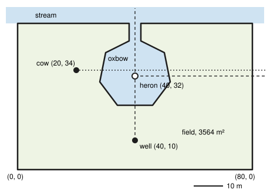

# Jordan curve theorem: a simple closed loop cuts the plane into an inside and an outside

[Syllabus](../../../SYLLABUS.md) → [Topology](../README.md) → [Surfaces and Manifolds](../README.md#s03) → Jordan curve theorem

---

## General Overview

A farm map shows a field 80 m east to west and 50 m north to south. Three sides are straight fences. The north side is the bank of a stream. The stream makes a tight bend, an oxbow, that loops south into the field through a neck 4 m wide.

Three things stand on the map, measured in metres from the field's south-west corner: a well at (40, 10), a cow at (20, 34) and a heron at (40, 32). The heron stands within the field's 80 m by 50 m box, but it is in the water of the bend. Which of the three are in the field?

[Inside or outside](../../05-Geometry%20and%20trig/07-Points%2C%20Convexity%20and%20Fractals/03-point-in-polygon-and-segment-tests.md) already answers this for a boundary of straight runs. Send a ray (a half-line) from the point and count how often it crosses the boundary: odd means inside. The well's ray north crosses once, the cow's ray east three times, the heron's ray east twice. So the well and the cow are in the field, and the heron is not.

That test takes one thing on trust: that the boundary cuts the map into exactly two pieces, a field and everything else. For straight runs that is proved. For a real bank, which curves and wiggles at every scale, it is the Jordan curve theorem. It looks obvious, and the obvious proof fails.

**A simple closed curve in the plane, a loop that ends where it starts and never meets itself, cuts the plane into exactly two pieces, a bounded inside and an unbounded outside, and every point of the curve lies on the edge of both.**

**What kind of fact this is:** a theorem. For curves made of finitely many straight runs it is proved in Why it works, Step 1, which takes the separation half from [Inside or outside](../../05-Geometry%20and%20trig/07-Points%2C%20Convexity%20and%20Fractals/03-point-in-polygon-and-segment-tests.md). For every continuous curve it is stated here with its key steps and a named source (Thomassen, 1992), not proved in full. The code checks finite cases; it illustrates and proves nothing about general curves.

### The picture: the field, the oxbow and three rays

<p align="center"></p>

To scale, 5 drawing units a metre, the south-west corner at (30, 290). The heavy line is the boundary, 16 corners on whole metres. The well's ray north crosses once at the bend's south bank, passes the heron's spot inside the bend, then runs up the open neck into the stream. The heron's ray east crosses 2 times, the cow's 3.

---

## The formula

The **plane** $`\mathbb{R}^2`$ is all points $`(x, y)`$ with $`x`$ and $`y`$ real numbers: here, metres east and north on the map.

A **simple closed curve** $`J`$ is the path traced by a continuous map $`\gamma`$ from the time interval $`[0, 1]`$ into the plane, with $`\gamma(0) = \gamma(1)`$ (it closes) and $`\gamma(s) \ne \gamma(t)`$ for any other two times $`s \ne t`$ (it never meets itself). Equivalently, $`J`$ is a copy of the circle $`S^1`$: $`J \cong S^1`$, homeomorphic in the sense of [Continuity by pre-images, and homeomorphism](../02-Topological%20Spaces/03-continuity-and-homeomorphism.md). Nothing is assumed about smoothness, corners or length.

A **piece** of a set is a largest part of it that is connected: in one piece, as [Connected and path-connected](../02-Topological%20Spaces/07-connectedness-and-path-connectedness.md) defines it. For an open set in the plane, connected means that any two of its points are joined by a path inside it. The **boundary** $`\partial U`$ of a set $`U`$ is every point whose every small disc meets both $`U`$ and the rest of the plane ([Closure, interior and boundary](../02-Topological%20Spaces/02-closure-interior-and-boundary.md)).

```math
\mathbb{R}^2 \setminus J = U_{\mathrm{in}} \cup U_{\mathrm{out}}, \qquad U_{\mathrm{in}} \cap U_{\mathrm{out}} = \varnothing, \qquad \partial U_{\mathrm{in}} = \partial U_{\mathrm{out}} = J
```

**Read it aloud:** take the curve away from the plane, and what is left is exactly two pieces that do not overlap, an inside and an outside, and the curve is the whole edge of each one. The inside is bounded (it fits in some disc); the outside is not.

When the curve is made of finitely many straight runs, the pieces can be told apart by a count:

```math
p \in U_{\mathrm{in}} \iff c(p) \text{ is odd} \iff n(J, p) = \pm 1
```

**Read it aloud:** a point is inside exactly when a ray from it crosses the curve an odd number of times, and exactly when the curve winds round it once, one way or the other. For the well, $`c = 1`$ and $`n = 1`$; for the heron, $`c = 2`$ and $`n = 0`$.

| Symbol | Plain meaning | In our example | Push it up and the answer… |
| --- | --- | --- | --- |
| $`\mathbb{R}^2`$, $`\mathbb{R}^n`$ | the plane: all points $`(x, y)`$; space of $`n`$ dimensions | the map, in metres east and north | — |
| $`J`$ | a simple closed curve | the field's boundary, 16 corners | more wiggle: still two pieces |
| $`\gamma`$, $`s`$, $`t`$ | the map that traces $`J`$; two times in $`[0, 1]`$ | a walk once round the field | — |
| $`S^1`$, $`\cong`$ | the circle; "is homeomorphic to" | $`J \cong S^1`$ | — |
| $`\setminus`$, $`\cup`$, $`\cap`$, $`\varnothing`$, $`\iff`$ | remove; union; overlap; the empty set; "exactly when" | the map minus the boundary is field plus the rest | — |
| $`U_{\mathrm{in}}`$ | the inside: the bounded piece | the field, 3564 m² | — |
| $`U_{\mathrm{out}}`$ | the outside: the unbounded piece | the stream and everything beyond | — |
| $`\partial U`$ | boundary: points touching both $`U`$ and the rest | $`\partial U_{\mathrm{in}} = J`$ | — |
| $`p`$ | a point not on the curve | the well (40, 10) | — |
| $`c(p)`$ | crossings of a ray from $`p`$ with $`J`$ | 1, 2 and 3 | each extra crossing flips the verdict |
| $`n(J, p)`$ | winding number: net turns of $`J`$ round $`p`$ | 1 for the well, 0 for the heron | — |
| $`V`$, $`E`$, $`F`$, $`K_{3,3}`$ | corners, runs and faces of a flat drawing; three houses joined to three utilities | 16, 16 and 2 for the field | each extra crossing adds a face |

### When it holds

- **Closed.** A boundary with a gap is an arc, and an arc leaves the plane in one piece. Remove the west fence and the grid finds 1 piece.
- **Simple: it never crosses itself.** Enter the corners of an 80 m by 50 m rectangle as south-west, south-east, north-west, north-east and the fence crosses itself once. The plane falls into 3 pieces, and the shoelace area (the area formula built from the corner coordinates) comes out at 0 m².
- **Simple: it never touches itself.** Close the oxbow's neck to 0 m and the bank runs into itself along the neck's whole length. The plane falls into 3 pieces, and the heron is cut off in a lake of 404 m².
- **In the plane.** On the surface of a bicycle inner tube, a loop drawn once round the tube leaves 1 piece. On a sphere a simple loop still leaves two pieces, but both are bounded, so neither is "the outside".
- **The count needs finitely many clean crossings.** The theorem itself holds for every simple closed curve. The ray count does not: a curve can cross a ray infinitely often, and then $`c(p)`$ has no value.

---

## Why it works

### Step 0: two claims, one easy to see and one hard

The theorem makes two claims.

1. **Separation:** the curve cuts the plane into at least two pieces. No path gets from the well to the far side of the stream without crossing the boundary.
2. **No shattering:** there are at most two pieces, and every point of the curve borders both. The field is not secretly two fields.

Separation comes from a number that cannot change along a path that avoids the curve: the crossing parity, or the winding number. The number is 0 far away and 1 at the well, so the two cannot be joined. No shattering needs a picture of what the plane looks like right next to the curve: near each point of the curve there should be exactly two sides. For a straight run that is plain. For a curve with no straight piece anywhere, it is the hard part.

### Step 1: fences of straight runs

For a boundary of straight runs the theorem has a short proof. [Inside or outside](../../05-Geometry%20and%20trig/07-Points%2C%20Convexity%20and%20Fractals/03-point-in-polygon-and-segment-tests.md) proves the separation half; the other half takes one more paragraph.

- **Separation.** Move a point along a path that misses the fence. Its crossing count changes only when the ray sweeps over a corner, and then by 0 or 2. So the parity stays the same. Far away it is even; just across one fence it is odd.
- **No shattering.** From any point, walk straight toward the fence and stop just short of it. Then walk beside the fence, keeping it on the same hand. A fence of straight runs has exactly two sides along its whole length, so every point reaches one of two strips: at most two pieces.

The field is such a fence, and the checks agree three ways. Ray parity east and north matches the winding number for all three points. A grid of 90 by 60 points, 1 m apart, joined wherever a link misses the fence, falls into 2 pieces, of 3564 and 1836 points. Euler's $`V - E + F = 2`$ from [Euler characteristic](04-euler-characteristic-and-triangulations.md), with 16 corners and 16 runs, gives $`F = 2`$ faces.

### Step 2: why the obvious proof fails

The obvious proof for a general curve runs like this: draw the curve with straight runs, finer and finer; each drawing has two pieces by Step 1; so the curve has two pieces too. Every step of that argument breaks.

**The count breaks.** Take the curve that follows $`y = x \sin(\pi / x)`$ for $`x`$ from 0 to 1, then closes with three straight runs below. It is a simple closed curve. Its wiggles get faster near $`x = 0`$ but also smaller, so it stays continuous. The line $`y = 0`$, walked from $`x = 1`$ toward $`x = 0`$, meets the curve at $`x = 1, 1/2, 1/3, \dots`$, every $`1/k`$. The checks count 10 crossings with $`x \ge 1/10`$, 100 with $`x \ge 1/100`$ and 1000 with $`x \ge 1/1000`$. There is no last crossing, so there is no parity.

Tilting the ray rescues this one example. A general proof would need a rule that finds a good ray for every curve, and the straight-run argument gives none.

**Walking beside the fence breaks.** Step 1 walked along the fence. The Koch snowflake shows a curve too long to walk: its length is infinite. Start with an equilateral triangle of perimeter 270 m and replace the middle third of every side with two sides of a smaller triangle, again and again. The perimeter grows by 4/3 each time: 270 m, 360 m, 480 m, then 1137.78 m at level 5 and 85141.0 m at level 20. The area only creeps up toward 8/5 of the triangle's. The limit is a simple closed curve of infinite length.

Worse, Osgood (1903) built a simple closed curve with positive area. No thin strip runs beside it at all.

**The limit breaks.** Close the oxbow's neck step by step. At 4 m and at 2 m the boundary is simple, and the grid and Euler's count both find 2 pieces. At 0 m the two banks meet, not at one point but along the neck's whole length. The heron's water is cut off from the stream, and both counts find 3 pieces: field, stream and a lake of 404 m².

Drawings can pinch like this: each one simple, their limit not. The limit keeps two pieces only because $`J`$ never touches itself, and turning that into a proof is the real work.

### Step 3: what the real proof does

Jordan stated the theorem in 1887. Proofs that convince modern readers came later; Hales (2007) gives the history and a proof checked line by line by computer. Thomassen (1992) gives a short proof built on one graph fact; Maehara (1984) gives another from Brouwer's fixed-point theorem. Thomassen's key steps, stated, not proved in full here:

1. **Straight runs.** The polygon case, Step 1.
2. **$`K_{3,3}`$ cannot be drawn flat.** $`K_{3,3}`$ is three houses each joined to three utilities, 6 points and 9 links. A crossing-free drawing would need $`F = 2 - 6 + 9 = 5`$ faces by Euler. But no three of the 6 points are all joined to each other (the checks try all 20 triples), so every face has at least 4 sides. Each link borders at most 2 faces, so $`4F \le 2E`$ and $`F \le 9/2`$. Five faces cannot fit.
3. **An arc never separates the plane.** A curve that does not close leaves one piece, like the field with its west fence gone. This is the most delicate step in the paper.
4. **Each piece has the whole curve as its edge.** Suppose a piece's boundary missed a stretch of $`J`$. Then the boundary lies on the rest of $`J`$, which is an arc. The piece is then a whole piece of the plane minus that arc, and by key step 3 that is everything off the arc. So the piece contains the missing stretch of $`J`$, but no piece contains points of $`J`$: a contradiction.
5. **At least two pieces.** If the curve left the plane in one piece, Thomassen joins chosen points of $`J`$ by paths through that piece and builds a crossing-free $`K_{3,3}`$. Key step 2 forbids it.
6. **At most two pieces.** Suppose there were three. Pick a point in each and three points on $`J`$. Using key step 4, Thomassen joins each of the three inner points to the three points on $`J`$ by paths inside its own piece. Paths in different pieces never meet, so this is a crossing-free $`K_{3,3}`$ again.

<details>
<summary>Detailed proof: the three-houses graph has no crossing-free drawing made of straight runs</summary>

Suppose $`K_{3,3}`$ is drawn with straight runs and no crossings. The drawing is in one piece, so Euler's count for flat drawings, from [Planar graphs](../../04-Combinatorics%20and%20graphs/12-Planarity%20and%20Colouring/01-planar-graphs-and-eulers-formula.md), gives the number of faces $`F`$:

$`\displaystyle F = 2 - V + E = 2 - 6 + 9 = 5`$

In a crossing-free drawing of $`K_{3,3}`$, the edge of each face is a cycle of the graph: a closed run of links with no point repeated. This holds because removing any one point leaves the graph in one piece. Every link joins a house to a utility, so a cycle alternates between the two kinds and has even length. A cycle needs at least 3 links, so every face's edge has at least 4.

Add the lengths of all the face edges. Each link is counted at most twice, once from each side, so the total is at most $`2E`$. Each face contributes at least 4, so the total is at least $`4F`$. Hence

$`\displaystyle 4F \le 2E = 2 \times 9, \qquad F \le 9/2`$

But $`F = 5`$, a contradiction. Key steps 5 and 6 need the same fact for links that are any arcs; Thomassen's paper supplies that extension.

</details>

### Step 4: the inside is a disc, and space is different

The **Schoenflies theorem** goes further: the inside together with $`J`$ is a copy of a closed disc. The field, however wiggly its bank, can be stretched onto a round pond without tearing. Thomassen's paper proves this too.

In three dimensions, a surface that is a copy of the sphere still splits space into two pieces. Brouwer proved that in 1912, along with **invariance of domain**: a continuous one-to-one map from an open set of $`\mathbb{R}^n`$ into $`\mathbb{R}^n`$ has an open image. But Schoenflies fails. Alexander's horned sphere (1924) has an outside in which a loop round one horn can never be shrunk to a point. So a sphere-shaped surface in space need not have an outside like a round sphere's, where every loop shrinks to a point.

---

## Worked numbers, by hand

The field, with the neck 4 m wide. Corners, in metres: (0, 0), (80, 0), (80, 50), then west along the bank to (60, 50) and (42, 50), round the bend through (42, 44), (50, 40), (52, 30), (46, 22), (34, 22), (28, 30), (30, 40), (38, 44), (38, 50), and on to (20, 50) and (0, 50).

| Step | Arithmetic | Value |
| --- | --- | --- |
| Area of the field | shoelace sum over the 16 corners | 3564 m² |
| Well (40, 10), ray north | meets the bend's south bank at 22 m north, then runs up the open neck | 1 crossing: odd |
| Heron (40, 32), ray east | the bend's east bank, the east fence | 2 crossings: even |
| Cow (20, 34), ray east | the bend's west bank, its east bank, the east fence | 3 crossings: odd |
| Same three, the other ray | heron north: up the neck, 0; cow north: the bank at (20, 50), 1 | parities agree |
| Winding numbers | net turns of the sight line | well 1, heron 0, cow 1 |
| Grid flood fill | 90 by 60 points, links that miss the fence | 2 pieces: 3564 and 1836 points |
| Euler's count | $`F = 2 - V + E = 2 - 16 + 16`$ | 2 faces |
| **Verdict** | **two pieces, by three roads** | **well and cow in the field, heron in the stream** |

The heron is in the stream although it stands in the middle of the field's box. The boundary decides, not the box.

### What breaks if you drop a piece

| Mistake | Comes out at | What went wrong |
| --- | --- | --- |
| Corners entered south-west, south-east, north-west, north-east | 1 crossing, 3 pieces, shoelace area 0 m² | not simple: the fence crosses itself, and the two halves' areas cancel |
| The neck closed to 0 m | 3 pieces; the heron in a lake of 404 m² | not simple: the bank touches itself |
| The west fence left out | 1 piece | not closed: an arc does not separate |
| A loop round the inner tube | 1 piece; the tube cut open flat, 2 | not in the plane |
| Counting crossings on $`y = x \sin(\pi / x)`$ | 10, 100, 1000 crossings, with no end | the count needs finitely many crossings |

---

## Code, from first principles, and it actually runs

The checks take three roads to the field's pieces. Road one is ray parity east and north against the winding number. Road two is a grid flood fill: 90 by 60 points, offset so none lands on the fence, joined where a link misses it. Road three is Euler's count of faces, each crossing made into a new corner. Roads two and three also run on every broken fence. The limits are checked by finite stages: the wiggle's crossings counted two ways, and the Koch perimeter and area summed against their formulas. The inner tube's surface is a 12 by 8 grid with both pairs of opposite edges glued: walk off one edge and you come back on the opposite one.

### Python

```python
# Jordan curve theorem -- the check behind the card.  Standard library only.
# A field on a map, in metres: three straight fences and a stream bank with an
# oxbow bend.  Roads: ray parity two ways against the winding angle; a 1 m grid
# flood fill whose piece count meets Euler's V - E + F; limits by finite stages.
from fractions import Fraction as Fr
from math import atan2, pi, sin, sqrt

def field(h):  # h: half-width of the oxbow's neck, in metres
    return [(0, 0), (80, 0), (80, 50), (60, 50), (40 + h, 50), (40 + h, 44), (50, 40),
            (52, 30), (46, 22), (34, 22), (28, 30), (30, 40), (40 - h, 44), (40 - h, 50),
            (20, 50), (0, 50)]

def edges(poly, closed=True):
    n = len(poly)
    es = [(poly[i], poly[(i + 1) % n]) for i in range(n if closed else n - 1)]
    return [(a, b) for a, b in es if a != b]

def east(p, es):  # half-open rule: a corner on the ray counts as just south of it
    n = 0
    for (ax, ay), (bx, by) in es:
        if (ay > p[1]) != (by > p[1]) and ((ax - p[0]) * (by - ay) + (p[1] - ay) * (bx - ax)) * (by - ay) > 0:
            n += 1
    return n

def north(p, es):  # the same count with east and north swapped
    return east((p[1], p[0]), [((ay, ax), (by, bx)) for (ax, ay), (bx, by) in es])

def winding(p, es):  # road 2: total turn of the sight line, in whole turns
    t = 0.0
    for (ax, ay), (bx, by) in es:
        ux, uy, vx, vy = ax - p[0], ay - p[1], bx - p[0], by - p[1]
        t += atan2(ux * vy - uy * vx, ux * vx + uy * vy)
    return round(t / (2 * pi))

def orient(a, b, c):
    return (b[0] - a[0]) * (c[1] - a[1]) - (b[1] - a[1]) * (c[0] - a[0])

def meets(a, b, c, d):  # do the closed segments ab and cd share a point?
    o = (orient(a, b, c), orient(a, b, d), orient(c, d, a), orient(c, d, b))
    if o[0] * o[1] < 0 and o[2] * o[3] < 0:
        return True
    box = lambda p, q, r: min(p[0], q[0]) <= r[0] <= max(p[0], q[0]) and min(p[1], q[1]) <= r[1] <= max(p[1], q[1])
    return any(o[k] == 0 and box(*s) for k, s in enumerate(((a, b, c), (a, b, d), (c, d, a), (c, d, b))))

def flood(w, h, ok, wrap=False):  # union-find over a w by h grid; returns piece of each point
    up = list(range(w * h))
    def find(k):
        while up[k] != k:
            up[k] = up[up[k]]; k = up[k]
        return k
    for i in range(w):
        for j in range(h):
            for di, dj in ((1, 0), (0, 1)):
                i2, j2 = ((i + di) % w, (j + dj) % h) if wrap else (i + di, j + dj)
                if i2 < w and j2 < h and ok(i, j, i2, j2):
                    up[find(i * h + j)] = find(i2 * h + j2)
    return [find(k) for k in range(w * h)]
def map_pieces(es):  # grid points at (x + 1/3, y + 1/2) m, x from -5 to 84, y from -5 to 54
    e6 = [((6 * a[0], 6 * a[1]), (6 * b[0], 6 * b[1])) for a, b in es]
    pt = lambda i, j: (6 * i - 28, 6 * j - 27)
    return flood(90, 60, lambda i, j, k, l: not any(meets(pt(i, j), pt(k, l), a, b) for a, b in e6))
def euler_faces(es):  # V - E + F = 2 for a drawing in one piece, crossings made into corners
    und = {tuple(sorted(e)) for e in es}
    cross = sum(1 for e in und for f in und if e < f and not set(e) & set(f)
                and orient(*e, f[0]) * orient(*e, f[1]) < 0 and orient(*f, e[0]) * orient(*f, e[1]) < 0)
    v, e = len({p for s in und for p in s}) + cross, len(und) + 2 * cross
    return cross, v, e, 2 - v + e

def area(poly):
    return Fr(sum(orient((0, 0), a, b) for a, b in edges(poly)), 2)
cell = lambda x, y: (x + 5) * 60 + (y + 5)  # grid index of the point just north-east of (x, y)
F = field(2); es = edges(F)
print(f"field, neck 4 m wide: {len(F)} corners, area by shoelace {area(F)} m2")
print(f"corners, anticlockwise from the south-west, metres: {F}")
verdicts = []
for name, p in (("well", (40, 10)), ("heron", (40, 32)), ("cow", (20, 34))):
    e, n, w = east(p, es), north(p, es), winding(p, es)
    verdicts.append((e % 2, n % 2, w))
    print(f"{name:<5} {p}: east ray {e}, north ray {n}, winding {w} -> {'inside' if w else 'outside'}")
piece = map_pieces(es); sizes = {r: piece.count(r) for r in set(piece)}
inside = sizes[piece[cell(40, 10)]]
print(f"grid 90 x 60 points 1 m apart: pieces {len(sizes)}; inside {inside} points, outside {sizes[piece[0]]}")
print(f"same piece: well and cow {piece[cell(40, 10)] == piece[cell(20, 34)]}, heron and far corner {piece[cell(40, 32)] == piece[0]}")
cases = [(f"neck {2 * h} m wide", edges(field(h))) for h in (2, 1, 0)]
cases += [("corners out of order SW SE NW NE", edges([(0, 0), (80, 0), (0, 50), (80, 50)])),
          ("west fence missing", edges(F, closed=False))]
counts = []  # each fence two ways: Euler's count of faces, and a flood fill of the grid
for name, c in cases:
    cr, v, e, f = euler_faces(c); g = len(set(map_pieces(c))); counts.append((g, f))
    print(f"{name:<32}: crossings {cr}, V {v}, E {e}, Euler faces {f}, grid pieces {g}")
lake = map_pieces(edges(field(0))); lake_n = lake.count(lake[cell(40, 32)])
print(f"neck closed: heron with the far corner {lake[cell(40, 32)] == lake[0]}; lake {lake_n} points, "
      f"shoelace {abs(area(field(0)[5:12]))} m2")
print(f"corners out of order: shoelace area {area([(0, 0), (80, 0), (0, 50), (80, 50)])} m2")
wall = lambda i, j, k, l: not (j == l and {i, k} == {0, 1})  # a closed loop on the tube, between columns 0 and 1
print(f"loop round the inner tube (12 x 8 grid, both edge pairs glued): pieces {len(set(flood(12, 8, wall, True)))}; "
      f"the tube cut open flat: {len(set(flood(12, 8, wall)))}")
wig = []
for N in (10, 100, 1000):  # y = x sin(pi/x) meets y = 0 at x = 1, 1/2, ..., 1/N
    s, last = 0, None
    for j in range(800, 1000 * N + 501):  # u = 1/x from 0.8 to N + 0.5, steps of 0.001
        sign = sin(pi * j / 1000) >= 0; s += last is not None and sign != last; last = sign
    wig.append((N, s)); print(f"wiggle, crossings with x >= 1/{N}: formula {N}, sampled {s}")

def koch(n):  # level-n snowflake on a 90 m triangle, clockwise, as floats
    pts = [(0.0, 0.0), (45.0, 45.0 * sqrt(3)), (90.0, 0.0)]
    for _ in range(n):
        new = []
        for k in range(len(pts)):
            (ax, ay), (bx, by) = pts[k], pts[(k + 1) % len(pts)]
            dx, dy = (bx - ax) / 3, (by - ay) / 3
            px, py = ax + 1.5 * dx - dy * sqrt(3) / 2, ay + 1.5 * dy + dx * sqrt(3) / 2  # the new peak
            new += [(ax, ay), (ax + dx, ay + dy), (px, py), (ax + 2 * dx, ay + 2 * dy)]
        pts = new
    return pts
tri = 8100 * sqrt(3) / 4
for n in (0, 1, 2, 5):
    k = koch(n); m = len(k)
    per = sum(sqrt((k[(i + 1) % m][0] - k[i][0]) ** 2 + (k[(i + 1) % m][1] - k[i][1]) ** 2) for i in range(m))
    ar = abs(sum(k[i][0] * k[(i + 1) % m][1] - k[(i + 1) % m][0] * k[i][1] for i in range(m))) / 2 / tri
    P, A = 270 * Fr(4, 3) ** n, Fr(8, 5) - Fr(3, 5) * Fr(4, 9) ** n
    assert abs(per - P) < 1e-9 * P and abs(ar - A) < 1e-9, "Koch polygon against the formulas"
    print(f"Koch level {n}: {m} sides, perimeter {P} = {float(P):.2f} m (summed {per:.2f}), area {A} = {float(A):.6f} triangles (shoelace {ar:.6f})")
print(f"Koch level 20: perimeter {float(270 * Fr(4, 3) ** 20):.1f} m; area limit 8/5 of the triangle")
adj = lambda x, y: (x < 3) != (y < 3)  # K33: three houses 0-2, three utilities 3-5
tris = sum(1 for a in range(6) for b in range(a + 1, 6) for c in range(b + 1, 6) if adj(a, b) and adj(b, c) and adj(a, c))
ke = sum(1 for a in range(6) for b in range(a + 1, 6) if adj(a, b)); girth = 3 if tris else 4
print(f"K33: V 6, E {ke}; Euler needs F = {2 - 6 + ke}; triangles {tris} of 20, so {girth}F <= 2E gives F <= {Fr(2 * ke, girth)}")
svg = lambda x, y: (30 + 5 * x, 290 - 5 * y)  # 5 drawing units a metre
print(f"figure, corners {[svg(*c) for c in F]}")
print(f"figure, well {svg(40, 10)}, heron {svg(40, 32)}, cow {svg(20, 34)}")

assert verdicts == [(1, 1, 1), (0, 0, 0), (1, 1, 1)], "ray parity both ways must match the winding angle"
assert [g for g, f in counts] == [f for g, f in counts] == [2, 2, 3, 3, 1], "grid pieces must equal Euler faces"
assert abs(inside - area(F)) < 40, "inside grid points must match the shoelace area"
assert all(N == s for N, s in wig), "sampled sign changes must match the zeros at 1/k"
assert 2 - 6 + ke > Fr(2 * ke, girth), "K33 needs more faces than its edges allow"
assert abs(lake_n - abs(area(field(0)[5:12]))) < 20, "lake grid points against its shoelace area"
print("ALL CHECKS PASS")
```

**Ran 2026-11-14 on macOS, Python 3.14.10, standard library only. All checks passed. Output, pasted from the run:**

```
field, neck 4 m wide: 16 corners, area by shoelace 3564 m2
corners, anticlockwise from the south-west, metres: [(0, 0), (80, 0), (80, 50), (60, 50), (42, 50), (42, 44), (50, 40), (52, 30), (46, 22), (34, 22), (28, 30), (30, 40), (38, 44), (38, 50), (20, 50), (0, 50)]
well  (40, 10): east ray 1, north ray 1, winding 1 -> inside
heron (40, 32): east ray 2, north ray 0, winding 0 -> outside
cow   (20, 34): east ray 3, north ray 1, winding 1 -> inside
grid 90 x 60 points 1 m apart: pieces 2; inside 3564 points, outside 1836
same piece: well and cow True, heron and far corner True
neck 4 m wide                   : crossings 0, V 16, E 16, Euler faces 2, grid pieces 2
neck 2 m wide                   : crossings 0, V 16, E 16, Euler faces 2, grid pieces 2
neck 0 m wide                   : crossings 0, V 14, E 15, Euler faces 3, grid pieces 3
corners out of order SW SE NW NE: crossings 1, V 5, E 6, Euler faces 3, grid pieces 3
west fence missing              : crossings 0, V 16, E 15, Euler faces 1, grid pieces 1
neck closed: heron with the far corner False; lake 404 points, shoelace 404 m2
corners out of order: shoelace area 0 m2
loop round the inner tube (12 x 8 grid, both edge pairs glued): pieces 1; the tube cut open flat: 2
wiggle, crossings with x >= 1/10: formula 10, sampled 10
wiggle, crossings with x >= 1/100: formula 100, sampled 100
wiggle, crossings with x >= 1/1000: formula 1000, sampled 1000
Koch level 0: 3 sides, perimeter 270 = 270.00 m (summed 270.00), area 1 = 1.000000 triangles (shoelace 1.000000)
Koch level 1: 12 sides, perimeter 360 = 360.00 m (summed 360.00), area 4/3 = 1.333333 triangles (shoelace 1.333333)
Koch level 2: 48 sides, perimeter 480 = 480.00 m (summed 480.00), area 40/27 = 1.481481 triangles (shoelace 1.481481)
Koch level 5: 3072 sides, perimeter 10240/9 = 1137.78 m (summed 1137.78), area 31288/19683 = 1.589595 triangles (shoelace 1.589595)
Koch level 20: perimeter 85141.0 m; area limit 8/5 of the triangle
K33: V 6, E 9; Euler needs F = 5; triangles 0 of 20, so 4F <= 2E gives F <= 9/2
figure, corners [(30, 290), (430, 290), (430, 40), (330, 40), (240, 40), (240, 70), (280, 90), (290, 140), (260, 180), (200, 180), (170, 140), (180, 90), (220, 70), (220, 40), (130, 40), (30, 40)]
figure, well (230, 240), heron (230, 130), cow (130, 120)
ALL CHECKS PASS
```

### Rust

```rust
// Jordan curve theorem -- the check behind the card.  Standard library only.
// A field on a map, in metres: three straight fences and a stream bank with an
// oxbow bend.  Roads: ray parity two ways against the winding angle; a 1 m grid
// flood fill whose piece count meets Euler's V - E + F; limits by finite stages.
use std::collections::BTreeSet;
use std::f64::consts::PI;
type P = (i64, i64);
type E = (P, P);

fn field(h: i64) -> Vec<P> {
    vec![(0, 0), (80, 0), (80, 50), (60, 50), (40 + h, 50), (40 + h, 44), (50, 40), (52, 30),
         (46, 22), (34, 22), (28, 30), (30, 40), (40 - h, 44), (40 - h, 50), (20, 50), (0, 50)]
}
fn edges(poly: &[P], closed: bool) -> Vec<E> {
    let (n, m) = (poly.len(), if closed { poly.len() } else { poly.len() - 1 });
    (0..m).map(|i| (poly[i], poly[(i + 1) % n])).filter(|(a, b)| a != b).collect()
}
fn east(p: P, es: &[E]) -> usize { // half-open rule: a corner on the ray counts as just south of it
    es.iter().filter(|&&((ax, ay), (bx, by))| (ay > p.1) != (by > p.1)
        && ((ax - p.0) * (by - ay) + (p.1 - ay) * (bx - ax)) * (by - ay) > 0).count()
}
fn north(p: P, es: &[E]) -> usize { // the same count with east and north swapped
    let sw: Vec<E> = es.iter().map(|&((ax, ay), (bx, by))| ((ay, ax), (by, bx))).collect();
    east((p.1, p.0), &sw)
}
fn winding(p: P, es: &[E]) -> i64 { // road 2: total turn of the sight line, in whole turns
    let mut t = 0.0f64;
    for &((ax, ay), (bx, by)) in es {
        let (ux, uy, vx, vy) = ((ax - p.0) as f64, (ay - p.1) as f64, (bx - p.0) as f64, (by - p.1) as f64);
        t += (ux * vy - uy * vx).atan2(ux * vx + uy * vy);
    }
    (t / (2.0 * PI)).round() as i64
}
fn orient(a: P, b: P, c: P) -> i64 { (b.0 - a.0) * (c.1 - a.1) - (b.1 - a.1) * (c.0 - a.0) }
fn meets(a: P, b: P, c: P, d: P) -> bool { // do the closed segments ab and cd share a point?
    let o = [orient(a, b, c), orient(a, b, d), orient(c, d, a), orient(c, d, b)];
    if o[0] * o[1] < 0 && o[2] * o[3] < 0 { return true; }
    let bx = |p: P, q: P, r: P| p.0.min(q.0) <= r.0 && r.0 <= p.0.max(q.0) && p.1.min(q.1) <= r.1 && r.1 <= p.1.max(q.1);
    let s = [(a, b, c), (a, b, d), (c, d, a), (c, d, b)];
    (0..4).any(|k| o[k] == 0 && bx(s[k].0, s[k].1, s[k].2))
}
fn flood(w: usize, h: usize, ok: &dyn Fn(usize, usize, usize, usize) -> bool, wrap: bool) -> Vec<usize> {
    let mut up: Vec<usize> = (0..w * h).collect();
    fn find(up: &mut Vec<usize>, mut k: usize) -> usize {
        while up[k] != k { up[k] = up[up[k]]; k = up[k]; }
        k
    }
    for i in 0..w { for j in 0..h { for (di, dj) in [(1, 0), (0, 1)] {
        let (i2, j2) = if wrap { ((i + di) % w, (j + dj) % h) } else { (i + di, j + dj) };
        if i2 < w && j2 < h && ok(i, j, i2, j2) {
            let (r1, r2) = (find(&mut up, i * h + j), find(&mut up, i2 * h + j2));
            up[r1] = r2;
        }
    } } }
    (0..w * h).map(|k| find(&mut up, k)).collect()
}
fn map_pieces(es: &[E]) -> Vec<usize> { // grid points at (x + 1/3, y + 1/2) m, x from -5 to 84, y from -5 to 54
    let e6: Vec<E> = es.iter().map(|&(a, b)| ((6 * a.0, 6 * a.1), (6 * b.0, 6 * b.1))).collect();
    let pt = |i: usize, j: usize| (6 * i as i64 - 28, 6 * j as i64 - 27);
    flood(90, 60, &|i, j, k, l| !e6.iter().any(|&(a, b)| meets(pt(i, j), pt(k, l), a, b)), false)
}
fn count(v: &[usize]) -> usize { v.iter().collect::<BTreeSet<_>>().len() }
fn euler_faces(es: &[E]) -> (i64, i64, i64, i64) { // V - E + F = 2, crossings made into corners
    let und: Vec<E> = es.iter().map(|&(a, b)| if a < b { (a, b) } else { (b, a) }).collect::<BTreeSet<_>>().into_iter().collect();
    let mut cross = 0;
    for x in &und { for y in &und {
        let shared = x.0 == y.0 || x.0 == y.1 || x.1 == y.0 || x.1 == y.1;
        if x < y && !shared && orient(x.0, x.1, y.0) * orient(x.0, x.1, y.1) < 0
            && orient(y.0, y.1, x.0) * orient(y.0, y.1, x.1) < 0 { cross += 1; }
    } }
    let pts: BTreeSet<P> = und.iter().flat_map(|&(a, b)| [a, b]).collect();
    let (v, e) = (pts.len() as i64 + cross, und.len() as i64 + 2 * cross);
    (cross, v, e, 2 - v + e)
}
fn area2(poly: &[P]) -> i64 { edges(poly, true).iter().map(|&(a, b)| orient((0, 0), a, b)).sum() } // twice the area
fn gcd(a: i128, b: i128) -> i128 { if b == 0 { a.abs() } else { gcd(b, a % b) } }
fn frac(n: i128, d: i128) -> String { // a fraction in lowest terms, as Python prints it
    let g = gcd(n, d);
    if d / g == 1 { format!("{}", n / g) } else { format!("{}/{}", n / g, d / g) } }
fn cell(x: i64, y: i64) -> usize { ((x + 5) * 60 + (y + 5)) as usize } // grid point just north-east of (x, y)
fn tf(b: bool) -> &'static str { if b { "True" } else { "False" } }
fn koch(n: u32) -> Vec<(f64, f64)> { // level-n snowflake on a 90 m triangle, clockwise, as floats
    let s3 = 3f64.sqrt();
    let mut pts = vec![(0.0, 0.0), (45.0, 45.0 * s3), (90.0, 0.0)];
    for _ in 0..n {
        let mut new = Vec::new();
        for k in 0..pts.len() {
            let ((ax, ay), (bx, by)) = (pts[k], pts[(k + 1) % pts.len()]);
            let (dx, dy) = ((bx - ax) / 3.0, (by - ay) / 3.0);
            let (px, py) = (ax + 1.5 * dx - dy * s3 / 2.0, ay + 1.5 * dy + dx * s3 / 2.0); // the new peak
            new.extend([(ax, ay), (ax + dx, ay + dy), (px, py), (ax + 2.0 * dx, ay + 2.0 * dy)]);
        }
        pts = new;
    }
    pts
}
fn main() {
    let (f, es) = (field(2), edges(&field(2), true));
    println!("field, neck 4 m wide: {} corners, area by shoelace {} m2", f.len(), frac(area2(&f) as i128, 2));
    println!("corners, anticlockwise from the south-west, metres: {:?}", f);
    let mut verdicts = Vec::new();
    for (name, p) in [("well", (40, 10)), ("heron", (40, 32)), ("cow", (20, 34))] {
        let (e, n, w) = (east(p, &es), north(p, &es), winding(p, &es));
        verdicts.push((e % 2, n % 2, w));
        println!("{:<5} {:?}: east ray {}, north ray {}, winding {} -> {}", name, p, e, n, w, if w != 0 { "inside" } else { "outside" });
    }
    let piece = map_pieces(&es);
    let size = |r: usize| piece.iter().filter(|&&x| x == r).count();
    let inside = size(piece[cell(40, 10)]);
    println!("grid 90 x 60 points 1 m apart: pieces {}; inside {} points, outside {}", count(&piece), inside, size(piece[0]));
    println!("same piece: well and cow {}, heron and far corner {}", tf(piece[cell(40, 10)] == piece[cell(20, 34)]), tf(piece[cell(40, 32)] == piece[0]));
    let mut cases: Vec<(String, Vec<E>)> = [2, 1, 0].iter().map(|&h| (format!("neck {} m wide", 2 * h), edges(&field(h), true))).collect();
    cases.push(("corners out of order SW SE NW NE".to_string(), edges(&[(0, 0), (80, 0), (0, 50), (80, 50)], true)));
    cases.push(("west fence missing".to_string(), edges(&f, false)));
    let mut counts = Vec::new(); // each fence two ways: Euler's count of faces, and a flood fill of the grid
    for (name, c) in &cases {
        let (cr, v, e, fa) = euler_faces(c);
        let g = count(&map_pieces(c));
        counts.push((g as i64, fa));
        println!("{:<32}: crossings {}, V {}, E {}, Euler faces {}, grid pieces {}", name, cr, v, e, fa, g);
    }
    let lake = map_pieces(&edges(&field(0), true));
    let lake_n = lake.iter().filter(|&&x| x == lake[cell(40, 32)]).count() as i64;
    let lake_a = area2(&field(0)[5..12]).abs();
    println!("neck closed: heron with the far corner {}; lake {} points, shoelace {} m2", tf(lake[cell(40, 32)] == lake[0]), lake_n, frac(lake_a as i128, 2));
    println!("corners out of order: shoelace area {} m2", frac(area2(&[(0, 0), (80, 0), (0, 50), (80, 50)]) as i128, 2));
    let wall = |i: usize, j: usize, k: usize, l: usize| !(j == l && i.min(k) == 0 && i.max(k) == 1); // a closed loop on the tube
    println!("loop round the inner tube (12 x 8 grid, both edge pairs glued): pieces {}; the tube cut open flat: {}", count(&flood(12, 8, &wall, true)), count(&flood(12, 8, &wall, false)));
    let mut wig = Vec::new();
    for n in [10i64, 100, 1000] { // y = x sin(pi/x) meets y = 0 at x = 1, 1/2, ..., 1/N
        let (mut s, mut last) = (0i64, None);
        for j in 800..=(1000 * n + 500) { // u = 1/x from 0.8 to N + 0.5, steps of 0.001
            let sign = (PI * j as f64 / 1000.0).sin() >= 0.0;
            if last.is_some() && last != Some(sign) { s += 1; }
            last = Some(sign);
        }
        wig.push((n, s));
        println!("wiggle, crossings with x >= 1/{}: formula {}, sampled {}", n, n, s);
    }
    let tri = 8100.0 * 3f64.sqrt() / 4.0;
    for n in [0u32, 1, 2, 5] {
        let (k, m) = (koch(n), 3 * 4usize.pow(n));
        let per: f64 = (0..m).map(|i| ((k[(i + 1) % m].0 - k[i].0).powi(2) + (k[(i + 1) % m].1 - k[i].1).powi(2)).sqrt()).sum();
        let ar = (0..m).map(|i| k[i].0 * k[(i + 1) % m].1 - k[(i + 1) % m].0 * k[i].1).sum::<f64>().abs() / 2.0 / tri;
        let (pn, pd) = (270 * 4i128.pow(n), 3i128.pow(n));
        let (an, ad) = (8 * 9i128.pow(n) - 3 * 4i128.pow(n), 5 * 9i128.pow(n));
        let (pf, af) = (pn as f64 / pd as f64, an as f64 / ad as f64);
        assert!((per - pf).abs() < 1e-9 * pf && (ar - af).abs() < 1e-9, "Koch polygon against the formulas");
        println!("Koch level {}: {} sides, perimeter {} = {:.2} m (summed {:.2}), area {} = {:.6} triangles (shoelace {:.6})", n, m, frac(pn, pd), pf, per, frac(an, ad), af, ar);
    }
    println!("Koch level 20: perimeter {:.1} m; area limit 8/5 of the triangle", 270.0 * 4i128.pow(20) as f64 / 3i128.pow(20) as f64);
    let adj = |x: usize, y: usize| (x < 3) != (y < 3); // K33: three houses 0-2, three utilities 3-5
    let mut tris = 0;
    for a in 0..6 { for b in a + 1..6 { for c in b + 1..6 { if adj(a, b) && adj(b, c) && adj(a, c) { tris += 1; } } } }
    let ke = (0..6).flat_map(|a| (a + 1..6).map(move |b| (a, b))).filter(|&(a, b)| adj(a, b)).count() as i128;
    let girth = if tris > 0 { 3 } else { 4 };
    println!("K33: V 6, E {}; Euler needs F = {}; triangles {} of 20, so {}F <= 2E gives F <= {}", ke, 2 - 6 + ke, tris, girth, frac(2 * ke, girth));
    let svg = |p: P| (30 + 5 * p.0, 290 - 5 * p.1); // 5 drawing units a metre
    println!("figure, corners {:?}", f.iter().map(|&c| svg(c)).collect::<Vec<P>>());
    println!("figure, well {:?}, heron {:?}, cow {:?}", svg((40, 10)), svg((40, 32)), svg((20, 34)));

    assert!(verdicts == vec![(1, 1, 1), (0, 0, 0), (1, 1, 1)], "ray parity both ways must match the winding angle");
    assert!(counts.iter().all(|&(g, fa)| g == fa) && counts.iter().map(|c| c.0).collect::<Vec<_>>() == vec![2, 2, 3, 3, 1], "grid pieces must equal Euler faces");
    assert!((2 * inside as i64 - area2(&f)).abs() < 80, "inside grid points must match the shoelace area");
    assert!(wig.iter().all(|&(n, s)| n == s), "sampled sign changes must match the zeros at 1/k");
    assert!((2 - 6 + ke) * girth > 2 * ke, "K33 needs more faces than its edges allow");
    assert!((2 * lake_n - lake_a).abs() < 40, "lake grid points against its shoelace area");
    println!("ALL CHECKS PASS");
}
```

**Ran 2026-11-14 on macOS, rustc 1.98.1, no crates. All checks passed. Output, pasted from the run:**

```
field, neck 4 m wide: 16 corners, area by shoelace 3564 m2
corners, anticlockwise from the south-west, metres: [(0, 0), (80, 0), (80, 50), (60, 50), (42, 50), (42, 44), (50, 40), (52, 30), (46, 22), (34, 22), (28, 30), (30, 40), (38, 44), (38, 50), (20, 50), (0, 50)]
well  (40, 10): east ray 1, north ray 1, winding 1 -> inside
heron (40, 32): east ray 2, north ray 0, winding 0 -> outside
cow   (20, 34): east ray 3, north ray 1, winding 1 -> inside
grid 90 x 60 points 1 m apart: pieces 2; inside 3564 points, outside 1836
same piece: well and cow True, heron and far corner True
neck 4 m wide                   : crossings 0, V 16, E 16, Euler faces 2, grid pieces 2
neck 2 m wide                   : crossings 0, V 16, E 16, Euler faces 2, grid pieces 2
neck 0 m wide                   : crossings 0, V 14, E 15, Euler faces 3, grid pieces 3
corners out of order SW SE NW NE: crossings 1, V 5, E 6, Euler faces 3, grid pieces 3
west fence missing              : crossings 0, V 16, E 15, Euler faces 1, grid pieces 1
neck closed: heron with the far corner False; lake 404 points, shoelace 404 m2
corners out of order: shoelace area 0 m2
loop round the inner tube (12 x 8 grid, both edge pairs glued): pieces 1; the tube cut open flat: 2
wiggle, crossings with x >= 1/10: formula 10, sampled 10
wiggle, crossings with x >= 1/100: formula 100, sampled 100
wiggle, crossings with x >= 1/1000: formula 1000, sampled 1000
Koch level 0: 3 sides, perimeter 270 = 270.00 m (summed 270.00), area 1 = 1.000000 triangles (shoelace 1.000000)
Koch level 1: 12 sides, perimeter 360 = 360.00 m (summed 360.00), area 4/3 = 1.333333 triangles (shoelace 1.333333)
Koch level 2: 48 sides, perimeter 480 = 480.00 m (summed 480.00), area 40/27 = 1.481481 triangles (shoelace 1.481481)
Koch level 5: 3072 sides, perimeter 10240/9 = 1137.78 m (summed 1137.78), area 31288/19683 = 1.589595 triangles (shoelace 1.589595)
Koch level 20: perimeter 85141.0 m; area limit 8/5 of the triangle
K33: V 6, E 9; Euler needs F = 5; triangles 0 of 20, so 4F <= 2E gives F <= 9/2
figure, corners [(30, 290), (430, 290), (430, 40), (330, 40), (240, 40), (240, 70), (280, 90), (290, 140), (260, 180), (200, 180), (170, 140), (180, 90), (220, 70), (220, 40), (130, 40), (30, 40)]
figure, well (230, 240), heron (230, 130), cow (130, 120)
ALL CHECKS PASS
```

### Lean

Lean proves the Jordan curve theorem for every simple closed curve, that an arc leaves one piece, and the card's worked numbers.

- Take a simple closed curve $`J`$ in the plane, with nothing assumed about smoothness, corners or length. Then the plane minus $`J`$ is exactly two pieces that do not overlap.
- One piece, the inside, is bounded. The other, the outside, is not.
- Each piece has the whole curve $`J`$ as its boundary.
- Take an arc: a curve traced over the times $`[0, 1]`$ that never meets itself and does not close. Then the plane minus the arc is one piece.
- The shoelace area is 3564 m² for the field, 404 m² for the lake and 0 m² for the rectangle with corners out of order.
- The grid's 3564 inside points and 1836 outside points add up to all 90 by 60 points.
- With 16 corners and 16 runs, Euler's count gives the field 2 faces.
- Take $`K_{3,3}`$, three houses each joined to three utilities. Then it has 9 links, and no three of its points are all joined to each other.
- Take $`V = 6`$ and $`E = 9`$. Then Euler asks for $`F = 5`$ faces, but $`4F \le 2E`$ allows at most 9/2.
- The Koch perimeter is 360 m, 480 m and 10240/9 m at levels 1, 2 and 5.
- The Koch area is 1, 4/3, 40/27 and 31288/19683 triangles at levels 0, 1, 2 and 5.

The ray counts, winding numbers, grid flood fills, inner tube and wiggle counts are left to the Python and Rust checks.

```lean
-- Jordan curve theorem: a simple closed curve in the plane leaves exactly two open connected pieces, one bounded and one unbounded, each with the whole curve as its boundary, and an arc leaves one piece.
import Mathlib.Analysis.InnerProductSpace.PiL2
import Mathlib.Topology.UnitInterval
import Mathlib.Topology.Connected.Basic
import Mathlib.Combinatorics.SimpleGraph.Finite
import Mathlib.Analysis.Complex.Convex
import Mathlib.Analysis.Complex.CoveringMap
import Mathlib.AlgebraicTopology.FundamentalGroupoid.SimplyConnected
import Mathlib.Analysis.Convex.Contractible
import Mathlib.Topology.TietzeExtension
import Mathlib.Topology.Homotopy.Lifting
import Mathlib.Topology.Algebra.Order.Floor

namespace JordanAux

open Set Complex

theorem exists_log_of_ne_zero (h : ℂ → ℂ) (hc : Continuous h) (hne : ∀ z, h z ≠ 0) :
    ∃ M : ℂ → ℂ, Continuous M ∧ ∀ z, Complex.exp (M z) = h z := by
  obtain ⟨F, ⟨-, hF⟩, -⟩ := IsCoveringMapOn.existsUnique_continuousMap_lifts
    Complex.isCoveringMapOn_exp ⟨h, hc⟩ (a₀ := 0) (e₀ := Complex.log (h 0))
    (Complex.exp_log (hne 0)) (fun a => hne a)
  exact ⟨F, F.continuous, fun z => congr_fun hF z⟩

theorem cos_nonpos_band (y : ℝ) (hy : Real.cos y ≤ 0) :
    ∃ j : ℤ, Real.pi / 2 + 2 * Real.pi * j ≤ y ∧ y ≤ 3 * Real.pi / 2 + 2 * Real.pi * j := by
  have hpi := Real.pi_pos
  set j0 : ℤ := ⌊(y + Real.pi / 2) / (2 * Real.pi)⌋
  have h1 : (j0 : ℝ) ≤ (y + Real.pi / 2) / (2 * Real.pi) := Int.floor_le _
  have h2 : (y + Real.pi / 2) / (2 * Real.pi) < j0 + 1 := Int.lt_floor_add_one _
  rw [le_div_iff₀ (by positivity)] at h1
  rw [div_lt_iff₀ (by positivity)] at h2
  have hc : Real.cos (y - j0 * (2 * Real.pi)) = Real.cos y := Real.cos_sub_int_mul_two_pi y j0
  by_cases hr : y - j0 * (2 * Real.pi) < Real.pi / 2
  · by_cases hr2 : -(Real.pi / 2) < y - j0 * (2 * Real.pi)
    · have := Real.cos_pos_of_mem_Ioo ⟨hr2, hr⟩
      linarith
    · refine ⟨j0 - 1, ?_, ?_⟩ <;> push_cast <;> nlinarith
  · exact ⟨j0, by nlinarith, by nlinarith⟩

theorem arg_band (θ : ℝ → ℝ) {u v : ℝ} (huv : u ≤ v) (hθ : ContinuousOn θ (Icc u v)) (φ : ℝ)
    (hcos : ∀ t ∈ Icc u v, Real.cos (θ t - φ) ≤ 0) :
    ∃ k : ℤ, ∀ t ∈ Icc u v, Real.pi / 2 + 2 * Real.pi * k ≤ θ t - φ ∧
      θ t - φ ≤ 3 * Real.pi / 2 + 2 * Real.pi * k := by
  have hpi := Real.pi_pos
  obtain ⟨k, hk1, hk2⟩ := cos_nonpos_band _ (hcos u ⟨le_rfl, huv⟩)
  refine ⟨k, fun t ht => ?_⟩
  obtain ⟨j, hj1, hj2⟩ := cos_nonpos_band _ (hcos t ht)
  have hsub : Icc u t ⊆ Icc u v := Icc_subset_Icc le_rfl ht.2
  have hc' : ContinuousOn θ (Icc u t) := hθ.mono hsub
  have hjk : j = k := by
    by_contra hne
    rcases lt_or_gt_of_ne hne with hlt | hgt
    · -- j ≤ k - 1: value 2πk in between
      have hjk' : (j : ℝ) ≤ k - 1 := by exact_mod_cast (show j ≤ k - 1 by omega)
      obtain ⟨t', ht', heq⟩ := intermediate_value_Icc' ht.1 hc'
        (show 2 * Real.pi * k + φ ∈ Icc (θ t) (θ u) by constructor <;> nlinarith)
      have := hcos t' (hsub ht')
      rw [heq, show 2 * Real.pi * k + φ - φ = (k : ℝ) * (2 * Real.pi) by ring,
        Real.cos_int_mul_two_pi] at this
      linarith
    · have hjk' : (k : ℝ) + 1 ≤ j := by exact_mod_cast (show k + 1 ≤ j by omega)
      obtain ⟨t', ht', heq⟩ := intermediate_value_Icc ht.1 hc'
        (show 2 * Real.pi * (k + 1) + φ ∈ Icc (θ u) (θ t) by constructor <;> nlinarith)
      have := hcos t' (hsub ht')
      rw [heq, show 2 * Real.pi * (k + 1) + φ - φ = ((k + 1 : ℤ) : ℝ) * (2 * Real.pi) by
        push_cast; ring, Real.cos_int_mul_two_pi] at this
      linarith
  subst hjk
  exact ⟨hj1, hj2⟩

theorem int_nonpos_of {a : ℤ} {c : ℝ} (hc : c < 1) (h : 2 * Real.pi * (a : ℝ) ≤ 2 * Real.pi * c) :
    a ≤ 0 := by
  have h1 : (a : ℝ) ≤ c := le_of_mul_le_mul_left h (by positivity)
  have h2 : (a : ℝ) < 1 := by linarith
  have : a < 1 := by exact_mod_cast h2
  omega

/-- Poincaré–Miranda in two dimensions. -/
theorem box_zero (F : ℝ → ℝ → ℂ) (hF : Continuous fun p : ℝ × ℝ => F p.1 p.2)
    {s0 s1 t0 t1 : ℝ} (hs : s0 ≤ s1) (ht : t0 ≤ t1)
    (hL : ∀ t ∈ Icc t0 t1, (F s0 t).re ≤ 0) (hR : ∀ t ∈ Icc t0 t1, 0 ≤ (F s1 t).re)
    (hB : ∀ s ∈ Icc s0 s1, (F s t0).im ≤ 0) (hT : ∀ s ∈ Icc s0 s1, 0 ≤ (F s t1).im) :
    ∃ s ∈ Icc s0 s1, ∃ t ∈ Icc t0 t1, F s t = 0 := by
  by_contra hne
  push Not at hne
  have hpi := Real.pi_pos
  set cs : ℝ → ℝ := fun s => max s0 (min s s1)
  set ct : ℝ → ℝ := fun t => max t0 (min t t1)
  have hcs : ∀ s, cs s ∈ Icc s0 s1 := fun s => ⟨le_max_left _ _, max_le hs (min_le_right _ _)⟩
  have hct : ∀ t, ct t ∈ Icc t0 t1 := fun t => ⟨le_max_left _ _, max_le ht (min_le_right _ _)⟩
  have hcs' : ∀ s ∈ Icc s0 s1, cs s = s := fun s h => by
    simp only [cs]; rw [min_eq_left h.2, max_eq_right h.1]
  have hct' : ∀ t ∈ Icc t0 t1, ct t = t := fun t h => by
    simp only [ct]; rw [min_eq_left h.2, max_eq_right h.1]
  set G : ℂ → ℂ := fun z => F (cs z.re) (ct z.im)
  have hG : Continuous G := by
    have : Continuous fun z : ℂ => (cs z.re, ct z.im) := by
      simp only [cs, ct]; fun_prop
    exact hF.comp this
  obtain ⟨M, hM, hMG⟩ := exists_log_of_ne_zero G hG (fun z => hne _ (hcs _) _ (hct _))
  set Θ : ℝ → ℝ → ℝ := fun s t => (M (s + t * I)).im
  set P : ℝ → ℝ → ℝ := fun s t => (M (s + t * I)).re
  have key : ∀ s ∈ Icc s0 s1, ∀ t ∈ Icc t0 t1, exp (M (s + t * I)) = F s t := by
    intro s hs t ht
    rw [hMG]; simp only [G]; simp [hcs' s hs, hct' t ht]
  have hre : ∀ s ∈ Icc s0 s1, ∀ t ∈ Icc t0 t1, (F s t).re = Real.exp (P s t) * Real.cos (Θ s t) :=
    fun s hs t ht => by rw [← key s hs t ht, exp_re]
  have him : ∀ s ∈ Icc s0 s1, ∀ t ∈ Icc t0 t1, (F s t).im = Real.exp (P s t) * Real.sin (Θ s t) :=
    fun s hs t ht => by rw [← key s hs t ht, exp_im]
  have hs0 : s0 ∈ Icc s0 s1 := ⟨le_rfl, hs⟩
  have hs1 : s1 ∈ Icc s0 s1 := ⟨hs, le_rfl⟩
  have ht0 : t0 ∈ Icc t0 t1 := ⟨le_rfl, ht⟩
  have ht1 : t1 ∈ Icc t0 t1 := ⟨ht, le_rfl⟩
  have pos : ∀ s t, 0 < Real.exp (P s t) := fun s t => Real.exp_pos _
  -- left edge
  obtain ⟨k1, hk1⟩ := arg_band (fun t => Θ s0 t) ht (by simp only [Θ]; fun_prop) 0
    (fun t htt => by
      have h := hL t htt; rw [hre s0 hs0 t htt] at h
      rw [sub_zero]; by_contra hc; push Not at hc; nlinarith [pos s0 t])
  obtain ⟨k2, hk2⟩ := arg_band (fun s => Θ s t0) hs (by simp only [Θ]; fun_prop) (Real.pi / 2)
    (fun s hss => by
      have h := hB s hss; rw [him s hss t0 ht0] at h
      rw [Real.cos_sub_pi_div_two]; by_contra hc; push Not at hc; nlinarith [pos s t0])
  obtain ⟨k3, hk3⟩ := arg_band (fun t => Θ s1 t) ht (by simp only [Θ]; fun_prop) Real.pi
    (fun t htt => by
      have h := hR t htt; rw [hre s1 hs1 t htt] at h
      rw [Real.cos_sub_pi]; by_contra hc; push Not at hc; nlinarith [pos s1 t])
  obtain ⟨k4, hk4⟩ := arg_band (fun s => Θ s t1) hs (by simp only [Θ]; fun_prop) (-(Real.pi / 2))
    (fun s hss => by
      have h := hT s hss; rw [him s hss t1 ht1] at h
      rw [sub_neg_eq_add, Real.cos_add_pi_div_two]; by_contra hc; push Not at hc
      nlinarith [pos s t1])
  obtain ⟨a1, a2⟩ := hk1 t0 ht0
  obtain ⟨b1, b2⟩ := hk2 s0 hs0
  obtain ⟨c1, c2⟩ := hk2 s1 hs1
  obtain ⟨d1, d2⟩ := hk3 t0 ht0
  obtain ⟨e1, e2⟩ := hk3 t1 ht1
  obtain ⟨f1, f2⟩ := hk4 s1 hs1
  obtain ⟨g1, g2⟩ := hk4 s0 hs0
  obtain ⟨h1, h2⟩ := hk1 t1 ht1
  -- corner (s0,t0): k1 = k2
  have q1 : k2 - k1 ≤ 0 := int_nonpos_of (c := 1/4) (by norm_num) (by push_cast; linarith)
  have q2 : k1 - k2 ≤ 0 := int_nonpos_of (c := 3/4) (by norm_num) (by push_cast; linarith)
  have q3 : k3 - k2 ≤ 0 := int_nonpos_of (c := 1/4) (by norm_num) (by push_cast; linarith)
  have q4 : k2 - k3 ≤ 0 := int_nonpos_of (c := 3/4) (by norm_num) (by push_cast; linarith)
  have q5 : k4 - k3 - 1 ≤ 0 := int_nonpos_of (c := 1/4) (by norm_num) (by push_cast; linarith)
  have q6 : k3 + 1 - k4 ≤ 0 := int_nonpos_of (c := 3/4) (by norm_num) (by push_cast; linarith)
  have q7 : k1 - k4 ≤ 0 := int_nonpos_of (c := 1/4) (by norm_num) (by push_cast; linarith)
  have q8 : k4 - k1 ≤ 0 := int_nonpos_of (c := 3/4) (by norm_num) (by push_cast; linarith)
  omega

theorem ray_left_closed (a : ℂ) : IsClosed {z : ℂ | ∃ t : ℝ, 0 ≤ t ∧ z = a - t} := by
  have : {z : ℂ | ∃ t : ℝ, 0 ≤ t ∧ z = a - t} = {z | z.im = a.im} ∩ {z | z.re ≤ a.re} := by
    ext z; simp only [mem_ofPred_eq, mem_inter_iff]; constructor
    · rintro ⟨t, ht, rfl⟩; simp; linarith
    · rintro ⟨h1, h2⟩; exact ⟨a.re - z.re, by linarith, Complex.ext (by simp) (by simp [h1])⟩
  rw [this]
  exact (isClosed_eq Complex.continuous_im continuous_const).inter
    (isClosed_le Complex.continuous_re continuous_const)

theorem ray_right_closed (a : ℂ) : IsClosed {z : ℂ | ∃ t : ℝ, 0 ≤ t ∧ z = a + t} := by
  have : {z : ℂ | ∃ t : ℝ, 0 ≤ t ∧ z = a + t} = {z | z.im = a.im} ∩ {z | a.re ≤ z.re} := by
    ext z; simp only [mem_ofPred_eq, mem_inter_iff]; constructor
    · rintro ⟨t, ht, rfl⟩; simp; linarith
    · rintro ⟨h1, h2⟩; exact ⟨z.re - a.re, by linarith, Complex.ext (by simp) (by simp [h1])⟩
  rw [this]
  exact (isClosed_eq Complex.continuous_im continuous_const).inter
    (isClosed_le continuous_const Complex.continuous_re)

/-- A barrier made of a path in a horizontal band, with horizontal rays out of its two ends,
cannot be crossed by a connected set from above the band to below it. -/
theorem sep_barrier (α : ℝ → ℂ) (hα : Continuous α) (K : ℝ)
    (hK : ∀ s ∈ Icc (0:ℝ) 1, |(α s).im| ≤ K) (C : Set ℂ) (hC : IsPreconnected C)
    (hCB : ∀ z ∈ C, z ∉ α '' Icc 0 1 ∧ (∀ t : ℝ, 0 ≤ t → z ≠ α 0 - t) ∧
      (∀ t : ℝ, 0 ≤ t → z ≠ α 1 + t))
    {x y : ℂ} (hx : x ∈ C) (hy : y ∈ C) (hxK : K < x.im) (hyK : y.im < -K) : False := by
  set B : Set ℂ := α '' Icc 0 1 ∪ {z | ∃ t : ℝ, 0 ≤ t ∧ z = α 0 - t} ∪
    {z | ∃ t : ℝ, 0 ≤ t ∧ z = α 1 + t} with hB_def
  have hBc : IsClosed B :=
    ((isCompact_Icc.image hα).isClosed.union (ray_left_closed _)).union (ray_right_closed _)
  have hCO : C ⊆ Bᶜ := by
    intro z hz hzB
    obtain ⟨h1, h2, h3⟩ := hCB z hz
    rcases hzB with (h | ⟨t, ht, rfl⟩) | ⟨t, ht, rfl⟩
    · exact h1 h
    · exact h2 t ht rfl
    · exact h3 t ht rfl
  set O := connectedComponentIn Bᶜ x
  have hOo : IsOpen O := hBc.isOpen_compl.connectedComponentIn
  have hxO : x ∈ Bᶜ := hCO hx
  have hCsub : C ⊆ O := hC.subset_connectedComponentIn hx hCO
  have hOpc : IsPathConnected O :=
    (hOo.isConnected_iff_isPathConnected).1 (isConnected_connectedComponentIn_iff.2 hxO)
  have hj := hOpc.joinedIn x (hCsub hx) y (hCsub hy)
  set γ := hj.somePath
  set β : ℝ → ℂ := ⇑γ.extend
  have hβc : Continuous β := γ.extend.continuous
  have hβO : ∀ t ∈ Icc (0:ℝ) 1, β t ∈ O := fun t ht => by
    simp only [β]; rw [Path.extend_apply γ ht]; exact hj.somePath_mem _
  obtain ⟨R, hR⟩ := isCompact_Icc.exists_bound_of_continuousOn hβc.continuousOn
  have hR0 : 0 ≤ R := le_trans (norm_nonneg _) (hR 0 ⟨le_rfl, zero_le_one⟩)
  set N : ℝ := R + ‖α 0‖ + ‖α 1‖ + 1
  set cl : ℝ → ℝ := fun s => max 0 (min s 1)
  set αh : ℝ → ℂ := fun s => α (cl s) + (((s - cl s) * N : ℝ) : ℂ)
  have hcl : ∀ s, cl s ∈ Icc (0:ℝ) 1 :=
    fun s => ⟨le_max_left _ _, max_le zero_le_one (min_le_right _ _)⟩
  have hβ0 : β 0 = x := γ.extend_zero
  have hβ1 : β 1 = y := γ.extend_one
  have cm1 : cl (-1) = 0 := by norm_num [cl]
  have c2 : cl 2 = 1 := by norm_num [cl]
  have eL : ∀ t ∈ Icc (0:ℝ) 1, (αh (-1) - β t).re ≤ 0 := by
    intro t ht
    have h1 := hR t ht
    have h2 := Complex.abs_re_le_norm (β t)
    have h3 := Complex.abs_re_le_norm (α 0)
    have h4 := norm_nonneg (α 1)
    simp only [αh, cm1, sub_re, add_re, ofReal_re]
    rw [abs_le] at h2 h3
    nlinarith
  have eR : ∀ t ∈ Icc (0:ℝ) 1, 0 ≤ (αh 2 - β t).re := by
    intro t ht
    have h1 := hR t ht
    have h2 := Complex.abs_re_le_norm (β t)
    have h3 := Complex.abs_re_le_norm (α 1)
    have h4 := norm_nonneg (α 0)
    simp only [αh, c2, sub_re, add_re, ofReal_re]
    rw [abs_le] at h2 h3
    nlinarith
  have eB : ∀ s ∈ Icc (-1:ℝ) 2, (αh s - β 0).im ≤ 0 := by
    intro s hs
    have := hK _ (hcl s)
    rw [abs_le] at this
    simp only [αh, hβ0, sub_im, add_im, ofReal_im]
    linarith
  have eT : ∀ s ∈ Icc (-1:ℝ) 2, 0 ≤ (αh s - β 1).im := by
    intro s hs
    have := hK _ (hcl s)
    rw [abs_le] at this
    simp only [αh, hβ1, sub_im, add_im, ofReal_im]
    linarith
  obtain ⟨s, hs, t, ht, hst⟩ := box_zero (fun s t => αh s - β t)
    (by simp only [αh, cl]; fun_prop)
    (show (-1:ℝ) ≤ 2 by norm_num) (show (0:ℝ) ≤ 1 by norm_num) eL eR eB eT
  have hβB : β t ∈ Bᶜ := connectedComponentIn_subset _ _ (hβO t ht)
  apply hβB
  rw [← sub_eq_zero.1 hst]
  rcases lt_or_ge s 0 with h0 | h0
  · have : cl s = 0 := by simp only [cl]; rw [min_eq_left (by linarith), max_eq_left h0.le]
    refine Or.inl (Or.inr ⟨-(s * N), ?_, ?_⟩)
    · have : 0 ≤ N := by positivity
      nlinarith
    · simp only [αh, this]; push_cast; ring
  rcases le_or_gt s 1 with h1 | h1
  · have : cl s = s := by simp only [cl]; rw [min_eq_left h1, max_eq_right h0]
    refine Or.inl (Or.inl ⟨s, ⟨h0, h1⟩, ?_⟩)
    simp only [αh, this]; simp
  · have : cl s = 1 := by simp only [cl]; rw [min_eq_right h1.le, max_eq_right zero_le_one]
    refine Or.inr ⟨(s - 1) * N, ?_, ?_⟩
    · have : 0 ≤ N := by positivity
      nlinarith
    · simp only [αh, this]

theorem no_log_on_circle (M : ℂ → ℂ) (hM : Continuous M) (x : ℂ) (R : ℝ) (hR : 0 < R)
    (h : ∀ z, ‖z - x‖ = R → Complex.exp (M z) = z - x) : False := by
  set c : ℝ → ℂ := fun θ => x + (R : ℂ) * exp (θ * I) with hc_def
  have hcx : ∀ θ : ℝ, c θ - x = (R : ℂ) * exp (θ * I) := fun θ => by simp [c]
  have hcn : ∀ θ : ℝ, ‖c θ - x‖ = R := fun θ => by
    rw [hcx, norm_mul, norm_exp_ofReal_mul_I, Complex.norm_real, Real.norm_of_nonneg hR.le, mul_one]
  set k : ℝ → ℂ := fun θ => M (c θ) - ((Real.log R : ℂ) + θ * I) with hk_def
  have hk1 : ∀ θ : ℝ, exp (k θ) = 1 := fun θ => by
    simp only [k]
    rw [exp_sub, h _ (hcn θ), hcx, exp_add, ← ofReal_exp, Real.exp_log hR]
    exact div_self (mul_ne_zero (by exact_mod_cast hR.ne') (exp_ne_zero _))
  have hkn : ∀ θ : ℝ, ∃ n : ℤ, k θ = n * (2 * Real.pi * I) := fun θ => exp_eq_one_iff.1 (hk1 θ)
  have hkc : Continuous k := by
    simp only [k, c]; fun_prop
  set u : ℝ → ℝ := fun θ => (k θ).im / (2 * Real.pi) with hu_def
  have hu : Continuous u := by fun_prop
  have hun : ∀ θ, ∃ n : ℤ, u θ = n := fun θ => by
    obtain ⟨n, hn⟩ := hkn θ
    refine ⟨n, ?_⟩
    simp only [u, hn]
    simp [Real.pi_ne_zero]
  have hc2 : c (2 * Real.pi) = c 0 := by
    simp only [c]
    push_cast
    rw [exp_two_pi_mul_I]; simp
  have hu2 : u (2 * Real.pi) = u 0 - 1 := by
    simp only [u, k, hc2]
    field_simp
    simp
  obtain ⟨θ, -, hθ⟩ := intermediate_value_Icc' (by positivity : (0:ℝ) ≤ 2 * Real.pi)
    hu.continuousOn (show u 0 - 1/2 ∈ Icc (u (2*Real.pi)) (u 0) by
      rw [hu2]; constructor <;> linarith)
  obtain ⟨n0, hn0⟩ := hun 0
  obtain ⟨n1, hn1⟩ := hun θ
  have h3 : ((2 * n1 : ℤ) : ℝ) = ((2 * n0 - 1 : ℤ) : ℝ) := by push_cast; linarith
  have : (2 * n1 : ℤ) = 2 * n0 - 1 := by exact_mod_cast h3
  omega

theorem mem_comp_of_mem_closure {O : Set ℂ} (hO : IsOpen O) {x y : ℂ}
    (hy : y ∈ closure (connectedComponentIn O x)) (hyO : y ∈ O) :
    y ∈ connectedComponentIn O x := by
  obtain ⟨z, hz1, hz2⟩ :=
    mem_closure_iff.1 hy _ hO.connectedComponentIn (mem_connectedComponentIn hyO)
  rw [connectedComponentIn_eq hz2, ← connectedComponentIn_eq hz1]
  exact mem_connectedComponentIn hyO

theorem frontier_comp_subset {O : Set ℂ} (hO : IsOpen O) (x : ℂ) :
    frontier (connectedComponentIn O x) ⊆ Oᶜ := by
  intro y hy hyO
  have h1 := mem_comp_of_mem_closure hO hy.1 hyO
  exact hy.2 (hO.connectedComponentIn.interior_eq.symm ▸ h1)

theorem isPreconnected_norm_gt (R : ℝ) : IsPreconnected {z : ℂ | R < ‖z‖} := by
  have : {z : ℂ | R < ‖z‖} =
      (fun p : ℝ × ℝ => (p.1 : ℂ) * exp (p.2 * I)) '' (Ioi R ×ˢ univ) := by
    ext z; constructor
    · intro hz; exact ⟨(‖z‖, arg z), ⟨hz, trivial⟩, by simpa using norm_mul_exp_arg_mul_I z⟩
    · rintro ⟨⟨r, θ⟩, ⟨hr, -⟩, rfl⟩
      show R < ‖(r : ℂ) * exp (θ * I)‖
      rw [norm_mul, norm_exp_ofReal_mul_I, mul_one, Complex.norm_real, Real.norm_eq_abs]
      exact lt_of_lt_of_le hr (le_abs_self r)
  rw [this]
  exact (isPreconnected_Ioi.prod isPreconnected_univ).image _ (by fun_prop)

theorem comp_eq_far {K : Set ℂ} {R0 : ℝ} (hK : ∀ z ∈ K, ‖z‖ ≤ R0) {y : ℂ}
    (hub : ¬ Bornology.IsBounded (connectedComponentIn Kᶜ y)) :
    connectedComponentIn Kᶜ y = connectedComponentIn Kᶜ ((R0 + 1 : ℝ) : ℂ) := by
  have hE : {z : ℂ | R0 < ‖z‖} ⊆ Kᶜ := fun z hz hzK => by
    have := hK z hzK; have : R0 < ‖z‖ := hz; linarith
  obtain ⟨w, hw, hwR⟩ : ∃ w ∈ connectedComponentIn Kᶜ y, R0 < ‖w‖ := by
    by_contra h; push Not at h
    exact hub ((Metric.isBounded_closedBall (x := (0:ℂ)) (r := R0)).subset
      (fun w hw => by simpa using h w hw))
  have hfar : ((R0 + 1 : ℝ) : ℂ) ∈ {z : ℂ | R0 < ‖z‖} := by
    show R0 < ‖((R0 + 1 : ℝ) : ℂ)‖
    rw [Complex.norm_real, Real.norm_eq_abs]
    exact lt_of_lt_of_le (by linarith) (le_abs_self _)
  have := (isPreconnected_norm_gt R0).subset_connectedComponentIn hwR hE
  rw [connectedComponentIn_eq hw]
  exact connectedComponentIn_eq (this hfar)

/-- Borsuk's argument for an arc: no component of its complement is bounded. -/
theorem arc_comp_unbounded (f : ℝ → ℂ) (hf : Continuous f) {c d : ℝ} (hcd : c ≤ d)
    (hinj : InjOn f (Icc c d)) {x : ℂ} (hx : x ∉ f '' Icc c d) :
    ¬ Bornology.IsBounded (connectedComponentIn (f '' Icc c d)ᶜ x) := by
  classical
  set K := f '' Icc c d with hK_def
  have hKc : IsCompact K := isCompact_Icc.image hf
  let e0 : Icc c d → K := fun t => ⟨f t, mem_image_of_mem f t.2⟩
  have he0c : Continuous e0 := by fun_prop
  have he0b : Function.Bijective e0 := by
    constructor
    · intro s t hst; exact Subtype.ext (hinj s.2 t.2 (congrArg Subtype.val hst))
    · rintro ⟨z, t, ht, rfl⟩; exact ⟨⟨t, ht⟩, rfl⟩
  let e := he0c.homeoOfEquivCompactToT2 (f := Equiv.ofBijective e0 he0b)
  let σ : C(K, ℝ) := ⟨fun z => (e.symm z : ℝ), continuous_subtype_val.comp e.symm.continuous⟩
  obtain ⟨g, hgI, hgK⟩ := ContinuousMap.exists_restrict_eq_forall_mem_of_closed σ (t := Icc c d)
    (fun z => (e.symm z).2) (nonempty_Icc.2 hcd) hKc.isClosed
  have hfg : ∀ z ∈ K, f (g z) = z := by
    intro z hz
    have h1 : g z = σ ⟨z, hz⟩ := by rw [← hgK]; rfl
    rw [h1]
    have h2 : e (e.symm ⟨z, hz⟩) = ⟨z, hz⟩ := e.apply_symm_apply _
    exact congrArg Subtype.val h2
  intro hU
  set U := connectedComponentIn Kᶜ x
  have hxU : x ∈ U := mem_connectedComponentIn hx
  have hfr : frontier U ⊆ K := fun z hz => by
    simpa using frontier_comp_subset hKc.isClosed.isOpen_compl x hz
  set h : ℂ → ℂ := fun z => if z ∈ U then f (g z) - x else z - x
  have hc : Continuous h := by
    apply Continuous.if
    · intro a ha; rw [Set.setOf_mem_eq] at ha; rw [hfg a (hfr ha)]
    · exact (hf.comp g.continuous).sub continuous_const
    · fun_prop
  have hne : ∀ z, h z ≠ 0 := by
    intro z; simp only [h]; split_ifs with hz
    · rw [sub_ne_zero]; intro heq; exact hx (heq ▸ mem_image_of_mem f (hgI z))
    · rw [sub_ne_zero]; rintro rfl; exact hz hxU
  obtain ⟨M, hM, hMh⟩ := exists_log_of_ne_zero h hc hne
  obtain ⟨r, hr⟩ := hU.subset_closedBall x
  apply no_log_on_circle M hM x (max r 0 + 1) (by positivity)
  intro z hz
  have hzU : z ∉ U := fun hzU => by
    have := hr hzU; rw [Metric.mem_closedBall, dist_eq_norm] at this
    linarith [le_max_left r 0]
  rw [hMh]; simp only [h, if_neg hzU]

/-- An arc does not separate the plane (complex-plane version). -/
theorem arc_compl_isConnected (f : ℝ → ℂ) (hf : Continuous f) {c d : ℝ} (hcd : c ≤ d)
    (hinj : InjOn f (Icc c d)) : IsConnected (f '' Icc c d)ᶜ := by
  set K := f '' Icc c d
  have hKc : IsCompact K := isCompact_Icc.image hf
  obtain ⟨R0, hR0⟩ := hKc.isBounded.subset_closedBall 0
  have hK : ∀ z ∈ K, ‖z‖ ≤ R0 := fun z hz => by simpa using hR0 hz
  set far : ℂ := ((R0 + 1 : ℝ) : ℂ)
  have hfar : far ∉ K := fun h => by
    have h1 := hK _ h
    rw [Complex.norm_real, Real.norm_eq_abs] at h1
    linarith [le_abs_self (R0 + 1)]
  have : connectedComponentIn Kᶜ far = Kᶜ := by
    apply Subset.antisymm (connectedComponentIn_subset _ _)
    intro y hy
    have := comp_eq_far hK (arc_comp_unbounded f hf hcd hinj hy)
    rw [← this]; exact mem_connectedComponentIn hy
  rw [← this]; exact isConnected_connectedComponentIn_iff.2 hfar

theorem maehara_core (αn αs : ℝ → ℂ) (hcn : Continuous αn) (hcs : Continuous αs)
    (h0n : αn 0 = -1) (h1n : αn 1 = 1) (h0s : αs 0 = -1) (h1s : αs 1 = 1)
    (hinjn : InjOn αn (Icc 0 1)) (hinjs : InjOn αs (Icc 0 1))
    (hcap : ∀ z, z ∈ αn '' Icc 0 1 → z ∈ αs '' Icc 0 1 → z = -1 ∨ z = 1)
    (hbox : ∀ z ∈ αn '' Icc 0 1 ∪ αs '' Icc 0 1, |z.re| ≤ 1 ∧ |z.im| < 2 ∧
      (z.re = -1 → z = -1) ∧ (z.re = 1 → z = 1))
    (hcl : ∀ x ∉ αn '' Icc 0 1 ∪ αs '' Icc 0 1,
      (-1 : ℂ) ∈ closure (connectedComponentIn (αn '' Icc 0 1 ∪ αs '' Icc 0 1)ᶜ x) ∧
      (1 : ℂ) ∈ closure (connectedComponentIn (αn '' Icc 0 1 ∪ αs '' Icc 0 1)ᶜ x))
    (hm : ∀ y : ℝ, (y : ℂ) * I ∈ αs '' Icc 0 1 → ∃ y', y ≤ y' ∧ (y' : ℂ) * I ∈ αn '' Icc 0 1) :
    ∃ z0, z0 ∉ αn '' Icc 0 1 ∪ αs '' Icc 0 1 ∧
      Bornology.IsBounded (connectedComponentIn (αn '' Icc 0 1 ∪ αs '' Icc 0 1)ᶜ z0) ∧
      ∀ w, w ∉ αn '' Icc 0 1 ∪ αs '' Icc 0 1 →
        Bornology.IsBounded (connectedComponentIn (αn '' Icc 0 1 ∪ αs '' Icc 0 1)ᶜ w) →
        connectedComponentIn (αn '' Icc 0 1 ∪ αs '' Icc 0 1)ᶜ w =
          connectedComponentIn (αn '' Icc 0 1 ∪ αs '' Icc 0 1)ᶜ z0 := by
  set Jn := αn '' Icc 0 1 with hJn
  set Js := αs '' Icc 0 1 with hJs
  set J := Jn ∪ Js with hJ
  set v : ℝ → ℂ := fun y => (y : ℂ) * I with hv
  have vre : ∀ y, (v y).re = 0 := fun y => by simp [v]
  have vim : ∀ y, (v y).im = y := fun y => by simp [v]
  have hvc : Continuous v := by fun_prop
  have hJnc : IsCompact Jn := isCompact_Icc.image hcn
  have hJsc : IsCompact Js := isCompact_Icc.image hcs
  have hJc : IsCompact J := hJnc.union hJsc
  have hJo : IsOpen Jᶜ := hJc.isClosed.isOpen_compl
  have m1n : (-1 : ℂ) ∈ Jn := ⟨0, ⟨le_rfl, zero_le_one⟩, h0n⟩
  have p1n : (1 : ℂ) ∈ Jn := ⟨1, ⟨zero_le_one, le_rfl⟩, h1n⟩
  have vne1 : ∀ y, v y ≠ -1 := fun y h => by
    have := congrArg Complex.re h; rw [vre] at this; norm_num at this
  have vne1' : ∀ y, v y ≠ 1 := fun y h => by
    have := congrArg Complex.re h; rw [vre] at this; norm_num at this
  have rayL : ∀ z ∈ J, z ≠ -1 → ∀ t : ℝ, 0 ≤ t → z ≠ -1 - t := by
    intro z hz hz1 t ht heq
    obtain ⟨h1, -, h3, -⟩ := hbox z hz
    have : z.re = -1 - t := by rw [heq]; simp
    rw [abs_le] at h1
    exact hz1 (h3 (by linarith))
  have rayR : ∀ z ∈ J, z ≠ 1 → ∀ t : ℝ, 0 ≤ t → z ≠ 1 + t := by
    intro z hz hz1 t ht heq
    obtain ⟨h1, -, -, h4⟩ := hbox z hz
    have : z.re = 1 + t := by rw [heq]; simp
    rw [abs_le] at h1
    exact hz1 (h4 (by linarith))
  have axL : ∀ y t : ℝ, 0 ≤ t → v y ≠ -1 - t := fun y t ht h => by
    have := congrArg Complex.re h; rw [vre] at this; simp at this; linarith
  have axR : ∀ y t : ℝ, 0 ≤ t → v y ≠ 1 + t := fun y t ht h => by
    have := congrArg Complex.re h; rw [vre] at this; simp at this; linarith
  have notJre : ∀ z : ℂ, 1 < |z.re| → z ∉ J := fun z hz hzJ => by
    have := (hbox z hzJ).1; linarith
  have notJim : ∀ z : ℂ, 2 ≤ |z.im| → z ∉ J := fun z hz hzJ => by
    have := (hbox z hzJ).2.1; linarith
  -- the separation property of the two extended arcs
  have sepN : ∀ C : Set ℂ, IsPreconnected C → (∀ z ∈ C, z ∉ Jn ∧
      (∀ t : ℝ, 0 ≤ t → z ≠ -1 - t) ∧ (∀ t : ℝ, 0 ≤ t → z ≠ 1 + t)) →
      v 3 ∈ C → v (-3) ∈ C → False := by
    intro C hC hCB h3 hm3
    refine sep_barrier αn hcn 2 (fun s hs => (hbox _ (Or.inl ⟨s, hs, rfl⟩)).2.1.le) C hC ?_ h3 hm3
      (by rw [vim]; norm_num) (by rw [vim]; norm_num)
    rw [h0n, h1n]; exact hCB
  have sepS : ∀ C : Set ℂ, IsPreconnected C → (∀ z ∈ C, z ∉ Js ∧
      (∀ t : ℝ, 0 ≤ t → z ≠ -1 - t) ∧ (∀ t : ℝ, 0 ≤ t → z ≠ 1 + t)) →
      v 3 ∈ C → v (-3) ∈ C → False := by
    intro C hC hCB h3 hm3
    refine sep_barrier αs hcs 2 (fun s hs => (hbox _ (Or.inr ⟨s, hs, rfl⟩)).2.1.le) C hC ?_ h3 hm3
      (by rw [vim]; norm_num) (by rw [vim]; norm_num)
    rw [h0s, h1s]; exact hCB
  -- sub-arcs
  have subarc : ∀ α : ℝ → ℂ, Continuous α → InjOn α (Icc 0 1) → α 0 = -1 → α 1 = 1 →
      ∀ t1 t2 : ℝ, t1 ∈ Ioo (0:ℝ) 1 → t2 ∈ Ioo (0:ℝ) 1 →
      IsCompact (α '' uIcc t1 t2) ∧ IsPreconnected (α '' uIcc t1 t2) ∧
      ∀ z ∈ α '' uIcc t1 t2, z ∈ α '' Icc 0 1 ∧ z ≠ -1 ∧ z ≠ 1 := by
    intro α hα hinj ha0 ha1 t1 t2 ht1 ht2
    refine ⟨isCompact_uIcc.image hα, isPreconnected_uIcc.image _ hα.continuousOn, ?_⟩
    rintro z ⟨t, ht, rfl⟩
    have ht' : t ∈ Ioo (0:ℝ) 1 := (ordConnected_Ioo.uIcc_subset ht1 ht2) ht
    have htI : t ∈ Icc (0:ℝ) 1 := Ioo_subset_Icc_self ht'
    refine ⟨⟨t, htI, rfl⟩, ?_, ?_⟩
    · intro h; rw [← ha0] at h
      have := hinj htI ⟨le_rfl, zero_le_one⟩ h; linarith [ht'.1]
    · intro h; rw [← ha1] at h
      have := hinj htI ⟨zero_le_one, le_rfl⟩ h; linarith [ht'.2]
  have param : ∀ α : ℝ → ℂ, α 0 = -1 → α 1 = 1 → ∀ z ∈ α '' Icc 0 1, z ≠ -1 → z ≠ 1 →
      ∃ t ∈ Ioo (0:ℝ) 1, α t = z := by
    rintro α ha0 ha1 z ⟨t, ht, rfl⟩ h1 h2
    refine ⟨t, ⟨lt_of_le_of_ne ht.1 ?_, lt_of_le_of_ne ht.2 ?_⟩, rfl⟩
    · rintro rfl; exact h1 ha0
    · rintro rfl; exact h2 ha1
  -- points of the arcs on the imaginary axis
  have Ycomp : ∀ S : Set ℂ, IsCompact S → S ⊆ J → IsCompact (v ⁻¹' S) := by
    intro S hS hSJ
    refine (isCompact_Icc (a := (-2:ℝ)) (b := 2)).of_isClosed_subset
      (hS.isClosed.preimage hvc) ?_
    intro y hy
    have := (hbox _ (hSJ hy)).2.1
    rw [vim, abs_lt] at this
    exact ⟨this.1.le, this.2.le⟩
  have hYn : IsCompact (v ⁻¹' Jn) := Ycomp Jn hJnc subset_union_left
  have hYs : IsCompact (v ⁻¹' Js) := Ycomp Js hJsc subset_union_right
  have Ybd : ∀ y, v y ∈ J → |y| < 2 := fun y hy => by
    have := (hbox _ hy).2.1; rwa [vim] at this
  -- step 1
  have hYne : (v ⁻¹' Jn).Nonempty := by
    by_contra hne
    rw [not_nonempty_iff_eq_empty] at hne
    refine sepN (v '' Icc (-3) 3) (isPreconnected_Icc.image _ hvc.continuousOn) ?_
      ⟨3, ⟨by norm_num, le_rfl⟩, rfl⟩ ⟨-3, ⟨le_rfl, by norm_num⟩, rfl⟩
    rintro z ⟨y, -, rfl⟩
    refine ⟨fun h => ?_, axL y, axR y⟩
    have : y ∈ v ⁻¹' Jn := h
    rw [hne] at this; exact this
  obtain ⟨ym, hymY, hymax⟩ := hYn.exists_isGreatest hYne
  obtain ⟨yl, hylY, hylmin⟩ := hYn.exists_isLeast hYne
  have hymJ : v ym ∈ J := Or.inl hymY
  have hylJ : v yl ∈ J := Or.inl hylY
  have hym2 := Ybd ym hymJ
  have hyl2 := Ybd yl hylJ
  rw [abs_lt] at hym2 hyl2
  have hd : ∀ y, ym < y → v y ∉ J := by
    rintro y hy (h | h)
    · linarith [hymax h]
    · obtain ⟨y', hy', h'⟩ := hm y h
      linarith [hymax h']
  have hmS : ∀ y, ym ≤ y → v y ∉ Js := by
    intro y hy h
    rcases eq_or_lt_of_le hy with rfl | hlt
    · rcases hcap _ hymY h with h1 | h1
      · exact vne1 _ h1
      · exact vne1' _ h1
    · exact hd y hlt (Or.inr h)
  have ha : ∀ y, y < yl → v y ∉ Jn := fun y hy h => by linarith [hylmin h]
  have hylS : v yl ∉ Js := fun h => by
    rcases hcap _ hylY h with h1 | h1
    · exact vne1 _ h1
    · exact vne1' _ h1
  obtain ⟨tm, htm, htmv⟩ := param αn h0n h1n (v ym) hymY (vne1 _) (vne1' _)
  obtain ⟨tl, htl, htlv⟩ := param αn h0n h1n (v yl) hylY (vne1 _) (vne1' _)
  obtain ⟨arcNc, arcNp, arcNs⟩ := subarc αn hcn hinjn h0n h1n tm tl htm htl
  set arcN := αn '' uIcc tm tl with harcN
  have hmA : v ym ∈ arcN := ⟨tm, left_mem_uIcc, htmv⟩
  have hlA : v yl ∈ arcN := ⟨tl, right_mem_uIcc, htlv⟩
  have arcN_ok : ∀ z ∈ arcN, z ∈ J ∧ z ∉ Js ∧ (∀ t : ℝ, 0 ≤ t → z ≠ -1 - t) ∧
      (∀ t : ℝ, 0 ≤ t → z ≠ 1 + t) := by
    intro z hz
    obtain ⟨hz1, hz2, hz3⟩ := arcNs z hz
    refine ⟨Or.inl hz1, fun h => ?_, rayL z (Or.inl hz1) hz2, rayR z (Or.inl hz1) hz3⟩
    rcases hcap z hz1 h with h | h
    · exact hz2 h
    · exact hz3 h
  -- step 3: the lower arc crosses the axis below `l`
  have hstep3 : ∃ y, v y ∈ Js ∧ y < yl := by
    by_contra h
    push Not at h
    have hpre : IsPreconnected (v '' Icc ym 3 ∪ arcN ∪ v '' Icc (-3) yl) := by
      refine IsPreconnected.union (v yl) (Or.inr hlA) ⟨yl, ⟨by linarith, le_rfl⟩, rfl⟩ ?_
        (isPreconnected_Icc.image _ hvc.continuousOn)
      exact IsPreconnected.union (v ym) ⟨ym, ⟨le_rfl, by linarith⟩, rfl⟩ hmA
        (isPreconnected_Icc.image _ hvc.continuousOn) arcNp
    refine sepS _ hpre ?_ (Or.inl (Or.inl ⟨3, ⟨by linarith, le_rfl⟩, rfl⟩))
      (Or.inr ⟨-3, ⟨le_rfl, by linarith⟩, rfl⟩)
    rintro z ((⟨y, hy, rfl⟩ | hz) | ⟨y, hy, rfl⟩)
    · exact ⟨hmS y hy.1, axL y, axR y⟩
    · exact (arcN_ok z hz).2
    · refine ⟨fun hs => ?_, axL y, axR y⟩
      have := h y hs
      have hy' : y = yl := le_antisymm hy.2 this
      rw [hy'] at hs; exact hylS hs
  obtain ⟨y0, hy0s, hy0l⟩ := hstep3
  have hYs' : IsCompact (v ⁻¹' Js ∩ Iic yl) := hYs.inter_right isClosed_Iic
  obtain ⟨yp, ⟨hypS, hypl⟩, hypmax⟩ := hYs'.exists_isGreatest ⟨y0, hy0s, hy0l.le⟩
  have hypl' : yp < yl := lt_of_le_of_ne hypl (fun h => by rw [h] at hypS; exact hylS hypS)
  obtain ⟨yq, hyqS, hyqmin⟩ := hYs.exists_isLeast ⟨yp, hypS⟩
  have hyqp : yq ≤ yp := hyqmin hypS
  have hb : ∀ y, yp < y → y ≤ yl → v y ∉ Js := fun y h1 h2 h => by
    linarith [hypmax ⟨h, h2⟩]
  have hc : ∀ y, y < yq → v y ∉ Js := fun y h1 h => by linarith [hyqmin h]
  have hypJ : v yp ∈ J := Or.inr hypS
  have hyqJ : v yq ∈ J := Or.inr hyqS
  have hyp2 := Ybd yp hypJ
  have hyq2 := Ybd yq hyqJ
  rw [abs_lt] at hyp2 hyq2
  have hypN : v yp ∉ Jn := ha yp hypl'
  have hyqN : v yq ∉ Jn := ha yq (by linarith)
  obtain ⟨tp, htp, htpv⟩ := param αs h0s h1s (v yp) hypS (vne1 _) (vne1' _)
  obtain ⟨tq, htq, htqv⟩ := param αs h0s h1s (v yq) hyqS (vne1 _) (vne1' _)
  obtain ⟨arcSc, arcSp, arcSs⟩ := subarc αs hcs hinjs h0s h1s tp tq htp htq
  set arcS := αs '' uIcc tp tq with harcS
  have hpA : v yp ∈ arcS := ⟨tp, left_mem_uIcc, htpv⟩
  have hqA : v yq ∈ arcS := ⟨tq, right_mem_uIcc, htqv⟩
  have arcS_ok : ∀ z ∈ arcS, z ∈ J ∧ z ∉ Jn ∧ (∀ t : ℝ, 0 ≤ t → z ≠ -1 - t) ∧
      (∀ t : ℝ, 0 ≤ t → z ≠ 1 + t) := by
    intro z hz
    obtain ⟨hz1, hz2, hz3⟩ := arcSs z hz
    refine ⟨Or.inr hz1, fun h => ?_, rayL z (Or.inr hz1) hz2, rayR z (Or.inr hz1) hz3⟩
    rcases hcap z h hz1 with h | h
    · exact hz2 h
    · exact hz3 h
  set mid := (yp + yl) / 2 with hmid
  have hmid1 : yp < mid := by rw [hmid]; linarith
  have hmid2 : mid < yl := by rw [hmid]; linarith
  have hbetween : ∀ y, yp < y → y < yl → v y ∉ J := by
    rintro y h1 h2 (h | h)
    · exact ha y h2 h
    · exact hb y h1 h2.le h
  have hz0 : v mid ∉ J := hbetween mid hmid1 hmid2
  -- the unbounded component
  have hK3 : ∀ z ∈ J, ‖z‖ ≤ 3 := fun z hz => by
    obtain ⟨h1, h2, -⟩ := hbox z hz
    linarith [Complex.norm_le_abs_re_add_abs_im z]
  set Vf := connectedComponentIn Jᶜ ((3 + 1 : ℝ) : ℂ) with hVf
  have hV_of : ∀ w, ¬ Bornology.IsBounded (connectedComponentIn Jᶜ w) →
      connectedComponentIn Jᶜ w = Vf := fun w hw => comp_eq_far hK3 hw
  have halfV : ∀ z : ℂ, 2 < |z.im| → z ∈ Vf := by
    intro z hz
    rcases lt_abs.1 hz with hz | hz
    · set UH := {c : ℂ | 2 < c.im}
      have hUH : UH ⊆ Jᶜ := fun c hc => notJim c (le_trans (le_of_lt hc) (le_abs_self _))
      have hsub := (convex_halfSpace_im_gt 2).isPreconnected.subset_connectedComponentIn
        (show z ∈ UH from hz) hUH
      have hub : ¬ Bornology.IsBounded (connectedComponentIn Jᶜ z) := by
        intro hbd
        obtain ⟨r, hr⟩ := (hbd.subset hsub).subset_closedBall 0
        have hmem : v (|r| + 3) ∈ UH := by
          show 2 < (v (|r| + 3)).im; rw [vim]; linarith [abs_nonneg r]
        have := hr hmem
        rw [Metric.mem_closedBall, dist_zero_right] at this
        have h2 : ‖v (|r| + 3)‖ = |r| + 3 := by
          simp only [v, norm_mul, Complex.norm_I, mul_one, Complex.norm_real, Real.norm_eq_abs]
          exact abs_of_nonneg (by positivity)
        rw [h2] at this; linarith [le_abs_self r]
      rw [← hV_of z hub]; exact mem_connectedComponentIn (notJim z (le_trans hz.le (le_abs_self _)))
    · set LH := {c : ℂ | c.im < -2}
      have hz' : 2 ≤ |z.im| := le_trans hz.le (neg_le_abs _)
      have hLH : LH ⊆ Jᶜ := fun c hc => notJim c (by
        have : c.im < -2 := hc; rw [abs_of_neg (by linarith)]; linarith)
      have hsub := (convex_halfSpace_im_lt (-2)).isPreconnected.subset_connectedComponentIn
        (show z ∈ LH from by show z.im < -2; linarith) hLH
      have hub : ¬ Bornology.IsBounded (connectedComponentIn Jᶜ z) := by
        intro hbd
        obtain ⟨r, hr⟩ := (hbd.subset hsub).subset_closedBall 0
        have hmem : v (-(|r| + 3)) ∈ LH := by
          show (v (-(|r| + 3))).im < -2; rw [vim]; linarith [abs_nonneg r]
        have := hr hmem
        rw [Metric.mem_closedBall, dist_zero_right] at this
        have h2 : ‖v (-(|r| + 3))‖ = |r| + 3 := by
          simp only [v, norm_mul, Complex.norm_I, mul_one, Complex.norm_real, Real.norm_eq_abs]
          rw [abs_neg]; exact abs_of_nonneg (by positivity)
        rw [h2] at this; linarith [le_abs_self r]
      rw [← hV_of z hub]; exact mem_connectedComponentIn (notJim z hz')
  have hVf_unb : ¬ Bornology.IsBounded Vf := by
    intro hbd
    obtain ⟨r, hr⟩ := hbd.subset_closedBall 0
    have hmem : v (|r| + 3) ∈ Vf := halfV _ (by rw [vim, abs_of_nonneg (by positivity)]; linarith [abs_nonneg r])
    have := hr hmem
    rw [Metric.mem_closedBall, dist_zero_right] at this
    have h2 : ‖v (|r| + 3)‖ = |r| + 3 := by
      simp only [v, norm_mul, Complex.norm_I, mul_one, Complex.norm_real, Real.norm_eq_abs]
      exact abs_of_nonneg (by positivity)
    rw [h2] at this; linarith [le_abs_self r]
  have toV : ∀ S : Set ℂ, IsPreconnected S → S ⊆ Jᶜ → ∀ z ∈ S, 2 < |z.im| → S ⊆ Vf := by
    intro S hS hSJ z hz hzi
    have hzV := halfV z hzi
    rw [hVf, connectedComponentIn_eq hzV]
    exact hS.subset_connectedComponentIn hz hSJ
  -- step 4: the component of `v mid` is bounded
  set Ray : Set ℂ := {z | ∃ t : ℝ, 0 ≤ t ∧ z = -1 - t} ∪ {z | ∃ t : ℝ, 0 ≤ t ∧ z = 1 + t}
    with hRay
  have hRayc : IsClosed Ray := (ray_left_closed (-1)).union (ray_right_closed 1)
  set O := (J ∪ Ray)ᶜ with hO
  have hOo : IsOpen O := (hJc.isClosed.union hRayc).isOpen_compl
  have memO : ∀ z, z ∉ J → (∀ t : ℝ, 0 ≤ t → z ≠ -1 - t) → (∀ t : ℝ, 0 ≤ t → z ≠ 1 + t) →
      z ∈ O := by
    intro z h1 h2 h3 h
    rcases h with h | (⟨t, ht, rfl⟩ | ⟨t, ht, rfl⟩)
    · exact h1 h
    · exact h2 t ht rfl
    · exact h3 t ht rfl
  have Oprops : ∀ z ∈ O, z ∉ J ∧ (∀ t : ℝ, 0 ≤ t → z ≠ -1 - t) ∧
      (∀ t : ℝ, 0 ≤ t → z ≠ 1 + t) := by
    intro z hz
    exact ⟨fun h => hz (Or.inl h), fun t ht h => hz (Or.inr (Or.inl ⟨t, ht, h⟩)),
      fun t ht h => hz (Or.inr (Or.inr ⟨t, ht, h⟩))⟩
  have imO : ∀ z : ℂ, z ∉ J → z.im ≠ 0 → z ∈ O := by
    intro z h1 h2
    refine memO z h1 (fun t ht h => h2 ?_) (fun t ht h => h2 ?_) <;> rw [h] <;> simp
  have hU0b : Bornology.IsBounded (connectedComponentIn Jᶜ (v mid)) := by
    by_contra hub
    have hz0V : connectedComponentIn Jᶜ (v mid) = Vf := hV_of _ hub
    have hz0O : v mid ∈ O := memO _ hz0 (axL mid) (axR mid)
    set C := connectedComponentIn O (v mid) with hC
    have hCo : IsOpen C := hOo.connectedComponentIn
    have hz0C : v mid ∈ C := mem_connectedComponentIn hz0O
    have hCO : C ⊆ O := connectedComponentIn_subset _ _
    have upC : ∀ c ∈ C, 1 < |c.re| → 0 < c.im → v 3 ∈ C := by
      intro c hc hre him
      set S := (fun s : ℝ => c + (s : ℂ) * I) '' Icc 0 3
      have hS : IsPreconnected S := isPreconnected_Icc.image _ (by fun_prop)
      have hUH : IsPreconnected {z : ℂ | 2 < z.im} := (convex_halfSpace_im_gt 2).isPreconnected
      have hpre : IsPreconnected (S ∪ {z : ℂ | 2 < z.im}) :=
        IsPreconnected.union (c + ((3:ℝ):ℂ) * I) ⟨3, ⟨by norm_num, le_rfl⟩, rfl⟩
          (by show 2 < (c + ((3:ℝ):ℂ) * I).im; simp; linarith) hS hUH
      have hsubO : S ∪ {z : ℂ | 2 < z.im} ⊆ O := by
        rintro z (⟨s, hs, rfl⟩ | hz)
        · apply imO
          · apply notJre; simpa using hre
          · simp; linarith [hs.1]
        · have hz' : 2 < z.im := hz
          exact imO z (notJim z (le_trans hz'.le (le_abs_self _))) (by linarith)
      have := hpre.subset_connectedComponentIn (x := c)
        (Or.inl ⟨0, ⟨le_rfl, by norm_num⟩, by simp⟩) hsubO
      rw [hC, connectedComponentIn_eq hc]
      exact this (Or.inr (by show 2 < (v 3).im; rw [vim]; norm_num))
    have downC : ∀ c ∈ C, 1 < |c.re| → c.im < 0 → v (-3) ∈ C := by
      intro c hc hre him
      set S := (fun s : ℝ => c - (s : ℂ) * I) '' Icc 0 3
      have hS : IsPreconnected S := isPreconnected_Icc.image _ (by fun_prop)
      have hLH : IsPreconnected {z : ℂ | z.im < -2} :=
        (convex_halfSpace_im_lt (-2)).isPreconnected
      have hpre : IsPreconnected (S ∪ {z : ℂ | z.im < -2}) :=
        IsPreconnected.union (c - ((3:ℝ):ℂ) * I) ⟨3, ⟨by norm_num, le_rfl⟩, rfl⟩
          (by show (c - ((3:ℝ):ℂ) * I).im < -2; simp; linarith) hS hLH
      have hsubO : S ∪ {z : ℂ | z.im < -2} ⊆ O := by
        rintro z (⟨s, hs, rfl⟩ | hz)
        · apply imO
          · apply notJre; simpa using hre
          · simp; linarith [hs.1]
        · have hz' : z.im < -2 := hz
          exact imO z (notJim z (le_trans (by linarith) (neg_le_abs _))) (by linarith)
      have := hpre.subset_connectedComponentIn (x := c)
        (Or.inl ⟨0, ⟨le_rfl, by norm_num⟩, by simp⟩) hsubO
      rw [hC, connectedComponentIn_eq hc]
      exact this (Or.inr (by show (v (-3)).im < -2; rw [vim]; norm_num))
    have hcases : v 3 ∈ C ∨ v (-3) ∈ C := by
      by_contra hcon
      push Not at hcon
      have nearRay : ∀ c ∈ C, 1 < |c.re| → False := by
        intro c hc hre
        rcases lt_trichotomy c.im 0 with h | h | h
        · exact hcon.2 (downC c hc hre h)
        · obtain ⟨-, h2, h3⟩ := Oprops c (hCO hc)
          rcases lt_abs.1 hre with h' | h'
          · exact h3 (c.re - 1) (by linarith) (Complex.ext (by simp) (by simp [h]))
          · exact h2 (-1 - c.re) (by linarith) (Complex.ext (by simp) (by simp [h]))
        · exact hcon.1 (upC c hc hre h)
      have key : Vf ⊆ C ∪ (closure C)ᶜ := by
        intro x hx
        by_cases hxc : x ∈ closure C
        swap
        · exact Or.inr hxc
        left
        by_cases hxO : x ∈ O
        · exact mem_comp_of_mem_closure hOo hxc hxO
        exfalso
        have hxJ : x ∉ J := connectedComponentIn_subset _ _ hx
        have hxR : x ∈ Ray := by
          by_contra hxR; exact hxO (fun h => h.elim hxJ hxR)
        rcases hxR with ⟨t, ht, rfl⟩ | ⟨t, ht, rfl⟩
        · have ht0 : 0 < t := lt_of_le_of_ne ht (fun h => hxJ (by
            rw [← h]; simp only [ofReal_zero, sub_zero]; exact Or.inl m1n))
          obtain ⟨c, hc, hdist⟩ := Metric.mem_closure_iff.1 hxc t ht0
          have h1 : |(-1 - (t:ℂ) - c).re| ≤ ‖-1 - (t:ℂ) - c‖ := Complex.abs_re_le_norm _
          rw [← dist_eq_norm] at h1
          have h2 : (-1 - (t:ℂ) - c).re = -1 - t - c.re := by simp
          rw [h2, abs_le] at h1
          exact nearRay c hc (by rw [abs_of_neg (by linarith)]; linarith)
        · have ht0 : 0 < t := lt_of_le_of_ne ht (fun h => hxJ (by
            rw [← h]; simp only [ofReal_zero, add_zero]; exact Or.inl p1n))
          obtain ⟨c, hc, hdist⟩ := Metric.mem_closure_iff.1 hxc t ht0
          have h1 : |(1 + (t:ℂ) - c).re| ≤ ‖1 + (t:ℂ) - c‖ := Complex.abs_re_le_norm _
          rw [← dist_eq_norm] at h1
          have h2 : (1 + (t:ℂ) - c).re = 1 + t - c.re := by simp
          rw [h2, abs_le] at h1
          exact nearRay c hc (by rw [abs_of_pos (by linarith)]; linarith)
      have hVpre : IsPreconnected Vf := isPreconnected_connectedComponentIn
      rcases hVpre.subset_or_subset hCo isClosed_closure.isOpen_compl
        (disjoint_compl_right_iff_subset.2 subset_closure) key with h | h
      · exact hcon.1 (h (halfV _ (by rw [vim]; norm_num)))
      · have : v mid ∈ Vf := hz0V ▸ mem_connectedComponentIn hz0
        exact h this (subset_closure hz0C)
    rcases hcases with h3 | h3
    · have hpre : IsPreconnected (C ∪ v '' Icc yp mid ∪ arcS ∪ v '' Icc (-3) yq) := by
        refine IsPreconnected.union (v yq) (Or.inr hqA) ⟨yq, ⟨by linarith, le_rfl⟩, rfl⟩ ?_
          (isPreconnected_Icc.image _ hvc.continuousOn)
        refine IsPreconnected.union (v yp) (Or.inr ⟨yp, ⟨le_rfl, hmid1.le⟩, rfl⟩) hpA ?_ arcSp
        exact IsPreconnected.union (v mid) hz0C ⟨mid, ⟨hmid1.le, le_rfl⟩, rfl⟩
          isPreconnected_connectedComponentIn (isPreconnected_Icc.image _ hvc.continuousOn)
      refine sepN _ hpre ?_ (Or.inl (Or.inl (Or.inl h3))) (Or.inr ⟨-3, ⟨le_rfl, by linarith⟩, rfl⟩)
      rintro z (((hz | ⟨y, hy, rfl⟩) | hz) | ⟨y, hy, rfl⟩)
      · obtain ⟨h1, h2, h3⟩ := Oprops z (hCO hz); exact ⟨fun h => h1 (Or.inl h), h2, h3⟩
      · exact ⟨ha y (by linarith [hy.2]), axL y, axR y⟩
      · exact (arcS_ok z hz).2
      · exact ⟨ha y (by linarith [hy.2]), axL y, axR y⟩
    · have hpre : IsPreconnected (v '' Icc ym 3 ∪ arcN ∪ v '' Icc mid yl ∪ C) := by
        refine IsPreconnected.union (v mid) (Or.inr ⟨mid, ⟨le_rfl, hmid2.le⟩, rfl⟩) hz0C ?_
          isPreconnected_connectedComponentIn
        refine IsPreconnected.union (v yl) (Or.inr hlA) ⟨yl, ⟨hmid2.le, le_rfl⟩, rfl⟩ ?_
          (isPreconnected_Icc.image _ hvc.continuousOn)
        exact IsPreconnected.union (v ym) ⟨ym, ⟨le_rfl, by linarith⟩, rfl⟩ hmA
          (isPreconnected_Icc.image _ hvc.continuousOn) arcNp
      refine sepS _ hpre ?_ (Or.inl (Or.inl (Or.inl ⟨3, ⟨by linarith, le_rfl⟩, rfl⟩))) (Or.inr h3)
      rintro z (((⟨y, hy, rfl⟩ | hz) | ⟨y, hy, rfl⟩) | hz)
      · exact ⟨hmS y hy.1, axL y, axR y⟩
      · exact (arcN_ok z hz).2
      · exact ⟨hb y (by linarith [hy.1]) hy.2, axL y, axR y⟩
      · obtain ⟨h1, h2, h3⟩ := Oprops z (hCO hz); exact ⟨fun h => h1 (Or.inr h), h2, h3⟩
  -- step 5: no other bounded component
  refine ⟨v mid, hz0, hU0b, ?_⟩
  intro w hw hwb
  by_contra hne
  set W := connectedComponentIn Jᶜ w with hW
  have hWU : ∀ z ∈ W, z ∉ connectedComponentIn Jᶜ (v mid) := fun z hzW hzU =>
    hne (by show connectedComponentIn Jᶜ w = _; rw [connectedComponentIn_eq hzW, ← connectedComponentIn_eq hzU])
  have hWV : ∀ z ∈ W, z ∉ Vf := fun z hzW hzV => by
    apply hVf_unb
    rw [hVf, connectedComponentIn_eq hzV, ← connectedComponentIn_eq hzW]; exact hwb
  have hWJ : W ⊆ Jᶜ := connectedComponentIn_subset _ _
  set Pk := v '' Icc ym 3 ∪ arcN ∪ v '' Icc yp yl ∪ arcS ∪ v '' Icc (-3) yq with hPk
  have hPpre : IsPreconnected Pk := by
    refine IsPreconnected.union (v yq) (Or.inr hqA) ⟨yq, ⟨by linarith, le_rfl⟩, rfl⟩ ?_
      (isPreconnected_Icc.image _ hvc.continuousOn)
    refine IsPreconnected.union (v yp) (Or.inr ⟨yp, ⟨le_rfl, hypl⟩, rfl⟩) hpA ?_ arcSp
    refine IsPreconnected.union (v yl) (Or.inr hlA) ⟨yl, ⟨hypl, le_rfl⟩, rfl⟩ ?_
      (isPreconnected_Icc.image _ hvc.continuousOn)
    exact IsPreconnected.union (v ym) ⟨ym, ⟨le_rfl, by linarith⟩, rfl⟩ hmA
      (isPreconnected_Icc.image _ hvc.continuousOn) arcNp
  have hPc : IsCompact Pk := ((((isCompact_Icc.image hvc).union arcNc).union
    (isCompact_Icc.image hvc)).union arcSc).union (isCompact_Icc.image hvc)
  have hPW : ∀ z ∈ Pk, z ∉ W := by
    rintro z ((((⟨y, hy, rfl⟩ | hz) | ⟨y, hy, rfl⟩) | hz) | ⟨y, hy, rfl⟩) hzW
    · rcases eq_or_lt_of_le hy.1 with h | h
      · rw [← h] at hzW; exact hWJ hzW hymJ
      · have hsub := toV (v '' Icc y 3) (isPreconnected_Icc.image _ hvc.continuousOn)
          (by rintro _ ⟨y', hy', rfl⟩; exact hd y' (by linarith [hy'.1]))
          (v 3) ⟨3, ⟨hy.2, le_rfl⟩, rfl⟩ (by rw [vim]; norm_num)
        exact hWV _ hzW (hsub ⟨y, ⟨le_rfl, hy.2⟩, rfl⟩)
    · exact hWJ hzW (arcN_ok z hz).1
    · rcases eq_or_lt_of_le hy.1 with h | h
      · rw [← h] at hzW; exact hWJ hzW hypJ
      rcases eq_or_lt_of_le hy.2 with h' | h'
      · rw [h'] at hzW; exact hWJ hzW hylJ
      have hsub : v '' uIcc y mid ⊆ connectedComponentIn Jᶜ (v mid) :=
        (isPreconnected_uIcc.image _ hvc.continuousOn).subset_connectedComponentIn
          ⟨mid, right_mem_uIcc, rfl⟩ (by
            rintro _ ⟨y', hy', rfl⟩
            have := (ordConnected_Ioo (a := yp) (b := yl)).uIcc_subset ⟨h, h'⟩
              ⟨hmid1, hmid2⟩ hy'
            exact hbetween y' this.1 this.2)
      exact hWU _ hzW (hsub ⟨y, left_mem_uIcc, rfl⟩)
    · exact hWJ hzW (arcS_ok z hz).1
    · rcases eq_or_lt_of_le hy.2 with h | h
      · rw [h] at hzW; exact hWJ hzW hyqJ
      · have hsub := toV (v '' Icc (-3) y) (isPreconnected_Icc.image _ hvc.continuousOn)
          (by
            rintro _ ⟨y', hy', rfl⟩ (h1 | h1)
            · exact ha y' (by linarith [hy'.2]) h1
            · exact hc y' (by linarith [hy'.2]) h1)
          (v (-3)) ⟨-3, ⟨le_rfl, hy.1⟩, rfl⟩ (by rw [vim]; norm_num)
        exact hWV _ hzW (hsub ⟨y, ⟨hy.1, le_rfl⟩, rfl⟩)
  have hPre : ∀ z ∈ Pk, |z.re| ≤ 1 := by
    rintro z ((((⟨y, -, rfl⟩ | hz) | ⟨y, -, rfl⟩) | hz) | ⟨y, -, rfl⟩)
    · rw [vre]; norm_num
    · exact (hbox z (arcN_ok z hz).1).1
    · rw [vre]; norm_num
    · exact (hbox z (arcS_ok z hz).1).1
    · rw [vre]; norm_num
  have hPm1 : (-1 : ℂ) ∉ Pk := by
    rintro ((((⟨y, -, h⟩ | hz) | ⟨y, -, h⟩) | hz) | ⟨y, -, h⟩)
    · exact vne1 y h
    · exact (arcNs _ hz).2.1 rfl
    · exact vne1 y h
    · exact (arcSs _ hz).2.1 rfl
    · exact vne1 y h
  have hP1 : (1 : ℂ) ∉ Pk := by
    rintro ((((⟨y, -, h⟩ | hz) | ⟨y, -, h⟩) | hz) | ⟨y, -, h⟩)
    · exact vne1' y h
    · exact (arcNs _ hz).2.2 rfl
    · exact vne1' y h
    · exact (arcSs _ hz).2.2 rfl
    · exact vne1' y h
  have hPo : IsOpen Pkᶜ := hPc.isClosed.isOpen_compl
  obtain ⟨ε1, hε1, hb1⟩ := Metric.isOpen_iff.1 hPo (-1) hPm1
  obtain ⟨ε2, hε2, hb2⟩ := Metric.isOpen_iff.1 hPo 1 hP1
  set ε := min ε1 ε2 / 2 with hε
  have hεpos : 0 < ε := by positivity
  have hε1' : 2 * ε ≤ ε1 := by rw [hε]; linarith [min_le_left ε1 ε2]
  have hε2' : 2 * ε ≤ ε2 := by rw [hε]; linarith [min_le_right ε1 ε2]
  obtain ⟨wa, hwaW, hwad⟩ := Metric.mem_closure_iff.1 (hcl w hw).1 ε hεpos
  obtain ⟨wb, hwbW, hwbd⟩ := Metric.mem_closure_iff.1 (hcl w hw).2 ε hεpos
  have hWo : IsOpen W := hJo.connectedComponentIn
  have hWpc : IsPathConnected W :=
    (hWo.isConnected_iff_isPathConnected).1 (isConnected_connectedComponentIn_iff.2 hw)
  have hj := hWpc.joinedIn wa hwaW wb hwbW
  set γ := hj.somePath
  set α : ℝ → ℂ := ⇑γ.extend
  have hαc : Continuous α := γ.extend.continuous
  have hαW : ∀ t ∈ Icc (0:ℝ) 1, α t ∈ W := fun t ht => by
    simp only [α]; rw [Path.extend_apply γ ht]; exact hj.somePath_mem _
  have hα0 : α 0 = wa := γ.extend_zero
  have hα1 : α 1 = wb := γ.extend_one
  refine sep_barrier α hαc 2 ?_ Pk hPpre ?_
    (Or.inl (Or.inl (Or.inl (Or.inl ⟨3, ⟨by linarith, le_rfl⟩, rfl⟩))))
    (Or.inr ⟨-3, ⟨le_rfl, by linarith⟩, rfl⟩) (by rw [vim]; norm_num) (by rw [vim]; norm_num)
  · intro s hs
    by_contra h; push Not at h
    exact hWV _ (hαW s hs) (halfV _ h)
  · intro z hz
    refine ⟨?_, ?_, ?_⟩
    · rintro ⟨t, ht, rfl⟩; exact hPW _ hz (hαW t ht)
    · intro t ht heq
      rw [hα0] at heq
      have hre := hPre z hz
      have h1 : |(-1 - wa).re| ≤ ‖-1 - wa‖ := Complex.abs_re_le_norm _
      rw [← dist_eq_norm] at h1
      have h2 : (-1 - wa).re = -1 - wa.re := by simp
      rw [h2, abs_le] at h1
      have hzre : z.re = wa.re - t := by rw [heq]; simp
      rw [abs_le] at hre
      have ht' : t < ε := by linarith
      apply hb1 (show z ∈ Metric.ball (-1) ε1 from ?_) hz
      rw [Metric.mem_ball, dist_eq_norm, heq]
      calc ‖wa - (t:ℂ) - -1‖ ≤ ‖wa - -1‖ + ‖(t:ℂ)‖ := by
            rw [show wa - (t:ℂ) - -1 = (wa - -1) - t by ring]; exact norm_sub_le _ _
        _ < ε + ε := by
            rw [← dist_eq_norm, dist_comm, Complex.norm_real, Real.norm_of_nonneg ht]; linarith
        _ ≤ ε1 := by linarith
    · intro t ht heq
      rw [hα1] at heq
      have hre := hPre z hz
      have h1 : |(1 - wb).re| ≤ ‖1 - wb‖ := Complex.abs_re_le_norm _
      rw [← dist_eq_norm] at h1
      have h2 : (1 - wb).re = 1 - wb.re := by simp
      rw [h2, abs_le] at h1
      have hzre : z.re = wb.re + t := by rw [heq]; simp
      rw [abs_le] at hre
      have ht' : t < ε := by linarith
      apply hb2 (show z ∈ Metric.ball 1 ε2 from ?_) hz
      rw [Metric.mem_ball, dist_eq_norm, heq]
      calc ‖wb + (t:ℂ) - 1‖ ≤ ‖wb - 1‖ + ‖(t:ℂ)‖ := by
            rw [show wb + (t:ℂ) - 1 = (wb - 1) + t by ring]; exact norm_add_le _ _
        _ < ε + ε := by
            rw [← dist_eq_norm, dist_comm, Complex.norm_real, Real.norm_of_nonneg ht]; linarith
        _ ≤ ε2 := by linarith

theorem inj_shift (Γ : ℝ → ℂ) (hper : Function.Periodic Γ 1) (hinj : InjOn Γ (Ico 0 1))
    (c : ℝ) : InjOn Γ (Ico c (c + 1)) := by
  intro s hs t ht hst
  have hf : ∀ x, Γ (Int.fract x) = Γ x := fun x => by
    have := hper.sub_int_mul_eq (x := x) ⌊x⌋; rwa [mul_one] at this
  have h1 : Int.fract s = Int.fract t := hinj ⟨Int.fract_nonneg _, Int.fract_lt_one _⟩
    ⟨Int.fract_nonneg _, Int.fract_lt_one _⟩ (by rw [hf, hf, hst])
  obtain ⟨z, hz⟩ := Int.fract_eq_fract.1 h1
  have h2 : (z : ℝ) < 1 := by rw [← hz]; linarith [hs.1, hs.2, ht.1, ht.2]
  have h3 : (-1 : ℝ) < z := by rw [← hz]; linarith [hs.1, hs.2, ht.1, ht.2]
  have h4 : z = 0 := by
    have : z < 1 := by exact_mod_cast h2
    have : -1 < z := by exact_mod_cast h3
    omega
  rw [h4] at hz; simp at hz; linarith

theorem periodic_image (Γ : ℝ → ℂ) (hper : Function.Periodic Γ 1) :
    Γ '' Icc 0 1 = range Γ := by
  apply Subset.antisymm (image_subset_range _ _)
  rintro _ ⟨t, rfl⟩
  refine ⟨Int.fract t, ⟨Int.fract_nonneg _, (Int.fract_lt_one _).le⟩, ?_⟩
  have := hper.sub_int_mul_eq (x := t) ⌊t⌋; rwa [mul_one] at this

/-- Every component of the complement of a Jordan curve has the whole curve as its boundary. -/
theorem jordan_frontier (Γ : ℝ → ℂ) (hΓ : Continuous Γ) (hper : Function.Periodic Γ 1)
    (hinj : InjOn Γ (Ico 0 1)) {x : ℂ} (hx : x ∉ range Γ) :
    frontier (connectedComponentIn (range Γ)ᶜ x) = range Γ := by
  set J := range Γ with hJ
  have hJc : IsCompact J := by rw [hJ, ← periodic_image Γ hper]; exact isCompact_Icc.image hΓ
  set W := connectedComponentIn Jᶜ x with hW
  have hWo : IsOpen W := hJc.isClosed.isOpen_compl.connectedComponentIn
  apply Subset.antisymm
  · intro z hz; simpa using frontier_comp_subset hJc.isClosed.isOpen_compl x hz
  rintro z ⟨t0, rfl⟩
  by_contra hz
  have hfo : IsOpen (frontier W)ᶜ := isClosed_frontier.isOpen_compl
  obtain ⟨δ, hδ, hball⟩ := Metric.isOpen_iff.1 (hfo.preimage hΓ) t0 hz
  set δ' := min (δ / 2) (1 / 4) with hδ'
  have hδ'pos : 0 < δ' := by positivity
  have hδ'δ : δ' < δ := lt_of_le_of_lt (min_le_left _ _) (by linarith)
  have hδ'q : δ' ≤ 1 / 4 := min_le_right _ _
  set A := Γ '' Icc (t0 + δ') (t0 + 1 - δ') with hA
  have hinjA : InjOn Γ (Icc (t0 + δ') (t0 + 1 - δ')) :=
    (inj_shift Γ hper hinj t0).mono (show Icc (t0 + δ') (t0 + 1 - δ') ⊆ Ico t0 (t0 + 1) from
      fun s hs => ⟨by linarith [hs.1], by linarith [hs.2]⟩)
  have hAconn := arc_compl_isConnected Γ hΓ (by linarith) hinjA
  have hfrA : frontier W ⊆ A := by
    intro y hy
    have hyJ : y ∈ J := by simpa using frontier_comp_subset hJc.isClosed.isOpen_compl x hy
    obtain ⟨t, rfl⟩ := hyJ
    set n := ⌊t - (t0 - δ')⌋
    have h1 : (n:ℝ) ≤ t - (t0 - δ') := Int.floor_le _
    have h2 : t - (t0 - δ') < n + 1 := Int.lt_floor_add_one _
    have hΓt : Γ (t - n) = Γ t := by
      have := hper.sub_int_mul_eq (x := t) n; rwa [mul_one] at this
    by_cases hlt : t - n < t0 + δ'
    · exfalso
      have hmem : t - n ∈ Metric.ball t0 δ := by
        rw [Metric.mem_ball, Real.dist_eq, abs_lt]; constructor <;> linarith
      exact hball hmem (by rw [hΓt]; exact hy)
    · exact ⟨t - n, ⟨by linarith, by linarith⟩, hΓt⟩
  have hzA : Γ t0 ∉ A := by
    rintro ⟨s, hs, hst⟩
    have := inj_shift Γ hper hinj t0 ⟨by linarith [hs.1], by linarith [hs.2]⟩
      ⟨le_rfl, by linarith⟩ hst
    linarith [hs.1]
  have hAJ : A ⊆ J := image_subset_range _ _
  have hWA : W ⊆ Aᶜ := fun w hw hwA => connectedComponentIn_subset _ _ hw (hAJ hwA)
  have key : Aᶜ ⊆ W ∪ (closure W)ᶜ := by
    intro y hy
    by_cases hyc : y ∈ closure W
    · left; by_contra hyW; exact hy (hfrA ⟨hyc, by rwa [hWo.interior_eq]⟩)
    · exact Or.inr hyc
  rcases hAconn.isPreconnected.subset_or_subset hWo isClosed_closure.isOpen_compl
    (disjoint_compl_right_iff_subset.2 subset_closure) key with h | h
  · exact connectedComponentIn_subset _ _ (h hzA) ⟨t0, rfl⟩
  · exact h (hWA (mem_connectedComponentIn hx)) (subset_closure (mem_connectedComponentIn hx))

theorem box_of_diam (z : ℂ) (h1 : ‖z + 1‖ ≤ 2) (h2 : ‖z - 1‖ ≤ 2) :
    |z.re| ≤ 1 ∧ |z.im| < 2 ∧ (z.re = -1 → z = -1) ∧ (z.re = 1 → z = 1) := by
  have e1 : ‖z + 1‖ ^ 2 = (z.re + 1) ^ 2 + z.im ^ 2 := by
    rw [Complex.sq_norm, Complex.normSq_apply]; simp; ring
  have e2 : ‖z - 1‖ ^ 2 = (z.re - 1) ^ 2 + z.im ^ 2 := by
    rw [Complex.sq_norm, Complex.normSq_apply]; simp; ring
  have f1 : (z.re + 1) ^ 2 + z.im ^ 2 ≤ 4 := by
    rw [← e1]; nlinarith [norm_nonneg (z + 1)]
  have f2 : (z.re - 1) ^ 2 + z.im ^ 2 ≤ 4 := by
    rw [← e2]; nlinarith [norm_nonneg (z - 1)]
  refine ⟨abs_le.2 ⟨by nlinarith [sq_nonneg z.im], by nlinarith [sq_nonneg z.im]⟩,
    abs_lt.2 ⟨by nlinarith [sq_nonneg (z.re)], by nlinarith [sq_nonneg z.re]⟩, ?_, ?_⟩
  · intro h
    have : z.im = 0 := by rw [h] at f2; nlinarith [sq_nonneg z.im]
    exact Complex.ext (by simp [h]) (by simp [this])
  · intro h
    have : z.im = 0 := by rw [h] at f1; nlinarith [sq_nonneg z.im]
    exact Complex.ext (by simp [h]) (by simp [this])

theorem not_bounded_far {J : Set ℂ} {R0 : ℝ} (hK : ∀ z ∈ J, ‖z‖ ≤ R0) :
    ¬ Bornology.IsBounded (connectedComponentIn Jᶜ ((R0 + 1 : ℝ) : ℂ)) := by
  intro hV
  have hfar : R0 < ‖((R0 + 1 : ℝ) : ℂ)‖ := by
    rw [Complex.norm_real, Real.norm_eq_abs]; exact lt_of_lt_of_le (by linarith) (le_abs_self _)
  have hsub := (isPreconnected_norm_gt R0).subset_connectedComponentIn (x := ((R0 + 1 : ℝ) : ℂ))
    hfar (show {z : ℂ | R0 < ‖z‖} ⊆ Jᶜ from fun z hz hzJ => by
      have := hK z hzJ; have : R0 < ‖z‖ := hz; linarith)
  obtain ⟨r, hr⟩ := (hV.subset hsub).subset_closedBall 0
  have hmem : R0 < ‖((max r R0 + 1 : ℝ) : ℂ)‖ := by
    rw [Complex.norm_real, Real.norm_eq_abs]
    exact lt_of_lt_of_le (by linarith [le_max_right r R0]) (le_abs_self _)
  have := hr hmem
  rw [Metric.mem_closedBall, dist_zero_right, Complex.norm_real, Real.norm_eq_abs] at this
  linarith [le_abs_self (max r R0 + 1), le_max_left r R0, abs_le.1 this]

theorem jordan_normalized (Γ : ℝ → ℂ) (hΓ : Continuous Γ) (hper : Function.Periodic Γ 1)
    (hinj : InjOn Γ (Ico 0 1)) {τ : ℝ} (hτ0 : 0 < τ) (hτ1 : τ < 1) (ha : Γ 0 = -1)
    (hb : Γ τ = 1) (hdiam : ∀ z ∈ range Γ, ‖z + 1‖ ≤ 2 ∧ ‖z - 1‖ ≤ 2) :
    ∃ U V : Set ℂ, U ∪ V = (range Γ)ᶜ ∧ Disjoint U V ∧ IsOpen U ∧ IsOpen V ∧
      IsConnected U ∧ IsConnected V ∧ Bornology.IsBounded U ∧ ¬ Bornology.IsBounded V ∧
      frontier U = range Γ ∧ frontier V = range Γ := by
  set J := range Γ with hJdef
  set αn : ℝ → ℂ := fun s => Γ (τ * s) with hαn
  set αs : ℝ → ℂ := fun s => Γ (1 - (1 - τ) * s) with hαs
  have h1τ : 0 < 1 - τ := by linarith
  have hJn : αn '' Icc 0 1 = Γ '' Icc 0 τ := by
    ext z; constructor
    · rintro ⟨s, hs, rfl⟩; exact ⟨τ * s, ⟨by nlinarith [hs.1], by nlinarith [hs.2]⟩, rfl⟩
    · rintro ⟨u, hu, rfl⟩
      refine ⟨u / τ, ⟨div_nonneg hu.1 hτ0.le, (div_le_one hτ0).2 hu.2⟩, ?_⟩
      show Γ (τ * (u / τ)) = Γ u
      rw [mul_div_cancel₀ _ hτ0.ne']
  have hJs : αs '' Icc 0 1 = Γ '' Icc τ 1 := by
    ext z; constructor
    · rintro ⟨s, hs, rfl⟩
      exact ⟨1 - (1 - τ) * s, ⟨by nlinarith [hs.2], by nlinarith [hs.1]⟩, rfl⟩
    · rintro ⟨u, hu, rfl⟩
      refine ⟨(1 - u) / (1 - τ), ⟨div_nonneg (by linarith [hu.2]) h1τ.le,
        (div_le_one h1τ).2 (by linarith [hu.1])⟩, ?_⟩
      show Γ (1 - (1 - τ) * ((1 - u) / (1 - τ))) = Γ u
      rw [mul_div_cancel₀ _ h1τ.ne']; congr 1; ring
  have hJ : J = αn '' Icc 0 1 ∪ αs '' Icc 0 1 := by
    rw [hJn, hJs, ← image_union, Icc_union_Icc_eq_Icc hτ0.le hτ1.le, periodic_image Γ hper]
  have hΓ1 : Γ 1 = -1 := by rw [← ha]; simpa using hper 0
  have hcn : Continuous αn := by fun_prop
  have hcs : Continuous αs := by fun_prop
  have h0n : αn 0 = -1 := by simp [αn, ha]
  have h1n : αn 1 = 1 := by simp [αn, hb]
  have h0s : αs 0 = -1 := by simp [αs, hΓ1]
  have h1s : αs 1 = 1 := by
    show Γ (1 - (1 - τ) * 1) = 1; rw [show (1:ℝ) - (1 - τ) * 1 = τ by ring, hb]
  have hinjn : InjOn αn (Icc 0 1) := by
    intro s hs t ht h
    have := hinj ⟨by nlinarith [hs.1], by nlinarith [hs.2]⟩
      ⟨by nlinarith [ht.1], by nlinarith [ht.2]⟩ h
    exact mul_left_cancel₀ hτ0.ne' this
  have hinjs : InjOn αs (Icc 0 1) := by
    intro s hs t ht h
    have := inj_shift Γ hper hinj τ ⟨by nlinarith [hs.2], by nlinarith [hs.1]⟩
      ⟨by nlinarith [ht.2], by nlinarith [ht.1]⟩ h
    have : (1 - τ) * s = (1 - τ) * t := by linarith
    exact mul_left_cancel₀ h1τ.ne' this
  have hcap : ∀ z, z ∈ αn '' Icc 0 1 → z ∈ αs '' Icc 0 1 → z = -1 ∨ z = 1 := by
    intro z h1 h2
    rw [hJn] at h1; rw [hJs] at h2
    obtain ⟨u, hu, rfl⟩ := h1
    obtain ⟨w, hw, hwu⟩ := h2
    rcases eq_or_lt_of_le hw.2 with h | h
    · left; rw [← hwu, h, hΓ1]
    · have := hinj ⟨hw.1.trans' hτ0.le, h⟩ ⟨hu.1, by linarith [hu.2]⟩ hwu
      right; rw [← hb]; congr 1; linarith [hu.2, hw.1]
  have hbox : ∀ z ∈ J, |z.re| ≤ 1 ∧ |z.im| < 2 ∧ (z.re = -1 → z = -1) ∧ (z.re = 1 → z = 1) :=
    fun z hz => box_of_diam z (hdiam z hz).1 (hdiam z hz).2
  have hm1J : (-1 : ℂ) ∈ J := ⟨0, ha⟩
  have hp1J : (1 : ℂ) ∈ J := ⟨τ, hb⟩
  have hcl : ∀ x ∉ J, (-1 : ℂ) ∈ closure (connectedComponentIn Jᶜ x) ∧
      (1 : ℂ) ∈ closure (connectedComponentIn Jᶜ x) := by
    intro x hx
    have hfr := jordan_frontier Γ hΓ hper hinj hx
    exact ⟨frontier_subset_closure (hfr ▸ hm1J), frontier_subset_closure (hfr ▸ hp1J)⟩
  have key : ∃ z0, z0 ∉ J ∧ Bornology.IsBounded (connectedComponentIn Jᶜ z0) ∧
      ∀ w, w ∉ J → Bornology.IsBounded (connectedComponentIn Jᶜ w) →
        connectedComponentIn Jᶜ w = connectedComponentIn Jᶜ z0 := by
    by_cases hm : ∀ y : ℝ, (y : ℂ) * I ∈ αs '' Icc 0 1 →
        ∃ y', y ≤ y' ∧ (y' : ℂ) * I ∈ αn '' Icc 0 1
    · have := maehara_core αn αs hcn hcs h0n h1n h0s h1s hinjn hinjs hcap
        (by rw [← hJ]; exact hbox) (by rw [← hJ]; exact hcl) hm
      rwa [← hJ] at this
    · push Not at hm
      obtain ⟨y0, hy0s, hy0⟩ := hm
      have hm' : ∀ y : ℝ, (y : ℂ) * I ∈ αn '' Icc 0 1 →
          ∃ y', y ≤ y' ∧ (y' : ℂ) * I ∈ αs '' Icc 0 1 := by
        intro y hy; refine ⟨y0, ?_, hy0s⟩
        by_contra hlt; push Not at hlt; exact hy0 y hlt.le hy
      have hJ' : J = αs '' Icc 0 1 ∪ αn '' Icc 0 1 := by rw [hJ, union_comm]
      have := maehara_core αs αn hcs hcn h0s h1s h0n h1n hinjs hinjn
        (fun z h1 h2 => hcap z h2 h1) (by rw [← hJ']; exact hbox) (by rw [← hJ']; exact hcl) hm'
      rwa [← hJ'] at this
  obtain ⟨z0, hz0, hbd, huniq⟩ := key
  have hJc : IsCompact J := by rw [hJdef, ← periodic_image Γ hper]; exact isCompact_Icc.image hΓ
  obtain ⟨R0, hR0⟩ := hJc.isBounded.subset_closedBall 0
  have hK : ∀ z ∈ J, ‖z‖ ≤ R0 := fun z hz => by simpa using hR0 hz
  have hfar : ((R0 + 1 : ℝ) : ℂ) ∉ J := fun h => by
    have h1 := hK _ h
    rw [Complex.norm_real, Real.norm_eq_abs] at h1
    linarith [le_abs_self (R0 + 1)]
  have hVunb := not_bounded_far hK
  refine ⟨connectedComponentIn Jᶜ z0, connectedComponentIn Jᶜ ((R0 + 1 : ℝ) : ℂ), ?_, ?_,
    hJc.isClosed.isOpen_compl.connectedComponentIn, hJc.isClosed.isOpen_compl.connectedComponentIn,
    isConnected_connectedComponentIn_iff.2 hz0, isConnected_connectedComponentIn_iff.2 hfar,
    hbd, hVunb, jordan_frontier Γ hΓ hper hinj hz0, jordan_frontier Γ hΓ hper hinj hfar⟩
  · apply Subset.antisymm
    · exact union_subset (connectedComponentIn_subset _ _) (connectedComponentIn_subset _ _)
    · intro y hy
      by_cases hyb : Bornology.IsBounded (connectedComponentIn Jᶜ y)
      · left; rw [← huniq y hy hyb]; exact mem_connectedComponentIn hy
      · right; rw [← comp_eq_far hK hyb]; exact mem_connectedComponentIn hy
  · rw [Set.disjoint_left]; intro z hzU hzV
    apply hVunb
    rw [connectedComponentIn_eq hzV, ← connectedComponentIn_eq hzU]; exact hbd

theorem isBounded_image_of_bound {X Y : Type*} [SeminormedAddCommGroup X]
    [SeminormedAddCommGroup Y] (f : X → Y) (C D : ℝ) (hC : 0 ≤ C)
    (hf : ∀ x, ‖f x‖ ≤ C * ‖x‖ + D) (s : Set X) (hs : Bornology.IsBounded s) :
    Bornology.IsBounded (f '' s) := by
  obtain ⟨r, hr⟩ := isBounded_iff_forall_norm_le.1 hs
  refine isBounded_iff_forall_norm_le.2 ⟨C * r + D, ?_⟩
  rintro _ ⟨x, hx, rfl⟩
  calc ‖f x‖ ≤ C * ‖x‖ + D := hf x
    _ ≤ C * r + D := by gcongr; exact hr x hx

theorem transfer_props {X Y : Type*} [PseudoMetricSpace X] [PseudoMetricSpace Y] (h : X ≃ₜ Y)
    (hb : ∀ s : Set X, Bornology.IsBounded s → Bornology.IsBounded (h '' s))
    (hb' : ∀ s : Set Y, Bornology.IsBounded s → Bornology.IsBounded (h.symm '' s))
    (J : Set X) (H : ∃ U V : Set X, U ∪ V = Jᶜ ∧ Disjoint U V ∧ IsOpen U ∧ IsOpen V ∧
      IsConnected U ∧ IsConnected V ∧ Bornology.IsBounded U ∧ ¬ Bornology.IsBounded V ∧
      frontier U = J ∧ frontier V = J) :
    ∃ U V : Set Y, U ∪ V = (h '' J)ᶜ ∧ Disjoint U V ∧ IsOpen U ∧ IsOpen V ∧
      IsConnected U ∧ IsConnected V ∧ Bornology.IsBounded U ∧ ¬ Bornology.IsBounded V ∧
      frontier U = h '' J ∧ frontier V = h '' J := by
  obtain ⟨U, V, h1, h2, h3, h4, h5, h6, h7, h8, h9, h10⟩ := H
  refine ⟨h '' U, h '' V, ?_, ?_, h.isOpenMap U h3, h.isOpenMap V h4,
    h5.image h h.continuous.continuousOn, h6.image h h.continuous.continuousOn, hb U h7, ?_, ?_, ?_⟩
  · rw [← image_union, h1, image_compl_eq h.bijective]
  · exact (disjoint_image_iff h.injective).2 h2
  · intro hV; apply h8; have := hb' _ hV; rwa [image_image, show (fun x => h.symm (h x)) = id from funext h.symm_apply_apply, image_id] at this
  · rw [← h.image_frontier, h9]
  · rw [← h.image_frontier, h10]

theorem jordan_complex (Γ : ℝ → ℂ) (hΓ : Continuous Γ) (hper : Function.Periodic Γ 1)
    (hinj : InjOn Γ (Ico 0 1)) :
    ∃ U V : Set ℂ, U ∪ V = (range Γ)ᶜ ∧ Disjoint U V ∧ IsOpen U ∧ IsOpen V ∧
      IsConnected U ∧ IsConnected V ∧ Bornology.IsBounded U ∧ ¬ Bornology.IsBounded V ∧
      frontier U = range Γ ∧ frontier V = range Γ := by
  set J := range Γ with hJdef
  have hJc : IsCompact J := by rw [hJdef, ← periodic_image Γ hper]; exact isCompact_Icc.image hΓ
  obtain ⟨⟨a, b⟩, ⟨haJ, hbJ⟩, hmax⟩ := (hJc.prod hJc).exists_isMaxOn
    ⟨(Γ 0, Γ 0), ⟨⟨0, rfl⟩, ⟨0, rfl⟩⟩⟩
    (continuous_norm.comp (continuous_fst.sub continuous_snd)).continuousOn
  have hmax' : ∀ z ∈ J, ∀ w ∈ J, ‖z - w‖ ≤ ‖a - b‖ := fun z hz w hw =>
    isMaxOn_iff.1 hmax (z, w) ⟨hz, hw⟩
  have hab : a ≠ b := by
    intro h
    have h1 := hmax' (Γ 0) ⟨0, rfl⟩ (Γ (1/2)) ⟨1/2, rfl⟩
    rw [h, sub_self, norm_zero] at h1
    have h2 : Γ 0 = Γ (1/2) := by rw [← sub_eq_zero]; exact norm_le_zero_iff.1 h1
    have := hinj ⟨le_rfl, by norm_num⟩ ⟨by norm_num, by norm_num⟩ h2
    norm_num at this
  obtain ⟨ta, rfl⟩ := haJ
  obtain ⟨tb, rfl⟩ := hbJ
  -- shift the parameter so that the curve starts at `Γ ta`
  set Γ1 : ℝ → ℂ := fun t => Γ (t + ta) with hΓ1
  have hΓ1c : Continuous Γ1 := by fun_prop
  have hper1 : Function.Periodic Γ1 1 := fun t => by
    show Γ (t + 1 + ta) = Γ (t + ta); rw [add_right_comm]; exact hper _
  have hinj1 : InjOn Γ1 (Ico 0 1) := by
    intro s hs t ht h
    have := inj_shift Γ hper hinj ta ⟨by linarith [hs.1], by linarith [hs.2]⟩
      ⟨by linarith [ht.1], by linarith [ht.2]⟩ h
    linarith
  have hr1 : range Γ1 = J := by
    apply Subset.antisymm
    · rintro _ ⟨t, rfl⟩; exact ⟨t + ta, rfl⟩
    · rintro _ ⟨t, rfl⟩; exact ⟨t - ta, by simp [Γ1]⟩
  set τ := Int.fract (tb - ta) with hτ
  have hΓ1τ : Γ1 τ = Γ tb := by
    show Γ (Int.fract (tb - ta) + ta) = Γ tb
    have := hper.sub_int_mul_eq (x := tb) ⌊tb - ta⌋
    rw [mul_one] at this
    rw [← this, Int.fract]; congr 1; ring
  have hΓ10 : Γ1 0 = Γ ta := by simp [Γ1]
  have hτ0 : 0 < τ := by
    refine lt_of_le_of_ne (Int.fract_nonneg _) (fun h => hab ?_)
    rw [← hΓ10, ← hΓ1τ, ← h]
  have hτ1 : τ < 1 := Int.fract_lt_one _
  -- the affine change of coordinates sending `Γ ta` to `-1` and `Γ tb` to `1`
  set a := Γ ta with ha
  set b := Γ tb with hb
  have hba : b - a ≠ 0 := sub_ne_zero.2 (Ne.symm hab)
  have h2 : (2 : ℂ) ≠ 0 := two_ne_zero
  let h : ℂ ≃ₜ ℂ :=
    { toFun := fun z => (b - a) / 2 * z + (a + b) / 2
      invFun := fun z => 2 / (b - a) * z + -((a + b) / (b - a))
      left_inv := fun z => by field_simp; ring
      right_inv := fun z => by field_simp; ring
      continuous_toFun := by fun_prop
      continuous_invFun := by fun_prop }
  have hbd : ∀ s : Set ℂ, Bornology.IsBounded s → Bornology.IsBounded (h '' s) := by
    intro s hs
    refine isBounded_image_of_bound h ‖(b - a) / 2‖ ‖(a + b) / 2‖ (norm_nonneg _) (fun z => ?_) s hs
    show ‖(b - a) / 2 * z + (a + b) / 2‖ ≤ _
    exact (norm_add_le _ _).trans (by rw [norm_mul])
  have hbd' : ∀ s : Set ℂ, Bornology.IsBounded s → Bornology.IsBounded (h.symm '' s) := by
    intro s hs
    refine isBounded_image_of_bound h.symm ‖2 / (b - a)‖ ‖-((a + b) / (b - a))‖ (norm_nonneg _)
      (fun z => ?_) s hs
    show ‖2 / (b - a) * z + -((a + b) / (b - a))‖ ≤ _
    exact (norm_add_le _ _).trans (by rw [norm_mul])
  set Γ2 : ℝ → ℂ := fun t => h.symm (Γ1 t) with hΓ2
  have hΓ2c : Continuous Γ2 := h.symm.continuous.comp hΓ1c
  have hper2 : Function.Periodic Γ2 1 := fun t => by simp only [Γ2]; rw [hper1 t]
  have hinj2 : InjOn Γ2 (Ico 0 1) := fun s hs t ht hst => hinj1 hs ht (h.symm.injective hst)
  have hΓ20 : Γ2 0 = -1 := by
    show 2 / (b - a) * Γ1 0 + -((a + b) / (b - a)) = -1
    rw [hΓ10]; field_simp; ring
  have hΓ2τ : Γ2 τ = 1 := by
    show 2 / (b - a) * Γ1 τ + -((a + b) / (b - a)) = 1
    rw [hΓ1τ]; field_simp; ring
  have hdiam : ∀ z ∈ range Γ2, ‖z + 1‖ ≤ 2 ∧ ‖z - 1‖ ≤ 2 := by
    rintro _ ⟨t, rfl⟩
    have hw : Γ1 t ∈ J := hr1 ▸ ⟨t, rfl⟩
    set w := Γ1 t
    have hpos : 0 < ‖b - a‖ := norm_pos_iff.2 hba
    have e1 : Γ2 t + 1 = 2 * (w - a) / (b - a) := by
      show 2 / (b - a) * w + -((a + b) / (b - a)) + 1 = _; field_simp; ring
    have e2 : Γ2 t - 1 = 2 * (w - b) / (b - a) := by
      show 2 / (b - a) * w + -((a + b) / (b - a)) - 1 = _; field_simp; ring
    have n2 : ‖(2 : ℂ)‖ = 2 := by simp
    rw [e1, e2, norm_div, norm_div, norm_mul, norm_mul, n2]
    have k1 := hmax' w hw a ⟨ta, rfl⟩
    have k2 := hmax' w hw b ⟨tb, rfl⟩
    rw [norm_sub_rev a b] at k1 k2
    constructor <;> rw [div_le_iff₀ hpos] <;> linarith
  obtain H := jordan_normalized Γ2 hΓ2c hper2 hinj2 hτ0 hτ1 hΓ20 hΓ2τ hdiam
  have hJ2 : h '' range Γ2 = J := by
    rw [← range_comp, ← hr1]
    congr 1; funext t; simp [Γ2]
  have := transfer_props h hbd hbd' (range Γ2) H
  rwa [hJ2] at this

#print axioms exists_log_of_ne_zero
#print axioms cos_nonpos_band
#print axioms arg_band
#print axioms int_nonpos_of
#print axioms box_zero
#print axioms ray_left_closed
#print axioms ray_right_closed
#print axioms sep_barrier
#print axioms no_log_on_circle
#print axioms mem_comp_of_mem_closure
#print axioms frontier_comp_subset
#print axioms isPreconnected_norm_gt
#print axioms comp_eq_far
#print axioms arc_comp_unbounded
#print axioms arc_compl_isConnected
#print axioms maehara_core
#print axioms inj_shift
#print axioms periodic_image
#print axioms jordan_frontier
#print axioms box_of_diam
#print axioms not_bounded_far
#print axioms jordan_normalized
#print axioms isBounded_image_of_bound
#print axioms transfer_props
#print axioms jordan_complex

end JordanAux

open Set unitInterval

/-- Jordan curve theorem. Let `γ` trace a simple closed curve `J` in the plane: it is continuous
on the time interval `[0, 1]`, it closes (`γ 0 = γ 1`), and two different times give the same
point only when they are the two ends `0` and `1`. Then the plane minus `J` is exactly two
pieces that do not overlap: an inside `U` and an outside `V`. Each is open and connected, the
inside is bounded, the outside is not, and the boundary of each is the whole curve `J`. -/
theorem jordan_curve_theorem (γ : I → EuclideanSpace ℝ (Fin 2)) (hγ : Continuous γ)
    (hclosed : γ 0 = γ 1)
    (hsimple : ∀ s t : I, s < t → γ s = γ t → s = 0 ∧ t = 1) :
    ∃ U V : Set (EuclideanSpace ℝ (Fin 2)),
      U ∪ V = (range γ)ᶜ ∧ Disjoint U V ∧
      IsOpen U ∧ IsOpen V ∧ IsConnected U ∧ IsConnected V ∧
      Bornology.IsBounded U ∧ ¬ Bornology.IsBounded V ∧
      frontier U = range γ ∧ frontier V = range γ := by
  set e := Complex.orthonormalBasisOneI.repr with he
  set f : ℝ → EuclideanSpace ℝ (Fin 2) := fun t => γ (projIcc 0 1 zero_le_one t) with hfdef
  have hf : Continuous f := hγ.comp continuous_projIcc
  have hf01 : f 0 = f 1 := by
    simp only [f]
    rw [projIcc_left, projIcc_right]
    exact hclosed
  set Γ : ℝ → ℂ := fun t => e.symm (f (Int.fract t)) with hΓdef
  have hΓc : Continuous Γ :=
    e.symm.continuous.comp (ContinuousOn.comp_fract'' (f := f) hf.continuousOn hf01)
  have hper : Function.Periodic Γ 1 := fun t => by simp only [Γ, Int.fract_add_one]
  have hinj : InjOn Γ (Ico 0 1) := by
    intro s hs t ht hst
    have h1 : f s = f t := by
      have := e.symm.injective hst
      rwa [Int.fract_eq_self.2 hs, Int.fract_eq_self.2 ht] at this
    simp only [f] at h1
    rw [projIcc_of_mem _ (Ico_subset_Icc_self hs), projIcc_of_mem _ (Ico_subset_Icc_self ht)] at h1
    by_contra hne
    rcases lt_or_gt_of_ne hne with hlt | hlt
    · have := hsimple _ _ (show (⟨s, Ico_subset_Icc_self hs⟩ : I) <
        ⟨t, Ico_subset_Icc_self ht⟩ from hlt) h1
      have := congrArg Subtype.val this.2
      simp at this; linarith [ht.2]
    · have := hsimple _ _ (show (⟨t, Ico_subset_Icc_self ht⟩ : I) <
        ⟨s, Ico_subset_Icc_self hs⟩ from hlt) h1.symm
      have := congrArg Subtype.val this.2
      simp at this; linarith [hs.2]
  have hrange : e '' range Γ = range γ := by
    ext z; constructor
    · rintro ⟨_, ⟨t, rfl⟩, rfl⟩
      exact ⟨projIcc 0 1 zero_le_one (Int.fract t), by simp [Γ, f]⟩
    · rintro ⟨u, rfl⟩
      by_cases hu : (u : ℝ) < 1
      · refine ⟨Γ u, ⟨u, rfl⟩, ?_⟩
        simp only [Γ, f, LinearIsometryEquiv.apply_symm_apply]
        rw [Int.fract_eq_self.2 ⟨u.2.1, hu⟩, projIcc_val]
      · have hu1 : u = 1 := Subtype.ext (le_antisymm u.2.2 (not_lt.1 hu))
        refine ⟨Γ 0, ⟨0, rfl⟩, ?_⟩
        simp only [Γ, f, LinearIsometryEquiv.apply_symm_apply, Int.fract_zero]
        rw [hu1, projIcc_left]
        exact hclosed
  have H := JordanAux.transfer_props e.toHomeomorph
    (fun s hs => JordanAux.isBounded_image_of_bound _ 1 0 zero_le_one (fun x => by simp) s hs)
    (fun s hs => JordanAux.isBounded_image_of_bound _ 1 0 zero_le_one (fun x => by simp) s hs)
    (range Γ) (JordanAux.jordan_complex Γ hΓc hper hinj)
  rw [show (e.toHomeomorph : ℂ → EuclideanSpace ℝ (Fin 2)) '' range Γ = range γ from hrange] at H
  exact H

/-- An arc never separates the plane: if `γ` is continuous on `[0, 1]` and never meets itself
(the curve does not close), then the plane minus the arc is in one piece. -/
theorem arc_does_not_separate_plane (γ : I → EuclideanSpace ℝ (Fin 2)) (hγ : Continuous γ)
    (hinj : Function.Injective γ) :
    IsConnected (range γ)ᶜ := by
  set e := Complex.orthonormalBasisOneI.repr with he
  set f : ℝ → ℂ := fun t => e.symm (γ (projIcc 0 1 zero_le_one t)) with hfdef
  have hf : Continuous f := e.symm.continuous.comp (hγ.comp continuous_projIcc)
  have hinj' : InjOn f (Icc 0 1) := by
    intro s hs t ht hst
    have h1 := hinj (e.symm.injective hst)
    rw [projIcc_of_mem _ hs, projIcc_of_mem _ ht] at h1
    exact congrArg Subtype.val h1
  have himg : e '' (f '' Icc 0 1) = range γ := by
    ext z; constructor
    · rintro ⟨_, ⟨t, -, rfl⟩, rfl⟩; simp [f]
    · rintro ⟨u, rfl⟩; exact ⟨f u, ⟨u, u.2, rfl⟩, by simp [f]⟩
  have hc := (JordanAux.arc_compl_isConnected f hf zero_le_one hinj').image e
    e.continuous.continuousOn
  rwa [image_compl_eq e.bijective, himg] at hc

/-! Worked numbers from the card, checked exactly. -/

-- The field with a 4 m neck: twice the shoelace area over the 16 corners is 2 × 3564 m².
example :
    let F : List (ℤ × ℤ) := [(0, 0), (80, 0), (80, 50), (60, 50), (42, 50), (42, 44), (50, 40),
      (52, 30), (46, 22), (34, 22), (28, 30), (30, 40), (38, 44), (38, 50), (20, 50), (0, 50)]
    (List.zipWith (fun p q => p.1 * q.2 - q.1 * p.2) F (F.rotate 1)).sum = 2 * 3564 := by
  decide

-- The neck closed to 0 m: the cut-off lake has shoelace area 404 m² (its corners run clockwise).
example :
    let L : List (ℤ × ℤ) := [(40, 44), (50, 40), (52, 30), (46, 22), (34, 22), (28, 30), (30, 40)]
    (List.zipWith (fun p q => p.1 * q.2 - q.1 * p.2) L (L.rotate 1)).sum = -(2 * 404) := by
  decide

-- Corners entered south-west, south-east, north-west, north-east: shoelace area 0 m².
example :
    let R : List (ℤ × ℤ) := [(0, 0), (80, 0), (0, 50), (80, 50)]
    (List.zipWith (fun p q => p.1 * q.2 - q.1 * p.2) R (R.rotate 1)).sum = 0 := by
  decide

-- The 90 by 60 grid splits into 3564 inside points and 1836 outside points.
example : 3564 + 1836 = 90 * 60 := by norm_num

-- Euler's count for the field: F = 2 - V + E with 16 corners and 16 runs gives 2 faces.
example : (2 : ℤ) - 16 + 16 = 2 := by norm_num

-- K₃,₃ has 9 edges and no triangle.
instance : DecidableRel (completeBipartiteGraph (Fin 3) (Fin 3)).Adj := fun v w =>
  inferInstanceAs (Decidable (v.isLeft ∧ w.isRight ∨ v.isRight ∧ w.isLeft))
example : (completeBipartiteGraph (Fin 3) (Fin 3)).edgeFinset.card = 9 := by decide
example : ∀ a b c : Fin 3 ⊕ Fin 3, (completeBipartiteGraph (Fin 3) (Fin 3)).Adj a b →
    (completeBipartiteGraph (Fin 3) (Fin 3)).Adj b c →
    ¬ (completeBipartiteGraph (Fin 3) (Fin 3)).Adj a c := by decide

-- K₃,₃ drawn flat would need F = 2 - 6 + 9 = 5 faces, but 4F ≤ 2E = 18 allows at most 9/2.
example : (2 : ℤ) - 6 + 9 = 5 ∧ ¬ (4 * 5 ≤ 2 * 9) := by norm_num

-- Koch snowflake: perimeter 270 · (4/3)^n and area 8/5 - (3/5)(4/9)^n triangles.
example : (270 : ℚ) * (4 / 3) ^ 1 = 360 ∧ (270 : ℚ) * (4 / 3) ^ 2 = 480 ∧
    (270 : ℚ) * (4 / 3) ^ 5 = 10240 / 9 := by norm_num
example : (8 / 5 : ℚ) - 3 / 5 * (4 / 9) ^ 0 = 1 ∧ (8 / 5 : ℚ) - 3 / 5 * (4 / 9) ^ 1 = 4 / 3 ∧
    (8 / 5 : ℚ) - 3 / 5 * (4 / 9) ^ 2 = 40 / 27 ∧
    (8 / 5 : ℚ) - 3 / 5 * (4 / 9) ^ 5 = 31288 / 19683 := by norm_num

#print axioms jordan_curve_theorem
#print axioms arc_does_not_separate_plane
```

**Checked 2026-11-15 on macOS, Lean 4.36.0-rc2, Mathlib v4.36.0-rc2. Every proof is complete and uses only Lean's standard axioms. Output, pasted from the run:**

```
'JordanAux.exists_log_of_ne_zero' depends on axioms: [propext, Classical.choice, Quot.sound]
'JordanAux.cos_nonpos_band' depends on axioms: [propext, Classical.choice, Quot.sound]
'JordanAux.arg_band' depends on axioms: [propext, Classical.choice, Quot.sound]
'JordanAux.int_nonpos_of' depends on axioms: [propext, Classical.choice, Quot.sound]
'JordanAux.box_zero' depends on axioms: [propext, Classical.choice, Quot.sound]
'JordanAux.ray_left_closed' depends on axioms: [propext, Classical.choice, Quot.sound]
'JordanAux.ray_right_closed' depends on axioms: [propext, Classical.choice, Quot.sound]
'JordanAux.sep_barrier' depends on axioms: [propext, Classical.choice, Quot.sound]
'JordanAux.no_log_on_circle' depends on axioms: [propext, Classical.choice, Quot.sound]
'JordanAux.mem_comp_of_mem_closure' depends on axioms: [propext, Classical.choice, Quot.sound]
'JordanAux.frontier_comp_subset' depends on axioms: [propext, Classical.choice, Quot.sound]
'JordanAux.isPreconnected_norm_gt' depends on axioms: [propext, Classical.choice, Quot.sound]
'JordanAux.comp_eq_far' depends on axioms: [propext, Classical.choice, Quot.sound]
'JordanAux.arc_comp_unbounded' depends on axioms: [propext, Classical.choice, Quot.sound]
'JordanAux.arc_compl_isConnected' depends on axioms: [propext, Classical.choice, Quot.sound]
'JordanAux.maehara_core' depends on axioms: [propext, Classical.choice, Quot.sound]
'JordanAux.inj_shift' depends on axioms: [propext, Classical.choice, Quot.sound]
'JordanAux.periodic_image' depends on axioms: [propext, Classical.choice, Quot.sound]
'JordanAux.jordan_frontier' depends on axioms: [propext, Classical.choice, Quot.sound]
'JordanAux.box_of_diam' depends on axioms: [propext, Classical.choice, Quot.sound]
'JordanAux.not_bounded_far' depends on axioms: [propext, Classical.choice, Quot.sound]
'JordanAux.jordan_normalized' depends on axioms: [propext, Classical.choice, Quot.sound]
'JordanAux.isBounded_image_of_bound' depends on axioms: [propext, Classical.choice, Quot.sound]
'JordanAux.transfer_props' depends on axioms: [propext, Classical.choice, Quot.sound]
'JordanAux.jordan_complex' depends on axioms: [propext, Classical.choice, Quot.sound]
'jordan_curve_theorem' depends on axioms: [propext, Classical.choice, Quot.sound]
'arc_does_not_separate_plane' depends on axioms: [propext, Classical.choice, Quot.sound]
```

> [!TIP]
> **Try changing**
> - Guess first: does a boundary that touches itself still have one inside? In the line `F = field(2)`, write `field(0)`. The grid finds 3 pieces, and the heron's piece no longer reaches the far corner. The counts assert stops the run: with the west fence gone, the touching banks still hold the lake, so 2 pieces are left, not 1.
> - Guess first: does the inner tube care where the loop is drawn? In the wall, change the columns `{0, 1}` to `{5, 6}`. It still prints 1 piece glued and 2 flat: a loop round the tube never separates it.
> - Guess first: does the wiggle ever run out of crossings? The loop over `N` covers 10, 100 and 1000. Add 10000: the sampled count again equals the formula, and that loop takes ten times longer.
> - Guess first: does order matter for the rectangle? Enter its corners south-west, south-east, north-east, north-west instead. The crossing goes, Euler and the grid both give 2, and the counts assert stops the run.

---

## The usual mistake

> [!warning]
> **Believing the ray count proves the theorem for every curve.** The count works for straight runs: finitely many clean crossings. A continuous curve can cross a ray infinitely often, as $`y = x \sin(\pi / x)`$ does, 1000 times with $`x \ge 1/1000`$ alone. It can have no finite length, like the Koch snowflake, at 85141.0 m by level 20. The theorem still holds, but its proof goes through $`K_{3,3}`$, not counting.
>
> - **Using the box instead of the boundary.** The heron lies within the field's 80 m by 50 m box but outside the field: 2 crossings.
> - **Entering corners out of order.** The rectangle's corners in the order south-west, south-east, north-west, north-east give a fence that crosses itself: 3 pieces and a shoelace area of 0 m².
> - **Calling a touching curve simple.** With the neck closed, the bank touches itself. The plane falls into 3 pieces, not 2, with a 404 m² lake.
> - **Expecting space to behave like the plane.** A sphere-shaped surface in space has an inside and an outside, but Alexander's horned sphere has an outside in which a loop cannot be shrunk to a point.

---

## Where you meet it in real life

- **Map software and GPS.** Deciding which parcel, county or delivery zone a GPS fix lies in is a point-in-polygon test. Map data standards require each polygon's outer ring to be simple and closed, and software rejects a self-crossing ring as invalid, for the reason in the corners-out-of-order row.
- **Drawing programs and fonts.** A shape is filled by the even-odd rule (ray parity) or the nonzero rule (winding number). For a simple outline the two rules agree, by this theorem. For a self-crossing star they differ, and designers pick one.
- **Robot lawn mowers.** A wire laid round the lawn carries a signal, and the mower reads the direction of its magnetic field to tell inside from outside. That works only because the wire loop has exactly one inside.
- **Planar graphs and map colouring.** Euler's formula for flat drawings, and with it the proof that $`K_{3,3}`$ cannot be drawn flat, start from the fact that a cycle drawn in the plane has two sides; [Planar graphs](../../04-Combinatorics%20and%20graphs/12-Planarity%20and%20Colouring/01-planar-graphs-and-eulers-formula.md) takes it on trust from here.

> **Say it back**
> A simple closed curve is a loop that ends where it starts and never meets itself. The Jordan curve theorem says it cuts the plane into exactly two pieces, a bounded inside and an unbounded outside, with the curve as the whole edge of each. For straight runs, a ray's crossing parity proves it and decides inside from outside. For general curves the count can be infinite and the curve can have infinite length, so the proof goes through the fact that $`K_{3,3}`$ cannot be drawn flat. On a tube the theorem fails, and in space a sphere still separates but its outside can be wild.

---

## What this builds on

- [Euler characteristic](04-euler-characteristic-and-triangulations.md): $`V - E + F`$, used here to count the faces of each fence and to show $`K_{3,3}`$ cannot be drawn flat.
- [Inside or outside](../../05-Geometry%20and%20trig/07-Points%2C%20Convexity%20and%20Fractals/03-point-in-polygon-and-segment-tests.md): the ray-parity test, and the proof that a fence of straight runs separates the plane.
- [Deforming a loop](../../07-Complex%20analysis/03-Contour%20Integrals%20and%20Cauchy%27s%20Theorem/04-deforming-contours-and-winding-numbers.md): the winding number $`n(\gamma, a)`$, the second invariant that tells inside from outside.

## Where this goes next

- [Knots and links](06-knots-and-invariants-in-outline.md): by Schoenflies, the plane can be stretched, without tearing, so that any simple loop becomes a round circle; in space a loop can be knotted, and telling knots apart needs invariants.

In the plane every simple loop can be stretched, along with the plane, into a round circle; whether a loop in space can always be untangled the same way is the question this card leaves open.

---

## Sources

Verified 2026-11-14: every link below resolves to the publisher's page.

- Thomassen, Carsten. "The Jordan–Schönflies theorem and the classification of surfaces." *The American Mathematical Monthly* 99 (1992), 116–130. [doi:10.1080/00029890.1992.11995820](https://doi.org/10.1080/00029890.1992.11995820). The proof route of Step 3, through $`K_{3,3}`$, and the Schoenflies theorem.
- Hales, Thomas C. "The Jordan curve theorem, formally and informally." *The American Mathematical Monthly* 114 (2007), 882–894. [doi:10.1080/00029890.2007.11920481](https://doi.org/10.1080/00029890.2007.11920481). The history of the proofs and a proof checked by computer.
- Maehara, Ryuji. "The Jordan curve theorem via the Brouwer fixed point theorem." *The American Mathematical Monthly* 91 (1984), 641–643. [doi:10.1080/00029890.1984.11971517](https://doi.org/10.1080/00029890.1984.11971517). A second short proof, by a fixed-point argument.
- Osgood, William F. "A Jordan curve of positive area." *Transactions of the American Mathematical Society* 4 (1903), 107–112. [doi:10.1090/S0002-9947-1903-1500628-5](https://doi.org/10.1090/S0002-9947-1903-1500628-5). A simple closed curve that covers ground, used in Step 2.
- Alexander, J. W. "An example of a simply connected surface bounding a region which is not simply connected." *Proceedings of the National Academy of Sciences* 10 (1924), 8–10. [doi:10.1073/pnas.10.1.8](https://doi.org/10.1073/pnas.10.1.8). The horned sphere of Step 4.
